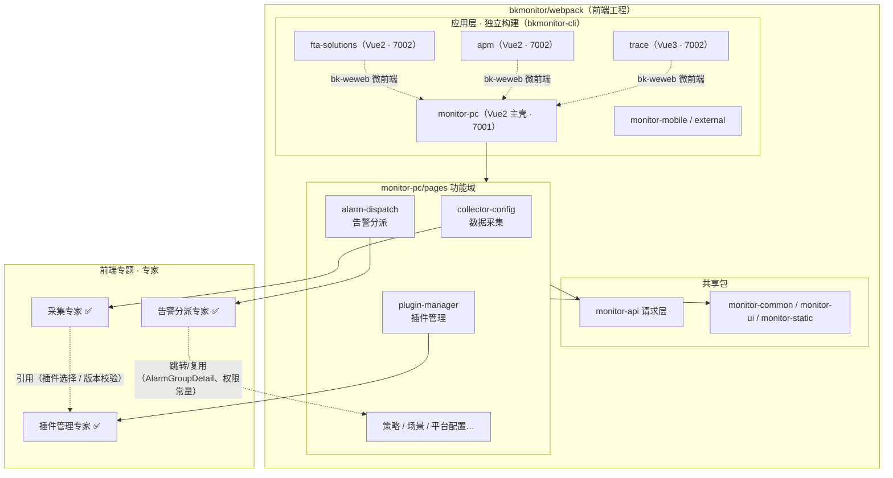

# T0-专题总览：前端专题

**本文引用的文件**
- [package.json](file://bkmonitor/webpack/package.json)
- [Makefile](file://bkmonitor/webpack/Makefile)
- [local-dev.md](file://bkmonitor/webpack/wikis/local-dev.md)
- [monitor-pc/index.ts](file://bkmonitor/webpack/src/monitor-pc/index.ts)
- [router-config.ts](file://bkmonitor/webpack/src/monitor-pc/router/router-config.ts)
- [collector-config.ts（路由）](file://bkmonitor/webpack/src/monitor-pc/router/integrated/collector-config.ts)
- [.fe-index/INDEX.md](file://bk-monitor-wiki/.fe-index/INDEX.md)
- [e2e/playwright.config.mjs](file://bkmonitor/webpack/e2e/playwright.config.mjs)

## 目录
1. [简介](#简介)
2. [专题能力清单](#专题能力清单)
3. [专题边界](#专题边界)
4. [工程形态与分层](#工程形态与分层)
5. [跨专家架构图](#跨专家架构图)
6. [专家导航](#专家导航)
7. [测试状态](#测试状态)

## 简介

前端专题覆盖 BK-Monitor 的 Web 前端工程 `bkmonitor/webpack/`：6 个可独立构建/启动的应用 + 4 个共享包，构建产物输出到 `bkmonitor/static/{monitor,weixin,fta,apm,trace,external}` 由 Django 侧托管。主应用 `monitor-pc`（Vue2）既是主壳（经 `@blueking/bk-weweb` 微前端挂载 trace / apm / fta 子应用），也承载策略、告警、采集、场景、平台配置等绝大部分管理界面。

专题采用「应用 → 功能域专家」的组织方式：每个专家覆盖 monitor-pc（或子应用）中一个业务功能域页面的契约与实现，供开发、排查、重构时取用。

章节来源：[package.json](file://bkmonitor/webpack/package.json)（关键符号：`pc:build`、`trace:build`）、[local-dev.md](file://bkmonitor/webpack/wikis/local-dev.md)（关键符号：`monitor-pc`、`7001`、`7002`）

## 专题能力清单

| 能力域 | 覆盖 | 用途 |
|--------|------|------|
| 主应用（monitor-pc） | `src/monitor-pc`（1826 文件） | 监控管理界面主壳：策略/告警/采集/场景/平台配置等 85 个页面文件、172 条路由条目 |
| Vue3 子应用（trace） | `src/trace`（1779 文件） | 主机监控新版、调用链检索、告警中心/屏蔽、RUM、Profiling、报表、轮值（微前端嵌入 monitor-pc） |
| APM / FTA 子应用 | `src/apm`（240）、`src/fta-solutions`（288） | 应用性能监控、故障自愈流程（微前端嵌入，页面可被 monitor-pc 路由注册） |
| 移动端 / 外部应用 | `src/monitor-mobile`（40）、`external`（复用 monitor-pc 源码，`APP=external` 构建） | H5 移动端（Vant）、对外独立入口 |
| 共享请求层 | `src/monitor-api`（72 文件） | `request('METHOD', 'path')` 声明式接口定义（`modules/*.js`）+ 统一 axios 封装（`base.ts`） |
| 共享组件/工具/静态资源 | `src/monitor-common`、`src/monitor-ui`、`src/monitor-static` | 工具函数、通用组件库（monitor-ui）、SVG 图标与样式 |

章节来源：[.fe-index/INDEX.md](file://bk-monitor-wiki/.fe-index/INDEX.md)（关键符号：`monitor-pc`、`页面文件 85 个`、`接口 338 个`）、[package.json](file://bkmonitor/webpack/package.json)（关键符号：`pc:dev`、`apm:dev`、`fta:dev`、`mobile:dev`、`external:dev`）

## 专题边界

- **覆盖**：`src/` 下 6 应用 + 共享包；本地 dev / 构建 / 测试基础设施（`webpack/`、`tests/`、`e2e/`、`Makefile`、`webpack.config.js`）。
- **不覆盖**：构建产物（`monitor/`、`weixin/`、`../static/*` 等输出目录）；后端 Django 侧模板与静态托管逻辑；Go 数据链路（独立仓库 `bkmonitor-datalink`）。
- **当前专家覆盖 monitor-pc 的 3 个功能域**（数据采集 / 指标插件管理 / 告警分派）：trace / apm / fta 应用与 monitor-pc 其余功能域（策略、场景、平台配置等）暂无专家，可后续按「应用 → 功能域专家」的同一组织方式扩展。
- **前端专家的特有形态**：本专题的专家契约层描述的是「页面路由契约 + 可复用组件契约 + 请求层契约」，而非后端类/方法；调用方代码即业务页面组件。

章节来源：[.fe-index/INDEX.md](file://bk-monitor-wiki/.fe-index/INDEX.md)（关键符号：`未建索引的应用`、`trace`、`apm`）

## 工程形态与分层

**多应用独立构建（`@blueking/bkmonitor-cli`）**：

| 应用 | 源码目录 | dev 命令 | 端口约定 |
|------|----------|----------|----------|
| monitor-pc（主应用，Vue2） | `src/monitor-pc` | `pnpm pc:dev` / `make dev-pc` | 7001（必须） |
| trace（Vue3） | `src/trace` | `pnpm trace:dev` / `make dev-vue3` | 7002 |
| apm（Vue2） | `src/apm` | `pnpm apm:dev` | 7002 |
| fta（Vue2） | `src/fta-solutions` | `pnpm fta:dev` | 7002 |
| mobile（H5，Vue2） | `src/monitor-mobile` | `pnpm mobile:dev` | 独立入口 |
| external（Vue2） | `src/monitor-pc`（`APP=external`） | `pnpm external:dev` | 独立入口 |

**微前端（`@blueking/bk-weweb`）**：monitor-pc 为主壳；trace / apm / fta 作为子应用被嵌入，monitor-pc 内子应用容器硬编码指向 `:7002`（dev 态），故「主应用 7001 先启动、子应用 7002 后启动」是本地开发硬约束（一次只能挂一个子应用）。

**技术栈**：Vue2（monitor-pc / apm / fta / mobile，`.vue` SFC + `.tsx` class component，bk-magic-vue，Vuex）与 Vue3（trace，TSX `defineComponent` + `setup`，Pinia，`shallowRef`）并存；`monitor-pc` 共享包按 Vue2/Vue3 适配入口分别消费。

**应用入口**（monitor-pc）：`src/monitor-pc/index.ts` —— 先 `Api.model.enhancedContext()` 拉取全局上下文（业务/空间/时区/各系统 URL）→ `assignWindowField` + `store.commit('app/SET_APP_STATE')` 注入 → `new Vue({ router, store, i18n })` 挂载 → 全局原型注入（`$api`/`$http`/`$authorityStore`/`$bus`）。

**路由与菜单**：`src/monitor-pc/router/`（按域分目录：`integrated/`、`manager/`、`scenes/`、`others/`、`platform-setting/`、`data-retrieval/`、`event/`、`home/`、`dashboard/`）+ `router/router-config.ts`（左侧导航菜单配置，`id/name/icon/path/href`）。

**请求层**：`src/monitor-api/modules/*.js` 以 `request('POST', 'rest/v2/xxx/')` 生成调用函数；`base.ts` 的 `request` 统一处理业务上下文注入（`needBiz`）、响应裁剪（`needRes`）、错误提示（`needMessage`/`noMessageCode`）、取消（`signal`/`cancelToken`）与 `traceparent` 注入。

章节来源：[monitor-pc/index.ts](file://bkmonitor/webpack/src/monitor-pc/index.ts)（关键符号：`enhancedContext`、`assignWindowField`、`SET_APP_STATE`）、[local-dev.md](file://bkmonitor/webpack/wikis/local-dev.md)（关键符号：`7001`、`7002`、`Access-Control-Allow-Origin`）

## 跨专家架构图

图表来源：[local-dev.md](file://bkmonitor/webpack/wikis/local-dev.md)（关键符号：`monitor-pc`、`trace`、`apm`、`fta`）、[collector-config.ts（路由）](file://bkmonitor/webpack/src/monitor-pc/router/integrated/collector-config.ts)（关键符号：`applyGuidePage`）

## 专家导航

| 专家 | 一句话职责 | 覆盖功能域 | 契约层 | 实现层 |
|------|------------|------------|--------|--------|
| [采集专家](采集专家/C0-使用总览.md) | 数据采集配置的前端全生命周期管理（列表/四步新建/详情/增删目标/启停升级/可视化/执行详情） | `src/monitor-pc/pages/collector-config`（9 条路由） | C0/C1/C2/C4/C5 | implementation/ 01~06 + test/ |
| [插件管理专家](插件管理专家/C0-使用总览.md) | 指标插件管理（列表 / 三步新建调试发布向导 / 详情 / 指标维度设置 / 导入导出） | `src/monitor-pc/pages/plugin-manager`（6 条路由） | C0/C1/C2/C4/C5 | implementation/ 01~06 |
| [告警分派专家](告警分派专家/C0-使用总览.md) | 告警自动分派配置（规则组列表 / 分派规则配置 / 条件编辑器 / 效果调试三态 / CSV 导入导出） | `src/monitor-pc/pages/alarm-dispatch`（2 条路由） | C0/C1/C2/C4/C5 | implementation/ 01~06 |

> 专家间协作关系：采集配置依赖插件（选择插件、`checkPluginVersion` 版本校验、插件详情/新建跳转），插件管理专家承接插件本体的管理链路（制作/调试/发布/指标维度）；双向关联与复用点（`PLUGIN_MANAGE_AUTH` 权限复用、`select-host`/`import-file`/`tag-switch` 组件复用）见两侧 C0 与 ki `关联关系/采集配置`。告警分派专家与告警组（`pages/alarm-group`，暂无专家）互为上下游：分派动作的目标是告警组，本模块复用其 `AlarmGroupDetail` 与权限常量，告警组页反向跳入本模块（`query.groupName`）——见告警分派专家 C0 与 ki `关联关系/告警分派`。

章节来源：[采集专家 agent.md](采集专家/agent.md)（关键符号：`采集专家`）、[告警分派专家 agent.md](告警分派专家/agent.md)（关键符号：`告警分派专家`）、[collector-config.ts（路由）](file://bkmonitor/webpack/src/monitor-pc/router/integrated/collector-config.ts)（关键符号：`CollectorConfig`）、[alarm-dispath.ts（路由）](file://bkmonitor/webpack/src/monitor-pc/router/manager/alarm-dispath.ts)（关键符号：`AlarmDispatch`）

## 测试状态

- **单元回归**：`bkmonitor/webpack/tests/`（Node 原生 `node:test`，直跑真实源码，不经打包），22 个文件；含采集专测 3 文件 28 用例（采集专家 `06-测试.md` 详载）。运行：`cd bkmonitor/webpack && node --test 'tests/**/*.test.cjs'`。
- **e2e**：`bkmonitor/webpack/e2e/`（Playwright 1.63.0，本地运行目录机制 `BKMONITOR_E2E_RUN_DIR`），仓库内**无入库用例**；自检 `pnpm e2e:doctor` 5/6 通过（缺 Chromium，`pnpm e2e:install` 修复）。
- **CI**：前端 `tests/` 无 CI 执行入口（本地手工回归）；`package.json` 的 `simple-git-hooks` 只做 pre-commit lint 与 commit-msg 校验。
- **本地开发硬约束**：主应用 7001 / 子应用 7002，先后顺序不可颠倒（详见 `wikis/local-dev.md`）。

章节来源：[e2e/playwright.config.mjs](file://bkmonitor/webpack/e2e/playwright.config.mjs)（关键符号：`BKMONITOR_E2E_RUN_DIR`、`testMatch`）、[package.json](file://bkmonitor/webpack/package.json)（关键符号：`e2e:doctor`、`simple-git-hooks`）

**出处行**：生成日期 2026-10-13（告警分派专家 2026-10-14 增补），git commit：ff89f63ff4（前端工程资产基线）
