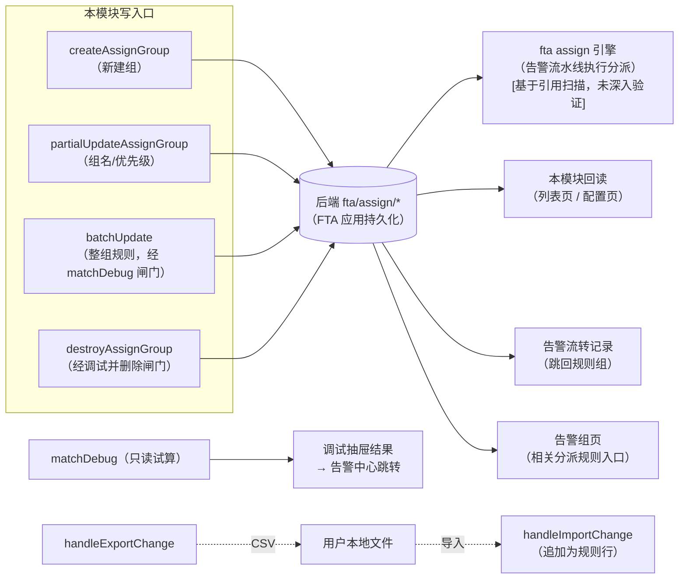

# 数据流向与消费：告警分派专家

> 契约快照生成于 2026-10-14（commit ff89f63ff4）。
> 若使用中发现行为与契约不符，可能代码已变更——expert-lookup 会自动增量修正，或用 expert-team 全量重建。
>
> 说明：本专家是前端功能域，**无自己的持久化存储**——数据实体为「前端提交给后端的分派配置」与「前端消费的回读/试算数据」两类，本文件按此口径记录流向与消费方。

## 数据实体清单

| 数据实体 | 产生入口（本模块） | 去向 | 消费方（模块/功能级） | 业务用途 |
|----------|--------------------|------|----------------------|----------|
| 分派规则组与规则配置（提交体：`rule_groups` + `rules` 结构） | `createAssignGroup`（新建组）、`partialUpdateAssignGroup`（组名/优先级）、`batchUpdate`（整组规则） | `fta/assign/*` → 后端（FTA 应用持久化） | **fta 后端 assign 引擎**（`AssignInfoEnricher` 在告警构建链中按优先级匹配条件并执行分派动作与内容调整 `[基于引用扫描，未深入验证]`）；本模块列表页/配置页回读展示；告警流转记录（跳回规则组的链接）；告警组管理页「相关分派规则」入口 | 定义「什么告警分派给哪些告警组、如何执行（通知/通知升级/ITSM 流程套餐）、是否调整等级/追加标签」，是告警自动分派的唯一配置载体 |
| 规则组删除动作 | `destroyAssignGroup`（仅经「调试并删除」链触发） | `DELETE fta/assign/rule_groups/{pk}/` → 后端 | 后端 assign 引擎（组内规则一并失效）；本模块列表页（重拉后消失） | 下线一条分派链路；**删除不可恢复**，故强制先经调试预览 |
| 调试试算请求与结果 | `DebuggingResult.getRuleMatchDebug`（`matchDebug`） | 不落库（只读试算）；结果留在前端内存 `resultsGroup` | 调试抽屉（命中告警三级折叠展示）；命中的告警可跳转告警中心 | 保存/删除前的「效果预览闸门」——让用户看到规则实际命中哪些告警（时间窗内前 1000 条） |
| CSV 规则文件 | `handleExportChange` → `downCsvFile`（下载 `{组名}-{时间戳}.csv`） | 用户本地文件系统 | 用户（留档/比对）；回流的 `handleImportChange`（`MonitorImport` 读取后 `csvToArr` 解析追加为规则行） | 规则的跨组/跨环境搬运与留档；导入不落库，仍走整组提交 |
| 前端会话内快照（无持久化） | 列表页 `cacheRuleGroups`（搜索过滤基线）；配置页 `cacheTableData`（进入时深拷贝快照）与 `resetConfig.cacheData`（逐行撤回基线） | 前端内存（刷新即丢） | 列表页搜索/清空搜索；配置页「撤回」（行级/批量）与 `isRuleChange` 离开判断 | 支撑「差异对比 + 逐行撤回 + 放弃修改确认」的编辑闭环 |
| 条件选项读数（字段 key / 值候选 / 二级选项 / 特殊选项） | 只读消费：`allKVOptions`（12 路并发）+ `setDimensionsOfStrategy`（策略维度按需加载） | 不落库；经 props 注入 `CommonCondition` | 条件编辑器（字段分类筛选、值多选、维度二级、策略联动、通知人员远程搜索）；调试抽屉与列表页的只读条件展示 | 让用户从「真实存在的字段/值」（CMDB 属性、策略、指标、标签 TopN…）中选择匹配条件，避免手填错误 |

## 数据流向图（黑盒级）

图表来源：[model.js](file://bkmonitor/webpack/src/monitor-api/modules/model.js)（关键符号：`createAssignGroup`、`partialUpdateAssignGroup`、`destroyAssignGroup`）、[assign.js](file://bkmonitor/webpack/src/monitor-api/modules/assign.js)（关键符号：`matchDebug`、`batchUpdate`）、[debugging-result.tsx](file://bkmonitor/webpack/src/monitor-pc/pages/alarm-dispatch/components/debugging-result.tsx)（关键符号：`getRuleMatchDebug`、`handleSave`）

## 消费方影响提示

- **保存才生效、且整组生效**：配置页所有编辑（含组名、优先级）在点「调试并生效」并确认前**不会产生任何写请求**；不存在「部分规则已保存」的中间态。
- **调试所见=保存所提交**：`matchDebug` 与 `batchUpdate` 消费同一份 `debugData`（见 C5 决策 1；debugging-result.tsx 的 props 注释原文「此为调试数据，保存时也用此数据」）。若变更提交体结构，两条链路必须同步。
- **删除不可恢复**：`destroyAssignGroup` 会连带删除组内规则；模块用「调试并删除」强制预览影响面（见 C5 决策 2）。后端 assign 引擎侧对该组的匹配立即失效 `[基于引用扫描，未深入验证]`。
- **调试为截断预览**：`matchDebug` 只返回时间窗内前 1000 条告警，命中条数不等于全量实际分派量。
- **组名/优先级行内编辑例外**：列表页的组名、优先级是**即时落库**（`partialUpdateAssignGroup`），与配置页「整组提交」形成两种写模式；改接口口径时注意区分。
- **规则配置的最终效果在告警处理链路**：后端 `AssignInfoEnricher`（docstring「告警分派动作」，`alarm_backends/service/alert/enricher/rule_assign.py`）在告警构建阶段执行本模块配置的规则，结果作用于告警的分派去向与展示 `[基于引用扫描，未深入验证]`；排查「配置了规则但告警没分派」需联合后端链路分析（后端侧入口见该文件）。
- **CSV 导入无校验兜底**：导入行直接追加进编辑态，字段合法性依赖后续编辑校验；跨版本 CSV（表头变化）会被静默忽略。
