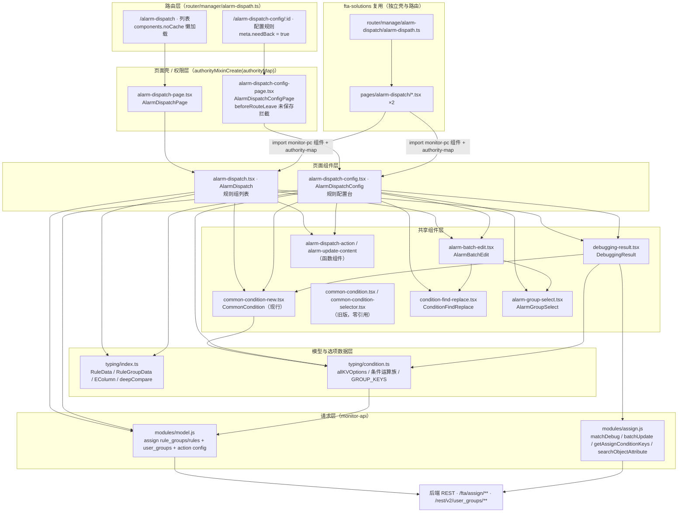
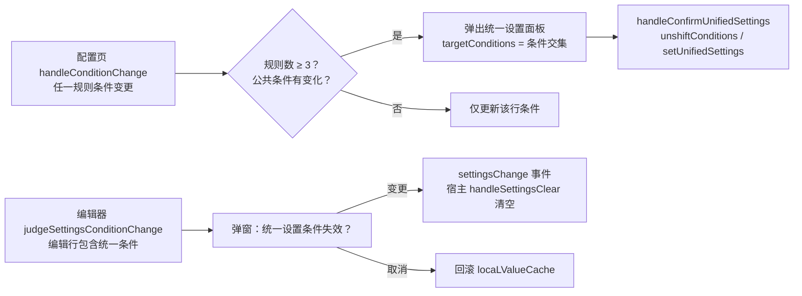
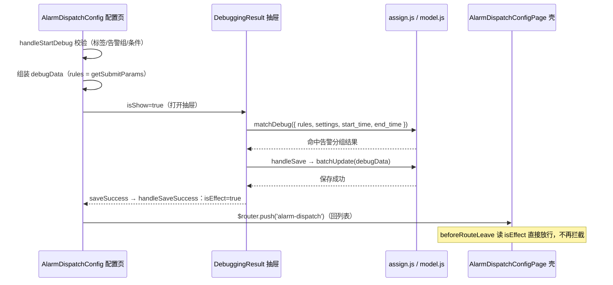
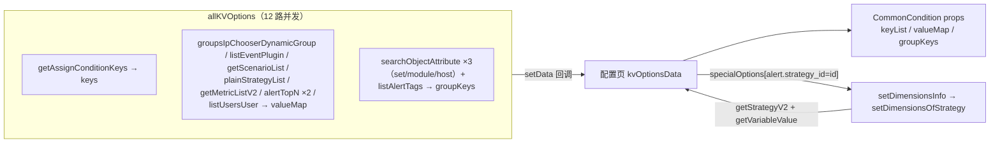
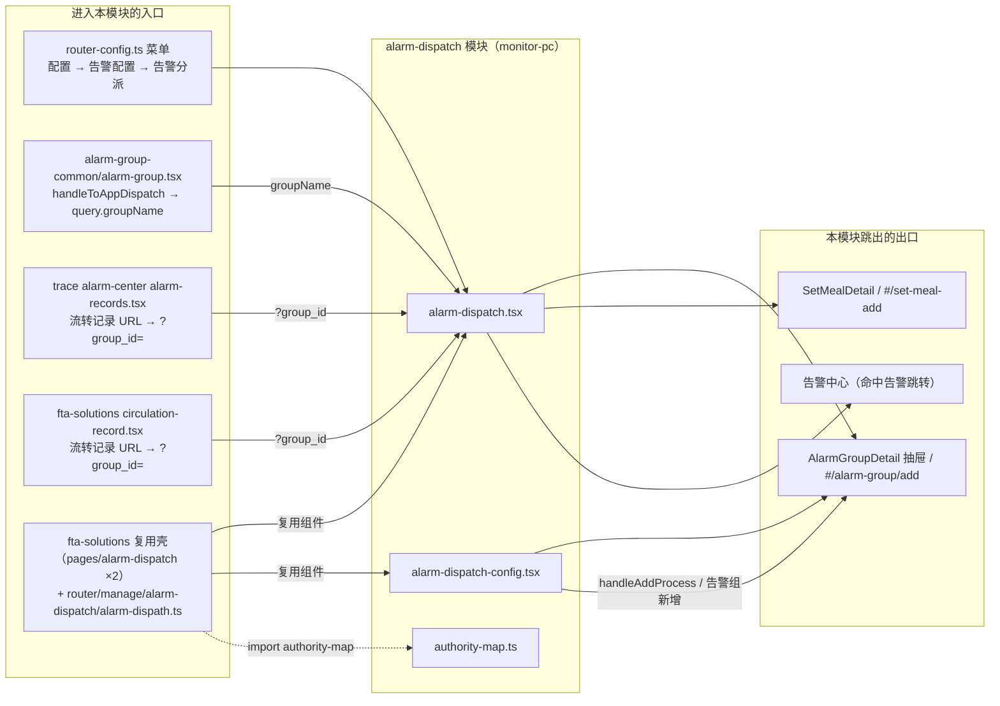

# 架构：告警分派专家 / 告警分派

**本文引用的文件**
- [alarm-dispatch/alarm-dispatch.tsx](file://bkmonitor/webpack/src/monitor-pc/pages/alarm-dispatch/alarm-dispatch.tsx)
- [alarm-dispatch/alarm-dispatch-config.tsx](file://bkmonitor/webpack/src/monitor-pc/pages/alarm-dispatch/alarm-dispatch-config.tsx)
- [alarm-dispatch/alarm-dispatch-page.tsx](file://bkmonitor/webpack/src/monitor-pc/pages/alarm-dispatch/alarm-dispatch-page.tsx)
- [alarm-dispatch/alarm-dispatch-config-page.tsx](file://bkmonitor/webpack/src/monitor-pc/pages/alarm-dispatch/alarm-dispatch-config-page.tsx)
- [alarm-dispatch/authority-map.ts](file://bkmonitor/webpack/src/monitor-pc/pages/alarm-dispatch/authority-map.ts)
- [alarm-dispatch/typing/index.ts](file://bkmonitor/webpack/src/monitor-pc/pages/alarm-dispatch/typing/index.ts)
- [alarm-dispatch/typing/condition.ts](file://bkmonitor/webpack/src/monitor-pc/pages/alarm-dispatch/typing/condition.ts)
- [alarm-dispatch/components/alarm-batch-edit.tsx](file://bkmonitor/webpack/src/monitor-pc/pages/alarm-dispatch/components/alarm-batch-edit.tsx)
- [alarm-dispatch/components/alarm-dispatch-action.tsx](file://bkmonitor/webpack/src/monitor-pc/pages/alarm-dispatch/components/alarm-dispatch-action.tsx)
- [alarm-dispatch/components/alarm-group-select.tsx](file://bkmonitor/webpack/src/monitor-pc/pages/alarm-dispatch/components/alarm-group-select.tsx)
- [alarm-dispatch/components/alarm-update-content.tsx](file://bkmonitor/webpack/src/monitor-pc/pages/alarm-dispatch/components/alarm-update-content.tsx)
- [alarm-dispatch/components/common-condition-new.tsx](file://bkmonitor/webpack/src/monitor-pc/pages/alarm-dispatch/components/common-condition-new.tsx)
- [alarm-dispatch/components/common-condition.tsx（旧版）](file://bkmonitor/webpack/src/monitor-pc/pages/alarm-dispatch/components/common-condition.tsx)
- [alarm-dispatch/components/common-condition-selector.tsx（旧版）](file://bkmonitor/webpack/src/monitor-pc/pages/alarm-dispatch/components/common-condition-selector.tsx)
- [alarm-dispatch/components/condition-find-replace.tsx](file://bkmonitor/webpack/src/monitor-pc/pages/alarm-dispatch/components/condition-find-replace.tsx)
- [alarm-dispatch/components/debugging-result.tsx](file://bkmonitor/webpack/src/monitor-pc/pages/alarm-dispatch/components/debugging-result.tsx)
- [router/manager/alarm-dispath.ts](file://bkmonitor/webpack/src/monitor-pc/router/manager/alarm-dispath.ts)
- [router/router-config.ts](file://bkmonitor/webpack/src/monitor-pc/router/router-config.ts)
- [mixins/authorityMixin.ts](file://bkmonitor/webpack/src/monitor-pc/mixins/authorityMixin.ts)
- [alarm-group/authority-map.ts](file://bkmonitor/webpack/src/monitor-pc/pages/alarm-group/authority-map.ts)
- [alarm-group/alarm-group-detail/alarm-group-detail.tsx](file://bkmonitor/webpack/src/monitor-pc/pages/alarm-group/alarm-group-detail/alarm-group-detail.tsx)
- [alarm-group/alarm-group-common/alarm-group.tsx](file://bkmonitor/webpack/src/monitor-pc/pages/alarm-group/alarm-group-common/alarm-group.tsx)
- [strategy-config/strategy-config-set-new/components/alarm-group.tsx](file://bkmonitor/webpack/src/monitor-pc/pages/strategy-config/strategy-config-set-new/components/alarm-group.tsx)
- [strategy-config/strategy-config-set-new/components/verify-item.tsx](file://bkmonitor/webpack/src/monitor-pc/pages/strategy-config/strategy-config-set-new/components/verify-item.tsx)
- [strategy-config/strategy-config-set-new/components/horizontal-scroll-container.tsx](file://bkmonitor/webpack/src/monitor-pc/pages/strategy-config/strategy-config-set-new/components/horizontal-scroll-container.tsx)
- [strategy-config/strategy-config-set-new/components/select-menu.tsx](file://bkmonitor/webpack/src/monitor-pc/pages/strategy-config/strategy-config-set-new/components/select-menu.tsx)
- [alarm-shield/components/simple-select-input.tsx](file://bkmonitor/webpack/src/monitor-pc/pages/alarm-shield/components/simple-select-input.tsx)
- [custom-escalation/utils.ts](file://bkmonitor/webpack/src/monitor-pc/pages/custom-escalation/utils.ts)
- [view-detail/utils.ts](file://bkmonitor/webpack/src/monitor-pc/pages/view-detail/utils.ts)
- [utils/index.ts（getEventPaths）](file://bkmonitor/webpack/src/monitor-pc/utils/index.ts)
- [components/empty-status/empty-status.tsx](file://bkmonitor/webpack/src/monitor-pc/components/empty-status/empty-status.tsx)
- [components/skeleton/table-skeleton.tsx](file://bkmonitor/webpack/src/monitor-pc/components/skeleton/table-skeleton.tsx)
- [components/time-range/time-range.tsx](file://bkmonitor/webpack/src/monitor-pc/components/time-range/time-range.tsx)
- [components/monitor-import/monitor-import.vue](file://bkmonitor/webpack/src/monitor-pc/components/monitor-import/monitor-import.vue)
- [components/ip-selector/common/util.ts](file://bkmonitor/webpack/src/monitor-pc/components/ip-selector/common/util.ts)
- [monitor-api/modules/model.js](file://bkmonitor/webpack/src/monitor-api/modules/model.js)
- [monitor-api/modules/assign.js](file://bkmonitor/webpack/src/monitor-api/modules/assign.js)
- [fta-solutions/pages/alarm-dispatch/alarm-dispatch.tsx](file://bkmonitor/webpack/src/fta-solutions/pages/alarm-dispatch/alarm-dispatch.tsx)
- [fta-solutions/pages/alarm-dispatch/alarm-dispatch-config.tsx](file://bkmonitor/webpack/src/fta-solutions/pages/alarm-dispatch/alarm-dispatch-config.tsx)
- [fta-solutions/router/manage/alarm-dispatch/alarm-dispath.ts](file://bkmonitor/webpack/src/fta-solutions/router/manage/alarm-dispatch/alarm-dispath.ts)
- [fta-solutions/pages/event/event-detail/circulation-record.tsx](file://bkmonitor/webpack/src/fta-solutions/pages/event/event-detail/circulation-record.tsx)
- [fta-solutions/pages/setting/set-meal-detail/set-meal-detail.tsx](file://bkmonitor/webpack/src/fta-solutions/pages/setting/set-meal-detail/set-meal-detail.tsx)
- [trace/pages/alarm-center/common-detail/components/alarm-view/alarm-records.tsx](file://bkmonitor/webpack/src/trace/pages/alarm-center/common-detail/components/alarm-view/alarm-records.tsx)

## 目录
1. [简介](#简介)
2. [项目结构](#项目结构)
3. [核心组件](#核心组件)
4. [架构总览](#架构总览)
5. [组件详细分析](#组件详细分析)
6. [依赖关系分析](#依赖关系分析)
7. [结论](#结论)
8. [实现层切面索引](#实现层切面索引)

## 简介

「告警分派专家」对应蓝鲸监控 monitor-pc 前端应用的**告警分派**功能域，模块根目录为 `bkmonitor/webpack/src/monitor-pc/pages/alarm-dispatch/`（16 个 `.ts/.tsx` 源文件 / 9390 行 + 11 个 `.scss`），是 Vue2 主应用内的 `.tsx` class component（`vue-property-decorator` + `vue-tsx-support`）技术栈。

**职责边界（做什么）**：
- **规则组管理（列表页 `/alarm-dispatch`）**：规则组的新建、删除（调试并删除）、组名/优先级就地编辑、展开收起、关键字搜索（前端过滤）、全局效果调试；
- **分派规则配置（配置页 `/alarm-dispatch-config/:id`）**：规则增删复制改、匹配条件编辑（tag 式条件编辑器）、统一设置（公共条件下发）、告警组选择、分派动作（通知 / 通知升级 / ITSM 流程套餐）、修改告警内容（等级调整 `alert_severity` + 追加标签 `additional_tags`）、启停开关、CSV 导入导出、逐格变更追踪与撤回、批量编辑、查找替换、调试并生效；
- **效果调试（`DebuggingResult`）**：以时间窗口（默认 `now-7d ~ now`）调用 `match_debug` 预览命中告警，是「生效」与「删除」两个关键动作的统一前置闸门。

**职责边界（不做什么）**：
- 不做规则的**后端执行**——条件匹配与分派动作由 fta 后端 `assign` 引擎执行，本模块只负责配置与调试展示；
- 不做**告警组本体管理**——告警组增删改查属 `pages/alarm-group`（本模块仅复用其 `AlarmGroupDetail` 详情抽屉、权限常量，并在新窗口跳转 `#/alarm-group/add`）；
- 不做**流程套餐（ITSM）管理**——套餐增删改属 set-meal（`fta-solutions/pages/setting/set-meal-detail`），本模块仅以 `SetMealDetail` 只读展示详情、新窗口跳转 `#/set-meal-add`；
- 不做**告警中心事件详情**——调试命中的告警仅跳转告警中心（`getAlarmCenterListUrl`）；
- 不做平台侧权限判定——交由 `authorityMixin` + `authority/checkAllowedByActionIds` 接口统一判定（复用告警组权限体系）。

**权限常量**（authority-map.ts）：

| 常量 | 值 | 用途 |
|------|----|------|
| `MANAGE_ACTION_CONFIG` | `manage_rule_v2` | 规则（套餐）配置管理权限 |
| `ALARM_GROUP_MANAGE_AUTH` | `manage_notify_team_v2`（自 `../alarm-group/authority-map` 的 `MANAGE_AUTH` 别名导入） | 复用「告警组管理」权限 |

> 注意：主键 `MANAGE_ACTION_CONFIG` 在 authority-map.ts 中的注释为「套餐管理权限」，实际 action id 是 `manage_rule_v2`（规则配置管理），注释与语义存在历史偏差。

章节来源：[authority-map.ts](file://bkmonitor/webpack/src/monitor-pc/pages/alarm-dispatch/authority-map.ts)（关键符号：`MANAGE_ACTION_CONFIG`、`ALARM_GROUP_MANAGE_AUTH`）；[alarm-group/authority-map.ts](file://bkmonitor/webpack/src/monitor-pc/pages/alarm-group/authority-map.ts)（关键符号：`MANAGE_AUTH`）

## 项目结构

```
pages/alarm-dispatch/
├── alarm-dispatch-page.tsx          # 列表页权限壳（37 行）：authorityMixinCreate(authorityMap) + 渲染 AlarmDispatch
├── alarm-dispatch.tsx               # 列表页（1006 行）：规则组卡片列表/搜索/排序/就地编辑/展开收起/效果调试/新建
├── alarm-dispatch-config-page.tsx   # 配置页权限壳（79 行）：authorityMixin + beforeRouteLeave 未保存拦截
├── alarm-dispatch-config.tsx        # 配置页（1922 行，模块最大）：自绘表格 + 变更追踪 + 统一设置 + 导入导出 + 调试并生效
├── authority-map.ts                 # 2 个权限常量（复用告警组 MANAGE）
├── typing/
│   ├── index.ts                     # RuleData / RuleGroupData 模型、EColumn / LEVELLIST / deepCompare / 动作类型
│   └── condition.ts                 # 选项聚合 allKVOptions（12 路并发）+ 条件运算族 + GROUP_KEYS / KEY_TAG_MAPS
└── components/
    ├── common-condition-new.tsx      # 条件编辑器（1894 行，现行）：tag 流式编辑、二级选项、统一设置冲突检测、只读模式
    ├── common-condition.tsx          # 条件编辑器（1497 行，旧版遗留，模块内零引用）
    ├── common-condition-selector.tsx # 条件选择器（327 行，旧版遗留，仅被 condition-find-replace 注释引用）
    ├── alarm-batch-edit.tsx          # 批量编辑 popover（595 行）：列表页/配置页双端复用，11 种 filed
    ├── condition-find-replace.tsx    # 查找替换面板（101 行）：find/replace 两组条件输入
    ├── debugging-result.tsx          # 调试结果抽屉（418 行）：matchDebug / batchUpdate / destroyAssignGroup
    ├── alarm-group-select.tsx        # 告警组多选（179 行）：tag 触发 + 新增/刷新扩展
    ├── alarm-dispatch-action.tsx     # 函数组件：分派动作展示（通知/升级/流程/人员类型）
    └── alarm-update-content.tsx      # 函数组件：修改告警内容展示（等级调整 + 追加标签）
```

外部关联资产（不在模块目录内，但属于本功能域）：
- 路由：[router/manager/alarm-dispath.ts](file://bkmonitor/webpack/src/monitor-pc/router/manager/alarm-dispath.ts)（2 条路由，`components.noCache` 懒加载挂载，注意文件名拼写 `dispath`）；菜单：[router/router-config.ts](file://bkmonitor/webpack/src/monitor-pc/router/router-config.ts)（`manager`（配置）→ `monitor`（告警配置）→ `alarm-dispatch`（告警分派），`canStore: true`）；
- fta-solutions 侧复用：[pages/alarm-dispatch/alarm-dispatch.tsx](file://bkmonitor/webpack/src/fta-solutions/pages/alarm-dispatch/alarm-dispatch.tsx) / [alarm-dispatch-config.tsx](file://bkmonitor/webpack/src/fta-solutions/pages/alarm-dispatch/alarm-dispatch-config.tsx)（两个壳 import monitor-pc 组件 + `authority-map`）+ [router/manage/alarm-dispatch/alarm-dispath.ts](file://bkmonitor/webpack/src/fta-solutions/router/manage/alarm-dispatch/alarm-dispath.ts)（同构的 2 条路由）；
- 请求层：[monitor-api/modules/model.js](file://bkmonitor/webpack/src/monitor-api/modules/model.js)（`fta/assign/rule_groups` / `rule_groups` PATCH / `fta/assign/rules`、`rest/v2/user_groups`、`fta/action/config` 系列）+ [monitor-api/modules/assign.js](file://bkmonitor/webpack/src/monitor-api/modules/assign.js)（4 个动作接口）。

章节来源：[alarm-dispath.ts](file://bkmonitor/webpack/src/monitor-pc/router/manager/alarm-dispath.ts)（关键符号：`AlarmDispatch`、`AlarmDispatchConfig`）；[alarm-dispatch.tsx](file://bkmonitor/webpack/src/monitor-pc/pages/alarm-dispatch/alarm-dispatch.tsx)（关键符号：`AlarmDispatch`）

## 核心组件

| 组件 / 文件 | 挂载路由或宿主 | 一句话职责 |
|------------|---------------|-----------|
| `AlarmDispatchPage`（alarm-dispatch-page.tsx） | `/alarm-dispatch` | 权限壳：`authorityMixinCreate(authorityMap)` 注入 `authority` / `handleShowAuthorityDetail` 后渲染列表页 |
| `AlarmDispatchConfigPage`（alarm-dispatch-config-page.tsx） | `/alarm-dispatch-config/:id` | 权限壳 + **离开拦截**：`isEffect` 直接放行；`isRuleChange` 弹「是否放弃本次操作？」；`to.params.refresh` 放行 |
| `AlarmDispatch`（alarm-dispatch.tsx） | 列表页 | 规则组折叠卡片列表：IntersectionObserver 懒渲染（每次 2 组）、前端搜索（tag/告警组名/组 id）、组名&优先级 popover 就地编辑（`partialUpdateAssignGroup`）、新建（优先级自动取 5 的倍数、上限 10000）、删除（走「调试并删除」）、全局「效果调试」 |
| `AlarmDispatchConfig`（alarm-dispatch-config.tsx） | 配置页 | 自绘 `<table>` 规则编辑台：11 列（含 select/operate）、`processList` 流程头（4 步）、列合并开关（通知&流程、等级&标签）、批量行、逐格变更标记与撤回、统一设置、CSV 导入导出、调试并生效（`isEffect`/`isRuleChange` 供壳读取） |
| `CommonCondition`（common-condition-new.tsx，**现行**） | 列表页只读展示 / 配置页编辑 / 调试结果 / 查找替换 / 统一设置 | tag 式条件编辑器：condition/key/method/value/input 五种 tag 流式拼接；二级选项（`groupKeys`）与策略特殊选项（`specialOptions`）；统一设置冲突弹窗；编辑器内校验（必填/重复/name 冲突） |
| `CommonCondition`（common-condition.tsx，**旧版遗留**） | 无（模块内零引用） | 上一代 tag 条件编辑器（1497 行），props 契约相近但缺少 `isFormMode`/`replaceData`/`refreshStrategyList` 等能力 |
| `CommonConditionSelector`（common-condition-selector.tsx，**旧版遗留**） | 无（仅被查找替换文件注释引用） | 最早期「下拉行」式条件选择器（SimpleSelectInput + tag-input），复用 alarm-shield / strategy-config 组件 |
| `AlarmBatchEdit`（alarm-batch-edit.tsx） | 列表页（isListPage=true）/ 配置页 popover | 批量编辑公共面板：`filed ∈ {name, priority, userGroups, conditions, alertSeverity, alertSeveritySingle, additionalTags, actionId, upgradeConfig, notice, isEnabled}`；优先级 10000 上限与冲突校验；通知升级联动校验 |
| `ConditionFindReplace`（condition-find-replace.tsx） | 批量编辑 conditions 场景 | 查找/替换双条件输入，产出 `findData/replaceData` 交由 `RuleData.setFindReplace` 运算 |
| `DebuggingResult`（debugging-result.tsx） | 列表页 / 配置页抽屉 | 调试结果抽屉：`matchDebug` 预览命中；`batchUpdate` 保存生效；`destroyAssignGroup` 调试并删除；`TimeRange` 时间窗；命中告警表可跳告警中心 |
| `AlarmGroupSelect`（alarm-group-select.tsx） | 配置页单元格 / 批量编辑 | 告警组多选（bk-select + trigger tag 列表 + extension「新增告警组/刷新」） |
| `AlarmDispatchAction`（函数组件） | 列表页「分派动作」列 | 展示 notice/itsm 动作摘要 + 通知人员类型（main/follower） |
| `AlarmUpdateContent`（函数组件） | 列表页「修改告警内容」列 | 展示等级调整（`LEVELLIST` 图标色）与追加标签 |

章节来源：[alarm-dispatch-config-page.tsx](file://bkmonitor/webpack/src/monitor-pc/pages/alarm-dispatch/alarm-dispatch-config-page.tsx)（关键符号：`beforeRouteLeave`、`confirmDialog`）；[common-condition-new.tsx](file://bkmonitor/webpack/src/monitor-pc/pages/alarm-dispatch/components/common-condition-new.tsx)（关键符号：`CommonCondition`、`handleConditionToTagList`、`judgeSettingsConditionChange`）；[alarm-batch-edit.tsx](file://bkmonitor/webpack/src/monitor-pc/pages/alarm-dispatch/components/alarm-batch-edit.tsx)（关键符号：`AlarmBatchEdit`、`configFiled`、`handleSubmit`）

## 架构总览



图表来源：[alarm-dispath.ts](file://bkmonitor/webpack/src/monitor-pc/router/manager/alarm-dispath.ts)、[alarm-dispatch-page.tsx](file://bkmonitor/webpack/src/monitor-pc/pages/alarm-dispatch/alarm-dispatch-page.tsx)、[alarm-dispatch-config-page.tsx](file://bkmonitor/webpack/src/monitor-pc/pages/alarm-dispatch/alarm-dispatch-config-page.tsx)（关键符号：`AlarmDispatchPage`、`AlarmDispatchConfigPage`、`AlarmDispatch`、`AlarmDispatchConfig`）

分层要点：
1. **路由层**：2 条路由均为 `components: { noCache: ... }` 形态（编辑类页面不走 keep-alive 缓存），`meta.navId` 统一 `alarm-dispatch`（菜单归属），配置页 `meta.needBack: true`（显示返回）；路由文件命名沿用历史拼写 `alarm-dispath`。**未走** `applyGuidePage` 包装（无引导页注入）。
2. **页面壳 / 权限层**：两个壳都用工厂函数 `authorityMixinCreate(authorityMap)` 生成 mixin——构造时按 authority-map 导出名初始化 `authority` 对象，`created` 批量调 `checkAllowedByActionIds` 并经 `common/auth-store` 缓存，`@ProvideReactive('authority')` / `@Provide('handleShowAuthorityDetail')` 下发；配置页壳额外承担**路由离开拦截**（见设计维度一）。
3. **页面组件层**：列表页与配置页互不引用，通过 `$router`（`alarm-dispatch` ↔ `alarm-dispatch-config/:id`）与路由 query（`groupName` / `group_id`）协作；两页均 `$Inject('authority')` / `$Inject('handleShowAuthorityDetail')`（当前为预留注入，见「常见坑」）。
4. **共享组件层**：条件编辑器族三代并存（现行 `common-condition-new` 与两条零引用遗留链）；批量编辑面板一套组件双端复用（`isListPage` 切换语义）；调试抽屉被两页共用。
5. **模型与选项数据层**：`RuleData / RuleGroupData` 承载前端全量状态（含 `config`/`verificatory`/`resetConfig` 变更标记），`condition.ts` 聚合选项数据并沉淀纯函数条件运算族。
6. **请求层**：`model.js`（RESTful 资源型：rule_groups / rules / user_groups / action config）+ `assign.js`（动作型：match_debug / batch_update）。

章节来源：[authorityMixin.ts](file://bkmonitor/webpack/src/monitor-pc/mixins/authorityMixin.ts)（关键符号：`authorityMixinCreate`、`handleInitPageAuthority`、`handleShowAuthorityDetail`）；[alarm-dispath.ts](file://bkmonitor/webpack/src/monitor-pc/router/manager/alarm-dispath.ts)（关键符号：`AlarmDispatchPage`、`AlarmDispatchConfigPage`）

## 组件详细分析

### 设计维度一：列表页与配置页的「双页协作 + 逐格变更追踪」

两个页面围绕「规则组」这一聚合根分工；配置页内部的**变更追踪体系**是整个模块最复杂的机制：

- **双页协作**：列表页 `handleToConfig(id)` 跳配置页；配置页「取消/保存成功」回列表。列表页读取路由 query（`getRouteParams`）：外部入口携带 `groupName`（来自告警组模块）或 `group_id`（来自流转记录链接）时预填搜索词，实现「从告警组/流转记录直达相关规则组」。
- **变更标记三层结构**（配置页）：
  1. `cacheTableData`：进入页面时的规则快照（`deepClone(this.tableData)`）；
  2. `resetConfig[index] = { disabled, cacheData }`：**行级**变更（`handleDiffRuleData` 对 6 个字段做键序归一化后 `deepCompare`，`disabled:false` 表示与快照有差异），驱动「撤回」按钮可用性与 `isRuleChange`；
  3. `RuleData.config[field]`：**格级**变更（`handleDiffRuleItemChange` 单字段对比），驱动 `getRuleItemType` 的五态着色（`rule-initial` 空组初始 / `rule-add` 新增或复制 / `rule-change` 有变更 / `rule-verification` 校验失败 / `rule-common`）。
- **行身份识别**：`handleDiffRuleItemChange` / `handleTableDataChange` 按三级身份回溯快照——`id`（DB 现有）→ `addId`（新增，`random(8)`）→ `copyId`（复制，`setCopyID`），保证三种来源的行都能正确对比。
- **离开拦截（不变量）**：配置页壳 `beforeRouteLeave` 中，`isEffect`（已生效保存）直接放行；否则若 `isRuleChange`（行数变化或任一行 `!disabled`）弹 `confirmDialog`「是否放弃本次操作？」由用户决定；`to.params.refresh` 用于内部刷新跳转豁免拦截。`isEffect` / `isRuleChange` 通过壳上的 `$refs.alarmDispatchConfig` 反向读取页面组件 getter，是「壳读页面状态」的固定模式。
- **数据加载**：配置页 `created` 五连发（`getKVOptionsData` / `getAlarmGroupList` / `getProcessPackage` / `getAlarmDispatchGroupData` / `getAlarmAssignGroupsRules`）；无规则时初始化为「一条空规则」（`new RuleData({ addId: random(8), isEnabled: true })`，`isNullData` 为真），并自动开启两组列合并、调整 `processList` colspan。
- **空组保护**：删除到只剩一条时不是清空而是回退到「空组初始态」（`handleOperateAction('delete')` / `batchDelete` 均如此），保证始终有一行可编辑。

章节来源：[alarm-dispatch-config.tsx](file://bkmonitor/webpack/src/monitor-pc/pages/alarm-dispatch/alarm-dispatch-config.tsx)（关键符号：`handleDiffRuleData`、`handleDiffRuleItemChange`、`getRuleItemType`、`isRuleChange`、`handleOperateAction`）；[alarm-dispatch.tsx](file://bkmonitor/webpack/src/monitor-pc/pages/alarm-dispatch/alarm-dispatch.tsx)（关键符号：`getRouteParams`、`handleToConfig`）；[alarm-dispatch-config-page.tsx](file://bkmonitor/webpack/src/monitor-pc/pages/alarm-dispatch/alarm-dispatch-config-page.tsx)（关键符号：`beforeRouteLeave`）

### 设计维度二：条件编辑器三代并存与「统一设置」共识机制

**三代实现**（同一 `ICondtionItem[]` 数据契约）：

| 代次 | 文件 | 交互形态 | 状态 |
|------|------|---------|------|
| 第一代 | `common-condition-selector.tsx` | 行式下拉（SimpleSelectInput + 原生 tag 输入 + SelectMenu） | 遗留（零引用） |
| 第二代 | `common-condition.tsx` | tag 流式（无 `isFormMode` / `replaceData`） | 遗留（零引用） |
| 第三代（现行） | `common-condition-new.tsx` | tag 流式 + 二级选项 + 统一设置冲突 + 只读模式 + 策略刷新 | 全部 5 个使用点（列表页只读/配置页/调试结果/查找替换/统一设置） |

**现行编辑器核心设计**（`common-condition-new.tsx`）：
- **tag 序列模型**：`ITagItem.tags = [condition?, key, method, value...]`，`handleConditionToTagList` 把 `ICondtionItem[]` 双向映射为 tag 列表与弹出层数据；`emitValue` 过滤 `value` 非空的行回写。
- **二级选项**：`GROUP_KEYS = ['dimensions','tags','set','module','host']` 命中时 `isGroupKey` 展开右侧二级弹层（`keyListSecond`，维度支持「直接输入」自定义维度 `handleSelectCustomDimension`）；key 筛选标签按 `KEY_TAG_MAPS` 分类（全部 / CMDB属性 / 告警策略 / 告警事件）。
- **空值互斥**：value 选项含 `-空-`（`nullOption`），选中即清空其他值并将条件值置 `['']`，与常规值互斥（`handleSelectValue` / `handleValueChange` 两处对称处理）。
- **策略联动**：key 为 `alert.strategy_id` 时展示策略名/ID/「未开启」标记与跳转链接（`handleLinkToStrategy` → `strategy-config-detail`），并提供「刷新列表」（`handleRefreshStrategyList` → 父级 `refreshStrategyList` prop）；维度值通过 `specialOptions` 按 `${key}=${value}` 命中注入（见设计维度四）。
- **编辑器内校验**：`validate`（必填，`locaLValue` 为空）、`getHasRepeatData`（两两 `conditionCompare`）、`validateConditionsRepeatKey`（同 key 冲突「注意: 名字冲突」），事件 `onValidate` / `onRepeat` 回传宿主行。
- **只读模式**：`readonly=true` 时 `canNotClick` 短路全部交互，用于列表页「匹配规则」列与调试结果展示。

**统一设置（公共条件）机制**（跨组件协作，属本模块独有设计）：
1. 配置页 `unifiedSettings.conditions` 为「已生效的统一条件」，`unifiedSettingInit` 在 `settings.public_conditions` 为真时用 `statisticsSameConditions`（所有规则条件的**交集**，任一条为空集则返回空）反推；
2. 编辑某条规则条件后 `handleClickUnifiedSetting(true)`：当规则数 ≥ 3 且新出现的公共条件与已设置不一致时，自动弹出统一设置面板提示纳入；
3. **反向冲突检测**：编辑器内 `judgeSettingsConditionChange` 检测当前编辑行是否包含统一条件（`conditionsInclues`），若是则弹「变更当前值将会使[统一设置条件失效]，是否确定变更？」——确认走 `settingsChange` 事件（宿主 `handleSettingsClear` 清空统一设置），取消回滚本地缓存 `locaLValueCache`；
4. 提交时以 `settings: { public_conditions: !!unifiedSettings.conditions.length }` 告知后端「规则含公共条件」语义（影响后端存储与回显策略）；
5. 应用统一条件有两条路径：`unshiftConditions`（无条件差异时前置合并）与 `setUnifiedSettings`（包含则替换、有差异则合并），均经 `conditionsDeduplication` + `mergeConditions` 收敛。

条件运算族（`typing/condition.ts` 纯函数）是上述机制的底座：`conditionCompare`（含 value 排序后比较）、`conditionsInclues`（包含判定）、`conditionsDeduplication`（去重）、`mergeConditions`（同 field+method 值合并）、`conditionFindReplace`（查找替换：全部 find 命中才替换，`isUnshift` 控制插入头部或原位）、`topNDataStrTransform`（剥离 topN 字符串首尾引号）。



图表来源：[alarm-dispatch-config.tsx](file://bkmonitor/webpack/src/monitor-pc/pages/alarm-dispatch/alarm-dispatch-config.tsx)（关键符号：`handleClickUnifiedSetting`、`handleConfirmUnifiedSettings`）；[common-condition-new.tsx](file://bkmonitor/webpack/src/monitor-pc/pages/alarm-dispatch/components/common-condition-new.tsx)（关键符号：`judgeSettingsConditionChange`、`handleSettingsPopConfirm`、`handleSettingsPopCancel`）

章节来源：[common-condition-new.tsx](file://bkmonitor/webpack/src/monitor-pc/pages/alarm-dispatch/components/common-condition-new.tsx)（关键符号：`CommonCondition`、`handleSelectValue`、`judgeSettingsConditionChange`）；[condition.ts](file://bkmonitor/webpack/src/monitor-pc/pages/alarm-dispatch/typing/condition.ts)（关键符号：`statisticsSameConditions`、`conditionFindReplace`、`mergeConditions`、`GROUP_KEYS`）；[alarm-dispatch-config.tsx](file://bkmonitor/webpack/src/monitor-pc/pages/alarm-dispatch/alarm-dispatch-config.tsx)（关键符号：`unifiedSettingInit`、`handleConfirmUnifiedSettings`、`handleSettingsClear`）

### 设计维度三：调试链路的三种角色——全局调试 / 调试并删除 / 调试并生效

`DebuggingResult`（bk-sideslider 抽屉）是模块唯一的「动作确认闸门」，按入参切换三种角色：

| 角色 | 触发方 | 入参 | 保存动作 |
|------|--------|------|---------|
| 全局效果调试 | 列表页 `handleDebug`（按钮「效果调试」） | `ruleGroupsData: []`、`excludeGroups: []` | 无保存按钮（仅预览全部分派结果） |
| 调试并删除 | 列表页 `handleDeleteGroup`（okText「调试并删除」） | `excludeGroups: [id]` | `handleSave` → `destroyAssignGroup(excludeGroups[0])` → `delSuccess`（列表页 `handleDelSucess` 刷新） |
| 调试并生效 | 配置页 `handleStartDebug`（按钮「调试并生效」） | `ruleGroupsData: [debugData]` | `handleSave` → `batchUpdate(params)` → `saveSuccess`（配置页 `handleSaveSuccess`：`isEffect = true` 后回列表） |

- **调试数据契约**（`IRuleGroupsDataItem`，由配置页 `handleStartDebug` 组装、同时用于调试与保存）：`{ bk_biz_id, assign_group_id, priority, group_name, rules: getSubmitParams()[], settings: { public_conditions } }`。
- **前置校验**：配置页 `handleStartDebug` 先逐行执行 `handleAdditionalTagsChange`（标签格式/重名）与 `debugVerificatory`（告警组与匹配规则非空，`isNullData` 行豁免），全部通过才打开抽屉；`canDebug` getter 要求所有行 `isVerifySuccess` 且非「唯一空行」。
- **调试预览**：`getRuleMatchDebug` 以 `curTimeRange`（默认 `['now-7d','now']`，`handleTransformToTimestamp` 转换）调 `matchDebug`，支持 `exclude_groups`（删除模式）与全量模式；结果按组展开、展示命中告警（ID 可跳告警中心、告警名称/指标/内容列），页面提示「调试数据范围取当前时间窗口前1000条数据」。
- **内部删除确认**：列表页 `handleDeleteGroup` 的 `$bkInfo` 原来直接 `destroyAssignGroup` 的代码被注释保留，改为统一走「调试并删除」——删除动作必须先看到规则实际效果再确认。



图表来源：[debugging-result.tsx](file://bkmonitor/webpack/src/monitor-pc/pages/alarm-dispatch/components/debugging-result.tsx)（关键符号：`DebuggingResult`、`getRuleMatchDebug`、`handleSave`）；[alarm-dispatch-config.tsx](file://bkmonitor/webpack/src/monitor-pc/pages/alarm-dispatch/alarm-dispatch-config.tsx)（关键符号：`handleStartDebug`、`handleSaveSuccess`）；[alarm-dispatch.tsx](file://bkmonitor/webpack/src/monitor-pc/pages/alarm-dispatch/alarm-dispatch.tsx)（关键符号：`handleDeleteGroup`、`handleDebug`）

章节来源：[debugging-result.tsx](file://bkmonitor/webpack/src/monitor-pc/pages/alarm-dispatch/components/debugging-result.tsx)（关键符号：`DebuggingResult`、`getRuleMatchDebug`、`handleSave`、`emitIsShow`）；[alarm-dispatch.tsx](file://bkmonitor/webpack/src/monitor-pc/pages/alarm-dispatch/alarm-dispatch.tsx)（关键符号：`handleDeleteGroup`、`handleDelSucess`）；[alarm-dispatch-config.tsx](file://bkmonitor/webpack/src/monitor-pc/pages/alarm-dispatch/alarm-dispatch-config.tsx)（关键符号：`handleStartDebug`、`handleSaveSuccess`、`canDebug`）

### 设计维度四：选项数据聚合（allKVOptions）与「策略维度」特殊选项

条件编辑器的选项数据不来自单一接口，而是 `allKVOptions`（`typing/condition.ts`）的 **12 路并发聚合**，通过 `setData(type, key, values)` 回调按 `keys / valueMap / groupKeys / specialOptions` 四个槽位写入：

- **key 列表**：`getAssignConditionKeys`（后端下发可选条件 key，前端过滤 `tags` 并追加「动态分组」）；
- **value 字典**：动态分组（`groupsIpChooserDynamicGroup`）、事件源（`listEventPlugin`，含「监控策略 bkmonitor」兜底）、场景（`getScenarioList`）、策略（`plainStrategyList`，id 转 string）、指标（`getMetricListV2`）、告警名称/IP/云区域 id（`alertTopN`）、通知人员（`listUsersUser`，默认 20 条 + 远程搜索 `NOTICE_USERS_KEY`）、策略标签（`listAlertTags` + 分批 `alertTopN` 取 topN 值）；
- **groupKeys（二级选项）**：CMDB `set/module/host`（`searchObjectAttribute` 三连发）与 `dimensions`（`listAlertTags`）；
- **完成信号**：`awaitAll` 计数 12 路回调（部分为 `.catch(() => awaitAll())` 保证容错），全部完成后配置页 `conditionsRefresh`（`random(8)` 刷新 `conditionsRenderKey`）强制条件组件以完整选项重渲染。
- **分片约束**：`TAG_FIELD_BATCH_SIZE = 20`，源码注释明写「需与后端 `AlertTopNResource.MAX_NESTED_TOP_N_FIELDS` 保持同步」——前后端接口上限的显式耦合点。
- **策略维度特殊选项**：`setDimensionsOfStrategy(strategyId)` 按策略 `query_configs` 的 `agg_dimension` 逐维度调 `getVariableValue` 拉取值，写入 `specialOptions[`alert.strategy_id=${id}`]`；编辑器 `getDimensionKeys` 以「当前条件中出现的 `${field}=${value}`」为键命中合并到 `valueMap`，实现「不同策略下的维度选项互不污染、各自追加」的按需加载。



图表来源：[condition.ts](file://bkmonitor/webpack/src/monitor-pc/pages/alarm-dispatch/typing/condition.ts)（关键符号：`allKVOptions`、`setDimensionsOfStrategy`、`TAG_FIELD_BATCH_SIZE`）；[alarm-dispatch-config.tsx](file://bkmonitor/webpack/src/monitor-pc/pages/alarm-dispatch/alarm-dispatch-config.tsx)（关键符号：`getKVOptionsData`、`setDimensionsInfo`）

章节来源：[condition.ts](file://bkmonitor/webpack/src/monitor-pc/pages/alarm-dispatch/typing/condition.ts)（关键符号：`allKVOptions`、`setDimensionsOfStrategy`、`TAG_FIELD_BATCH_SIZE`、`NOTICE_USERS_KEY`、`KEY_TAG_MAPS`）；[alarm-dispatch-config.tsx](file://bkmonitor/webpack/src/monitor-pc/pages/alarm-dispatch/alarm-dispatch-config.tsx)（关键符号：`getKVOptionsData`、`setDimensionsInfo`、`handleRefreshStrategyList`）

### 设计维度五：权限复用、内置组保护与批量编辑的双端复用

- **权限复用**：authority-map 仅声明 2 个常量，其中 `ALARM_GROUP_MANAGE_AUTH` 直接别名自告警组模块（`import { MANAGE_AUTH as MANAGE } from '../alarm-group/authority-map'`），体现「告警分派复用告警组权限体系」的产品决策；壳层经 `authorityMixinCreate` 批量判定并 provide（详见架构总览分层要点 2）。当前两个页面组件对 `$Inject('authority')` / `$Inject('handleShowAuthorityDetail')` **仅注入未消费**（预留位，见「常见坑」）。
- **内置规则组保护（不变量）**：`edit_allowed === false` 的内置组在列表页禁用「配置规则/删除」入口（`edit-btn-disabled` + tooltip「内置的分派规则组不允许修改」），在配置页禁用「调试并生效」按钮（同一 tooltip）——注意这是**两处独立判断**：列表页 `item.editAllowed`（来自 `listAssignGroup` 行）、配置页 `this.editAllowed`（来自 `list.find` 匹配行），修改服务端语义时需要同步。
- **批量编辑双端复用**（`AlarmBatchEdit`）：同一组件以 `isListPage` 区分场景——列表页仅暴露 `name`/`priority`（优先级提交按钮文案为「调试并生效」并受 `canDebug` 禁用），配置页暴露全部 11 种 `filed`（表头「批量行」出现于任一行勾选后，`hasBatchColumn` 7 列可批量）；`configFiled` 常量维护各 `filed` 的中文标题；提交经 `@Emit('submit')` 回宿主 `handleBatchEditSubmit` 分发处理（配置页按 `filed` 分支更新行数据并触发 `handleDiffRuleItemChange`）。
- **批量边界校验**：优先级（`0 < x ≤ 10000`，冲突检测剔除自身 `priorityList.filter(item => item !== dataSource)`）、通知升级（`upgradeInterval` 正整数 + 告警组必选）、追加标签（`/^[^:=]+[:=][^:=]+$/` 兼容 `key:value` 与 `key=value`，key 不可重复）——与配置页单元格内联校验逻辑（`handleAdditionalTagsChange` / `validateAlarmGroup`）成对存在，**同一规则在两处各实现了一遍**。
- **通知升级交集校验（不变量）**：单元格编辑与统一校验均要求「通知升级的告警组不能和原告警组相同」（`validateAlarmGroup` 的交集检测），批量编辑侧通过 `alarmDisabledList` 禁用已选原告警组实现前置约束。

章节来源：[alarm-batch-edit.tsx](file://bkmonitor/webpack/src/monitor-pc/pages/alarm-dispatch/components/alarm-batch-edit.tsx)（关键符号：`configFiled`、`handlePriorityChange`、`handleAdditionalTagsChange`、`isListPage`）；[alarm-dispatch.tsx](file://bkmonitor/webpack/src/monitor-pc/pages/alarm-dispatch/alarm-dispatch.tsx)（关键符号：`editAllowed`、`handleBatchEditSubmit`）；[alarm-dispatch-config.tsx](file://bkmonitor/webpack/src/monitor-pc/pages/alarm-dispatch/alarm-dispatch-config.tsx)（关键符号：`validateAlarmGroup`、`handleAdditionalTagsChange`、`hasBatchColumn`）

## 依赖关系分析

### 依赖 monitor-api（请求层）

| 模块文件 | 被本模块使用的函数 | 使用场景 |
|---------|------------------|---------|
| `modules/model.js`（assign rule_groups） | `createAssignGroup` / `destroyAssignGroup` / `listAssignGroup` / `partialUpdateAssignGroup` | 规则组新建 / 删除（调试并删除）/ 列表 / 组名&优先级就地编辑 |
| `modules/model.js`（assign rules） | `listAssignRule` | 列表页全量拉取（`page:1, page_size:1000` 后按 `assign_group_id` 分组）；配置页按组拉取 |
| `modules/model.js`（user_groups / 选项） | `listUserGroup` / `listActionConfig` / `listUsersUser` / `groupsIpChooserDynamicGroup` | 告警组下拉、ITSM 套餐（过滤 `plugin_type ∈ {itsm, itsmv4}`）、通知人员选项、动态分组选项 |
| `modules/assign.js` | `matchDebug` / `batchUpdate` / `getAssignConditionKeys` / `searchObjectAttribute` | 调试预览 / 保存生效 / 条件 key 选项 / CMDB set·module·host 选项 |
| `modules/alert.js` / `event_plugin.js` / `grafana.js` / `strategies.js` | `alertTopN` / `listAlertTags` / `listEventPlugin` / `getVariableValue` / `getMetricListV2` / `getScenarioList` / `getStrategyV2` / `plainStrategyList` | 选项聚合 12 路 + 策略维度特殊选项（详见设计维度四） |

> 后端 REST 前缀为 `fta/assign/**`（rule_groups / rules / rule_operate）与 `rest/v2/user_groups/**`——「分派」功能域在后端属 fta（故障自愈）应用。

章节来源：[monitor-api/modules/model.js](file://bkmonitor/webpack/src/monitor-api/modules/model.js)（关键符号：`createAssignGroup`、`listAssignGroup`、`partialUpdateAssignGroup`、`destroyAssignGroup`、`listAssignRule`、`listUserGroup`、`listActionConfig`）；[monitor-api/modules/assign.js](file://bkmonitor/webpack/src/monitor-api/modules/assign.js)（关键符号：`matchDebug`、`batchUpdate`、`getAssignConditionKeys`、`searchObjectAttribute`）

### 依赖的页面共享资产（monitor-pc / fta-solutions 内）

- **alarm-group（告警组）**：`AlarmGroupDetail`（详情抽屉，列表页 `customEdit` 支持「编辑告警组」跳转、配置页只读）；权限常量别名复用；新窗口 `#/alarm-group/add`（`AlarmGroupSelect.handleAddAlarmGroup`）；
- **strategy-config（告警策略）**：`AlarmGroup`（告警组选择，批量编辑通知升级场景）、`VerifyItem`（错误提示条）、`HorizontalScrollContainer`（条件编辑器 key 分类横滚）、`select-menu`（旧版 selector）；
- **alarm-shield（告警屏蔽）**：`simple-select-input`（旧版 selector）；
- **custom-escalation**：`csvToArr`（配置页导入解析）；**view-detail**：`downCsvFile`（配置页导出下载）；**monitor-pc/utils**：`getEventPaths`（弹层外点击判定的路径收集）；**ip-selector**：`Debounce` 装饰器（配置页）；
- **公共组件**：`EmptyStatus`（列表空态/搜索空态）、`TableSkeleton`（规则组内表格骨架屏）、`TimeRange`（调试抽屉时间窗）、`MonitorImport`（CSV 导入选择）；
- **fta-solutions**：`SetMealDetail`（流程套餐详情弹窗）；
- **monitor-common**：`random` / `deepClone` / `getCookie` / `detailOfFormatWithTimezone` / `getAlarmCenterListUrl` / `handleTransformToTimestamp`。

章节来源：[alarm-batch-edit.tsx](file://bkmonitor/webpack/src/monitor-pc/pages/alarm-dispatch/components/alarm-batch-edit.tsx)（关键符号：`AlarmGroup`、`VerifyItem`）；[alarm-dispatch-config.tsx](file://bkmonitor/webpack/src/monitor-pc/pages/alarm-dispatch/alarm-dispatch-config.tsx)（关键符号：`csvToArr`、`downCsvFile`、`MonitorImport`、`SetMealDetail`）；[common-condition-new.tsx](file://bkmonitor/webpack/src/monitor-pc/pages/alarm-dispatch/components/common-condition-new.tsx)（关键符号：`HorizontalScrollContainer`）

### 对外被依赖 / 被谁进入



图表来源：[router-config.ts](file://bkmonitor/webpack/src/monitor-pc/router/router-config.ts)（关键符号：`alarm-dispatch`）；[alarm-group.tsx](file://bkmonitor/webpack/src/monitor-pc/pages/alarm-group/alarm-group-common/alarm-group.tsx)（关键符号：`handleToAppDispatch`）；[alarm-records.tsx](file://bkmonitor/webpack/src/trace/pages/alarm-center/common-detail/components/alarm-view/alarm-records.tsx)（关键符号：`routerName === 'alarm-dispatch'` 跳转链接）；[fta-solutions/pages/alarm-dispatch/alarm-dispatch.tsx](file://bkmonitor/webpack/src/fta-solutions/pages/alarm-dispatch/alarm-dispatch.tsx)（关键符号：`FtaAlarmDispatch`）

跨模块协作契约（实际代码证据）：
- **fta-solutions 双壳复用**：`fta-solutions/pages/alarm-dispatch/*.tsx` 的 `FtaAlarmDispatch` / `FtaAlarmDispatchConfig` 与 monitor-pc 壳同构（各自 `authorityMixinCreate(authorityMap)` + `beforeRouteLeave`），区别仅在 mixin 来源（monitor-pc 用 `../../mixins/authorityMixin`，fta-solutions 用 `monitor-ui/mixins/authorityMixin`）——**核心页面组件与权限 map 被两个应用包共享**，改动需双端回归；
- **query 契约**：列表页 `getRouteParams` 支持 `groupName` 与 `group_id` 两种 query（前者来自告警组管理页「相关分派规则」入口，后者来自 trace/fta 两张流转记录页的链接），都作为搜索词预填；
- **新窗口出口**：`#/alarm-group/add`（AlarmGroupSelect）、`#/set-meal-add`（配置页 `handleAddProcess`，携带 `bizId`）均 `window.open` 同级 hash 路由，不离开当前编辑页。

章节来源：[fta-solutions/pages/alarm-dispatch/alarm-dispatch-config.tsx](file://bkmonitor/webpack/src/fta-solutions/pages/alarm-dispatch/alarm-dispatch-config.tsx)（关键符号：`FtaAlarmDispatchConfig`）；[fta-solutions/router/manage/alarm-dispatch/alarm-dispath.ts](file://bkmonitor/webpack/src/fta-solutions/router/manage/alarm-dispatch/alarm-dispath.ts)（关键符号：`AlarmDispatch`、`AlarmDispatchConfig`）；[alarm-dispatch.tsx](file://bkmonitor/webpack/src/monitor-pc/pages/alarm-dispatch/alarm-dispatch.tsx)（关键符号：`getRouteParams`、`handleAddProcess`）

## 结论

### 关键发现
1. **清晰的「列表-配置-调试」三段式**：列表页管规则组生命周期与组间导航，配置页管规则级全字段编辑与变更追踪，调试抽屉（`DebuggingResult`）管一切「生效/删除」动作的确认闸门——三个页面组件零相互引用，靠路由与 props 契约协作。
2. **变更追踪是模块最大的自研机制**：三级身份（id/addId/copyId）× 两层标记（行级 `resetConfig`、格级 `config`）× 五态着色（`getRuleItemType`）+ 离开拦截（`isRuleChange`），构成「编辑-撤回-放弃确认」的完整闭环；配合 `deepCompare` 的键序归一化对比（`additionalTags` / `actions` 特殊预处理）。
3. **条件编辑器三代并存**：仅第三代 `common-condition-new.tsx` 在用（5 个消费点，含只读模式）；两代旧实现（约 1800 行）为纯遗留。条件选项数据靠 `allKVOptions` 12 路并发 + `specialOptions` 策略维度按需加载两层聚合。
4. **统一设置（公共条件）是本模块独有的产品能力**：`statisticsSameConditions` 求交集、编辑时冲突弹窗、`setUnifiedSettings`/`unshiftConditions` 双路径应用、`settings.public_conditions` 与后端约定语义。
5. **跨应用复用**：fta-solutions 以「壳 + 路由」方式完整复用本模块（组件与 authority-map），是排查「fta 侧问题」时必须同步关注的边界。

章节来源：[common-condition-new.tsx](file://bkmonitor/webpack/src/monitor-pc/pages/alarm-dispatch/components/common-condition-new.tsx)（关键符号：`CommonCondition`）；[debugging-result.tsx](file://bkmonitor/webpack/src/monitor-pc/pages/alarm-dispatch/components/debugging-result.tsx)（关键符号：`DebuggingResult`）；[fta-solutions/pages/alarm-dispatch/alarm-dispatch.tsx](file://bkmonitor/webpack/src/fta-solutions/pages/alarm-dispatch/alarm-dispatch.tsx)（关键符号：`FtaAlarmDispatch`）

### 主要风险
1. **超大文件**：`alarm-dispatch-config.tsx`（1922 行）、`common-condition-new.tsx`（1894 行）、`common-condition.tsx`（1497 行遗留）、`alarm-dispatch.tsx`（1006 行）为改动高风险区；配置页的渲染方法（`render` 约 360 行 + `getRowContent` 约 300 行）与逻辑方法深度耦合。
2. **遗留代码未清理**：`common-condition.tsx`、`common-condition-selector.tsx` 模块内外均零引用（仅 scss 残留），合计约 1800 行，容易误认为现行实现。
3. **校验逻辑双实现**：追加标签格式/重名校验（`alarm-dispatch-config.tsx` 与 `alarm-batch-edit.tsx` 各一份，均为正则 + 直接 DOM 操作 `getElementsByClassName('key-node')` 标红/禁用 input）；优先级 10000 钳制逻辑同样两处重复（列表页 `handlePriorityChange` / 批量编辑 `handlePriorityChange`）——行为漂移风险。
4. **内置组判断双源**：列表页与配置页分别从各自接口结果读取 `edit_allowed`，非共享状态；服务端若两处返回不一致，会出现「列表可编辑、配置页只读」的错位。
5. **无专门测试**：`bkmonitor/webpack/tests/` 下无 alarm-dispatch 相关用例（匹配 `*dispatch*` / `*assign*` 均为 0），调试/生效链路回归依赖手工。

章节来源：[alarm-dispatch-config.tsx](file://bkmonitor/webpack/src/monitor-pc/pages/alarm-dispatch/alarm-dispatch-config.tsx)（关键符号：`AlarmDispatchConfig`、`handleAdditionalTagsChange`）；[alarm-batch-edit.tsx](file://bkmonitor/webpack/src/monitor-pc/pages/alarm-dispatch/components/alarm-batch-edit.tsx)（关键符号：`AlarmBatchEdit`、`handlePriorityChange`）；[common-condition-selector.tsx（旧版）](file://bkmonitor/webpack/src/monitor-pc/pages/alarm-dispatch/components/common-condition-selector.tsx)（关键符号：`CommonConditionSelector`）

### 常见坑
1. **删除 ≠ 直接删除**：列表页删除按钮确认文案是「调试并删除」，确认后打开调试抽屉，真正的 `destroyAssignGroup` 在抽屉「保存」时执行（`handleSave` 内按 `excludeGroups` 分支）；直接找删除接口的调用点会扑空。
2. **`handleSave` 的双语义**：`DebuggingResult.handleSave` 同一按钮根据 `excludeGroups` 还是 `ruleGroupsData` 决定调 `destroyAssignGroup` 或 `batchUpdate`——改这一个方法影响三个角色。
3. **`polymerizeRuleGroups` 去重疑似笔误**：列表页 `if (!result.includes())`（无参数调用 `Array.prototype.includes`）恒为真，标签数组不去重；因 tag 仅用于搜索匹配，表现为冗余而非功能错误，但按它写新逻辑会踩坑。
4. **优先级自动推算**：新建时默认值 = 当前最高优先级向上取整到 5 的倍数再 +5；若结果 ≥ 10000 则留空（`undefined`）——「新建后优先级为空」不是 bug。
5. **`handlePriorityChange` 的 0 值处理**：输入 0 会被改写为 1；粘贴小数会被四舍五入——校验相关需求要读这段而不是只看 `max=10000`。
6. **两个 Debounce 来源**：列表页用 `monitor-common/utils` 的 `Debounce`，配置页用 `components/ip-selector/common/util` 的 `Debounce`——行为参数（如等待时长默认值）可能不同。
7. **`Sort` 排序在展示层**：列表页「告警组」列排序（`handleSort` → `showRuleGroups`）是在 getter 里对 `renderGroups` 深拷贝后按首个告警组别名重排，不影响 `ruleGroups` 本体；筛选搜索作用于 `ruleGroups`，两者叠加时注意顺序。
8. **配置页 `tooltip-key='__null__'`**：追加标签输入框以不可能字符串规避已知 XSS 注入问题（源码注释明写），不要「修复」回默认值。
9. **预留注入**：两个页面组件的 `@Inject('authority')` / `@Inject('handleShowAuthorityDetail')` 当前无消费点——新增权限 UI 时可直接用，不要重复 provide。
10. **调试数据范围**：调试结果只取「当前时间窗口前 1000 条」告警，命中数量受后端截断，验证「是否命中」时不要以条数绝对值为准。

章节来源：[alarm-dispatch.tsx](file://bkmonitor/webpack/src/monitor-pc/pages/alarm-dispatch/alarm-dispatch.tsx)（关键符号：`handleDeleteGroup`、`handleAddAlarmDispatch`、`handleSearch`、`polymerizeRuleGroups`）；[debugging-result.tsx](file://bkmonitor/webpack/src/monitor-pc/pages/alarm-dispatch/components/debugging-result.tsx)（关键符号：`handleSave`、`getRuleMatchDebug`）；[alarm-dispatch-config.tsx](file://bkmonitor/webpack/src/monitor-pc/pages/alarm-dispatch/alarm-dispatch-config.tsx)（关键符号：`handleAdditionalTagsChange`）

### 扩展点
1. **新增分派动作类型**：动作在 `RuleData.actions`（`IActionTtem.actionType: 'itsm' | 'notice'`）与 `setActions` / `getSubmitParams` / 展示组件（`alarm-dispatch-action.tsx`）三处联动；当前 UI 仅支持 notice + itsm 两型。
2. **新增规则字段**：全链路 6 处——`RuleData` 字段与 `config`/`verificatory` 初始化、`EColumn` 枚举、配置页 `tableColumns` 与 `getRowContent` 分支、`handleDiffRuleItemChange` 的 fieldList（`handleDiffRuleData` 内）与字段对比策略、`getSubmitParams` 序列化、`AlarmBatchEdit` 的 `configFiled` + `getFieldForm`。注意 `handleDiffRuleData` 的 `fieldList` 与 `Config` 对象为手写清单，漏加会导致变更追踪失灵。
3. **条件编辑器扩展**：优先在 `common-condition-new.tsx` 上迭代（`TypeEnum` / `KEY_TAG_MAPS` / 二级选项），旧版两文件不建议复活；新增 key 选项类别同步 `EKeyTags` + `KEY_FILTER_TAGS` + `KEY_TAG_MAPS` 三处。
4. **选项数据源**：`allKVOptions` 的 `awaitAll` 计数（当前 12）与新增请求强绑定——增删请求必须同步修改计数，否则完成回调提前/滞后触发。
5. **权限扩展**：在 `authority-map.ts` 增加常量即可被 mixin 自动纳入批量判定与 provide；若需页面级权限，补 `meta.authority.page` 与 `VIEW_AUTH` 语义键（当前模块未使用）。
6. **CSV 导入导出**：表头顺序在导出（`handleExportChange` 的 `thArr`）与导入（`handleImportChange` 的 `thArr` 校验）两处硬编码，列变更必须双端同步，且导入解析以 `，` 替换 `,` 规避 CSV 逗号。

章节来源：[alarm-dispatch-config.tsx](file://bkmonitor/webpack/src/monitor-pc/pages/alarm-dispatch/alarm-dispatch-config.tsx)（关键符号：`handleExportChange`、`handleImportChange`、`getRowContent`）；[typing/index.ts](file://bkmonitor/webpack/src/monitor-pc/pages/alarm-dispatch/typing/index.ts)（关键符号：`RuleData`、`getSubmitParams`、`setActions`、`EColumn`）；[alarm-dispatch.tsx](file://bkmonitor/webpack/src/monitor-pc/pages/alarm-dispatch/alarm-dispatch.tsx)（关键符号：`handleAddAlarmDispatch`、`handlePriorityChange`、`handleSort`、`polymerizeRuleGroups`）

## 实现层切面索引

本目录同批产出的实现层切面（与本文互补，供深入编码时查阅）：

| 切面 | 文件 | 内容 |
|------|------|------|
| 01-架构 | 本文 | 职责边界 / 分层 / 依赖 / 关键不变量 |
| 02-实现 | [02-实现.md](./02-实现.md) | 组件方法级实现细节与关键算法 |
| 03-数据流转 | [03-数据流转.md](./03-数据流转.md) | 规则组/规则的加载、编辑、提交与调试数据流 |
| 04-模型 | [04-模型.md](./04-模型.md) | `RuleData` / `RuleGroupData` / 条件模型的字段与约束 |
| 05-接口 | [05-接口.md](./05-接口.md) | fta/assign 与 user_groups 等后端接口契约 |
| 06-测试 | [06-测试.md](./06-测试.md) | 测试现状与验证建议 |

章节来源：[alarm-dispatch-config.tsx](file://bkmonitor/webpack/src/monitor-pc/pages/alarm-dispatch/alarm-dispatch-config.tsx)（关键符号：`AlarmDispatchConfig`）；[typing/index.ts](file://bkmonitor/webpack/src/monitor-pc/pages/alarm-dispatch/typing/index.ts)（关键符号：`RuleData`、`RuleGroupData`）
