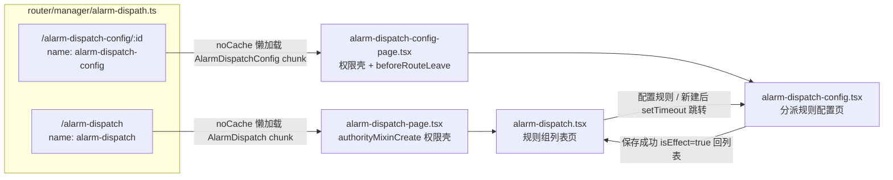
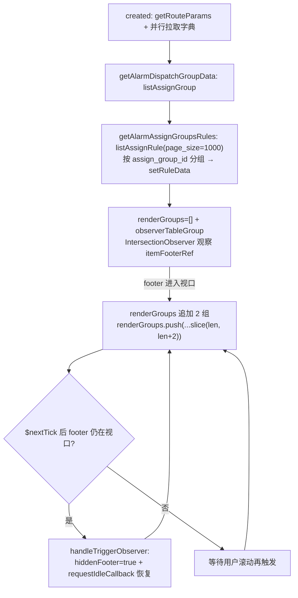
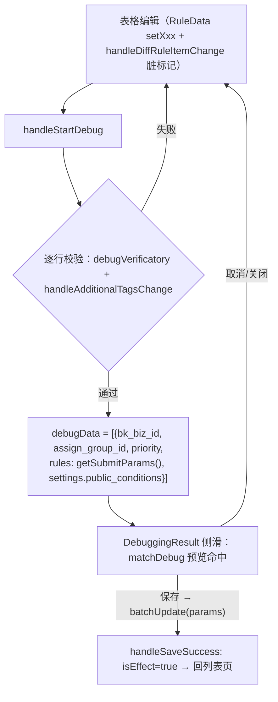

# 实现：告警分派专家 / 告警分派

**本文引用的文件**
- [alarm-dispatch.tsx](file://bkmonitor/webpack/src/monitor-pc/pages/alarm-dispatch/alarm-dispatch.tsx)
- [alarm-dispatch-config.tsx](file://bkmonitor/webpack/src/monitor-pc/pages/alarm-dispatch/alarm-dispatch-config.tsx)
- [alarm-dispatch-page.tsx](file://bkmonitor/webpack/src/monitor-pc/pages/alarm-dispatch/alarm-dispatch-page.tsx)
- [alarm-dispatch-config-page.tsx](file://bkmonitor/webpack/src/monitor-pc/pages/alarm-dispatch/alarm-dispatch-config-page.tsx)
- [authority-map.ts](file://bkmonitor/webpack/src/monitor-pc/pages/alarm-dispatch/authority-map.ts)
- [typing/index.ts](file://bkmonitor/webpack/src/monitor-pc/pages/alarm-dispatch/typing/index.ts)
- [typing/condition.ts](file://bkmonitor/webpack/src/monitor-pc/pages/alarm-dispatch/typing/condition.ts)
- [components/common-condition.tsx](file://bkmonitor/webpack/src/monitor-pc/pages/alarm-dispatch/components/common-condition.tsx)
- [components/common-condition-new.tsx](file://bkmonitor/webpack/src/monitor-pc/pages/alarm-dispatch/components/common-condition-new.tsx)
- [components/common-condition-selector.tsx](file://bkmonitor/webpack/src/monitor-pc/pages/alarm-dispatch/components/common-condition-selector.tsx)
- [components/condition-find-replace.tsx](file://bkmonitor/webpack/src/monitor-pc/pages/alarm-dispatch/components/condition-find-replace.tsx)
- [components/alarm-batch-edit.tsx](file://bkmonitor/webpack/src/monitor-pc/pages/alarm-dispatch/components/alarm-batch-edit.tsx)
- [components/debugging-result.tsx](file://bkmonitor/webpack/src/monitor-pc/pages/alarm-dispatch/components/debugging-result.tsx)
- [components/alarm-dispatch-action.tsx](file://bkmonitor/webpack/src/monitor-pc/pages/alarm-dispatch/components/alarm-dispatch-action.tsx)
- [components/alarm-update-content.tsx](file://bkmonitor/webpack/src/monitor-pc/pages/alarm-dispatch/components/alarm-update-content.tsx)
- [components/alarm-group-select.tsx](file://bkmonitor/webpack/src/monitor-pc/pages/alarm-dispatch/components/alarm-group-select.tsx)
- [router/manager/alarm-dispath.ts](file://bkmonitor/webpack/src/monitor-pc/router/manager/alarm-dispath.ts)
- [mixins/authorityMixin.ts](file://bkmonitor/webpack/src/monitor-pc/mixins/authorityMixin.ts)
- [pages/alarm-group/authority-map.ts](file://bkmonitor/webpack/src/monitor-pc/pages/alarm-group/authority-map.ts)
- [pages/alarm-group/alarm-group-detail/alarm-group-detail.tsx](file://bkmonitor/webpack/src/monitor-pc/pages/alarm-group/alarm-group-detail/alarm-group-detail.tsx)
- [monitor-api/modules/assign.js](file://bkmonitor/webpack/src/monitor-api/modules/assign.js)
- [monitor-api/modules/model.js](file://bkmonitor/webpack/src/monitor-api/modules/model.js)
- [pages/custom-escalation/utils.ts](file://bkmonitor/webpack/src/monitor-pc/pages/custom-escalation/utils.ts)
- [pages/view-detail/utils.ts](file://bkmonitor/webpack/src/monitor-pc/pages/view-detail/utils.ts)
- [components/ip-selector/common/util.ts](file://bkmonitor/webpack/src/monitor-pc/components/ip-selector/common/util.ts)

## 目录
1. [简介](#简介)
2. [核心流程](#核心流程)
3. [设计模式](#设计模式)
4. [关键类与函数](#关键类与函数)
5. [热点路径](#热点路径)
6. [技术债](#技术债)
7. [结论](#结论)

## 简介

告警分派专家对应 monitor-pc 的「告警分派」功能域（Vue2 + `.tsx` class component，`vue-property-decorator` + `vue-tsx-support`），模块目录共 16 个 ts/tsx 源文件、9390 行（`wc -l` 实测），由两个页面、一族条件编辑器组件、两个模型文件与一组纯函数构成：

1. **规则组列表页**（`/alarm-dispatch`，`alarm-dispatch.tsx` + `alarm-dispatch-page.tsx` 权限壳）：规则组折叠列表（IntersectionObserver 懒渲染）、搜索（组名/标签/告警组名/组 ID 本地过滤）、新建规则组（优先级步进算法）、组名/优先级行内编辑、删除（走「调试并删除」）、组内规则只读表格、效果调试入口。
2. **分派规则配置页**（`/alarm-dispatch-config/:id`，`alarm-dispatch-config.tsx` + `alarm-dispatch-config-page.tsx` 壳）：手写 `<table>` 规则表格（选择/告警组/匹配规则/分派动作/通知升级/修改告警内容/状态/操作）、流程展示行（分派给谁 → 匹配哪些告警规则 → 如何执行分派 → 修改原告警内容）、批量行操作、统一设置、查找替换、CSV 导入导出、`调试并生效` 保存链路、`beforeRouteLeave` 离开拦截。

**条件编辑器是模块内最大子域**：`common-condition-new.tsx`（1894 行，在用）以「tag 行 + 弹出面板」实现条件四元组（condition/key/method/value）编辑，是列表页、配置页、调试弹窗、查找替换四处共用的核心交互组件；`common-condition.tsx`（1497 行）是**旧版且已无生产引用**（全文仅自身 `common-condition.scss` 的 import，模块内外均无其他引用，经 grep 实证）；`common-condition-selector.tsx`（327 行）同样无生产引用——`condition-find-replace.tsx` 中指向它的 import 行被注释（`// import CommonConditionSelector from './common-condition-selector';`），构成一条断开的引用链。三者共同记录了「key 选择器 → 旧版 tag 编辑器 → 新版 tag 编辑器」的演进过程。

所有后端交互集中在 `fta/assign/**`（规则组/规则 CRUD、`match_debug`、`batch_update`、`get_assign_condition_keys`、`cmdb/search_object_attribute`）与 `rest/v2/**`、`fta/**` 的字典接口（告警组、流程套餐、告警 TopN、策略列表等）上；条件编辑器的选项聚合入口是 `allKVOptions`。

章节来源：[alarm-dispatch.tsx](file://bkmonitor/webpack/src/monitor-pc/pages/alarm-dispatch/alarm-dispatch.tsx)（关键符号：`getAlarmDispatchGroupData`、`handleToConfig`）、[alarm-dispatch-config.tsx](file://bkmonitor/webpack/src/monitor-pc/pages/alarm-dispatch/alarm-dispatch-config.tsx)（关键符号：`handleStartDebug`、`handleBatchEditSubmit`）、[typing/condition.ts](file://bkmonitor/webpack/src/monitor-pc/pages/alarm-dispatch/typing/condition.ts)（关键符号：`allKVOptions`）

## 核心流程

### 2.1 路由与页面骨架

`router/manager/alarm-dispath.ts` 定义两个路由，均以 `noCache` 懒加载（chunk 名 `AlarmDispatch` / `AlarmDispatchConfig`）、`meta.navId: 'alarm-dispatch'` 归属同一导航；`alarm-dispatch-config` 额外带 `meta.needBack: true`：

| 路由 name | 路径 | 容器组件 | 说明 |
|---|---|---|---|
| `alarm-dispatch` | `/alarm-dispatch` | `alarm-dispatch-page.tsx` | 规则组列表页 |
| `alarm-dispatch-config` | `/alarm-dispatch-config/:id` | `alarm-dispatch-config-page.tsx` | 分派规则配置页 |

两个页面壳都是同一工厂模式：`Mixins(authorityMixinCreate(authorityMap))` 注入权限，`render()` 只渲染对应内容组件。配置页壳额外注册了 `Component.registerHooks(['beforeRouteLeave'])`，用 `isEffect`（已保存生效）与 `isRuleChange`（规则有未生效修改）两个 getter 经 `$refs.alarmDispatchConfig` 从内容组件取值，未保存的修改会弹「是否放弃本次操作？」确认：

图表来源：[router/manager/alarm-dispath.ts](file://bkmonitor/webpack/src/monitor-pc/router/manager/alarm-dispath.ts)（关键符号：`AlarmDispatch`、`AlarmDispatchConfig`、`navId`）、[alarm-dispatch-config-page.tsx](file://bkmonitor/webpack/src/monitor-pc/pages/alarm-dispatch/alarm-dispatch-config-page.tsx)（关键符号：`beforeRouteLeave`、`confirmDialog`、`isEffect`）

章节来源：[alarm-dispatch-page.tsx](file://bkmonitor/webpack/src/monitor-pc/pages/alarm-dispatch/alarm-dispatch-page.tsx)（关键符号：`AlarmDispatchPage`）、[alarm-dispatch-config-page.tsx](file://bkmonitor/webpack/src/monitor-pc/pages/alarm-dispatch/alarm-dispatch-config-page.tsx)（关键符号：`AlarmDispatchConfigPage`、`isRuleChange`）

### 2.2 列表页：两段式加载与 IntersectionObserver 懒渲染

**两段式加载**：`created` 后 `getAlarmDispatchGroupData` 先调 `listAssignGroup()` 拉全部规则组（映射为 `RuleGroupData` 模板类，含 `editAllowed`/`updateTime`），随后 `getAlarmAssignGroupsRules(ids)` 再调 `listAssignRule({ page: 1, page_size: 1000 })` **全量拉取规则**并本地按 `assign_group_id` 分组回填各组的 `ruleData`（组数少、规则多，用一次大分页换取「组内规则随组展开即时可见」）。两个请求与 `getAlarmGroupList`（告警组字典）、`getKVOptionsData`（条件选项）并行；列表加载完成前条件组件以骨架屏/loading 承接。

**懒渲染**：`observerTableGroup` 用 `IntersectionObserver` 观察列表底部的 `itemFooterRef`（`item-footer` 占位节点），footer 进入视口即 `renderGroups` 追加 **2 组**；若追加后 footer 仍在视口（`isInViewport` + `$nextTick` 复检），通过 `handleTriggerObserver` 把 footer 临时 `hiddenFooter=true` 并用 `window.requestIdleCallback` 恢复，让浏览器完成布局后触发下一次进入回调，形成「空闲时连续增量渲染」；`beforeDestroy` 中 `unobserve` 释放观察器：

图表来源：[alarm-dispatch.tsx](file://bkmonitor/webpack/src/monitor-pc/pages/alarm-dispatch/alarm-dispatch.tsx)（关键符号：`observerTableGroup`、`handleTriggerObserver`、`isInViewport`）

**搜索**：`handleSearch` 经 `@Debounce(300)` 去抖，基于 `polymerizeRuleGroups`——由 `cacheRuleGroups` 聚合出每个规则组去重后的告警组集合（`user_groups`）与标签集合（`tag`，`key:value` 形式）——按「标签全串 / key / value 命中」「告警组名正则命中」「组 ID 相等」三个路径过滤出组 ID 列表；空搜索恢复全量。`isSearch` 标志保证 `getAlarmGroupList` 与 `getAlarmAssignGroupsRules` **两个请求都完成后**才允许按告警组名/标签过滤（否则命中集合不全）。过滤后重建 `renderGroups` 并重新 observe。

**新建规则组**：弹窗中 `handleAddAlarmDispatch` 按最大优先级推算默认值——`remainder = priority % 5; target = remainder === 0 ? priority + 5 : priority + 10 - remainder`（结果总是大于现有最大优先级的 5 的倍数，互斥区间），`>= 10000` 时置空；`handlePriorityChange` 实时查重（`priorityList.includes`）并提示「注意: 优先级冲突」，提交时 `handleAddAlarmDispatchGroup` 再次拦截重复优先级，成功后 `setTimeout` 跳转配置页。

**行内编辑与删除**：组名/优先级通过 `handleAlarmGroupInfoEdit` 用 `$bkPopover` 复用隐藏的 `AlarmBatchEdit` 实例（`content: (this.$refs.alarmBatchEdit).$el`），提交调 `partialUpdateAssignGroup(id, { [filed]: value })`；删除是 `handleDeleteGroup` 弹窗「调试并删除」——不直接调 `destroyAssignGroup`（该调用在源码中被注释掉了），而是把 `delGroups=[id]` 交给 `DebuggingResult` 以「先预览影响面、再删除」的流程完成。

**跨模块复用（AlarmGroupDetail）**：两个页面的「告警组详情」弹窗都复用 alarm-group 模块的 `AlarmGroupDetail`（表格中告警组 tag / 通知升级告警组名点击弹出，数据由 `listUserGroup` 提供）。两页用法有一处分工差异：列表页传 `customEdit` + `onEditGroup`，弹窗的编辑按钮改为 emit `editGroup` 事件，由页面 `handleEditGroup` 接管（关闭弹窗后跳 `alarm-group-edit`）；配置页传 `customEdit={false}`，由弹窗组件内部自行 `$router.push` 到同一路由——跳转终点一致、责任分工不同。

章节来源：[alarm-dispatch.tsx](file://bkmonitor/webpack/src/monitor-pc/pages/alarm-dispatch/alarm-dispatch.tsx)（关键符号：`getAlarmAssignGroupsRules`、`handleSearch`、`handleDeleteGroup`、`handlePriorityChange`、`handleEditGroup`）、[pages/alarm-group/alarm-group-detail/alarm-group-detail.tsx](file://bkmonitor/webpack/src/monitor-pc/pages/alarm-group/alarm-group-detail/alarm-group-detail.tsx)（关键符号：`customEdit`、`handleEditGroup`、`emitIsShow`）

### 2.3 配置页：脏标记体系与「调试并生效」

**加载**：`getAlarmDispatchGroupData` 调 `listAssignGroup()` 找到当前 `:id` 的规则组（同时收集全量 `priorityList` 供冲突校验、`editAllowed` 控制编辑开关）；`getAlarmAssignGroupsRules` 按 `assign_group_id` 拉规则并构造 `RuleData[]`；**空组兜底**：无规则时生成一条 `new RuleData({ addId: random(8), isEnabled: true })` 的空白新规则，并把「通知&流程」「等级&标签」两对列默认合并（`mergeConfig` 置 true、`processList` colspan 置 1）。`cacheTableData` 深拷贝快照作为「上一次生效配置」的对比基准。

**脏标记（diff 检测）**：`@Watch('tableData', { deep: true })` 与各编辑回调都会触发 `handleDiffRuleData` / `handleDiffRuleItemChange`——按三种身份匹配快照（DB 现有规则比 `id`、新增规则比 `addId`、复制规则比 `copyId`），用 `deepCompare` 逐字段比较（`additionalTags`、`actions` 需要归一化：过滤未启用通知、只保留 `actionId`），把「是否与基准一致」写入每行的 `resetConfig[index].disabled`（true=未修改）与列级 `config[field]`；行样式由 `getRuleItemType` 汇总为 `rule-verification / rule-initial / rule-add / rule-change / rule-common` 五态。`isRuleChange` getter 消费这两套标记决定离开拦截。

**「调试并生效」保存链路**：`handleStartDebug` 先逐行校验（`debugVerificatory` 校验告警组与匹配规则非空；`handleAdditionalTagsChange` 校验标签格式与 key 冲突），通过后把整个组组装为 `debugData`（`rules: tableData.filter(!isNullData).map(getSubmitParams)`、`settings.public_conditions` 标记是否设置了统一设置），打开 `DebuggingResult` 侧滑；侧滑内 `matchDebug` 按最近 7 天窗口预览每条规则命中的告警，用户确认后 `handleSave` 调 `batchUpdate`，成功后 `handleSaveSuccess` 置 `isEffect=true` 并回列表页：

图表来源：[alarm-dispatch-config.tsx](file://bkmonitor/webpack/src/monitor-pc/pages/alarm-dispatch/alarm-dispatch-config.tsx)（关键符号：`handleStartDebug`、`handleDiffRuleItemChange`、`handleSaveSuccess`）、[components/debugging-result.tsx](file://bkmonitor/webpack/src/monitor-pc/pages/alarm-dispatch/components/debugging-result.tsx)（关键符号：`getRuleMatchDebug`、`handleSave`）

**批量操作**：勾选任一行后表头下方插入「批量行」（`hasBatchColumn` 枚举可批量编辑的列），提供批量编辑（复用 `AlarmBatchEdit`）、批量删除、批量撤回（`batchReset` 从 `resetConfig` 恢复基准数据）。「批量删除全部」与「删除唯一行」都回到「空组初始状态」（保留一条空白新规则）；行操作的撤回按钮仅对「有修改的存量规则」可用（`!resetConfig[index].disabled && !row.addId && !row.copyId`）。

章节来源：[alarm-dispatch-config.tsx](file://bkmonitor/webpack/src/monitor-pc/pages/alarm-dispatch/alarm-dispatch-config.tsx)（关键符号：`handleDiffRuleData`、`handleOperateAction`、`handleCheckAllChange`）

### 2.4 条件编辑器（新版）：tag 行状态机与选项异步聚合

`common-condition-new.tsx` 的核心是一个**「行」级状态机**：每条条件渲染为一行 `ITagItem`（`condition` 数据 + `tags` 渲染标签序列），tags 由 `condition` / `key` / `method` / `value` / `input` 五种类型 token 组成，例如 `[AND][策略ID][in][策略A][策略B][输入框]`。交互上：点击行内任意位置/标签会展开 `$bkPopover` 面板（`showPopFn`），面板内容按 `selectType` 切换为 key 列表（带 `KEY_FILTER_TAGS` 分类 tab：全部 / CMDB属性 / 告警策略 / 告警事件）、连接符列表或 value 多选列表；key 命中 `groupKey`（`GROUP_KEYS = ['dimensions','tags','set','module','host']`）时弹出**二级选项面板**（`showSecondPopfn`），支持搜索与「维度」的**自定义输入**（`handleSelectCustomDimension`，把它变成「直接输入」项）。变更统一走 `handleSelectKey / handleSelectMethod / handleSelectCondition / handleSelectValue` 写回 `condition` 与 `tags`，最终由 `emitValue`（只在 `locaLValue` 与 `value` 有差异时）`$emit('change')`。

选项数据由 `typing/condition.ts` 的 `allKVOptions` 聚合：内部并行发起 12 项请求（动态分组、条件 key 表、第三方告警源、监控对象、策略列表、指标、告警 TopN 三字段、CMDB set/module/host 属性、通知人员、策略标签、TopN 标签字段），以 `awaitAll()` 计数到达 12 次为「全部结束」信号回调 `end`（计数式聚合，见技术债）。几处针对性设计：CMDB 属性以 `type.bk_property_id` 为 key 注册进 `groupKeys`；`alert.strategy_id` 的选项在统一设置中经 `setDimensionsOfStrategy` 按策略动态扩展维度与维度值（`specialOptions` 机制：`alert.strategy_id=${id}` → 额外可选项）；`notice_users` 支持远程搜索（`handleSearchChange` 里 300ms 去抖调 `listUsersUser`）。`alert.strategy_id` 的值列表还带「未开启」标记与跳转策略详情入口（`handleLinkToStrategy`）以及「刷新列表」（`handleRefreshStrategyList`）。

**校验**：`validate`（需填）与 `validateConditionsRepeatKey`（同一规则内 key 不得重复，否则「注意: 名字冲突」）、`getHasRepeatData`（O(n²) 重复条件检测，emit `repeat`）。

章节来源：[components/common-condition-new.tsx](file://bkmonitor/webpack/src/monitor-pc/pages/alarm-dispatch/components/common-condition-new.tsx)（关键符号：`handleConditionToTagList`、`emitValue`、`handleSelectValue`、`handleKeyMouseEnter`）、[typing/condition.ts](file://bkmonitor/webpack/src/monitor-pc/pages/alarm-dispatch/typing/condition.ts)（关键符号：`allKVOptions`、`GROUP_KEYS`、`KEY_FILTER_TAGS`、`setDimensionsOfStrategy`）

### 2.5 统一设置、查找替换与批量编辑

**统一设置**（匹配规则表头「统一设置」）是条件编辑器的上层聚合能力：`statisticsSameConditions(allConditions)` 找出所有规则**共同包含**的条件组合（把各组按长度升序排序，取最短组中「被所有组包含」的条件），浮层内用 `CommonCondition` 编辑；确认时 `handleConfirmUnifiedSettings` 分两条路径——条件有变更（`isConditionChange`）或原本无统一设置时，用 `unshiftConditions` 把条件**插入所有规则**；否则用 `setUnifiedSettings` **查找替换型**更新（`conditionsInclues` 判断包含关系，`conditionFindReplace` + `conditionsDeduplication` + `mergeConditions`）。当用户编辑的某行条件与统一设置条件相同且被改动时，`judgeSettingsConditionChange` 会弹「变更当前值将会使统一设置条件失效」的确认浮层，取消则从 `locaLValueCache` 回滚。

**查找替换**：批量行 `conditions` 列的编辑会话是 `ConditionFindReplace`（上下两个 `CommonCondition`：「查找规则」与「批量替换成」），确认后 `AlarmBatchEdit` emit `findReplace`，由配置页 `handleFindReplace` 对勾选行逐条调 `RuleData.setFindReplace`——内部经 `conditionFindReplace`（按 `conditionCompare` 全量匹配、命中后删除并记录落点）替换、`conditionsDeduplication` 去重，并刷新 `conditionsRenderKey` 触发该行条件组件重建。

**批量编辑**：`AlarmBatchEdit`（595 行）是「一份隐藏实例 + 多个字段复用」的字段编辑 popover，字段矩阵由 `configFiled` 描述（组名/优先级/告警组/查找替换/等级/标签/流程套餐/通知升级/状态），每种字段一套表单与校验：优先级去重（`handlePriorityChange`，排除自身）、通知升级整数校验（`handleVerifyInterval`，预设 1/5/10/30 分钟）、追加标签 `key:value|key=value` 正则与 key 冲突校验（`handleAdditionalTagsChange`）。列表页通过 `isListPage` prop 屏蔽「调试并生效」按钮（注释：`特殊处理： 告警分派页表页暂不需要调试并生效按钮`），配置页提交优先级/组名后直接调用 `handleStartDebug` 触发整组调试。

**导入导出**：表头区提供 CSV 导入（`MonitorImport` 组件，`accept='.csv'`、`return-text`）与导出。导出 `handleExportChange` 手工拼 CSV：固定 7 列表头（告警组/匹配规则/通知升级/流程/等级调整/追加标签/状态），条件与通知配置直接 `JSON.stringify` 后把半角逗号替换为全角「，」防止列错位，经 `downCsvFile`（加 `\ufeff` BOM）下载，文件名带规则组名与当前时间。导入 `handleImportChange` 用 `csvToArr` 解析、校验表头全等后，逐行还原为 `RuleData`（`transformDataKey` 转驼峰 + `JSON.parse` 还原 JSON 列，actions 重建为 notice/itsm 两条）**追加**到现有表格，逐行走常规脏标记与调试生效链路；错误仅 `console.log`（见技术债）。导入导出的字段与 `getSubmitParams` 语义对齐（如标签 `key:value`、条件四元组 JSON），因此 CSV 可在不同规则组之间搬运规则。

章节来源：[alarm-dispatch-config.tsx](file://bkmonitor/webpack/src/monitor-pc/pages/alarm-dispatch/alarm-dispatch-config.tsx)（关键符号：`unifiedSettingInit`、`handleConfirmUnifiedSettings`、`judgeSettingsConditionChange`、`handleFindReplace`、`handleExportChange`、`handleImportChange`）、[components/alarm-batch-edit.tsx](file://bkmonitor/webpack/src/monitor-pc/pages/alarm-dispatch/components/alarm-batch-edit.tsx)（关键符号：`handleSubmit`、`handlePriorityChange`、`handleAdditionalTagsChange`）、[pages/custom-escalation/utils.ts](file://bkmonitor/webpack/src/monitor-pc/pages/custom-escalation/utils.ts)（关键符号：`csvToArr`）、[pages/view-detail/utils.ts](file://bkmonitor/webpack/src/monitor-pc/pages/view-detail/utils.ts)（关键符号：`downCsvFile`）

### 2.6 调试弹窗：三种模式共用一条「预览 → 决策」链路

`DebuggingResult`（418 行）是模块所有写操作的最终确认闸门，通过 `ruleGroupsData` 与 `excludeGroups` 两个 prop 组合出三种模式：

| 模式 | 入口 | 参数 | 底部按钮行为 |
|---|---|---|---|
| 全局调试（只读预览） | 列表页「效果调试」`handleDebug` | `ruleGroupsData=[]`、`excludeGroups=[]` | 无保存按钮，仅「关闭」（`isViewDebugEffect`） |
| 调试并删除 | 列表页「删除」`handleDeleteGroup` | `excludeGroups=[id]` | 「保存」→ `destroyAssignGroup(id)` → `delSuccess` 刷新列表 |
| 调试并生效 | 配置页「调试并生效」`handleStartDebug` | `ruleGroupsData=[debugData]` | 「保存」→ `batchUpdate(params)` → `saveSuccess` 回列表 |

打开时 `getRuleMatchDebug` 组参：有 `ruleGroupsData` 时用其 `[0]`（带本次未保存的规则，用于模拟生效效果），否则全局调试（可带 `exclude_groups` 排除待删除组）；时间窗口默认最近 7 天，头部 `TimeRange` 可改（`handleTimeRangeChange` 重查）。结果按组 → 规则 → 告警三级折叠渲染，命中告警的 ID 可跳转告警中心（`handleToEvent`），仅「被改动且被当前组命中」的规则行高亮（`is-light`）。组件 props 注释明确了两处设计意图：`此为调试数据，保存时也用此数据 防止有批量调试，故采用数组格式 此数据为空则为全局调试`、`出数据用于删除并调试 点击生效按钮根据此参数删除规则组`。

章节来源：[components/debugging-result.tsx](file://bkmonitor/webpack/src/monitor-pc/pages/alarm-dispatch/components/debugging-result.tsx)（关键符号：`getRuleMatchDebug`、`handleSave`、`ruleGroupsData`、`excludeGroups`）

## 设计模式

### 3.1 页面容器 + 权限壳工厂模式（authorityMixinCreate）

模块的两个页面都拆成「壳」与「内容」两层：`alarm-dispatch-page.tsx` / `alarm-dispatch-config-page.tsx` 只做 `Mixins(authorityMixinCreate(authorityMap))` 与 `render` 转发；`authorityMixinCreate`（`mixins/authorityMixin.ts`）是一个工厂函数——接收 `{ KEY: actionId }` 映射，`@ProvideReactive('authority')` + `@Provide('handleShowAuthorityDetail')` 把权限对象注入整棵子树，并在 `created` 中批量调用 `checkAllowedByActionIds` 填充。

本模块 `authority-map.ts` 只声明两个 action：`MANAGE_ACTION_CONFIG = 'manage_rule_v2'`（套餐管理权限）与 `ALARM_GROUP_MANAGE_AUTH = MANAGE`（复用 alarm-group 的 `manage_notify_team_v2` 告警组管理权限）。注意这两个 key 在本模块内部**没有消费点**（`alarm-dispatch.tsx` / `alarm-dispatch-config.tsx` 里的 `@Inject('authority')` / `@Inject('handleShowAuthorityDetail')` 仅为声明，模块内无任何 `this.authority.` 使用，已 grep 实证）；真正的消费方是子树里的外部组件：`fta-solutions/pages/setting/set-meal-detail/set-meal-detail.tsx`（inject 本页提供的 authority，用 `MANAGE_ACTION_CONFIG` 控制套餐详情的编辑按钮）与 `strategy-config` 的 `alarm-group.tsx`（用 `ALARM_GROUP_MANAGE_AUTH` 控制「管理告警组」入口）。

设计维度一（**声明式注入的边界**）：页面只声明「本页涉及哪些 action」，具体按钮的置灰/申请权限由子树组件按 inject 的 authority 自行决定，页面不感知——`authorityMixinCreate` 的映射 key 必须与消费方 inject 的 key 对齐（本模块正是为了 `SetMealDetail`/`AlarmGroup` 的消费而声明）。设计维度二（**权限与业务开关的分层**）：规则组是否可编辑实际由后端字段 `edit_allowed` 决定（`RuleGroupData.editAllowed`），前端以 tooltip「内置的分派规则组不允许修改」呈现，权限 action 只覆盖「套餐/告警组」相关的跨模块跳转能力——两者不可互相替代。

章节来源：[alarm-dispatch-page.tsx](file://bkmonitor/webpack/src/monitor-pc/pages/alarm-dispatch/alarm-dispatch-page.tsx)（关键符号：`authorityMixinCreate`）、[authority-map.ts](file://bkmonitor/webpack/src/monitor-pc/pages/alarm-dispatch/authority-map.ts)（关键符号：`MANAGE_ACTION_CONFIG`、`ALARM_GROUP_MANAGE_AUTH`）、[mixins/authorityMixin.ts](file://bkmonitor/webpack/src/monitor-pc/mixins/authorityMixin.ts)（关键符号：`handleShowAuthorityDetail`、`handleInitPageAuthority`）

### 3.2 模板类 RuleData / RuleGroupData：构造、脏标记与提交转换

`typing/index.ts` 用「模板对象 + 构造函数拷贝」实现两个数据类：构造函数先把 `this` 序列化得到 `TEMP_THIS` 的默认键集合，然后对传入 `data` 的同名 truthy 字段逐键覆盖——`RuleData` 对 `actions` / `additionalTags` / `conditions` 三个字段做展开转换（actions 拆成 `upgradeConfig` + `actionId`、tags 展开为 `tag` 字符串数组、conditions 的值做 `topNDataStrTransform` 去引号）。类内高密度内聚了三种前端态：

- **脏标记**：`config`（逐列「与基准不同」）、`verificatory` + `validateTips`（逐列校验错误与提示）、`resetConfig`（行级快照，在页面层维护）；
- **派生状态**：`isInitData`（无任何变更）、`isNullData`（空白行）、`isVerifySuccess`（校验通过）；
- **写回协议**：`getSubmitParams()` 把前端态翻译为后端结构——`id || undefined`、`actions` 拆分 notice（`is_enabled`/`upgrade_config`）与 itsm（`action_id`，无值则过滤）、`alert_severity`、`additional_tags`、`is_enabled`；`setUnifiedSettings` / `setFindReplace` / `unshiftConditions` 封装统一设置与查找替换的条件变换。

设计维度一（**前后端字段映射的单一收口**）：读（构造函数）与写（`getSubmitParams`）都在类内完成，页面与子组件只操作驼峰属性，后端下划线模型与前端语义（如 `actionType='notice'|'itsm'` 双 action 结构）的翻译不外泄。设计维度二（**truthy 覆盖的边界风险**）：构造函数用 `if (data?.[key])` 判断，`priority: 0`、`editAllowed: false`、`is_enabled: false` 等合法 falsy 值不会覆盖默认值——当前默认值与业务含义恰好兼容（如 `RuleData` 默认 `isEnabled=false`），但这是隐式约定；同理 `JSON.parse(JSON.stringify(this))` 会丢掉 `undefined` 键（如 `upgradeInterval: undefined`），新增字段时需验证默认键集合的完整性。

章节来源：[typing/index.ts](file://bkmonitor/webpack/src/monitor-pc/pages/alarm-dispatch/typing/index.ts)（关键符号：`RuleData`、`getSubmitParams`、`setUnifiedSettings`、`isNullData`、`RuleGroupData`）、[typing/index.ts](file://bkmonitor/webpack/src/monitor-pc/pages/alarm-dispatch/typing/index.ts)（关键符号：`deepCompare`）

### 3.3 条件编辑器的半受控模式与随机 key 重建

`common-condition-new.tsx` 采用「**半受控**」协议：`value` prop 只在 `mounted` 时被读入 `locaLValue` 并转换为 `tagList`；此后组件以内部 `tagList` 为准，变更经 `emitValue` 差异比对后 `$emit('change')` 上报；组件**没有** `@Watch('value')`（对比旧版 `common-condition.tsx` 有 `@Watch('value')`），外部要做到「重置组件内部状态」只能更换组件 key。模块内正是这样做的——三处随机 key 刷新机制：

- 列表页 `conditionsKey = random(8)`：`getKVOptionsData` 的完成回调里重置，逼所有行条件组件在选项就绪后重建（`key={this.conditionsKey}`）；
- 配置页 `RuleData.conditionsRenderKey`：每次条件写回（`setFindReplace`、`setUnifiedSettings`、`unshiftConditions`、`conditionsRefresh`）后重置，逐行强制重建（`key={row.conditionsRenderKey}`）——因为 `replaceData`/`settingsValue` 这类派生数据是外部算出来的，重建比增量同步更可靠；
- 统一设置浮层 `conditionsSelectorKey = random(8)`：每次打开浮层换 key，保证编辑数据干净。

设计维度一（**非受控内部状态换取交互流畅**）：条件行的输入框、弹出面板、tag 增删都在组件内部频繁变更，若全量受控（每键 emit）会让父表格 deep watch + diff 在高频输入下抖动；半受控把中间态留在组件内，只在「条件成立」时向外 emit。设计维度二（**用「重建」代替「同步」的一致性策略**）：代价是外部数据刷新时旧交互状态（展开、输入中）丢失，且需要维护多个随机 key 的刷新时机（漏刷新会出现「选项已更新但面板仍旧值」）。旧版的 `@Watch('value')` 与新版的无 watch 是两种取舍，新版现役使用者的刷新全部依赖 key 机制。

章节来源：[components/common-condition-new.tsx](file://bkmonitor/webpack/src/monitor-pc/pages/alarm-dispatch/components/common-condition-new.tsx)（关键符号：`mounted`、`emitValue`、`handleConditionToTagList`）、[typing/index.ts](file://bkmonitor/webpack/src/monitor-pc/pages/alarm-dispatch/typing/index.ts)（关键符号：`conditionsRenderKey`、`conditionsRefresh`）、[alarm-dispatch-config.tsx](file://bkmonitor/webpack/src/monitor-pc/pages/alarm-dispatch/alarm-dispatch-config.tsx)（关键符号：`conditionsSelectorKey`）

### 3.4 弹层编排：同一组件实例服务多列，多层弹层冲突的手工治理

模块重度依赖命令式弹层（`$bkPopover`），形成一套固定的编排套路：**隐藏容器实例 + popover content 指向 `$el`**。两个页面都在 `render` 末尾放 `style='display: none'` 的容器承载 `AlarmBatchEdit`，弹层打开时把 `dataSource/filed/index` 等上下文写进页面 data，再 `$bkPopover(target, { content: ref.$el })` 挂载；统一设置浮层同理（`unifiedSettingsRef` 容器 + `unifiedSettingBtnRef` 目标）。

围绕这套机制产生了三类治理代码：

1. **点击外部关闭**：`handleClickOutSide` 用 `getEventPaths` 判断事件路径——点击目标在弹层内放行；检测到 `tippy-popper` 节点时用 350ms 延迟判定这是「二次弹层」（如告警组选择弹窗内再开弹层），保存到 `secondPopover` 防误关；对 `bk-sideslider` 的点击特判放行（注释：`侧栏关闭不能影响弹层`）。
2. **弹层内互斥**：条件编辑器的 `handleMousedown` 用 `componentId`（随机 id 挂在组件根节点与浮层上）判断点击是否发生在自身内部；`AbortController` 在 `mouseenter/mouseleave` 间挂/删 document 级监听，`handleMouseLeave` 仅在无弹层时 abort，避免误清理。
3. **二级浮层**：条件编辑器的「组合 key」二级列表（`showSecondPopfn`）与统一设置提示（`handleSettingsPopShow`）都是独立 `$bkPopover` 实例，关闭主面板时级联清理（`handlePopoverHidden` 内先 `handleSecondPopHidden`）。

设计维度一（**命令式弹层的生命周期责任**）：打开、定位、内容、销毁全部由调用方管理（`show(100)` / `hide(0)+destroy()`），换来对「弹层挂到什么元素、何时销毁」的完全控制，代价是每个调用点都要写清理逻辑（`removePopoverInstance` 在三处重复实现）。设计维度二（**多层弹层冲突的手工判定**）：用 DOM 路径类名（`tippy-popper`、`bk-sideslider`）判定弹层归属是典型的「以 DOM 特征充当组件边界」，脆且难测——`setTimeout(..., 350)`、`requestAnimationFrame` 等时序依赖散落其间，是该模块弹层代码的主要维护成本。

章节来源：[alarm-dispatch-config.tsx](file://bkmonitor/webpack/src/monitor-pc/pages/alarm-dispatch/alarm-dispatch-config.tsx)（关键符号：`handleBatchEdit`、`handleClickOutSide`、`secondPopover`）、[components/common-condition-new.tsx](file://bkmonitor/webpack/src/monitor-pc/pages/alarm-dispatch/components/common-condition-new.tsx)（关键符号：`handleMousedown`、`handlePopoverHidden`、`showSecondPopfn`）

## 关键类与函数

### 页面容器

| 名称 | 文件 | 职责 |
|---|---|---|
| `AlarmDispatchPage` / `AlarmDispatchConfigPage` | 两个 `-page.tsx` | 权限壳：`authorityMixinCreate` + render 转发；配置页壳承载 `beforeRouteLeave` 离开拦截（`isEffect` / `isRuleChange` / `confirmDialog`） |
| `AlarmDispatch` | alarm-dispatch.tsx | 列表页容器：两段式加载、懒渲染、搜索、新建/编辑/删除规则组、只读规则表格 |
| `AlarmDispatchConfig` | alarm-dispatch-config.tsx | 配置页容器：表格列定义、脏标记、批量操作、统一设置、导入导出、调试并生效 |

章节来源：[alarm-dispatch-config-page.tsx](file://bkmonitor/webpack/src/monitor-pc/pages/alarm-dispatch/alarm-dispatch-config-page.tsx)（关键符号：`beforeRouteLeave`）、[alarm-dispatch.tsx](file://bkmonitor/webpack/src/monitor-pc/pages/alarm-dispatch/alarm-dispatch.tsx)（关键符号：`AlarmDispatch`）、[alarm-dispatch-config.tsx](file://bkmonitor/webpack/src/monitor-pc/pages/alarm-dispatch/alarm-dispatch-config.tsx)（关键符号：`AlarmDispatchConfig`）

### 条件编辑器族

| 名称 | 文件 | 职责 |
|---|---|---|
| `CommonCondition`（新版，在用） | common-condition-new.tsx | 条件 tag 行编辑：`handleConditionToTagList`（条件 → tag 行）、`handleSelectKey / handleSelectMethod / handleSelectCondition / handleSelectValue`（选择写回）、`emitValue`（差异 emit）、`validate / getHasRepeatData / validateConditionsRepeatKey`（校验）、`judgeSettingsConditionChange / handleSettingsPopConfirm / handleSettingsPopCancel`（统一设置失效提示）、`handleKeyMouseEnter / handleClickSecondKey`（二级选项）、`handleSelectCustomDimension`（维度自定义输入）、`handleRefreshStrategyList`（策略列表刷新）、`calculateTagNum`（tag 行高折叠）、`getSearchNode`（搜索高亮） |
| `CommonCondition`（旧版，无引用） | common-condition.tsx | 同域旧实现：`handleOptionClick`（单弹层选择分发）、`tagListToConditions` / `handleConditionToTagList`（双向转换）、`handleReplaceValue`（按 value 段替换）、`handleOptionMouseEnter` / `handleShowkeyListSecond`（二级 key）、`@Watch('value')` 受控同步 |
| `CommonConditionSelector`（无引用） | common-condition-selector.tsx | 更早的 key 选择器（CST 列式：condition/key/method/value 用 `SimpleSelectInput` + `SelectMenu` 弹出），含 `handleKeyChange`、`handlePaste`、`handleValueChange` |
| `ConditionFindReplace` | condition-find-replace.tsx | 查找/替换双面板容器（两个 `CommonCondition`，非表单模式） |
| `ICondtionItem` / `TContionType` / `TMthodType` / `CONDITIONS` / `METHODS` | typing/index.ts | 条件数据契约与固定选项（and/or；eq/neq/include/exclude/reg/nreg） |
| `GROUP_KEYS` / `KEY_FILTER_TAGS` / `KEY_TAG_MAPS` / `EKeyTags` / `NOTICE_USERS_KEY` / `ISpecialOptions` / `TGroupKeys` / `TValueMap` | typing/condition.ts | 组合 key 前缀、key 分类 tab 映射、通知人员 key、特殊选项表结构与 Map 类型 |
| `allKVOptions` | typing/condition.ts | 选项聚合加载（12 路并行 + `awaitAll` 计数收口），覆盖 valueMap / groupKeys 全部数据 |
| `conditionCompare` / `conditionFindReplace` / `conditionsDeduplication` / `conditionsInclues` / `mergeConditions` / `statisticsSameConditions` | typing/condition.ts | 条件匹配、查找替换、去重、包含判定、同 key 合并、公共条件统计 |
| `setDimensionsOfStrategy` / `topNDataStrTransform` / `chunkFields` | typing/condition.ts | 策略维度动态加载（specialOptions 数据源）、TopN 字符串去引号、字段分片（与后端 `MAX_NESTED_TOP_N_FIELDS` 对齐，批次 20） |

章节来源：[components/common-condition-new.tsx](file://bkmonitor/webpack/src/monitor-pc/pages/alarm-dispatch/components/common-condition-new.tsx)（关键符号：`emitValue`、`handleSelectValue`、`calculateTagNum`）、[components/common-condition.tsx](file://bkmonitor/webpack/src/monitor-pc/pages/alarm-dispatch/components/common-condition.tsx)（关键符号：`handleOptionClick`、`tagListToConditions`、`handleReplaceValue`）、[components/common-condition-selector.tsx](file://bkmonitor/webpack/src/monitor-pc/pages/alarm-dispatch/components/common-condition-selector.tsx)（关键符号：`handleToggleCondition`、`handlePaste`）、[typing/condition.ts](file://bkmonitor/webpack/src/monitor-pc/pages/alarm-dispatch/typing/condition.ts)（关键符号：`statisticsSameConditions`、`conditionFindReplace`、`chunkFields`）

### 批量编辑、调试与展示组件

| 名称 | 文件 | 职责 |
|---|---|---|
| `AlarmBatchEdit` | alarm-batch-edit.tsx | 字段批量编辑面板：`handleSubmit`（分字段校验与提交）、`handlePriorityChange`（优先级去重步进）、`handleVerifyInterval`（升级间隔正整数）、`handleAdditionalTagsChange`（标签格式/key 冲突）、`handleFindReplace`（emit 查找替换数据）、`getFieldForm`（字段表单矩阵） |
| `DebuggingResult` | debugging-result.tsx | 调试侧滑：`getRuleMatchDebug`（match_debug 预览）、`handleSave`（batch_update / destroyAssignGroup 二选一）、`handleExpand`（组展开）、`handleTimeRangeChange`（时间窗重查）、`handleToEvent`（跳告警中心）、`IRuleGroupsDataItem`（调试数据契约） |
| `AlarmGroupSelect` | alarm-group-select.tsx | 告警组多选：`handleSelected`（值 → tag 映射）、`handleTagClick` / `handleDelTag`（tag 交互）、`handleAddAlarmGroup`（新开页新建告警组）、`handleRefresh`（刷新字典） |
| `AlarmDispatchAction` | alarm-dispatch-action.tsx | 列表页「分派动作」列只读渲染（函数组件，从 `ctx.props` 取值；通知/通知升级/流程服务/通知人员类型） |
| `AlarmUpdateContent` | alarm-update-content.tsx | 列表页「修改告警内容」列只读渲染（等级名称 + 图标、追加标签） |

章节来源：[components/alarm-batch-edit.tsx](file://bkmonitor/webpack/src/monitor-pc/pages/alarm-dispatch/components/alarm-batch-edit.tsx)（关键符号：`handleSubmit`、`getFieldForm`）、[components/debugging-result.tsx](file://bkmonitor/webpack/src/monitor-pc/pages/alarm-dispatch/components/debugging-result.tsx)（关键符号：`handleSave`、`IRuleGroupsDataItem`）、[components/alarm-group-select.tsx](file://bkmonitor/webpack/src/monitor-pc/pages/alarm-dispatch/components/alarm-group-select.tsx)（关键符号：`handleSelected`）、[components/alarm-dispatch-action.tsx](file://bkmonitor/webpack/src/monitor-pc/pages/alarm-dispatch/components/alarm-dispatch-action.tsx)（关键符号：`AlarmDispatchAction`）、[components/alarm-update-content.tsx](file://bkmonitor/webpack/src/monitor-pc/pages/alarm-dispatch/components/alarm-update-content.tsx)（关键符号：`AlarmUpdateContent`）

### 模型与工具

| 名称 | 文件 | 职责 |
|---|---|---|
| `RuleData` | typing/index.ts | 单条规则模板类：构造转换（actions/tags/conditions）、脏标记（`config`/`verificatory`/`validateTips`）、派生状态（`isInitData`/`isNullData`/`isVerifySuccess`）、写回（`getSubmitParams`）与条件变换（`setFindReplace`/`setUnifiedSettings`/`unshiftConditions`）、渲染 key（`conditionsRenderKey`） |
| `RuleGroupData` | typing/index.ts | 规则组模板类：`setExpan`（折叠）、`setRuleData`（规则列表 + 条件值去引号） |
| `EColumn` / `LEVELLIST` | typing/index.ts | 列 id 枚举（含合并列 `noticeProgress`/`levelTag`）、告警等级选项（0 保持原样/1 致命/2 预警/3 提醒） |
| `deepCompare` | typing/index.ts | 深度相等（递归比较数组/对象），脏标记判定基础 |
| `csvToArr` | pages/custom-escalation/utils.ts | CSV 文本解析（引号逃逸处理），配置页导入复用 |
| `downCsvFile` | pages/view-detail/utils.ts | CSV 下载（BOM + text/csv），配置页导出复用 |
| `Debounce` | components/ip-selector/common/util.ts | 防抖装饰器（`@Debounce(300)`），本模块多处使用（另一处从 `monitor-common/utils` 导入同名装饰器） |
| `getEventPaths` | monitor-pc/utils/index.ts | 事件路径收集（冒泡链），弹层外部点击判定基础 |

章节来源：[typing/index.ts](file://bkmonitor/webpack/src/monitor-pc/pages/alarm-dispatch/typing/index.ts)（关键符号：`RuleData`、`RuleGroupData`、`deepCompare`）、[pages/custom-escalation/utils.ts](file://bkmonitor/webpack/src/monitor-pc/pages/custom-escalation/utils.ts)（关键符号：`csvToArr`）、[pages/view-detail/utils.ts](file://bkmonitor/webpack/src/monitor-pc/pages/view-detail/utils.ts)（关键符号：`downCsvFile`）

## 热点路径

### 5.1 common-condition-new.tsx（1894 行）：全模块交互与状态最重的文件

- **渲染热路径**：`render` 中每行先 `item.tags.slice(0, item.isExpanded ? item.tags.length : item.max)` 截断再逐 tag 依 `TypeEnum` 分支渲染；`+N/收起` 由 `item.max < item.tags.length` 触发。`calculateTagNum` 用 `name.length * 8` 估算 tag 宽度、`tagContainerWidth`（挂载时按容器宽度取，兜底 500）分行的模拟布局——字符宽度估算对中文/英文混排必然有偏差，属「够用即可」的性能折衷（避免真实测量 DOM）。
- **value 选择热路径**：`handleSelectValue` 是文件内最复杂的函数（百余行）：维护 `curList` 勾选态、拆分「前半段（又增又删）/后半段（只删不增）」维护 tag 顺序、处理空选项（`-空-` 与其它值互斥）、自定义输入 diff。它直接对 `tagList[...]` 做多段 `splice`，任何下标偏移都会引起视图错乱——模块中少数需要「改前先通读全函数」的地方。
- **弹层热路径**：`handleClickLineWrap` 按「行末 tag 类型」决定弹出什么（key → method → value 链式引导），配合 `setTimeout(..., 100)` 的「选择后自动弹出下一级」。
- **远程/异步**：`handleSearchChange`（通知人员远程搜索，300ms 去抖）、`handleSecondSearchChange`（维度自定义输入）、`handleRefreshStrategyList`（策略列表刷新 + 重新勾选）。

章节来源：[components/common-condition-new.tsx](file://bkmonitor/webpack/src/monitor-pc/pages/alarm-dispatch/components/common-condition-new.tsx)（关键符号：`handleClickLineWrap`、`handleSelectValue`、`calculateTagNum`、`handleSearchChange`）

### 5.2 alarm-dispatch-config.tsx（1922 行）：表格与脏标记中枢

- `@Watch('tableData', { deep: true })` 的 diff 计算会在**每次**深层变更后遍历全表（逐行 find 快照 + `deepCompare`），配合 `handleDiffRuleItemChange` 的显式调用存在重复计算；表规模小（规则数量级为十位/百位）时无感，但这是全表编辑操作都要经过的路径。
- `getRowContent` 的 switch 渲染 11 类单元格，其中通知升级、等级、标签、组名/优先级、流程套餐五处都是「点击 → 打开 `AlarmBatchEdit`/popover」；`tableColumnsInit` 每次列合并切换（`handleColumnsMerge`）都重建整份列定义（`this.tableColumns = [...]`）。
- 手写 `<table>`（非 `bk-table`）+ `handleTableScroll` 记录 `scrollTop` 驱动表头吸顶样式（`is-scroll` 类），全部行内编辑控件都是自绘 div/icon（`icon-monitor` 字体图标），与 bk-table 风格页（列表页/调试弹窗）形成两套渲染体系。

章节来源：[alarm-dispatch-config.tsx](file://bkmonitor/webpack/src/monitor-pc/pages/alarm-dispatch/alarm-dispatch-config.tsx)（关键符号：`handleTableDataChange`、`getRowContent`、`tableColumnsInit`、`handleTableScroll`）

### 5.3 列表页懒渲染与搜索重建

- `observerTableGroup` + `handleTriggerObserver` + `isInViewport` 三件套：footer 在视口内时用 `hiddenFooter` 短时移除元素 + `requestIdleCallback` 触发下一轮，使「一屏内放不满 2 组」时也能持续追加而不是等待滚动事件。
- 每次搜索/刷新都会 `renderGroups=[]` 重建并从头部重新懒渲染；`showRuleGroups`（排序开启时）每次渲染对 `renderGroups` 深拷贝并按告警组名排序——深拷贝成本随已渲染组数线性增长。
- 组内规则表格（`bk-table`）的 `条件/动作/内容` 三列都是「整列交给子组件渲染」，条件列在最坏情况下渲染全部规则的完整 tag 行（无虚拟化），组内规则量大的组展开是渲染热点。

章节来源：[alarm-dispatch.tsx](file://bkmonitor/webpack/src/monitor-pc/pages/alarm-dispatch/alarm-dispatch.tsx)（关键符号：`observerTableGroup`、`handleTriggerObserver`、`showRuleGroups`）

### 5.4 typing/condition.ts 算法族：条件集合的四个原语

`conditionCompare`（全字段相等，value 排序后比较）、`conditionsInclues`（含等于匹配）、`conditionsDeduplication`（O(n²) 去重）、`mergeConditions`（按 field+method 合并 value）四个原语组合出所有上层操作：`conditionFindReplace`（按命中删除、落点插入替换项，未全部命中则不生效）、`statisticsSameConditions`（公共条件交集）、`RuleData.setFindReplace / setUnifiedSettings / unshiftConditions`。「单条规则内条件量 ≪ 100」的量级假设使 O(n²) 可接受；`statisticsSameConditions` 的「任一规则无任何条件则直接返回空」是「有规则无匹配条件时统一设置不成立」的语义实现。注意该函数在**单组输入时返回的是 `ICondtionItem[][]`（组数组）而非条件数组**，与其余分支返回类型不一致（见技术债）。

章节来源：[typing/condition.ts](file://bkmonitor/webpack/src/monitor-pc/pages/alarm-dispatch/typing/condition.ts)（关键符号：`conditionCompare`、`conditionsInclues`、`conditionsDeduplication`、`mergeConditions`、`statisticsSameConditions`）

## 技术债

以下各项均经源码核实（含 grep 引用检查），按影响排序：

1. **条件编辑器双版本并存（旧版已断链）**：`common-condition-new.tsx`（1894 行）为现役版本，被 4 处引用（`alarm-dispatch.tsx`、`alarm-dispatch-config.tsx`、`debugging-result.tsx`、`condition-find-replace.tsx`）；`common-condition.tsx`（1497 行）在 `webpack/src` 内**无任何引用**（仅自身 import `./common-condition.scss`），属死文件；`common-condition-selector.tsx`（327 行）同样无引用——`condition-find-replace.tsx` 中指向它的 import 被注释（`// import CommonConditionSelector from './common-condition-selector';`）。旧版与新版的 scss 定义了同名浮层类（`.common-condition-component-pop-wrap` 等），一旦误引入旧版会造成样式互踩。
2. **`dispath` 拼写遗留**：路由文件名为 `router/manager/alarm-dispath.ts`，列表页根类与样式类为 `alarm-dispath-page` / `alarm-dispath-page-wrap`（新代码拼写应为 dispatch）。改名需同步 scss 与组件，当前以「沿用旧拼写」避免扩散。
3. **`polymerizeRuleGroups` 去重失效**：列表页 `result.includes()`（无参数）用于判断标签是否已存在——`includes(undefined)` 恒为 false，导致同一 `key:value` 标签重复 push；去重意图未实现（`result.includes()` 处疑为漏传参的笔误）。
4. **查找替换第二个面板绑定可疑**：`condition-find-replace.tsx` 中「批量替换成」的 `CommonCondition` 其 `value` 绑定的是 `this.findData`（而非 `this.replaceData`），`onChange` 却写 `this.replaceData`；结合新版组件「无 `@Watch('value')`」的行为，初始/回填语义与「替换值」不一致，属 copy-paste 遗留嫌疑。
5. **`statisticsSameConditions` 单组时返回结构不一致**：`localGroups.length < 2` 分支直接返回 `localGroups`（`ICondtionItem[][]`），与函数声明/其余分支（`ICondtionItem[]`）不符；调用方 `unifiedSettingInit` 在此路径下会把「组数组」当作条件数组使用，单规则组场景的「统一设置」回显可能异常。
6. **列表页规则加载失败会抛错**：`getAlarmAssignGroupsRules` 中 `listAssignRule(...).catch(() => (this.groupLoading = false))` 使 `list` 变为 `false`，随后 `ids.reduce(...)` 内 `list.filter` 直接 TypeError；同类隐患还有同函数中 `groupData[item.id].length` 未做空值守卫。
7. **`IS_EMPTY_USERS_VALUES` 死常量且与实装不一致**：`typing/condition.ts` 定义 `IS_EMPTY_USERS_VALUES`（`id: '0' / '1'`）但全模块无引用；`allKVOptions` 实际写入的 `is_empty_users` 选项是 `'true' / 'false'`，两份「空判断」数据定义并存且值不同。
8. **注释掉的删除链路**：列表页 `handleDeleteGroup` 中直接删除逻辑被注释（`// await destroyAssignGroup(id);` 等三行），实际只走「调试并删除」；注释残留在回调内影响阅读（清理时需确认无回退需求）。
9. **调试输出残留**：`alarm-dispatch-config.tsx` 导入异常分支 `console.log(error)`、`common-condition-new.tsx` 两处 `console.log(e)`（`emitValue` / `judgeSettingsConditionChange` 的 try-catch 内）。
10. **注释与行为不一致**：`common-condition-new.tsx` 中 `calculateTagNum` 注释为「计算3行内可以展示的tag个数」，实现是 `if (lineCount < 4) count++`（最多 4 行）。
11. **侵入组件私有属性**：列表页/批量编辑中 `(this.$refs.priorityInput as any).curValue = 1` 直接写 `bk-input` 内部属性以纠偏输入值（两处 `handlePriorityChange`），依赖 bk-magic-vue 内部实现。
12. **进程套餐过滤不一致**：列表页 `getProcessPackage` 只保留 `plugin_type === 'itsm'`，配置页保留 `'itsm' || 'itsmv4'`——同一数据源两套过滤，列表页展示可能滞后于配置页。
13. **`awaitAll` 计数魔数**：`allKVOptions` 以「到达 12 次」判定全部加载完成，而实际注册的终态回调（含 1 个 `finally`）为 11 个 + 尾部 1 次调用恰好凑成 12（`dynamic_group` 的 then 分支 `// awaitAll();` 被注释、失败时改走 catch 计数）；新增/删除任一请求不同步修改 12 会导致 `end` 提前或永不触发——该约定无任何断言保护。
14. **导入校验缺失（自认）**：配置页 CSV 导入有 `// to do 校验` 注释，仅做表头字符串全等校验，行级错误仅 `console.log` 静默失败（catch 无用户提示）。
15. **行为怪点（保留观察）**：`handleDiffRuleItemChange` 的 `upgradeConfig` 分支写作 `data1[field].isEnabled ? data1[field] : data1[field].isEnabled`（等价于真值取对象、假值取 false）；列表页搜索对告警组名用 `reg.test(item.user_groups.map(g => g.name))`（数组隐式转字符串参与正则）——建议复核这两处的边界。
16. **`setting-msg-wrap` 样式无使用点**：`alarm-dispatch-config.scss` 中 `.setting-msg-wrap` 区块（含 `.common-condition-component` 覆盖）在 tsx 中无对应结构，属旧交互残留样式；`alarm-dispatch-config.scss` 同时为新旧类名维护覆盖（`.common-condition-component` 与新 `.common-condition-new-component`）。

章节来源：[components/condition-find-replace.tsx](file://bkmonitor/webpack/src/monitor-pc/pages/alarm-dispatch/components/condition-find-replace.tsx)（关键符号：`CommonConditionSelector`、`findData`、`replaceData`）、[typing/condition.ts](file://bkmonitor/webpack/src/monitor-pc/pages/alarm-dispatch/typing/condition.ts)（关键符号：`IS_EMPTY_USERS_VALUES`、`awaitAll`、`statisticsSameConditions`）、[alarm-dispatch.tsx](file://bkmonitor/webpack/src/monitor-pc/pages/alarm-dispatch/alarm-dispatch.tsx)（关键符号：`handleDeleteGroup`、`polymerizeRuleGroups`、`getAlarmAssignGroupsRules`）、[alarm-dispatch-config.tsx](file://bkmonitor/webpack/src/monitor-pc/pages/alarm-dispatch/alarm-dispatch-config.tsx)（关键符号：`handleImportChange`、`handleDiffRuleItemChange`、`getProcessPackage`）、[components/common-condition-new.tsx](file://bkmonitor/webpack/src/monitor-pc/pages/alarm-dispatch/components/common-condition-new.tsx)（关键符号：`calculateTagNum`）

## 结论

告警分派模块的实现可以概括为「**两条页面流程 + 一个条件编辑器子域 + 一套模板类数据层**」：列表页以 `listAssignGroup → listAssignRule` 两段式加载和 IntersectionObserver 懒渲染支撑「组多规则多」的只读总览；配置页以手写表格 + `RuleData` 脏标记（`config`/`verificatory`/`resetConfig` 三件套）追踪「相对上次生效配置」的全部差异，所有写操作最终收敛到 `DebuggingResult` 一条「match_debug 预览 → batch_update / destroyAssignGroup」的确认链路；条件编辑器（`common-condition-new.tsx` + `typing/condition.ts` 算法族）承担四元组条件的编辑、校验、统一设置与查找替换，是本模块复用量最高、逻辑密度最大的子域。维护时建议按三条线建立索引：**数据线**（`RuleData.getSubmitParams` ↔ 后端 `fta/assign` 模型）、**交互线**（半受控条件组件 + 随机 key 重建 + 命令式弹层）、**清理线**（旧版 condition/selector 死文件、`dispath` 拼写、注释残留——改动前先用 grep 确认引用链）。

章节来源：[alarm-dispatch-config.tsx](file://bkmonitor/webpack/src/monitor-pc/pages/alarm-dispatch/alarm-dispatch-config.tsx)（关键符号：`handleStartDebug`）、[components/common-condition-new.tsx](file://bkmonitor/webpack/src/monitor-pc/pages/alarm-dispatch/components/common-condition-new.tsx)（关键符号：`emitValue`）、[typing/index.ts](file://bkmonitor/webpack/src/monitor-pc/pages/alarm-dispatch/typing/index.ts)（关键符号：`getSubmitParams`）
