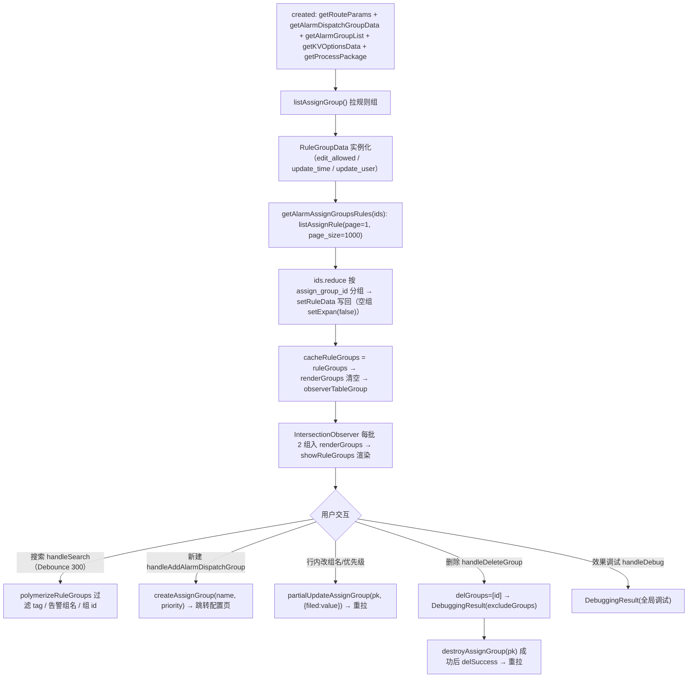
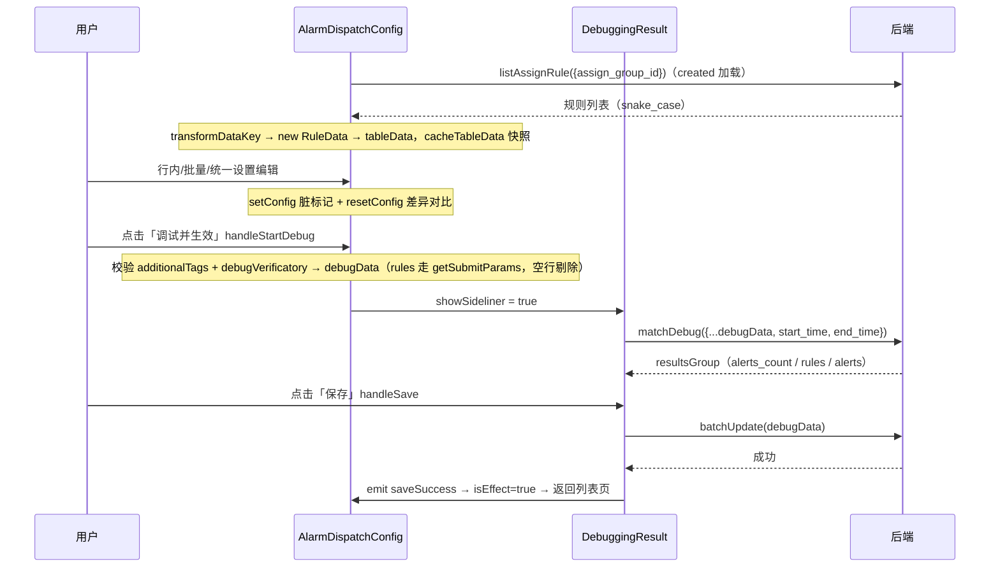
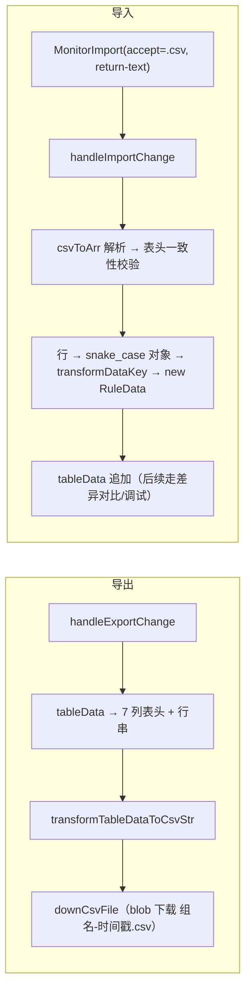
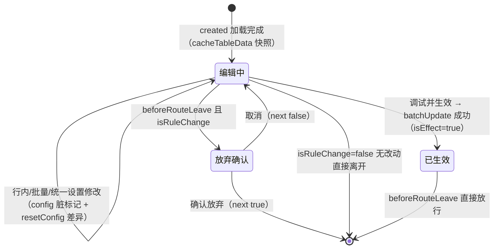

# 数据流转：告警分派专家 / 告警分派

**本文引用的文件**

- [alarm-dispatch.tsx](file://bkmonitor/webpack/src/monitor-pc/pages/alarm-dispatch/alarm-dispatch.tsx)——规则组列表页（加载/搜索/行内编辑/删除/效果调试）
- [alarm-dispatch-page.tsx](file://bkmonitor/webpack/src/monitor-pc/pages/alarm-dispatch/alarm-dispatch-page.tsx)——列表页路由壳（authorityMixin）
- [alarm-dispatch-config.tsx](file://bkmonitor/webpack/src/monitor-pc/pages/alarm-dispatch/alarm-dispatch-config.tsx)——分派规则配置页（行内/批量编辑、统一设置、查找替换、导入导出）
- [alarm-dispatch-config-page.tsx](file://bkmonitor/webpack/src/monitor-pc/pages/alarm-dispatch/alarm-dispatch-config-page.tsx)——配置页路由壳（isEffect/isRuleChange 与 beforeRouteLeave 拦截）
- [debugging-result.tsx](file://bkmonitor/webpack/src/monitor-pc/pages/alarm-dispatch/components/debugging-result.tsx)——调试结果侧栏（matchDebug 试算 / batchUpdate / destroyAssignGroup）
- [alarm-batch-edit.tsx](file://bkmonitor/webpack/src/monitor-pc/pages/alarm-dispatch/components/alarm-batch-edit.tsx)——行内/批量编辑弹层
- [alarm-group-select.tsx](file://bkmonitor/webpack/src/monitor-pc/pages/alarm-dispatch/components/alarm-group-select.tsx)——告警组多选组件
- [alarm-dispatch-action.tsx](file://bkmonitor/webpack/src/monitor-pc/pages/alarm-dispatch/components/alarm-dispatch-action.tsx)——列表页「分派动作」列
- [alarm-update-content.tsx](file://bkmonitor/webpack/src/monitor-pc/pages/alarm-dispatch/components/alarm-update-content.tsx)——列表页「修改告警内容」列
- [common-condition-new.tsx](file://bkmonitor/webpack/src/monitor-pc/pages/alarm-dispatch/components/common-condition-new.tsx)——匹配规则条件选择器（现行版本）
- [condition-find-replace.tsx](file://bkmonitor/webpack/src/monitor-pc/pages/alarm-dispatch/components/condition-find-replace.tsx)——查找替换组件
- [typing/index.ts](file://bkmonitor/webpack/src/monitor-pc/pages/alarm-dispatch/typing/index.ts)——RuleData / RuleGroupData 类与类型
- [typing/condition.ts](file://bkmonitor/webpack/src/monitor-pc/pages/alarm-dispatch/typing/condition.ts)——KV 选项加载与条件函数族
- [router/manager/alarm-dispath.ts](file://bkmonitor/webpack/src/monitor-pc/router/manager/alarm-dispath.ts)——路由表
- [model.js](file://bkmonitor/webpack/src/monitor-api/modules/model.js)——rule_groups / rules CRUD、listUserGroup、listActionConfig
- [assign.js](file://bkmonitor/webpack/src/monitor-api/modules/assign.js)——batchUpdate / matchDebug / getAssignConditionKeys / searchObjectAttribute
- [utils.js](file://bkmonitor/webpack/src/monitor-common/utils/utils.js)——transformDataKey（snake_case ↔ camelCase）
- [custom-escalation/utils.ts](file://bkmonitor/webpack/src/monitor-pc/pages/custom-escalation/utils.ts)——csvToArr
- [view-detail/utils.ts](file://bkmonitor/webpack/src/monitor-pc/pages/view-detail/utils.ts)——downCsvFile
- [monitor-import.vue](file://bkmonitor/webpack/src/monitor-pc/components/monitor-import/monitor-import.vue)——文件选择与文本读取

## 目录

1. [简介](#简介)
2. [列表页数据生命周期](#列表页数据生命周期)
3. [配置页数据生命周期](#配置页数据生命周期)
4. [编辑保存链](#编辑保存链)
5. [调试链](#调试链)
6. [导入导出链](#导入导出链)
7. [异步流与渲染优化](#异步流与渲染优化)
8. [状态流转](#状态流转)
9. [结论](#结论)

## 简介

告警分派是 monitor-pc 下的「告警分派」功能域（Vue2 + tsx class component），由两个路由页面组成：规则组列表页 `/alarm-dispatch`（组件 `AlarmDispatch`）与分派规则配置页 `/alarm-dispatch-config/:id`（组件 `AlarmDispatchConfig`）。数据本质是**「规则组 × 规则」的配置数据**：规则组（`rule_groups`）持有优先级与名称，规则（`rules`）持有告警组、匹配条件、分派动作、等级调整、追加标签与启停状态。

两条主数据流：

| 入口 | 路由 | 数据职责 |
|------|------|----------|
| 列表页 | `alarm-dispatch` | 拉全量规则组 + 全量规则并分组展示；组名/优先级行内修改；删除组（调试后删除）；全局效果调试；搜索过滤 |
| 配置页 | `alarm-dispatch-config/:id` | 单组规则的编辑（行内/批量/统一设置/查找替换）、调试并生效（matchDebug → batchUpdate 全量提交）、CSV 导入导出 |

与插件管理专家不同，本模块**没有「保存」按钮的逐字段提交**：配置页的所有修改（含组名、优先级）都汇总进 `debugData` 大对象，先经 `matchDebug` 用最近 7 天告警数据试算分派效果，再由用户确认后调用 `batchUpdate` 一次性提交。列表页仅有两个写入接口：`partialUpdateAssignGroup`（组名/优先级行内 PATCH）与经调试侧栏触发的 `destroyAssignGroup`（删除组）。

章节来源：[alarm-dispatch.tsx](file://bkmonitor/webpack/src/monitor-pc/pages/alarm-dispatch/alarm-dispatch.tsx)（关键符号：`AlarmDispatch`）、[alarm-dispatch-config.tsx](file://bkmonitor/webpack/src/monitor-pc/pages/alarm-dispatch/alarm-dispatch-config.tsx)（关键符号：`AlarmDispatchConfig`）、[router/manager/alarm-dispath.ts](file://bkmonitor/webpack/src/monitor-pc/router/manager/alarm-dispath.ts)（关键符号：`AlarmDispatchConfig`、`navId`）

## 列表页数据生命周期

### 加载链

`created` 同时发起 5 个动作：`getRouteParams`（读取 query 里的 `groupName`/`group_id` 写入搜索词）、`getAlarmDispatchGroupData`、`getAlarmGroupList`、`getKVOptionsData`、`getProcessPackage`，随后提交导航面包屑。其中列表加载是**两段串行**：

1. `getAlarmDispatchGroupData` → `listAssignGroup()` 拉规则组数组，逐项实例化为 `RuleGroupData`（字段映射：`id/name/priority` 直取，`isExpan: true`，`ruleData: []`，`editAllowed: !!item.edit_allowed`，`updateTime` 经 `detailOfFormatWithTimezone` 按空间时区格式化，`updateUser` 直取）；完成后以组 id 数组为参数调用下一步。
2. `getAlarmAssignGroupsRules(ids)` → `listAssignRule({ page: 1, page_size: 1000 })` 拉**全量规则**（无按组过滤，1000 条为隐式上限），用 `ids.reduce` 按 `assign_group_id` 分组，再逐组 `item.setRuleData(groupData[item.id])` 写回（`setRuleData` 对每条规则的条件值做 `topNDataStrTransform` 去引号；空组 `setExpan(false)` 默认收起）。最后 `cacheRuleGroups = this.ruleGroups` 建立搜索缓存。

注意：列表页 `ruleData` 中保存的是**后端原始行对象（snake_case）**，不是 `RuleData` 实例——渲染时直接消费 `row.user_groups`、`row.additional_tags`、`row.is_enabled`、`row.alert_severity`、`row.actions`（`alarm-dispatch-action.tsx` 中按 `action.action_type/action_id/upgrade_config` 读取）。

章节来源：[alarm-dispatch.tsx](file://bkmonitor/webpack/src/monitor-pc/pages/alarm-dispatch/alarm-dispatch.tsx)（关键符号：`created`、`getAlarmDispatchGroupData`、`getAlarmAssignGroupsRules`、`cacheRuleGroups`）；[typing/index.ts](file://bkmonitor/webpack/src/monitor-pc/pages/alarm-dispatch/typing/index.ts)（关键符号：`RuleGroupData.setRuleData`）

### 渲染链（IntersectionObserver 懒渲染）

加载完成后 `renderGroups = []` 并调用 `observerTableGroup()`：以页面底部 `itemFooterRef` 为哨兵创建 `IntersectionObserver`，**每批 2 个规则组**推入 `renderGroups` 渲染；若推入后哨兵仍在视口内则继续 `handleTriggerObserver()`（`hiddenFooter` + `requestIdleCallback` 触发下一批）。渲染数据经 `showRuleGroups` getter 输出：深拷贝 `renderGroups`，若存在排序（`sortProp/sortOrder`）则按告警组别名（`groupAliasList`）重排每组内的规则行。`beforeDestroy` 对哨兵 `unobserve`。

面板头部展示组名/优先级（均可点击触发行内编辑）、最近更新记录；`editAllowed=false`（内置组）时「配置规则」「删除」按钮禁用并显示 tooltip「内置的分派规则组不允许修改」。

章节来源：[alarm-dispatch.tsx](file://bkmonitor/webpack/src/monitor-pc/pages/alarm-dispatch/alarm-dispatch.tsx)（关键符号：`observerTableGroup`、`handleTriggerObserver`、`isInViewport`、`renderEditAttribute`）

### 交互触发的重拉

| 交互 | 处理 | 数据结果 |
|------|------|----------|
| 搜索（`handleSearch`，`@Debounce(300)`） | 用 `polymerizeRuleGroups` 聚合（每组内 rules 的 `user_groups` 映射为告警组名、`additional_tags` 拼为 `key:value` 列表）后按 tag/告警组名/组 id 过滤，命中集合从 `cacheRuleGroups` 过滤 | 纯前端过滤，`emptyType='search-empty'` |
| 清空搜索（`handleEmptyOpreation`） | 恢复 `cacheRuleGroups`，`emptyType='empty'` | 纯前端恢复 |
| 新建规则组（`handleAddAlarmDispatchGroup`） | `createAssignGroup({ name, priority })`，成功后关闭弹窗、重拉列表、跳转配置页 `params.id = data.id` | 重拉 + 路由跳转 |
| 行内改组名/优先级（`handleBatchEditSubmit` ← `AlarmBatchEdit`） | `partialUpdateAssignGroup(currentId, { [filed]: value })` | 成功后 `getAlarmDispatchGroupData()` 重拉 |
| 删除（`handleDeleteGroup`） | `$bkInfo` 二次确认（okText「调试并删除」）→ `delGroups=[id]`，打开调试侧栏（见调试链） | 删除在侧栏内完成 |
| 效果调试（`handleDebug`） | `delGroups=[]`，打开调试侧栏（全局 matchDebug） | 只读试算 |
| 展开/收起全部（`handleExpandAll`） | 逐组 `setExpan` | 纯展示 |
| 排序（`handleSort` → `showRuleGroups`） | 按 `sortProp/sortOrder` 对组内规则行排序（告警组别名） | 纯展示 |



图表来源：[alarm-dispatch.tsx](file://bkmonitor/webpack/src/monitor-pc/pages/alarm-dispatch/alarm-dispatch.tsx)（关键符号：`getAlarmDispatchGroupData`、`getAlarmAssignGroupsRules`、`observerTableGroup`、`showRuleGroups`、`handleSearch`、`handleAddAlarmDispatchGroup`、`handleBatchEditSubmit`、`handleDeleteGroup`、`handleDebug`）

章节来源：[alarm-dispatch.tsx](file://bkmonitor/webpack/src/monitor-pc/pages/alarm-dispatch/alarm-dispatch.tsx)（关键符号：`polymerizeRuleGroups`、`renderEditAttribute`、`handleExpandAll`、`handleSort`、`handleEmptyOpreation`）；[typing/index.ts](file://bkmonitor/webpack/src/monitor-pc/pages/alarm-dispatch/typing/index.ts)（关键符号：`RuleGroupData`、`RuleGroupData.setRuleData`）；[model.js](file://bkmonitor/webpack/src/monitor-api/modules/model.js)（关键符号：`listAssignGroup`、`listAssignRule`、`createAssignGroup`、`partialUpdateAssignGroup`）

## 配置页数据生命周期

### 加载链

`created` 并发发起 6 个动作：`init()`（→ `tableColumnsInit` 构建表头列配置）、`getKVOptionsData`、`getAlarmGroupList`、`getProcessPackage`、`getAlarmDispatchGroupData`、`getAlarmAssignGroupsRules`。后两者互不依赖：

- `getAlarmDispatchGroupData` → `listAssignGroup()` 后按路由 `params.id` find 出目标组，存入 `ruleGroupData`（**保存后端原始组对象**，提交时用其 `bk_biz_id/priority/name/id`），同时 `editAllowed = !!edit_allowed`，并记录全量 `priorityList`（供优先级冲突校验）。
- `getAlarmAssignGroupsRules` → `listAssignRule({ assign_group_id: id })`，每条规则经 **`transformDataKey(item, false)`（snake_case → camelCase）** 后构造为 `RuleData` 实例数组赋给 `tableData`；**空组时**生成一条初始空行 `new RuleData({ addId: random(8), isEnabled: true })`，并把「通知升级」「等级&标签」两对列合并（`mergeConfig` + `processList` colspan 调整）。随后 `cacheTableData = deepClone(tableData)` 建立**快照**（差异对比与撤回的数据基线），`isInitialRule = !list.length`；再逐行 `validateAlarmGroup`、收集已选策略 id 集合并经 `setDimensionsInfo` 加载策略维度特殊选项，最后 `unifiedSettingInit()` 根据 `ruleGroupData.settings.public_conditions` 从现有规则反推「统一设置」条件。

章节来源：[alarm-dispatch-config.tsx](file://bkmonitor/webpack/src/monitor-pc/pages/alarm-dispatch/alarm-dispatch-config.tsx)（关键符号：`created`、`getAlarmDispatchGroupData`、`getAlarmAssignGroupsRules`、`unifiedSettingInit`、`setDimensionsInfo`）

### 表格状态模型（表头列与合并）

`tableColumnsInit` 按 `mergeConfig` 生成列：`select / userGroups / conditions / (noticeProgress | upgradeConfig + actionId) / (levelTag | alertSeverity + additionalTags) / isEnabled / operate`——`noticeProgress`（通知&流程）与 `levelTag`（等级&标签）两组列可互相合并，用户点击流程表头 merge 图标切换（`handleColumnsMerge`）。数据行渲染由 `getRowContent` 按 `EColumn` 分派到各编辑子组件。

章节来源：[alarm-dispatch-config.tsx](file://bkmonitor/webpack/src/monitor-pc/pages/alarm-dispatch/alarm-dispatch-config.tsx)（关键符号：`getAlarmDispatchGroupData`、`getAlarmAssignGroupsRules`、`tableColumnsInit`、`handleColumnsMerge`、`getRowContent`、`unifiedSettingInit`）；[utils.js](file://bkmonitor/webpack/src/monitor-common/utils/utils.js)（关键符号：`transformDataKey`）

## 编辑保存链

### 编辑入口与脏标记

规则行的所有编辑都发生在 `tableData` 的 `RuleData` 实例上（就地修改）：

| 编辑入口 | 触发符号 | 写回方式 |
|----------|----------|----------|
| 匹配规则（`CommonCondition`） | `handleConditionChange` | `row.setConditions(v)` + `handleDiffRuleItemChange(row, 'conditions', index)` |
| 告警组（`AlarmGroupSelect`） | `AlarmGroupSelect.handleSelected` | `row.userGroups = value` + `validateAlarmGroup(row)` |
| 流程套餐（`bk-select`） | `row.setActions(value, 'itsm')` | 更新 `actions` 中 itsm 项及 `row.actionId` |
| 通知升级（弹层 `AlarmBatchEdit`） | `handleNoticeEdit` → `handleBatchEditSubmit('notice')` | `row.setActions(value, 'notice')`（同步 `upgradeConfig`） |
| 等级调整 | `handleBatchEditSubmit('alertSeveritySingle')` | `row.alertSeverity = value` |
| 追加标签 | `row.setAdditionalTags(value)` + `handleAdditionalTagsChange` 校验 | 拆解 `key:value` 为 `{key, value}` 数组 |
| 启停 | `row.setIsEnabled(value)` | 布尔写入 |
| 批量列编辑 | `handleBatchEditSubmit`（`userGroups/alertSeverity/upgradeConfig/additionalTags/isEnabled` 分支） | `tableData.map(item => item.isCheck && ...)` 逐选中行写入 |

三条**差异/脏标记体系**并行维护：

1. `@Watch('tableData', { deep: true })` → `handleTableDataChange` → `handleDiffRuleData(row, cacheTableData 中对应行, index)`：对 `fieldList = ['userGroups','conditions','actions','alertSeverity','additionalTags','isEnabled']` 做 `deepCompare`（actions 先按「itsm 有 actionId / notice 有 upgradeConfig.isEnabled」过滤，additionalTags 标准化为 `{key,value}`），结果写入 `resetConfig[index] = { disabled: !isChanged, cacheData: deepClone(原行) }`——`disabled` 即「与上次生效配置无差异」。
2. 行内编辑方法**显式**调用 `handleDiffRuleItemChange(row, field, index)` → `setConfig(field, !deepCompare(...))`，为单元格提供 `is-change` 高亮标记（`row.config`）。
3. `resetConfig[index].cacheData` 支撑「撤回」：`handleOperateAction('reset'|'batchReset')` 用快照整行替换当前行（复制/新增的行 `addId/copyId` 存在时不可撤回）。

行级 UI 状态由 `getRuleItemType` 计算（优先级：`verificatory[column]` → `rule-verification`；`isInitialRule` → `rule-initial`；`addId||copyId` → `rule-add`；`config[column]` → `rule-change`；否则 `rule-common`）。

章节来源：[alarm-dispatch-config.tsx](file://bkmonitor/webpack/src/monitor-pc/pages/alarm-dispatch/alarm-dispatch-config.tsx)（关键符号：`handleDiffRuleItemChange`、`handleBatchEditSubmit`、`handleOperateAction`、`getRuleItemType`）；[typing/index.ts](file://bkmonitor/webpack/src/monitor-pc/pages/alarm-dispatch/typing/index.ts)（关键符号：`RuleData.setConfig`、`RuleData.setVerificatory`、`RuleData.setCopyID`）；[utils.js](file://bkmonitor/webpack/src/monitor-common/utils/utils.js)（关键符号：`deepClone`）

### 统一设置与查找替换

- **统一设置**：`handleClickUnifiedSetting` 打开条件编辑弹层；若由行内条件变更触发（`isConditionChange`）且 `tableData.length >= 3` 且统计学相同条件（`statisticsSameConditions`）与当前记录不同，则提示「是否将以下条件添加到统一设置」。确认 `handleConfirmUnifiedSettings` 分两路：`isConditionChange || !findData.length` → 逐行 `row.unshiftConditions(addConditions)`（前插 + 去重 + 合并）；否则 → 逐行 `row.setUnifiedSettings(findData, replaceData, row.conditions)`（`conditionsInclues` 判定完整包含后做查找替换，否则合并 curConditions+replaceData）。行内编辑到与统一设置相同的条件时 `judgeSettingsConditionChange` 弹提示，确认后 `emit('settingsChange')` → 父级 `handleSettingsClear` 清空统一设置。
- **查找替换（批量）**：`AlarmBatchEdit` 的 `conditions` 分支渲染 `ConditionFindReplace`（内含两个 `CommonCondition`），确认时 emit `findReplace`；父级 `handleFindReplace` 对**选中行**执行 `row.setFindReplace(findData, replaceData)`（内部调用 `conditionFindReplace` → `conditionsDeduplication`/`mergeConditions`，并记录 `replaceData` 用于字体重放）。

章节来源：[alarm-dispatch-config.tsx](file://bkmonitor/webpack/src/monitor-pc/pages/alarm-dispatch/alarm-dispatch-config.tsx)（关键符号：`handleClickUnifiedSetting`、`handleConfirmUnifiedSettings`、`handleSettingsClear`、`handleFindReplace`）；[typing/condition.ts](file://bkmonitor/webpack/src/monitor-pc/pages/alarm-dispatch/typing/condition.ts)（关键符号：`statisticsSameConditions`、`conditionsInclues`、`conditionFindReplace`）

### 提交体变换（getSubmitParams → debugData）

配置页没有即时保存接口，点击「调试并生效」`handleStartDebug` 做三件事：

1. 校验：逐行 `handleAdditionalTagsChange`（标签格式/唯一性）+ `!item.debugVerificatory()`（非空规则必须有告警组与匹配条件），失败即中止；
2. 组装 `debugData`（`IRuleGroupsDataItem[]`，数组长度恒为 1，注释说明「防止有批量调试」）：

```ts
{
  bk_biz_id, assign_group_id, priority, group_name,          // 来自 ruleGroupData（行内改过的 name/priority 已写回）
  rules: tableData.filter(!isNullData).map(item => item.getSubmitParams()),  // 空行剔除
  settings: { public_conditions: !!unifiedSettings.conditions?.length },     // 前端重算，非透传
}
```

3. `showSideliner = true` 打开调试侧栏。

`RuleData.getSubmitParams` 是「前端 camelCase 态 → 后端 snake_case 提交体」的唯一映射点：

| 前端字段 | 提交字段 | 变换 |
|----------|----------|------|
| `id` | `id` | `this.id \|\| undefined`（新增行为 undefined） |
| `userGroups` | `user_groups` | 直通（数字 id 数组） |
| `conditions` | `conditions` | 直通（值已去引号） |
| `actions` | `actions` | notice → `{action_type, is_enabled, upgrade_config:{is_enabled, user_groups, upgrade_interval}}`；itsm → `{action_type, action_id}`；**itsm 且 action_id 为空被 filter 剔除** |
| `alertSeverity` | `alert_severity` | 直通（0~3） |
| `additionalTags` | `additional_tags` | `[{key: item.key, value: item.value}]` |
| `isEnabled` | `is_enabled` | 直通 |
| 其余（`config/verificatory/tag/copyId` 等前端态） | —— | 不提交 |

章节来源：[alarm-dispatch-config.tsx](file://bkmonitor/webpack/src/monitor-pc/pages/alarm-dispatch/alarm-dispatch-config.tsx)（关键符号：`handleStartDebug`、`handleExportChange`、`debugData`）；[typing/index.ts](file://bkmonitor/webpack/src/monitor-pc/pages/alarm-dispatch/typing/index.ts)（关键符号：`RuleData.getSubmitParams`）

章节来源：[alarm-dispatch-config.tsx](file://bkmonitor/webpack/src/monitor-pc/pages/alarm-dispatch/alarm-dispatch-config.tsx)（关键符号：`handleTableDataChange`、`handleDiffRuleData`、`handleDiffRuleItemChange`、`handleConditionChange`、`handleBatchEditSubmit`、`handleConfirmUnifiedSettings`、`handleFindReplace`、`handleStartDebug`、`getRuleItemType`）；[typing/index.ts](file://bkmonitor/webpack/src/monitor-pc/pages/alarm-dispatch/typing/index.ts)（关键符号：`RuleData.getSubmitParams`、`RuleData.setFindReplace`、`RuleData.setUnifiedSettings`、`RuleData.unshiftConditions`、`deepCompare`）

## 调试链

三个场景共用 `DebuggingResult` 侧栏组件，行为由 props 二分：

| 场景 | ruleGroupsData | excludeGroups | matchDebug 参数 | 保存动作 |
|------|----------------|---------------|-----------------|----------|
| 配置页「调试并生效」 | `[debugData[0]]` | `[]` | `{...debugData[0], start_time, end_time}` | `batchUpdate(debugData[0])` |
| 列表页「效果调试」 | `[]` | `[]` | `{start_time, end_time}`（全局试算） | 无保存按钮 |
| 列表页「删除并调试」 | `[]` | `[id]` | `{exclude_groups: [id], start_time, end_time}` | `destroyAssignGroup(excludeGroups[0])` |

- **试算**：`@Watch('isShow')` 打开时 `getRuleMatchDebug()`：时间窗默认 `['now-7d','now']`（顶部 `TimeRange` 可改，改动即重算），`handleTransformToTimestamp` 转为时间戳后调 `matchDebug`；响应映射为 `resultsGroup`（每条 `+key: random(8)`，`isExpand` 仅当前组 `curGroupId === group_id` 展开）。展示数据：`alerts_count`（组命中次数，与规则级 alerts 同口径、不按告警去重）、每组下 `rules[].{user_groups, conditions, is_enabled, is_changed, alerts[]}`，alerts 行为 `{id, severity, alert_name, metrics[], content}`，点击告警 id 跳告警中心（`getAlarmCenterListUrl`）。文案明示「调试数据范围取当前时间窗口前 1000 条数据」。
- **保存**：`handleSave` 依 `excludeGroups` 分派——删除场景 `destroyAssignGroup(excludeGroups[0])` 成功后 `$emit('delSuccess')`（列表页 `handleDelSucess` 关闭侧栏并重拉全量）；配置场景 `batchUpdate(ruleGroupsData[0])` 成功后 `$emit('saveSuccess')` → 配置页 `handleSaveSuccess`：`isEffect = true` + `$router.push({ name: 'alarm-dispatch' })` 返回列表页（此时 `beforeRouteLeave` 直接放行）。
- **失败**：两接口均 `.catch(() => false)`，失败仅不进入成功分支（无 toast、无重试）。



图表来源：[debugging-result.tsx](file://bkmonitor/webpack/src/monitor-pc/pages/alarm-dispatch/components/debugging-result.tsx)（关键符号：`getRuleMatchDebug`、`handleSave`、`handleTimeRangeChange`、`resultsGroup`、`excludeGroups`）；[alarm-dispatch-config.tsx](file://bkmonitor/webpack/src/monitor-pc/pages/alarm-dispatch/alarm-dispatch-config.tsx)（关键符号：`handleStartDebug`、`handleSaveSuccess`、`debugData`）；[assign.js](file://bkmonitor/webpack/src/monitor-api/modules/assign.js)（关键符号：`matchDebug`、`batchUpdate`）

章节来源：[alarm-dispatch.tsx](file://bkmonitor/webpack/src/monitor-pc/pages/alarm-dispatch/alarm-dispatch.tsx)（关键符号：`handleDeleteGroup`、`handleDebug`、`handleDelSucess`、`isViewDebugEffect`）；[model.js](file://bkmonitor/webpack/src/monitor-api/modules/model.js)（关键符号：`destroyAssignGroup`）

## 导入导出链

### 导出（handleExportChange）

纯前端生成 CSV：表头固定 7 列（告警组/匹配规则/通知升级/流程/等级调整/追加标签/状态），每行取 `tableData` 的对应字段——`userGroups.join(';')`、`JSON.stringify(conditions)`（逗号转中文逗号避免与分隔符冲突）、通知升级 JSON（`is_enabled + upgrade_config`）、`actionId`、`alertSeverity`、`additionalTags` 拼 `key:value`、`isEnabled`——经 `downCsvFile`（BOM + blob）以 `<组名>-<时间戳>.csv` 下载。

章节来源：[alarm-dispatch-config.tsx](file://bkmonitor/webpack/src/monitor-pc/pages/alarm-dispatch/alarm-dispatch-config.tsx)（关键符号：`handleExportChange`、`transformTableDataToCsvStr`）

### 导入（handleImportChange）

`MonitorImport`（`accept='.csv'`、`return-text`，内部 FileReader `readAsText`）把文本交给 `handleImportChange`：`csvToArr` 解析为二维数组 → 表头必须与导出表头**逐字一致**（否则静默 return，源码留有 `// to do 校验` 注释）→ 每行把 CSV 列反向组装为**模拟提交体的 snake_case 对象**（`user_groups/conditions/actions/alert_severity/additional_tags/is_enabled`）→ `transformDataKey` 转 camel 后 `new RuleData(...)` → `tableData = [...tableData, ...targetImportData]` **追加**（不覆盖），解析异常 catch 后仅 console.log。

导入行随后进入正常编辑/差异对比流程；由于导入行无 `id/addId/copyId` 显式标记，其差异基线与撤回缓存依赖 `handleTableDataChange` 的默认值匹配行为（`id → addId → copyId` 顺序，默认 `null` 可能与既有行配对，详见结论第 3 条）。



图表来源：[alarm-dispatch-config.tsx](file://bkmonitor/webpack/src/monitor-pc/pages/alarm-dispatch/alarm-dispatch-config.tsx)（关键符号：`handleExportChange`、`handleImportChange`、`transformTableDataToCsvStr`）；[custom-escalation/utils.ts](file://bkmonitor/webpack/src/monitor-pc/pages/custom-escalation/utils.ts)（关键符号：`csvToArr`）；[view-detail/utils.ts](file://bkmonitor/webpack/src/monitor-pc/pages/view-detail/utils.ts)（关键符号：`downCsvFile`）；[monitor-import.vue](file://bkmonitor/webpack/src/monitor-pc/components/monitor-import/monitor-import.vue)（关键符号：`accept`）

章节来源：[alarm-dispatch-config.tsx](file://bkmonitor/webpack/src/monitor-pc/pages/alarm-dispatch/alarm-dispatch-config.tsx)（关键符号：`handleExportChange`、`handleImportChange`）

## 异步流与渲染优化

### KV 选项的并发加载（allKVOptions）

`typing/condition.ts` 的 `allKVOptions(bkBizIds, setData, end)` 是本模块最重的异步流：**以 12 个数据源为约定**，通过闭包计数器 `awaitAll()`（`i === 12` 时回调 `end`）判定整体完成，各请求失败也计数：

| # | 请求 | 输出落位（setData） |
|---|------|--------------------|
| 1 | `groupsIpChooserDynamicGroup`（动态分组） | `valueMap.dynamic_group` |
| 2 | `getAssignConditionKeys`（条件 key，剔除 `tags`，追加「动态分组」） | `keys`（整体赋值） |
| 3 | `listEventPlugin`（第三方告警源，「监控策略」恒在首） | `valueMap['alert.event_source']` |
| 4 | `getScenarioList`（监控对象） | `valueMap['alert.scenario']` |
| 5 | `plainStrategyList`（告警策略） | `valueMap['alert.strategy_id']` |
| 6 | `getMetricListV2`（指标，page_size=1000） | `valueMap['alert.metric']` |
| 7 | `alertTopN`（fields: alert_name/ip/bk_cloud_id） | `valueMap['alert.name'/'ip'/'bk_cloud_id']` |
| 8-10 | `searchObjectAttribute` ×3（set/module/host，经 `setCMDBOptions`） | `groupKeys.set/module/host` + 值选项 |
| 11 | `listUsersUser`（通知人员，默认 20 个） | `valueMap.notice_users` |
| 12+ | `alertTopN`（labels）+ `listAlertTags`（tags）+ 分批 `alertTopN`（tag 值，按 20 个 field 分块 `chunkFields`） | `valueMap.labels`、`groupKeys.dimensions`、各 tag 的 topN 值 |

细节：动态分组请求的**成功分支不调用 `awaitAll`**（源码中 `// awaitAll()` 被注释）、失败分支才计数——即完成判定实际依赖其余数据源凑满 12 次；`end` 回调在列表页里刷新 `conditionsKey = random(8)`（强制重渲染条件组件），在配置页里对每行 `item.conditionsRefresh()` 并复位 `conditionsLoading`。另有按需补充流：条件里选了策略时 `handleConditionChange → getStrategyDimensionsAndValues`（`@Debounce(300)`）→ `setDimensionsInfo` → `setDimensionsOfStrategy`（`getStrategyV2` + `getVariableValue` 拉策略维度的候选值），写入 `kvOptionsData.specialOptions['alert.strategy_id=<id>']` 并合并进 `groupKeys.dimensions`。

### 其他异步/性能细节

- **搜索防抖**：列表页 `handleSearch` 与配置页 `getStrategyDimensionsAndValues` 均 `@Debounce(300)`。
- **双重就绪门控**：列表页 `isSearch` 由 `getAlarmGroupList` 与 `getAlarmAssignGroupsRules` 两处分别置 true；两链任一先完成且带 query 搜索词时立即执行 `handleSearch`，另一链完成后再次校正——保证「带 group 参数跳转进入」时搜索在数据齐备后生效。
- **懒渲染节流**：IntersectionObserver 每批 2 组 + `requestIdleCallback` 隐藏哨兵防抖；但每次 `getAlarmDispatchGroupData` / `handleSearch` 都会**新建 observer 实例并重新 observe 同一哨兵节点**，旧实例未 `disconnect`（`beforeDestroy` 只 unobserve 最新实例）。
- **请求竞态**：列表页所有请求无取消/去重机制（无 CancelToken），快速连续的行内编辑+重拉可能产生旧响应覆盖新数据的窗口；调试侧栏与配置页之间通过 `isShow` / `isEffect` 的单向事件流衔接，不做请求级并发保护。

章节来源：[typing/condition.ts](file://bkmonitor/webpack/src/monitor-pc/pages/alarm-dispatch/typing/condition.ts)（关键符号：`allKVOptions`、`chunkFields`、`awaitAll`、`setCMDBOptions`、`setDimensionsOfStrategy`）；[alarm-dispatch.tsx](file://bkmonitor/webpack/src/monitor-pc/pages/alarm-dispatch/alarm-dispatch.tsx)（关键符号：`getKVOptionsData`、`conditionsKey`、`isSearch`、`observerTableGroup`）；[alarm-dispatch-config.tsx](file://bkmonitor/webpack/src/monitor-pc/pages/alarm-dispatch/alarm-dispatch-config.tsx)（关键符号：`getKVOptionsData`、`getStrategyDimensionsAndValues`、`setDimensionsInfo`、`handleRefreshStrategyList`）

## 状态流转

### 配置页：isEffect / isRuleChange 与离开拦截

配置页与路由壳 `AlarmDispatchConfigPage` 通过 `$refs` 桥接两个状态：

- `isEffect`：`handleSaveSuccess` 置 true（batchUpdate 成功后）——表示「本次改动已生效」；
- `isRuleChange`：`tableData.length !== cacheTableData.length` 或 `resetConfig` 中任一项 `disabled === false`——表示「有未生效的修改」。

`beforeRouteLeave` 判定顺序：`to.params.refresh` 直接放行 → `isEffect` 直接放行 → `isRuleChange` 弹「是否放弃本次操作？」（确认放弃放行 / 取消滞留）→ 无改动直接放行。取消按钮 `handleCancel` 与保存成功 `handleSaveSuccess` 都走 `$router.push({ name: 'alarm-dispatch' })`，由上述拦截分流。

章节来源：[alarm-dispatch-config-page.tsx](file://bkmonitor/webpack/src/monitor-pc/pages/alarm-dispatch/alarm-dispatch-config-page.tsx)（关键符号：`isEffect`、`isRuleChange`、`beforeRouteLeave`、`confirmDialog`）；[alarm-dispatch-config.tsx](file://bkmonitor/webpack/src/monitor-pc/pages/alarm-dispatch/alarm-dispatch-config.tsx)（关键符号：`handleSaveSuccess`、`handleCancel`）

### 列表页：editAllowed / 调试侧栏三态

- 组级 `editAllowed`（来自 `edit_allowed`）：false 时禁用「配置规则」入口与删除入口（内置组不可改）。
- 调试侧栏三态由 `showDebug / isViewDebugEffect / delGroups` 组合：删除并调试（delGroups 非空、有保存按钮且保存=删除）、效果调试（isViewDebugEffect=true、按钮文案「关闭」、无保存）、配置页生效（ruleGroupsData 非空、有保存按钮且保存=batchUpdate）。
- 行级状态（`verificatory` 错误位、`config` 变更位、`addId/copyId` 新行/复制行、`isInitialRule` 空组）见「编辑保存链」。

章节来源：[alarm-dispatch.tsx](file://bkmonitor/webpack/src/monitor-pc/pages/alarm-dispatch/alarm-dispatch.tsx)（关键符号：`editAllowed`、`handleShowChange`、`handleDebug`、`handleDelSucess`）



图表来源：[alarm-dispatch-config-page.tsx](file://bkmonitor/webpack/src/monitor-pc/pages/alarm-dispatch/alarm-dispatch-config-page.tsx)（关键符号：`isEffect`、`isRuleChange`、`beforeRouteLeave`、`confirmDialog`）；[alarm-dispatch-config.tsx](file://bkmonitor/webpack/src/monitor-pc/pages/alarm-dispatch/alarm-dispatch-config.tsx)（关键符号：`isRuleChange`、`handleSaveSuccess`、`handleCancel`、`resetConfig`）

章节来源：[alarm-dispatch.tsx](file://bkmonitor/webpack/src/monitor-pc/pages/alarm-dispatch/alarm-dispatch.tsx)（关键符号：`editAllowed`、`handleShowChange`、`handleDebug`、`handleDelSucess`、`isViewDebugEffect`）；[alarm-dispatch-config-page.tsx](file://bkmonitor/webpack/src/monitor-pc/pages/alarm-dispatch/alarm-dispatch-config-page.tsx)（关键符号：`beforeRouteLeave`）

## 结论

本模块数据流转可概括为：**「列表页全量读 + 行内小写 + 调试侧栏删除」与「配置页快照编辑 + 试算后整体提交」两条主链**，所有写操作经 `fta/assign/*` 系列接口回写。围绕数据一致性与性能有六点值得关注：

1. **试算即提交的同构性**：配置页 `matchDebug` 与 `batchUpdate` 共用同一份 `debugData`（含 `getSubmitParams` 结果），意味着「调试看到的规则」与「保存落库的规则」严格一致——这是本模块最重要的设计决策，改动提交体结构时必须同步两条链路。
2. **空行与 isNullData 的边界语义**：`isNullData` 要求 `isEnabled === true` 且其余字段全空（默认空行形态）；提交时过滤空行、校验时跳过空行。若用户把唯一空行的开关关掉，空行不再 isNullData，会被要求补全告警组与条件——空态、校验态耦合在同一 getter 上。
3. **差异对比的多重匹配键**：`handleTableDataChange` 以 `id → addId → copyId` 顺序在快照中找基线；无这三类标记的行（如 CSV 导入行，`addId/copyId` 均为默认 `null`）会与快照中同为 `null` 的既有行配对（通常为第一条），导致其差异标记与撤回缓存指向该既有行（依据匹配顺序推导）。
4. **请求竞态与观察器积累**：列表页无请求取消机制；IntersectionObserver 在每次重拉/搜索时新建并重复 observe 哨兵，旧实例未 disconnect，存在长期的观察器泄漏隐患。
5. **完成计数的脆弱约定**：`allKVOptions` 的 `i === 12` 依赖「动态分组成功不计数」等隐含前提，任一请求分支调整都可能使 `end` 提前/滞后触发（表现为条件组件选项渲染时机抖动）。
6. **导入链的弱校验**：CSV 导入仅做表头一致性检查（源码 `// to do 校验`），字段合法性完全依赖后续编辑时的校验；解析失败静默 console.log，用户无感知。

章节来源：[typing/index.ts](file://bkmonitor/webpack/src/monitor-pc/pages/alarm-dispatch/typing/index.ts)（关键符号：`RuleData.isNullData`、`RuleData.getSubmitParams`、`deepCompare`）；[alarm-dispatch-config.tsx](file://bkmonitor/webpack/src/monitor-pc/pages/alarm-dispatch/alarm-dispatch-config.tsx)（关键符号：`handleTableDataChange`、`handleStartDebug`、`handleImportChange`）；[typing/condition.ts](file://bkmonitor/webpack/src/monitor-pc/pages/alarm-dispatch/typing/condition.ts)（关键符号：`allKVOptions`）；[alarm-dispatch.tsx](file://bkmonitor/webpack/src/monitor-pc/pages/alarm-dispatch/alarm-dispatch.tsx)（关键符号：`observerTableGroup`）
