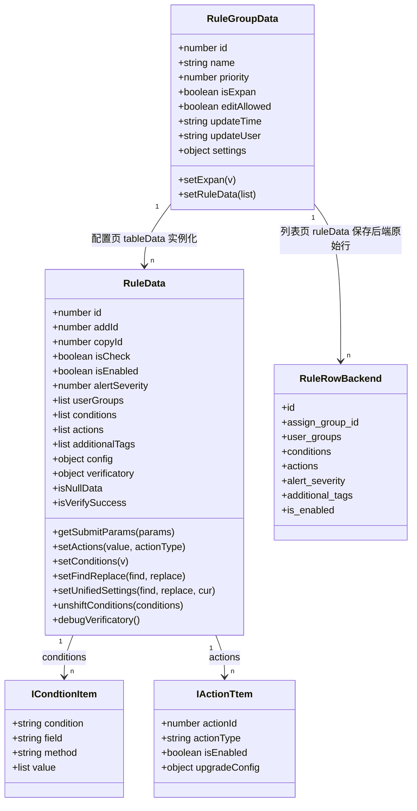
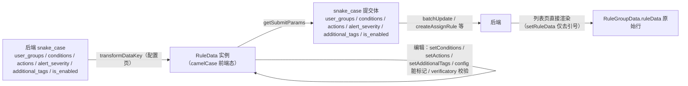

# 模型：告警分派专家 / 告警分派

**本文引用的文件**

- [typing/index.ts](file://bkmonitor/webpack/src/monitor-pc/pages/alarm-dispatch/typing/index.ts)——核心模型：RuleData / RuleGroupData 类、类型、枚举、常量
- [typing/condition.ts](file://bkmonitor/webpack/src/monitor-pc/pages/alarm-dispatch/typing/condition.ts)——条件选项模型与条件函数族
- [alarm-dispatch.tsx](file://bkmonitor/webpack/src/monitor-pc/pages/alarm-dispatch/alarm-dispatch.tsx)——列表页（规则组模型消费、名称/优先级校验）
- [alarm-dispatch-config.tsx](file://bkmonitor/webpack/src/monitor-pc/pages/alarm-dispatch/alarm-dispatch-config.tsx)——配置页（RuleData 实例化、提交体组装、校验触发）
- [debugging-result.tsx](file://bkmonitor/webpack/src/monitor-pc/pages/alarm-dispatch/components/debugging-result.tsx)——调试数据与响应模型（IRuleGroupsDataItem / IResultGroupItem）
- [alarm-batch-edit.tsx](file://bkmonitor/webpack/src/monitor-pc/pages/alarm-dispatch/components/alarm-batch-edit.tsx)——批量编辑表单模型与校验
- [alarm-group-select.tsx](file://bkmonitor/webpack/src/monitor-pc/pages/alarm-dispatch/components/alarm-group-select.tsx)——告警组选择模型
- [alarm-update-content.tsx](file://bkmonitor/webpack/src/monitor-pc/pages/alarm-dispatch/components/alarm-update-content.tsx)——等级/标签展示（LEVELLIST 消费）
- [alarm-dispatch-action.tsx](file://bkmonitor/webpack/src/monitor-pc/pages/alarm-dispatch/components/alarm-dispatch-action.tsx)——分派动作展示（actions snake_case 消费）
- [common-condition-new.tsx](file://bkmonitor/webpack/src/monitor-pc/pages/alarm-dispatch/components/common-condition-new.tsx)——条件选择器（条件模型编辑与校验）
- [model.js](file://bkmonitor/webpack/src/monitor-api/modules/model.js)——接口定义（路径）
- [assign.js](file://bkmonitor/webpack/src/monitor-api/modules/assign.js)——接口定义（路径）
- [utils.js](file://bkmonitor/webpack/src/monitor-common/utils/utils.js)——transformDataKey

## 目录

1. [简介](#简介)
2. [实体清单](#实体清单)
3. [核心类模型](#核心类模型)
4. [条件选项模型](#条件选项模型)
5. [接口数据结构契约](#接口数据结构契约)
6. [校验规则](#校验规则)
7. [迁移说明](#迁移说明)
8. [结论](#结论)

## 简介

本模块无数据库/ORM，「模型」口径 = **前端数据模型 + 接口数据结构 + 校验规则**，包含四类资产：

1. **TypeScript 类**：`RuleData`（规则行模型：字段 + 脏标记 + 校验位 + 提交变换方法）与 `RuleGroupData`（规则组模型）——本模块的独特之处在于用 class 而非普通 interface 承载行模型，把「前端态字段、差异标记、校验状态、提交体映射」聚合在同一个对象上，行编辑即方法调用；
2. **接口与类型**：`IRuleGroup`、`ICondtionItem`、`IActionTtem`、`IRuleDataItem`、`LevelItem`、`IConditionProps`，以及配置页/调试组件的局部接口（`ITableColumn`、`IRuleGroupsDataItem`、`IResultGroupItem`、`IAlarmBatchEditProps`、`IOption` 等）；
3. **枚举与常量**：`EColumn`、`EKeyTags`、`ActionType`、`RuleStatusType`、`TContionType`、`TMthodType`、`CONDITIONS`、`METHODS`、`LEVELLIST`、`GROUP_KEYS`、`KEY_FILTER_TAGS`、`KEY_TAG_MAPS`、`NOTICE_USERS_KEY`、`STRATEGY_LABELS`、`TAG_FIELD_BATCH_SIZE`、`IS_EMPTY_USERS_VALUES`；
4. **接口数据结构契约**（从调用点反推）：`rule_groups` / `rules` 响应、`batchUpdate` / `matchDebug` 提交与响应、辅助接口（`listUserGroup`、`listActionConfig`、`getAssignConditionKeys`、`searchObjectAttribute`）——见第 5 节，均标注推导来源。

章节来源：[typing/index.ts](file://bkmonitor/webpack/src/monitor-pc/pages/alarm-dispatch/typing/index.ts)（关键符号：`RuleData`、`RuleGroupData`、`EColumn`、`LEVELLIST`）、[typing/condition.ts](file://bkmonitor/webpack/src/monitor-pc/pages/alarm-dispatch/typing/condition.ts)（关键符号：`GROUP_KEYS`、`KEY_TAG_MAPS`、`allKVOptions`）

## 实体清单

### 2.1 类（typing/index.ts）

| 类 | 职责 | 实例化位置 |
|----|------|-----------|
| `RuleData` | 单条分派规则的完整前端模型（含 `config` 脏标记、`verificatory` 校验位、`getSubmitParams` 提交变换） | 配置页 `getAlarmAssignGroupsRules`（`new RuleData({...transformDataKey(item, false)})`）、空组初始行、复制/新增行、CSV 导入行 |
| `RuleGroupData` | 规则组模型（`id/name/priority/editAllowed/updateTime/updateUser/isExpan` + `ruleData`） | 列表页 `getAlarmDispatchGroupData`（由 `listAssignGroup` 响应字段映射构造） |

章节来源：[typing/index.ts](file://bkmonitor/webpack/src/monitor-pc/pages/alarm-dispatch/typing/index.ts)（关键符号：`RuleData`、`RuleGroupData`）；[alarm-dispatch-config.tsx](file://bkmonitor/webpack/src/monitor-pc/pages/alarm-dispatch/alarm-dispatch-config.tsx)（关键符号：`getAlarmAssignGroupsRules`）

### 2.2 接口与类型

| 类型 | 关键字段 | 用途 | 备注 |
|------|----------|------|------|
| `IRuleGroup` | `editAllowed?`、`id`、`isExpan`、`name`、`priority`、`ruleData: IRuleDataItem[]`、`updateTime`、`updateUser` | `RuleGroupData` 构造入参 | 导出 |
| `ICondtionItem` | `condition: TContionType`、`field`、`method: TMthodType`、`value: string[]` | 单条匹配条件（条件选择器、调试、提交体的最小单元） | 导出 |
| `IActionTtem` | `actionId?`、`actionType: 'itsm' \| 'notice'`、`isEnabled?`、`upgradeConfig?: {isEnabled, userGroups, upgradeInterval}` | 分派动作项 | 未导出（RuleData.actions 的元素类型） |
| `IRuleDataItem` | `actionConfig`、`alarmGroups`、`conditions`、`level`、`notice` | 旧版规则行接口（`IRuleGroup.ruleData` 的元素类型） | 未导出；现行运行时由 `RuleData` 类替代承载 |
| `LevelItem` | `color?`、`icon?`、`name`、`value` | 等级调整选项项 | 导出 |
| `IConditionProps` | `groupKey: string[]`、`groupKeys: TGroupKeys`、`keys?`、`valueMap: TValueMap` | 条件组件 props 聚合（列表页/调试侧栏透传） | 导出 |
| `IRuleGroupsDataItem` | `assign_group_id`、`bk_biz_id`、`group_name`、`priority`、`rules`、`settings?` | 调试数据 / `batchUpdate` 提交体 | 导出（debugging-result.tsx） |
| `IResultGroupItem` | `alerts_count?`、`group_id`、`group_name`、`isExpand`、`key?`、`priority`、`rules` | `matchDebug` 响应组项 | 内部（debugging-result.tsx） |
| `ITableColumn` | `class?`、`content?`、`id: EColumn`、`show?`、`width?` | 配置页动态列配置 | 内部（alarm-dispatch-config.tsx） |
| `IListItem` | `id`、`name`、`alias?`、`isCheck?`、`isGroupKey?`、`isStrategyId?`、`strategyIsEnabled?` | 条件 key/value 选项项 | 多处同名（condition.ts、common-condition-new.tsx 等内部定义；condition-find-replace.tsx 导出） |

章节来源：[typing/index.ts](file://bkmonitor/webpack/src/monitor-pc/pages/alarm-dispatch/typing/index.ts)（关键符号：`IRuleGroup`、`ICondtionItem`、`IActionTtem`、`IRuleDataItem`）；[typing/condition.ts](file://bkmonitor/webpack/src/monitor-pc/pages/alarm-dispatch/typing/condition.ts)（关键符号：`IConditionProps`）；[debugging-result.tsx](file://bkmonitor/webpack/src/monitor-pc/pages/alarm-dispatch/components/debugging-result.tsx)（关键符号：`IRuleGroupsDataItem`）

### 2.3 枚举与常量

| 名称 | 值/内容 | 用途 |
|------|---------|------|
| `EColumn`（枚举） | `select / userGroups / conditions / noticeProgress / upgradeConfig / actionId / levelTag / alertSeverity / additionalTags / isEnabled / operate` | 配置页列标识（渲染分派、批量编辑、合并判断） |
| `EKeyTags`（枚举） | `all / CMDB / event / strategy` | 条件 key 的分类标签 |
| `TypeEnum`（枚举，common-condition-new 内部） | `condition / input / key / method / value / ''` | 条件组件 tag 段类型 |
| `ActionType`（类型） | `'add' \| 'batchDelete' \| 'batchReset' \| 'copy' \| 'delete' \| 'reset'` | `handleOperateAction` 操作参数 |
| `RuleStatusType`（类型） | `'add' \| 'change' \| 'common' \| 'initial' \| 'verification'` | 定义存在但**全仓无消费点**（行状态样式类名由 `getRuleItemType` 直接返回字符串） |
| `TContionType`（类型） | `'and' \| 'or'` | 条件连接符 |
| `TMthodType`（类型） | `'eq' \| 'exclude' \| 'include' \| 'neq' \| 'nreg' \| 'reg'` | 条件匹配方法 |
| `CONDITIONS`（常量） | `[{and, 'AND'}, {or, 'OR'}]` | 连接符选项与默认值（`CONDITIONS[0].id`） |
| `METHODS`（常量） | `eq→in / neq→not in / include→like / exclude→not like / reg→regex / nreg→nregex`；组件内另有 `issuperset→⊇` | 匹配方法选项 |
| `LEVELLIST`（常量） | `0 保持原样 / 1 致命(#EA3636) / 2 预警(#FFB848) / 3 提醒(#3A84FF)`（含 icon） | 等级调整选择与展示 |
| `GROUP_KEYS`（常量） | `['dimensions', 'tags', 'set', 'module', 'host']` | 条件复合 key 前缀（二级选项展开依据） |
| `KEY_FILTER_TAGS` / `KEY_TAG_MAPS`（常量） | 4 类筛选标签；`CMDB: set/module/host/dynamic_group`、`strategy: alert.scenario/alert.metric/alert.strategy_id/labels`、`event: alert.name/notice_users/dimensions/ip/bk_cloud_id/alert.event_source` | key 列表分类过滤 |
| `NOTICE_USERS_KEY` / `STRATEGY_LABELS` / `TAG_FIELD_BATCH_SIZE`（常量） | `'notice_users'` / `'labels'` / `20` | 通知人员远程搜索、策略标签、alertTopN 分块大小（与后端 `MAX_NESTED_TOP_N_FIELDS` 约定同步） |
| `IS_EMPTY_USERS_VALUES`（常量） | `[{id:'0',name:'false'},{id:'1',name:'true'}]` | `is_empty_users` 条件固定值 |
| `processList`（配置页常量） | 5 段流程说明（分派给谁/匹配哪些告警规则/如何执行分派/修改原告警内容 + 收尾段） | 表头流程展示条（`colspan` 与 `mergeConfig` 联动） |

章节来源：[typing/index.ts](file://bkmonitor/webpack/src/monitor-pc/pages/alarm-dispatch/typing/index.ts)（关键符号：`EColumn`、`ActionType`、`RuleStatusType`、`TContionType`、`TMthodType`、`CONDITIONS`、`METHODS`、`LEVELLIST`、`IRuleGroup`、`ICondtionItem`、`IActionTtem`、`IRuleDataItem`）；[typing/condition.ts](file://bkmonitor/webpack/src/monitor-pc/pages/alarm-dispatch/typing/condition.ts)（关键符号：`GROUP_KEYS`、`EKeyTags`、`KEY_FILTER_TAGS`、`KEY_TAG_MAPS`、`NOTICE_USERS_KEY`、`TAG_FIELD_BATCH_SIZE`、`IS_EMPTY_USERS_VALUES`、`IConditionProps`）；[alarm-dispatch-config.tsx](file://bkmonitor/webpack/src/monitor-pc/pages/alarm-dispatch/alarm-dispatch-config.tsx)（关键符号：`ITableColumn`、`processList`）；[debugging-result.tsx](file://bkmonitor/webpack/src/monitor-pc/pages/alarm-dispatch/components/debugging-result.tsx)（关键符号：`IRuleGroupsDataItem`、`IResultGroupItem`）

## 核心类模型

### 3.1 RuleData 字段模型

`RuleData` 以类字段默认值定义「前端态模型」（20 个字段、3 个 getter、约 15 个方法），后端数据仅在有值时覆盖默认：

| 字段 | 默认值 | 说明 |
|------|--------|------|
| `id` | `0` | 数据库规则 id；`0` = 新增未保存 |
| `addId` / `copyId` | `null` | 新增行/复制行的前端标记（`random(8)` 生成；`copyId` 由 `setCopyID` 设置） |
| `key` | `random(8)` | Vue 渲染 key |
| `isCheck` | `false` | 行勾选（批量操作依据） |
| `isEnabled` | `false` | 规则启停 |
| `alertSeverity` | `0` | 等级调整（LEVELLIST value） |
| `userGroups` | `[]` | 告警组 id 数组 |
| `conditions` | `[]` | 匹配条件（`ICondtionItem[]`） |
| `actions` | `[{actionType:'notice', isEnabled:true, upgradeConfig:{isEnabled:false, userGroups:[], upgradeInterval:0}}]` | 分派动作数组（默认通知开、升级关） |
| `upgradeConfig` | `{noticeIsEnabled:true, isEnabled:false, userGroups:[], upgradeInterval:undefined}` | 通知升级的表单态（与 actions 中 notice 分支双向同步） |
| `additionalTags` | `[]` | 追加标签（`{key, value}[]`，提交形态） |
| `tag` | `[]` | 追加标签的输入框字符串态（`key:value`，构造/编辑时同步） |
| `actionId` | `undefined` | 流程套餐 id 的表单态（与 actions 中 itsm 分支同步） |
| `conditionsRenderKey` | `random(8)` | 条件组件强制重渲染 key（`conditionsRefresh`/`setFindReplace` 等场景刷新） |
| `conditionsRepeat` | `false` | 条件重复标记（`setConditionsRepeat` 写入；未见外部读取消费） |
| `replaceData` | `[]` | 查找替换后的新条件缓存（条件组件据此标记 `isReplace`） |
| `tooltipsDisabled` | `false` | 操作栏 tooltip 的临时禁用（popconfirm 打开期间） |
| `config` | 7 键全 `false` | **脏标记**：`userGroups / isEnabled / upgradeConfig / conditions / actionId / additionalTags / alertSeverity` |
| `verificatory` | 7 键全 `false` | **校验位**：与 config 同键 + `validateTips` 存提示文案 |

章节来源：[typing/index.ts](file://bkmonitor/webpack/src/monitor-pc/pages/alarm-dispatch/typing/index.ts)（关键符号：`RuleData`、`RuleData.config`、`RuleData.verificatory`）；[alarm-dispatch-config.tsx](file://bkmonitor/webpack/src/monitor-pc/pages/alarm-dispatch/alarm-dispatch-config.tsx)（关键符号：`getRowContent`）

### 3.2 构造、getter 与方法

**构造逻辑**（`constructor(data)`）：先 `JSON.parse(JSON.stringify(this))` 取默认字段名集合 `TEMP_THIS`，遍历其键，仅当 `data[key]` 为真值时赋值——三条特殊分支：

1. `actions`：遍历数组，`notice` 项反向合成 `this.upgradeConfig = {...action.upgradeConfig, noticeIsEnabled: action.isEnabled}`；`itsm` 项提取 `action.actionId`；
2. `additionalTags`：同时生成 `this.tag = data[key].map(item => `${item.key}:${item.value}`)`；
3. `conditions`：逐条将 value 经 `topNDataStrTransform`（去首尾双引号）处理后写入。

其余字段直通。注意「falsy 不覆盖」语义：`isEnabled:false`、`alertSeverity:0`、空数组等因与默认值等价而无副作用，但 `id:0` 同样不会覆盖。

**状态 getter**：

| getter | 语义 | 计算 |
|--------|------|------|
| `isInitData` | 是否未触碰任何字段 | `config` 7 键全 false |
| `isNullData` | 是否空规则（默认空行形态） | 无告警组、无条件、升级关、通知开、无流程、无等级、无标签且 `isEnabled === true` |
| `isVerifySuccess` | 是否通过校验 | `verificatory` 的 `userGroups/conditions/additionalTags` 全 false |

**方法清单**：

| 方法 | 作用 |
|------|------|
| `getSubmitParams(params)` | 前端态 → snake_case 提交体（含 itsm 无 action_id 剔除，见第 5 节） |
| `setActions(value, actionType)` | 按 actionType 更新/追加 actions 项并同步 `upgradeConfig`/`actionId` |
| `setAdditionalTags(list)` | 兼容 `key:value` 与 `key=value` 两种输入，拆为 `{key, value}` |
| `setConditions(v)` / `setConditionsRepeat(v)` / `setConfig(field, v)` / `setVerificatory(field, v, tips)` / `setCheck(v)` / `setIsEnabled(v)` / `setTooltipsDisabled(v)` | 原子写入口 |
| `setCopyID()` | 生成 `copyId`（区分复制行） |
| `conditionsRefresh()` | 刷新 `conditionsRenderKey`（强制重渲染条件组件） |
| `debugVerificatory()` | 调试前校验：非空行必须有告警组与条件（写 `verificatory` 并返回是否有误） |
| `setFindReplace(findData, replaceData, isUnshift)` | 查找替换（内部：`conditionFindReplace` → `mergeConditions` / `conditionsDeduplication`，并刷新渲染 key） |
| `setUnifiedSettings(findData, replaceData, curConditions)` | 统一设置：完整包含时查找替换，有差异时与当前条件合并（`mergeConditions([...curConditions, ...replaceData])`） |
| `unshiftConditions(conditions)` | 条件前插 + 去重 + 合并（统一设置「新增」路径） |
| `setExpan(v)` / `setRuleData(list)`（RuleGroupData） | 展开态 / 规则数据写入（含条件值去引号） |

章节来源：[typing/index.ts](file://bkmonitor/webpack/src/monitor-pc/pages/alarm-dispatch/typing/index.ts)（关键符号：`RuleData.constructor`、`RuleData.isInitData`、`RuleData.isNullData`、`RuleData.isVerifySuccess`、`RuleData.conditionsRefresh`）；[typing/condition.ts](file://bkmonitor/webpack/src/monitor-pc/pages/alarm-dispatch/typing/condition.ts)（关键符号：`topNDataStrTransform`）

### 3.3 RuleGroupData

字段：`id`（0）、`name`（''）、`priority`（0）、`isExpan`（true）、`editAllowed`（false）、`updateTime`（''）、`updateUser`（''）、`ruleData`（[]）、`settings`（{}）。构造同样是「TEMP_THIS 键集 + 真值覆盖」。列表页负责字段映射（`edit_allowed → editAllowed`、`update_time → updateTime` 等），配置页使用 `ruleGroupData` 时的 `settings.public_conditions` 与 `bk_biz_id` 直接取自后端响应对象。

图表来源：[typing/index.ts](file://bkmonitor/webpack/src/monitor-pc/pages/alarm-dispatch/typing/index.ts)（关键符号：`RuleData`、`RuleGroupData`、`ICondtionItem`、`IActionTtem`、`IRuleGroup`）；[alarm-dispatch.tsx](file://bkmonitor/webpack/src/monitor-pc/pages/alarm-dispatch/alarm-dispatch.tsx)（关键符号：`getAlarmDispatchGroupData`、`getAlarmAssignGroupsRules`）；[alarm-dispatch-config.tsx](file://bkmonitor/webpack/src/monitor-pc/pages/alarm-dispatch/alarm-dispatch-config.tsx)（关键符号：`getAlarmAssignGroupsRules`）

章节来源：[typing/index.ts](file://bkmonitor/webpack/src/monitor-pc/pages/alarm-dispatch/typing/index.ts)（关键符号：`RuleData`、`RuleData.getSubmitParams`、`RuleData.debugVerificatory`、`RuleData.setFindReplace`、`RuleData.setUnifiedSettings`、`RuleData.unshiftConditions`、`RuleGroupData.setRuleData`）

## 条件选项模型

### 4.1 复合 key 选项体系

条件选择器的选项模型由三张 Map + 一个特殊选项表构成，全部可（改）动绑定，最终以 props 传入 `CommonCondition`：

| 模型 | 结构 | 说明 |
|------|------|------|
| `TGroupKeys` | `Map<string, any[] \| string[]>` | 复合 key 的二级选项：`set/module/host`（CMDB 属性，`id = '<type>.<bk_property_id>'`）与 `dimensions/tags`（标签维度，来自 `listAlertTags`） |
| `TValueMap` | `Map<string, {id, name}[]>` | 每个 key 的候选值：`alert.name / alert.metric / alert.scenario / alert.strategy_id / alert.event_source / ip / bk_cloud_id / labels / notice_users / dynamic_group / is_empty_users` 及 CMDB 属性值与 topN 标签值 |
| `keys` | `{id, name}[]` | 一级 key 列表（`getAssignConditionKeys` 映射 `key → display_key`，剔除 `tags`，前端追加「动态分组」） |
| `ISpecialOptions` | `{ [key: string]: TValueMap }` | **特殊选项**：键为 `'<field>=<value>'`（如 `alert.strategy_id=123`），值为该策略的维度候选；`CommonCondition.getDimensionKeys` 将当前条件拼成 `field=value` 集合命中后合并进 valueMap，实现「选了策略才出现对应维度」 |

条件显示与选择的 key 分类由 `EKeyTags` + `KEY_TAG_MAPS` 驱动（CMDB 属性/告警策略/告警事件三组 + 全部），`GROUP_KEYS` 决定哪些 key 可展开二级选项。

章节来源：[typing/condition.ts](file://bkmonitor/webpack/src/monitor-pc/pages/alarm-dispatch/typing/condition.ts)（关键符号：`TGroupKeys`、`TValueMap`、`ISpecialOptions`、`GROUP_KEYS`、`EKeyTags`、`KEY_TAG_MAPS`）；[common-condition-new.tsx](file://bkmonitor/webpack/src/monitor-pc/pages/alarm-dispatch/components/common-condition-new.tsx)（关键符号：`getDimensionKeys`、`getCurValuesList`）

### 4.2 条件函数族（typing/condition.ts）

条件数据的比较、查找替换、合并、去重由六个纯函数协作：

| 函数 | 语义 | 备注 |
|------|------|------|
| `conditionCompare(left, right)` | 条件相等判定：`field/method` 相等 + `value` 排序后相等 | 首项为 `condition` 字段的自比较（恒真，已用 biome-ignore 标注 noSelfCompare）——连接符不参与比较 |
| `conditionsInclues(target, conditions)` | target 是否包含在条件数组中 | 基于 conditionCompare |
| `conditionsDeduplication(conditions)` | 去重（保留首个） | `setFindReplace`/`setUnifiedSettings`/`unshiftConditions` 复用 |
| `mergeConditions(conditions)` | 相同 `field + method` 的 value 合并 | 统一设置/查找替换的收尾归并 |
| `conditionFindReplace(old, findData, replaceData, isUnshift)` | 命中 findData **全部条件**才替换：`isUnshift` 时新条件前插，否则插入到最后命中位置；未全命中原样返回 | 查找替换与统一设置的主变换 |
| `statisticsSameConditions(groups)` | 多组条件的**共同子集**（交集）：任一空组直接返回 `[]`；单组时返回该组本身 | 统一设置初始值反推与变更提示 |
| `topNDataStrTransform(value)` | 去除字符串首尾双引号 | topN 接口值（ip/alert_name/labels/tags）的规范化，构造与选项装载两处使用 |
| `deepCompare(a, b)` | 深比较（类型、长度、属性逐一对比） | 脏标记/差异对比的基础 |

图表来源：[typing/index.ts](file://bkmonitor/webpack/src/monitor-pc/pages/alarm-dispatch/typing/index.ts)（关键符号：`RuleData`、`RuleData.getSubmitParams`、`RuleGroupData.setRuleData`、`deepCompare`）；[alarm-dispatch-config.tsx](file://bkmonitor/webpack/src/monitor-pc/pages/alarm-dispatch/alarm-dispatch-config.tsx)（关键符号：`getAlarmAssignGroupsRules`、`handleStartDebug`）；[utils.js](file://bkmonitor/webpack/src/monitor-common/utils/utils.js)（关键符号：`transformDataKey`）

章节来源：[typing/condition.ts](file://bkmonitor/webpack/src/monitor-pc/pages/alarm-dispatch/typing/condition.ts)（关键符号：`conditionCompare`、`conditionFindReplace`、`conditionsDeduplication`、`conditionsInclues`、`mergeConditions`、`statisticsSameConditions`、`topNDataStrTransform`）；[typing/index.ts](file://bkmonitor/webpack/src/monitor-pc/pages/alarm-dispatch/typing/index.ts)（关键符号：`deepCompare`）

### 4.3 选项数据供给（allKVOptions）

条件选项的全部数据源与落位（详见 03-数据流转「异步流」章）：

| 数据源（符号） | 落位 |
|----------------|------|
| `getAssignConditionKeys` | `keys`（key 列表） |
| `listAlertTags` | `groupKeys.dimensions` + 各 tag 的 `valueMap`（分批 `alertTopN`，`TAG_FIELD_BATCH_SIZE=20`） |
| `searchObjectAttribute`（set/module/host） | `groupKeys.set/module/host` + 属性值 `valueMap` |
| `alertTopN`（alert_name/ip/bk_cloud_id/labels） | 对应 `valueMap`（`topNDataStrTransform` 去引号） |
| `plainStrategyList` / `getMetricListV2` / `getScenarioList` | `valueMap['alert.strategy_id'/'alert.metric'/'alert.scenario']` |
| `listEventPlugin` | `valueMap['alert.event_source']`（「监控策略」恒在首项） |
| `listUsersUser` | `valueMap['notice_users']`（默认 20 人，远程搜索补充） |
| `groupsIpChooserDynamicGroup` | `valueMap['dynamic_group']` |
| 固定项 | `valueMap['is_empty_users']`（`IS_EMPTY_USERS_VALUES`） |
| 按需：`getStrategyV2` + `getVariableValue`（`setDimensionsOfStrategy`） | `specialOptions['alert.strategy_id=<id>']` |

章节来源：[typing/condition.ts](file://bkmonitor/webpack/src/monitor-pc/pages/alarm-dispatch/typing/condition.ts)（关键符号：`allKVOptions`、`setDimensionsOfStrategy`、`conditionCompare`、`conditionFindReplace`、`conditionsDeduplication`、`conditionsInclues`、`mergeConditions`、`statisticsSameConditions`、`topNDataStrTransform`、`TGroupKeys`、`TValueMap`、`ISpecialOptions`、`IConditionProps`）；[common-condition-new.tsx](file://bkmonitor/webpack/src/monitor-pc/pages/alarm-dispatch/components/common-condition-new.tsx)（关键符号：`getDimensionKeys`、`getCurValuesList`、`IProps`）

## 接口数据结构契约

以下为**从前端调用点反推**的契约（接口路径来自 monitor-api 模块定义；字段来自消费方式）：

| 接口（符号 / 路径） | 入参 | 响应 / 提交结构（推导依据） |
|---|---|---|
| `listAssignGroup` `GET fta/assign/rule_groups/` | 无 | `[{id, name, priority, edit_allowed, update_time, update_user}]` + 配置页消费的 `settings`（读 `public_conditions`）与 `bk_biz_id`（提交 debugData）；依据 `getAlarmDispatchGroupData`（列表页字段映射）与配置页 `unifiedSettingInit`/`handleStartDebug` |
| `createAssignGroup` `POST fta/assign/rule_groups/` | `{name, priority}` | `{id, ...}`；依据 `handleAddAlarmDispatchGroup`（用 `data.id` 跳转配置页） |
| `partialUpdateAssignGroup` `PATCH fta/assign/rule_groups/{pk}/` | `{name}` 或 `{priority}` | 通用成功响应；依据列表页 `handleBatchEditSubmit` |
| `destroyAssignGroup` `DELETE fta/assign/rule_groups/{pk}/` | pk=组 id | 通用成功响应；依据 `DebuggingResult.handleSave` |
| `listAssignRule` `GET fta/assign/rules/` | 列表页：`{page:1, page_size:1000}`；配置页：`{assign_group_id}` | `[{id, assign_group_id, user_groups, conditions, actions, alert_severity, additional_tags, is_enabled, user_type?}]`；依据列表页渲染（snake 消费）、配置页 `transformDataKey` + `RuleData` 构造、`AlarmDispatchAction` 的 `user_type` 消费 |
| `batchUpdate` `POST fta/assign/rule_operate/batch_update/` | `{bk_biz_id, assign_group_id, priority, group_name, rules: getSubmitParams 输出数组, settings: {public_conditions}}` | 通用成功响应；依据 `handleStartDebug` 组装与 `DebuggingResult.handleSave` 提交（规则级字段见 `getSubmitParams`：`id?/user_groups/conditions/actions[{action_type, is_enabled, upgrade_config{is_enabled, user_groups, upgrade_interval}} 或 {action_type, action_id}]/alert_severity/additional_tags[{key,value}]/is_enabled`） |
| `matchDebug` `POST fta/assign/rule_operate/match_debug/` | 同上（或 `{exclude_groups}`）+ `{start_time, end_time}` | `[{group_id, group_name, priority, alerts_count, rules: [{user_groups, conditions, is_enabled, is_changed, alerts: [{id, severity, alert_name, metrics: [{id, name}], content}]}]}]`；依据 `getRuleMatchDebug` 渲染消费 |
| `getAssignConditionKeys` `GET fta/assign/rule_operate/get_assign_condition_keys/` | 无 | `[{key, display_key}]`；依据 `allKVOptions` 映射 |
| `searchObjectAttribute` `GET fta/assign/cmdb/search_object_attribute/` | `{bk_obj_id: 'set'\|'module'\|'host'}` | `[{bk_property_id, bk_property_name, option}]`（option 为 string[] 或 {id,name}[]）；依据 `setCMDBOptions` |
| `listUserGroup` `GET rest/v2/user_groups/` | 无 | `[{id, name, users: [{display_name}]}]`；依据 `getAlarmGroupList`（`receiver` 取 display_name） |
| `listActionConfig` `GET fta/action/config/` | 无 | `[{id, name, plugin_type, plugin_name}]`；依据 `getProcessPackage`（`plugin_type` 过滤 itsm/itsmv4；展示 `name(plugin_name)`，**列表页只留 itsm**） |

对话框侧数据形态（调试相关）：`debugData`（`IRuleGroupsDataItem`，数组恒为 1 项，注释「防止有批量调试」）承载提交，`resultsGroup`（`IResultGroupItem`）承载试算展示。

章节来源：[model.js](file://bkmonitor/webpack/src/monitor-api/modules/model.js)（关键符号：`createAssignGroup`、`destroyAssignGroup`、`listAssignGroup`、`partialUpdateAssignGroup`、`listAssignRule`、`listUserGroup`、`listActionConfig`）、[assign.js](file://bkmonitor/webpack/src/monitor-api/modules/assign.js)（关键符号：`batchUpdate`、`matchDebug`、`getAssignConditionKeys`、`searchObjectAttribute`）；[alarm-dispatch-config.tsx](file://bkmonitor/webpack/src/monitor-pc/pages/alarm-dispatch/alarm-dispatch-config.tsx)（关键符号：`handleStartDebug`、`getAlarmAssignGroupsRules`、`getProcessPackage`）；[debugging-result.tsx](file://bkmonitor/webpack/src/monitor-pc/pages/alarm-dispatch/components/debugging-result.tsx)（关键符号：`getRuleMatchDebug`、`handleSave`、`IRuleGroupsDataItem`、`IResultGroupItem`）

## 校验规则

| # | 规则 | 逻辑 / 正则 | 位置（关键符号） |
|---|------|-------------|------------------|
| 1 | 规则组名必填 | form rules `required: true`，提示「输入规则组名」 | alarm-dispatch.tsx `rules`、`handleAddAlarmDispatchGroup`、`AlarmBatchEdit.handleSubmit`（`errorMsg.name`） |
| 2 | 规则组名禁 emoji | `/(\ud83c[\udf00-\udfff])|(\ud83d[\udc00-\ude4f\ude80-\udeff])|[\u2600-\u2B55]/g`，提示「不能输入emoji表情」 | alarm-dispatch.tsx `rules` |
| 3 | 优先级范围 | `min=1 max=10000`；输入归一化（NaN→1、0→1、≥10000→10000、小数取整），文案「数值越高优先级越高,最大值为10000」 | `handlePriorityChange`、`AlarmBatchEdit.handlePriorityChange` |
| 4 | 优先级冲突 | 与其余组优先级重复即提示「注意: 优先级冲突」并阻止提交（列表页新建/行内编辑；`priorityList` 排除自身） | `handlePriorityChange`、`handleAddAlarmDispatchGroup`、`AlarmBatchEdit.handlePriorityChange` |
| 5 | 告警组非空 | 非空规则必须选择告警组，提示「告警组不能为空」 | `validateAlarmGroup` |
| 6 | 升级组互斥 | 通知升级的告警组不能与原告警组有交集（且升级开启、通知开启），提示「通知升级的告警组不能和原告警组相同」 | `validateAlarmGroup` |
| 7 | 匹配条件非空 | 非空规则必须至少一条条件；条件组件 `validate` 置 `isErr`，提示「注意: 必填字段不能为空」，经 `onValidate` 写回 `verificatory.conditions` | `CommonCondition.validate`、`debugVerificatory`、`handleConditionChange` |
| 8 | 条件 key 冲突 | 同一规则内 `field` 重复即报错「注意: 名字冲突」（`validateConditionsRepeatKey`） | `validateConditionsRepeatKey` |
| 9 | 条件重复检测 | 两两 `conditionCompare`，重复时 `getHasRepeatData` → `onRepeat` → `row.setConditionsRepeat(true)`（组件内红框提示） | `getHasRepeatData`、`setConditionsRepeat` |
| 10 | 标签格式 | `key:value` 或 `key=value`（`/^[^:=]+[:=][^:=]+$/`），非法提示「标签格式不正确,格式为key:value 或 key=value」 | `handleAdditionalTagsChange`、`AlarmBatchEdit.handleAdditionalTagsChange` |
| 11 | 标签 key 唯一 | 同一规则内标签 key 重复提示「注意: 名字冲突」 | `handleAdditionalTagsChange` |
| 12 | 升级间隔 | 开启通知升级时必填且为正整数（`/^\+?[1-9][0-9]*$/`），提示「选择时间」「输入正整数」；同时必须选择升级告警组 | `AlarmBatchEdit.handleSubmit`、`handleVerifyInterval` |
| 13 | 调试前置（canDebug） | 全部行 `isVerifySuccess` 且不同时满足「仅一行且为空行」；配置页「调试并生效」按钮与批量优先级面板复用 | `canDebug` |
| 14 | 调试前汇总校验 | 逐行 `debugVerificatory()`（非空行的告警组+条件）+ 标签校验全部通过才组装 `debugData` | `handleStartDebug` |
| 15 | 导入表头一致性 | CSV 表头必须与导出表头 7 列逐字一致，否则静默忽略（`// to do 校验`） | `handleImportChange` |

补充说明：`RuleData.isVerifySuccess` 仅汇总 `userGroups/conditions/additionalTags` 三个校验位——通知升级、等级、流程等字段的校验以「表单弹层内部即时校验 + 提交前汇总」两层兜底。

章节来源：[alarm-dispatch.tsx](file://bkmonitor/webpack/src/monitor-pc/pages/alarm-dispatch/alarm-dispatch.tsx)（关键符号：`rules`、`handlePriorityChange`、`handleAddAlarmDispatchGroup`）；[alarm-dispatch-config.tsx](file://bkmonitor/webpack/src/monitor-pc/pages/alarm-dispatch/alarm-dispatch-config.tsx)（关键符号：`validateAlarmGroup`、`handleAdditionalTagsChange`、`handleStartDebug`、`canDebug`、`handleImportChange`）；[alarm-batch-edit.tsx](file://bkmonitor/webpack/src/monitor-pc/pages/alarm-dispatch/components/alarm-batch-edit.tsx)（关键符号：`handleSubmit`、`handlePriorityChange`、`handleAdditionalTagsChange`）；[common-condition-new.tsx](file://bkmonitor/webpack/src/monitor-pc/pages/alarm-dispatch/components/common-condition-new.tsx)（关键符号：`validate`、`getHasRepeatData`、`validateConditionsRepeatKey`）；[typing/index.ts](file://bkmonitor/webpack/src/monitor-pc/pages/alarm-dispatch/typing/index.ts)（关键符号：`RuleData.debugVerificatory`、`RuleData.isVerifySuccess`）

## 迁移说明

该模块无此项（前端无 DB/ORM，不涉及数据迁移与版本化；持久化数据全部由后端 `fta/assign` 系列接口管理）。

章节来源：[typing/index.ts](file://bkmonitor/webpack/src/monitor-pc/pages/alarm-dispatch/typing/index.ts)（关键符号：`RuleData`）

## 结论

1. **类模型是本模块的「心脏」**：`RuleData` 把「前后端字段映射（getSubmitParams）、脏标记（config）、校验位（verificatory/validateTips）、条件变换（setFindReplace/setUnifiedSettings/unshiftConditions）」聚合为一个可实例化的行模型；`RuleGroupData` 则是轻量的组壳。引用这两类的文件覆盖两个页面与全部核心交互——维护时改类方法比改页面模板优先。
2. **同一份规则数据存在两种前端形态**：列表页保留后端原始行（snake_case，`RuleGroupData.ruleData`），配置页转换为 `RuleData` 实例（camelCase）——`transformDataKey`（入）与 `getSubmitParams`（出）是唯一的双向转换点，其余代码不应跨界消费字段名。
3. **条件模型是「三 Map + 特殊选项」的运行时装配**：`TGroupKeys`/`TValueMap`/`keys` 由 `allKVOptions` 12 路数据源写入，`ISpecialOptions` 让「策略→维度」产生联动；条件比对（`conditionCompare`）刻意忽略连接符（含自比较写法，biome-ignore 标注），去重/合并/查找替换都建立在它之上。
4. **校验分层清晰但分散**：组件层（`CommonCondition` 的 validate/repeat）→ 行层（`verificatory` 三键 + `debugVerificatory`）→ 提交层（`handleStartDebug` 汇总 + `canDebug` 门控）。`isVerifySuccess` 只覆盖三个校验位，是新增校验字段时最容易遗漏的聚合点。
5. **需注意的模型级事实**：`RuleStatusType` 定义后全仓无消费；`IRuleDataItem` 为旧形态残留接口（现行由 `RuleData` 承担）；`conditionsRepeat` 有写入无读取；`isNullData` 的成立条件包含 `isEnabled === true`（关闭开关会让空行脱离「空行豁免」）。上述均已在正文各节如实标注，供后续重构参考。

章节来源：[typing/index.ts](file://bkmonitor/webpack/src/monitor-pc/pages/alarm-dispatch/typing/index.ts)（关键符号：`RuleData`、`RuleGroupData`、`RuleStatusType`、`IRuleDataItem`）、[typing/condition.ts](file://bkmonitor/webpack/src/monitor-pc/pages/alarm-dispatch/typing/condition.ts)（关键符号：`conditionCompare`、`ISpecialOptions`）、[alarm-dispatch-config.tsx](file://bkmonitor/webpack/src/monitor-pc/pages/alarm-dispatch/alarm-dispatch-config.tsx)（关键符号：`canDebug`、`handleStartDebug`）
