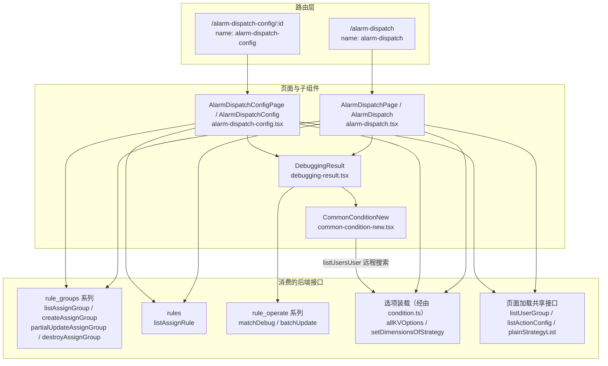

# 接口：告警分派专家 / 告警分派

**本文引用的文件**

路由与页面容器：
- [alarm-dispath.ts](file://bkmonitor/webpack/src/monitor-pc/router/manager/alarm-dispath.ts)
- [manager/index.ts](file://bkmonitor/webpack/src/monitor-pc/router/manager/index.ts)
- [router-config.ts](file://bkmonitor/webpack/src/monitor-pc/router/router-config.ts)
- [alarm-dispatch-page.tsx](file://bkmonitor/webpack/src/monitor-pc/pages/alarm-dispatch/alarm-dispatch-page.tsx)
- [alarm-dispatch-config-page.tsx](file://bkmonitor/webpack/src/monitor-pc/pages/alarm-dispatch/alarm-dispatch-config-page.tsx)

页面与调用点：
- [alarm-dispatch.tsx](file://bkmonitor/webpack/src/monitor-pc/pages/alarm-dispatch/alarm-dispatch.tsx)
- [alarm-dispatch-config.tsx](file://bkmonitor/webpack/src/monitor-pc/pages/alarm-dispatch/alarm-dispatch-config.tsx)
- [debugging-result.tsx](file://bkmonitor/webpack/src/monitor-pc/pages/alarm-dispatch/components/debugging-result.tsx)
- [common-condition-new.tsx](file://bkmonitor/webpack/src/monitor-pc/pages/alarm-dispatch/components/common-condition-new.tsx)
- [common-condition.tsx](file://bkmonitor/webpack/src/monitor-pc/pages/alarm-dispatch/components/common-condition.tsx)
- [condition.ts](file://bkmonitor/webpack/src/monitor-pc/pages/alarm-dispatch/typing/condition.ts)
- [typing/index.ts](file://bkmonitor/webpack/src/monitor-pc/pages/alarm-dispatch/typing/index.ts)

权限：
- [authority-map.ts](file://bkmonitor/webpack/src/monitor-pc/pages/alarm-dispatch/authority-map.ts)
- [authorityMixin.ts](file://bkmonitor/webpack/src/monitor-pc/mixins/authorityMixin.ts)

API 定义：
- [model.js](file://bkmonitor/webpack/src/monitor-api/modules/model.js)
- [assign.js](file://bkmonitor/webpack/src/monitor-api/modules/assign.js)
- [alert.js](file://bkmonitor/webpack/src/monitor-api/modules/alert.js)
- [strategies.js](file://bkmonitor/webpack/src/monitor-api/modules/strategies.js)
- [event_plugin.js](file://bkmonitor/webpack/src/monitor-api/modules/event_plugin.js)
- [grafana.js](file://bkmonitor/webpack/src/monitor-api/modules/grafana.js)
- [base.ts](file://bkmonitor/webpack/src/monitor-api/base.ts)

共享工具：
- [utils/index.ts](file://bkmonitor/webpack/src/monitor-pc/utils/index.ts)

## 目录

1. [简介](#简介)
2. [路由入口清单](#路由入口清单)
3. [API 方法清单](#api-方法清单)
4. [接口与调用点关系图](#接口与调用点关系图)
5. [契约示例](#契约示例)
6. [错误处理与权限](#错误处理与权限)
7. [结论](#结论)

## 简介

告警分派专家（前端「告警分派」功能域）的「接口」包含两层含义：

1. **页面路由入口**：`router/manager/alarm-dispath.ts` 注册的 2 条路由，覆盖「规则组列表（`/alarm-dispatch`）→ 分派规则配置（`/alarm-dispatch-config/:id`）」全流程；
2. **后端 API 调用**：围绕 FTA 告警分派域 `fta/assign/*`（规则组 `rule_groups` / 规则 `rules` / 规则操作 `rule_operate` / CMDB 属性 `cmdb`）主线，加上条件编辑器与页面加载所用的 `alert` / `strategies` / `event_plugin` / `grafana` / `model` 共享支撑接口。

本模块是纯前端消费方（不对后端暴露 HTTP 入口）。所有请求经 `monitor-api/modules/*.js` 的 `request('METHOD', 'path')` 声明式定义，统一走 `monitor-api/base.ts` 的 `request` 封装（自动附加 `bk_biz_id`/`space_uid`、生成 traceparent、统一错误 message 策略）。规则组数据面以 `rule_groups` 的 `id`（即路由参数 `:id`）为主键，规则以 `assign_group_id` 关联到组。

章节来源：[alarm-dispath.ts](file://bkmonitor/webpack/src/monitor-pc/router/manager/alarm-dispath.ts)（关键符号：`AlarmDispatchConfig`）；[assign.js](file://bkmonitor/webpack/src/monitor-api/modules/assign.js)（关键符号：`batchUpdate`）

## 路由入口清单

### 两条路由

路由文件为 `router/manager/alarm-dispath.ts`（注意文件名比目录名少一个 `t`；在 `router/manager/index.ts` 中以 `alarmDispath` 引入）：

| path | name | 组件 | meta 要点 |
|---|---|---|---|
| `/alarm-dispatch` | `alarm-dispatch` | `alarm-dispatch-page.tsx`（`AlarmDispatchPage`，components.noCache） | title 告警分派、navId `alarm-dispatch`、route.parent `manager`、noNavBar false |
| `/alarm-dispatch-config/:id` | `alarm-dispatch-config` | `alarm-dispatch-config-page.tsx`（`AlarmDispatchConfigPage`，components.noCache） | title 配置规则、needBack: true、navId `alarm-dispatch`、route.parent `manager` |

- **导航注册**：`router/router-config.ts` 的「告警」分组中配置菜单项 `{ name: '告警分派', id: 'alarm-dispatch', path: '/alarm-dispatch', href: '#/alarm-dispatch', canStore: true }`。
- **页面内跳转**：列表页 `handleToConfig(id)` → `router.push({ name: 'alarm-dispatch-config', params: { id } })`；新建组成功后 `handleAddAlarmDispatchGroup` 携带 `data.id` 跳转同一路由；配置页 `handleCancel` / `handleSaveSuccess` 返回 `alarm-dispatch`。
- **配置页容器守卫**：`alarm-dispatch-config-page.tsx` 注册了 `beforeRouteLeave`——已生效保存（`isEffect`）直接放行；有未生效修改（`isRuleChange`）时弹「是否放弃本次操作？」确认后才允许离开（`to.params.refresh` 为真时跳过）。`isEffect` / `isRuleChange` 通过 ref 透传给配置页组件。
- **跨模块入口（不计入本模块路由）**：列表页「告警组详情」「套餐详情」复用 alarm-group / fta-solutions 模块组件（`AlarmGroupDetail`、`SetMealDetail`）；配置页「创建流程」跳 `#/set-meal-add`。

章节来源：[alarm-dispath.ts](file://bkmonitor/webpack/src/monitor-pc/router/manager/alarm-dispath.ts)（关键符号：`alarm-dispatch-config`）；[alarm-dispatch-config-page.tsx](file://bkmonitor/webpack/src/monitor-pc/pages/alarm-dispatch/alarm-dispatch-config-page.tsx)（关键符号：`beforeRouteLeave`）

## API 方法清单

### assign 系列（本模块专属，共 16 个）

定义位置：`monitor-api/modules/model.js`（12 个 `rule_groups`/`rules` REST 方法）与 `monitor-api/modules/assign.js`（4 个 `rule_operate`/`cmdb` 方法）。

**model.js 的规则组与规则方法**（路径前缀 `fta/assign/`）：

| 方法 | HTTP | 路径 | 语义 | 主要调用点 |
|---|---|---|---|---|
| `listAssignGroup` | GET | `fta/assign/rule_groups/` | 规则组列表（全量，request 层自动附加 `bk_biz_id`） | 列表页 `getAlarmDispatchGroupData`；配置页 `getAlarmDispatchGroupData` |
| `createAssignGroup` | POST | `fta/assign/rule_groups/` | 新建规则组 | 列表页 `handleAddAlarmDispatchGroup` |
| `partialUpdateAssignGroup` | PATCH | `fta/assign/rule_groups/{pk}/` | 更新组名/优先级（pk = 组 id） | 列表页 `handleBatchEditSubmit` |
| `destroyAssignGroup` | DELETE | `fta/assign/rule_groups/{pk}/` | 删除规则组（「调试并删除」链） | `debugging-result.tsx` `handleSave`（`excludeGroups` 分支） |
| `retrieveAssignGroup` | GET | `fta/assign/rule_groups/{pk}/` | 规则组详情 | 无前端调用点（仅定义与默认导出） |
| `updateAssignGroup` | PUT | `fta/assign/rule_groups/{pk}/` | 全量更新规则组 | 无前端调用点 |
| `listAssignRule` | GET | `fta/assign/rules/` | 规则列表（支持 `assign_group_id` 过滤 / 分页） | 列表页 `getAlarmAssignGroupsRules`；配置页 `getAlarmAssignGroupsRules` |
| `createAssignRule` | POST | `fta/assign/rules/` | 新建规则 | 无前端调用点 |
| `updateAssignRule` | PUT | `fta/assign/rules/{pk}/` | 全量更新规则 | 无前端调用点 |
| `partialUpdateAssignRule` | PATCH | `fta/assign/rules/{pk}/` | 部分更新规则 | 无前端调用点 |
| `destroyAssignRule` | DELETE | `fta/assign/rules/{pk}/` | 删除规则 | 无前端调用点 |
| `retrieveAssignRule` | GET | `fta/assign/rules/{pk}/` | 规则详情 | 无前端调用点 |

**assign.js 的规则操作与 CMDB 方法**：

| 方法 | HTTP | 路径 | 语义 | 主要调用点 |
|---|---|---|---|---|
| `matchDebug` | POST | `fta/assign/rule_operate/match_debug/` | 规则匹配调试（预览命中告警） | `debugging-result.tsx` `getRuleMatchDebug` |
| `batchUpdate` | POST | `fta/assign/rule_operate/batch_update/` | 批量保存（整组规则「调试并生效」） | `debugging-result.tsx` `handleSave` |
| `getAssignConditionKeys` | GET | `fta/assign/rule_operate/get_assign_condition_keys/` | 匹配条件可选 key 列表 | `typing/condition.ts` `allKVOptions` |
| `searchObjectAttribute` | GET | `fta/assign/cmdb/search_object_attribute/` | CMDB 对象属性（`bk_obj_id` = `set`/`module`/`host`） | `typing/condition.ts` `allKVOptions`（3 处，分别取集群/模块/主机） |

说明：规则的编辑走「整组调试后一次性 `batchUpdate`」模型，规则级 REST 端点（`create/update/partialUpdate/destroy/retrieveAssignRule`、`retrieve/updateAssignGroup`）在当前前端链路中未被使用——已做全前端（`webpack/src`）范围 grep 核实，除 `monitor-api/modules` 的定义与导出外无任何调用点（两处同名误报已排除：`batchUpdateFavorite`、APM 模板表的 `$emit('batchUpdate')`）。

章节来源：[model.js](file://bkmonitor/webpack/src/monitor-api/modules/model.js)（关键符号：`partialUpdateAssignGroup`）；[assign.js](file://bkmonitor/webpack/src/monitor-api/modules/assign.js)（关键符号：`matchDebug`）

### 选项/依赖接口（条件编辑器与页面加载，共 12 个）

这些接口不直接操作分派实体，服务于「匹配规则」条件编辑器（key/value 选项三级联动）与页面加载，定义在共享 API 模块：

| 方法 | HTTP | 路径 | 消费内容 | 调用点 |
|---|---|---|---|---|
| `listUserGroup` | GET | `rest/v2/user_groups/` | 告警组选项：`id`/`name`/`users[].display_name` | 列表页 `getAlarmGroupList`；配置页 `getAlarmGroupList` |
| `listActionConfig` | GET | `fta/action/config/` | 流程套餐选项：`plugin_type`/`id`/`name`/`plugin_name` | 列表页 `getProcessPackage`（过滤 `itsm`）；配置页 `getProcessPackage`（过滤 `itsm`/`itsmv4`） |
| `plainStrategyList` | GET | `rest/v2/strategies/plain_strategy_list/` | 告警策略选项：`id`（字符串化）/`name` | `condition.ts` `allKVOptions`；配置页 `handleRefreshStrategyList`（条件编辑器「刷新列表」） |
| `getStrategyV2` | GET | `rest/v2/strategies/v2/get_strategy/` | 策略详情：`items[0].query_configs`（维度前置数据） | `condition.ts` `setDimensionsOfStrategy` |
| `getMetricListV2` | POST | `rest/v2/strategies/v2/get_metric_list/` | 指标选项：`metric_list[].metric_id`/`name` | `condition.ts` `allKVOptions` |
| `getScenarioList` | GET | `rest/v2/strategies/get_scenario_list/` | 监控对象选项：`children[].id`/`name` | `condition.ts` `allKVOptions` |
| `alertTopN` | POST | `fta/alert/alert/top_n/` | 值候选 TopN：`fields[].field`/`is_char`/`buckets[].id`/`name`（告警名、IP、云区域、`labels`、标签维度） | `condition.ts` `allKVOptions`（3 处：基础字段、`labels`、按标签批量） |
| `listAlertTags` | POST | `fta/alert/alert/tags/` | 标签/维度 key 列表（`id`） | `condition.ts` `allKVOptions` |
| `listEventPlugin` | GET | `fta/plugin/event/` | 第三方告警源选项：`list[].plugin_id`/`plugin_display_name` | `condition.ts` `allKVOptions` |
| `getVariableValue` | POST | `query-api/rest/v2/grafana/get_variable_value/` | 维度取值：`value`/`label` | `condition.ts` `setDimensionsOfStrategy`（`{ needMessage: false }`） |
| `groupsIpChooserDynamicGroup` | POST | `rest/v2/commons/ip_chooser_dynamic_group/groups/` | 主机动态分组选项：`id`/`name` | `condition.ts` `allKVOptions` |
| `listUsersUser` | GET | `rest/v2/commons/user/list_users/` | 通知人员选项/远程搜索：`results[].username`/`display_name` | `condition.ts` `allKVOptions`；`common-condition-new.tsx` `handleSearchChange` |

补充说明：

- `getEventPaths`（`monitor-pc/utils/index.ts`）**不是接口**，是工具函数，用于条件编辑器与批量编辑弹层的点击穿透判定；被配置页、`common-condition.tsx`、`common-condition-new.tsx` 引用（`require` 侧无网络行为）。
- `common-condition.tsx`（条件渲染组件）不直接调用任何接口，数据全部经 props（`keyList`/`valueMap`/`groupKeys`/`specialOptions`）从父页面注入；`common-condition-new.tsx` 是唯一直接调用接口的编辑器组件（仅 `listUsersUser`，用于通知人员远程搜索）。
- 选项接口的装载统一入口是 `typing/condition.ts` 的 `allKVOptions`（见契约示例 5）。

章节来源：[condition.ts](file://bkmonitor/webpack/src/monitor-pc/pages/alarm-dispatch/typing/condition.ts)（关键符号：`allKVOptions`、`setDimensionsOfStrategy`）；[common-condition-new.tsx](file://bkmonitor/webpack/src/monitor-pc/pages/alarm-dispatch/components/common-condition-new.tsx)（关键符号：`handleSearchChange`）

## 接口与调用点关系图



图表来源：[alarm-dispath.ts](file://bkmonitor/webpack/src/monitor-pc/router/manager/alarm-dispath.ts)、[debugging-result.tsx](file://bkmonitor/webpack/src/monitor-pc/pages/alarm-dispatch/components/debugging-result.tsx)、[condition.ts](file://bkmonitor/webpack/src/monitor-pc/pages/alarm-dispatch/typing/condition.ts)（关键符号：`AlarmDispatchConfig`、`matchDebug`、`allKVOptions`）

说明：`allKVOptions` 内部再分发到 12 个选项接口（`getAssignConditionKeys`/`searchObjectAttribute`/`alertTopN`/`listAlertTags`/`listEventPlugin`/`getVariableValue`/`getMetricListV2`/`getScenarioList`/`getStrategyV2`/`plainStrategyList`/`groupsIpChooserDynamicGroup`/`listUsersUser`），为避免图面拥挤合并为 A4 节点；两个页面均通过 `getKVOptionsData` 调用它。

章节来源：[condition.ts](file://bkmonitor/webpack/src/monitor-pc/pages/alarm-dispatch/typing/condition.ts)（关键符号：`allKVOptions`）；[alarm-dispatch.tsx](file://bkmonitor/webpack/src/monitor-pc/pages/alarm-dispatch/alarm-dispatch.tsx)（关键符号：`getKVOptionsData`）

## 契约示例

以下请求/响应结构均从调用点代码反推（标注来源），为「前端实际依赖的字段」，而非后端完备契约。

### 1. 规则组保存链：`matchDebug` → `batchUpdate`

配置页点「调试并生效」时组装 `debugData`（`handleStartDebug`），作为调试与保存的唯一请求体：

```js
// POST fta/assign/rule_operate/match_debug/（DebuggingResult.getRuleMatchDebug）
{
  bk_biz_id,                    // 来自 listAssignGroup 响应的 ruleGroupData
  assign_group_id,              // 规则组 id（路由 :id）
  priority,
  group_name,
  rules: [                      // tableData.filter(!isNullData).map(getSubmitParams)
    {
      id,                       // 已有规则自增 id（插入时不传）；新增/复制规则为 undefined
      user_groups: number[],    // 告警组 id 数组
      conditions: [{ condition: 'and'|'or', field, method, value: string[] }],
      actions: [                // 通知动作 + 流程（itsm）动作
        { action_type: 'notice', is_enabled,
          upgrade_config: { is_enabled, user_groups, upgrade_interval } },
        { action_type: 'itsm', action_id }   // 无 action_id 的 itsm 项被过滤
      ],
      alert_severity: 0|1|2|3,  // 等级调整（0 保持原样）
      additional_tags: [{ key, value }],
      is_enabled,
    }
  ],
  settings: { public_conditions: boolean },   // 是否启用了「统一设置条件」
  start_time, end_time          // DebuggingResult 追加（调试窗口，默认 now-7d ~ now）
}
```

`matchDebug` 响应（前端消费字段，`res.map(item => ({ ...item, key, isExpand }))`）：

```txt
[{
  group_id, group_name, priority, alerts_count,
  rules: [{
    user_groups, is_enabled, conditions, is_changed,
    alerts: [{ id, severity, alert_name, metrics: [{ id, name }], content }]
  }]
}]
```

语义：`group_id` 用于判断哪组展开（`curGroupId === item.group_id`）；`is_changed`/`alerts` 决定命中高亮与「命中 N 条」计数；级别按优先级排序展示。点击「保存」后 `handleSave` 将**同一个 `debugData[0]`**（不含时间字段）传给 `batchUpdate`，成功后提示「保存成功」并 emit `saveSuccess` 返回列表。

列表页两种调试模式复用同一组件：`ruleGroupsData=[]` + `excludeGroups=[]`（「效果调试」）→ `matchDebug({ start_time, end_time })`；`excludeGroups=[id]`（「删除并调试」模式）→ `matchDebug({ exclude_groups, start_time, end_time })`，保存时改走 `destroyAssignGroup(id)`。

章节来源：[debugging-result.tsx](file://bkmonitor/webpack/src/monitor-pc/pages/alarm-dispatch/components/debugging-result.tsx)（关键符号：`getRuleMatchDebug`、`handleSave`）；[alarm-dispatch-config.tsx](file://bkmonitor/webpack/src/monitor-pc/pages/alarm-dispatch/alarm-dispatch-config.tsx)（关键符号：`handleStartDebug`）；[typing/index.ts](file://bkmonitor/webpack/src/monitor-pc/pages/alarm-dispatch/typing/index.ts)（关键符号：`RuleData.getSubmitParams`）

### 2. 规则组列表 `listAssignGroup`

- 请求：`GET fta/assign/rule_groups/`，无业务参数（request 层自动补 `bk_biz_id`）。
- 响应（前端实际消费字段）：

```txt
[{ id, name, priority, edit_allowed, update_time, update_user, bk_biz_id, settings }]
```

- 列表页消费：`id`/`name`（标题）、`priority`（优先级列表与冲突校验）、`edit_allowed`（「配置规则/删除」按钮可用性——内置规则组不可改）、`update_time`（经 `detailOfFormatWithTimezone` 按空间时区格式化）、`update_user`。
- 配置页消费：按路由 `:id` 找到 `targetRuleGroup` 作为 `ruleGroupData`（含 `bk_biz_id`/`settings.public_conditions`），并用 `list.map(item => item.priority)` 构造优先级冲突列表；`edit_allowed` 控制底部「调试并生效」按钮禁用。

章节来源：[alarm-dispatch.tsx](file://bkmonitor/webpack/src/monitor-pc/pages/alarm-dispatch/alarm-dispatch.tsx)（关键符号：`getAlarmDispatchGroupData`）；[alarm-dispatch-config.tsx](file://bkmonitor/webpack/src/monitor-pc/pages/alarm-dispatch/alarm-dispatch-config.tsx)（关键符号：`getAlarmDispatchGroupData`）

### 3. 规则列表 `listAssignRule`

- 请求与响应（前端实际消费字段）：

```js
// 列表页：GET fta/assign/rules/，{ page: 1, page_size: 1000 }（一次取满）
// 配置页：GET fta/assign/rules/，{ assign_group_id: id }（按组过滤）
// 响应：[{ id, assign_group_id, user_groups, conditions, actions, alert_severity,
//          additional_tags, is_enabled, user_type }]
```

- 列表页消费：按 `assign_group_id` 分组挂到各组（`groupData[item.id] = list.filter(rule => item === rule.assign_group_id)`）；行渲染消费 `user_groups`（告警组 tag）、`conditions`（只读条件）、`actions`（`alarm-dispatch-action.tsx`：`action_type`/`is_enabled`/`upgrade_config.is_enabled`/`upgrade_config.upgrade_interval`/`upgrade_config.user_groups`/`action_id`）、`alert_severity`、`additional_tags`（`{ key, value }`）、`is_enabled`、`user_type`（`main` 负责人 / `follower` 关注人）。
- 配置页消费：`transformDataKey(item, false)` 做 snake_case → camelCase 转换后构造 `new RuleData(...)`（`userGroups`/`alertSeverity`/`additionalTags`/`isEnabled`/`addId`/`copyId` 等），条件值经 `topNDataStrTransform` 去掉首尾双引号；提交时由 `getSubmitParams` 反向还原为 snake_case（见契约 1）。

章节来源：[alarm-dispatch.tsx](file://bkmonitor/webpack/src/monitor-pc/pages/alarm-dispatch/alarm-dispatch.tsx)（关键符号：`getAlarmAssignGroupsRules`、`setRuleData`）；[alarm-dispatch-config.tsx](file://bkmonitor/webpack/src/monitor-pc/pages/alarm-dispatch/alarm-dispatch-config.tsx)（关键符号：`getAlarmAssignGroupsRules`）

### 4. 规则组新建/改名/删除（`createAssignGroup` / `partialUpdateAssignGroup` / `destroyAssignGroup`）

```js
// POST fta/assign/rule_groups/   body: { name, priority }  → 响应 { id } 用于跳转配置页
// PATCH fta/assign/rule_groups/{pk}/   body: { name } 或 { priority }（行内编辑单个字段）
// DELETE fta/assign/rule_groups/{pk}/  （「调试并删除」保存时调用；pk 为 string[] 首项）
```

语义要点：新建前前端做优先级冲突校验（`priorityList.includes(...)` 拒绝提交，最高 10000）；行内编辑（组名/优先级）成功后重新拉取列表；删除必须先经过 `matchDebug` 预览（删除并调试），确认保存后才真正删除。

章节来源：[alarm-dispatch.tsx](file://bkmonitor/webpack/src/monitor-pc/pages/alarm-dispatch/alarm-dispatch.tsx)（关键符号：`handleAddAlarmDispatchGroup`、`handleBatchEditSubmit`）；[debugging-result.tsx](file://bkmonitor/webpack/src/monitor-pc/pages/alarm-dispatch/components/debugging-result.tsx)（关键符号：`destroyAssignGroup`）

### 5. 条件编辑器选项装载：`allKVOptions` 12 路并发

两个页面 `created` 时都会调用 `allKVOptions([bizId], setData, end)`；它一次性并发发起下列请求（计数满 12 触发 `end` 回调解锁编辑器渲染）：

| # | 请求 | 写回的选项（`setData(type, key, values)`） |
|---|---|---|
| 1 | `getAssignConditionKeys()` | `keys`：`{ id: item.key, name: item.display_key }`，过滤 `tags` 后追加 `dynamic_group`（动态分组） |
| 2 | `listEventPlugin()` | `valueMap['alert.event_source']`：`bkmonitor`（监控策略）+ `list[].plugin_id`/`plugin_display_name` |
| 3 | `getScenarioList()` | `valueMap['alert.scenario']`：`children[].id/name` 拍平 |
| 4 | `plainStrategyList()` | `valueMap['alert.strategy_id']`：`id` 字符串化 |
| 5 | `getMetricListV2({ conditions: [{ key: 'query', value: '' }], page: 1, page_size: 1000, tag: '' })` | `valueMap['alert.metric']`：`metric_list[].metric_id/name` |
| 6 | `alertTopN({ fields: ['alert_name','ip','bk_cloud_id'], size: 10, ... })` | `valueMap['alert.name']`/`ip`/`bk_cloud_id`：`buckets[].id/name`（`is_char` 时经 `topNDataStrTransform` 去引号） |
| 7-9 | `searchObjectAttribute({ bk_obj_id: 'set' / 'module' / 'host' })` | `groupKeys.set/module/host`：`{ id: 'set.${bk_property_id}', name: bk_property_name }`，`option` 数组转 valueMap |
| 10 | `listUsersUser({ app_code: 'bk-magicbox', page: 1, page_size: 20 })` | `valueMap['notice_users']`：`results[].username/display_name` |
| 11 | `alertTopN({ fields: ['labels'], ... })` | `valueMap['labels']`（策略标签） |
| 12 | `listAlertTags({ ... })` + 按 `TAG_FIELD_BATCH_SIZE=20` 分批的 `alertTopN` | `groupKeys.dimensions` + 各标签维度的 `valueMap` |

计数语义与注意点：`awaitAll` 以 `i === 12` 判定结束（成功/失败分支各计一次）；`groupsIpChooserDynamicGroup`（动态分组）的**成功分支计数被注释掉、仅失败分支计数**，为已知的不对称处理；时间窗口统一取 `now-7d ~ now`（`handleTransformToTimestamp`）。`TAG_FIELD_BATCH_SIZE=20` 注释注明「需与后端 `AlertTopNResource.MAX_NESTED_TOP_N_FIELDS` 保持同步」。

`setDimensionsOfStrategy(strategyId, setData)` 提供「选定策略后补充维度值」的特殊选项：`getStrategyV2({ id })` 取 `items[0].query_configs[].agg_dimension` 去重后，逐个调 `getVariableValue({ params: { data_source_label, data_type_label, field, metric_field, result_table_id, where: [] }, type: 'dimension' }, { needMessage: false })`，响应 `data.map(d => ({ id: d.value, name: d.label }))`；结果以 `` `${strategyIdKey}=${id}` ``（如 `alert.strategy_id=5`）为 key 写入 `specialOptions`，失败时该维度置空数组。

章节来源：[condition.ts](file://bkmonitor/webpack/src/monitor-pc/pages/alarm-dispatch/typing/condition.ts)（关键符号：`allKVOptions`、`setDimensionsOfStrategy`、`chunkFields`）；[alarm-dispatch-config.tsx](file://bkmonitor/webpack/src/monitor-pc/pages/alarm-dispatch/alarm-dispatch-config.tsx)（关键符号：`setDimensionsInfo`）

## 错误处理与权限

### 请求层约定（base.ts request）

- `request(method, url)` 返回函数有双签名：`(pk, data, config)`（首参为 string/number 时替换 URL 中的 `{pk}`，从调用点看本模块仅 `partialUpdateAssignGroup` / `destroyAssignGroup` 用到）与 `(data, config)`；
- 默认配置：`needBiz: true`（GET 自动补 `bk_biz_id`，无业务时补 `space_uid`）、`needMessage` 默认开启（受 localStorage `bk_monitor_api_no_message !== 'true'` 控制）、`needTraceId: true`（自动生成 `traceparent` 头）、`needCancel: false`；
- `needRes: true` 返回原始 response（可读 `result`/`message`）；`isAsync: true` 附加 `X-Async-Task: true`（本模块未使用）；body 含 `File`/`FileList` 时自动转 FormData（本模块未使用）；
- 错误提示：`needMessage` 生效且错误码不在 `noMessageCode = [3308005, 3314003, 3314004, ...axiosError]` 白名单时自动 `bkMessage`；`axiosError` 名单（`ERR_CANCELED`、`ECONNABORTED`、`ETIMEDOUT`、`ERR_NETWORK` 等）中的错误 reject 空字符串。

章节来源：[base.ts](file://bkmonitor/webpack/src/monitor-api/base.ts)（关键符号：`needMessage`、`noMessageCode`）

### 页面级错误处理策略

| 调用点 | 降级/策略 | 说明 |
|---|---|---|
| `listAssignGroup`（列表页） | `.catch(() => { this.loading = false; })` | 失败置空列表并结束 loading |
| `listAssignRule`（列表页/配置页） | `.catch(() => (this.groupLoading = false))` / `.catch(() => [])` | 失败返回空数组，页面退化为「空组初始态」（配置页自动生成一条空白可编辑规则） |
| `listUserGroup` / `listActionConfig`（两页） | `.catch(() => [])` | 告警组/流程套餐选项失败静默降级为空 |
| `plainStrategyList`（配置页 `handleRefreshStrategyList`） | `.catch(() => { valueMap.set('alert.strategy_id', []); return [] })` | 刷新失败时清空策略选项 |
| `alertTopN` / `listAlertTags`（`allKVOptions`） | `.catch(() => [])` / `.catch(() => { awaitAll(); })` | 单个选项失败不影响其它选项装载与 `end` 回调 |
| `getVariableValue`（`setDimensionsOfStrategy`） | `{ needMessage: false }` + `.catch(() => [])`（维度置空） | 关闭全局弹窗，静默降级 |
| `matchDebug`（DebuggingResult） | `.catch(() => [])` | 调试结果为空态展示 |
| `batchUpdate` / `destroyAssignGroup`（DebuggingResult） | `.catch(() => false)` → 不提示成功 | 成功仅以真值判断；失败不额外弹窗（依赖 request 层默认提示） |

本模块未使用 `cancelToken` / `needCancel`（不同于采集配置等页面）；请求取消未设专门策略。

章节来源：[alarm-dispatch.tsx](file://bkmonitor/webpack/src/monitor-pc/pages/alarm-dispatch/alarm-dispatch.tsx)（关键符号：`getAlarmDispatchGroupData`）；[debugging-result.tsx](file://bkmonitor/webpack/src/monitor-pc/pages/alarm-dispatch/components/debugging-result.tsx)（关键符号：`handleSave`）

### 权限约定

`authority-map.ts` 定义 2 个权限常量（其余依赖数据字段）：

- `MANAGE_ACTION_CONFIG = 'manage_rule_v2'`：套餐管理权限；
- `ALARM_GROUP_MANAGE_AUTH = 'manage_notify_team_v2'`：告警组管理权限（从 `alarm-group/authority-map` 的 `MANAGE_AUTH` re-export）。

两个页面容器（`alarm-dispatch-page.tsx` / `alarm-dispatch-config-page.tsx`）通过 `authorityMixinCreate(authorityMap)` 应用权限 mixin：`created` 时批量 `checkAllowedByActionIds({ action_ids })` 查询权限，注入 `authority`（ProvideReactive）/`handleShowAuthorityDetail`（Provide），并在临时分享模式或超级管理员下短路为全部 true。**现状说明**：页面组件中 `@Inject('authority')` / `@Inject('handleShowAuthorityDetail')` 仅声明未见消费代码（已 grep 核实），实际生效的界面级控制是数据驱动的 `edit_allowed`（内置分派规则组）——禁用「配置规则/删除/调试并生效」并 tooltip 提示「内置的分派规则组不允许修改」；路由 meta 未配置 `authority.page`。

章节来源：[authority-map.ts](file://bkmonitor/webpack/src/monitor-pc/pages/alarm-dispatch/authority-map.ts)（关键符号：`MANAGE_ACTION_CONFIG`）；[authorityMixin.ts](file://bkmonitor/webpack/src/monitor-pc/mixins/authorityMixin.ts)（关键符号：`authorityMixinCreate`、`checkAllowedByActionIds`）

### 版本策略与鉴权机制

- 路径均为无版本段的 FTA/REST 风格（`fta/assign/*`、`rest/v2/*`、`query-api/rest/v2/*`），无显式 API 版本协商逻辑；
- 鉴权由请求层统一承担：cookie 会话由 axios 实例携带，权限动作由 mixin 的 `checkAllowedByActionIds` 查询；模块内无独立鉴权/签名/token 逻辑；
- 业务上下文注入：`bk_biz_id`（或 `space_uid`）由 base.ts 统一附加，前端不逐接口手写。

章节来源：[base.ts](file://bkmonitor/webpack/src/monitor-api/base.ts)（关键符号：`parseBizId`）；[grafana.js](file://bkmonitor/webpack/src/monitor-api/modules/grafana.js)（关键符号：`getVariableValue`）

## 结论

- 路由入口共 **2 条**：列表（`/alarm-dispatch`）与配置（`/alarm-dispatch-config/:id`），容器均为权限 mixin 包装，配置页附加「未保存修改离开确认」守卫；
- 本模块消费的后端接口共 **28 个**：assign 系列 16 个（9 个有调用点，7 个规则级 REST 端点仅定义未使用——已全前端范围核实）+ 选项/依赖接口 12 个（全部有调用点）；`getEventPaths` 为工具函数非接口；
- 核心调用链：`listAssignGroup → listAssignRule →（条件选项装载 allKVOptions/setDimensionsOfStrategy）→ matchDebug（预览）→ batchUpdate（保存生效）`；删除链为 `matchDebug(exclude_groups) → destroyAssignGroup`；组级行内编辑走 `partialUpdateAssignGroup`，新建走 `createAssignGroup`；
- 错误处理以「静默降级 + 空态」为主（`.catch(() => [])` 族），成功提示由页面手动 `$bkMessage`；请求层统一错误弹窗可通过 `needMessage: false` 关闭；权限为「mixin 查询 + `edit_allowed` 数据字段」双轨，当前 UI 实际消费的是后者。

章节来源：[model.js](file://bkmonitor/webpack/src/monitor-api/modules/model.js)（关键符号：`createAssignGroup`、`listAssignRule`）；[assign.js](file://bkmonitor/webpack/src/monitor-api/modules/assign.js)（关键符号：`batchUpdate`）；[debugging-result.tsx](file://bkmonitor/webpack/src/monitor-pc/pages/alarm-dispatch/components/debugging-result.tsx)（关键符号：`handleSave`）
