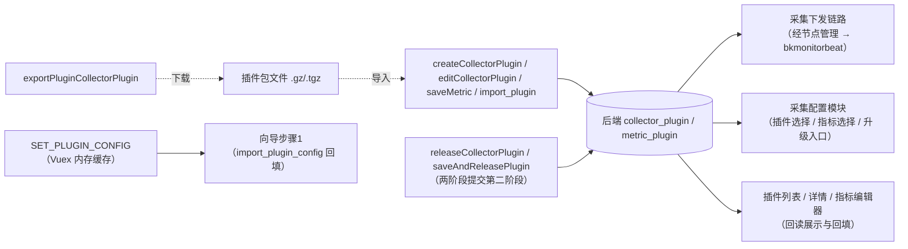

# 数据流向与消费：插件管理专家

> 契约快照生成于 2026-10-13（commit ff89f63ff4）。
> 若使用中发现行为与契约不符，可能代码已变更——expert-lookup 会自动增量修正，或用 expert-team 全量重建。
>
> 说明：本专家是前端功能域，**无自己的持久化存储**——数据实体为「前端提交给后端的插件/指标定义」与「前端消费的插件读数」两类，本文件按此口径记录流向与消费方。

## 数据实体清单

| 数据实体 | 产生入口（本模块） | 去向 | 消费方（模块/功能级） | 业务用途 |
|----------|--------------------|------|----------------------|----------|
| 插件定义（CollectorPlugin） | `createCollectorPlugin` / `editCollectorPlugin`（步骤1）、`deleteCollectorPlugin`、`importPluginCollectorPlugin` + `saveAndReleasePlugin`（导入） | `rest/v2/collector_plugin/*` → 后端（MySQL） | **采集配置模块**（插件选择器 `plugin-selector` / `config-set.vue` 的插件列表与对象类型映射）；采集下发链路（经节点管理下发插件包至 bkmonitorbeat）`[基于引用扫描，未深入验证]`；插件列表/详情（回读展示） | 定义"采集什么指标、用什么采集器、参数是什么"的插件元数据，是采集能力的来源 |
| 指标维度定义（metric_json） | `saveMetric` → `releaseCollectorPlugin`（两阶段提交；三条编辑器路径共用） | `rest/v2/metric_plugin/save/` + `collector_plugin/{pk}/release/` → 后端 | 采集配置模块（`getMetrics`/指标选择、字段形态）；场景视图（`collect_<id>` 场景的面板字段来源）`[基于引用扫描，未深入验证]`；监控数据链路（指标入库形态）`[基于引用扫描，未深入验证]` | 定义插件产出的指标/维度结构（表名、字段类型、单位、分组规则），决定采集数据的元数据形态 |
| 插件包文件（.gz/.tgz） | `uploadFileCollectorPlugin`（Exporter 上传）/ `dataDogPluginUpload`（DataDog）/ `exportPluginCollectorPlugin`（导出）/ `importPluginCollectorPlugin`（导入） | 上传 → 后端文件存储；导出 → `download_url` 浏览器下载 | 采集器侧（下发安装）`[基于引用扫描，未深入验证]`；用户（本地留存/跨环境搬运） | 插件的可分发实体——脚本/采集器配置的载体 |
| 插件 LOGO（base64） | `logo.vue`（canvas 裁剪至 ≤78px → dataURL）→ 随 `createCollectorPlugin`/`editCollectorPlugin` 提交 | 后端（随插件记录） | 插件列表/详情/采集配置的插件选择器（视觉标识） | 插件在界面中的图标标识 |
| 发布凭据（token · config_version · info_version） | `saveMetric` 响应 / `pluginRegister` 轮询的 `data.token` | 前端持有（`pluginInfo` / `pluginData.token`）→ 回传 `releaseCollectorPlugin` | 本模块发布链路（步骤3 `releasePlugin`）；向导经 `changeVersion` 事件回传复用 | 两阶段提交的"提货凭证"——证明版本已生成、可被发布；决定「保存」是否真正生效 |
| 导入缓存（Vuex `pluginConfigCache`，内存） | 列表页导入成功后 `SET_PLUGIN_CONFIG(data)` | Vuex 内存（无持久化） | 向导步骤1（`import_plugin_config`/`import_plugin_metric_json` 回填）、冲突弹窗分支 | 把导入解析结果接力给「更新插件/新建插件」向导；离开列表（非 add/update 目标）或刷新即丢 |

## 数据流向图（黑盒级）

图表来源：[model.js](file://bkmonitor/webpack/src/monitor-api/modules/model.js)（关键符号：`createCollectorPlugin`、`releaseCollectorPlugin`、`importPluginCollectorPlugin`）、[plugin.js](file://bkmonitor/webpack/src/monitor-api/modules/plugin.js)（关键符号：`saveMetric`、`saveAndReleasePlugin`）

## 消费方影响提示

- **发布才生效**：`create/edit`、`saveMetric`、`pluginRegister` 只生成新版本；**不调 `releaseCollectorPlugin`（或 `saveAndReleasePlugin`）则变更不生效**（落草稿/未发布态）。
- **插件变更影响采集配置**：插件版本变化会联动采集配置的「升级插件」入口（`pluginUpgradeInfo` / `step-set-done` 的 `needUpdataPlugin` 依据 `related_conf_count > 0`），删除/大幅改插件前先看关联配置数（列表「关联配置」列）。
- **指标维度是采集数据的元数据形态**：`metric_json` 的字段/类型变更会影响采集侧数据解析与场景视图面板（跨链路影响，改动需评估）。
- **两条删除口径**：列表删除走 `deleteCollectorPlugin({ plugin_ids })`（批量语义，前端仍传数组）；后端另有 REST 风格 `destroy`（预留未用）。
- **导入缓存无持久化**：跨页面/刷新会丢，导入冲突后的分支选择需在弹窗链路内完成。
- **公共插件（`bk_biz_id === 0`）影响面更大**：被多个业务共享，更新/删除前确认双管理权限（`MANAGE_AUTH` + `MANAGE_PUBLIC_AUTH`）与关联配置。
