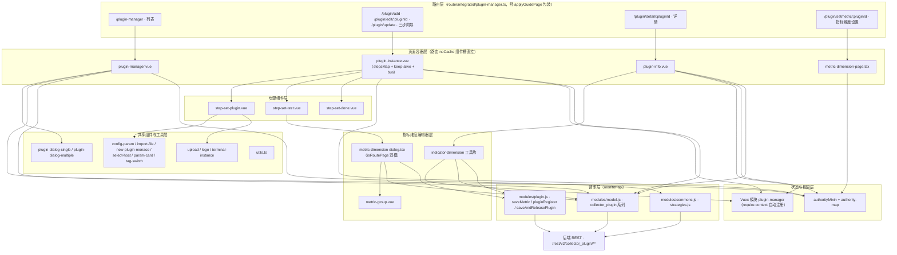
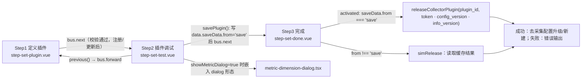
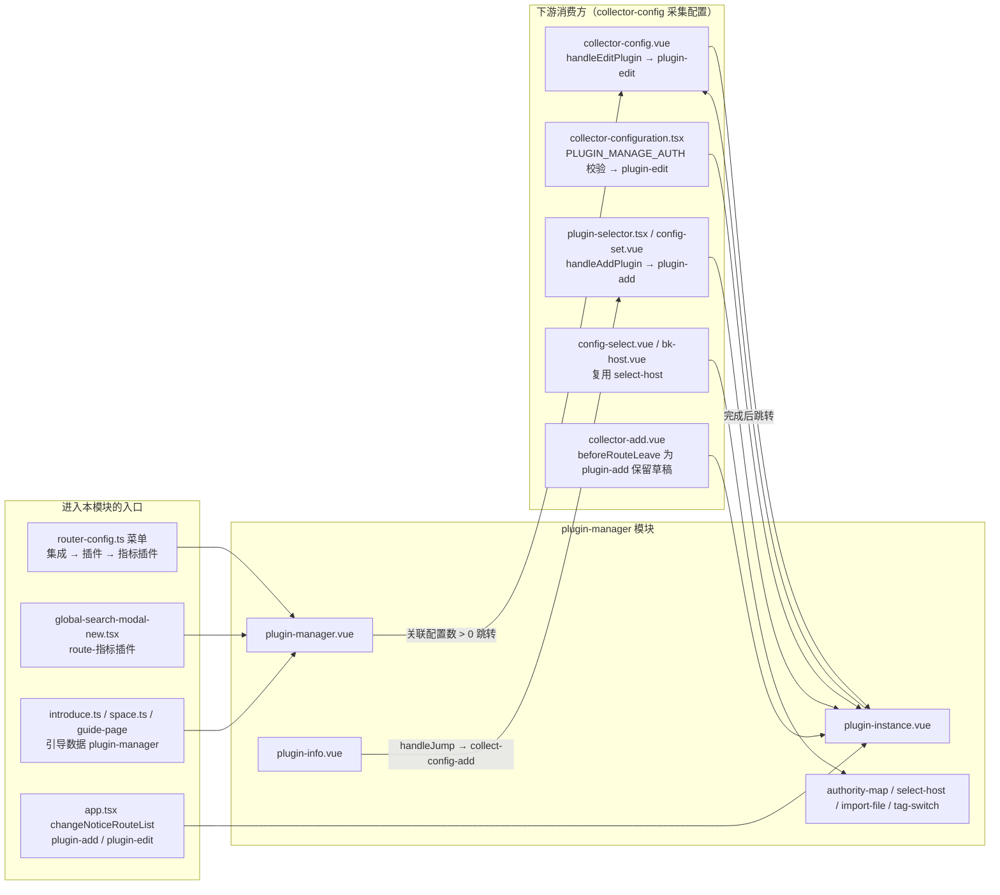

# 架构：插件管理专家 / 指标插件管理

**本文引用的文件**
- [router/integrated/plugin-manager.ts](file://bkmonitor/webpack/src/monitor-pc/router/integrated/plugin-manager.ts)
- [router/integrated/index.ts](file://bkmonitor/webpack/src/monitor-pc/router/integrated/index.ts)
- [router/router-config.ts](file://bkmonitor/webpack/src/monitor-pc/router/router-config.ts)
- [common/index.ts（applyGuidePage）](file://bkmonitor/webpack/src/monitor-pc/common/index.ts)
- [plugin-manager/authority-map.ts](file://bkmonitor/webpack/src/monitor-pc/pages/plugin-manager/authority-map.ts)
- [plugin-manager/plugin-manager.vue](file://bkmonitor/webpack/src/monitor-pc/pages/plugin-manager/plugin-manager.vue)
- [plugin-manager/plugin-info/plugin-info.vue](file://bkmonitor/webpack/src/monitor-pc/pages/plugin-manager/plugin-info/plugin-info.vue)
- [plugin-manager/plugin-instance/plugin-instance.vue](file://bkmonitor/webpack/src/monitor-pc/pages/plugin-manager/plugin-instance/plugin-instance.vue)
- [plugin-manager/plugin-instance/set-steps/step-set-plugin.vue](file://bkmonitor/webpack/src/monitor-pc/pages/plugin-manager/plugin-instance/set-steps/step-set-plugin.vue)
- [plugin-manager/plugin-instance/set-steps/step-set-test.vue](file://bkmonitor/webpack/src/monitor-pc/pages/plugin-manager/plugin-instance/set-steps/step-set-test.vue)
- [plugin-manager/plugin-instance/set-steps/step-set-done.vue](file://bkmonitor/webpack/src/monitor-pc/pages/plugin-manager/plugin-instance/set-steps/step-set-done.vue)
- [plugin-manager/plugin-instance/set-steps/metric-dimension/metric-dimension-dialog.vue（旧版）](file://bkmonitor/webpack/src/monitor-pc/pages/plugin-manager/plugin-instance/set-steps/metric-dimension/metric-dimension-dialog.vue)
- [plugin-manager/plugin-instance/set-steps/metric-dimension/metric-group.vue](file://bkmonitor/webpack/src/monitor-pc/pages/plugin-manager/plugin-instance/set-steps/metric-dimension/metric-group.vue)
- [plugin-manager/plugin-instance/set-steps/components/select-host.vue](file://bkmonitor/webpack/src/monitor-pc/pages/plugin-manager/plugin-instance/set-steps/components/select-host.vue)
- [plugin-manager/plugin-instance/set-steps/components/new-plugin-monaco.vue](file://bkmonitor/webpack/src/monitor-pc/pages/plugin-manager/plugin-instance/set-steps/components/new-plugin-monaco.vue)
- [plugin-manager/plugin-instance/upload/upload.vue](file://bkmonitor/webpack/src/monitor-pc/pages/plugin-manager/plugin-instance/upload/upload.vue)
- [plugin-manager/plugin-instance/logo/logo.vue](file://bkmonitor/webpack/src/monitor-pc/pages/plugin-manager/plugin-instance/logo/logo.vue)
- [plugin-manager/plugin-instance/terminal-instance/terminal-instance.vue](file://bkmonitor/webpack/src/monitor-pc/pages/plugin-manager/plugin-instance/terminal-instance/terminal-instance.vue)
- [plugin-manager/components/metric-dimension-page.tsx](file://bkmonitor/webpack/src/monitor-pc/pages/plugin-manager/components/metric-dimension-page.tsx)
- [plugin-manager/components/metric-dimension-dialog.tsx](file://bkmonitor/webpack/src/monitor-pc/pages/plugin-manager/components/metric-dimension-dialog.tsx)
- [plugin-manager/components/indicator-dimension/index.tsx](file://bkmonitor/webpack/src/monitor-pc/pages/plugin-manager/components/indicator-dimension/index.tsx)
- [plugin-manager/components/indicator-dimension/utils.ts](file://bkmonitor/webpack/src/monitor-pc/pages/plugin-manager/components/indicator-dimension/utils.ts)
- [plugin-manager/components/indicator-dimension/types.ts](file://bkmonitor/webpack/src/monitor-pc/pages/plugin-manager/components/indicator-dimension/types.ts)
- [plugin-manager/components/indicator-dimension/group-list/index.tsx](file://bkmonitor/webpack/src/monitor-pc/pages/plugin-manager/components/indicator-dimension/group-list/index.tsx)
- [plugin-manager/components/indicator-dimension/field-list/index.tsx](file://bkmonitor/webpack/src/monitor-pc/pages/plugin-manager/components/indicator-dimension/field-list/index.tsx)
- [plugin-manager/components/indicator-dimension/batch-edit/index.tsx](file://bkmonitor/webpack/src/monitor-pc/pages/plugin-manager/components/indicator-dimension/batch-edit/index.tsx)
- [plugin-manager/components/indicator-dimension/edit-group/index.tsx](file://bkmonitor/webpack/src/monitor-pc/pages/plugin-manager/components/indicator-dimension/edit-group/index.tsx)
- [plugin-manager/components/indicator-dimension/metric-detail/index.tsx](file://bkmonitor/webpack/src/monitor-pc/pages/plugin-manager/components/indicator-dimension/metric-detail/index.tsx)
- [plugin-manager/plugin-dialog-single.vue](file://bkmonitor/webpack/src/monitor-pc/pages/plugin-manager/plugin-dialog-single.vue)
- [plugin-manager/plugin-dialog-multiple.vue](file://bkmonitor/webpack/src/monitor-pc/pages/plugin-manager/plugin-dialog-multiple.vue)
- [plugin-manager/plugin-setmetric.vue（旧版路由页）](file://bkmonitor/webpack/src/monitor-pc/pages/plugin-manager/plugin-setmetric.vue)
- [plugin-manager/loading-component.vue](file://bkmonitor/webpack/src/monitor-pc/pages/plugin-manager/loading-component.vue)
- [plugin-manager/utils.ts](file://bkmonitor/webpack/src/monitor-pc/pages/plugin-manager/utils.ts)
- [store/modules/plugin-manager.js](file://bkmonitor/webpack/src/monitor-pc/store/modules/plugin-manager.js)
- [store/store.js](file://bkmonitor/webpack/src/monitor-pc/store/store.js)
- [mixins/authorityMixin.ts](file://bkmonitor/webpack/src/monitor-pc/mixins/authorityMixin.ts)
- [monitor-api/modules/model.js](file://bkmonitor/webpack/src/monitor-api/modules/model.js)
- [monitor-api/modules/plugin.js](file://bkmonitor/webpack/src/monitor-api/modules/plugin.js)
- [collector-config/authority-map.ts](file://bkmonitor/webpack/src/monitor-pc/pages/collector-config/authority-map.ts)
- [collector-config/collector-config.vue](file://bkmonitor/webpack/src/monitor-pc/pages/collector-config/collector-config.vue)
- [collector-config/collector-detail/collector-configuration.tsx](file://bkmonitor/webpack/src/monitor-pc/pages/collector-config/collector-detail/collector-configuration.tsx)
- [collector-config/collector-add/config-set/plugin-selector.tsx](file://bkmonitor/webpack/src/monitor-pc/pages/collector-config/collector-add/config-set/plugin-selector.tsx)
- [collector-config/collector-add/config-set/config-set.vue](file://bkmonitor/webpack/src/monitor-pc/pages/collector-config/collector-add/config-set/config-set.vue)
- [shell-collector/set-data-source/set-data-steps/shell-side-notice.vue](file://bkmonitor/webpack/src/monitor-pc/pages/shell-collector/set-data-source/set-data-steps/shell-side-notice.vue)
- [custom-escalation/metric-manage/components/indicator-dimension/index.tsx（同族参照）](file://bkmonitor/webpack/src/monitor-pc/pages/custom-escalation/metric-manage/components/indicator-dimension/index.tsx)
- [common/introduce.ts](file://bkmonitor/webpack/src/monitor-pc/common/introduce.ts)
- [router/space.ts](file://bkmonitor/webpack/src/monitor-pc/router/space.ts)

## 目录
1. [简介](#简介)
2. [项目结构](#项目结构)
3. [核心组件](#核心组件)
4. [架构总览](#架构总览)
5. [组件详细分析](#组件详细分析)
6. [依赖关系分析](#依赖关系分析)
7. [结论](#结论)

## 简介

「插件管理专家」对应蓝鲸监控 monitor-pc 前端应用的**指标插件管理**功能域，模块根目录为 `bkmonitor/webpack/src/monitor-pc/pages/plugin-manager/`（41 个源文件 / 56 个文件与目录条目），是 Vue2（`.vue` SFC Options API）+ `.tsx` class component（`vue-property-decorator` / `vue-tsx-support`）混合技术栈。

**职责边界（做什么）**：
- 指标插件的**前端全生命周期管理**：列表（tab 分类 / 搜索 / 排序 / 分类标签筛选 / 删除 / 导入导出 / 官方标记）、三步新建/编辑/升级向导（定义插件 → 插件调试 → 完成发布）、插件详情查看、指标&维度元数据设置（setmetric）、插件包上传/下载、插件 LOGO 制作；
- 面向 7 种插件类型：`Script`、`JMX`、`Exporter`、`DataDog`、`PushGateway`（别名 BK-Pull）、`SNMP`、`Built-In`（别名 BK-Monitor，列表 tab 中被注释隐藏）；
- 携带**公共插件**（`bk_biz_id === 0`）与**草稿**（`status === 'draft'`）两个业务态的差异化分流。

**职责边界（不做什么）**：
- 不做采集配置（collector-config）的实例化——下发插件、配置目标等全部在「数据采集」模块，本模块只提供跳转入口（`collector-config` / `collector-config-add`）；
- 不做插件的实际执行——脚本/采集器运行在 bkmonitorbeat/采集器侧，本模块仅做「调试」的前端发起与日志展示；
- 不做平台侧权限判定——交由 `authorityMixin` + `authority/checkAllowedByActionIds` 接口统一判定。

**权限常量**（authority-map.ts）：
| 常量 | action id | 用途 |
|------|-----------|------|
| `MANAGE_AUTH` | `manage_plugin_v2` | 插件管理（新建/编辑/删除/导入导出） |
| `VIEW_AUTH` | `view_plugin_v2` | 插件查看（路由级 `meta.authority.page`） |
| `MANAGE_PUBLIC_AUTH` | `manage_public_plugin` | 公共插件管理（`bk_biz_id === 0` 时附加要求） |
| `COLLECTION_VIEW_AUTH` | `view_collection_v2` | 复用采集配置查看权限（完成页 `getCollectionAuth` 使用） |
| `COLLECTION_MANAGE_AUTH` | `manage_collection_v2` | 复用采集配置管理权限 |

章节来源：[authority-map.ts](file://bkmonitor/webpack/src/monitor-pc/pages/plugin-manager/authority-map.ts)（关键符号：`MANAGE_AUTH`、`VIEW_AUTH`、`MANAGE_PUBLIC_AUTH`、`COLLECTION_VIEW_AUTH`、`COLLECTION_MANAGE_AUTH`）

## 项目结构

```
pages/plugin-manager/
├── plugin-manager.vue                 # 列表页（47.5KB）：tab/搜索/排序/筛签/删除/导入导出/官方标记
├── plugin-dialog-single.vue           # 单包导入结果对话框（冲突 5 状态 + 更新/新建分支）
├── plugin-dialog-multiple.vue         # 批量导入进度列表对话框
├── plugin-setmetric.vue               # 旧版 setmetric 路由页（路由已切换，遗留）
├── loading-component.vue              # 纯 loading 占位（仓库内无引用，遗留）
├── authority-map.ts                   # 5 个权限常量
├── utils.ts                           # judgeIsIllegal / metricNameTransFrom
├── plugin-info/
│   └── plugin-info.vue                # 插件详情（27.5KB）：详情 tab + 指标维度 tab
├── plugin-instance/
│   ├── plugin-instance.vue            # 三步向导容器：stepsMap + keep-alive 动态组件 + $bus 协作
│   ├── set-steps/
│   │   ├── step-set-plugin.vue        # 步骤1 定义插件（66KB）
│   │   ├── step-set-test.vue          # 步骤2 插件调试（63KB）
│   │   ├── step-set-done.vue          # 步骤3 完成与发布
│   │   ├── tag-switch.vue             # 标签/输入切换控件（被采集配置复用）
│   │   ├── codemirror.css
│   │   ├── components/
│   │   │   ├── config-param.vue       # 参数定义弹窗（text/password/file/switch/service/host）
│   │   │   ├── import-file.vue        # 文件导入（支持 base64，被采集配置复用）
│   │   │   ├── new-plugin-monaco.vue  # 多语言脚本编辑器（复用 shell-side-notice）
│   │   │   ├── param-card.vue         # 参数卡片输入
│   │   │   └── select-host.vue        # 调试目标主机选择（被采集配置复用）
│   │   └── metric-dimension/
│   │       ├── metric-dimension-dialog.vue  # 旧版指标维度对话框（38KB，遗留链）
│   │       └── metric-group.vue             # 分组表格组件（42KB，新旧对话框共用）
│   ├── terminal-instance/
│   │   └── terminal-instance.vue      # 调试日志终端（纯展示 + 全屏）
│   ├── upload/
│   │   └── upload.vue                 # 单文件上传（Exporter 包 / DataDog tgz / 脚本）
│   └── logo/
│       └── logo.vue                   # 插件 LOGO 上传（canvas 裁剪 → base64）
└── components/
    ├── metric-dimension-page.tsx      # setmetric 路由壳（authorityMixin + 渲染 MDD）
    ├── metric-dimension-dialog.tsx    # 新版指标维度编辑器（46.6KB）：isRoutePage 双模
    └── indicator-dimension/           # 详情页「指标维度」管理（tsx 工具族）
        ├── index.tsx                  # 容器：分组 + 指标/维度两个 tab + 右侧详情
        ├── types.ts                   # ALL_LABEL / GROUP_DEFAULT_NAME / GROUP_NAME_REGX / FRONT_END_FIELD_KEYS
        ├── utils.ts                   # 纯函数族（建组/分组/移动/批量保存/导出/类型表）
        ├── group-list/index.tsx       # 左侧分组列表（PluginGroupList）
        ├── field-list/index.tsx       # 右侧字段表格（PluginFieldList）
        ├── batch-edit/index.tsx       # 批量新增/编辑（PluginBatchEdit）
        ├── edit-group/index.tsx       # 分组编辑（PluginEditGroup，含 rule_list 规则）
        └── metric-detail/index.tsx    # 指标详情卡片（PluginMetricDetail）
```

外部关联资产（不在模块目录内，但属于本功能域）：
- 路由：[router/integrated/plugin-manager.ts](file://bkmonitor/webpack/src/monitor-pc/router/integrated/plugin-manager.ts)（6 条路由，经 [router/integrated/index.ts](file://bkmonitor/webpack/src/monitor-pc/router/integrated/index.ts) 汇总进集成路由数组）；菜单：[router/router-config.ts](file://bkmonitor/webpack/src/monitor-pc/router/router-config.ts)（integrated → 插件 → 指标插件）；
- Vuex：[store/modules/plugin-manager.js](file://bkmonitor/webpack/src/monitor-pc/store/modules/plugin-manager.js)（经 [store/store.js](file://bkmonitor/webpack/src/monitor-pc/store/store.js) 的 `require.context('./modules', true, /\.js$/)` 自动注册，命名空间即文件名 `plugin-manager`）；
- 请求层：[monitor-api/modules/model.js](file://bkmonitor/webpack/src/monitor-api/modules/model.js)（collector_plugin 系列）、[modules/plugin.js](file://bkmonitor/webpack/src/monitor-api/modules/plugin.js)、`modules/commons.js`、`modules/strategies.js`。

章节来源：[plugin-manager.vue](file://bkmonitor/webpack/src/monitor-pc/pages/plugin-manager/plugin-manager.vue)（关键符号：`PluginManager`）；[plugin-instance.vue](file://bkmonitor/webpack/src/monitor-pc/pages/plugin-manager/plugin-instance/plugin-instance.vue)（关键符号：`PluginInstance`）；[indicator-dimension/index.tsx](file://bkmonitor/webpack/src/monitor-pc/pages/plugin-manager/components/indicator-dimension/index.tsx)（关键符号：`PluginIndicatorDimension`）

## 核心组件

| 组件 / 文件 | 挂载路由或宿主 | 一句话职责 |
|------------|---------------|-----------|
| `plugin-manager.vue`（`PluginManager`） | `/plugin-manager` | 插件列表：tab 分类（全部/Exporter/Script/DataDog/JMX/BK-Pull/SNMP）、关键字搜索（防抖 300ms + CancelToken 取消）、排序、分类标签 popover 筛选、分页、删除、导出、导入（单包/多包） |
| `plugin-dialog-single.vue` | 列表页 | 单包导入结果对话框：解析进度 → 冲突（`conflict_detail`/`duplicate_type`）→ 更新/创建分支出入口 |
| `plugin-dialog-multiple.vue` | 列表页 | 多包导入进度对话框：逐文件解析、版本展示、成功/失败/冲突状态汇总 |
| `plugin-info.vue`（`PluginDetail`） | `/plugin/detail/:pluginId` | 插件详情：基本信息 / 上传内容（脚本预览用 monaco）/ 定义参数（历史记录 `history-dialog`）/ 描述（markdown viewer）+「指标维度」tab（内嵌 `PluginIndicatorDimension`） |
| `plugin-instance.vue`（`PluginInstance`） | `/plugin/add`、`/plugin/edit/:pluginId`、`/plugin/update` | 三步向导容器：`stepsMap`（3 步）+ `keep-alive` 动态组件 + `$bus` 事件协作 + `provide`（authority / handleShowAuthorityDetail / pluginManageAuth） |
| `step-set-plugin.vue`（`StepSetPlugin`） | 步骤1 | 定义插件：所属/插件ID（`checkIdCollectorPlugin` 校验）/别名/LOGO/类型（7 类）/上传包/绑定端口主机/采集配置（脚本、yaml）/定义参数/描述 md → 注册或更新（`pluginRegister`） |
| `step-set-test.vue`（`StepSetTest`） | 步骤2 | 插件调试：选择目标主机（`select-host`）→ `startDebugCollectorPlugin` → 轮询 `fetchDebugLogCollectorPlugin` 展示终端 → `stopDebugCollectorPlugin`；可打开指标维度对话框；「保存」= `savePlugin()` 挂 saveData 后 `$bus.$emit('next')` |
| `step-set-done.vue`（`StepSetDone`） | 步骤3 | 完成：`activated` 时判定 `saveData.from === 'save'` → `releaseCollectorPlugin(plugin_id, {config_version, info_version, token})` 真实发布，或读取缓存模拟结果；成功后提供「前往采集配置升级插件 / 新建采集配置」 |
| `metric-dimension-page.tsx`（`MetricDimensionPage`） | `/plugin/setmetric/:pluginId` | 路由壳：`authorityMixinCreate(pluginManageAuth)` + `@Provide('authority')`，渲染 `<MetricDimensionDialog isRoutePage={true} />` |
| `metric-dimension-dialog.tsx`（`MetricDimensionDialog`） | setmetric 路由 / 步骤2 弹窗 | 新版指标维度编辑器：分组管理、指标/维度表格、批量移动、导入导出、自动采集开关、`saveMetric` + `releaseCollectorPlugin`；`isRoutePage` 切换全页/弹窗形态 |
| `indicator-dimension/*`（`PluginIndicatorDimension` 等 6 个类） | 详情页 tab | 以「分组（table_name + rule_list）」为单位的指标/维度管理：分组列表 + 字段列表 + 批量编辑 + 分组编辑 + 指标详情，纯函数逻辑集中在 `utils.ts` |
| `metric-group.vue`（`MetricGroup`） | 新旧指标对话框共用 | 分组表格组件：指标/维度行内编辑、名称合法校验（`judgeIsIllegal`/`metricNameTransFrom`）、匹配规则标签、分页 |
| `upload/upload.vue`（`MoUpload`） | 步骤1 | 单文件上传：`uploadFileCollectorPlugin`（Exporter/脚本）、`dataDogPluginUpload`（DataDog tgz），带进度与编码回填 |
| `logo/logo.vue`（`Logo`） | 步骤1 | LOGO 上传：FileReader → canvas 裁剪至 ≤78px → `toDataURL` 输出 base64 |
| `terminal-instance.vue`（`TerminalInstance`） | 步骤2 | 调试日志终端：纯展示组件（props: `animation`/`delay`/`consoles`），支持全屏与自动滚动 |
| `select-host.vue`（`SelectHost`） | 步骤2 | 调试目标主机选择弹窗（`hostAgentStatus` 查询），被采集配置模块（`config-select.vue`、`bk-host.vue`）复用 |
| `utils.ts` | 全局 | `judgeIsIllegal`（名称合法正则）/ `metricNameTransFrom`（非法字符转下划线并循环修正开头） |

章节来源：[step-set-plugin.vue](file://bkmonitor/webpack/src/monitor-pc/pages/plugin-manager/plugin-instance/set-steps/step-set-plugin.vue)（关键符号：`checkPluginId`、`registerPlugin`、`handleRegisterFlow`）；[step-set-test.vue](file://bkmonitor/webpack/src/monitor-pc/pages/plugin-manager/plugin-instance/set-steps/step-set-test.vue)（关键符号：`startDebug`、`savePlugin`）；[step-set-done.vue](file://bkmonitor/webpack/src/monitor-pc/pages/plugin-manager/plugin-instance/set-steps/step-set-done.vue)（关键符号：`releasePlugin`、`simRelease`）

## 架构总览



图表来源：[plugin-manager.ts](file://bkmonitor/webpack/src/monitor-pc/router/integrated/plugin-manager.ts)、[plugin-manager.vue](file://bkmonitor/webpack/src/monitor-pc/pages/plugin-manager/plugin-manager.vue)、[plugin-instance.vue](file://bkmonitor/webpack/src/monitor-pc/pages/plugin-manager/plugin-instance/plugin-instance.vue)（关键符号：`PluginManager`、`PluginInstance`、`MetricDimensionPage`、`applyGuidePage`）

分层要点：
1. **路由层**：6 条路由集中在 `router/integrated/plugin-manager.ts`——列表页 `plugin-manager` 为单视图 `component`，其余 5 条用 `components: { noCache: ... }` 挂载（编辑类页面不走缓存）；整体经 `applyGuidePage([...], ['plugin-add'])` 包装——除 `plugin-add` 外的路由统一注入 `beforeEnter`（space 校验）与 `meta.noChangeLoading`；`meta.navId` 均为 `plugin-manager`（菜单/引导页归属），`meta.authority` 声明 `map`（authority-map 命名空间）与 `page`（页面级权限）。
2. **页面容器层**：4 个容器组件承载 4 种形态（列表 / 三步向导 / 详情 / setmetric）。
3. **步骤组件层**：仅三步向导容器内部使用，彼此不直接引用（见「组件详细分析」）。
4. **指标维度编辑器层**：三条并存实现（新版 tsx 双模、旧版 vue 遗留链、详情页 tsx 工具族），共享 `metric-group.vue` 与后端 `saveMetric` 契约。
5. **状态与权限层**：Vuex `plugin-manager` 命名空间（`SET_PLUGIN_CONFIG` 等 6 个 mutation + 3 个带缓存的 action）；权限统一走 `authorityMixin`。
6. **请求层**：`monitor-api` 描述符（`request()`）→ REST `/rest/v2/collector_plugin/**` 等。

章节来源：[plugin-manager.ts](file://bkmonitor/webpack/src/monitor-pc/router/integrated/plugin-manager.ts)（关键符号：`PluginInstance`、`MetricDimensionPage`、`applyGuidePage`）；[common/index.ts](file://bkmonitor/webpack/src/monitor-pc/common/index.ts)（关键符号：`applyGuidePage`）

## 组件详细分析

### 设计维度一：列表页的「草稿/可用 × 私有/公共」双维分流

`plugin-manager.vue` 是模块最复杂的单文件（47.5KB），核心分流逻辑：

- **行状态分流**：`table.statusMap` 定义 `normal`（可用，绿）与 `draft`（草稿，橙）两种状态；点击名称走 `showPluginInfo(row)`——`draft` 行直接进入**编辑向导**（`plugin-edit`），`normal` 行进入**详情页**（`plugin-detail`）；`draft` 行同时禁用「设置指标&维度」入口（`handleShowMeticr` 要求 `status === 'normal' && !is_official`）。
- **权限分流**：`getManageAuth(row)` 对公共插件（`bk_biz_id === 0`）要求 `MANAGE_AUTH` 与 `MANAGE_PUBLIC_AUTH` **同时具备**；私有插件仅要求 `MANAGE_AUTH`。无权限时通过 `v-authority` 指令加禁用态并在点击时 `showAuthorityDetail(row)` 聚合缺失的 actionIds（`MANAGE_AUTH` + 公共插件场景的 `MANAGE_PUBLIC_AUTH`）拉起权限申请。
- **导入分流**（`handeFileSingel` / `handleFileMultiple`）：
  - 单包：`importPluginCollectorPlugin` 解析 → 结果缓存 `SET_PLUGIN_CONFIG` → 按 `conflict_detail` / `is_official` / `duplicate_type` / `isSuperUser` 分为状态 1（上传中）/ 2（失败）/ 3（成功，转 `plugin-add` type=import）/ 4（ID 冲突，`dialog.update` 组合判定）/ 5（普通用户无权限导入官方插件，引导新建）；
  - 多包：仅 `(is_official || is_safety) && !duplicate_type` 的文件执行 `saveAndReleasePlugin` 批量上传，其余按「插件包不完整 / 名字冲突 / 插件冲突」提示，进度由前端定时器模拟（`percent += 0.16`）。
- **导出**：`exportPluginCollectorPlugin` → `downFile(download_url)`；导出/删除按钮的可用态由服务端字段驱动（`export_allowed` / `delete_allowed` / `edit_allowed`）——前端不自行推断业务规则。
- **列表数据**：`listCollectorPlugin` 单接口同时返回 `data.count`（各类型计数，用于 tab 角标）与 `data.list`；查询参数含 `search_key / plugin_type / page / page_size / order / labels`；清空搜索时用 `CancelToken` 取消 pending 请求；每页条数持久化 `commonPageSizeSet`。

章节来源：[plugin-manager.vue](file://bkmonitor/webpack/src/monitor-pc/pages/plugin-manager/plugin-manager.vue)（关键符号：`getPluginListData`、`getManageAuth`、`showAuthorityDetail`、`handeFileSingel`、`handleSetUpdatePlugin`）；[plugin-dialog-single.vue](file://bkmonitor/webpack/src/monitor-pc/pages/plugin-manager/plugin-dialog-single.vue)（关键符号：`handleCreateNewPlugin`、`handleUpdatePlugin`、`canIUpdatePlubin`）

### 设计维度二：三步向导的「容器-步骤」解耦协作

`plugin-instance.vue` 本身不含业务，只做编排：

- **步骤编排**：`left.stepsMap = [{ 定义插件 → step-set-plugin }, { 插件调试 → step-set-test }, { 完成 → step-set-done }]`，每项带 `done` 标记（完成后才能点击跳转）；`<keep-alive><component :is="curStep.component" :show.sync="showView" :data.sync="pluginInfo" :from-route="fromRouteName" /></keep-alive>`——keep-alive 保证步骤切换不丢表单状态。
- **步骤间通信**：步骤组件不互相 import，全部通过事件总线 `$bus` 协作：`next`（前进）、`forward`（后退）、`showmsg`（顶部草稿变更提示，来自步骤1 `getPluginInfo` 的版本/更新人/时间信息）、`resetscroll`（容器滚动复位）；数据通过 `data.sync` 双向绑定汇总在容器 `pluginInfo`。
- **权限下发**：容器 `provide()` 注入 `authority` / `handleShowAuthorityDetail` / `pluginManageAuth`，步骤组件 `inject` 消费——避免逐层 props 透传。
- **路由态编排**：`created` 中根据路由名推导 `type`（`create` / `edit` / `import`，其中 `create + (pluginId || pluginData)` 判定为 `import`）；`beforeRouteEnter` 缓存来源路由名 `fromRouteName`（供步骤3 的 `close()` 决定回跳采集新增页还是插件列表）。
- **离开拦截（不变量）**：`beforeRouteLeave` 中，只要目标不是 `plugin-add`/`plugin-edit` 且 `left.step < 2`，弹「是否放弃本次操作？」并由用户确认决定是否放行——**未完成向导的离开必须显式确认**。
- **缓存清理**：容器 `beforeDestroy` 与列表页 `beforeRouteLeave`（离开到非 `plugin-update`/`plugin-add` 路由时）都会执行 `SET_PLUGIN_CONFIG(null)`，避免导入缓存跨会话泄漏。



图表来源：[plugin-instance.vue](file://bkmonitor/webpack/src/monitor-pc/pages/plugin-manager/plugin-instance/plugin-instance.vue)（关键符号：`handleNextStep`、`handleForward`、`handleCancel`）；[step-set-test.vue](file://bkmonitor/webpack/src/monitor-pc/pages/plugin-manager/plugin-instance/set-steps/step-set-test.vue)（关键符号：`savePlugin`）；[step-set-done.vue](file://bkmonitor/webpack/src/monitor-pc/pages/plugin-manager/plugin-instance/set-steps/step-set-done.vue)（关键符号：`releasePlugin`）

章节来源：[plugin-instance.vue](file://bkmonitor/webpack/src/monitor-pc/pages/plugin-manager/plugin-instance/plugin-instance.vue)（关键符号：`stepsMap`、`handleNextStep`、`handleCancel`）

### 设计维度三：指标维度编辑的三条实现路径（两代并存）

指标&维度是模块内最重的子域，当前**同一数据契约（`metric_json`：分组 `table_name/table_desc/rule_list/fields`）下并存三套 UI 实现**：

| 路径 | 入口 | 实现 | 状态 |
|------|------|------|------|
| A. setmetric 路由页 | `/plugin/setmetric/:pluginId` | `components/metric-dimension-page.tsx` → `metric-dimension-dialog.tsx`（`isRoutePage=true` 全页形态） | 现行（路由已从旧 `plugin-setmetric.vue` 切换） |
| B. 调试内嵌弹窗 | 步骤2 的「指标维度设置」按钮 | 同一个 `metric-dimension-dialog.tsx`（`isRoutePage=false` 弹窗形态，1280px dialog） | 现行 |
| C. 详情页 tab | `/plugin/detail/:pluginId` 的「指标维度」tab | `components/indicator-dimension/` tsx 工具族（`PluginIndicatorDimension` + 5 个子组件） | 现行（与 custom-escalation/metric-manage 同族的改造版） |
| 旧版（遗留） | 旧 `plugin-setmetric.vue` → `metric-dimension-dialog.vue` | `.vue` Options API 版（38KB，依赖 `saveMetric` + `metric-group.vue`） | 路由已切换，仅被遗留页引用 |

三条路径共享的关键不变量：
- **分组模型**：默认分组 `GROUP_DEFAULT_NAME = 'group_default'`（不可编辑/删除）；分组名正则 `GROUP_NAME_REGX = /^[_|a-zA-Z][a-zA-Z0-9_]*$/`；`rule_list` 为组内指标匹配规则，`is_manual` 标记「不满足规则且不在默认分组」的指标；
- **条数上限**：普通插件 5000 条（`MAX_NUM_METRIC_DIM`），SNMP 插件 500 条（`MAX_NUM_METRIC_DIM_SNMP`）；
- **唯一性校验**（`canSave`）：指标名全局唯一、维度名组内唯一、别名全局唯一；
- **类型映射**：`diff` 类型前端展示、提交时还原为 `type: 'double' + is_diff_metric: true`；`typeList` 仅对 `Script/JMX/Exporter/Pushgateway` 开放 `diff`；
- **前端态字段剔除**：`FRONT_END_FIELD_KEYS`（`descReValue/errValue/isCheck/isDel/isFirst/id/reValue/showInput` 等）提交前必须删除；
- **保存即发布**：`saveMetric` 返回 `token` 时必须紧跟 `releaseCollectorPlugin({ token, config_version, info_version })`，否则改动只落草稿不生效（`need_upgrade` 在路由页/无 token 场景强制为 true）。

章节来源：[metric-dimension-dialog.tsx](file://bkmonitor/webpack/src/monitor-pc/pages/plugin-manager/components/metric-dimension-dialog.tsx)（关键符号：`handleSave`、`canSave`、`contentRender`、`handleBackPlugin`）；[indicator-dimension/utils.ts](file://bkmonitor/webpack/src/monitor-pc/pages/plugin-manager/components/indicator-dimension/utils.ts)（关键符号：`savePluginMetricJson`、`buildSaveMetricParams`）；[types.ts](file://bkmonitor/webpack/src/monitor-pc/pages/plugin-manager/components/indicator-dimension/types.ts)（关键符号：`GROUP_NAME_REGX`、`FRONT_END_FIELD_KEYS`）

### 设计维度四：权限栅栏——authorityMixin 的批量判定与共享

- `authorityMixin.ts` 是一个**工厂函数**（`authorityMixinCreate(authMap)`），返回 Vue class mixin：构造时把 `authMap` 的**导出名作为 key**初始化 `authority` 对象；`created` 时对全部 actionId 去重后批量调 `checkAllowedByActionIds`，并用 `common/auth-store` 做结果缓存（`getAuthById`/`setAuthById`）；结果通过 `@ProvideReactive('authority')` / `@Provide('authorityMap')` / `@Provide('handleShowAuthorityDetail')` 下发。
- 本模块 4 个容器（列表/详情/向导/setmetric）都以 `authorityMixinCreate(pluginManageAuth)` 复用同一份 map；向导容器再把权限对象 provide 给步骤组件。
- 特殊放行：分享视图（`__POWERED_BY_BK_WEWEB__ && token`）与超级用户直接全量放行；`VIEW_AUTH` 类 key 在特殊事件页面短路。
- **key 即导出名的耦合**：模板里的 `this.authority.MANAGE_AUTH`、`authority.VIEW_AUTH` 等全部依赖 authority-map 的**变量名**，重命名导出会同时改变权限对象的 key。

章节来源：[authorityMixin.ts](file://bkmonitor/webpack/src/monitor-pc/mixins/authorityMixin.ts)（关键符号：`getAuthCreated`、`handleInitPageAuthority`、`handleShowAuthorityDetail`）；[metric-dimension-page.tsx](file://bkmonitor/webpack/src/monitor-pc/pages/plugin-manager/components/metric-dimension-page.tsx)（关键符号：`MetricDimensionPage`）

### 设计维度五：升级（update）与「保存-发布」两阶段提交

模块存在三处「两阶段提交」形态，是理解插件生效链路的关键：

1. **列表页导入官方插件更新**：`importPluginCollectorPlugin` 解析 → `saveAndReleasePlugin(data)` 一步完成保存+发布；
2. **向导步骤3**：`saveMetric`/`pluginRegister` 阶段只产生 `token`，`step-set-done.vue` 的 `releasePlugin` 用 `(plugin_id, { config_version, info_version, token })` 完成发布；`needUpdataPlugin` 计算属性决定是否展示「前往采集配置升级插件」（配置版本递增且 `related_conf_count > 0`）；
3. **指标维度编辑器**：同 2，`saveMetric → data.token → releaseCollectorPlugin`。

此外 `/plugin/update` 路由（`plugin-update`）承载「非官方、完整签名插件包」的升级向导（`plugin-dialog-single` → `handleToEdit` 带 `pluginData` 跳转），与 `plugin-add`/`plugin-edit` 共用 `plugin-instance.vue` 容器。

章节来源：[step-set-done.vue](file://bkmonitor/webpack/src/monitor-pc/pages/plugin-manager/plugin-instance/set-steps/step-set-done.vue)（关键符号：`needUpdataPlugin`、`goToCollectConfig`、`goToCollectConfigAdd`）；[plugin-dialog-single.vue](file://bkmonitor/webpack/src/monitor-pc/pages/plugin-manager/plugin-dialog-single.vue)（关键符号：`handleToEdit`）

## 依赖关系分析

### 依赖 monitor-api（请求层）

| 模块文件 | 被本模块使用的函数 | 使用场景 |
|---------|------------------|---------|
| `modules/model.js`（collector_plugin 系列） | `listCollectorPlugin` / `retrieveCollectorPlugin` / `createCollectorPlugin` / `editCollectorPlugin` / `deleteCollectorPlugin` / `checkIdCollectorPlugin` / `importPluginCollectorPlugin` / `exportPluginCollectorPlugin` / `tagOptionsCollectorPlugin` / `operatorSystemCollectorPlugin` / `uploadFileCollectorPlugin` / `releaseCollectorPlugin` / `startDebugCollectorPlugin` / `stopDebugCollectorPlugin` / `fetchDebugLogCollectorPlugin` | 列表 CRUD、ID 校验、包导入导出、OS 列表、文件上传、发布、调试链路 |
| `modules/plugin.js` | `saveMetric` / `pluginRegister` / `saveAndReleasePlugin` / `getReservedWord` / `dataDogPluginUpload` | 指标保存（+release）、插件注册、一步发布、保留字、DataDog 包上传 |
| `modules/commons.js` | `getLabel` / `queryAsyncTaskResult` / `hostAgentStatus` | 分类标签、异步任务（步骤1 轮询）、调试主机 agent 状态（select-host） |
| `modules/strategies.js` | `getUnitList` | 指标/维度单位列表 |
| `monitor-api/cancel` | `CancelToken` | 搜索请求取消 |

> 注：`plugin.js` 中的 `pluginUpgradeInfo` / `pluginType` / `processCollectorDebug` 主要为采集配置等下游模块服务，非本模块直接调用（如 `collector-config-update.vue` 使用 `pluginUpgradeInfo`）。

章节来源：[monitor-api/modules/model.js](file://bkmonitor/webpack/src/monitor-api/modules/model.js)（关键符号：`listCollectorPlugin`、`editCollectorPlugin`、`releaseCollectorPlugin`、`startDebugCollectorPlugin`）；[monitor-api/modules/plugin.js](file://bkmonitor/webpack/src/monitor-api/modules/plugin.js)（关键符号：`saveMetric`、`pluginUpgradeInfo`）

### 依赖的页面共享资产（monitor-pc 内）

- 组件：`monaco-editor`、`monitor-ui/markdown-editor`（editor/viewer）、`history-dialog` + `view-param`、`monitor-tab`、`empty-status`、`guide-page`、`pageTips`、`table-skeleton`、`verify-input`、`polling-loading`、`monitor-import` / `monitor-export`、`column-check`（metric-group/batch-edit）、`delete-subtitle`（strategy-config）、`common-nav-bar`（monitor-k8s）；
- mixin 与工具：`authorityMixin`、`formLabelMixin`、`documentLinkMixin`、`commonPageSizeGet/Set`、`formatWithTimezone`、`downFile`、`deepClone/random`、`@blueking/fork-resize-detector`；
- 跨模块复用：`new-plugin-monaco.vue` 复用 shell 采集器的 `shell-side-notice.vue`；`indicator-dimension` 与 `custom-escalation/metric-manage/components/indicator-dimension` 为同族实现（继承其分组/批量编辑交互模式）。

章节来源：[new-plugin-monaco.vue](file://bkmonitor/webpack/src/monitor-pc/pages/plugin-manager/plugin-instance/set-steps/components/new-plugin-monaco.vue)（关键符号：`ShellSideNotice`、`languageList`）；[shell-side-notice.vue](file://bkmonitor/webpack/src/monitor-pc/pages/shell-collector/set-data-source/set-data-steps/shell-side-notice.vue)；[custom-escalation/metric-manage/components/indicator-dimension/index.tsx](file://bkmonitor/webpack/src/monitor-pc/pages/custom-escalation/metric-manage/components/indicator-dimension/index.tsx)

### 对外被依赖 / 被谁进入



图表来源：[router-config.ts](file://bkmonitor/webpack/src/monitor-pc/router/router-config.ts)（关键符号：`plugin-manager`）；[collector-config/authority-map.ts](file://bkmonitor/webpack/src/monitor-pc/pages/collector-config/authority-map.ts)（关键符号：`PLUGIN_MANAGE_AUTH`）；[collector-config.vue](file://bkmonitor/webpack/src/monitor-pc/pages/collector-config/collector-config.vue)（关键符号：`handleEditPlugin`）

跨模块协作契约（实际代码证据）：
- 采集配置模块 `collector-config/authority-map.ts` 直接 `import { MANAGE_AUTH as PLUGIN_MANAGE } from '../plugin-manager/authority-map'`，并在 `collector-configuration.tsx` 用 `PLUGIN_MANAGE_AUTH` 守卫「编辑插件」按钮；
- 采集新增页把 `objectId`（分类）通过路由 params 传给 `plugin-add`（`config-set.vue` 的 `handleToAddPlugin`），向导步骤1 `created` 读取 `this.$route.params.objectId` 预设分类；步骤3 的 `close()` 在 `fromRoute === 'collect-config-add'` 时带 `objectId/pluginType/pluginId` 回跳，同时 `collector-add.vue` 的 `beforeRouteLeave` 对 `plugin-add` 豁免清缓存——形成「采集配置草稿 → 制作插件 → 返回继续」的完整回路；
- 列表页「关联配置」列点击 → `collect-config`（`searchType: 'correlation'`）；步骤3 → `collect-config`（`searchType: 'upgrade'`）；详情页/步骤3 → `collect-config-add`。

章节来源：[monitor-api/modules/model.js](file://bkmonitor/webpack/src/monitor-api/modules/model.js)（关键符号：`listCollectorPlugin`、`releaseCollectorPlugin`）；[monitor-api/modules/plugin.js](file://bkmonitor/webpack/src/monitor-api/modules/plugin.js)（关键符号：`saveMetric`、`pluginRegister`、`saveAndReleasePlugin`）；[collector-config/authority-map.ts](file://bkmonitor/webpack/src/monitor-pc/pages/collector-config/authority-map.ts)（关键符号：`PLUGIN_MANAGE_AUTH`）；[config-set.vue](file://bkmonitor/webpack/src/monitor-pc/pages/collector-config/collector-add/config-set/config-set.vue)（关键符号：`handleToAddPlugin`）；[step-set-done.vue](file://bkmonitor/webpack/src/monitor-pc/pages/plugin-manager/plugin-instance/set-steps/step-set-done.vue)（关键符号：`close`）

## 结论

### 关键发现
1. **边界清晰的管理域**：本模块负责「插件的定义/制作/调试/发布」与「指标维度元数据维护」；采集配置实例化与采集器执行均在其外，通过路由跳转 + 少量组件复用（select-host / import-file / tag-switch / shell-side-notice）与采集模块协作。
2. **双技术栈、三代指标维度实现并存**：`.vue` Options API（列表/向导/旧指标）与 `.tsx` class component（indicator-dimension、新版 metric-dimension-dialog）混合；指标维度有 3 条现行路径 + 1 条遗留链，共享 `metric-group.vue` 与 `saveMetric(+release)` 契约。
3. **协作模式统一**：向导用 `$bus` 事件 + `.sync` + `provide/inject` 解耦；权限用 `authorityMixin` 工厂批量判定并 provide 下发；列表/详情间的导航状态用 Vuex（`SET_PLUGIN_ID` / `SET_PLUGIN_CONFIG`）。
4. **两阶段发布贯穿全局**：`saveMetric`/`pluginRegister` 产生 token → `releaseCollectorPlugin` 发布，是插件与指标变更「生效」的唯一路径。

章节来源：[router/integrated/plugin-manager.ts](file://bkmonitor/webpack/src/monitor-pc/router/integrated/plugin-manager.ts)（关键符号：`PluginManager`、`PluginInfo`、`PluginInstance`）；[step-set-done.vue](file://bkmonitor/webpack/src/monitor-pc/pages/plugin-manager/plugin-instance/set-steps/step-set-done.vue)（关键符号：`releasePlugin`、`simRelease`）

### 主要风险
1. **遗留代码清理**：`plugin-setmetric.vue`、`metric-dimension-dialog.vue`（旧版）、`loading-component.vue` 在仓库内无引用（路由已被 `components/metric-dimension-page` 取代）；旧版对话框与新 tsx 版并行维护，行为可能漂移。
2. **超大文件**：`step-set-plugin.vue`（66KB）、`step-set-test.vue`（63KB）、`metric-dimension-dialog.tsx`（46.6KB）、`metric-group.vue`（42KB）、`plugin-manager.vue`（47.5KB）为改动高风险区。
3. **无专门测试**：`bkmonitor/webpack/tests/` 无 plugin-manager 专测（导入/导出/发布链路回归依赖手工）。
4. **缓存耦合**：`SET_PLUGIN_CONFIG` 同时被列表页（导入缓存）、向导容器（清理）与步骤1（读取回填）三方读写，跨路由时序理解错误会导致导入数据丢失或残留。

章节来源：[plugin-setmetric.vue](file://bkmonitor/webpack/src/monitor-pc/pages/plugin-manager/plugin-setmetric.vue)（关键符号：`PluginSetmetric`）；[loading-component.vue](file://bkmonitor/webpack/src/monitor-pc/pages/plugin-manager/loading-component.vue)（关键符号：`LoadingComponent`）；[metric-dimension-dialog.vue（旧版）](file://bkmonitor/webpack/src/monitor-pc/pages/plugin-manager/plugin-instance/set-steps/metric-dimension/metric-dimension-dialog.vue)（关键符号：`MetricDimensionDialog`、`MAX_NUM_METRIC_DIM`）

### 常见坑
1. **`beforeDestroy` 中的 `$bus.$on('resetscroll', ...)`**（plugin-instance.vue）疑似笔误（其余均为 `$off`），反复进入向导可能造成监听叠加——改动该文件时留意。
2. **权限 key = authority-map 导出名**：`authority.MANAGE_AUTH` 等取值依赖导出变量名，重命名常量会静默改变所有权限判断。
3. **公共插件双重权限**：`bk_biz_id === 0` 的行，`getManageAuth` 要求 `MANAGE_AUTH + MANAGE_PUBLIC_AUTH` 同时具备，只判断前者会漏禁止。
4. **步骤2「保存」不是直接发布**：`savePlugin()` 只是写入 `data.saveData.from = 'save'` 并 `$bus.$emit('next')`，真正发布在步骤3 `activated` 中执行——排查「保存后没生效」要顺链路看 `step-set-done.vue`。
5. **只调 `saveMetric` 不 release**：返回 `token` 场景必须补 `releaseCollectorPlugin`，否则指标/维度只落草稿；
6. **提交前必须剔除前端态字段**（`FRONT_END_FIELD_KEYS` / `frontEndParams`），否则污染 `metric_json`；
7. **分组名正则不一致**：`GROUP_NAME_REGX = /^[_|a-zA-Z][a-zA-Z0-9_]*$/` 允许 `|`，与 `judgeIsIllegal = /^[_a-zA-Z][a-zA-Z0-9_]*$/` 不同，校验口径需按入口区分；
8. **离开列表页会清空导入缓存**：`beforeRouteLeave` 仅在目标为 `plugin-update`/`plugin-add` 时保留 `SET_PLUGIN_CONFIG`，其他跳转一律清空。

章节来源：[plugin-instance.vue](file://bkmonitor/webpack/src/monitor-pc/pages/plugin-manager/plugin-instance/plugin-instance.vue)（关键符号：`handleScroll`、`handleForward`）；[plugin-manager.vue](file://bkmonitor/webpack/src/monitor-pc/pages/plugin-manager/plugin-manager.vue)（关键符号：`getManageAuth`、`showPluginInfo`）；[types.ts](file://bkmonitor/webpack/src/monitor-pc/pages/plugin-manager/components/indicator-dimension/types.ts)（关键符号：`GROUP_NAME_REGX`）；[utils.ts](file://bkmonitor/webpack/src/monitor-pc/pages/plugin-manager/utils.ts)（关键符号：`judgeIsIllegal`）

### 扩展点
1. **新增插件类型**：同步修改 4 处——`step-set-plugin.vue` 的 `pluginBasicInfo.type.list` 与 `params` 装配（`disabledEditConfig` / `isPrivate` / `pluginTypeDes`）、列表页 tab（`panel.tabs`）与 `pluginTypeMap`/`colorMap`、`getMetricTypeList`（indicator-dimension/utils.ts）、后端类型支持。
2. **新增指标维度入口**：优先复用 `metric-dimension-dialog.tsx` 的 `isRoutePage=false` 弹窗形态，而非新写页面。
3. **列表扩展**：`bk-table-column` + `getPluginListData` 查询参数（`order/labels/plugin_type`）即可扩展列与服务端排序。
4. **样式与文案**：全部文案走 `this.$t` / `window.i18n.t`；新增交互优先复用 `verify-input`（校验展示）与 `GuidePage`/`empty-status`（空态与引导）。
5. **权限扩展**：新增权限点只需在 `authority-map.ts` 增加常量并注册 actionId，mixin 会自动纳入批量判定与 provide。

章节来源：[step-set-plugin.vue](file://bkmonitor/webpack/src/monitor-pc/pages/plugin-manager/plugin-instance/set-steps/step-set-plugin.vue)（关键符号：`pluginTypeDes`、`needRegister`）；[indicator-dimension/utils.ts](file://bkmonitor/webpack/src/monitor-pc/pages/plugin-manager/components/indicator-dimension/utils.ts)（关键符号：`getMetricTypeList`）；[utils.ts](file://bkmonitor/webpack/src/monitor-pc/pages/plugin-manager/utils.ts)（关键符号：`judgeIsIllegal`、`metricNameTransFrom`）
