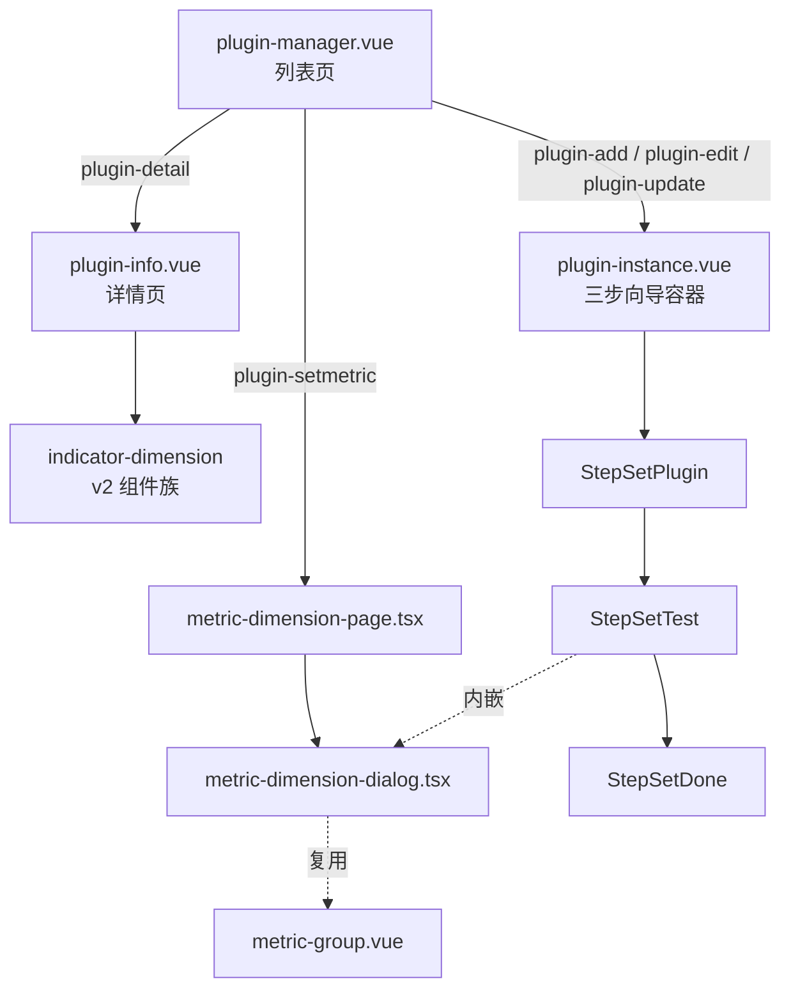
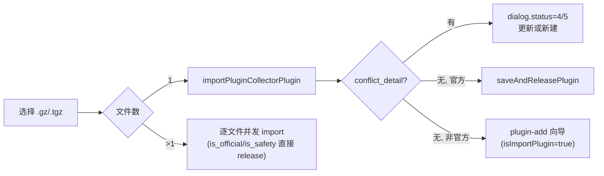
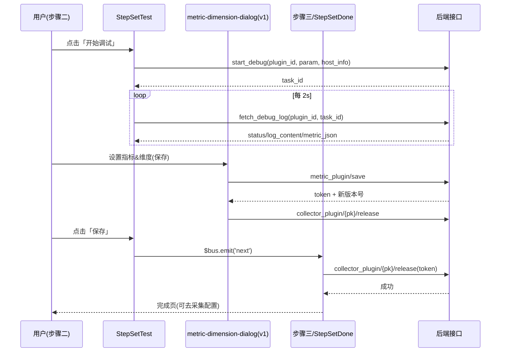

# 实现：插件管理专家 / 指标插件管理

**本文引用的文件**
- [plugin-manager.vue](file://bkmonitor/webpack/src/monitor-pc/pages/plugin-manager/plugin-manager.vue)
- [plugin-instance.vue](file://bkmonitor/webpack/src/monitor-pc/pages/plugin-manager/plugin-instance/plugin-instance.vue)
- [step-set-plugin.vue](file://bkmonitor/webpack/src/monitor-pc/pages/plugin-manager/plugin-instance/set-steps/step-set-plugin.vue)
- [step-set-test.vue](file://bkmonitor/webpack/src/monitor-pc/pages/plugin-manager/plugin-instance/set-steps/step-set-test.vue)
- [step-set-done.vue](file://bkmonitor/webpack/src/monitor-pc/pages/plugin-manager/plugin-instance/set-steps/step-set-done.vue)
- [new-plugin-monaco.vue](file://bkmonitor/webpack/src/monitor-pc/pages/plugin-manager/plugin-instance/set-steps/components/new-plugin-monaco.vue)
- [config-param.vue](file://bkmonitor/webpack/src/monitor-pc/pages/plugin-manager/plugin-instance/set-steps/components/config-param.vue)
- [select-host.vue](file://bkmonitor/webpack/src/monitor-pc/pages/plugin-manager/plugin-instance/set-steps/components/select-host.vue)
- [import-file.vue](file://bkmonitor/webpack/src/monitor-pc/pages/plugin-manager/plugin-instance/set-steps/components/import-file.vue)
- [param-card.vue](file://bkmonitor/webpack/src/monitor-pc/pages/plugin-manager/plugin-instance/set-steps/components/param-card.vue)
- [tag-switch.vue](file://bkmonitor/webpack/src/monitor-pc/pages/plugin-manager/plugin-instance/set-steps/tag-switch.vue)
- [metric-group.vue](file://bkmonitor/webpack/src/monitor-pc/pages/plugin-manager/plugin-instance/set-steps/metric-dimension/metric-group.vue)
- [metric-dimension-dialog.vue](file://bkmonitor/webpack/src/monitor-pc/pages/plugin-manager/plugin-instance/set-steps/metric-dimension/metric-dimension-dialog.vue)
- [upload.vue](file://bkmonitor/webpack/src/monitor-pc/pages/plugin-manager/plugin-instance/upload/upload.vue)
- [terminal-instance.vue](file://bkmonitor/webpack/src/monitor-pc/pages/plugin-manager/plugin-instance/terminal-instance/terminal-instance.vue)
- [logo.vue](file://bkmonitor/webpack/src/monitor-pc/pages/plugin-manager/plugin-instance/logo/logo.vue)
- [metric-dimension-dialog.tsx](file://bkmonitor/webpack/src/monitor-pc/pages/plugin-manager/components/metric-dimension-dialog.tsx)
- [metric-dimension-page.tsx](file://bkmonitor/webpack/src/monitor-pc/pages/plugin-manager/components/metric-dimension-page.tsx)
- [indicator-dimension/index.tsx](file://bkmonitor/webpack/src/monitor-pc/pages/plugin-manager/components/indicator-dimension/index.tsx)
- [indicator-dimension/utils.ts](file://bkmonitor/webpack/src/monitor-pc/pages/plugin-manager/components/indicator-dimension/utils.ts)
- [indicator-dimension/types.ts](file://bkmonitor/webpack/src/monitor-pc/pages/plugin-manager/components/indicator-dimension/types.ts)
- [indicator-dimension/field-list/index.tsx](file://bkmonitor/webpack/src/monitor-pc/pages/plugin-manager/components/indicator-dimension/field-list/index.tsx)
- [indicator-dimension/batch-edit/index.tsx](file://bkmonitor/webpack/src/monitor-pc/pages/plugin-manager/components/indicator-dimension/batch-edit/index.tsx)
- [indicator-dimension/group-list/index.tsx](file://bkmonitor/webpack/src/monitor-pc/pages/plugin-manager/components/indicator-dimension/group-list/index.tsx)
- [indicator-dimension/metric-detail/index.tsx](file://bkmonitor/webpack/src/monitor-pc/pages/plugin-manager/components/indicator-dimension/metric-detail/index.tsx)
- [indicator-dimension/edit-group/index.tsx](file://bkmonitor/webpack/src/monitor-pc/pages/plugin-manager/components/indicator-dimension/edit-group/index.tsx)
- [plugin-dialog-single.vue](file://bkmonitor/webpack/src/monitor-pc/pages/plugin-manager/plugin-dialog-single.vue)
- [plugin-dialog-multiple.vue](file://bkmonitor/webpack/src/monitor-pc/pages/plugin-manager/plugin-dialog-multiple.vue)
- [plugin-info.vue](file://bkmonitor/webpack/src/monitor-pc/pages/plugin-manager/plugin-info/plugin-info.vue)
- [plugin-setmetric.vue](file://bkmonitor/webpack/src/monitor-pc/pages/plugin-manager/plugin-setmetric.vue)
- [loading-component.vue](file://bkmonitor/webpack/src/monitor-pc/pages/plugin-manager/loading-component.vue)
- [utils.ts](file://bkmonitor/webpack/src/monitor-pc/pages/plugin-manager/utils.ts)
- [authority-map.ts](file://bkmonitor/webpack/src/monitor-pc/pages/plugin-manager/authority-map.ts)
- [router/integrated/plugin-manager.ts](file://bkmonitor/webpack/src/monitor-pc/router/integrated/plugin-manager.ts)
- [store/modules/plugin-manager.js](file://bkmonitor/webpack/src/monitor-pc/store/modules/plugin-manager.js)
- [monitor-api/modules/model.js](file://bkmonitor/webpack/src/monitor-api/modules/model.js)
- [monitor-api/modules/plugin.js](file://bkmonitor/webpack/src/monitor-api/modules/plugin.js)
- [monitor-api/modules/commons.js](file://bkmonitor/webpack/src/monitor-api/modules/commons.js)

## 目录
1. [简介](#简介)
2. [核心流程](#核心流程)
3. [设计模式](#设计模式)
4. [关键类与函数](#关键类与函数)
5. [热点路径](#热点路径)
6. [技术债](#技术债)
7. [结论](#结论)

## 简介

插件管理专家对应 monitor-pc 的「指标插件管理」功能域（Vue2）。它由四个相对独立的界面形态组成：

1. **插件列表页**（`plugin-manager` 路由，`plugin-manager.vue`）：插件全生命周期的入口——搜索/分页/排序、按类型分 tab、删除、导出、导入（`.gz/.tgz`）、跳转编辑/详情/设置指标&维度。
2. **三步制作向导**（`plugin-add` / `plugin-edit` / `plugin-update` 路由，`plugin-instance.vue` 容器 + 三个步骤组件）：定义插件 → 插件调试 → 完成发布。
3. **插件详情页**（`plugin-detail` 路由，`plugin-info.vue`）与其中的「指标维度」tab（`indicator-dimension` 目录，TSX 类组件族）。
4. **设置指标&维度独立页**（`plugin-setmetric` 路由，`components/metric-dimension-page.tsx` → `metric-dimension-dialog.tsx`），以及历史上独立页所用的旧版 Vue SFC 实现（`plugin-setmetric.vue` + `set-steps/metric-dimension/metric-dimension-dialog.vue`，现已不在路由链上）。

模块内存在两套「指标维度编辑」实现（TSX 类组件版 v1 与 indicator-dimension 版 v2），以及一个已退役的 Vue SFC 版 v0，是本模块最显著的实现特征。所有后端交互集中在 `rest/v2/collector_plugin/**`、`rest/v2/metric_plugin/save/`、`rest/v2/register_plugin/`、`rest/v2/save_and_release_plugin/`、`rest/v2/commons/query_async_task_result/` 等接口上。

章节来源：[plugin-manager.vue](file://bkmonitor/webpack/src/monitor-pc/pages/plugin-manager/plugin-manager.vue)（关键符号：`listCollectorPlugin`、`handlePluginAdd`）、[router/integrated/plugin-manager.ts](file://bkmonitor/webpack/src/monitor-pc/router/integrated/plugin-manager.ts)（关键符号：`PluginInstance`、`PluginSetmetric`）

## 核心流程

### 2.1 页面与路由拓扑

`router/integrated/plugin-manager.ts` 定义了模块的六个命名路由，并全部挂 `pluginAuth` 权限元信息（页面级校验 `VIEW_AUTH` / `MANAGE_AUTH`）：

| 路由 name | 组件 | 说明 |
|---|---|---|
| `plugin-manager` | `plugin-manager.vue` | 列表页，`noNavBar` |
| `plugin-add` / `plugin-edit` / `plugin-update` | `plugin-instance.vue`（`components.noCache`） | 向导，三态复用同一容器 |
| `plugin-detail` | `plugin-info/plugin-info.vue`（`noCache`） | 详情页 |
| `plugin-setmetric` | `components/metric-dimension-page` | 设置指标&维度（TSX 版） |

路由表整体经 `applyGuidePage(routes, ['plugin-add'])` 处理：除 `plugin-add` 外的路由会被注入 `beforeEnter(navId)` 前置处理并统一补 `meta.noChangeLoading = true`；`plugin-add` 被排除在外，不受该前置逻辑约束。

图表来源：[router/integrated/plugin-manager.ts](file://bkmonitor/webpack/src/monitor-pc/router/integrated/plugin-manager.ts)（关键符号：`plugin-setmetric`、`PluginSetmetric`）、[plugin-instance.vue](file://bkmonitor/webpack/src/monitor-pc/pages/plugin-manager/plugin-instance/plugin-instance.vue)（关键符号：`stepsMap`）

章节来源：[router/integrated/plugin-manager.ts](file://bkmonitor/webpack/src/monitor-pc/router/integrated/plugin-manager.ts)（关键符号：`applyGuidePage`、`PluginInstance`）

### 2.2 列表页：加载与操作

**列表加载**：`getPluginListData(needLoading)` 统一承担刷新逻辑——组装 `search_key / plugin_type / page / page_size / order / labels` 参数调 `listCollectorPlugin`；用 `CancelToken` 把取消函数挂到 `cancelListRequest`（搜索清空时取消 pending 请求）；响应中的 `data.count` 按 `tab.alias || tab.name` 回填各 tab 数量，并累加为「全部」；失败时 `emptyType = '500'`，空态交给 `empty-status` 组件（`handleOperation` 响应 `clear-filter` / `refresh`）。首次进入由 `beforeRouteEnter` 判断来源：来自 `plugin-add / plugin-edit / plugin-detail` 时不重置搜索词和分页，否则重置为第一页并读取 `commonPageSizeGet()`。

**搜索/排序/分页**：搜索走 `debounce(300, ...)`；排序把 bk-table 的 `descending` 映射为 `-prop`（如 `-update_time`）；分页大小变更写回本地存储（`commonPageSizeSet`）。tab 切换通过 `handlePanelChange` 重置页码。tab 名称与后端类型存在别名映射（如 `BK-Pull → Pushgateway`、`SNMP → SNMP`）。

**行操作**：主操作区只有「编辑」按钮和 `icon-more` 触发器；更多操作（设置指标&维度 / 导出 / 删除）通过 `$bkPopover` 挂载隐藏 DOM（`operatorGroup`）呈现——`handleOperatorOver` 负责 popover 实例的创建/复用与销毁（`onHidden` 中 destroy）。设置指标&维度仅在 `status === 'normal' && !is_official` 时跳转 `plugin-setmetric`（`handleShowMeticr`）；导出调 `exportPluginCollectorPlugin` 拿 `download_url` 后 `downFile`；删除先 `$bkInfo` 确认（配合 `delete-subtitle` 组件展示插件名），再调 `deleteCollectorPlugin({ plugin_ids: [id] })`。

**权限分流**：行级使用 `getManageAuth(row)`（注意语义：返回 true 表示**缺**权限）——公共插件（`bk_biz_id === 0`）需要同时具备 `MANAGE_AUTH` 和 `MANAGE_PUBLIC_AUTH`；无权限时点击名称/编辑/更多均转入 `showAuthorityDetail(row)`，动态收集缺失的 actionId 交给 authorityMixin 的 `handleShowAuthorityDetail`。草稿（`status === 'draft'`）行点击名称直接进入 `plugin-edit`，否则进入 `plugin-detail`（`showPluginInfo`）。

章节来源：[plugin-manager.vue](file://bkmonitor/webpack/src/monitor-pc/pages/plugin-manager/plugin-manager.vue)（关键符号：`getPluginListData`、`handleOperatorOver`、`getManageAuth`、`showAuthorityDetail`、`handleShowMeticr`）

### 2.3 导入：单文件与多文件

导入入口是「导入」按钮内嵌的隐藏 `<input accept=".gz, .tgz" multiple>`。`handleFileChange` 按文件个数分流：

- **单文件 `handeFileSingel(file)`**：先显示 `plugin-dialog-single`（`dialog.status=1`，并用 `setInterval` 以 `percent += 0.16` 做伪进度动画）；`importPluginCollectorPlugin({ file_data })` 成功后把结果缓存进 Vuex（`SET_PLUGIN_CONFIG`），然后按冲突矩阵决策：
  - `conflict_detail` 存在 → `status=4`（重名/冲突），非超管时前置「无权限导入官方插件」文案；`dialog.update` 按 `is_official / duplicate_type / conflict_title` 组合计算是否允许「更新至现有插件」；
  - 非超管 + 官方插件 → `status=5`（只能新建）；
  - 官方插件且无冲突 → `handleSetUpdatePlugin()`（`saveAndReleasePlugin` 直接更新发布）；
  - 非官方且无冲突 → 关闭弹窗并 `handlePluginAdd(null, data, true)` 跳到向导新建（`isImportPlugin=true`，向导创建时从 `pluginConfigCache` 取回 `collector_json/config_json/metric_json`）。
- **多文件 `handleFileMultiple(files)`**：显示 `plugin-dialog-multiple`（每文件独立行 + 独立进度 + 状态文案），对每个文件并发调 `importPluginCollectorPlugin`；`(is_official || is_safety) && !duplicate_type` 的文件直接 `saveAndReleasePlugin`（官方置 `bk_biz_id=0`，否则取当前业务），其余给出「插件包不完整 / 名字冲突 / 插件冲突」文案。进度也是 `setInterval` 伪进度（`50 + index*50` 毫秒的错峰刷新）。

单文件弹窗的按钮分发在 `plugin-dialog-single.vue`：`handleToEdit`（非官方且签名完整 → 跳 `plugin-update` 走向导升级）、`handleCreateNewPlugin`、`handleUpdatePlugin`、`handleHideDialog`——通过 `$parent` 回调列表页方法，是模块中少数「子组件反向调用父级」的写法。

图表来源：[plugin-manager.vue](file://bkmonitor/webpack/src/monitor-pc/pages/plugin-manager/plugin-manager.vue)（关键符号：`handeFileSingel`、`handleFileMultiple`、`handleSetUpdatePlugin`）

章节来源：[plugin-manager.vue](file://bkmonitor/webpack/src/monitor-pc/pages/plugin-manager/plugin-manager.vue)（关键符号：`handeFileSingel`、`handleFileMultiple`）、[plugin-dialog-single.vue](file://bkmonitor/webpack/src/monitor-pc/pages/plugin-manager/plugin-dialog-single.vue)（关键符号：`handleCreateNewPlugin`、`handleToEdit`）

### 2.4 三步向导

**容器 `plugin-instance.vue`**：`left.stepsMap` 定义三步（`定义插件 → 插件调试 → 完成`），每步携带 `done` 与 `component` 字符串；模板用 `<keep-alive><component :is="curStep.component" :show.sync="showView" :data.sync="pluginInfo" :from-route="fromRouteName" /></keep-alive>` 渲染当前步骤，三个步骤组件全部注册在容器上。步骤间通信走 `$bus`：`next`（进入下一步）、`forward`（回退一步）、`showmsg`（步骤一向容器标题栏传版本信息）、`resetscroll`（重置滚动位置）。`handleNextStep` 先把当前步 `done=true` 再 `step += 1`；`handleForward` 仅 `step -= 1`。步骤条允许点击已完成步骤（`item.done && handleSetStep(index)`）。

**进入与离开**：`beforeRouteEnter` 记录来源路由名（`fromRouteName`，供步骤三判断是否回采集新增页）；`beforeRouteLeave` 在「去往非 add/edit 路由且 `step < 2`」时弹「是否放弃本次操作？」——通过 `handleCancel(false)` 返回 Promise，`confirm` 时 `next(true)` 放行、`cancel` 时 `next(false)` 拦截导航。`beforeDestroy` 中清空 `SET_PLUGIN_CONFIG` 缓存。

**步骤一 `step-set-plugin.vue`（定义插件）**：进入时 `created` 并行加载 `getOsList / getLabels / getReservedWords`（Vuex actions，结果有缓存），再按 `data.pluginId`（编辑 → `retrieveCollectorPlugin` 回填）或 `data.pluginData`（导入/升级 → `backFillData`）初始化。表单覆盖：所属业务 / 插件 ID（`checkPluginId` 调 `checkIdCollectorPlugin` 做唯一性校验，前端另有 `validateRequired` 正则 `^[a-zA-Z][a-zA-Z0-9_]*$` 与 30 字符限制）/ 别名 / 类型选择（Script、JMX、Exporter、DataDog、BK-Pull、SNMP，支持 `query.notype` 隐藏）/ 采集内容（Exporter/DataDog 用 `mo-upload` 分系统上传；Script/JMX/DataDog 用 `new-plugin-monaco` 写脚本或 yaml；SNMP 上传 yaml）/ 定义参数（`config-param` 弹窗编辑，JMX/SNMP 用内置不可编辑参数集）/ 分类（含「有采集任务时不允许修改」的禁用项）/ 远程采集开关 / 描述（markdown 编辑器）。

点击「下一步」`handleNextStep`：`generationPluginParams()` 组装 `bk_biz_id / plugin_id / plugin_display_name / plugin_type / collector_json / config_json / metric_json / label / version_log / is_support_remote / description_md / config_version_old` 等参数（`getCollectorJsonParam` 从 monaco 读取脚本内容并 base64 编码，`getConfigParam` 为 JMX/Exporter 注入隐藏的 host/port 配置），`validateAllOptions` 校验通过后调 `createCollectorPlugin` / `editCollectorPlugin`（编辑走 edit）。保存成功后按 `needRegister` 决定是否走 `registerPlugin`（生成插件包）：`registerPlugin` 以 `pluginRegister(params, { isAsync: true })` 拿异步任务，用 `queryAsyncTaskResult` 每 1.5s 轮询，SUCCESS 且返回 `token` 才 resolve——失败/无 token 会停在 `polling-loading` 弹层并显示 `registerDialog.status.failMsg`。编辑场景还有「插件变更说明」弹窗（`pluginChangeMsg`）：当配置、信息有变更且插件已发布时，`createPlugin` 会主动 `Promise.reject` 以暂停注册流程，等用户填写变更说明（`handleUpdateDesc`）后再继续。

**步骤二 `step-set-test.vue`（插件调试）**：`activated` 时从 `data.from === 'bkmonitor.models.fta.plugin'` 判定是从步骤一进入，执行 `handleData`（构造 `host_info` 数组，逐系统准备调试目标）+ `handleParamsList`（展开 `config_json` 与 SNMP v3 `auth_json`，动态计算必填/禁用项）。可调试性由 `canStartDebug` 计算：参数齐全（`isParamsCompletely`）、至少选了一个调试目标、SNMP 需填目标、Exporter 需端口合法。点击「开始调试」`startDebug`：对每个已选主机调 `startDebugCollectorPlugin` 拿 `task_id`，进入状态机 `debugStatus: 'setting' | 'debugging' | 'finish'`；`handleDebugLog` 每 2s 调 `fetchDebugLogCollectorPlugin` 拉日志，按 `status`（`INSTALL / FETCH_DATA / SUCCESS / FAILED`）更新 tab 状态与终端输出；`FETCH_DATA` 且返回 `metric_json` 时写入 `host.metricJson` 并更新「数据时间」；`host.timeOut > 180` 时自动 `stopDebug`，否则持续轮询。`deactivated` 与 `beforeDestroy` 分别用 `clearTimer(false)` / `clearTimer()` 清理定时器并在必要时 stopDebug（离开页面不遗留调试进程）。

**步骤三 `step-set-done.vue`（完成）**：`activated` 时根据 `data.saveData.from === 'save'` 分流——新建直接 `releasePlugin`（调 `releaseCollectorPlugin` 带 `config_version / info_version / token`）；编辑若带 `token` 也走 release，否则 `simRelease('success')` 直接展示成功（无需再发布）；从缓存结果进入时 `simRelease(status, message)` 只做展示。页脚提供「前往采集配置升级插件」（`config_version > config_version_old && related_conf_count > 0` 时显示）、「新建采集配置」和「关闭」（`close` 会区分来源路由，若来自 `collect-config-add` 则原路返回）。

章节来源：[plugin-instance.vue](file://bkmonitor/webpack/src/monitor-pc/pages/plugin-manager/plugin-instance/plugin-instance.vue)（关键符号：`handleNextStep`、`handleForward`、`handleCancel`）、[step-set-plugin.vue](file://bkmonitor/webpack/src/monitor-pc/pages/plugin-manager/plugin-instance/set-steps/step-set-plugin.vue)（关键符号：`generationPluginParams`、`registerPlugin`、`handleNextStep`）、[step-set-test.vue](file://bkmonitor/webpack/src/monitor-pc/pages/plugin-manager/plugin-instance/set-steps/step-set-test.vue)（关键符号：`startDebug`、`handleDebugLog`、`clearTimer`）、[step-set-done.vue](file://bkmonitor/webpack/src/monitor-pc/pages/plugin-manager/plugin-instance/set-steps/step-set-done.vue)（关键符号：`releasePlugin`、`needUpdataPlugin`）

### 2.5 指标维度编辑（两代实现）

模块内有三份「指标维度编辑」实现，各自定位如下：

- **v0（已退役）**：`set-steps/metric-dimension/metric-dimension-dialog.vue`（Vue SFC，含分组管理、移动、规则匹配、数据预览、下载样例等），只被 `plugin-setmetric.vue` 引用；而 `plugin-setmetric` 路由的组件已在路由表中改为 `components/metric-dimension-page`（原 import 被注释），`step-set-test.vue` 中指向 v0 的 import 同样被注释。两文件构成一条已断开的引用链。
- **v1（在用）**：`components/metric-dimension-dialog.tsx`（TSX 类组件）+ `components/metric-dimension-page.tsx`（路由包装，`render` 返回 `<MetricDimensionDialog isRoutePage={true} />`）。使用方有两个：`plugin-setmetric` 独立页（`isRoutePage=true`，`created` 时自行 `retrieveCollectorPlugin`）与向导步骤二的内嵌弹窗（`isRoutePage=false`，接收父级传入的 `metricJson / pluginData` 和实时调试数据）。它复用 v0 的子组件 `metric-group.vue` 渲染每个分组表格。
- **v2（在用）**：`components/indicator-dimension/**`（TSX 类组件族 + 纯函数 `utils.ts` + 类型 `types.ts`），用于 `plugin-info.vue` 详情页的「指标维度」tab（`<plugin-indicator-dimension :plugin-id :can-edit>`）。

**v1 交互路径（metric-dimension-dialog.tsx）**：

- `init()` 按 `isRoutePage` 决定数据来源（拉详情或取 props），`createDefaultGroup` 补默认分组，`getUnitListData` 加载单位表；
- `localMetricData` 深监听 → `tableData` 深拷贝 + `handleTableDataChange`（补 `id`、把 `type='double' + is_diff_metric` 归一为 `diff` 展示、`handleSortTableData` 按 `order` 排序）；
- 分组操作：`handleAddGroup / handleSetGroup / handleEditGroup / handleDelGroup`（名字正则 `groupNameRegx`、冲突检测、默认分组保护）；规则变更走 `handleAddRule / moveMatchMetric`——把默认分组中匹配规则（`matchRuleFn`）的指标移入目标分组、把目标分组中不再匹配的移回默认分组；
- 行操作：`handleAddRow / handleDelRow / handleEditRow`，其中删除有级联语义（删指标时若其携带的维度已无其他指标关联则一并删除；删维度时清理所有指标的 `tag_list` 引用）；移动分组 `handleMoveGroup` 用 `isCheck` 勾选集合做迁移并同步携带关联维度；
- 导入导出：`handleImportMetric`（校验 group/name/别名重复、`type` 分类错误，错误以 `ul` 列表形式一次性提示）与 `handleExportMetric`（`monitor-export` 组件回吐精简 `metric_json`）；
- 保存 `handleSave`：过滤空行、`haveData / canSave` 校验（指标全局唯一、维度组内唯一、别名全局唯一）、剔除前端态字段（`descReValue/errValue/isCheck/isDel/isFirst/id/reValue/showInput`），`need_upgrade` 仅对「路由页或非发布态」置 true；`saveMetric` 返回 `token` 时继续 `releaseCollectorPlugin`，成功后 `handleSucessSave` 通知父级更新 token/版本并关闭；
- 额外能力：自动采集开关（`handleAutoCollectChange`，开关均弹风险确认）、「一键转换」（对格式错误名称做 `metricNameTransFrom` 批量转换）、数据预览、指标数量上限（普通 5000 / SNMP 500，`isAllowAddItem` + `handleMaxMetircDimMsg`）。

**v2 交互路径（indicator-dimension）**：

- `PluginIndicatorDimension`（index.tsx）持有 `groupList / pluginMeta / selectedGroup / activeTab`；`loadPlugin` 拉详情并 `ensureDefaultGroup`；`persist(nextGroups, successMsg, silent)` 是唯一的落盘出口——内部 `savePluginMetricJson`（`utils.ts`）= `saveMetric(buildSaveMetricParams(...))` + 必要时 `releaseCollectorPlugin`；
- 所有写操作都是「先深拷贝出 `next` 再落盘」：`handleEditField`（行内编辑别名/单位/类型/启停，silent 落盘）、`handleMoveField`（单条移动，silent）、`handleBatchMove`（勾选勾选移动，整表 reload）、`handleSaveBatch`（批量编辑侧滑保存）、`handleSubmitGroup / handleDeleteGroup`（分组操作）；
- `GroupList`（左栏）：`全部 / 默认分组` 固定项 + 自定义分组列表（搜索、计数 `getMetricCount`）、编辑/删除弹窗（删除提示「指标将自动挪入默认分组」）；
- `FieldList`（主表）：指标/维度 tab、`SearchSelect` 多条件搜索（名称/别名/单位/类型/启停）、分页 30、行内编辑、勾选批量移动、「管理」打开批量编辑侧滑、点击指标名打开右侧 `MetricDetail` 明细叶；
- `BatchEdit`（侧滑）：支持「全量 / 勾选项」两种编辑范围，列头 popover 批量改写（别名/分组/类型/单位/启停），支持新增/删除行，保存前对新增行做名称合法性（`judgeIsIllegal`）与重名校验（含跨分组、排除已删除项）；
- `utils.ts` 是纯函数数据层：`fieldUid`（`${tableName}::${monitorType}::${name}` 唯一键）、`flattenFields / filterFieldsByGroup / fuzzyMatch`、`moveCheckedFields / moveFieldToGroup`（对齐 v1 的 `handleMoveGroup` 语义）、`applyGroupRules`（编辑分类时「只吸入不挪走」）、`deleteGroup`（字段并入默认分组）、`applyBatchFieldChanges`（合并批量编辑结果，维度删除级联清理指标引用）、`buildSaveMetricParams / savePluginMetricJson / getExportMetricJson / getMetricTypeList`。

章节来源：[metric-dimension-dialog.tsx](file://bkmonitor/webpack/src/monitor-pc/pages/plugin-manager/components/metric-dimension-dialog.tsx)（关键符号：`handleSave`、`moveMatchMetric`、`handleDelRow`）、[indicator-dimension/index.tsx](file://bkmonitor/webpack/src/monitor-pc/pages/plugin-manager/components/indicator-dimension/index.tsx)（关键符号：`persist`、`handleSubmitGroup`）、[indicator-dimension/utils.ts](file://bkmonitor/webpack/src/monitor-pc/pages/plugin-manager/components/indicator-dimension/utils.ts)（关键符号：`moveCheckedFields`、`applyGroupRules`）

### 2.6 调试与发布（时序）

图表来源：[step-set-test.vue](file://bkmonitor/webpack/src/monitor-pc/pages/plugin-manager/plugin-instance/set-steps/step-set-test.vue)（关键符号：`startDebug`、`getTaskId`、`savePlugin`）、[step-set-done.vue](file://bkmonitor/webpack/src/monitor-pc/pages/plugin-manager/plugin-instance/set-steps/step-set-done.vue)（关键符号：`releasePlugin`）

关键接口与调用点（均在 `monitor-api/modules/model.js`、`plugin.js`）：`start_debug` / `stop_debug` / `fetch_debug_log` / `release` 挂在 `collector_plugin/{pk}/` 下；`saveMetric`、`pluginRegister`、`saveAndReleasePlugin` 挂在 `rest/v2/metric_plugin/save/`、`rest/v2/register_plugin/`、`rest/v2/save_and_release_plugin/`；异步任务结果统一由 `commons.js` 的 `queryAsyncTaskResult` 轮询（register 流程，1.5s 间隔）。调试日志的终端渲染由 `terminal-instance.vue` 完成（`consoles` 数组逐条着色、`transformJobUrl` 处理后 `v-html` 输出、支持全屏、自动滚底）。

章节来源：[step-set-test.vue](file://bkmonitor/webpack/src/monitor-pc/pages/plugin-manager/plugin-instance/set-steps/step-set-test.vue)（关键符号：`handleDebugLog`、`getDebugParams`、`stopDebug`）、[monitor-api/modules/model.js](file://bkmonitor/webpack/src/monitor-api/modules/model.js)（关键符号：`fetchDebugLogCollectorPlugin`、`releaseCollectorPlugin`）、[terminal-instance.vue](file://bkmonitor/webpack/src/monitor-pc/pages/plugin-manager/plugin-instance/terminal-instance/terminal-instance.vue)（关键符号：`autoScrollToBottom`）

## 设计模式

### 3.1 步骤容器 + keep-alive 动态组件 + 事件总线

向导的完成度较高：容器不关心步骤内部实现，只维护 `stepsMap`（名称、完成态、组件名字符串）与当前索引；步骤组件通过 `:data.sync`（即 `update:data` 事件）向上同步「跨步骤共享的 pluginInfo」，通过 `$bus` 事件（`next / forward / showmsg / resetscroll`）驱动容器状态机。`keep-alive` 保证步骤切换时表单状态不丢失（步骤二依赖这一点——从步骤一反复前进/后退时 `activated` 会重新执行初始化逻辑）。

设计维度一（**一致性**）：步骤间只用「事件 + sync 属性」两种通道，不直接引用兄弟组件，三步组件互不依赖；容器是唯一的编排者。设计维度二（**代价与风险**）：`$bus` 是全局事件总线，事件名短且无命名空间，且容器 `beforeDestroy` 中 `resetscroll` 的清理误写为 `$on`（详见技术债），长期看这类事件通道的可追踪性弱于 props/emit 链。步骤组件在 `keep-alive` 下常驻，`activated` 中的初始化逻辑必须幂等（步骤二正是如此处理的）。

章节来源：[plugin-instance.vue](file://bkmonitor/webpack/src/monitor-pc/pages/plugin-manager/plugin-instance/plugin-instance.vue)（关键符号：`stepsMap`、`handleSetStep`、`curStep`）

### 3.2 Vuex 跨页传参与缓存（SET_PLUGIN_CONFIG）

`store/modules/plugin-manager.js` 是一个 `namespaced: true` 的轻量 store：state 中 `pluginConfigCache` 专门存「单个插件文件的导入结果」，配合 `SET_PLUGIN_CONFIG` mutation 使用；getter `pluginConfigCache` 供向导读取；actions `getOsList / getLabels / getReservedWords` 带「有缓存就不重复请求」的短路逻辑（state 为空才发请求）。

跨页数据流：列表页导入 → `SET_PLUGIN_CONFIG(data)` → 跳转 `plugin-add`（isImportPlugin）或 `plugin-update`；`step-set-plugin.createPlugin` 中若 `$route.name === 'plugin-update' || pluginConfigCache` 则把缓存的 `collector_json / config_json / is_support_remote` 作为 `import_plugin_config`，`metric_json` 作为 `import_plugin_metric_json` 随创建请求提交；列表页和向导在离开/销毁时各自把缓存置 `null`（`beforeRouteLeave` / `beforeDestroy`），避免脏数据串页。

设计维度一（**职责边界**）：Vuex 只做「跨路由的一次性数据摆渡」和共享字典缓存，业务状态仍在组件内（列表数据、表单数据都不进 store）。设计维度二（**容错性**）：缓存的生命周期靠三个位置的清空逻辑手动维护（列表页离开、向导销毁、导入成功覆盖），任一环节漏清理都会让下一次导入读到旧值——这是该设计的脆弱点。

章节来源：[store/modules/plugin-manager.js](file://bkmonitor/webpack/src/monitor-pc/store/modules/plugin-manager.js)（关键符号：`SET_PLUGIN_CONFIG`、`pluginConfigCache`、`getOsList`）、[step-set-plugin.vue](file://bkmonitor/webpack/src/monitor-pc/pages/plugin-manager/plugin-instance/set-steps/step-set-plugin.vue)（关键符号：`pluginConfigCache`、`createPlugin`）

### 3.3 迁移中的两代指标维度实现（v1/v2 并存）

v1（`metric-dimension-dialog.tsx`）与 v2（`indicator-dimension`）同域共存、面向不同入口：v1 更「重交互、面向调试数据」（数据预览、一键转换、自动采集开关、token 释放编排），v2 更「结构清晰、面向编辑」（组件拆分 + 纯函数层 + 行内编辑即保存）。两者对 `saveMetric` 的入参构造高度一致（都剔除前端态字段、`diff → double + is_diff_metric`、`is_manual` 按 `rule_list` 计算、`need_upgrade`），说明 v2 是从 v1 语义中提炼出来的。

设计维度一（**复用策略**）：v2 没有复制 v1 的表格组件，v2 是重写；但 v1 复用了 v0 的 `metric-group.vue`。同一个领域出现「旧组件被新组件复用、旧页面被新页面替代」两种策略并存，是渐进迁移中的真实形态。设计维度二（**一致性成本**）：两代实现共享同一批接口与数据结构（`metric_json`、`tag_list`、`rule_list`、`FRONT_END_FIELD_KEYS`），字段级行为需保持同步（如「编辑分类只吸入不挪走」的规则语义、删除维度级联清理）；`indicator-dimension/utils.ts` 中保留了「与设置指标&维度页保持一致」的注释，说明一致性靠人工对齐而非共享代码。

章节来源：[metric-dimension-dialog.tsx](file://bkmonitor/webpack/src/monitor-pc/pages/plugin-manager/components/metric-dimension-dialog.tsx)（关键符号：`handleSave`、`MetricGroup`）、[indicator-dimension/utils.ts](file://bkmonitor/webpack/src/monitor-pc/pages/plugin-manager/components/indicator-dimension/utils.ts)（关键符号：`buildSaveMetricParams`、`moveCheckedFields`）、[indicator-dimension/types.ts](file://bkmonitor/webpack/src/monitor-pc/pages/plugin-manager/components/indicator-dimension/types.ts)（关键符号：`FRONT_END_FIELD_KEYS`）

### 3.4 纯函数数据层（indicator-dimension/utils.ts）

v2 把「分组/字段的数据变换」全部抽成纯函数：输入 `IPluginGroup[]`，输出新的 `IPluginGroup[]`（内部 `deepClone`），副作用只有网络请求（`savePluginMetricJson`）。组件层只负责把事件翻译成 utils 调用并把结果交给 `persist`。

设计维度一（**可测试性/可读性**）：移动、删除、批量编辑、规则应用等最易出错的逻辑集中在一个文件，用 `uid`（`table_name::monitor_type::name`）而非数组下标定位字段，避免了「同一列表里同名指标/维度」的定位歧义。设计维度二（**性能取舍**）：几乎每个操作都会 `deepClone` 全量分组（`applyBatchFieldChanges`、`moveCheckedFields` 等），在 5000 条上限的指标规模下内存与耗时可控，但批量编辑一次大表保存会产生多次全量克隆，属于「可读性优先」的显式取舍。

章节来源：[indicator-dimension/utils.ts](file://bkmonitor/webpack/src/monitor-pc/pages/plugin-manager/components/indicator-dimension/utils.ts)（关键符号：`fieldUid`、`applyBatchFieldChanges`、`savePluginMetricJson`）

### 3.5 Monaco 与文件/终端控件

- **Monaco**：`new-plugin-monaco.vue` 封装 `monaco-editor`（`components/editors/monaco-editor.vue`），服务 Script（多系统多语言，含启用开关与「启用遮罩」）、JMX/DataDog（yaml，`otherLanguage`）。暴露 `getScriptContents()` 给步骤一提交（校验「必须开启一个采集脚本」「脚本内容不能为空」）；`setEditData` 负责回填。宽度由父组件 `width` 传入，父级用 `@blueking/fork-resize-detector` 监听容器宽度（`calculationEditorWidth`，注释说明「monaco 宽度无法自适应」），并监听 `editorWidth` 调 `layout()`。
- **文件控件**：`import-file.vue` 封装 `monitor-import`（base64 开关、文件大小上限来自 `collectingConfigFileMaxSize`、错误消息上抛），被 yaml 参数、SNMP 配置、文件类型参数三处复用。
- **上传包**：`upload.vue`（Exporter/DataDog）按系统渲染自定义文件槽，内部调 `uploadFileCollectorPlugin` / `dataDogPluginUpload`，并 emit `change`（datadog check name）与 `yaml`（回填 monaco）。父组件通过 ref 名 `uploadFile-exporter-{index}` / `uploadFile-datadog-{index}` 在提交时读取 `fileDesc`（`getUploadFile`）。
- **终端**：`terminal-instance.vue` 渲染调试日志（`consoles` 逐行着色，`status` 映射三种颜色），`animation` 模式做逐字符打字动画，`getDelayTime` 按累计字符数计算动画延迟；支持全屏（原生 Fullscreen API）与自动滚底。

设计维度一（**封装粒度**）：编辑器、文件、终端、上传四种「重型交互」都有独立封装组件，业务组件只保留数据契约；设计维度二（**耦合方式**）：上传/编辑器通过 `ref` + 方法调用传递数据（`getScriptContents`、`getUploadFile`），与 Vue2 的响应式 props 流不同，这类命令式接口在重构时需要同步核对。

章节来源：[new-plugin-monaco.vue](file://bkmonitor/webpack/src/monitor-pc/pages/plugin-manager/plugin-instance/set-steps/components/new-plugin-monaco.vue)（关键符号：`getScriptContents`、`setEditData`）、[upload.vue](file://bkmonitor/webpack/src/monitor-pc/pages/plugin-manager/plugin-instance/upload/upload.vue)（关键符号：`handleSelectFile`）、[terminal-instance.vue](file://bkmonitor/webpack/src/monitor-pc/pages/plugin-manager/plugin-instance/terminal-instance/terminal-instance.vue)（关键符号：`getDelayTime`）

### 3.6 权限注入与分流

`authority-map.ts` 统一定义 5 个 action id：`MANAGE_AUTH='manage_plugin_v2'`、`VIEW_AUTH='view_plugin_v2'`、`MANAGE_PUBLIC_AUTH='manage_public_plugin'`、`COLLECTION_VIEW_AUTH='view_collection_v2'`、`COLLECTION_MANAGE_AUTH='manage_collection_v2'`。列表页用 `authorityMixinCreate(pluginManageAuth)` 注入 `authority` 对象与 `handleShowAuthorityDetail`；行级细粒度用 `getManageAuth(row)`（公共插件双权限）与 `showAuthorityDetail(row)` 动态收集缺失 action；向导容器通过 `provide` 把 `authority / handleShowAuthorityDetail / pluginManageAuth` 传给所有步骤组件（`inject` 消费），步骤内用 `v-authority` 指令 + 点击兜底回调实现「置灰/落权限弹窗」。

设计维度一（**声明式与命令式双轨**）：展示层用 `v-authority` 声明置灰，行为层用「无权限则弹窗」命令式兜底，两者必须成对出现，漏一处就会出现「按钮可点但无效果」或「按钮置灰但点击无提示」；设计维度二（**两级粒度**）：页面级（路由 meta）与动作级（action map）分开，公共插件额外叠加 `MANAGE_PUBLIC_AUTH`，权限模型与后端 `plugin_id` 归属（`bk_biz_id=0` 为公共）严格对应。

章节来源：[authority-map.ts](file://bkmonitor/webpack/src/monitor-pc/pages/plugin-manager/authority-map.ts)（关键符号：`MANAGE_AUTH`、`MANAGE_PUBLIC_AUTH`）、[plugin-manager.vue](file://bkmonitor/webpack/src/monitor-pc/pages/plugin-manager/plugin-manager.vue)（关键符号：`getManageAuth`、`showAuthorityDetail`）、[plugin-instance.vue](file://bkmonitor/webpack/src/monitor-pc/pages/plugin-manager/plugin-instance/plugin-instance.vue)（关键符号：`provide`、`handleShowAuthorityDetail`）

## 关键类与函数

### 列表页（plugin-manager.vue）

| 名称 | 职责 |
|---|---|
| `getPluginListData` | 列表主请求：组装参数、cancelToken、tab 计数回填、空态与错误态 |
| `handleSearchKey`（debounce 300） | 搜索词防抖落库并重查 |
| `handlePanelChange / handleSortChange / handleLimitChange / handlePageChange` | tab/排序/分页参数变更 |
| `handlePluginAdd` | 跳向导（新建/导入两用，`isImportPlugin` 标记） |
| `handlePluginEdit / showPluginInfo / handleShowMeticr / handleToCollectorConfig` | 跳编辑、详情（draft 分流）、设置指标&维度、关联采集配置 |
| `handeFileSingel / handleFileMultiple` | 单文件 / 多文件插件包导入与冲突决策 |
| `handleSetUpdatePlugin / handleHideDialog / getDefaultDialogData` | 官方插件直接更新发布与弹窗状态管理 |
| `handlePluginExport / handleDeletePlugin` | 导出下载与删除确认 |
| `handleOperatorOver / handleShow / handleSelectLabel / handleLabelChange / handleResetLable` | 行更多操作 popover 与「分类」表头筛选 |
| `renderHeader` | 手写 render 函数渲染「分类」表头（注释说明为规避 VSCode 对 vue+jsx 支持不佳） |
| `getManageAuth / showAuthorityDetail / handleOperation` | 权限与空态交互 |

章节来源：[plugin-manager.vue](file://bkmonitor/webpack/src/monitor-pc/pages/plugin-manager/plugin-manager.vue)（关键符号：`getPluginListData`、`handleOperatorOver`、`renderHeader`）

### 向导容器与步骤（plugin-instance / set-steps）

| 名称 | 文件 | 职责 |
|---|---|---|
| `handleNextStep / handleForward / handleSetStep / handleStepOk` | plugin-instance.vue | 步骤机推进、回退、跳步 |
| `handleCancel` | plugin-instance.vue | 离开拦截确认（Promise 化，供 `beforeRouteLeave` await） |
| `handleScroll / handleShowMsg` | plugin-instance.vue | 响应 `resetscroll` / `showmsg` 总线事件 |
| `generationPluginParams / getConfigParam / getCollectorJsonParam / deleteDisabled` | step-set-plugin.vue | 组装创建/编辑入参（含脚本 base64、隐藏 host/port 注入） |
| `createPlugin / addPluginDataProp / getPluginVersion` | step-set-plugin.vue | 创建/编辑请求与返回数据加工（sameConfig/sameInfo/update/is_completed 判定） |
| `registerPlugin / handleRegisterFlow / handleEditOperator / handleUpdateDesc` | step-set-plugin.vue | 插件包生成轮询、变更说明弹窗编排 |
| `validateAllOptions / validateRequired / validateExporterPlugin / validateExporterParam / validateUploadFile` | step-set-plugin.vue | 步骤一全套校验 |
| `backFillData / checkPluginId / getSystemTabs / getLabelList / getUploadFile` | step-set-plugin.vue | 回填与初始化 |
| `handlePublicPluginChange / handlePluginChange / defaultCheckOptions / checkPluginId` | step-set-plugin.vue | 表单联动（公共插件、类型切换、notype 隐藏） |
| `startDebug / getTaskId / requestDebugLog / stopDebug / clearTimer` | step-set-test.vue | 调试生命周期（含 cancelToken 与定时器清理） |
| `handleDebugLog / changeDebugLog / setDebugStatus` | step-set-test.vue | 日志轮询状态机与进度展示 |
| `handleData / handleParamsList / getDebugParams / getItemParam` | step-set-test.vue | 调试数据准备与参数序列化 |
| `handleMergeData / handleMergeEditMetric / automaticGrouping / checkArrIntersection / getNewRow / getAllNewMetricDimensions` | step-set-test.vue | 调试指标合并、自动分组、跨系统值合并 |
| `savePlugin / previous` | step-set-test.vue | 保存（置 `saveData.from='save'` 后进步骤三）与回退 |
| `releasePlugin / simRelease / saveData / needUpdataPlugin / close / goToCollectConfig` | step-set-done.vue | 发布与完成页跳转 |

章节来源：[plugin-instance.vue](file://bkmonitor/webpack/src/monitor-pc/pages/plugin-manager/plugin-instance/plugin-instance.vue)（关键符号：`handleNextStep`、`handleCancel`）、[step-set-plugin.vue](file://bkmonitor/webpack/src/monitor-pc/pages/plugin-manager/plugin-instance/set-steps/step-set-plugin.vue)（关键符号：`registerPlugin`、`generationPluginParams`）、[step-set-test.vue](file://bkmonitor/webpack/src/monitor-pc/pages/plugin-manager/plugin-instance/set-steps/step-set-test.vue)（关键符号：`handleMergeEditMetric`、`automaticGrouping`）、[step-set-done.vue](file://bkmonitor/webpack/src/monitor-pc/pages/plugin-manager/plugin-instance/set-steps/step-set-done.vue)（关键符号：`releasePlugin`）

### v1 指标维度（metric-dimension-dialog.tsx / metric-group.vue）

| 名称 | 文件 | 职责 |
|---|---|---|
| `init / createDefaultGroup / handleWatchMetricJson` | metric-dimension-dialog.tsx | 初始化与数据深拷贝同步 |
| `canSave / haveData / hasWrongFormat / isAllowAddItem` | metric-dimension-dialog.tsx | 保存与上限校验的可计算状态 |
| `handleMoveGroup / checkDimensionRelevance` | metric-dimension-dialog.tsx | 勾选迁移（携带/清理关联维度） |
| `handleAddRule / handleDelRule / moveMatchMetric` | metric-dimension-dialog.tsx | 分类匹配规则维护与指标互移 |
| `handleAddRow / handleDelRow / handleEditRow / handleAddFirstRow` | metric-dimension-dialog.tsx | 行级增删改与级联 |
| `handleSave / handleSucessSave / handleCancel` | metric-dimension-dialog.tsx | 保存→release→回传版本的编排 |
| `handleImportMetric / handleExportMetric / handleDownloadMetricJson` | metric-dimension-dialog.tsx | 指标维度 JSON 导入导出 |
| `handleAutoCollectChange / handleOneClickTransFrom` | metric-dimension-dialog.tsx | 自动采集开关（含风险确认）与名称一键转换 |
| `handleCheckMetric / handleCheckAll / resetCheckStatus / handleRename / checkNameFn / handleCheckDescName` | metric-group.vue | 分组表格勾选、重命名与重名/冲突校验 |
| `handleDelRow / handleDelGroup / handleAddFirstRow / addRow` | metric-group.vue | 分组内行操作 |
| `handleTypeChange / handleUnitChange / handleActiveChange / handleFindUnitName` | metric-group.vue | 行内类型/单位/启停编辑与单位名展示 |
| `showAddRulePopover / addRuleConfirm / handleDelRule` | metric-group.vue | 表格内规则 popover |
| `handleDataChange / paginationData`（数据预览） | metric-group.vue | 右侧数据预览列（仅非首页模式） |

章节来源：[metric-dimension-dialog.tsx](file://bkmonitor/webpack/src/monitor-pc/pages/plugin-manager/components/metric-dimension-dialog.tsx)（关键符号：`moveMatchMetric`、`handleDelRow`）、[metric-group.vue](file://bkmonitor/webpack/src/monitor-pc/pages/plugin-manager/plugin-instance/set-steps/metric-dimension/metric-group.vue)（关键符号：`checkNameFn`、`showAddRulePopover`）

### v2 指标维度（indicator-dimension/**）

| 名称 | 文件 | 职责 |
|---|---|---|
| `loadPlugin / loadUnitList / persist` | index.tsx | 数据加载与唯一落盘出口 |
| `handleSubmitGroup / handleDeleteGroup` | index.tsx | 分组新增/编辑/删除（落盘后刷新或重置选中） |
| `handleEditField / handleMoveField / handleBatchMove / handleSaveBatch` | index.tsx | 行内编辑、单条/批量移动、批量保存 |
| `handleExportMetric / handleImportMetric` | index.tsx | JSON 导入导出（含校验与默认分组兜底） |
| `fieldUid / ensureDefaultGroup / normalizeField / flattenFields / filterFieldsByGroup / fuzzyMatch / getMetricCount` | utils.ts | 基础数据函数 |
| `moveCheckedFields / moveFieldToGroup / applyGroupRules / deleteGroup` | utils.ts | 移动与分组规则（对齐 v1 语义） |
| `applyBatchFieldChanges / buildSaveMetricParams / savePluginMetricJson / getExportMetricJson / getMetricTypeList` | utils.ts | 批量编辑合并、入参构造、保存+释放 |
| `changeSelectedLabel / changeSelectedLabelByName / handleMenuClick / scrollToGroup` | group-list/index.tsx | 分组选中、更多菜单、滚动定位 |
| `filteredList / pagedList / matchSearch / tableKey / syncPageSelection` | field-list/index.tsx | 过滤分页、搜索匹配、表格重建键、跨页勾选 |
| `handleEditDescription / handleEditActive / handleEditType / handleEditUnit / handleGroupChange` | field-list/index.tsx | 行内编辑 emit（先 `ensureManage` 鉴权） |
| `handleRowCheck / handleCheckAll / handleBatchAdd / handleManage / showMetricDetail` | field-list/index.tsx | 勾选、批量操作、批量编辑入口、指标详情侧叶 |
| `initTableData / confirmBatchEdit / cancelBatchEdit / handleAddRow / handleRemoveRow / validateName / validateSync / handleSave` | batch-edit/index.tsx | 批量编辑侧滑的编辑范围、列头批量改写、校验与保存 |
| `handleValidateName / handleConfirm` | edit-group/index.tsx | 分组弹窗校验（正则 + `group_default` 保护 + 冲突检测） |
| `handleShowEditAlias / handleEditAlias / handleShowEditUnit / handleShowEditType / handleGroupChange` | metric-detail/index.tsx | 指标详情侧叶的即时编辑 |

章节来源：[indicator-dimension/index.tsx](file://bkmonitor/webpack/src/monitor-pc/pages/plugin-manager/components/indicator-dimension/index.tsx)（关键符号：`persist`、`handleBatchMove`）、[field-list/index.tsx](file://bkmonitor/webpack/src/monitor-pc/pages/plugin-manager/components/indicator-dimension/field-list/index.tsx)（关键符号：`syncPageSelection`、`tableKey`）、[batch-edit/index.tsx](file://bkmonitor/webpack/src/monitor-pc/pages/plugin-manager/components/indicator-dimension/batch-edit/index.tsx)（关键符号：`validateSync`、`confirmBatchEdit`）、[indicator-dimension/utils.ts](file://bkmonitor/webpack/src/monitor-pc/pages/plugin-manager/components/indicator-dimension/utils.ts)（关键符号：`applyBatchFieldChanges`）

### 工具与配置

| 名称 | 文件 | 职责 |
|---|---|---|
| `judgeIsIllegal / metricNameTransFrom` | utils.ts（模块根） | 名称合法性正则与非法名称归一化转换 |
| `MANAGE_AUTH / VIEW_AUTH / MANAGE_PUBLIC_AUTH / COLLECTION_VIEW_AUTH / COLLECTION_MANAGE_AUTH` | authority-map.ts | 权限 action 常量 |
| `SET_PLUGIN_CONFIG / SET_PLUGIN_DATA / SET_PLUGIN_ID / SET_OS_LIST / SET_LABELS / SET_RESERVED_WORD` | store/modules/plugin-manager.js | 跨页缓存与字典 mutation |
| `getOsList / getLabels / getReservedWords` | store/modules/plugin-manager.js | 带本地缓存的字典 actions |
| `listCollectorPlugin / importPluginCollectorPlugin / exportPluginCollectorPlugin / deleteCollectorPlugin / createCollectorPlugin / editCollectorPlugin / retrieveCollectorPlugin / checkIdCollectorPlugin / startDebugCollectorPlugin / stopDebugCollectorPlugin / fetchDebugLogCollectorPlugin / releaseCollectorPlugin / uploadFileCollectorPlugin / operatorSystemCollectorPlugin / tagOptionsCollectorPlugin` | monitor-api/modules/model.js | collector_plugin 资源族接口 |
| `saveMetric / pluginRegister / saveAndReleasePlugin / getReservedWord / dataDogPluginUpload` | monitor-api/modules/plugin.js | 指标保存、注册与发布接口 |
| `queryAsyncTaskResult` | monitor-api/modules/commons.js | 异步任务轮询（注册流程） |

章节来源：[utils.ts](file://bkmonitor/webpack/src/monitor-pc/pages/plugin-manager/utils.ts)（关键符号：`judgeIsIllegal`、`metricNameTransFrom`）、[authority-map.ts](file://bkmonitor/webpack/src/monitor-pc/pages/plugin-manager/authority-map.ts)（关键符号：`MANAGE_AUTH`）、[monitor-api/modules/model.js](file://bkmonitor/webpack/src/monitor-api/modules/model.js)（关键符号：`startDebugCollectorPlugin`、`releaseCollectorPlugin`）

## 热点路径

### 5.1 step-set-plugin.vue（66KB）：表单巨组件

- **初始化路径**：`created` 中 `Promise.all([getOsList, getLabels, getReservedWords])` 串行等待后根据来源走 `getPluginInfo`（编辑）或 `backFillData`（导入/升级）；失败即 `return` 停在 loading。热路径是「编辑已有插件」：`retrieveCollectorPlugin` + `backFillData` 一次性填充 20+ 表单字段，其中 `pluginMonaco.defaultValue` 对 Script 类型做 base64 解码展开（`window.escape(window.atob(...))`），对 DataDog/JMX 回填 yaml。
- **提交路径**：`handleNextStep` → `generationPluginParams`（深拷贝全表单 + monaco 内容读取 + base64 编码）→ `validateAllOptions`（多次网络/表单校验）→ `createPlugin` → 可选 `registerPlugin` 轮询（1.5s × 未知次数）。这是全模块最长的一条同步交互链，loading 状态（`bkBtnIcon='loading'`、`registerDialog`）必须覆盖每一段。
- **渲染敏感点**：`new-plugin-monaco` 的宽度依赖 `containerWidth.clientWidth` 与 resize-detector（注释明确「monaco 宽度无法自适应，父容器被 monaco 撑开」）；系统 tab（linux/windows/aix…）会为每个系统渲染一份上传/编辑器槽位，类型切换（`handlePluginChange`）直接替换整个表单区块。

章节来源：[step-set-plugin.vue](file://bkmonitor/webpack/src/monitor-pc/pages/plugin-manager/plugin-instance/set-steps/step-set-plugin.vue)（关键符号：`handleNextStep`、`backFillData`、`calculationEditorWidth`）

### 5.2 step-set-test.vue（63KB）：调试轮询与数据合并

- **轮询路径**：`startDebug` 对每个已选系统并发发起调试；`handleDebugLog` 以 2s 周期拉日志，直到终态；`host.timeOut > 180` 自动停止；`clearTimer` 在 deactivated/beforeDestroy 时清理所有 timer 并按需 stopDebug。轮询频率固定、无退避，最长运行时间由 timeOut 与调试服务端共同约束。
- **数据合并路径**：调试返回多系统 `metric_json` 后，`handleMergeData` 把「指标+维度」扁平化成行（`getNewRow`），再把不同系统的同名项合并（`value[osType]`）；编辑场景 `handleMergeEditMetric` 更重——先按维度集合做分组重排（`automaticGrouping`/`checkArrIntersection`），再补 `tag_list`，最后深拷贝进 `metricData` 交给 v1 弹窗。这是「调试结果 → 指标维度编辑器」的关键数据变换，逻辑密度全模块最高。
- **交互敏感点**：`canShowMetricDialog` 依赖任一主机 `isDebug && status===1`，为真时自动打开指标弹窗；`canSavePlugin`/`canStartDebug` 都是多条件 computed，任何参数编辑都可能触发按钮态翻转；`activated` 每次进入都要重建 host_info 并重算参数，避免 keep-alive 缓存的旧状态。

章节来源：[step-set-test.vue](file://bkmonitor/webpack/src/monitor-pc/pages/plugin-manager/plugin-instance/set-steps/step-set-test.vue)（关键符号：`handleDebugLog`、`handleMergeData`、`canShowMetricDialog`）

### 5.3 metric-dimension-dialog.tsx（46.6KB）：编辑器主循环

- `localMetricData` 深监听 → 全量深拷贝 + `handleTableDataChange`（每条字段 `random(10)` 赋 id、diff 归一、分组内排序），所有分组/行操作都在该副本上完成；保存时再做一次 `JSON.parse(JSON.stringify())` 并剔除前端字段。
- `canSave` 是三重 O(n²) 唯一性扫描（指标全局、维度组内、别名全局），数据量大时是明显的 CPU 热点；指标上限 5000/500 的约束（`isAllowAddItem`）就是为这条路径兜底。
- 保存链路在组件内完成 `saveMetric` + 可选 `releaseCollectorPlugin` 两段网络请求，成功后通过 `changeVersion` 事件把 `token / config_version / info_version` 写回向导，供步骤二「保存」与步骤三 release 复用；`isRoutePage` 时则直接 `$router.back()`。

章节来源：[metric-dimension-dialog.tsx](file://bkmonitor/webpack/src/monitor-pc/pages/plugin-manager/components/metric-dimension-dialog.tsx)（关键符号：`handleTableDataChange`、`canSave`、`handleSave`）

### 5.4 indicator-dimension（v2）：列表与批编辑

- **表格重建机制**：`field-list` 的 `tableKey = mode-选中分组-pageSize-page-refreshCount` 作为 `bk-table` 的 key；`@Watch('pagedList', { deep: true })` 中 `refreshCount++` 使任何数据变化都强制整表重建——用「重建」换「内部状态（勾选、滚动、展开）的确定性」，代价是大表每次刷新都重新渲染。`syncPageSelection` 维护跨页勾选（`selectedMap` 以 uid 为键）。
- **详情侧叶点击外关闭**：`handleClickDetailOutside` 全局监听 click，并针对 `bk-select` 弹层（`bk-option-content-default` 等类名）与 tippy popper 特判放行，属于典型的「复杂弹层内部事件与全局关闭冲突」处理。
- **批量编辑侧滑**：每次打开 `initTableData` 深拷贝过滤后的字段并追加 `originUid`，保存时把「新增行（isNew）」与「存量行」分别走校验/移动逻辑，删除用 `deletedUids` 记录；`confirmBatchEdit` 支持全量/勾选两种范围，并同步维护 `table_desc`。

章节来源：[field-list/index.tsx](file://bkmonitor/webpack/src/monitor-pc/pages/plugin-manager/components/indicator-dimension/field-list/index.tsx)（关键符号：`tableKey`、`handleClickDetailOutside`、`syncPageSelection`）、[batch-edit/index.tsx](file://bkmonitor/webpack/src/monitor-pc/pages/plugin-manager/components/indicator-dimension/batch-edit/index.tsx)（关键符号：`initTableData`、`handleSave`）

### 5.5 metric-group.vue（42KB）：跨页大表格

该组件是 v1/v0 共用的分组表格，自带分页（10/20/50/100）、跨页全选（`checkType: 'current' | 'all'`）、行内重命名/类型/单位/启停编辑、规则 popover、右侧「数据预览」列（按操作系统切换 tab 展示调试值）。热点在于它同时承接「调试数据预览」与「指标维度最终编辑」两个职责，行内编辑（`handleRename`/`checkNameFn`）要在输入过程中完成重名与保留字校验。

章节来源：[metric-group.vue](file://bkmonitor/webpack/src/monitor-pc/pages/plugin-manager/plugin-instance/set-steps/metric-dimension/metric-group.vue)（关键符号：`handleRename`、`handleCheckAll`、`handleDataChange`）

## 技术债

以下各项均经源码核实（含 grep 引用检查）：

1. **退役页面残留（v0 链路）**：`plugin-setmetric.vue` 与 `set-steps/metric-dimension/metric-dimension-dialog.vue` 构成一条断开的引用链——路由表中 `PluginSetmetric` 已改为 `components/metric-dimension-page`（原 import 行被注释），`step-set-test.vue` 中指向 v0 dialog 的 import 同样被注释（`// import MetricDimension from './metric-dimension/metric-dimension-dialog.vue';`）。两者不再进入生产引用链，但文件仍保留在模块目录。
2. **疑似无引用文件**：`loading-component.vue`（仅一个 `v-bkloading` 占位）在全 `src` 内除自身外无任何 import/引用，疑似死文件。
3. **plugin-manager.vue 死代码残留**：`handleSelectAble / handleSelectionChange` 与多选列（模板中的注释行）构成未启用的多选删除功能；标签编辑链 `handleEditLabel / handleTagClickout / handleTagChange / handleLabelKey` 无模板入口（`handleTagSelect` 与 `table.editIndex` 的渲染分支仍被模板引用，但打开编辑 popover 的入口函数 `handleTagChange` 已断，实际不可达）；`headTitle` 未使用；`table.hoverIndex` 只写不读（行 hover 弹层定位实际使用 `tablePopover.hover`）。
4. **事件监听泄漏（局部笔误）**：`plugin-instance.vue` 的 `beforeDestroy` 中前三行是 `$bus.$off`，最后一行 `resetscroll` 误写为 `$bus.$on`——销毁时会多注册一次监听而非移除。
5. **step-set-plugin.vue 字段名笔误**：`checkPluginId` 中判断 `!pluginBasicInfo.isNameLagal`（`isNameLagal` 未在 data 中定义，实际字段为 `isNameLegal`），当前依赖 `undefined` 的隐式真值行为凑巧成立，属危险写法。
6. **未使用的加载数据**：`step-set-plugin.vue` 加载 `getReservedWords` 并存入 `reservedWord`，但组件内无任何消费点（grep 仅命中定义与赋值）。
7. **模板注释残留与死分支**：`step-set-test.vue` 中保留 `<template v-if="false">` 的「旧代码」参数输入分支与注释掉的 `MonitorDialog / MetricDimension` import；`plugin-manager.vue` 有多处被注释的模板（多选列、删除按钮、旧弹层），样式文件中同样保留对应死样式。
8. **重复的字段过滤清单**：前端态字段剔除逻辑在 v1（`handleSave` 中硬编码数组）与 v2（`types.ts` 的 `FRONT_END_FIELD_KEYS`）各写一份，改动需双处同步。
9. **调试中残留的 console.log**：`field-list/index.tsx`（`handlePagedListChange`、`handleEditUnit`）与 `batch-edit/index.tsx` 保存失败分支等存在调试输出。
10. **规格文案与实际行为的潜在不一致**：步骤二「数据抓取限时 600 秒」为模板硬编码文案，实际自动停止逻辑由 `host.timeOut > 180` 触发；「样例下载」在 v1 中保留 `handleDownloadMetricJson` 与 `metricJsonExample`（后者注释「功能关闭，待确认模板」）但界面无入口。
11. **导入进度的伪实现**：单文件/多文件导入都用 `setInterval` 递增百分比（最大 0.96 封顶）模拟进度，与真实上传阶段无关联，属早期实现的妥协。
12. **`metric-dimension-dialog.tsx` 中重复定义**：`frontEndParams` 数组与 v2 的 `FRONT_END_FIELD_KEYS` 内容重叠（`order/uid/isNew/error` 等新增项只在 v2 侧维护）。

章节来源：[plugin-manager.vue](file://bkmonitor/webpack/src/monitor-pc/pages/plugin-manager/plugin-manager.vue)（关键符号：`handleSelectionChange`、`headTitle`）、[plugin-instance.vue](file://bkmonitor/webpack/src/monitor-pc/pages/plugin-manager/plugin-instance/plugin-instance.vue)（关键符号：`handleScroll`）、[step-set-test.vue](file://bkmonitor/webpack/src/monitor-pc/pages/plugin-manager/plugin-instance/set-steps/step-set-test.vue)（关键符号：`metricJsonExample`）、[router/integrated/plugin-manager.ts](file://bkmonitor/webpack/src/monitor-pc/router/integrated/plugin-manager.ts)（关键符号：`PluginSetmetric`）

## 结论

插件管理模块的列表页与三步向导是两条强流程：列表页以 `listCollectorPlugin` 为唯一列表源、以「权限分流 + 状态分流（draft/normal）」驱动跳转；向导以「容器步骤机 + keep-alive 动态组件 + `$bus` + `update:data`」串起「定义 → 调试 → 完成」，并把「插件注册（异步轮询）」与「发布（release token）」编排在步骤一和步骤三两端。指标维度编辑正处于三实现并存阶段：v0 已退役（引用链断开）、v1（TSX dialog + 复用的 `metric-group.vue`）服务独立页与向导内嵌弹窗、v2（indicator-dimension 组件族 + 纯函数 utils）服务详情页并承担最新交互（行内编辑、批量编辑、分组规则）。理解本模块时建议按「入口（列表/详情/向导）→ 数据出口（createCollectorPlugin / saveMetric / releaseCollectorPlugin / saveAndReleasePlugin）→ 指标维度数据契约（metric_json / tag_list / rule_list）」三条线建立索引；同时警惕技术债中列出的死代码残留与事件清理笔误。

章节来源：[step-set-plugin.vue](file://bkmonitor/webpack/src/monitor-pc/pages/plugin-manager/plugin-instance/set-steps/step-set-plugin.vue)（关键符号：`registerPlugin`）、[indicator-dimension/index.tsx](file://bkmonitor/webpack/src/monitor-pc/pages/plugin-manager/components/indicator-dimension/index.tsx)（关键符号：`persist`）、[plugin-manager.vue](file://bkmonitor/webpack/src/monitor-pc/pages/plugin-manager/plugin-manager.vue)（关键符号：`getPluginListData`）
