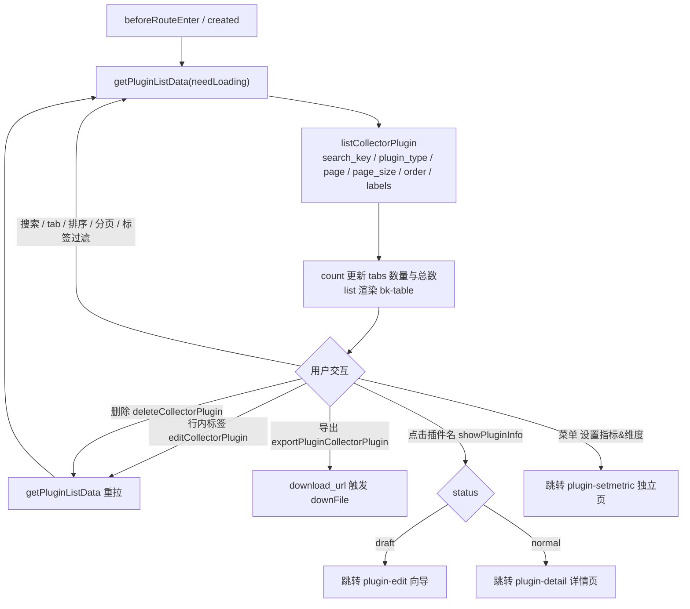
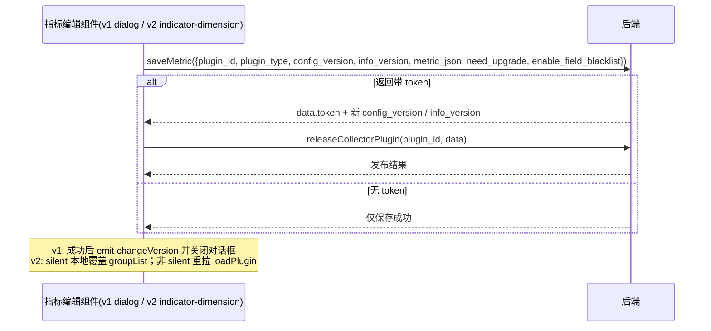
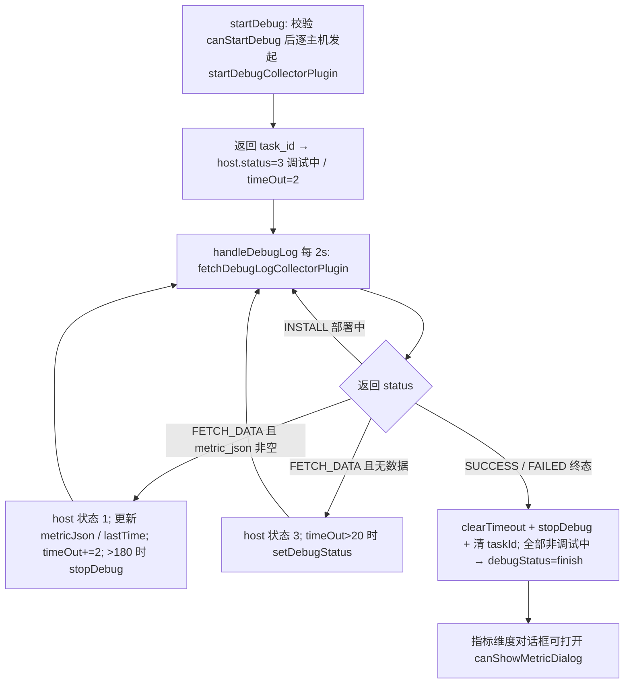
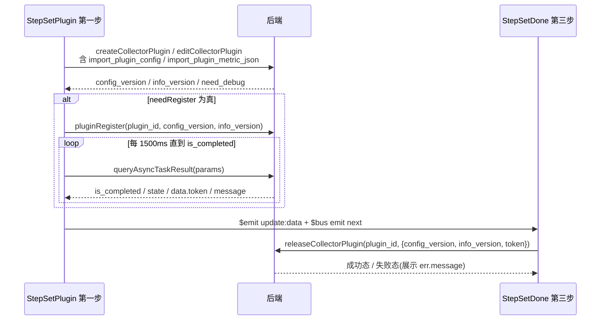

# 数据流转：插件管理专家 / 指标插件管理

**本文引用的文件**

- [plugin-manager.vue](file://bkmonitor/webpack/src/monitor-pc/pages/plugin-manager/plugin-manager.vue)——列表页（加载/搜索/删除/导入/导出）
- [plugin-dialog-single.vue](file://bkmonitor/webpack/src/monitor-pc/pages/plugin-manager/plugin-dialog-single.vue)——单文件导入对话框
- [plugin-dialog-multiple.vue](file://bkmonitor/webpack/src/monitor-pc/pages/plugin-manager/plugin-dialog-multiple.vue)——多文件导入对话框
- [utils.ts](file://bkmonitor/webpack/src/monitor-pc/pages/plugin-manager/utils.ts)——`judgeIsIllegal` / `metricNameTransFrom`
- [plugin-setmetric.vue](file://bkmonitor/webpack/src/monitor-pc/pages/plugin-manager/plugin-setmetric.vue)——（死代码：路由已改指 metric-dimension-page）
- [loading-component.vue](file://bkmonitor/webpack/src/monitor-pc/pages/plugin-manager/loading-component.vue)——（死代码：全仓无引用）
- [plugin-instance.vue](file://bkmonitor/webpack/src/monitor-pc/pages/plugin-manager/plugin-instance/plugin-instance.vue)——三步向导容器
- [step-set-plugin.vue](file://bkmonitor/webpack/src/monitor-pc/pages/plugin-manager/plugin-instance/set-steps/step-set-plugin.vue)——第一步：定义插件
- [step-set-test.vue](file://bkmonitor/webpack/src/monitor-pc/pages/plugin-manager/plugin-instance/set-steps/step-set-test.vue)——第二步：插件调试
- [step-set-done.vue](file://bkmonitor/webpack/src/monitor-pc/pages/plugin-manager/plugin-instance/set-steps/step-set-done.vue)——第三步：发布
- [upload.vue](file://bkmonitor/webpack/src/monitor-pc/pages/plugin-manager/plugin-instance/upload/upload.vue)——插件包上传（按系统分片）
- [select-host.vue](file://bkmonitor/webpack/src/monitor-pc/pages/plugin-manager/plugin-instance/set-steps/components/select-host.vue)——调试目标选择
- [metric-group.vue](file://bkmonitor/webpack/src/monitor-pc/pages/plugin-manager/plugin-instance/set-steps/metric-dimension/metric-group.vue)——指标分组编辑表格（v1 复用）
- [metric-dimension-dialog.vue](file://bkmonitor/webpack/src/monitor-pc/pages/plugin-manager/plugin-instance/set-steps/metric-dimension/metric-dimension-dialog.vue)——（死代码：旧 .vue 版指标维度对话框，仅被注释引用）
- [terminal-instance.vue](file://bkmonitor/webpack/src/monitor-pc/pages/plugin-manager/plugin-instance/terminal-instance/terminal-instance.vue)——调试日志终端渲染
- [metric-dimension-dialog.tsx](file://bkmonitor/webpack/src/monitor-pc/pages/plugin-manager/components/metric-dimension-dialog.tsx)——v1 指标维度编辑（调试对话框 + 独立页共用）
- [metric-dimension-page.tsx](file://bkmonitor/webpack/src/monitor-pc/pages/plugin-manager/components/metric-dimension-page.tsx)——`plugin-setmetric` 路由页壳
- [indicator-dimension/index.tsx](file://bkmonitor/webpack/src/monitor-pc/pages/plugin-manager/components/indicator-dimension/index.tsx)——v2 指标维度编辑（详情页）
- [indicator-dimension/field-list/index.tsx](file://bkmonitor/webpack/src/monitor-pc/pages/plugin-manager/components/indicator-dimension/field-list/index.tsx)
- [indicator-dimension/batch-edit/index.tsx](file://bkmonitor/webpack/src/monitor-pc/pages/plugin-manager/components/indicator-dimension/batch-edit/index.tsx)
- [indicator-dimension/metric-detail/index.tsx](file://bkmonitor/webpack/src/monitor-pc/pages/plugin-manager/components/indicator-dimension/metric-detail/index.tsx)
- [indicator-dimension/group-list/index.tsx](file://bkmonitor/webpack/src/monitor-pc/pages/plugin-manager/components/indicator-dimension/group-list/index.tsx)
- [indicator-dimension/edit-group/index.tsx](file://bkmonitor/webpack/src/monitor-pc/pages/plugin-manager/components/indicator-dimension/edit-group/index.tsx)
- [indicator-dimension/utils.ts](file://bkmonitor/webpack/src/monitor-pc/pages/plugin-manager/components/indicator-dimension/utils.ts)
- [indicator-dimension/types.ts](file://bkmonitor/webpack/src/monitor-pc/pages/plugin-manager/components/indicator-dimension/types.ts)
- [plugin-info.vue](file://bkmonitor/webpack/src/monitor-pc/pages/plugin-manager/plugin-info/plugin-info.vue)——插件详情页（挂载 v2）
- [store/modules/plugin-manager.js](file://bkmonitor/webpack/src/monitor-pc/store/modules/plugin-manager.js)——Vuex 模块
- [router/integrated/plugin-manager.ts](file://bkmonitor/webpack/src/monitor-pc/router/integrated/plugin-manager.ts)——路由表
- [monitor-api/modules/model.js](file://bkmonitor/webpack/src/monitor-api/modules/model.js)——`collector_plugin` 系列接口
- [monitor-api/modules/plugin.js](file://bkmonitor/webpack/src/monitor-api/modules/plugin.js)——`saveMetric` / `pluginRegister` / `saveAndReleasePlugin`
- [monitor-api/modules/commons.js](file://bkmonitor/webpack/src/monitor-api/modules/commons.js)——`queryAsyncTaskResult`
- [polling-loading.vue](file://bkmonitor/webpack/src/monitor-pc/components/polling-loading/polling-loading.vue)——注册轮询弹窗（纯展示）

## 目录

1. [简介](#简介)
2. [列表页数据生命周期](#列表页数据生命周期)
3. [三步向导数据流](#三步向导数据流)
4. [指标维度编辑数据流](#指标维度编辑数据流)
5. [异步流（轮询与异步任务）](#异步流轮询与异步任务)
6. [上传与导入流](#上传与导入流)
7. [结论](#结论)

章节来源：[router/integrated/plugin-manager.ts](file://bkmonitor/webpack/src/monitor-pc/router/integrated/plugin-manager.ts)（关键符号：`PluginManager`、`PluginInfo`、`PluginInstance`、`PluginSetmetric`）

## 简介

插件管理是 monitor-pc 下的「指标插件管理」功能域（Vue2），数据本质是**一份以 `metric_json` 为核心的插件配置**在多个页面间的反复读写。前端共有三个数据入口，数据流向彼此独立但都汇聚到同一组 `collector_plugin` 接口：

| 入口 | 路由 | 组件 | 数据职责 |
|------|------|------|----------|
| 列表管理 | `plugin-manager` | `plugin-manager.vue` | 列表加载、删除、导入、导出、标签编辑 |
| 新建/编辑向导 | `plugin-add` / `plugin-edit` / `plugin-update` | `plugin-instance.vue` + 三个 step | 插件信息 → 调试 → 注册发布（三步共享 `pluginInfo` 大对象） |
| 指标维度编辑 | `plugin-setmetric`（独立页）/ `plugin-detail`（详情页 tab）/ 调试对话框 | `metric-dimension-dialog.tsx`（v1）与 `indicator-dimension/`（v2） | 对已生成插件的 `metric_json` 做增删改，再走两阶段提交回写 |

指标维度编辑器存在三代实现并存：旧 `.vue` 版 `set-steps/metric-dimension/metric-dimension-dialog.vue`（已注释，死代码）、v1 `components/metric-dimension-dialog.tsx`（当前调试对话框与独立页主路径，内部复用 `metric-group.vue`）、v2 `components/indicator-dimension/`（插件详情页新路径）。本文按「数据从哪来、写到哪去、何时重拉、异常如何兜底」逐层展开。

章节来源：[plugin-manager.vue](file://bkmonitor/webpack/src/monitor-pc/pages/plugin-manager/plugin-manager.vue)（关键符号：`PluginManager`）、[plugin-instance.vue](file://bkmonitor/webpack/src/monitor-pc/pages/plugin-manager/plugin-instance/plugin-instance.vue)（关键符号：`stepsMap`）

## 列表页数据生命周期

### 请求与渲染

列表页 `plugin-manager.vue` 有两条加载时机：`beforeRouteEnter`（从非 `plugin-add`/`plugin-edit`/`plugin-detail` 路由进入时重置关键字/页码/tab，并调 `getPluginListData(true)`）与 `created`（`getPluginListData(true)` + `getLabelList()`）。`getPluginListData` 是唯一数据入口，请求参数与响应消费如下：

- 请求：`listCollectorPlugin({ search_key, plugin_type, page, page_size, order, labels })`；`order` 默认 `-update_time`，`plugin_type` 取当前 tab 的 `alias || name`；携带 `CancelToken` 存入 `cancelListRequest`，**仅在搜索框清空（`@clear`）时执行取消**。
- 响应：`data.count` 按各 tab 别名拆分写入 `panel.tabs[i].num` 并汇总为 `pagination.total`；`data.list` 直接赋给 `table.data` 渲染 `bk-table`。
- 展示映射：插件名称/首字母 logo（`logo` base64 或 `colorMap[plugin_type]`）；`pluginTypeMap` 把 `Built-In` 显示为 BK-Monitor、`Pushgateway` 显示为 BK-Pull；分类列来自 `label_info.first_label_name/second_label_name`；关联配置列显示 `related_conf_count`（大于 0 可点击跳 `collect-config`）；状态列用 `table.statusMap`（`normal`=可用/绿色，`draft`=草稿/橙色）。
- 加载态：`loading`（骨架屏 `table-skeleton`）与 `table.loading` 二选一；请求 `.catch` 时 `emptyType='500'`；`empty-status` 组件的 `clear-filter`/`refresh` 操作分别触发清空搜索重拉与直接重拉。

章节来源：[plugin-manager.vue](file://bkmonitor/webpack/src/monitor-pc/pages/plugin-manager/plugin-manager.vue)（关键符号：`getPluginListData`、`beforeRouteEnter`、`cancelListRequest`、`emptyType`）；[monitor-api/modules/model.js](file://bkmonitor/webpack/src/monitor-api/modules/model.js)（关键符号：`listCollectorPlugin`）

### 交互触发的重拉

围绕 `getPluginListData()` 的重拉闭环：

| 交互 | 处理 | 数据结果 |
|------|------|----------|
| 搜索（`handleSearchKey`，debounce 300ms） | 重置 page=1 后重拉 | 重拉 |
| tab 切换（`handlePanelChange`） | 重置 page=1 后重拉 | 重拉 |
| 排序（`handleSortChange`） | `order = descending ? '-prop' : prop`，无 prop 置 null | 重拉 |
| 分页/每页条数 | `handlePageChange` / `handleLimitChange`（写入 `commonPageSizeSet`） | 重拉 |
| 分类过滤（`handleLabelChange` / `handleResetLable`） | 以 `labelKeyword` 传 `labels` | 重拉 |
| 行内标签（`handleTagSelect`） | `editCollectorPlugin(plugin_id, { bk_biz_id, tag })` | 成功后重拉 |
| 删除（`handleDeletePlugin`） | `$bkInfo` 二次确认 → `deleteCollectorPlugin({ plugin_ids: [id] })` | 成功后重拉 |
| 导出（`handlePluginExport`） | `exportPluginCollectorPlugin(plugin_id)` → `downFile(data.download_url)` | 不重拉 |
| 点击插件名（`showPluginInfo`） | `SET_PLUGIN_ID`；`status==='draft'` 走 `plugin-edit`，否则 `plugin-detail` | 路由跳转 |
| 菜单「设置指标&维度」（`handleShowMeticr`） | 仅 `status==='normal' && !is_official` 可跳 `plugin-setmetric` | 路由跳转 |
| 行菜单（`handleOperatorOver`） | 弹层按 `delete_allowed`/`export_allowed`/`status`/`is_official` 控制按钮可用性 | —— |

图表来源：[plugin-manager.vue](file://bkmonitor/webpack/src/monitor-pc/pages/plugin-manager/plugin-manager.vue)（关键符号：`getPluginListData`、`handlePanelChange`、`handleSortChange`、`handleTagSelect`、`handleDeletePlugin`、`handlePluginExport`、`showPluginInfo`、`handleShowMeticr`）

章节来源：[plugin-manager.vue](file://bkmonitor/webpack/src/monitor-pc/pages/plugin-manager/plugin-manager.vue)（关键符号：`handleSearchKey`、`handleSortChange`、`handleLimitChange`、`handleLabelChange`、`handleOperatorOver`）

### 状态与入口

列表响应中的插件字段直接决定入口可用性（均在模板/方法中消费）：`status`（`normal`/`draft`）、`is_official`（官方标记）、`edit_allowed`（编辑按钮 disabled 条件）、`delete_allowed`/`export_allowed`（行菜单按钮可用性）、`related_conf_count`（关联配置跳转条件）、`bk_biz_id`（0 为公共插件，权限判断 `getManageAuth` 区分 `MANAGE_AUTH` / `MANAGE_PUBLIC_AUTH`）。列表页 `beforeRouteLeave` 在离开时对非 `plugin-update`/`plugin-add` 目标执行 `SET_PLUGIN_CONFIG(null)`（清空导入缓存）；`beforeDestroy` 同样清空。

章节来源：[plugin-manager.vue](file://bkmonitor/webpack/src/monitor-pc/pages/plugin-manager/plugin-manager.vue)（关键符号：`statusMap`、`getManageAuth`、`showAuthorityDetail`、`beforeRouteLeave`）

## 三步向导数据流

### 容器 plugin-instance.vue 的职责

容器持有向导的**唯一数据源 `pluginInfo` 大对象**，并用三条通道协调三个 step：

1. `:data.sync="pluginInfo"`：子组件通过 `$emit('update:data', ...)` 回写；子组件内只读 `props.data`，写回后由容器统一持有。
2. 全局 `$bus`（`Vue.prototype.$bus = new Vue()`）事件：
   - `next`：子组件完成本步 → `handleNextStep` 将当前 step `done=true` 并 `left.step += 1`；
   - `forward`：回退一步（`handleForward`）；
   - `showmsg`：`handleShowMsg` 更新顶部提示条 `message`（如编辑时展示"上次变更，版本号…"）；
   - `resetscroll`：`handleScroll` 重置内容容器滚动位置。
3. `keep-alive` + 动态组件 `:is="curStep.component"`：三个 step 常驻缓存，靠 `activated`/`deactivated` 钩子感知"进入本步"。

初始化：`created` 依据 `$route.params` 组装 `pluginInfo = { isEdit, pluginId, type: 'create'|'edit', pluginData }`；`type === 'create'` 且带 `pluginId || pluginData` 时改写为 `'import'`。离开拦截 `beforeRouteLeave`：目标非 `plugin-add`/`plugin-edit`、且 `left.step < 2`（未到第三步）、且非 `bizIdChangePending` 目标时，弹 `$bkInfo` 确认（`handleCancel`），确认放弃才放行。`beforeDestroy` 时 `SET_PLUGIN_CONFIG(null)` 清理导入缓存。

章节来源：[plugin-instance.vue](file://bkmonitor/webpack/src/monitor-pc/pages/plugin-manager/plugin-instance/plugin-instance.vue)（关键符号：`pluginInfo`、`curStep`、`handleSetStep`、`handleStepOk`、`beforeRouteLeave`）；[store/modules/plugin-manager.js](file://bkmonitor/webpack/src/monitor-pc/store/modules/plugin-manager.js)（关键符号：`SET_PLUGIN_CONFIG`）

### 第一步 StepSetPlugin（定义插件）

- **初始化加载**：`created` 并行拉 `[getOsList, getLabels, getReservedWords]`（Vuex action，带模块级缓存）。分流回填：
  - 有 `data.pluginId` → `getPluginInfo()` 调 `retrieveCollectorPlugin`，`backFillData`（含 logo/类型/desc/分类/版本号/`status`/`is_support_remote`/`metric_json` 等），并 `$bus.$emit('showmsg')` 展示最近更新信息，再 `resetScroll()`（500ms 后 `$bus.$emit('resetscroll')`）；
  - 有 `data.pluginData`（导入/升级场景）→ 直接 `backFillData(data)`；
  - `data.type === 'import'` 时补 `checkPluginId()`（`checkIdCollectorPlugin` 校验 ID 是否被占用）。
- **提交前组装**：`handleNextStep` → `generationPluginParams()` 将 `pluginBasicInfo` 转换为接口参数：`{ bk_biz_id, plugin_id, plugin_display_name, plugin_type, logo, collector_json, config_json, metric_json, label, version_log, signature, is_support_remote, description_md, related_conf_count, config_version_old, enable_field_blacklist, is_split_measurement }`，其中 `collector_json` 由 `getCollectorJsonParam` 拼装（Script 逐系统 base64；JMX/DataDog 取 monaco 内容；SNMP 取 `snmpConfig`；Exporter/DataDog 另从上传组件 `getUploadFile` 收集 `file_name/file_id/md5`），`config_json` 由 `getConfigParam` 补充默认 `host`/`port` 并 `deleteDisabled`。
- **第一次提交**：`createPlugin()` 依 `isEdit` 选择 `editCollectorPlugin` / `createCollectorPlugin`；若 `$route.name === 'plugin-update'` 或 Vuex `pluginConfigCache` 存在，附带 `import_plugin_config`（collector_json/config_json/is_support_remote）；若 `$route.params.isImportPlugin`，附带 `import_plugin_metric_json`（缓存中的 `metric_json`）。返回后 `addPluginDataProp` 写回 `pluginData`（`config_version`、`info_version`、`need_debug`、`metric_json`、`systemList` 等），`getPluginVersion` 计算 `sameInfo`/`sameConfig`/`update`/`is_completed`。
- **是否要注册**：`needRegister = !isEdit || status === 'draft' || !sameConfig`。需要注册则进入 `registerPlugin`（见第 5 章），成功后 `handleRegisterFlow` 统一 `$emit('update:data', pluginData)` + `$bus.$emit('next')`；不需要注册也走同一出口。
- **编辑变更说明**：已发布插件（`stage === 'release'`）且 `sameConfig/sameInfo` 有变化时，`createPlugin` 故意 `Promise.reject(data)`，弹出「插件变更说明」对话框收集 `version_log`（`pluginChangeMsg.msg`），确认后 `handleUpdateDesc` → `handleEditOperator` 重新提交（带着 `version_log`），再进入注册流程。

章节来源：[step-set-plugin.vue](file://bkmonitor/webpack/src/monitor-pc/pages/plugin-manager/plugin-instance/set-steps/step-set-plugin.vue)（关键符号：`getPluginInfo`、`checkPluginId`、`generationPluginParams`、`createPlugin`、`needRegister`、`handleUpdateDesc`）

### 第二步 StepSetTest（插件调试）

- **进入本步**：`activated` 时若 `data.from === 'bkmonitor.models.fta.plugin'`（即来自第一步「下一步」），重置 `debugStatus='setting'`、`handleData(this.data)` 把插件信息灌入本地 `info`（含 `host_info` 初始化：由 `systemList` 逐个生成 `{ osType, osTypeId, ip: '', taskId, timer, status: 0, isDebug: false, data: [], metricJson? }`），并 `handleParamsList()` 生成待填参数列表（含 SNMP v3 按 `security_level` 动态 required/disabled 的规则）。
- **本地编辑**：端口（Exporter）、参数（`paramsList` 上的 `default` 即用户输入）、抓取周期（`info.cycle`，默认 '10'）、调试目标（`select-host` 弹窗 `$emit('confirm', host)` → `handleSelectHostConfirm` 写回 `info.host_info[index]`，host 携带 `bk_host_id`）、SNMP 采集目标（`snmpTargets`）。
- **调试**：`startDebug` 对每个已选 IP 的目标并发发起（细节见第 5 章），日志渲染为 `terminal-instance` 的 `consoles`（由 `handleConsolesData` 用 `transformJobUrl` 处理）。
- **指标维度对话框**：`canShowMetricDialog`（某主机 `isDebug && status===1`）驱动 `watch` 弹开 `metric-dimension-dialog.tsx`（`isRoutePage=false`），传入 `metric-json="metricData"`（当前合并数据）、`plugin-data`（`plugin_id/plugin_type/config_version/info_version/enable_field_blacklist/is_split_measurement`）、`is-token="!!data.token"`。dialog 的 `changeVersion` 事件回传 token/版本号 → `handleChangeVersion` 用 `$set` 更新 `this.data`；`refreshData` → `handleRefreshData` 合并新指标；`backPlugin` → `previous()`。
- **保存并进入第三步**：`savePlugin()` 将 `data.from` 置空、`$set(data, 'saveData', { from: 'save', status: '', message: '' })` 后 `$bus.$emit('next')`。
- **回退**：`previous()` 置 `data.back = true`、`$emit('update:data', data)` 后 `$bus.$emit('forward')`（第一步据此走 `editCollectorPlugin` 分支）。

章节来源：[step-set-test.vue](file://bkmonitor/webpack/src/monitor-pc/pages/plugin-manager/plugin-instance/set-steps/step-set-test.vue)（关键符号：`activated`、`handleParamsList`、`canShowMetricDialog`、`startDebug`、`savePlugin`、`previous`）；[select-host.vue](file://bkmonitor/webpack/src/monitor-pc/pages/plugin-manager/plugin-instance/set-steps/components/select-host.vue)（关键符号：`handleSelectHostConfirm`）

### 第三步 StepSetDone

`activated` 根据 `data.saveData.from` 分流：

- `from === 'save'`（点过「保存」按钮）：
  - `type === 'create'` → `releasePlugin(this.data)`；
  - `type === 'edit'`：有 `token` → `releasePlugin`；无 `token` → `simRelease('success')`（本地模拟成功，1000ms 后展示成功态）。
- 否则（未点保存）→ `simRelease(saveData.status, saveData.message)` 取缓存结果。

`releasePlugin` 调 `releaseCollectorPlugin(plugin_id, { config_version, info_version, token })`：成功 `status=true`；失败 `status=false` 并展示 `err.message`。页面按钮：`close`（回列表；若 `fromRoute === 'collect-config-add'` 则回采集配置新增页）、`goToCollectConfig`（`related_conf_count>0` 且 `config_version > config_version_old` 时显示"前往采集配置升级插件"）、`goToCollectConfigAdd`。

三个 step 的 `$next` 事件流与数据回写方向一致：`update:data` 向上、`next/forward` 向后、`showmsg/resetscroll` 向容器。

章节来源：[plugin-instance.vue](file://bkmonitor/webpack/src/monitor-pc/pages/plugin-manager/plugin-instance/plugin-instance.vue)（关键符号：`handleNextStep`、`handleForward`、`handleShowMsg`、`handleScroll`、`handleCancel`）；[step-set-plugin.vue](file://bkmonitor/webpack/src/monitor-pc/pages/plugin-manager/plugin-instance/set-steps/step-set-plugin.vue)（关键符号：`generationPluginParams`、`createPlugin`、`handleRegisterFlow`、`backFillData`）；[step-set-test.vue](file://bkmonitor/webpack/src/monitor-pc/pages/plugin-manager/plugin-instance/set-steps/step-set-test.vue)（关键符号：`handleData`、`savePlugin`、`previous`、`handleChangeVersion`）；[step-set-done.vue](file://bkmonitor/webpack/src/monitor-pc/pages/plugin-manager/plugin-instance/set-steps/step-set-done.vue)（关键符号：`releasePlugin`、`simRelease`、`saveData`、`needUpdataPlugin`）

## 指标维度编辑数据流

### 三代实现与并存关系

| 代 | 文件 | 入口 | 当前状态 |
|----|------|------|----------|
| 旧 .vue | `set-steps/metric-dimension/metric-dimension-dialog.vue` | 仅被 `plugin-setmetric.vue`（死代码）与注释引用 | 死代码 |
| v1 | `components/metric-dimension-dialog.tsx`（+ `metric-dimension-page.tsx` 壳） | ① 调试对话框（`step-set-test` 内 `isRoutePage=false`）② `plugin-setmetric` 独立页（`isRoutePage=true`，列表菜单进入） | 活链路 |
| v2 | `components/indicator-dimension/` | `plugin-info` 详情页「指标维度」tab（`isRoutePage` 语义的 `canEdit` 由 `edit_allowed` 决定） | 活链路 |

v1 与 v2 是**对同一份 `metric_json` 的两套 UI**，共存于同一个插件生命周期中：用户在编辑向导里用 v1 调试对话框整理指标，在详情页用 v2 做日常维护；两者的提交路径最终都汇到 `saveMetric + releaseCollectorPlugin`（见 4.4）。

章节来源：[metric-dimension-page.tsx](file://bkmonitor/webpack/src/monitor-pc/pages/plugin-manager/components/metric-dimension-page.tsx)（关键符号：`MetricDimensionPage`）；[plugin-info.vue](file://bkmonitor/webpack/src/monitor-pc/pages/plugin-manager/plugin-info/plugin-info.vue)（关键符号：`plugin-indicator-dimension`、`canEdit`）；[router/integrated/plugin-manager.ts](file://bkmonitor/webpack/src/monitor-pc/router/integrated/plugin-manager.ts)（关键符号：`plugin-setmetric`）

### v1 数据流（metric-dimension-dialog.tsx）

- **加载**：`isRoutePage=true` 时 `created → init()` 直接 `retrieveCollectorPlugin($route.params.pluginId)`；对话框模式由 `@Watch('show')` 在打开时 `init()`，数据源为 props（`metricJson`、`pluginData`）。`init` 统一做：补 `group_default` 默认分组（`createDefaultGroup`）、字段补前端态（`id: random(10)`、`order` 按 metric/dimension 排序、`is_diff_metric` 转 `type='diff'`）、`getUnitListData()` 拉单位表。
- **本地表格 `tableData`**：由 `localMetricData` 深拷贝生成（`handleWatchMetricJson` → `handleTableDataChange` → `handleSortTableData`）。行内改动全部发生在 `metric-group.vue`：该组件 `/* eslint-disable vue/no-mutating-props */` 直接**原地改写传入的 `metricData` 数组**（别名 `description`、启用 `is_active`、类型/单位、勾选 `isCheck`、规则 `rule_list`），并通过 `edit-group/del-group/add-row/del-row/add-first/edit-row` 等事件通知 dialog 做结构性操作。
- **分组规则**：dialog 的 `handleAddRule`/`moveMatchMetric` 依据 `matchRuleFn` 规则把默认分组中匹配的指标（连带维度）移入目标分组，把不匹配的移回默认分组；`handleMoveGroup`（手动勾选移动）与 `handleDelRow`/`handleEditRow`（删除指标连带清理孤儿维度、编辑维度同步关联指标的 `tag_list`）维护行级一致性。
- **保存（两阶段）**：`handleSave` → 过滤无名行/空分组 → 校验 `haveData`（每分组至少一个启用指标，或开启自动发现）与 `canSave`（指标/维度/别名重名检测）→ 构造 `params = { plugin_id, plugin_type, config_version, info_version, enable_field_blacklist, metric_json }`，非路由页且已带 token（`isToken`）时不加 `need_upgrade`，否则 `need_upgrade=true` → `saveMetric(params, { needMessage: false })` → **若返回 `data.token` 则 `releaseCollectorPlugin(plugin_id, data)`** → 全部成功 `handleSucessSave(data)`：`handleChangeVersion(data)`（`@Emit('changeVersion')`）+ `handleCancel()`（路由页 `$router.back()`，对话框 `emit('showChange', false)`）。
- **数据回流外层**：对话框场景中 `changeVersion` 的 data 被 `step-set-test.handleChangeVersion` 消费，`$set` 更新 `data.token` 与 `config_version/info_version`；`refreshData` 触发 `handleRefreshData` 把调试新抓到的指标/维度合并进 `tableData`（`handleMergeData` + `automaticGrouping`/`handleMergeEditMetric`）。
- **导入/导出**：`handleImportMetric` 解析 JSON 后**整体替换 `tableData`**（校验重名/空名后 `handleTableDataChange`）；`handleExportMetric` 输出精简字段（`description/monitor_type/is_diff_metric/name/type/unit/is_active/dimensions/tag_list`）。刷新按钮（`handleRefreshData`）仅追加新抓取项。

章节来源：[metric-dimension-dialog.tsx](file://bkmonitor/webpack/src/monitor-pc/pages/plugin-manager/components/metric-dimension-dialog.tsx)（关键符号：`handleWatchShow`、`handleMoveGroup`、`handleAddRule`、`handleRefreshData`、`handleImportMetric`）；[metric-group.vue](file://bkmonitor/webpack/src/monitor-pc/pages/plugin-manager/plugin-instance/set-steps/metric-dimension/metric-group.vue)（关键符号：`paginationData`、`handleCheckMetric`）

### v2 数据流（indicator-dimension/）

v2 把「对话框整表编辑」改为「列表页 + 单条/分组/批量操作即保存」，数据源与写回路径如下：

- **加载**：`@Watch('pluginId', { immediate: true }) → loadPlugin() + loadUnitList()`；`loadPlugin` 调 `retrieveCollectorPlugin` 得到 `pluginMeta = { plugin_id, plugin_type, config_version, info_version, enable_field_blacklist, edit_allowed }`，`groupList = ensureDefaultGroup(metric_json || [])`（`ensureDefaultGroup` 深拷贝 + `normalizeField` 补 `uid`/`selection`/diff 展示态）。
- **表格派生**：`fieldList = flattenFields(groupList)`（带 `uid = table::type::name`）、按 `selectedGroup`/`mode` 过滤（`filterFieldsByGroup`）、关键字/条件检索、`pagedList` 前端分页（30/页）。
- **写路径统一收敛到 `persist(nextGroups, successMsg, silent)`**：
  - `silent=true`（单条字段编辑、单条/批量移动）：成功后**本地 `groupList = nextGroups`，不重拉**；
  - `silent=false`（分组增删改、批量编辑保存、导入）：成功后 `await loadPlugin()` 重拉 + `$emit('refresh')`（`plugin-info` 据此 `requestPluginDetail` 重拉详情）。
  - 失败统一 `$bkMessage` 报错并 `return false`；成功则用返回的 `config_version/info_version` 更新 `pluginMeta`。
- **各操作的本地变换函数**（`utils.ts`，全部先 `deepClone` 再变换，保证失败时可丢弃）：`handleEditField`（`Object.assign` 打补丁，`type='diff'` 同步 `is_diff_metric`）、`handleMoveField`/`handleBatchMove`（`moveFieldToGroup`/`moveCheckedFields`，连带维度迁移与孤儿维度回收）、`handleSaveBatch`（`applyBatchFieldChanges`：删除 uid 集、新行插入、改名/类型/单位回写、跨组移动）、`handleSubmitGroup`（`applyGroupRules`：规则吸入匹配指标，编辑时 `evictUnmatched=false` 保留已有）、`handleDeleteGroup`（`deleteGroup`：字段并入默认分组）。
- **子组件职责**：`field-list`（表格 + 别名内联编辑 + 类型/单位/启停下拉 + 分组移动 + 勾选/批量操作 + 管理入口）、`batch-edit`（`bk-sideslider` 复制一份 `selectedGroup` 字段到本地 `localTable`，编辑 `deletedUids`/新增行，保存时 `$emit('save', localTable, deletedUids)`）、`metric-detail`（单指标详情：别名/单位/类型/分组/启停编辑 → `editField`/`moveField`）、`group-list`（左侧分组切换 + 计数 + 编辑/删除菜单）、`edit-group`（分组表单，本地校验名称/冲突后 `$emit('groupSubmit')`）。
- **导入/导出**：`handleImportMetric` 校验后 `ensureDefaultGroup` + `persist`；`handleExportMetric` 用 `getExportMetricJson` 生成 blob 下载。

章节来源：[indicator-dimension/index.tsx](file://bkmonitor/webpack/src/monitor-pc/pages/plugin-manager/components/indicator-dimension/index.tsx)（关键符号：`handlePluginIdChange`、`loadUnitList`、`handleMoveField`、`handleImportMetric`、`handleExportMetric`）；[indicator-dimension/utils.ts](file://bkmonitor/webpack/src/monitor-pc/pages/plugin-manager/components/indicator-dimension/utils.ts)（关键符号：`ensureDefaultGroup`、`flattenFields`、`applyGroupRules`、`deleteGroup`）；[indicator-dimension/group-list/index.tsx](file://bkmonitor/webpack/src/monitor-pc/pages/plugin-manager/components/indicator-dimension/group-list/index.tsx)（关键符号：`changeSelectedLabel`、`handleSubmitGroup`）；[indicator-dimension/edit-group/index.tsx](file://bkmonitor/webpack/src/monitor-pc/pages/plugin-manager/components/indicator-dimension/edit-group/index.tsx)（关键符号：`handleConfirm`）

### 两阶段提交与失败处理

三条活链路（v1 `handleSave`、v2 `savePluginMetricJson`、向导 `step-set-done.releasePlugin`）形态一致：**第一阶段 `saveMetric`/`register` 产出 token，第二阶段 `releaseCollectorPlugin` 发布**，release 的入参都携带 `token` 与版本号。

失败处理：`saveMetric` 异常 → `$bkMessage` 错误（v1 直接返回、v2 由 `persist` 统一捕获）；`releaseCollectorPlugin` 失败 → v1 `result=false` 不进入成功回调（但 `loading` 复位）、v2 `persist` 报错返回 false。注意两阶段间没有回滚动作：第一阶段成功后第二阶段失败时，后端已生成新版本但未发布，前端仅提示失败。

图表来源：[metric-dimension-dialog.tsx](file://bkmonitor/webpack/src/monitor-pc/pages/plugin-manager/components/metric-dimension-dialog.tsx)（关键符号：`handleSave`、`handleSucessSave`、`handleChangeVersion`）；[indicator-dimension/utils.ts](file://bkmonitor/webpack/src/monitor-pc/pages/plugin-manager/components/indicator-dimension/utils.ts)（关键符号：`savePluginMetricJson`、`buildSaveMetricParams`）

章节来源：[metric-dimension-dialog.tsx](file://bkmonitor/webpack/src/monitor-pc/pages/plugin-manager/components/metric-dimension-dialog.tsx)（关键符号：`init`、`handleTableDataChange`、`moveMatchMetric`、`handleSave`）；[indicator-dimension/index.tsx](file://bkmonitor/webpack/src/monitor-pc/pages/plugin-manager/components/indicator-dimension/index.tsx)（关键符号：`loadPlugin`、`persist`、`handleEditField`、`handleSaveBatch`、`handleSubmitGroup`）；[indicator-dimension/field-list/index.tsx](file://bkmonitor/webpack/src/monitor-pc/pages/plugin-manager/components/indicator-dimension/field-list/index.tsx)（关键符号：`handleEditDescription`、`handleBatchAdd`、`handleSaveBatch`）；[indicator-dimension/batch-edit/index.tsx](file://bkmonitor/webpack/src/monitor-pc/pages/plugin-manager/components/indicator-dimension/batch-edit/index.tsx)（关键符号：`initTableData`、`handleSave`、`deletedUids`）；[indicator-dimension/metric-detail/index.tsx](file://bkmonitor/webpack/src/monitor-pc/pages/plugin-manager/components/indicator-dimension/metric-detail/index.tsx)（关键符号：`handleEditAlias`、`handleEditUnit`、`handleEditType`）；[metric-group.vue](file://bkmonitor/webpack/src/monitor-pc/pages/plugin-manager/plugin-instance/set-steps/metric-dimension/metric-group.vue)（关键符号：`handleAddRow`、`handleDelRow`、`handleEditGroup`）

## 异步流（轮询与异步任务）

### 插件注册轮询（pluginRegister + queryAsyncTaskResult）

`step-set-plugin.registerPlugin` 的时序：

1. 前置判断 `pluginStatus = typeof stage === 'undefined' ? false : data.stage === 'release'`；若 `!sameInfo || !sameConfig || !pluginStatus` 才真正注册（否则直接 resolve「插件无需再次注册」）。
2. 打开 `registerDialog`（`polling-loading` 纯展示弹窗，`status.msg='生成中...'`），调用 `pluginRegister({ plugin_id, config_version, info_version }, { isAsync: true })`。
3. `polling(params, callBack)`：`queryAsyncTaskResult(params)` → `is_completed` 为 false 时 `setTimeout(1500)` 后继续；网络异常时构造 `{ is_completed: true, state: 'FAILURE', message, data }` 回调。
4. 完成态：`state === 'SUCCESS'` 且 `data.data.token` 存在 → 记入 `pluginData.token` 并 resolve；**无 token → 报「插件包生成失败, 没有返回插件token数据」并 reject**；`state === 'FAILURE'` → 展示 `data.message` 并 reject。
5. resolve 后 `handleRegisterFlow` 写回 `update:data` 并 `$bus.$emit('next')`（进入第二步）。

轮询间隔 1500ms，终止条件仅依赖 `is_completed`；**没有取消入口、没有最大轮询次数**，页面离开后链式 `setTimeout` 仍会继续直到完成/失败。

章节来源：[step-set-plugin.vue](file://bkmonitor/webpack/src/monitor-pc/pages/plugin-manager/plugin-instance/set-steps/step-set-plugin.vue)（关键符号：`registerPlugin`、`polling`、`registerDialog`）；[monitor-api/modules/commons.js](file://bkmonitor/webpack/src/monitor-api/modules/commons.js)（关键符号：`queryAsyncTaskResult`）

### 插件调试轮询（start_debug → fetch_debug_log）

`step-set-test.startDebug → handleDebugLog` 的完整状态机：

- 发起：`getTaskId` → `startDebugCollectorPlugin(plugin_id, { config_version, info_version, param, host_info: { bk_host_id }, target_nodes })`（`param` 由 `getDebugParams` 组装：collector.period=抓取周期，plugin.* 为参数值；SNMP 额外带 `target_nodes`），返回 `task_id` 后置 `host.status=3`（调试中）、`host.timeOut=2`，并 `handleDebugLog(taskId)` 开始轮询。
- 轮询：每轮 `fetchDebugLogCollectorPlugin(plugin_id, { task_id })`，按返回 `status` 分派（间隔 2000ms，由 `setTimeout` 链维持）：
  - `INSTALL`（部署中）→ host 保持 3，继续轮询；
  - `FETCH_DATA`（抓取数据中）→ 有 `metric_json`：host 置 1、写入 `host.metricJson` 与 `info.lastTime`、`timeOut += 2`，**`timeOut > 180` 时调用 `stopDebug`**（前端主动止损，约 90 轮）；无数据：host 保持 3，`timeOut > 20` 时尝试 `setDebugStatus`；两种分支都会继续挂下一轮 timer；
  - `SUCCESS` / 其它终态 → `changeDebugLog(host, 1/2, text)`、`clearTimeout(host.timer)`、`stopDebug(taskId)`、清空 `host.taskId`、`setDebugStatus()`（所有 host 非「调试中」则 `debugStatus='finish'`）。
- 日志展示：每轮把 `log_content` 整体**替换**进 `host.data`（`changeDebugLog` 只保留最新一条），经 `terminal-instance` 渲染，不是累积日志流。
- 重调试：`startDebug` 对已有 `taskId && status===1` 的主机先 `stopDebug` 清 `taskId` 再重发。
- 清理：`deactivated` → `clearTimer(false)`（只清 timer 与 cancelToken，不 stop）；`beforeDestroy` → `clearTimer()`（清 timer 且对每个残留 `taskId` 调 `stopDebug`）。

图表来源：[step-set-test.vue](file://bkmonitor/webpack/src/monitor-pc/pages/plugin-manager/plugin-instance/set-steps/step-set-test.vue)（关键符号：`startDebug`、`handleDebugLog`、`changeDebugLog`、`setDebugStatus`、`clearTimer`、`getDebugParams`）

章节来源：[step-set-test.vue](file://bkmonitor/webpack/src/monitor-pc/pages/plugin-manager/plugin-instance/set-steps/step-set-test.vue)（关键符号：`handleDebugLog`、`changeDebugLog`、`handleConsolesData`）；[terminal-instance.vue](file://bkmonitor/webpack/src/monitor-pc/pages/plugin-manager/plugin-instance/terminal-instance/terminal-instance.vue)（关键符号：`consoles`）

### 注册/发布全时序（向导侧）

图表来源：[step-set-plugin.vue](file://bkmonitor/webpack/src/monitor-pc/pages/plugin-manager/plugin-instance/set-steps/step-set-plugin.vue)（关键符号：`registerPlugin`、`polling`、`handleRegisterFlow`）；[step-set-done.vue](file://bkmonitor/webpack/src/monitor-pc/pages/plugin-manager/plugin-instance/set-steps/step-set-done.vue)（关键符号：`releasePlugin`）

章节来源：[step-set-plugin.vue](file://bkmonitor/webpack/src/monitor-pc/pages/plugin-manager/plugin-instance/set-steps/step-set-plugin.vue)（关键符号：`handleRegisterFlow`、`pluginRegister`、`handleEditOperator`）；[monitor-api/modules/plugin.js](file://bkmonitor/webpack/src/monitor-api/modules/plugin.js)（关键符号：`pluginRegister`、`saveMetric`、`saveAndReleasePlugin`）

### 清理时机小结

| 流向 | 停止方式 | 清理时机 |
|------|----------|----------|
| 注册轮询 | 仅 `is_completed`/异常终止 | 无显式清理（组件销毁也不停） |
| 调试轮询 | 终态 / `timeOut>180` stopDebug / 组件销毁 | `deactivated` 清 timer（不 stop）、`beforeDestroy` 清 timer + stopDebug、`clearTimer` 内的 `cancelFn` 取消 startDebug 请求 |
| 指标维度保存 | 单次请求 | 无轮询 |

章节来源：[step-set-plugin.vue](file://bkmonitor/webpack/src/monitor-pc/pages/plugin-manager/plugin-instance/set-steps/step-set-plugin.vue)（关键符号：`registerPlugin`、`polling`、`pluginRegister`）；[step-set-test.vue](file://bkmonitor/webpack/src/monitor-pc/pages/plugin-manager/plugin-instance/set-steps/step-set-test.vue)（关键符号：`getTaskId`、`handleDebugLog`、`stopDebug`、`clearTimer`）；[polling-loading.vue](file://bkmonitor/webpack/src/monitor-pc/components/polling-loading/polling-loading.vue)（关键符号：`status`、`close`）

## 上传与导入流

### 插件包上传（upload.vue）

向导第一步中 Exporter/DataDog 类型按系统维度渲染多个上传位（`MoUpload`）。`handleSelectFile` 组装 `{ file_data, file_name, os, plugin_id? }`：

- Exporter → `uploadFileCollectorPlugin`（补 `plugin_type='Exporter'`）；
- DataDog → `dataDogPluginUpload`（删除 `file_name`）。

成功后把响应收敛为 `fileDesc = { file_name, file_id, md5 }`（DataDog 追加 `datadog_check_name`），并 `$emit('change', datadog_check_name)` / `$emit('yaml', config_yaml, system)`；进度条是纯前端模拟（`handleProgress` 递增到 100）。回填由 `watch collector → setFileData` 完成。最终在第一步提交时由 `getUploadFile` 通过组件 ref（`uploadFile-exporter-*` / `uploadFile-datadog-*`）收集为 `collector_json[system] = fileDesc`。

章节来源：[upload.vue](file://bkmonitor/webpack/src/monitor-pc/pages/plugin-manager/plugin-instance/upload/upload.vue)（关键符号：`handleSelectFile`、`setFileData`、`handleClear`）；[step-set-plugin.vue](file://bkmonitor/webpack/src/monitor-pc/pages/plugin-manager/plugin-instance/set-steps/step-set-plugin.vue)（关键符号：`getUploadFile`、`getCollectorJsonParam`）

### 导入（单文件 / 多文件）

列表页「导入」按钮绑定隐藏 `input[accept=".gz,.tgz"][multiple]`，`handleFileChange` 按文件数分流：

- **单文件 `handeFileSingel`**：打开 `plugin-dialog-single`（虚构进度 0.16/50ms），`importPluginCollectorPlugin({ file_data })` 返回后**先 `SET_PLUGIN_CONFIG(data)` 缓存**，再按分支置状态：
  - `conflict_detail` 存在 → `status=4`（重名冲突，`conflict_ids` 驱动按钮）；
  - 非超管且 `is_official` → `status=5`（无权限直接导入官方插件）；
  - `is_official` → `status=1` → `handleSetUpdatePlugin`（`saveAndReleasePlugin(data)` 直接覆盖更新，成功后重拉列表）；
  - 其他（非官方无冲突）→ `status=3` → `handlePluginAdd(null, data, true)` 跳 `plugin-add`（`params.isImportPlugin=true`）。
- **多文件 `handleFileMultiple`**：每个文件并发 `importPluginCollectorPlugin`，逐条写入 `fileArr[i]`（`percent/status/verson/isOk`），`plugin-dialog-multiple` 列表展示：
  - `(is_official || is_safety) && !duplicate_type` → `saveAndReleasePlugin(data)`（`bk_biz_id` 按是否官方取 0 或当前业务）→ 状态「成功/上传失败」；
  - 非 `is_safety` → 「插件包不完整」；否则按 `conflict_detail/conflict_title` 显示「名字冲突/插件冲突」。
  - 弹窗内 `isSuccess`（全部 `isOk`）后关闭时 `$emit('refalsh-table-data')` → 列表 `getPluginListData()` 重拉。

冲突处理细节：`plugin-dialog-single` 的 `canIUpdatePlubin` 依据 `conflict_ids` 判断（源码注释枚举：1 导入版本不大于当前版本、2 插件类型冲突、3 远程采集配置冲突、4 插件已关联采集配置、5 内容完全一致；出现 2/3/5 时不展示「更新插件」按钮）。按钮动作：「更新插件」→ `plugin-update` 路由（`params.pluginData`，走向导 `importPluginConfig` 分支）；「创建插件」→ 新建向导；「更新至现有插件」（官方且 `update` 时）→ `handleSetUpdatePlugin`；`dialog.update` 由 `handleSetUpdatePlugin` 前的分支条件决定。

章节来源：[plugin-manager.vue](file://bkmonitor/webpack/src/monitor-pc/pages/plugin-manager/plugin-manager.vue)（关键符号：`handeFileSingel`、`handleFileMultiple`、`handleSetUpdatePlugin`）；[plugin-dialog-single.vue](file://bkmonitor/webpack/src/monitor-pc/pages/plugin-manager/plugin-dialog-single.vue)（关键符号：`canIUpdatePlubin`、`handleCreateNewPlugin`）；[plugin-dialog-multiple.vue](file://bkmonitor/webpack/src/monitor-pc/pages/plugin-manager/plugin-dialog-multiple.vue)（关键符号：`isSuccess`、`handleDialogClose`）

### 导出

- 插件包：`handlePluginExport` → `exportPluginCollectorPlugin(plugin_id)` → `data.download_url` 存在则 `downFile(url)`，否则提示「导出失败」。
- 指标维度：v1 `handleExportMetric`（`MonitorExport` 回调生成 `<plugin_id>-<时间>.json`）、v2 `handleExportMetric`（`getExportMetricJson(groupList)` blob 下载）；导入侧 v1 `handleImportMetric` 整体替换、v2 校验后 `persist` 全量保存。

章节来源：[upload.vue](file://bkmonitor/webpack/src/monitor-pc/pages/plugin-manager/plugin-instance/upload/upload.vue)（关键符号：`handleSelectFile`、`fileDesc`、`handleProgress`）；[plugin-manager.vue](file://bkmonitor/webpack/src/monitor-pc/pages/plugin-manager/plugin-manager.vue)（关键符号：`handeFileSingel`、`handleFileMultiple`、`handleSetUpdatePlugin`、`handlePluginExport`）；[plugin-dialog-single.vue](file://bkmonitor/webpack/src/monitor-pc/pages/plugin-manager/plugin-dialog-single.vue)（关键符号：`canIUpdatePlubin`、`handleToEdit`、`handleCreateNewPlugin`）；[plugin-dialog-multiple.vue](file://bkmonitor/webpack/src/monitor-pc/pages/plugin-manager/plugin-dialog-multiple.vue)（关键符号：`isSuccess`、`handleDialogClose`）

## 结论

模块的数据流转可概括为：**「列表页读-写-重拉」与「向导页三步共享大对象 + 异步注册」两条主链，叠加「指标维度 v1/v2 两套编辑器的两阶段提交」**。所有写操作最终都经由 `collector_plugin` 系列接口回写后端，前端本地状态通过「重拉」或「受控覆盖」与后端对齐。需要重点关注的数据一致性与丢失风险：

1. **列表页请求竞态**：仅「清空搜索」有 `CancelToken` 取消（`cancelListRequest`），tab/排序/分页快速切换产生的并发请求没有取消或时序保护，晚返回的旧响应可能覆盖新结果。
2. **注册轮询不可中断、无超时**：`polling` 只有 `is_completed` 一个终止条件，页面离开/组件销毁都不会停止链式 `setTimeout`；若后端任务永不完成，弹窗将长期处于「生成中...」。
3. **两阶段提交的半程失败**：`saveMetric`/`pluginRegister` 成功而 `releaseCollectorPlugin` 失败时无回滚，后端处于「新版本已生成、未发布」的中间态；前端仅 toast 失败。向导侧存在兜底（`step-set-done` 编辑场景 `data.token` 缺失时 `simRelease('success')` **直接展示成功**，即"修改不影响采集"时不真正发布），而 v1/v2 编辑器侧无 token 时同样视为「仅保存」。
4. **调试轮询的清理边界**：`deactivated` 只清 timer 不 `stopDebug`（依赖 `beforeDestroy` 兜底）；`handleClearIp` 清空主机不清理 `taskId/timer`；`timeOut > 180` 触发 `stopDebug` 后轮询链仍会继续下一轮，直到收到终态才真正停止；日志仅保留最新一条（`changeDebugLog` 整体替换）。
5. **`$bus` 事件泄漏**：`plugin-instance.vue` 的 `beforeDestroy` 中 `resetscroll` 监听使用的是 `$bus.$on` 而非 `$off`（其余三个事件均正确 `$off`），组件销毁后会重复注册监听；同时 `$bus` 是全局总线，`next`/`forward` 等通用事件名存在与其他模块冲突的理论风险。
6. **导入缓存生命周期**：单文件导入结果存在 Vuex `pluginConfigCache`（内存），仅 `plugin-add`/`plugin-update` 路由间迁移时保留；一旦离开或刷新页面缓存即丢，向导的 `import_plugin_config`/`import_plugin_metric_json` 将缺失。
7. **指标维度编辑的并发写**：v2 的单条编辑采用 `silent` 即存（本地覆盖 `groupList` 不重拉）；连续快速编辑会并发 `saveMetric+release`，请求乱序时后端最终版本不可控，前端本地态以最后一次操作后的 `nextGroups` 为准。
8. **死代码链路混淆**：`plugin-setmetric` 作为**路由名**指向 v1 的 `metric-dimension-page.tsx`，而同名文件 `plugin-setmetric.vue` 已废弃；`set-steps/metric-dimension/metric-dimension-dialog.vue`（旧 .vue 版）与 `loading-component.vue` 均无引用。维护指标维度逻辑时切勿改到死代码分支。

章节来源：[plugin-manager.vue](file://bkmonitor/webpack/src/monitor-pc/pages/plugin-manager/plugin-manager.vue)（关键符号：`cancelListRequest`、`getPluginListData`）；[plugin-instance.vue](file://bkmonitor/webpack/src/monitor-pc/pages/plugin-manager/plugin-instance/plugin-instance.vue)（关键符号：`beforeDestroy`、`handleScroll`）；[step-set-test.vue](file://bkmonitor/webpack/src/monitor-pc/pages/plugin-manager/plugin-instance/set-steps/step-set-test.vue)（关键符号：`clearTimer`、`handleClearIp`）；[step-set-done.vue](file://bkmonitor/webpack/src/monitor-pc/pages/plugin-manager/plugin-instance/set-steps/step-set-done.vue)（关键符号：`simRelease`）；[indicator-dimension/index.tsx](file://bkmonitor/webpack/src/monitor-pc/pages/plugin-manager/components/indicator-dimension/index.tsx)（关键符号：`persist`）；[store/modules/plugin-manager.js](file://bkmonitor/webpack/src/monitor-pc/store/modules/plugin-manager.js)（关键符号：`SET_PLUGIN_CONFIG`、`pluginConfigCache`）
