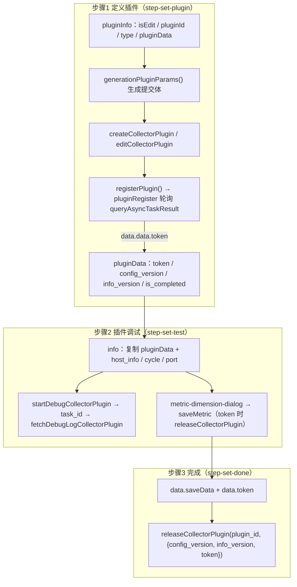

# 模型：插件管理专家 / 指标插件管理

**本文引用的文件**
- [types.ts](file://bkmonitor/webpack/src/monitor-pc/pages/plugin-manager/components/indicator-dimension/types.ts)
- [utils.ts](file://bkmonitor/webpack/src/monitor-pc/pages/plugin-manager/components/indicator-dimension/utils.ts)
- [index.tsx](file://bkmonitor/webpack/src/monitor-pc/pages/plugin-manager/components/indicator-dimension/index.tsx)
- [batch-edit/index.tsx](file://bkmonitor/webpack/src/monitor-pc/pages/plugin-manager/components/indicator-dimension/batch-edit/index.tsx)
- [field-list/index.tsx](file://bkmonitor/webpack/src/monitor-pc/pages/plugin-manager/components/indicator-dimension/field-list/index.tsx)
- [group-list/index.tsx](file://bkmonitor/webpack/src/monitor-pc/pages/plugin-manager/components/indicator-dimension/group-list/index.tsx)
- [metric-detail/index.tsx](file://bkmonitor/webpack/src/monitor-pc/pages/plugin-manager/components/indicator-dimension/metric-detail/index.tsx)
- [edit-group/index.tsx](file://bkmonitor/webpack/src/monitor-pc/pages/plugin-manager/components/indicator-dimension/edit-group/index.tsx)
- [metric-dimension-dialog.tsx](file://bkmonitor/webpack/src/monitor-pc/pages/plugin-manager/components/metric-dimension-dialog.tsx)
- [metric-dimension-page.tsx](file://bkmonitor/webpack/src/monitor-pc/pages/plugin-manager/components/metric-dimension-page.tsx)
- [plugin-manager.vue](file://bkmonitor/webpack/src/monitor-pc/pages/plugin-manager/plugin-manager.vue)
- [plugin-info.vue](file://bkmonitor/webpack/src/monitor-pc/pages/plugin-manager/plugin-info/plugin-info.vue)
- [plugin-setmetric.vue](file://bkmonitor/webpack/src/monitor-pc/pages/plugin-manager/plugin-setmetric.vue)
- [utils.ts（页面级）](file://bkmonitor/webpack/src/monitor-pc/pages/plugin-manager/utils.ts)
- [authority-map.ts](file://bkmonitor/webpack/src/monitor-pc/pages/plugin-manager/authority-map.ts)
- [plugin-instance.vue](file://bkmonitor/webpack/src/monitor-pc/pages/plugin-manager/plugin-instance/plugin-instance.vue)
- [step-set-plugin.vue](file://bkmonitor/webpack/src/monitor-pc/pages/plugin-manager/plugin-instance/set-steps/step-set-plugin.vue)
- [step-set-test.vue](file://bkmonitor/webpack/src/monitor-pc/pages/plugin-manager/plugin-instance/set-steps/step-set-test.vue)
- [step-set-done.vue](file://bkmonitor/webpack/src/monitor-pc/pages/plugin-manager/plugin-instance/set-steps/step-set-done.vue)
- [config-param.vue](file://bkmonitor/webpack/src/monitor-pc/pages/plugin-manager/plugin-instance/set-steps/components/config-param.vue)
- [select-host.vue](file://bkmonitor/webpack/src/monitor-pc/pages/plugin-manager/plugin-instance/set-steps/components/select-host.vue)
- [new-plugin-monaco.vue](file://bkmonitor/webpack/src/monitor-pc/pages/plugin-manager/plugin-instance/set-steps/components/new-plugin-monaco.vue)
- [import-file.vue](file://bkmonitor/webpack/src/monitor-pc/pages/plugin-manager/plugin-instance/set-steps/components/import-file.vue)
- [upload.vue](file://bkmonitor/webpack/src/monitor-pc/pages/plugin-manager/plugin-instance/upload/upload.vue)
- [logo.vue](file://bkmonitor/webpack/src/monitor-pc/pages/plugin-manager/plugin-instance/logo/logo.vue)
- [metric-dimension-dialog.vue](file://bkmonitor/webpack/src/monitor-pc/pages/plugin-manager/plugin-instance/set-steps/metric-dimension/metric-dimension-dialog.vue)
- [metric-group.vue](file://bkmonitor/webpack/src/monitor-pc/pages/plugin-manager/plugin-instance/set-steps/metric-dimension/metric-group.vue)
- [plugin-dialog-single.vue](file://bkmonitor/webpack/src/monitor-pc/pages/plugin-manager/plugin-dialog-single.vue)
- [plugin-manager.js（store）](file://bkmonitor/webpack/src/monitor-pc/store/modules/plugin-manager.js)
- [types/plugin-manager/index.ts](file://bkmonitor/webpack/src/monitor-pc/types/plugin-manager/index.ts)
- [model.js（API）](file://bkmonitor/webpack/src/monitor-api/modules/model.js)
- [plugin.js（API）](file://bkmonitor/webpack/src/monitor-api/modules/plugin.js)
- [commons.js（API）](file://bkmonitor/webpack/src/monitor-api/modules/commons.js)
- [strategies.js（API）](file://bkmonitor/webpack/src/monitor-api/modules/strategies.js)

## 目录
1. [简介](#简介)
2. [类型清单](#类型清单)
3. [运行时数据结构](#运行时数据结构)
4. [状态枚举与映射](#状态枚举与映射)
5. [后端数据结构契约](#后端数据结构契约)
6. [校验规则](#校验规则)
7. [结论](#结论)

## 简介

本切面覆盖 `bkmonitor/webpack/src/monitor-pc/pages/plugin-manager/`（路由插件管理 / 指标插件管理）。**前端没有 DB/ORM，「模型」在此口径下 = 前端数据模型**，具体包括四类：

1. **TypeScript 类型定义**：`components/indicator-dimension/types.ts`（指标/维度/分组核心类型）及模块内各 `.tsx` 的组件接口、`types/plugin-manager/index.ts` 的公共类型；
2. **运行时数据结构**：三步向导共享的 `pluginInfo` 大对象（`plugin-instance.vue` 持有并向下传递）、列表行模型、详情回填（`backFillData`）、指标维度编辑的中间行/分组结构、调试主机与调试日志结构等；
3. **状态枚举与映射**：`plugin_type`、`status`、`stage`、向导步骤、调试状态、指标类型、参数类型/模式、抓取周期、单位表等；
4. **后端数据结构契约（从调用点反推）**：`collector_plugin` 系列、`pluginRegister` 异步任务、`metric_plugin/save`、`save_and_release_plugin`、导入冲突字段等，均在本文第 5 节标注推导来源文件。

页面范围：列表页 `plugin-manager.vue`、详情页 `plugin-info.vue`、独立设置指标&维度页 `plugin-setmetric.vue`、向导（新建/编辑/导入/更新）`plugin-instance.vue` 及 `set-steps/**`、指标维度编辑组件族 `components/indicator-dimension/**` 与 `components/metric-dimension-dialog.tsx`。

章节来源：[plugin-manager.vue](file://bkmonitor/webpack/src/monitor-pc/pages/plugin-manager/plugin-manager.vue)（关键符号：`PluginManager`）、[plugin-instance.vue](file://bkmonitor/webpack/src/monitor-pc/pages/plugin-manager/plugin-instance/plugin-instance.vue)（关键符号：`PluginInstance`）

## 类型清单

### 2.1 核心类型（indicator-dimension/types.ts，全部 export）

| 类型/常量 | 关键字段 | 用途 |
|---|---|---|
| `MonitorType` | `'dimension' \| 'metric'` | 字段类别判别（行、分组、过滤函数均以此区分） |
| `IPluginField` | `name`、`description`、`monitor_type`、`type`、`unit`、`is_active`、`is_diff_metric?`、`is_manual?`、`source_name?`、`dimensions?: Record<string, any>[]`、`tag_list?: { field_name; [key: string]: any }[]`、`id?`、`uid?`、`value?`、`selection?` | 插件指标/维度字段（后端 `metric_json[].fields[]` 的前端形态） |
| `IPluginGroup` | `table_name`、`table_desc`、`rule_list: string[]`、`fields: IPluginField[]` | 指标分组（后端 `metric_json` 数组项） |
| `IPluginMeta` | `plugin_id`、`plugin_type`、`config_version`、`info_version`、`enable_field_blacklist?`、`edit_allowed?` | 保存指标所需的插件元信息（用于 saveMetric 与权限判断） |
| `IFlatField` | `IPluginField` + `table_name`、`table_desc`、`uid` | 扁平化字段（跨分组列表渲染/搜索用） |
| `IBatchField` | `IFlatField` + `error?`、`isNew?`、`originUid?` | 批量编辑行（含编辑态元信息） |
| `ISelectedGroup` | `name` | 左侧分组选中态（可为 `ALL_LABEL`） |
| `IUnitItem` | `id`、`name`、`children?: {id;name}[]`、`formats?: {id;name}[]` | 单位下拉项（get_unit_list 映射后的结构） |
| `IGroupSubmitPayload` | `table_name`、`table_desc`、`rule_list`、`fields?`、`isEdit`、`oldName?` | 新建/编辑分组弹窗的提交载荷 |
| `ALL_LABEL` | `'__all_label__'` | 「全部分组」标识 |
| `GROUP_DEFAULT_NAME` | `'group_default'` | 默认分组英文名（与设置指标&维度页一致） |
| `GROUP_NAME_REGX` | `/^[_|a-zA-Z][a-zA-Z0-9_]*$/` | 分组英文名校验 |
| `FRONT_END_FIELD_KEYS` | `descReValue`、`errValue`、`isCheck`、`isDel`、`isFirst`、`id`、`reValue`、`showInput`、`selection`、`order`、`uid`、`originUid`、`isNew`、`error`（14 项） | 提交 saveMetric 前必须剔除的前端态字段 |

章节来源：[types.ts](file://bkmonitor/webpack/src/monitor-pc/pages/plugin-manager/components/indicator-dimension/types.ts)（关键符号：`IPluginField`、`IPluginGroup`、`IPluginMeta`、`IFlatField`、`IBatchField`、`ISelectedGroup`、`IUnitItem`、`IGroupSubmitPayload`、`FRONT_END_FIELD_KEYS`、`GROUP_NAME_REGX`）

### 2.2 组件局部接口（tsx 组件 IProps/IEmits 等）

| 文件 | 接口 | 关键字段 | 用途 |
|---|---|---|---|
| indicator-dimension/index.tsx | `IProps` | `canEdit?`、`pluginId?` | 详情页指标维度组件入参 |
| indicator-dimension/batch-edit/index.tsx | `IColumnConfig`、`IProps`、`IEmits` | `label/minWidth/renderFn/renderHeaderFn/width`；`fieldList/groupList/isShow/mode/selectedGroup/typeList/unitList`；`onSave(rows, deletedUids)` | 批量编辑抽屉 |
| indicator-dimension/field-list/index.tsx | `IProps`、`IEmits` | `canManage/fieldList/groupList/mode/selectedGroup/typeList/unitList`；`onBatchMove/onEditField/onMoveField/onSaveBatch/onShowAddGroup` | 指标/维度主列表（Tab 页） |
| indicator-dimension/group-list/index.tsx | `IProps`、`IEmits` | `groupList/canManage/confirmLoading`；`onChangeGroup/onDeleteGroup/onSubmitGroup` | 左侧分组导航 |
| indicator-dimension/metric-detail/index.tsx | `IProps`、`IEmits` | `metricData: IFlatField`、`groupList`、`unitList`、`typeList`；`onEditField/onMoveField` | 指标/维度详情右栏 |
| indicator-dimension/edit-group/index.tsx | `IProps`、`IEmits` | `groupInfo: IGroupSubmitPayload`、`isEdit/isShow/nameList/confirmLoading`；`onGroupSubmit/onCancel` | 新建/编辑分组弹窗 |
| components/metric-dimension-dialog.tsx | `IProps` | `show/dataTime/osTypeList/metricJson/pluginData/isRoutePage/isToken/pluginType` + 事件 props | 调试内/独立页指标维度 dialog |
| plugin-instance/set-steps/components/import-file.vue | `IFileInfo` | `fileStr/name/size` | 文件导入组件回调结构 |
| components/metric-dimension-page.tsx | —（class 组件，无自定义接口） | `render()` 中透传 `isRoutePage={true}` | 独立「设置指标&维度」路由页包装（内部渲染 `MetricDimensionDialog`） |

章节来源：[index.tsx](file://bkmonitor/webpack/src/monitor-pc/pages/plugin-manager/components/indicator-dimension/index.tsx)（关键符号：`IProps`）、[batch-edit/index.tsx](file://bkmonitor/webpack/src/monitor-pc/pages/plugin-manager/components/indicator-dimension/batch-edit/index.tsx)（关键符号：`IColumnConfig`）、[import-file.vue](file://bkmonitor/webpack/src/monitor-pc/pages/plugin-manager/plugin-instance/set-steps/components/import-file.vue)（关键符号：`IFileInfo`）、[metric-dimension-page.tsx](file://bkmonitor/webpack/src/monitor-pc/pages/plugin-manager/components/metric-dimension-page.tsx)（关键符号：`MetricDimensionPage`）

### 2.3 公共类型（types/plugin-manager/index.ts）

| 类型 | 关键字段 | 用途 |
|---|---|---|
| `ILanguage` | `name`、`lang`、`abb`、`text`、`active` | 脚本语言项（Shell/Bat/Python/Perl/Powershell/Vbs/Yaml/Custom） |
| `ISystem` | `name`、`enable`、`languageList: ILanguage[]` | Script 插件的系统 Tab（linux/windows…） |
| `IValues` | `name: { lang; text }` | Monaco 编辑器传参 |

章节来源：[types/plugin-manager/index.ts](file://bkmonitor/webpack/src/monitor-pc/types/plugin-manager/index.ts)（关键符号：`ILanguage`、`ISystem`、`IValues`）

说明：`plugin-manager.vue`、`plugin-info.vue`、`step-*.vue` 等 Vue 组件未使用 TS 类型，其数据结构以运行时字面量定义（见第 3 节）；唯一以 TS class 组件编写的是 `components/` 下 tsx 组件与 `new-plugin-monaco.vue`（`<script lang="ts">`）。

章节来源：[new-plugin-monaco.vue](file://bkmonitor/webpack/src/monitor-pc/pages/plugin-manager/plugin-instance/set-steps/components/new-plugin-monaco.vue)（关键符号：`NewPluginMonaco`）

## 运行时数据结构

### 3.1 pluginInfo 大对象（向导共享状态）

`plugin-instance.vue` 持有 `data.pluginInfo`（初始 `{}`），并在 `created` 时构造：

| 字段 | 类型 | 说明 |
|---|---|---|
| `isEdit` | boolean | 是否编辑态（`route.name !== 'plugin-add'`） |
| `pluginId` | string | 路由参数插件 ID（编辑/导入来源） |
| `type` | `'create' \| 'edit' \| 'import'` | 向导模式；新增带 pluginId/pluginData 时升级为 import |
| `pluginData` | object | 路由带入的导入数据（`handleFileSingel` 中 `SET_PLUGIN_CONFIG` 缓存后跳转） |

通过 `<component :data.sync="pluginInfo">` 传给每个 step；step 内 `$emit('update:data', this.pluginData)` 回写。经 `step-set-plugin` 的 `generationPluginParams()` + `addPluginDataProp()` + `getPluginVersion()` 逐步膨胀为跨三步的「大对象」：

| 字段（追加来源） | 说明 |
|---|---|
| `bk_biz_id` | 0=全业务（公共插件）；否则业务 ID |
| `plugin_id` / `plugin_display_name` / `plugin_type` / `logo` | 基本信息（logo 为 `''` 或 dataURL base64 字符串，长度 >1 才提交） |
| `collector_json` | 采集包/脚本内容（按类型不同，见 3.5） |
| `config_json` | 定义参数数组（提交前经 `deleteDisabled` 剔除 `disabled`） |
| `metric_json` | 指标维度分组数组 |
| `label` / `version_log` / `signature` / `description_md` | 分类、变更日志、签名、描述 |
| `is_support_remote` / `enable_field_blacklist` / `is_split_measurement` | 远程采集开关、自动采集新增指标、新增指标提示隐藏 |
| `related_conf_count` / `config_version_old` | 关联采集配置数、旧配置版本（step-set-done 用于判断「前往采集配置升级插件」） |
| `port` / `url` | 非 Script：绑定端口、`'127.0.0.1'` |
| `status` / `isEdit` / `type` / `from` | `status` 取自详情；`from='bkmonitor.models.fta.plugin'`（step-set-test 用于判断从定义步骤进入） |
| `systemList: {os_type; os_id}[]` | 按插件类型/系统勾选构建的调试目标系统列表 |
| `pluginId` / `config_version` / `info_version` / `need_debug` | 创建/编辑接口返回；版本号用于注册与发布 |
| `sameInfo` / `sameConfig` / `update` / `is_completed` | `getPluginVersion()` 计算的版本对比（`update=true` 表示需重新调试） |
| `token` | 注册成功后由轮询结果写入（`registerPlugin`）；发布接口的关键入参 |
| `saveData: {from:'save'; status; message}` | step-set-test 点击「保存」时 `$set` 注入，step-set-done 读取缓存结果 |
| `back` | 从调试步骤点「上一步」时置 true，用于回填判断 |

图表来源：[plugin-instance.vue](file://bkmonitor/webpack/src/monitor-pc/pages/plugin-manager/plugin-instance/plugin-instance.vue)（关键符号：`pluginInfo`、`stepsMap`）、[step-set-plugin.vue](file://bkmonitor/webpack/src/monitor-pc/pages/plugin-manager/plugin-instance/set-steps/step-set-plugin.vue)（关键符号：`registerPlugin`）、[step-set-done.vue](file://bkmonitor/webpack/src/monitor-pc/pages/plugin-manager/plugin-instance/set-steps/step-set-done.vue)（关键符号：`releasePlugin`）

章节来源：[plugin-instance.vue](file://bkmonitor/webpack/src/monitor-pc/pages/plugin-manager/plugin-instance/plugin-instance.vue)（关键符号：`pluginInfo`、`left.stepsMap`）、[step-set-plugin.vue](file://bkmonitor/webpack/src/monitor-pc/pages/plugin-manager/plugin-instance/set-steps/step-set-plugin.vue)（关键符号：`generationPluginParams`、`addPluginDataProp`、`getPluginVersion`、`registerPlugin`）

### 3.2 列表行模型（plugin-manager.vue）

`listCollectorPlugin` 返回的 `data.list` 行对象（模板中实际使用字段）：

| 字段 | 说明 |
|---|---|
| `plugin_id` | 插件 ID（列 prop、路由跳转 key） |
| `plugin_display_name` | 插件别名（无则回退显 plugin_id） |
| `plugin_type` | 插件类型（经 `pluginTypeMap` 显示） |
| `status` | `normal` / `draft`（经 `table.statusMap` 显示颜色文案） |
| `is_official` | 是否官方插件（显示「官方」角标；`bk_biz_id` 会被强制为 0） |
| `label_info.first_label_name` / `label_info.second_label_name` | 分类一/二级名（列「分类」拼接显示） |
| `logo` | base64 字符串；模板以 `data:image/gif;base64,${logo}` 作为背景图（无 logo 时取 `plugin_display_name` 首字母 + `colorMap[plugin_type]` 底色） |
| `bk_biz_id` | 0=公共插件（`getManageAuth` 权限分流：公共插件需额外 `MANAGE_PUBLIC_AUTH`） |
| `related_conf_count` | 关联采集配置数（>0 可点击跳 collect-config） |
| `create_time` / `create_user` / `update_time` / `update_user` | 创建/更新记录（`formatWithTimezone`、`bk-user-display-name`） |
| `edit_allowed` | 编辑按钮 disabled 依据 |
| `export_allowed` / `delete_allowed` | 更多菜单「导出」「删除」的可用性 |
| `needUpdate` | 弹层编辑态标记（`tablePopover.edit`） |
| `tag` | 标签编辑（`handleTagSelect` 差异化提交 `{bk_biz_id, tag}`） |

列表请求参数：`{search_key, plugin_type, page, page_size, order, labels}`（`order` 形如 `-update_time`）。`data.count` 为按插件类型计数的字典（`data.count[item.alias || item.name]`）。

章节来源：[plugin-manager.vue](file://bkmonitor/webpack/src/monitor-pc/pages/plugin-manager/plugin-manager.vue)（关键符号：`table.statusMap`、`pluginTypeMap`、`getPluginListData`、`getManageAuth`）

### 3.3 详情回填结构（backFillData）

`step-set-plugin.vue#backFillData(plugin)` 与 `plugin-info.vue#handleData(data)` 消费 `retrieveCollectorPlugin` 的响应；`backFillData` 字段到组件态映射：

| 后端字段 | 回填去向 | 说明 |
|---|---|---|
| `plugin_id` | `pluginBasicInfo.name` | 编辑态插件 ID 不可改 |
| `plugin_display_name` | `pluginBasicInfo.alias` | |
| `plugin_type` | `pluginBasicInfo.type.value` | |
| `logo` | `pluginBasicInfo.logo`（`data:image/png;base64,` 前缀；无 logo 时取首字母）；上传由 logo.vue 处理（canvas 裁剪为 78×78 后输出 dataURL base64） | |
| `description_md` | `pluginBasicInfo.desc` | markdown 编辑器 |
| `label` | `pluginBasicInfo.label.value` | 值为 label 子项 `id` |
| `bk_biz_id` | `bizList.value`（非超管强制当前业务） | 0=公共插件 |
| `config_version` / `info_version` | `configVersion` / `infoVersion` | 版本对比的基线 |
| `metric_json` | `pluginBasicInfo.metricJson` | |
| `signature` / `status` / `stage` | `pluginBasicInfo.signature/status/stage` | `stage==='release'` 影响注册必要性 |
| `is_support_remote` | `remoteCollector` + `disabledRemote` | 开启后不可关闭 |
| `version_log` | `pluginChangeMsg.msg` | |
| `related_conf_count` | `pluginBasicInfo.relatedConfCount` | 有采集任务时分类不可改 |
| `enable_field_blacklist` / `is_split_measurement` | 原样带上（自动采集新增指标 / 提示隐藏） | |
| `collector_json` | 按类型分发：`exporterCollector`（Exporter）/ `dataDogCollector`（JMX、DataDog）/ `snmpConfig{name,content}`（SNMP）/ 解析 base64 脚本进 Monaco（Script） | |
| `config_json` | 逐项 push 进 `pluginBasicInfo.params`（跳过 `visible` 项与 `mode==='collector'`）；`name==='port'` 灌入 `port` | |

`plugin-info.vue` 只读展示时另消费：`collector_json.config_yaml`、`systemList`（由 collector_json keys ∩ osList 得出）、`config_json[].multipleLin`（前端按换行计算后 `$set`）、`host`/`port`（从 config_json 中 `name==='host'/'port'` 的 default 提取）、`edit_allowed`（控制编辑按钮）。

章节来源：[step-set-plugin.vue](file://bkmonitor/webpack/src/monitor-pc/pages/plugin-manager/plugin-instance/set-steps/step-set-plugin.vue)（关键符号：`backFillData`）、[plugin-info.vue](file://bkmonitor/webpack/src/monitor-pc/pages/plugin-manager/plugin-info/plugin-info.vue)（关键符号：`handleData`、`requestPluginDetail`）、[logo.vue](file://bkmonitor/webpack/src/monitor-pc/pages/plugin-manager/plugin-instance/logo/logo.vue)（关键符号：`graphLogo`）

### 3.4 指标维度编辑的中间结构（v0 / v1 / v2 三代）

三代实现并存，均围绕同构的「分组表」`metric_json`，差异在**组件形态**与**保存载荷**：

**共同行模型**（`getNewRow` / `normalizeField` 生成）：

| 字段 | 说明 |
|---|---|
| `monitor_type` | `'metric' \| 'dimension'` |
| `name` / `description` / `source_name` | 英文名 / 别名 / 原名（自动转换后保留原名） |
| `value: {linux, windows, aix}` | 数据预览值（按系统） |
| `is_active` | 启用状态（「隐藏已停用」过滤依据） |
| `is_diff_metric` | 是否差值指标（`type==='diff'` 展示态的底层标记） |
| `type` / `unit` | metric 默认 `double`/`none`（可 `int`、`diff`）；dimension 固定 `string`/`--` |
| `dimensions: string[]` / `tag_list: {field_name; unit; type; description}[]` | 指标关联维度（双向同步：编辑/删除维度需回改关联指标） |
| `isCheck` / `isDel` / `isFirst` / `errValue` / `reValue` / `descReValue` / `showInput` / `id` | 前端态（勾选、可否删、默认获取、重名、待转换、别名重名、输入展开、行 ID） |
| `order` | 排序键（metric 在前、dimension 在后） |

**三代差异**：

| 维度 | v0：metric-dimension-dialog.vue + metric-group.vue | v1：metric-dimension-dialog.tsx | v2：components/indicator-dimension/** |
|---|---|---|---|
| 使用场景 | 旧 `plugin-setmetric.vue` 路由页（已退役，引用链断开） | 现行 setmetric 路由页（`isRoutePage=true` 全页）+ 向导调试步骤弹窗（`isRoutePage=false`） | 详情页 plugin-info 的「指标维度」Tab |
| 表格实现 | Vue + 手写分页/勾选/拖拽（`stopedData`） | TSX 重写，逻辑对齐 v0 | TSX 组件族 + 纯函数 utils |
| 前端态剔除 | `frontEndParams` 8 项（descReValue/errValue/isCheck/isDel/isFirst/id/reValue/showInput） | 同上 8 项 | `FRONT_END_FIELD_KEYS` 14 项（多 selection/order/uid/originUid/isNew/error） |
| 保存载荷 | `{plugin_id, plugin_type, config_version, info_version, metric_json}`；`need_upgrade` 条件 `isFromHome \|\| !isToken` | 增加 `enable_field_blacklist`；fields 增加 `is_manual`；`need_upgrade` 条件 `isRoutePage \|\| !isToken` | 增加 `enable_field_blacklist`；`is_manual`、`need_upgrade: true` 恒真；保留空分组（`table_name` 过滤） |
| 保存后 | `releaseCollectorPlugin`（有 token 时）| 同左 | 同左，成功后回读 `loadPlugin()` 并 `emit('refresh')` |
| 行 uid | 仅 `id`（random(10)） | 同左 | `uid = fieldUid(table_name, monitor_type, name)`（跨分组稳定键），批量编辑以 uid 定位 |
| 分组操作 | 手写 handleMoveGroup/规则匹配 | 同左 | `moveCheckedFields`、`applyGroupRules`、`deleteGroup` 等纯函数 |
| 保存入参构造 | 组件内 inline | 组件内 inline | `buildSaveMetricParams`（utils.ts）统一构造 |

其它公共约束：默认分组 `group_default` 必存在（`ensureDefaultGroup`/`createDefaultGroup`）；指标数量上限 `MAX_NUM_METRIC_DIM=5000`（SNMP 为 `MAX_NUM_METRIC_DIM_SNMP=500`）；保存时 `type==='diff'` 还原为 `type='double' + is_diff_metric=true`；`is_manual = !rule_list.some(matchRuleFn(name)) && table_name !== 'group_default'`。

章节来源：[metric-dimension-dialog.vue](file://bkmonitor/webpack/src/monitor-pc/pages/plugin-manager/plugin-instance/set-steps/metric-dimension/metric-dimension-dialog.vue)（关键符号：`getNewRow`、`handleSave`）、[metric-dimension-dialog.tsx](file://bkmonitor/webpack/src/monitor-pc/pages/plugin-manager/components/metric-dimension-dialog.tsx)（关键符号：`MetricDimensionDialog`、`handleSave`）、[utils.ts](file://bkmonitor/webpack/src/monitor-pc/pages/plugin-manager/components/indicator-dimension/utils.ts)（关键符号：`buildSaveMetricParams`、`fieldUid`、`ensureDefaultGroup`）

### 3.5 采集配置与调试中间结构

**config_json 参数项**（定义参数，`config-param.vue#handleConfirm` 生成、`backFillData` 回填）：

| 字段 | 枚举/说明 |
|---|---|
| `name` / `alias` / `description` / `required` | 名称 / 别名 / 说明 / 必填 |
| `mode` | `opt_cmd`（命令行）/ `env`（环境变量）/ `pos_cmd`（位置参数）/ `collector`（采集器参数）/ `dms_insert`（维度注入） |
| `type` | `text` / `encrypt`（强密码）/ `password` / `file` / `switch` / `service`（服务实例标签）/ `host`（主机字段）/ `custom` |
| `default` | 普通为字符串；`service/host/custom` 为 `{key: value}` 对象；`file` 附带 `file_base64` |
| `key` | SNMP v3 等内置参数使用的键名（如 `security_level`、`community`、`auth_json`） |
| `disabled` | 前端禁用态（提交前删除） |

内置参数模板：`jmxParams`（port/jmx_url/username/password，disabled）、`dataDogParams`（python_path）、`pushGatewayParams`（metrics_url/username/password）、`snmpParams`（commons + v1/v2/v3 分版本，含 `auth_json` 嵌套数组）。

**collector_json 按插件类型**：
- Script：`{ [os_type]: {filename, type, script_content_base64} }`；
- JMX / DataDog：`{ config_yaml, datadog_check_name? }` + 各系统上传文件项；
- Exporter / DataDog 上传文件项：`{file_name, file_id, md5}`（upload.vue 的 `fileDesc`）;
- SNMP：`{ snmp_version, filename, config_yaml }`；
- Pushgateway：`{}`。

**host_info（调试目标）**：由 `systemList` 生成 `{osName, osType, osTypeId, cloudId, companyId, ip, taskId, timer, status, isDebug, data, showInput, display_name}`；选主机后合并 select-host 行数据（`ip/ipv6/osType/osName/agentStatus/agentStatusName/cloudName/cloudId/companyId/bk_biz_id/bk_host_id/display_name`）；调试过程增补 `metricJson`、`lastTime`、`timeOut`。`status`：`1` 成功 / `2` 失败 / `3` 调试中。

**调试日志消费结构**（`fetchDebugLogCollectorPlugin` 响应）：`{ status, log_content, metric_json, last_time }`，`status` 取值 `INSTALL`（部署中）/ `FETCH_DATA`（抓取中）/ `SUCCESS` / `FAILED`。

**调试参数（getDebugParams）**：`{plugin_id, info_version, config_version, param: {collector: {period, host?, port?, ...}, plugin: {...}}, target_nodes?: [{ip, bk_cloud_id, bk_supplier_id}]}`。

章节来源：[config-param.vue](file://bkmonitor/webpack/src/monitor-pc/pages/plugin-manager/plugin-instance/set-steps/components/config-param.vue)（关键符号：`handleConfirm`）、[step-set-test.vue](file://bkmonitor/webpack/src/monitor-pc/pages/plugin-manager/plugin-instance/set-steps/step-set-test.vue)（关键符号：`getDebugParams`、`handleData`、`handleDebugLog`）、[upload.vue](file://bkmonitor/webpack/src/monitor-pc/pages/plugin-manager/plugin-instance/upload/upload.vue)（关键符号：`fileDesc`）、[select-host.vue](file://bkmonitor/webpack/src/monitor-pc/pages/plugin-manager/plugin-instance/set-steps/components/select-host.vue)（关键符号：`handleHostData`）

## 状态枚举与映射

### 4.1 plugin_type 取值与 pluginTypeMap

- **可选类型（新建按钮组，step-set-plugin.vue `pluginBasicInfo.type.list`）**：`Script`、`JMX`、`Exporter`、`DataDog`、`Pushgateway`（显示名 BK-Pull）、`SNMP`；由 route query `notype` 可隐藏部分类型（`type.notShowType`）。
- **列表页 `pluginTypeMap`（枚举→展示名）**：`{Exporter, Script, JMX, DataDog, 'Built-In': 'BK-Monitor', Pushgateway: 'BK-Pull', SNMP}`；列表 Tab 为 全部 / Exporter / Script / DataDog / JMX / BK-Pull（alias `Pushgateway`）/ SNMP（`Built-In` Tab 被注释隐藏）。
- **头像底色 `colorMap`**：Exporter `#B6CAEC`、Script `#E3D5C2`、JMX `#A1CEAC`、DataDog `#F0D3A5`、`Built-In` `#E3D5C2`、Pushgateway `#B6CAEC`、SNMP `#B6CAEC`。
- 插件 ID 侧类型说明（`plugin-info.vue` `pluginType`/`types`）同 map；`types` 另有参数类型文案：`text/password/file/switch/service/host`。

章节来源：[plugin-manager.vue](file://bkmonitor/webpack/src/monitor-pc/pages/plugin-manager/plugin-manager.vue)（关键符号：`pluginTypeMap`、`colorMap`）、[step-set-plugin.vue](file://bkmonitor/webpack/src/monitor-pc/pages/plugin-manager/plugin-instance/set-steps/step-set-plugin.vue)（关键符号：`pluginBasicInfo.type.list`）

### 4.2 status / stage 与 statusMap

- **列表 `status`**：`normal`（「可用」，`#2DCB56`）、`draft`（「草稿」，`#FF9C01`），来自 `table.statusMap`；`draft` 行点击进入编辑，`normal` 行进入详情；`draft` 或 `is_official` 不可进「设置指标&维度」。
- **详情 `stage`**：`'release'`（已发布）；`undefined` 表示草稿/未发布（`registerPlugin` 中 `stage === 'release'` 才跳过重新注册）。
- **编辑版本对比布尔量**：`sameInfo`、`sameConfig`、`update`（=!sameConfig，需重新调试）、`is_completed`（=sameConfig && stage==='release'，无需注册），由 `getPluginVersion()` 计算。

章节来源：[plugin-manager.vue](file://bkmonitor/webpack/src/monitor-pc/pages/plugin-manager/plugin-manager.vue)（关键符号：`table.statusMap`、`showPluginInfo`）、[step-set-plugin.vue](file://bkmonitor/webpack/src/monitor-pc/pages/plugin-manager/plugin-instance/set-steps/step-set-plugin.vue)（关键符号：`getPluginVersion`、`registerPlugin`）

### 4.3 向导步骤枚举（left.stepsMap）

| 索引 | `name` | `component` | `done` |
|---|---|---|---|
| 0 | 定义插件 | `step-set-plugin` | 完成后可点击回跳 |
| 1 | 插件调试 | `step-set-test` | 同上 |
| 2 | 完成 | `step-set-done` | — |

初始 `step: 0`；`$bus` 事件：`next`（下一步）/`forward`（上一步）/`showmsg`（顶部提示）/`resetscroll`。调试步骤内部状态机 `debugStatus`：`setting`（设置中）→ `debugging`（调试中）→ `finish`（调试完毕）。

章节来源：[plugin-instance.vue](file://bkmonitor/webpack/src/monitor-pc/pages/plugin-manager/plugin-instance/plugin-instance.vue)（关键符号：`left.stepsMap`、`handleNextStep`）、[step-set-test.vue](file://bkmonitor/webpack/src/monitor-pc/pages/plugin-manager/plugin-instance/set-steps/step-set-test.vue)（关键符号：`debugStatus`）

### 4.4 指标/维度、单位与周期枚举

| 枚举 | 取值 | 来源 |
|---|---|---|
| 指标类型 `getMetricTypeList` | `double`、`int`；`Script/JMX/Exporter/Pushgateway` 追加 `diff`（diff 展示态保存时还原 double+is_diff_metric） | indicator-dimension/utils.ts |
| 维度行固定值 | `type='string'`、`unit='--'` | getNewRow / normalizeField |
| 单位（`getUnitList` → `IUnitItem`） | 接口 `rest/v2/strategies/get_unit_list/` 返回 `[{name, formats:[{id,name}]}]`，前端映射 `{...item, children: item.formats, id: item.name}`；展示时 `none/--` 回落为 `--` | metric-dimension-dialog.tsx、metric-detail/index.tsx、strategies.js |
| 抓取周期 `cycleList` | `10/20/30/60/120/300`（秒），默认 `10` | step-set-test.vue |
| 调试主机状态 | `1` 成功 / `2` 失败 / `3` 调试中 | step-set-test.vue |
| 批量编辑勾选态（局部 enum） | `CheckboxStatus`：`ALL_CHECKED=2 / INDETERMINATE=1 / UNCHECKED=0` | batch-edit/index.tsx |
| 权限码（authority-map） | `manage_plugin_v2`（MANAGE_AUTH）、`view_plugin_v2`（VIEW_AUTH）、`manage_public_plugin`（MANAGE_PUBLIC_AUTH）、`view_collection_v2`、`manage_collection_v2` | authority-map.ts |

章节来源：[indicator-dimension/utils.ts](file://bkmonitor/webpack/src/monitor-pc/pages/plugin-manager/components/indicator-dimension/utils.ts)（关键符号：`getMetricTypeList`）、[metric-dimension-dialog.tsx](file://bkmonitor/webpack/src/monitor-pc/pages/plugin-manager/components/metric-dimension-dialog.tsx)（关键符号：`getUnitListData`）、[step-set-test.vue](file://bkmonitor/webpack/src/monitor-pc/pages/plugin-manager/plugin-instance/set-steps/step-set-test.vue)（关键符号：`cycleList`、`paramType`）、[authority-map.ts](file://bkmonitor/webpack/src/monitor-pc/pages/plugin-manager/authority-map.ts)（关键符号：`MANAGE_AUTH`、`MANAGE_PUBLIC_AUTH`）

### 4.5 Vuex plugin-manager 状态模型（store/modules/plugin-manager.js）

| 状态 | 类型 | 说明 |
|---|---|---|
| `pluginData` | object（getter `pluginData`，`SET_PLUGIN_DATA`） | 列表页点击时缓存的插件行 |
| `pluginId` | string/number（`SET_PLUGIN_ID`） | 当前查看插件 ID |
| `osList` | `[]`（`SET_OS_LIST`，action `getOsList` → `operatorSystemCollectorPlugin`） | 操作系统列表（`os_type/os_type_id`） |
| `labels` | `[]`（`SET_LABELS`，action `getLabels` → `getLabel`） | 分类树（`{name, children:[{id,name,disabled}]}`） |
| `reservedWords` | `[]`（`SET_RESERVED_WORD`，action `getReservedWords` → `getReservedWord`，取 `data.RT_RESERVED_WORD_EXACT \|\| data`） | 保留字（精确匹配名单） |
| `pluginConfigCache` | object/null（`SET_PLUGIN_CONFIG`） | 单个导入插件包的缓存（导入→新建流程携带） |

章节来源：[plugin-manager.js](file://bkmonitor/webpack/src/monitor-pc/store/modules/plugin-manager.js)（关键符号：`SET_PLUGIN_CONFIG`、`getReservedWords`、`SET_OS_LIST`）

## 后端数据结构契约

以下为**从前端调用点反推**的契约（接口路径来自 monitor-api 模块定义；字段来自调用方对响应的消费方式）。前端所有 REST 调用经 `request` 封装，响应典型地被直接使用（部分接口带 `{isAsync: true}` / `{needRes/needMessage/needTraceId}` 选项）。

| 接口（monitor-api 符号 / 路径） | 入参（调用点证据） | 响应结构（推导依据） |
|---|---|---|
| `listCollectorPlugin` `GET rest/v2/collector_plugin/` | `{search_key, plugin_type, page, page_size, order, labels}` | `{count: {[plugin_type]: number}, list: PluginRow[]}`；依据 plugin-manager.vue `getPluginListData`（`data.count[item.alias || item.name]`、`data.list`）与 3.2 行模型 |
| `retrieveCollectorPlugin` `GET rest/v2/collector_plugin/{pk}/` | `pk`=插件 ID | 详情对象（含 `plugin_id/plugin_display_name/plugin_type/bk_biz_id/logo/description_md/label/config_version/info_version/metric_json/collector_json/config_json/signature/status/stage/is_support_remote/version_log/related_conf_count/enable_field_blacklist/is_split_measurement/edit_allowed/create_user/create_time/update_user/update_time` 等）；依据 step-set-plugin.vue `backFillData`、plugin-info.vue `handleData`、indicator-dimension/index.tsx `loadPlugin` |
| `createCollectorPlugin` `POST rest/v2/collector_plugin/`、`editCollectorPlugin` `POST rest/v2/collector_plugin/{pk}/edit/` | `create`：插件提交体（3.1 表前两段字段 + `import_plugin_config`/`import_plugin_metric_json`）；`edit`：`(plugin_id, {...提交体})` | `{config_version, info_version, need_debug, enable_field_blacklist, os_type_list: string[]（os_type 列表）, stage}`；依据 `addPluginDataProp`（`data.config_version/info_version/need_debug/os_type_list`）与 `registerPlugin`（`data.stage === 'release'`） |
| `checkIdCollectorPlugin` `GET rest/v2/collector_plugin/check_id/` | `{plugin_id}` + `{needRes,needMessage,needTraceId}` | `{result: boolean, message}`；**`result=true` = 校验通过/可用**（`false` = 占用或非法，以 `message` 提示；调用点 `isNameLegal = !res.result` 中的 `isNameLegal` 实为「显示错误态」的误导命名，见 `verify-input.vue` 的 `showValidate` 语义）；依据 step-set-plugin.vue `checkPluginId` |
| `deleteCollectorPlugin` `POST rest/v2/collector_plugin/delete/` | `{plugin_ids: string[]}` | 通用成功响应；依据 plugin-manager.vue `handleDeletePlugin` |
| `exportPluginCollectorPlugin` `GET rest/v2/collector_plugin/{pk}/export_plugin/` | `pk` | `{download_url}`；依据 plugin-manager.vue `handlePluginExport` |
| `importPluginCollectorPlugin` `POST rest/v2/collector_plugin/import_plugin/` | `{file_data: File}` | 导入解析结果：`plugin_id/plugin_type/bk_biz_id/config_version/info_version/is_official/is_safety/duplicate_type('official'\|'custom')/conflict_detail/conflict_title/conflict_ids/collector_json/config_json/metric_json/is_support_remote` 等；依据 plugin-manager.vue `handeFileSingel`/`handleFileMultiple`、plugin-dialog-single.vue `canIUpdatePlubin`（conflict_ids 含 2/3/5 表示不强更） |
| `tagOptionsCollectorPlugin` `GET rest/v2/collector_plugin/tag_options/` | 无 | `string[]` 标签候选；依据 plugin-manager.vue `getTagList` |
| `operatorSystemCollectorPlugin` `GET rest/v2/collector_plugin/operator_system/` | 无 | `[{os_type, os_type_id}]`；依据 step-set-plugin.vue `getSystemTabs` |
| `startDebugCollectorPlugin` `POST rest/v2/collector_plugin/{pk}/start_debug/` | `{config_version, info_version, param, host_info:{bk_host_id}, target_nodes?}` | `{task_id}`；依据 step-set-test.vue `getTaskId` |
| `fetchDebugLogCollectorPlugin` `GET rest/v2/collector_plugin/{pk}/fetch_debug_log/` | `{task_id}` | `{status: 'INSTALL'\|'FETCH_DATA'\|'SUCCESS'\|'FAILED', log_content, metric_json, last_time}`；依据 step-set-test.vue `handleDebugLog` |
| `stopDebugCollectorPlugin` `POST rest/v2/collector_plugin/{pk}/stop_debug/` | `{task_id}` | 通用响应；依据 step-set-test.vue `stopDebug` |
| `releaseCollectorPlugin` `POST rest/v2/collector_plugin/{pk}/release/` | 第二参传含 `{config_version, info_version, token}` 的对象（saveMetric/register 返回的 `data` 可直接复用，或显式构造） | 发布成功响应；依据 step-set-done.vue `releasePlugin`、utils.ts `savePluginMetricJson` |
| `saveMetric` `POST rest/v2/metric_plugin/save/` | `{plugin_id, plugin_type, config_version, info_version, enable_field_blacklist, need_upgrade, metric_json[{table_name, table_desc, rule_list, fields[]}]}`（v2 由 `buildSaveMetricParams` 构造） | `{token?, config_version, info_version}`（有 token 需继续调用 release）；依据 metric-dimension-dialog.tsx `handleSave`、indicator-dimension/index.tsx `persist` |
| `pluginRegister` `POST rest/v2/register_plugin/`（`{isAsync:true}`） | `{plugin_id, config_version, info_version}` | 异步任务对象：`{is_completed, state: 'SUCCESS'\|'FAILURE', data: {token}, message, stage?}`；该对象可直接作为 `queryAsyncTaskResult` 入参（`polling(data)`）；依据 step-set-plugin.vue `registerPlugin` |
| `queryAsyncTaskResult` `GET rest/v2/commons/query_async_task_result/` | 注册返回的任务参数 | `{is_completed, state, data: {token}, message}`；`is_completed=false` 时 1.5s 轮询；依据 step-set-plugin.vue `polling` |
| `saveAndReleasePlugin` `POST rest/v2/save_and_release_plugin/` | 导入包的完整数据对象（`data`，含 `bk_biz_id`），导入对话框「更新至现有插件」/批量导入走此接口 | 通用响应；依据 plugin-manager.vue `handleSetUpdatePlugin`、`handleFileMultiple` |
| `getReservedWord` `GET rest/v2/get_reserved_word/` | 无 | `{RT_RESERVED_WORD_EXACT: string[]}` 或直接 `string[]`；依据 store `getReservedWords` |
| `dataDogPluginUpload` `POST rest/v2/data_dog_plugin/` | `{file_data, os, plugin_id?}` | `{file_id, md5/file_md5, actual_filename/file_name, datadog_check_name, config_yaml}`；依据 upload.vue `handleSelectFile` |
| `uploadFileCollectorPlugin` `POST rest/v2/collector_plugin/upload_file/` | `{file_data, file_name, os, plugin_type:'Exporter', plugin_id?}` | 同上（非 DataDog 分支）；依据 upload.vue |
| `getLabel` `GET rest/v2/commons/get_label/` | `{include_admin_only: false}` | `[{name, children: [{id, name, disabled}]}]`；依据 store `getLabels`、plugin-manager.vue `getLabelList` |
| `hostAgentStatus` `POST rest/v2/commons/host_agent_status/` | `{bk_biz_id}` | 主机数组：`{bk_host_id, bk_host_innerip, bk_host_innerip_v6, bk_os_type, bk_os_name, agent_status, agent_status_display, bk_cloud_name, bk_cloud_id, bk_biz_id, display_name}`；依据 select-host.vue `handleHostData` |
| `getUnitList` `GET rest/v2/strategies/get_unit_list/` | 无 | `[{name, formats: [{id, name}]}]`；依据 metric-dimension-dialog.tsx `getUnitListData` |

章节来源：[model.js](file://bkmonitor/webpack/src/monitor-api/modules/model.js)（关键符号：`listCollectorPlugin`、`retrieveCollectorPlugin`、`createCollectorPlugin`、`editCollectorPlugin`、`checkIdCollectorPlugin`、`importPluginCollectorPlugin`、`releaseCollectorPlugin`、`operatorSystemCollectorPlugin`）、[plugin.js](file://bkmonitor/webpack/src/monitor-api/modules/plugin.js)（关键符号：`saveMetric`、`pluginRegister`、`saveAndReleasePlugin`、`getReservedWord`）、[commons.js](file://bkmonitor/webpack/src/monitor-api/modules/commons.js)（关键符号：`queryAsyncTaskResult`、`getLabel`、`hostAgentStatus`）

## 校验规则

| 规则 | 正则 / 逻辑 | 位置（关键符号） |
|---|---|---|
| 插件 ID | `/^[a-zA-Z][a-zA-Z0-9_]*$/` 且长度 ≤ 30；提示「仅以字母开头，仅支持字母、下划线和数字, 长度不能超过30个字符」；另经 `checkIdCollectorPlugin` 查重（占用时回显后端 message） | step-set-plugin.vue `validateRequired`、`checkPluginId` |
| 指标/维度英文名合法性（允许下划线开头） | `/^[_a-zA-Z][a-zA-Z0-9_]*$/`（`judgeIsIllegal`）；非法时置 `reValue=true` 提供「自动转换」 | utils.ts（页面级）`judgeIsIllegal`、metric-group.vue `checkNameFn` |
| 指标名自动转换 | `metricNameTransFrom`：非法字符→`_`；结果需匹配 `/^[a-zA-Z][a-zA-Z0-9_]*$/`（`judgeIsIllegalNew`，字母开头），否则循环去除开头 `_`/数字（上限 100 次）；转换后原名记入 `source_name` | utils.ts（页面级）`metricNameTransFrom`、metric-group.vue `reNameFn` |
| 保留字 | `getReservedWord` → `RT_RESERVED_WORD_EXACT`；由 store `getReservedWords` 提供（编辑器组件引入该 action；新建向导创建时预加载） | store/modules/plugin-manager.js `getReservedWords`、step-set-plugin.vue |
| 分组英文名 | `/^[_|a-zA-Z][a-zA-Z0-9_]*$/`（`GROUP_NAME_REGX`）且不得为 `group_default`；重名拦截「注意: 名字冲突」 | types.ts `GROUP_NAME_REGX`、edit-group/index.tsx `handleValidateName`、metric-dimension-dialog.tsx `handleSetGroup` |
| 指标/维度重名 | 指标全局唯一、维度组内唯一、别名全局唯一（`canSave`）；批量/导入亦有同名检查 | metric-dimension-dialog.tsx `canSave`、indicator-dimension/index.tsx `handleImportMetric` |
| 端口 | `/^([1-9]\d{0,4}|[1-5]\d{5}|6[0-4]\d{4}|65[0-4]\d{3}|655[0-2]\d{2}|6553[0-5])$/`（1-65535，无前导零） | step-set-plugin.vue `portRgx`、step-set-test.vue `validatePortRules` |
| Exporter 参数模板 | 参数默认值必须同时包含 `${host}` 与 `${port}`；必须上传 collector 文件 | step-set-plugin.vue `validateExporterParam`、`validateUploadFile` |
| SNMP 调试目标 | IPv4（可带端口）正则校验，支持 `,;空格` 粘贴分割；`snmp_version=3` 时按 `security_level`（authPriv/authNoPriv/noAuthNoPriv）动态推导必填与可选协议枚举 | step-set-test.vue `ipv4Reg`、`handleTargetsPaste`、`handleParamsList` |
| 维度注入标签 | `key:value` 格式（兼容中文冒号）、key 唯一、必填项非空 | step-set-test.vue `validInsertValue` |
| 数量上限 | 指标+维度 ≤ 5000（SNMP ≤ 500） | metric-dimension-dialog.tsx `MAX_NUM_METRIC_DIM`、`isAllowAddItem` |
| 别名/描述 | 别名重复即报错；英文名与别名不能为空（保存前校验） | metric-dimension-dialog.tsx `canSave` |
| 文件大小 | 受 store `collectingConfigFileMaxSize` 限制（文案「文件大小不能超过{num}M」） | import-file.vue `handleFileImport` |
| 插件包导入 | 仅接受 `.gz/.tgz`；批量导入要求 `is_safety` 且无 `duplicate_type` 才能自动上传；`conflict_ids` 含 2/3/5 时不可强更 | plugin-manager.vue `handleFileChange`、`handleFileMultiple`、plugin-dialog-single.vue `canIUpdatePlubin` |

章节来源：[utils.ts（页面级）](file://bkmonitor/webpack/src/monitor-pc/pages/plugin-manager/utils.ts)（关键符号：`judgeIsIllegal`、`metricNameTransFrom`）、[step-set-plugin.vue](file://bkmonitor/webpack/src/monitor-pc/pages/plugin-manager/plugin-instance/set-steps/step-set-plugin.vue)（关键符号：`validateRequired`、`validateExporterParam`）、[metric-dimension-dialog.tsx](file://bkmonitor/webpack/src/monitor-pc/pages/plugin-manager/components/metric-dimension-dialog.tsx)（关键符号：`canSave`、`isAllowAddItem`）、[plugin-dialog-single.vue](file://bkmonitor/webpack/src/monitor-pc/pages/plugin-manager/plugin-dialog-single.vue)（关键符号：`canIUpdatePlubin`）

## 结论

1. **类型资产集中在两处**：`components/indicator-dimension/types.ts`（8 个核心 interface + 1 个 union + 4 个常量，构成指标维度模型的唯一强类型口径）与 `types/plugin-manager/index.ts`（ILanguage/ISystem/IValues）；其余局部接口共约 14 个（各 tsx 组件的 IProps/IEmits/IColumnConfig + import-file.vue 的 IFileInfo）。Vue 组件（向导/列表/详情）的数据结构靠运行时字面量定义，无类型护栏。
2. **两类「大对象」是模块数据流核心**：向导 `pluginInfo`（跨三步逐步膨胀：提交体 → 版本对比 → token/saveData）与指标维度分组表 `metric_json`（三代编辑器共用同一行/分组结构，仅前端态字段与保存载荷递进增强：v0 8 项剔除 → v1 增加 `enable_field_blacklist`/`is_manual` → v2 14 项剔除 + `uid` 稳定键 + `need_upgrade: true`）。
3. **状态枚举清晰可穷举**：`plugin_type` 6 类可选（map 含 Built-In 展示名 BK-Monitor）、`status ∈ {normal, draft}`、`stage === 'release'`、调试状态机 `setting/debugging/finish`、指标类型 `double/int/diff`；`pluginTypeMap`、`statusMap`、`colorMap`、`typeList`（参数）、`cycleList` 是主要映射表。
4. **后端契约**：`collector_plugin` 列表 `{count, list}`、`metric_plugin/save`（返回 `{token?, config_version, info_version}`，token 存在则续调 `release`）、`register_plugin` 异步任务 `{is_completed, state, data.token}` 与 `query_async_task_result` 轮询配套、导入冲突字段 `conflict_ids/conflict_detail/conflict_title/duplicate_type` —— 均已在第 5 节标注推导来源，可直接作为联调基准。
5. **风险提示（供其他切面引用）**：`registerPlugin` 中 `queryAsyncTaskResult` 的入参复用 `pluginRegister` 的返回对象（隐式依赖后端任务对象形状）；`metric_json.fields[].type` 存在 `diff` 展示态与 `double+is_diff_metric` 存储态的双态约定，跨层修改时需保持转换逻辑一致。

章节来源：[components/indicator-dimension](file://bkmonitor/webpack/src/monitor-pc/pages/plugin-manager/components/indicator-dimension/index.tsx)（关键符号：`PluginIndicatorDimension`、`pluginMeta`）、[step-set-plugin.vue](file://bkmonitor/webpack/src/monitor-pc/pages/plugin-manager/plugin-instance/set-steps/step-set-plugin.vue)（关键符号：`registerPlugin`）
