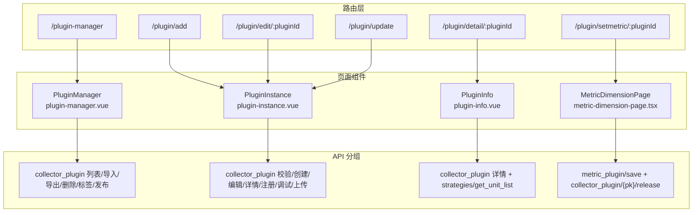

# 接口：插件管理专家 / 指标插件管理

**本文引用的文件**

路由与守卫：
- [plugin-manager.ts](file://bkmonitor/webpack/src/monitor-pc/router/integrated/plugin-manager.ts)
- [common/index.ts](file://bkmonitor/webpack/src/monitor-pc/common/index.ts)
- [router/utils.ts](file://bkmonitor/webpack/src/monitor-pc/router/utils.ts)
- [common/introduce.ts](file://bkmonitor/webpack/src/monitor-pc/common/introduce.ts)

权限：
- [authority-map.ts](file://bkmonitor/webpack/src/monitor-pc/pages/plugin-manager/authority-map.ts)
- [authorityMixin.ts](file://bkmonitor/webpack/src/monitor-pc/mixins/authorityMixin.ts)

API 定义：
- [model.js](file://bkmonitor/webpack/src/monitor-api/modules/model.js)
- [plugin.js](file://bkmonitor/webpack/src/monitor-api/modules/plugin.js)
- [commons.js](file://bkmonitor/webpack/src/monitor-api/modules/commons.js)
- [strategies.js](file://bkmonitor/webpack/src/monitor-api/modules/strategies.js)
- [base.ts](file://bkmonitor/webpack/src/monitor-api/base.ts)

Store：
- [store/modules/plugin-manager.js](file://bkmonitor/webpack/src/monitor-pc/store/modules/plugin-manager.js)

页面与调用点：
- [plugin-manager.vue](file://bkmonitor/webpack/src/monitor-pc/pages/plugin-manager/plugin-manager.vue)
- [plugin-info.vue](file://bkmonitor/webpack/src/monitor-pc/pages/plugin-manager/plugin-info/plugin-info.vue)
- [plugin-instance.vue](file://bkmonitor/webpack/src/monitor-pc/pages/plugin-manager/plugin-instance/plugin-instance.vue)
- [step-set-plugin.vue](file://bkmonitor/webpack/src/monitor-pc/pages/plugin-manager/plugin-instance/set-steps/step-set-plugin.vue)
- [step-set-test.vue](file://bkmonitor/webpack/src/monitor-pc/pages/plugin-manager/plugin-instance/set-steps/step-set-test.vue)
- [step-set-done.vue](file://bkmonitor/webpack/src/monitor-pc/pages/plugin-manager/plugin-instance/set-steps/step-set-done.vue)
- [upload.vue](file://bkmonitor/webpack/src/monitor-pc/pages/plugin-manager/plugin-instance/upload/upload.vue)
- [metric-dimension-page.tsx](file://bkmonitor/webpack/src/monitor-pc/pages/plugin-manager/components/metric-dimension-page.tsx)
- [metric-dimension-dialog.tsx](file://bkmonitor/webpack/src/monitor-pc/pages/plugin-manager/components/metric-dimension-dialog.tsx)
- [indicator-dimension/utils.ts](file://bkmonitor/webpack/src/monitor-pc/pages/plugin-manager/components/indicator-dimension/utils.ts)
- [indicator-dimension/index.tsx](file://bkmonitor/webpack/src/monitor-pc/pages/plugin-manager/components/indicator-dimension/index.tsx)
- [plugin-dialog-single.vue](file://bkmonitor/webpack/src/monitor-pc/pages/plugin-manager/plugin-dialog-single.vue)
- [plugin-dialog-multiple.vue](file://bkmonitor/webpack/src/monitor-pc/pages/plugin-manager/plugin-dialog-multiple.vue)
- [metric-group.vue](file://bkmonitor/webpack/src/monitor-pc/pages/plugin-manager/plugin-instance/set-steps/metric-dimension/metric-group.vue)
- [select-host.vue](file://bkmonitor/webpack/src/monitor-pc/pages/plugin-manager/plugin-instance/set-steps/components/select-host.vue)
- [plugin-setmetric.vue](file://bkmonitor/webpack/src/monitor-pc/pages/plugin-manager/plugin-setmetric.vue)（旧版入口，路由已不指向）
- [metric-dimension-dialog.vue](file://bkmonitor/webpack/src/monitor-pc/pages/plugin-manager/plugin-instance/set-steps/metric-dimension/metric-dimension-dialog.vue)（旧版实现，仅被旧入口引用）

采集侧关联调用（plugin.js 共享，仅归属说明）：
- [collector-config-update.vue](file://bkmonitor/webpack/src/monitor-pc/pages/collector-config/collector-config-update/collector-config-update.vue)
- [process-params.vue](file://bkmonitor/webpack/src/monitor-pc/pages/collector-config/collector-add/config-set/process-params.vue)

## 目录

1. [简介](#简介)
2. [路由入口清单](#路由入口清单)
3. [API 方法清单](#api-方法清单)
4. [契约示例](#契约示例)
5. [错误处理与权限](#错误处理与权限)
6. [结论](#结论)

章节来源：[plugin-manager.ts](file://bkmonitor/webpack/src/monitor-pc/router/integrated/plugin-manager.ts)（关键符号：`PluginManager`）

## 简介

插件管理专家（指标插件管理）的「接口」包含两层含义：

1. **页面路由入口**：`router/integrated/plugin-manager.ts` 注册的 6 条路由，覆盖「插件列表 → 新建/编辑/升级 → 详情 → 设置指标&维度」全流程；
2. **后端 API 调用**：围绕 `collector_plugin`（插件实体 CRUD / 导入导出 / 调试 / 发布）、`plugin`（注册 / 保存指标 / 保留字）两条主线，加上 `commons` / `strategies` 的共享支撑接口。

页面通过 `monitor-api/modules/model.js`、`plugin.js` 等静态导出的 `request(method, url)` 函数发起请求，统一走 `monitor-api/base.ts` 的 `request` 封装（自动附加 `bk_biz_id`/`space_uid`、traceparent、错误 message 策略）。数据面以 `plugin_id` 为主键，版本由 `config_version` + `info_version` 二元组标识。

章节来源：[plugin-manager.ts](file://bkmonitor/webpack/src/monitor-pc/router/integrated/plugin-manager.ts)（关键符号：`applyGuidePage`）

## 路由入口清单

### 六条路由

路由文件为 `router/integrated/plugin-manager.ts`（default export = `applyGuidePage([...6 条...], ['plugin-add'])`）：

| path | name | 组件 | props | 权限（meta.authority.page） | meta 要点 |
|---|---|---|---|---|---|
| `/plugin-manager` | `plugin-manager` | `PluginManager`（`plugin-manager.vue`） | — | `VIEW_AUTH` | title 插件管理、navId `plugin-manager`、noNavBar: true、route.parent: integrated |
| `/plugin/add` | `plugin-add` | `PluginInstance`（`plugin-instance.vue`，components.noCache） | — | `MANAGE_AUTH` | title 新建插件、needBack: true、route.parent: plugin-manager |
| `/plugin/edit/:pluginId` | `plugin-edit` | `PluginInstance`（components.noCache） | — | `MANAGE_AUTH` | title 编辑、needBack: true |
| `/plugin/update` | `plugin-update` | `PluginInstance`（components.noCache） | — | `MANAGE_AUTH` | title 升级、needBack: true、noNavBar: false |
| `/plugin/detail/:pluginId` | `plugin-detail` | `PluginInfo`（`plugin-info.vue`，components.noCache） | `true` | `VIEW_AUTH` | title 插件详情、navClass `plugin-detail-nav`、noNavBar: true |
| `/plugin/setmetric/:pluginId` | `plugin-setmetric` | `PluginSetmetric`（当前指向 `components/metric-dimension-page` → `MetricDimensionPage`） | — | `MANAGE_AUTH` | title 设置指标&维度、needBack: false、noNavBar: false |

注意：`plugin-setmetric` 路由中保留了旧组件实现的注释（`plugin-setmetric.vue`），现加载 `components/metric-dimension-page.tsx`（`MetricDimensionPage`），其内部渲染 `components/metric-dimension-dialog.tsx`（`MetricDimensionDialog`，传 `isRoutePage={true}`）。旧文件 `plugin-setmetric.vue` / `set-steps/metric-dimension/metric-dimension-dialog.vue` 仍保留在仓库并含 API 调用，但已不在路由链路上（`metric-dimension-dialog.vue` 仅被 `plugin-setmetric.vue` 引用）。

路由跳转入口（组件内 `$router.push`）：

- 列表 `handlePluginAdd` → `plugin-add`（可携带 `pluginData`、`isImportPlugin` 参数实现「导入后建新」）；
- 列表 `handlePluginEdit` → `plugin-edit`（携带 `pluginId`）；
- 列表 `handleShowMeticr` → `plugin-setmetric`（仅 `status === 'normal'` 且非官方插件）；
- 列表 `showPluginInfo` → `plugin-detail`；`handleToCollectorConfig` → `collect-config`（采集侧路由，携带 `searchType: 'correlation'`）；
- 详情页 `handleEdit` → `plugin-edit`；`handleJump` → `collect-config-add`；
- 导入冲突弹窗 `plugin-dialog-single.vue` 的 `handleToEdit` → `plugin-update`（携带 `params.pluginData`）。

章节来源：[plugin-manager.ts](file://bkmonitor/webpack/src/monitor-pc/router/integrated/plugin-manager.ts)（关键符号：`PluginInstance`）

### applyGuidePage 排除名单 ['plugin-add'] 的实际影响

`applyGuidePage(routes, excludes = [])` 在 `common/index.ts` 中对每条路由做 map：

- 若 `route.name` 在排除名单（此处即 `plugin-add`）→ **原样返回**：不注入 `beforeEnter`，也不设置 `meta.noChangeLoading`；
- 否则（其余 5 条）→ 返回 `{ ...route, beforeEnter: (to, from, next) => beforeEnter(navId, next), meta: { ...route.meta, noChangeLoading: true } }`。

被注入的 `beforeEnter`（`router/utils.ts`）行为：先 `store.commit('app/SET_ROUTE_CHANGE_LOADING', true)`，再 `introduce.getRouteFunc(navId).then(() => next())`（加载 navId=`plugin-manager` 的引导数据，成功后放行），finally 复位 loading。即进入这 5 条路由前会先拉取插件管理模块的引导页（GuidePage）数据，并等价于给页面打上 `meta.noChangeLoading: true`。

**覆盖影响**：注入写法是对象展开后直接赋值 `beforeEnter`，会**覆盖**这 5 条路由自身可能存在的自定义 `beforeEnter`（与采集专家的同类发现一致）。当前 6 条路由源文件均未定义自定义 `beforeEnter`，暂无实际覆盖；`plugin-add` 被排除后不参与注入、也不受注入影响。组件级守卫不受此影响：`plugin-manager.vue` 与 `plugin-instance.vue` 均在组件内定义了 `beforeRouteEnter` / `beforeRouteLeave`（如列表页进入时重置搜索/页码、`plugin-instance` 离开未完成步骤时二次确认），它们与路由级 `beforeEnter` 属于不同层级、互不冲突。

章节来源：[common/index.ts](file://bkmonitor/webpack/src/monitor-pc/common/index.ts)（关键符号：`applyGuidePage`）；[router/utils.ts](file://bkmonitor/webpack/src/monitor-pc/router/utils.ts)（关键符号：`beforeEnter`）

## API 方法清单

### collector_plugin 系列（model.js）

以下 20 个方法均定义于 `monitor-api/modules/model.js`，路径前缀 `rest/v2/collector_plugin`：

| 方法 | HTTP | 路径 | 语义 | 主要调用点 |
|---|---|---|---|---|
| `listCollectorPlugin` | GET | `rest/v2/collector_plugin/` | 插件列表（分页/搜索/标签/排序） | `plugin-manager.vue`（`getPluginListData`） |
| `retrieveCollectorPlugin` | GET | `rest/v2/collector_plugin/{pk}/` | 插件详情（pk = plugin_id） | `plugin-info.vue`、`step-set-plugin.vue`、`indicator-dimension/index.tsx`、`metric-dimension-dialog.tsx`、`plugin-setmetric.vue`（旧） |
| `checkIdCollectorPlugin` | GET | `rest/v2/collector_plugin/check_id/` | 校验插件 ID | `step-set-plugin.vue`（`checkPluginId`） |
| `createCollectorPlugin` | POST | `rest/v2/collector_plugin/` | 新建插件 | `step-set-plugin.vue`（`createPlugin`） |
| `editCollectorPlugin` | POST | `rest/v2/collector_plugin/{pk}/edit/` | 编辑插件（pk = plugin_id） | `step-set-plugin.vue`（保存编辑）、`plugin-manager.vue`（列表行内改 tag） |
| `deleteCollectorPlugin` | POST | `rest/v2/collector_plugin/delete/` | 批量删除（`plugin_ids` 数组） | `plugin-manager.vue`（`handleDeletePlugin`） |
| `importPluginCollectorPlugin` | POST | `rest/v2/collector_plugin/import_plugin/` | 导入插件包（`.gz/.tgz`） | `plugin-manager.vue`（单个/批量导入） |
| `exportPluginCollectorPlugin` | GET | `rest/v2/collector_plugin/{pk}/export_plugin/` | 导出插件包 | `plugin-manager.vue`（`handlePluginExport`） |
| `releaseCollectorPlugin` | POST | `rest/v2/collector_plugin/{pk}/release/` | 发布（生成正式版本） | `step-set-done.vue`、`metric-dimension-dialog.tsx`、`indicator-dimension/utils.ts`、`metric-dimension-dialog.vue`（旧） |
| `startDebugCollectorPlugin` | POST | `rest/v2/collector_plugin/{pk}/start_debug/` | 启动插件调试（返回任务） | `step-set-test.vue`（`getTaskId`） |
| `stopDebugCollectorPlugin` | POST | `rest/v2/collector_plugin/{pk}/stop_debug/` | 停止调试 | `step-set-test.vue`（`stopDebug`） |
| `fetchDebugLogCollectorPlugin` | GET | `rest/v2/collector_plugin/{pk}/fetch_debug_log/` | 拉取调试日志 | `step-set-test.vue`（`requestDebugLog`） |
| `operatorSystemCollectorPlugin` | GET | `rest/v2/collector_plugin/operator_system/` | 操作系统列表 | store action `getOsList` → `step-set-plugin.vue` / `plugin-info.vue` |
| `tagOptionsCollectorPlugin` | GET | `rest/v2/collector_plugin/tag_options/` | 标签选项（行内改标签） | `plugin-manager.vue`（`getTagList`） |
| `uploadFileCollectorPlugin` | POST | `rest/v2/collector_plugin/upload_file/` | 上传采集器文件（非 DataDog 插件） | `upload.vue`（`handleSelectFile`） |
| `destroyCollectorPlugin` | DELETE | `rest/v2/collector_plugin/{pk}/` | 删除单个（REST 风格） | 无前端调用点（仅定义与默认导出） |
| `partialUpdateCollectorPlugin` | PATCH | `rest/v2/collector_plugin/{pk}/` | 部分更新 | 无前端调用点 |
| `updateCollectorPlugin` | PUT | `rest/v2/collector_plugin/{pk}/` | 全量更新 | 无前端调用点 |
| `replacePluginCollectorPlugin` | POST | `rest/v2/collector_plugin/replace_plugin/` | 替换插件 | 无前端调用点 |
| `pluginImportWithoutFrontendCollectorPlugin` | POST | `rest/v2/collector_plugin/plugin_import_without_frontend/` | 无前端导入插件 | 无前端调用点 |

章节来源：[model.js](file://bkmonitor/webpack/src/monitor-api/modules/model.js)（关键符号：`listCollectorPlugin`）

### plugin 系列（plugin.js）

以下 8 个方法定义于 `monitor-api/modules/plugin.js`：

| 方法 | HTTP | 路径 | 语义 | 主要调用点 |
|---|---|---|---|---|
| `saveMetric` | POST | `rest/v2/metric_plugin/save/` | 保存指标&维度（可能返回 token 待发布） | `metric-dimension-dialog.tsx`、`indicator-dimension/utils.ts`、`metric-dimension-dialog.vue`（旧） |
| `pluginRegister` | POST | `rest/v2/register_plugin/` | 注册插件（异步任务，生成插件包） | `step-set-plugin.vue`（`registerPlugin`，配合 `isAsync: true`） |
| `saveAndReleasePlugin` | POST | `rest/v2/save_and_release_plugin/` | 保存并直接发布（导入官方/安全插件、冲突「更新至现有插件」） | `plugin-manager.vue`（`handleFileMultiple`、`handleSetUpdatePlugin`） |
| `getReservedWord` | GET | `rest/v2/get_reserved_word/` | 获取保留关键字 | store action `getReservedWords` → `step-set-plugin.vue`、`metric-group.vue` |
| `dataDogPluginUpload` | POST | `rest/v2/data_dog_plugin/` | DataDog check 包上传 | `upload.vue`（pluginType === 'DataDog' 分支） |
| `pluginUpgradeInfo` | GET | `rest/v2/plugin_upgrade_info/` | 插件升级信息（采集侧） | `collector-config-update.vue`（非本模块页面，plugin.js 为共享模块） |
| `processCollectorDebug` | POST | `rest/v2/process_collector_debug/` | 进程匹配调试（采集侧） | `process-params.vue`（非本模块页面） |
| `pluginType` | GET | `rest/v2/plugin_type/` | 插件类型列表 | 无前端调用点（仅定义与默认导出） |

章节来源：[plugin.js](file://bkmonitor/webpack/src/monitor-api/modules/plugin.js)（关键符号：`saveMetric`）

### 关联模块（commons / strategies）

| 方法 | HTTP | 路径 | 语义 | 主要调用点 |
|---|---|---|---|---|
| `getLabel` | GET | `rest/v2/commons/get_label/` | 插件标签树（传 `include_admin_only: false`） | store action `getLabels`、`plugin-manager.vue`（`getLabelList`） |
| `queryAsyncTaskResult` | GET | `rest/v2/commons/query_async_task_result/` | 异步任务结果轮询 | `step-set-plugin.vue`（`registerPlugin` 内轮询） |
| `getUnitList` | GET | `rest/v2/strategies/get_unit_list/` | 指标单位列表 | `metric-dimension-dialog.tsx`、`indicator-dimension/index.tsx`、`metric-dimension-dialog.vue`（旧） |
| `hostAgentStatus` | POST | `rest/v2/commons/host_agent_status/` | 主机 Agent 状态 | `select-host.vue` |

章节来源：[commons.js](file://bkmonitor/webpack/src/monitor-api/modules/commons.js)（关键符号：`getLabel`）；[strategies.js](file://bkmonitor/webpack/src/monitor-api/modules/strategies.js)（关键符号：`getUnitList`）

### 路由 → 页面 → API 关系图



图表来源：[plugin-manager.ts](file://bkmonitor/webpack/src/monitor-pc/router/integrated/plugin-manager.ts)、[model.js](file://bkmonitor/webpack/src/monitor-api/modules/model.js)、[plugin.js](file://bkmonitor/webpack/src/monitor-api/modules/plugin.js)（关键符号：`MetricDimensionPage`、`listCollectorPlugin`、`saveMetric`）

章节来源：[model.js](file://bkmonitor/webpack/src/monitor-api/modules/model.js)（关键符号：`retrieveCollectorPlugin`）

## 契约示例

以下请求/响应结构均从调用点代码反推（标注来源），为「前端实际依赖的字段」，而非后端完备契约。

### 1. 插件列表 `listCollectorPlugin`

- 请求（`GET rest/v2/collector_plugin/`，query 参数）：

```js
{
  search_key: '',            // 搜索关键字（插件名称）
  plugin_type: 'Exporter',   // 面板类型：Exporter/Script/DataDog/JMX/Pushgateway(面板 alias)/SNMP，空串=全部
  page: 1,
  page_size: 20,
  order: '-update_time',     // 默认按更新时间倒序；表头排序（plugin_id/update_time）会改写
  labels: 'label-id-1,label-id-2', // 标签筛选，逗号拼接的标签 id
}
```

- 响应（实际使用字段）：`{ count: { [插件类型]: 数量 }, list: [插件行] }`。`count` 以插件类型为 key（面板用 `count[alias || name]` 取值并对各类型求和得「全部」总数）；`list` 行为表格数据，模板与逻辑中可见字段包括 `plugin_id`、`plugin_display_name`、`plugin_type`、`logo`、`status`（`normal`/`draft`）、`is_official`、`bk_biz_id`、`tag`/`label`、`related_conf_count`、`update_user`、`update_time`、`edit_allowed`、`delete_allowed`、`export_allowed` 等。
- 取消：第二参数传 `{ cancelToken: new CancelToken(...) }`，清空搜索时调用 `cancelListRequest` 取消 pending 请求。失败时置列表空态 `'500'`。

章节来源：[plugin-manager.vue](file://bkmonitor/webpack/src/monitor-pc/pages/plugin-manager/plugin-manager.vue)（关键符号：`getPluginListData`、`listCollectorPlugin`）

### 2. 插件详情 `retrieveCollectorPlugin(pk)`

- 请求：`GET rest/v2/collector_plugin/{pk}/`，pk = `plugin_id`（路由 params）。
- 响应（由 `backFillData`、`handleData`、`plugin-setmetric.vue` 反推的字段）：

```txt
plugin_id, plugin_display_name, plugin_type, description_md, label,
bk_biz_id, config_version, info_version, metric_json, stage, status,
signature, logo(base64), is_support_remote, version_log, related_conf_count,
collector_json, config_json, is_split_measurement, enable_field_blacklist,
edit_allowed, create_user, create_time, update_user, update_time
```

其中 `metric_json` 为分组数组（含 `fields`，字段带 `monitor_type`、`is_diff_metric`、`type` 等）；`collector_json` 按插件类型形态不同：`Script` 按系统 key 存 `script_content_base64`/`type`，`DataDog`/`JMX` 存 `config_yaml` + `datadog_check_name`，`Exporter` 存上传文件描述，`SNMP` 存 `snmp_version`/`filename`/`config_yaml`；`config_json` 为参数数组（含 `name`、`default`、`visible`、`mode` 等）。`status === 'draft'` 与 `edit_allowed` 参与权限/编辑按钮分流。

章节来源：[plugin-info.vue](file://bkmonitor/webpack/src/monitor-pc/pages/plugin-manager/plugin-info/plugin-info.vue)（关键符号：`handleData`）、[step-set-plugin.vue](file://bkmonitor/webpack/src/monitor-pc/pages/plugin-manager/plugin-instance/set-steps/step-set-plugin.vue)（关键符号：`backFillData`）

### 3. 注册插件 `pluginRegister` + 异步轮询 `queryAsyncTaskResult`

- 请求：`POST rest/v2/register_plugin/`，body 为 `{ plugin_id, config_version, info_version }`；config 传 `{ isAsync: true }`（请求层自动附加 header `X-Async-Task: true`）。
- 响应：返回异步任务描述对象，前端用其整体作为参数调 `queryAsyncTaskResult(params)` 轮询（间隔 1500ms）：

```js
// 轮询响应（前端判断字段）
{ is_completed: true, state: 'SUCCESS' | 'FAILURE', data: { token: '...' }, message: '...' }
```

成功后取 `data.data.token` 写入 `pluginData.token`（后续用于 `releaseCollectorPlugin`）；失败时把 `state/message` 作为失败提示。轮询请求本身异常时构造 `{ is_completed: true, state: 'FAILURE', data: err.data, message: err.message }` 结束轮询。

章节来源：[step-set-plugin.vue](file://bkmonitor/webpack/src/monitor-pc/pages/plugin-manager/plugin-instance/set-steps/step-set-plugin.vue)（关键符号：`registerPlugin`、`queryAsyncTaskResult`）

### 4. 保存指标 `saveMetric` + 发布 `releaseCollectorPlugin`

- 保存请求：`POST rest/v2/metric_plugin/save/`，body（节选关键字段）：

```js
{
  plugin_id, plugin_type, config_version, info_version,
  enable_field_blacklist,                       // 新版 tsx 实现携带
  need_upgrade: true,                           // 路由页 / 非 token 场景
  metric_json: [{
    table_name, table_desc, rule_list,
    fields: [ /* 剔除前端态字段(descReValue/isCheck/isDel…)：diff 指标转 { type: 'double', is_diff_metric: true }，is_manual 按 rule 判定 */ ]
  }]
}
```

- config 传 `{ needMessage: false }`（关闭自动弹窗，手动 `$bkMessage(err.message)`）。
- 响应：若含 `token` → 调 `releaseCollectorPlugin(plugin_id, data)`（把 saveMetric 整个响应体作为参数传回，含 `config_version`/`info_version`/`token`），发布成功才算保存成功；失败静默置 false。
- `step-set-done.vue` 独立发布分支请求体：`{ config_version, info_version, token }`。

章节来源：[metric-dimension-dialog.tsx](file://bkmonitor/webpack/src/monitor-pc/pages/plugin-manager/components/metric-dimension-dialog.tsx)（关键符号：`saveMetric`、`releaseCollectorPlugin`）、[indicator-dimension/utils.ts](file://bkmonitor/webpack/src/monitor-pc/pages/plugin-manager/components/indicator-dimension/utils.ts)（关键符号：`buildSaveMetricParams`）、[step-set-done.vue](file://bkmonitor/webpack/src/monitor-pc/pages/plugin-manager/plugin-instance/set-steps/step-set-done.vue)（关键符号：`releasePlugin`）

### 5. 导入插件 `importPluginCollectorPlugin` + `saveAndReleasePlugin`

- 导入请求：`POST rest/v2/collector_plugin/import_plugin/`，body `{ file_data: File }`（请求层自动转 FormData）。文件格式限制 `accept=".gz, .tgz"`。
- 响应（前端判断字段）：

```txt
config_version, info_version,        // 版本号展示 `${config_version}.${info_version}`
is_official, is_safety,              // 官方/安全插件：导入后可直接 saveAndReleasePlugin
duplicate_type,                      // 重名类型
conflict_detail, conflict_ids, conflict_title,  // 插件 ID 冲突详情（conflict_ids: 1~5 见下文）
plugin_id, license, ...
```

- 无冲突且（官方或安全）：`data.bk_biz_id = is_official ? 0 : 当前业务`，随后 `saveAndReleasePlugin(data)` 直接发布；
- 冲突：`SET_PLUGIN_CONFIG(data)` 缓存导入配置，弹窗提供「更新插件」（非官方 + `is_safety` + 无需强制更新时 → 跳 `plugin-update`）、「创建插件」（跳 `plugin-add` 携带 pluginData）、「更新至现有插件」（官方 + 超级管理员 → `saveAndReleasePlugin`）。

章节来源：[plugin-manager.vue](file://bkmonitor/webpack/src/monitor-pc/pages/plugin-manager/plugin-manager.vue)（关键符号：`handeFileSingel`、`handleFileMultiple`、`saveAndReleasePlugin`、`importPluginCollectorPlugin`）、[plugin-dialog-single.vue](file://bkmonitor/webpack/src/monitor-pc/pages/plugin-manager/plugin-dialog-single.vue)（关键符号：`handleToEdit`）

## 错误处理与权限

### 请求层约定（base.ts request）

- `request(method, url)` 返回的函数有两种签名：`(pk, data, config)`（pk 为 string/number 时替换 URL 中 `{pk}`）与 `(data, config)`；
- 默认配置：`needBiz: true`（GET 请求自动补 `bk_biz_id`，无业务时补 `space_uid`）、`needMessage` 默认开启（受 localStorage `bk_monitor_api_no_message` 开关）、`needTraceId: true`（自动生成 traceparent 头）；
- `isAsync: true` → 附加 header `X-Async-Task: true`（异步任务模式）；
- `needRes: true` → 返回原始 response（可读 `result`/`message`）；
- 错误提示：`needMessage` 生效且错误码不在 `noMessageCode`（如 3308005、3314003、3314004）白名单时自动 `bkMessage`；部分错误（axiosError 名单）reject 空字符串；
- 上传：body 中出现 `File`/`FileList` 时自动组装 FormData。

章节来源：[base.ts](file://bkmonitor/webpack/src/monitor-api/base.ts)（关键符号：`needMessage`）

### 页面级错误处理策略

| 调用点 | config 策略 | 说明 |
|---|---|---|
| `checkIdCollectorPlugin`（`step-set-plugin.vue`） | `{ needRes: true, needMessage: false, needTraceId: false }` | 用 `res.result` 判定 ID 是否可用、`res.message` 作错误文案，不弹全局 message |
| `saveMetric`（tsx / vue / utils） | `{ needMessage: false }` | 手动 `$bkMessage({ theme: 'error', message: err.message, ellipsisLine: 0 })` |
| `listCollectorPlugin` | `{ cancelToken }` | 清空搜索/离开时取消 pending 列表请求 |
| 调试接口（`step-set-test.vue`） | `{ cancelToken }` | `cancelFn` 存实例，停止调试/离开时可取消 |
| `pluginRegister` | `{ isAsync: true }` | 见契约示例 3：轮询 1500ms，`is_completed`/`state` 驱动 UI |
| `releaseCollectorPlugin`（tsx/vue） | 默认（自动弹窗） | 失败 `catch(() => false)` 静默，不打断保存成功态判断 |

章节来源：[step-set-plugin.vue](file://bkmonitor/webpack/src/monitor-pc/pages/plugin-manager/plugin-instance/set-steps/step-set-plugin.vue)（关键符号：`checkPluginId`）

### 权限约定

`authority-map.ts` 定义 5 个权限常量：

- `MANAGE_AUTH = 'manage_plugin_v2'`：插件管理——新建/编辑/升级/导入导出/删除/设置指标维度（路由级用于 `plugin/add|edit|update|setmetric`，按钮级用于「新建/导入/编辑」等）；
- `VIEW_AUTH = 'view_plugin_v2'`：插件查看——列表与详情页访问；
- `MANAGE_PUBLIC_AUTH = 'manage_public_plugin'`：公共插件管理——仅针对公共插件（`bk_biz_id === 0`）；
- `COLLECTION_VIEW_AUTH / COLLECTION_MANAGE_AUTH`：复用采集配置的查看/管理权限（如 `step-set-done.vue` 的「新建采集配置/去采集」按钮可用性）。

**draft 状态与权限分流**（`plugin-manager.vue` 表格行）：

- 名称点击：`status !== 'draft'` 或有权限 → `showPluginInfo`（进详情）；`draft` 且无管理权限 → `showAuthorityDetail`（弹出权限申请）；
- `getManageAuth(row)`：`row.bk_biz_id === 0`（公共插件）→ 需要 `MANAGE_AUTH` 与 `MANAGE_PUBLIC_AUTH` **同时满足**才返回 false（即无缺口）；普通插件仅看 `MANAGE_AUTH`；
- 编辑按钮/更多操作均以 `getManageAuth` 判定并配合 `v-authority` 指令（无权限时置灰并引导申请）。
- 权限获取机制（`authorityMixin.ts`）：页面 mixin `authorityMixinCreate(authMap)` 把权限常量映射为布尔 `authority` 对象，`created` 时调 `checkAllowedByActionIds({ action_ids })` 批量查询；`VIEW_AUTH` 类 key 在分享模式/特殊事件下短路为 true；`handleShowAuthorityDetail` 打开申请弹窗。

章节来源：[authority-map.ts](file://bkmonitor/webpack/src/monitor-pc/pages/plugin-manager/authority-map.ts)（关键符号：`MANAGE_PUBLIC_AUTH`）；[plugin-manager.vue](file://bkmonitor/webpack/src/monitor-pc/pages/plugin-manager/plugin-manager.vue)（关键符号：`getManageAuth`）

### 版本/兼容约定

- **插件包格式**：导入 `accept=".gz, .tgz"`；上传本地文件时非 DataDog 走 `collector_plugin/upload_file/`（`plugin_type: 'Exporter'`），DataDog 走 `data_dog_plugin/` 且不传 `file_name`；
- **冲突类型**（`plugin-dialog-single.vue` 注释，`conflict_ids` 1~5）：1 版本不大于当前、2 插件类型冲突、3 远程采集配置项冲突、4 已关联 N 个采集配置、5 内容完全一致；其中 2/3/5 不提供强制「更新插件」入口（`canIUpdatePlubin`），只能「创建插件」；
- **升级链路（/plugin/update）**：导入冲突 → 缓存 `SET_PLUGIN_CONFIG(data)` → 弹窗「更新插件」跳转 `plugin-update`（携带 `pluginData`）→ `step-set-plugin.vue` 检测 `$route.name === 'plugin-update'`（或 `pluginConfigCache` 非空）时组装 `import_plugin_config = { collector_json, config_json, is_support_remote }` 合并进 create/edit 请求；列表页 `beforeRouteLeave` 仅在离开去 `plugin-update`/`plugin-add` 时保留缓存；
- **保存指标升级语义**：`saveMetric` 传 `need_upgrade: true`（路由页或非 token 场景），配合 `data.token` 触发 `release`；
- **指标 diff 兼容**：`type === 'diff'` 的指标提交前转 `{ type: 'double', is_diff_metric: true }`（详情回显时反向转换）；
- **保留字**：`getReservedWord` 响应取 `RT_RESERVED_WORD_EXACT`（缺省回退整体），store 缓存 `reservedWords`；页面创建时预加载（`step-set-plugin.vue` 的 `reservedWord`、`metric-group.vue` 的 `getReservedWords`）；
- **版本号展示**：`config_version` / `info_version` 以 `${config_version}.${info_version}` 拼接（导入进度、升级比较 `config_version_old`）。

章节来源：[plugin-dialog-single.vue](file://bkmonitor/webpack/src/monitor-pc/pages/plugin-manager/plugin-dialog-single.vue)（关键符号：`handleToEdit`）；[store/modules/plugin-manager.js](file://bkmonitor/webpack/src/monitor-pc/store/modules/plugin-manager.js)（关键符号：`getReservedWords`）

## 结论

- 路由入口共 **6 条**：列表（VIEW）、新建/编辑/升级/设置指标（MANAGE）、详情（VIEW）；`applyGuidePage(['plugin-add'])` 使 `plugin-add` 豁免 beforeEnter 注入，其余 5 条被注入「引导数据预加载」守卫并带 `noChangeLoading`（注入方式会覆盖未来新增的自定义 `beforeEnter`，属已知结构性风险）；
- API 方法共 **32 个**：`collector_plugin` 20 个（15 个有调用点）、`plugin.js` 8 个（7 个有调用点，其中 2 个属采集侧共享）、关联 `commons/strategies` 4 个（全部有调用点）；无调用点的 6 个（`destroy/partialUpdate/update/replace/plugin_import_without_frontend/pluginType`）仅定义与默认导出；
- 核心调用链：`list → detail → check_id/create|edit → register(异步轮询) → start/stop/fetch debug → saveMetric → release`；导入导出围绕 `.gz/.tgz` 包 + `import_plugin`/`export_plugin`/`save_and_release_plugin`；
- 权限为「VIEW / MANAGE / MANAGE_PUBLIC」三档 + 采集复用两档，公共插件（`bk_biz_id === 0`）需双管理权限，draft 状态在列表点击时决定「去详情」还是「权限提示/去编辑」。

章节来源：[model.js](file://bkmonitor/webpack/src/monitor-api/modules/model.js)（关键符号：`releaseCollectorPlugin`）；[authority-map.ts](file://bkmonitor/webpack/src/monitor-pc/pages/plugin-manager/authority-map.ts)（关键符号：`VIEW_AUTH`）
