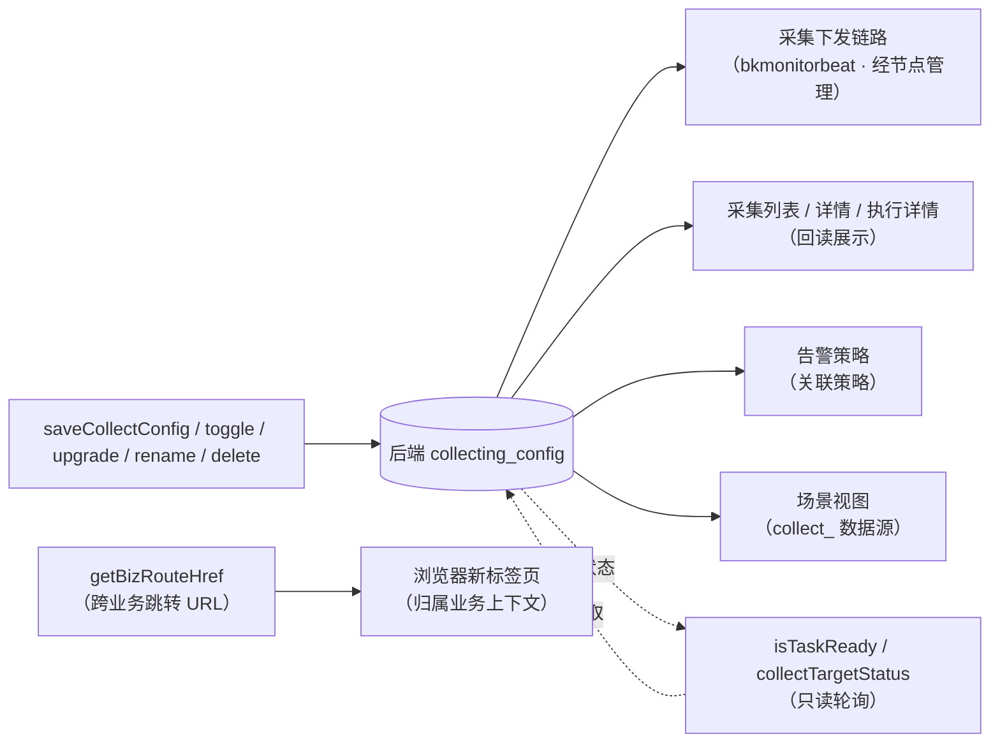

# 数据流向与消费：采集专家

> 契约快照生成于 2026-10-13（commit ff89f63ff4）。
> 若使用中发现行为与契约不符，可能代码已变更——expert-lookup 会自动增量修正，或用 expert-team 全量重建。
>
> 说明：本专家是前端功能域，**无自己的持久化存储**——数据实体为「前端提交给后端的配置数据」与「前端消费的状态/配置读数」两类，本文件按此口径记录流向与消费方。

## 数据实体清单

| 数据实体 | 产生入口（本模块） | 去向 | 消费方（模块/功能级） | 业务用途 |
|----------|--------------------|------|----------------------|----------|
| 采集配置（CollectConfig） | `saveCollectConfig`（新建/编辑/增删目标）、`toggleCollectConfigStatus`（启停）、`upgradeCollectPlugin`（升级）、`renameCollectConfig`（重命名）、`deleteCollectConfig`（删除） | `rest/v2/collecting_config/*` → 后端 collecting 模块（MySQL） | 采集下发链路（经节点管理下发至 bkmonitorbeat 采集器）`[基于引用扫描，未深入验证]`；采集列表/详情（回读展示）；告警策略（关联策略可级联删除）；场景视图（`collect_<id>` 数据源）`[基于引用扫描，未深入验证]`；导出配置页（`export-configuration` 的「采集配置」导出项）`[基于引用扫描，未深入验证]` | 定义"采什么、在哪采、怎么采"的采集任务，是监控数据产生的源头配置 |
| 采集目标集合（target_nodes / diff_node） | `saveCollectConfig`（含 `operation: 'ADD_DEL'` 增量模式） | 同上（配置的子结构） | 目标状态查询（`collectTargetStatus`）；下发执行（增删目标/启停流程展示进度） | 声明采集任务覆盖的拓扑节点/主机/服务实例范围 |
| 下发任务状态 | 前端只读：`isTaskReady`（就绪）、`collectTargetStatus`（进度）、`collectRunningStatus`（启停态）、`collectInstanceStatus`（实例态）、`getCollectLogDetail`（日志） | 前端 UI（不落库） | 列表页（5s 轮询状态列）、详情页「采集状态」、执行详情、下发结果面板（`config-deploy`） | 让用户感知下发是否成功、采集是否健康，是排障的第一手视图 |
| 关联策略查询结果 | `listRelatedStrategy`（精准/模糊两档） | 删除弹层 UI（临时数据） | 删除流程（提示有 N 个关联策略，可勾选 `deleteStrategyConfig` 级联删除） | 避免误删仍被告警策略引用的采集配置；或按需连带清理策略 |
| 图表视图变量（localStorage） | `setCollectVariable` / `delCollectScene` / `batchDelCollectRecord`（`collector-view/variable-set.ts`） | localStorage（key `collectVariablesConfig`） | 本模块可视化页（`collect-config-view`）；**performance 模块详情面板**（跨模块复用） | 记住用户在采集数据源视图中的变量取值与图表展开状态，提升复访体验 |
| 跨业务跳转 URL | `handleConfigNavigate` + `getBizRouteHref`（`monitor-common/utils`） | 浏览器新标签页（`?bizId=<归属业务>#/<path>`） | 用户（打开归属业务上下文页面） | 把「可见但属于其它业务」的配置安全地带到其归属业务环境中查看（#12736 约定） |

## 数据流向图（黑盒级）

图表来源：[collecting.js（API）](file://bkmonitor/webpack/src/monitor-api/modules/collecting.js)（关键符号：`saveCollectConfig`、`isTaskReady`、`collectTargetStatus`）、[collector-config.vue](file://bkmonitor/webpack/src/monitor-pc/pages/collector-config/collector-config.vue)（关键符号：`handleConfigNavigate`）

## 消费方影响提示

- **保存即下发**：`saveCollectConfig` 成功后配置立刻进入下发流程（无独立部署确认），失败需走「回滚」或「重试」，不会自动恢复。
- **重命名是展示层语义**：`renameCollectConfig` 只改配置展示名，不影响已产生的告警与监控数据。
- **删除不清理监控数据**：`deleteCollectConfig` 删除的是采集配置本身；已采集落库的监控数据不随删除消失。若勾选级联删除，会一并删除关联的**告警策略**（影响告警产生），需谨慎。
- **停用是异步的**：`toggleCollectConfigStatus({ action: 'disable' })` 后目标逐个停用（删除流程以 3s 轮询展示进度），期间采集可能仍在运行。
- **视图变量跨模块共享**：`variable-set.ts` 的 localStorage 数据同时服务 performance 模块，清理/改 key 会影响 performance 详情面板的视图记忆。
- **跨业务可见性由后端列表口径决定**：前端只按行 `bizId` 做只读/跳转处理；若后端收窄列表口径（见 C5 决策 1 重新评估条件），前端跨业务分支将自然失效。
