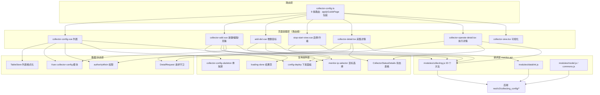
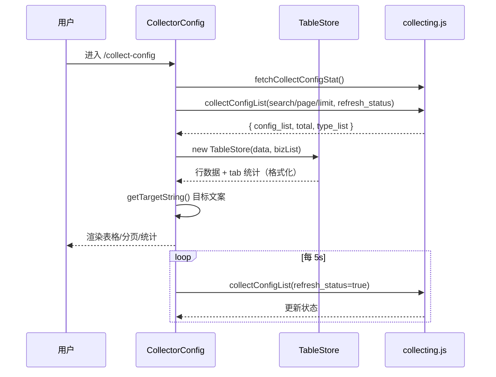
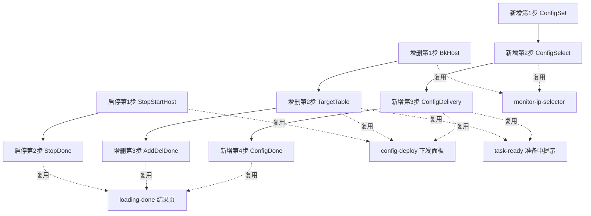

# 架构：采集专家 / 采集配置

**本文引用的文件**
- [collector-config.ts](file://bkmonitor/webpack/src/monitor-pc/router/integrated/collector-config.ts)
- [router-config.ts](file://bkmonitor/webpack/src/monitor-pc/router/router-config.ts)
- [utils.ts（router）](file://bkmonitor/webpack/src/monitor-pc/router/utils.ts)
- [space.ts](file://bkmonitor/webpack/src/monitor-pc/router/space.ts)
- [collector-config.vue](file://bkmonitor/webpack/src/monitor-pc/pages/collector-config/collector-config.vue)
- [store.ts](file://bkmonitor/webpack/src/monitor-pc/pages/collector-config/store.ts)
- [utils.ts（模块内）](file://bkmonitor/webpack/src/monitor-pc/pages/collector-config/utils.ts)
- [authority-map.ts](file://bkmonitor/webpack/src/monitor-pc/pages/collector-config/authority-map.ts)
- [collector-config-type.ts](file://bkmonitor/webpack/src/monitor-pc/pages/collector-config/collector-config-type.ts)
- [collector-type.ts](file://bkmonitor/webpack/src/monitor-pc/pages/collector-config/collector-type.ts)
- [collector-config-skeleton.tsx](file://bkmonitor/webpack/src/monitor-pc/pages/collector-config/collector-config-skeleton.tsx)
- [collector-add.vue](file://bkmonitor/webpack/src/monitor-pc/pages/collector-config/collector-add/collector-add.vue)
- [config-set.vue](file://bkmonitor/webpack/src/monitor-pc/pages/collector-config/collector-add/config-set/config-set.vue)
- [plugin-selector.tsx](file://bkmonitor/webpack/src/monitor-pc/pages/collector-config/collector-add/config-set/plugin-selector.tsx)
- [collector-introduction.vue](file://bkmonitor/webpack/src/monitor-pc/pages/collector-config/collector-add/config-set/collector-introduction.vue)
- [config-select.vue](file://bkmonitor/webpack/src/monitor-pc/pages/collector-config/collector-add/config-select/config-select.vue)
- [config-delivery.vue](file://bkmonitor/webpack/src/monitor-pc/pages/collector-config/collector-add/config-delivery/config-delivery.vue)
- [config-done.vue](file://bkmonitor/webpack/src/monitor-pc/pages/collector-config/collector-add/config-done/config-done.vue)
- [loading-done.vue](file://bkmonitor/webpack/src/monitor-pc/pages/collector-config/collector-add/config-done/loading-done.vue)
- [add-del.vue](file://bkmonitor/webpack/src/monitor-pc/pages/collector-config/collector-target-add-del/add-del.vue)
- [bk-host.vue](file://bkmonitor/webpack/src/monitor-pc/pages/collector-config/collector-target-add-del/bk-host/bk-host.vue)
- [target-table.vue](file://bkmonitor/webpack/src/monitor-pc/pages/collector-config/collector-target-add-del/target-table/target-table.vue)
- [stop-start-view.vue](file://bkmonitor/webpack/src/monitor-pc/pages/collector-config/collector-stop-start/stop-start-view.vue)
- [stop-start-host.vue](file://bkmonitor/webpack/src/monitor-pc/pages/collector-config/collector-stop-start/stop-start-host/stop-start-host.vue)
- [collector-detail.tsx](file://bkmonitor/webpack/src/monitor-pc/pages/collector-config/collector-detail/collector-detail.tsx)
- [collector-configuration.tsx](file://bkmonitor/webpack/src/monitor-pc/pages/collector-config/collector-detail/collector-configuration.tsx)
- [collector-status-details.tsx](file://bkmonitor/webpack/src/monitor-pc/pages/collector-config/collector-detail/collector-status-details.tsx)
- [detail-request.ts](file://bkmonitor/webpack/src/monitor-pc/pages/collector-config/collector-detail/detail-request.ts)
- [typings/detail.ts](file://bkmonitor/webpack/src/monitor-pc/pages/collector-config/collector-detail/typings/detail.ts)
- [collector-config-detail.vue](file://bkmonitor/webpack/src/monitor-pc/pages/collector-config/collector-config-detail/collector-config-detail.vue)
- [collector-config-update.vue](file://bkmonitor/webpack/src/monitor-pc/pages/collector-config/collector-config-update/collector-config-update.vue)
- [collector-dialog-delete.vue](file://bkmonitor/webpack/src/monitor-pc/pages/collector-config/collector-dialog-delete/collector-dialog-delete.vue)
- [collector-operate-detail.tsx](file://bkmonitor/webpack/src/monitor-pc/pages/collector-config/collector-host-detail/collector-operate-detail.tsx)
- [collector-host-detail.vue](file://bkmonitor/webpack/src/monitor-pc/pages/collector-config/collector-host-detail/collector-host-detail.vue)
- [utils.ts（host-detail）](file://bkmonitor/webpack/src/monitor-pc/pages/collector-config/collector-host-detail/utils.ts)
- [config-deploy.vue](file://bkmonitor/webpack/src/monitor-pc/pages/collector-config/config-deploy/config-deploy.vue)
- [collector-view.tsx](file://bkmonitor/webpack/src/monitor-pc/pages/collector-config/collector-view-detail/collector-view.tsx)
- [status-tab-list.tsx](file://bkmonitor/webpack/src/monitor-pc/pages/collector-config/collector-view-detail/status-tab-list.tsx)
- [variable-set.ts](file://bkmonitor/webpack/src/monitor-pc/pages/collector-config/collector-view/variable-set.ts)
- [log-handle.ts](file://bkmonitor/webpack/src/monitor-pc/pages/collector-config/collector-view/log-handle.ts)
- [authorityMixin.ts](file://bkmonitor/webpack/src/monitor-pc/mixins/authorityMixin.ts)
- [collector-config.js（Vuex）](file://bkmonitor/webpack/src/monitor-pc/store/modules/collector-config.js)
- [collecting.js（API）](file://bkmonitor/webpack/src/monitor-api/modules/collecting.js)
- [common/index.ts](file://bkmonitor/webpack/src/monitor-pc/common/index.ts)
- [common/introduce.ts](file://bkmonitor/webpack/src/monitor-pc/common/introduce.ts)
- [collector-cross-business.test.cjs](file://bkmonitor/webpack/tests/collector-cross-business.test.cjs)
- [collector-detail-back.test.cjs](file://bkmonitor/webpack/tests/collector-detail-back.test.cjs)
- [collector-detail-isolation.test.cjs](file://bkmonitor/webpack/tests/collector-detail-isolation.test.cjs)

## 目录
1. [简介](#简介)
2. [项目结构](#项目结构)
3. [核心组件](#核心组件)
4. [架构总览](#架构总览)
5. [组件详细分析](#组件详细分析)
6. [依赖关系分析](#依赖关系分析)
7. [结论](#结论)

## 简介

采集配置（collector-config）是 monitor-pc 应用「数据采集」功能域的前端实现，同时也是该功能域的**全生命周期前端管理入口**：列表浏览（多 tab 统计 / 搜索 / 分页 / 状态轮询）、新建 / 编辑 / 克隆（四步流程）、采集详情（独立详情页 + 列表侧栏）、增删目标（三步流程）、启停 / 升级（两步流程）、可视化视图（数据源管理）、执行详情、删除（可级联删除关联策略）。

模块定位与边界：

- **做什么**：前端配置管理与展示。所有写操作最终落到后端 `rest/v2/collecting_config/*` 接口（33 个方法集中于 `monitor-api/modules/collecting.js`），页面负责采集配置的创建、修改、启停、目标增删、删除，以及下发/采集状态的轮询展示。
- **不做什么**：数据下发与采集执行发生在后端与采集器侧（bkmonitorbeat），前端只提交配置并展示状态；采集器安装引导跳转「节点管理」（`$store.getters.bkNodeManHost`）；插件本体编辑跳转「插件管理」（`plugin-edit`）；采集策略本身的编辑不在本模块（删除采集任务时可勾选级联删除关联策略）。

技术形态：Vue2，`.vue`（Options API）与 `.tsx`（`vue-property-decorator` class component）双写法并存；UI 库 bk-magic-vue（`bk-*` 组件）；i18n 双通道——组件内 `this.$t`，模块级非组件代码（`store.ts`、`utils.ts`）用 `window.i18n.t`；状态层为 Vuex 命名空间模块 `collector-config` + 组件内局部状态。

章节来源：[collector-config.ts](file://bkmonitor/webpack/src/monitor-pc/router/integrated/collector-config.ts)（关键符号：`CollectorConfig`）、[authority-map.ts](file://bkmonitor/webpack/src/monitor-pc/pages/collector-config/authority-map.ts)（关键符号：`VIEW_AUTH`、`MANAGE_AUTH`）

## 项目结构

```
collector-config/
├── collector-config.vue              # 列表页（路由级页面，约 1900 行）
├── store.ts                          # TableStore：列表数据格式化 / 本地过滤 / 排序 / 分页 / tab 统计
├── utils.ts                          # getCustomDmsInsertParams：维度注入参数解析
├── authority-map.ts                  # 权限 ID 常量（依赖 plugin-manager / alarm-group 权限）
├── collector-config-type.ts          # 列表/详情通用 TS 类型（IStatusData、IDetailInfo 等）
├── collector-type.ts                 # 采集任务启停等类型（ICollectorTaskData 等）
├── collector-config-skeleton.tsx     # 统计区/表格加载骨架屏
├── collector-add/                    # 新建 / 编辑 / 克隆 四步流程
│   ├── collector-add.vue             #   步骤容器（配置 → 选择目标 → 采集下发 → 完成）
│   ├── config-set/                   #   第 1 步「配置」：插件选择 + 参数表单（最复杂）
│   ├── config-select/                #   第 2 步「选择目标」：monitor-ip-selector / SNMP / 远程主机
│   ├── config-delivery/              #   第 3 步「采集下发」：save + 状态轮询 + task-ready
│   └── config-done/                  #   第 4 步「完成」：结果页 + 跳可视化/策略
├── collector-target-add-del/         # 增删目标 三步流程
│   ├── add-del.vue                   #   步骤容器（选择目标 → 采集下发 → 完成）
│   ├── bk-host/                      #   第 1 步「选择目标」
│   ├── target-table/                 #   第 2 步「采集下发」（下发进度表格）
│   └── add-del-done/                 #   第 3 步「完成」
├── collector-stop-start/             # 启停 / 升级 两步流程
│   ├── stop-start-view.vue           #   步骤容器（采集下发 → 完成）
│   ├── stop-start-host/              #   第 1 步「采集下发」（toggle / upgrade / rollback）
│   └── stop-done/                    #   第 2 步「完成」
├── collector-detail/                 # 采集详情页（新版，5 Tab）
│   ├── collector-detail.tsx          #   详情页容器（Tab 切换 + 请求编排）
│   ├── collector-configuration.tsx   #   「配置信息」Tab（基本信息 + 目标 + 重命名）
│   ├── collector-status-details.tsx  #   采集状态表格（被详情/执行详情复用）
│   ├── detail-request.ts             #   DetailRequest：请求取消/竞态防护工具类
│   ├── components/                   #   alert-topic / link-status / storage-state / field-details / alarm-group 等
│   └── typings/detail.ts             #   TabEnum / DetailData / TCollectorAlertStage
├── collector-config-detail/          # 列表页「采集详情」侧滑栏（bk-sideslider）
├── collector-config-update/          # 「升级插件」弹窗内容（运行参数确认）
├── collector-dialog-delete/          # 删除采集任务对话框（先停用、可级联删策略）
├── collector-host-detail/            # 执行详情
│   ├── collector-operate-detail.tsx  #   新版执行详情页（datalink 接口 + 10s 轮询）
│   ├── collector-host-detail.vue     #   ［旧版·未引用］单次操作执行详情（collectInstanceStatus）
│   ├── collector-host-status.vue     #   ［旧版·未引用］状态表格
│   └── utils.ts                      #   共享状态枚举/颜色映射（EStatus、statusMap、STATUS_LIST）
├── collector-view-detail/            # 可视化（新版）：CommonPage/CommonNavBar + 场景视图
│   └── status-tab-list.tsx           #   状态 Tab 列表（IStatusData 被 performance 模块复用）
├── collector-view/                   # ［旧版·基本未引用］可视化视图主体
│   ├── variable-set.ts               #   场景变量存取（仍被 performance-detail 复用）
│   └── log-handle.ts                 #   日志采集特殊处理（类型被 custom-escalation 复用）
└── config-deploy/                    # 采集下发执行状态面板（被新增/增删/启停流程复用）
```

模块外的邻接物：`pages/collector-upgrade/collector-upgrade.vue`（V3 配置升级向导，全仓搜索无引用，属遗留页面）；路由注册在 `router/integrated/collector-config.ts`；接口层在 `monitor-api/modules/collecting.js`。

章节来源：[collector-config.vue](file://bkmonitor/webpack/src/monitor-pc/pages/collector-config/collector-config.vue)（关键符号：`CollectorConfig`）、[collector-add.vue](file://bkmonitor/webpack/src/monitor-pc/pages/collector-config/collector-add/collector-add.vue)（关键符号：`CollectorAdd`）、[add-del.vue](file://bkmonitor/webpack/src/monitor-pc/pages/collector-config/collector-target-add-del/add-del.vue)（关键符号：`AddAndDel`）

## 核心组件

| 组件 / 类 | 位置 | 职责（一句话） |
|---|---|---|
| `CollectorConfig` | `collector-config.vue` | 列表页：tab 统计、搜索、分页、5s 状态轮询、行操作（查看/可视化/编辑/启停/克隆/删除/升级） |
| `TableStore` | `store.ts` | 列表数据格式化层：config_list → 表格行（状态名/对象/时间格式化），本地过滤/排序/分页/tab 统计 |
| `DetailRequest` | `collector-detail/detail-request.ts` | 请求守卫工具类：AbortController + version 序号，保证「取消旧请求、只应用最新结果」 |
| `authorityMixinCreate` | `mixins/authorityMixin.ts` | 权限 mixin 工厂：批量查询 action、构造 `authority` 响应式对象并 provide 给子组件 |
| `CollectorConfigSkeleton` | `collector-config-skeleton.tsx` | 列表/统计区骨架屏（列结构可配置，行高随 size） |
| `ConfigDeploy` | `config-deploy/config-deploy.vue` | 下发执行状态面板：状态筛选、批量重试/终止、复制目标、执行详情侧栏；被 3 条流程复用 |
| `LoadingDone` | `collector-add/config-done/loading-done.vue` | 流程「完成」页通用展示（loading/成功/失败 + 文案插槽 + 底部操作插槽） |
| `MonitorIpSelector` | `components/monitor-ip-selector/`（共享组件） | 目标选择器（拓扑/动态分组/服务模板等 panel），新增/增删目标流程共用 |
| `CollectorConfigDetail` | `collector-config-detail/collector-config-detail.vue` | 列表页侧滑详情：基本信息 + 采集目标两 Tab，重命名（`renameCollectConfig`） |
| `CollectorOperateDetail` | `collector-host-detail/collector-operate-detail.tsx` | 执行详情页：`collectingTargetStatus` + 10s 轮询 + 复用 `CollectorStatusDetails` |
| `StatusTablList` | `collector-view-detail/status-tab-list.tsx` | 可视化页状态 Tab 列表；`IStatusData` 类型被 performance 模块引用 |
| Vuex 模块 `collector-config` | `store/modules/collector-config.js` | 跨页面共享新建/编辑数据：`addMode` / `addData` / `objectType` / `infoData` |

`EStatus` / `statusMap` / `STATUS_LIST`（`collector-host-detail/utils.ts`）是跨详情页共享的状态枚举与颜色映射，是「状态如何显示」的单点定义。

章节来源：[store.ts](file://bkmonitor/webpack/src/monitor-pc/pages/collector-config/store.ts)（关键符号：`TableStore`、`getTableData`）、[detail-request.ts](file://bkmonitor/webpack/src/monitor-pc/pages/collector-config/collector-detail/detail-request.ts)（关键符号：`DetailRequest`）、[utils.ts（host-detail）](file://bkmonitor/webpack/src/monitor-pc/pages/collector-config/collector-host-detail/utils.ts)（关键符号：`EStatus`、`statusMap`）

## 架构总览

模块整体是「路由层 → 页面容器层 → 复用组件层 → 数据/状态层 → 请求层 → 后端」的六层结构：

1. **路由层**：`router/integrated/collector-config.ts` 注册 9 条路由（列表 / 可视化 / 新建 / 克隆 / 编辑 / 增删目标 / 启停升级 / 执行详情 / 采集详情），由 `applyGuidePage` 包装注入「引导页预载」`beforeEnter`（除 `collect-config-add`、`collect-config-edit` 两条被 exclude）；每条路由 `meta.authority` 引用 `authority-map` 的 `VIEW_AUTH` / `MANAGE_AUTH`。
2. **页面容器层**：8 个路由级组件（列表页 + 3 条流程容器 + 4 个独立页面）。流程容器统一采用「左侧步骤条 + 动态 `<component :is>` 切换子步骤」的模式。
3. **复用组件层**：`config-deploy`（下发状态面板）、`loading-done`（结果页）、`monitor-ip-selector`（目标选择）、`collector-config-skeleton`（骨架屏）等，被多条流程横向复用。
4. **数据 / 状态层**：`TableStore` 承担列表格式化与本地过滤；`DetailRequest` 承担详情类页面的请求竞态治理；Vuex `collector-config` 模块在「列表 → 新增页」之间传递 `addData`；`authorityMixin` 提供权限对象。
5. **请求层**：`monitor-api/modules/collecting.js`（33 个方法，全部 `rest/v2/collecting_config/*`），辅以 `datalink`（链路/采集状态）、`model`（插件列表/告警组）、`commons`（节点/标签）三个模块。
6. **后端**：保存（`save`/`toggle`/`upgrade`/`rollback`）与查询（`config_list`/`config_detail`/`status`）由后端承接，前端以 `setTimeout` 链轮询状态收敛。



图表来源：[collector-config.ts](file://bkmonitor/webpack/src/monitor-pc/router/integrated/collector-config.ts)、[collector-config.vue](file://bkmonitor/webpack/src/monitor-pc/pages/collector-config/collector-config.vue)、[collecting.js（API）](file://bkmonitor/webpack/src/monitor-api/modules/collecting.js)（关键符号：`applyGuidePage`、`collectConfigList`、`fetchCollectConfigStat`）

章节来源：[common/index.ts](file://bkmonitor/webpack/src/monitor-pc/common/index.ts)（关键符号：`applyGuidePage`）、[collector-config.ts](file://bkmonitor/webpack/src/monitor-pc/router/integrated/collector-config.ts)（关键符号：`CollectorConfigViewNew`、`CollectorConfigAdd`）、[router/utils.ts（router）](file://bkmonitor/webpack/src/monitor-pc/router/utils.ts)（关键符号：`beforeEnter`）

## 组件详细分析

### 列表页：服务端搜索 + 本地格式化的双轨设计

列表页（`CollectorConfig`）是模块中复杂度最高的页面（约 1900 行），其数据链路的要点：

- **统计与列表分离加载**：`initPageData` 并行触发 `fetchCollectConfigStat`（头部 tab 统计）与 `getCollectionConfigList`（列表），两者各自管理 `statsLoading/statsError` 与 `listLoading/listLoaded` 状态，互不阻塞；统计失败时展示「数据获取异常 + 刷新」局部兜底，而不是整页失败。
- **服务端搜索**：`getSearchOfParams` 把「tab 分类 + 状态卡片 + 关键词」翻译为请求参数——`collect_type`、`status`、`task_status`、`need_upgrade`、`plugin_id`（`插件ID:` 前缀）、`id`（`ID:` 前缀）或 `fuzzy`；即过滤主要发生在服务端，`TableStore` 只做展示格式化与排序。
- **本地格式化轨道**：`TableStore` 构造时把 `config_list` 转成行数据（`statusMap` 文案、`objectTypeMap`、`formatWithTimezone` 时间、`doingStatus` 计算等），`getTargetString` 再把目标节点数/实例数翻译为「N 个拓扑节点（共 M 台主机）」一类文案。
- **状态轮询**：`getCollectionConfigList(status, needLoading, pollingDelay = 5000)` 在请求成功后经 `setTimeout` 自链式轮询（`refresh_status: true` 刷新状态）；页面 `deactivated` / `beforeDestroy` / `errorCaptured` 均会 `stopLoading` 清理计时器与在途请求（`AbortController`）。
- **请求竞态防护**：以 `listRequestId`（自增序号）+ `AbortController` 双保险，旧响应在 `requestId !== this.listRequestId` 时直接丢弃。
- **行内权限细节**：写操作按钮（增删目标/可视化/编辑/更多）通过 `v-authority` 指令 + `authority.MANAGE_AUTH` 三元短路控制；跨业务行（`bizId !== this.bizId`）只保留「查看」，其余操作分支直接 `return` 拦截。



图表来源：[collector-config.vue](file://bkmonitor/webpack/src/monitor-pc/pages/collector-config/collector-config.vue)、[store.ts](file://bkmonitor/webpack/src/monitor-pc/pages/collector-config/store.ts)（关键符号：`getCollectionConfigList`、`getFilterTabList`、`TableStore`、`getTargetString`）

章节来源：[collector-config.vue](file://bkmonitor/webpack/src/monitor-pc/pages/collector-config/collector-config.vue)（关键符号：`initPageData`、`getSearchOfParams`、`handleShowAdd`）、[store.ts](file://bkmonitor/webpack/src/monitor-pc/pages/collector-config/store.ts)（关键符号：`TableStore`、`deleteDataById`）

### 新建 / 编辑 / 克隆：四步流程容器

`CollectorAdd` 是一个「步骤容器」：左侧 4 个步骤（配置 → 选择目标 → 采集下发 → 完成），右侧通过 `changeView(index)` 切换 `currentView`（`config-set` / `config-select` / `config-delivery` / `config-done`）动态组件，步骤间用 `config`（`{ mode, data, set, select, delivery, done, target }`）与 `hosts` 两个大对象传递上下文（`.sync` 双向绑定）。

- **第 1 步 `ConfigSet`**（最重）：表单域包含业务/名称/对象类型（SERVICE/HOST）、采集周期/超时、采集方式、插件（`PluginSelector` 含 SNMP Trap / 日志关键字 / 进程采集等特殊伪插件）、运行参数（`AutoCompleteInput`、`ProcessParams`、`VariableTable`、`AutoMulti` 等）、插件介绍面板（`CollectorIntroduction` 官方/认证/OS 标签）。保存时把表单数据写入 `config.set`，并由 `formLabelMixin` 统一生成 `:label-width` 布局。
- **第 2 步 `ConfigSelect`**：`MonitorIpSelector` 选择动态节点/主机，SNMP 类型走 IP 标签输入；支持「远程运行主机」（`remoteCollectingHost`）与「采集专有主机」。点「开始下发」时调 `saveConfig` → `saveCollectConfig` 保存配置并进入下一步；Process 等类型先经 `checkPluginVersion` 校验插件版本（变更时提示升级）。
- **第 3 步 `ConfigDelivery`**：轮询 `collectTargetStatus`（默认 10s）展示下发进度（复用 `config-deploy`），`isTaskReady` 处理「任务准备中」场景（2s 重试探测）；支持 `rollbackDeploymentConfig` 回滚；腾讯云 K8S 插件（`isTencentCloudPlugin`）走独立 loading 分支，提供「失败重试」（重试即再次 `saveCollectConfig`）与「任务终止」（`CancelToken`）。
- **第 4 步 `ConfigDone`**：`LoadingDone` 结果页展示成功/失败数量，提供「可视化」「策略配置」两个跳转（策略跳转受 `STRATEGY_VIEW_AUTH` 权限控制）。
- **编辑 / 克隆差异**：同一容器组件通过路由名区分——`collect-config-add`（新建）、`collect-config-edit`（编辑，`componentType=EDIT`）、`collect-config-clone`（克隆，`isClone` 为真但 `mode=add`）；进入编辑时 `addData` 由列表页经 Vuex `SET_ADD_DATA` 预置，`ConfigSet` 再按需调 `collectConfigDetail` 拉取现状。

章节来源：[collector-add.vue](file://bkmonitor/webpack/src/monitor-pc/pages/collector-config/collector-add/collector-add.vue)（关键符号：`CollectorAdd`、`handleNext`、`changeView`）、[config-set.vue](file://bkmonitor/webpack/src/monitor-pc/pages/collector-config/collector-add/config-set/config-set.vue)（关键符号：`ConfigSet`、`handlePluginClick`）

### 增删目标与启停 / 升级：步骤复用与下发收敛

两条流程与新增流程共享大量底层组件，是「流程编排复用模式」的典型案例：

- **增删目标（`AddAndDel`）**：三步（选择目标 `BkHost` → 采集下发 `TargetTable` → 完成 `AddDelDone`）。进入时 `collectConfigDetail` 拉取当前配置与已选目标；`BkHost` 用 `MonitorIpSelector`（`show-view-diff=true` 展示变更差异）与 `saveCollectConfig` 提交目标变更；`TargetTable` 展示 `collectTargetStatus` 结果并提供「回滚」。
- **启停 / 升级（`StopStartView`）**：两步（采集下发 `StopStartHost` → 完成 `StopDone`）。通过路由 `params.stopStart.type` 区分 `START/STOP/UPGRADE`；`StopStartHost` 调 `toggleCollectConfigStatus`（启停）或 `upgradeCollectPlugin`（升级），10s 轮询 `collectRunningStatus/collectTargetStatus`，支持 `rollbackDeploymentConfig` 回滚。
- **复用关系**：`config-deploy`（下发面板）、`task-ready`（准备中提示）、`loading-done`（结果页）三者在新增/增删/启停流程间共享，确保三条流程的上手体验一致。



图表来源：[target-table.vue](file://bkmonitor/webpack/src/monitor-pc/pages/collector-config/collector-target-add-del/target-table/target-table.vue)、[stop-start-view.vue](file://bkmonitor/webpack/src/monitor-pc/pages/collector-config/collector-stop-start/stop-start-view.vue)、[config-deploy.vue](file://bkmonitor/webpack/src/monitor-pc/pages/collector-config/config-deploy/config-deploy.vue)（关键符号：`ConfigDeploy`、`StopStartView`、`AddAndDel`）

章节来源：[bk-host.vue](file://bkmonitor/webpack/src/monitor-pc/pages/collector-config/collector-target-add-del/bk-host/bk-host.vue)（关键符号：`BkHost`、`saveCollectConfig`）、[stop-start-host.vue](file://bkmonitor/webpack/src/monitor-pc/pages/collector-config/collector-stop-start/stop-start-host/stop-start-host.vue)（关键符号：`StopStartHost`、`toggleCollectConfigStatus`）、[config-delivery.vue](file://bkmonitor/webpack/src/monitor-pc/pages/collector-config/collector-add/config-delivery/config-delivery.vue)（关键符号：`ConfigDelivery`、`pollingStatus`）

### 详情体系：DetailRequest 请求模式与双入口

采集详情有两个入口，共享组件与请求工具：

- **独立详情页 `collector-detail.tsx`（新版）**：5 个 Tab（`TabEnum`：配置信息 / 链路状态 / 指标维度 / 存储状态 / 采集状态），每个 Tab 的请求由 `DetailRequest` 类管理（`run(fetch, apply)` 内部做 cancel + version 校验），未加载过的 Tab 惰性请求、已加载的复用；「采集状态」Tab 由 `CollectorStatusDetails` 渲染（分组表格 + 状态筛选 + 重试/终止/查看日志/批量操作），并 10s 轮询收敛（`needPolling` 为假即停）。
- **列表侧栏 `CollectorConfigDetail`**：从列表点「名称」打开 `bk-sideslider`（新标签页场景由 `handleShowDetail` 直接跳页），展示基本信息（可改名 `renameCollectConfig`，受 `PLUGIN_MANAGE_AUTH` 影响）与采集目标；同样复用 `DetailRequest` 与 `DetailLoadError/DetailSkeleton`。
- **请求模式设计维度**：`DetailRequest` 用「同实例版本号 + AbortController」解决重复请求与旧响应覆盖问题；页面级额外用 `disposed` 标记防止 `beforeDestroy` 后应用数据；Tab 切换时对已发起的无关请求（`requests.hosts / requests.storage`）主动 `cancel`，减少无效并发。

章节来源：[collector-detail.tsx](file://bkmonitor/webpack/src/monitor-pc/pages/collector-config/collector-detail/collector-detail.tsx)（关键符号：`CollectorDetail`、`handleTabChange`、`TabEnum`）、[collector-config-detail.vue](file://bkmonitor/webpack/src/monitor-pc/pages/collector-config/collector-config-detail/collector-config-detail.vue)（关键符号：`CollectorConfigDetail`、`renameCollectConfig`）

### 可视化与执行详情：新旧两代并存

- **可视化（新版 `collector-view-detail/collector-view.tsx`）**：路由 `/collect-config/view/:id` 实际加载的是 `collector-view-detail/collector-view`（旧版 `collector-view/collector-view.vue` 路由注册被注释）。页面直接复用 monitor-k8s 的 `CommonPage` + `CommonNavBar`（`navMode='share'`），以 `sceneId = collect_{id}` 打开场景视图；跨业务场景下 `bizId` 从 `route.query.customQuery` 读取（列表跳转时携带），并据此决定 `showListMenu`。菜单「数据源管理」跳 `collect-config-edit`。
- **执行详情（新版 `collector-operate-detail.tsx`）**：调 `collectingTargetStatus({ collect_config_id })` 展示一次操作的执行明细，轮询 10s 并在所有子任务收敛后停止；直接复用 `CollectorStatusDetails` 与 `STATUS_LIST`。旧版 `collector-host-detail.vue`（`collectInstanceStatus` 接口）已从路由注释掉，仅存代码。
- **历史包袱**：`collector-view/` 目录内 `view-wrapper.vue`、`view-settings*.tsx`、`variable-settings.tsx` 等旧版可视化主体已无入口引用，但 `variable-set.ts`（`getCollectVariable/setCollectVariable`）与 `log-handle.ts`（`hideOptions` 类型）仍被 `performance-detail/dashboard-panels.vue`、`custom-escalation/event-view-setting.ts` 跨模块复用——删除时不能整目录清掉。

章节来源：[collector-view.tsx](file://bkmonitor/webpack/src/monitor-pc/pages/collector-config/collector-view-detail/collector-view.tsx)（关键符号：`CollectorView`、`CommonPage`、`sceneId`）、[collector-operate-detail.tsx](file://bkmonitor/webpack/src/monitor-pc/pages/collector-config/collector-host-detail/collector-operate-detail.tsx)（关键符号：`CollectorOperateDetail`、`getHosts`）、[variable-set.ts](file://bkmonitor/webpack/src/monitor-pc/pages/collector-config/collector-view/variable-set.ts)（关键符号：`getCollectVariable`、`setCollectVariable`）

### 设计维度：权限注入与跨业务边界

- **权限模型**：`authorityMixinCreate(authMap)` 是模块内统一的权限获取方式（列表页、4 步流程、详情页、旧版执行详情均使用）。mixin 在 `created` 阶段调 `authorityStore.checkAllowedByActionIds` 批量查询，结果写入响应式 `authority` 对象（`ProvideReactive`），并通过 `handleShowAuthorityDetail` 提供「申请权限」弹窗入口；子组件（如 `CollectorStatusDetails`、`ConfigSet`）用 `inject: ['authority', ...]` 消费。按钮层用 `v-authority` 指令（`active: !authority.MANAGE_AUTH`）在无权限时挂载「加锁」提示。`authority-map.ts` 集中定义权限点：`VIEW_AUTH = view_collection_v2`、`MANAGE_AUTH = manage_collection_v2`、`PLUGIN_MANAGE_AUTH`（复用插件管理）、`STRATEGY_VIEW_AUTH = view_rule_v2`、`ALARM_GROUP_MANAGE_AUTH`（复用告警组）。
- **跨业务守卫（不变量）**：列表可展示「全部业务」的配置行，但任何行操作先校验 `data.bizId === this.bizId`——写操作（增删目标/编辑/克隆/启停/删除/升级）直接 `return` 拦截；读操作（查看详情/可视化/执行详情）对跨业务行走 `handleConfigNavigate`：`getBizRouteHref` 拼出目标业务 URL 后新窗口打开（`window.open`），不改变当前业务上下文。详情页对跨业务配置的写按钮同样受 `basicInfo.bk_biz_id === $store.getters.bizId` 约束；可视化页以 `customQuery.bizId` 作为数据过滤依据。
- **路由约定**：流程页统一 `meta.needBack: true` + `route.parent: 'collect-config'`（返回键与面包屑）；`collect-config-add/edit` 被 `applyGuidePage` exclude 并自带 `beforeEnter` 重写 title（`to.params.title`）；`collect-config-update` 与 `operate-detail` / `detail` 在 `beforeEnter` 校验缺失参数时回退列表。

章节来源：[authorityMixin.ts](file://bkmonitor/webpack/src/monitor-pc/mixins/authorityMixin.ts)（关键符号：`authorityMixinCreate`、`handleShowAuthorityDetail`）、[collector-config.vue](file://bkmonitor/webpack/src/monitor-pc/pages/collector-config/collector-config.vue)（关键符号：`handleConfigNavigate`、`handleShowAdd`）、[collector-cross-business.test.cjs](file://bkmonitor/webpack/tests/collector-cross-business.test.cjs)（关键符号：`handleCheckView`、`handleSubmitDelete`）

### 设计维度：状态与轮询治理

模块内至少有 5 处独立的状态轮询实现，模式并不统一，汇总如下：

| 位置 | 接口 | 间隔 | 终止条件 |
|---|---|---|---|
| 列表页 | `collectConfigList(refresh_status=true)` | 5s（首轮 1s） | 页面 deactivated / destroy / 请求失败 |
| 增删/新增第 3 步、启停第 1 步 | `collectTargetStatus` / `collectRunningStatus` | 10s | 子任务全部脱离 RUNNING/PENDING（`hasRunning=false`）后按钮解锁，轮询由 `pollingStatus` 续期 |
| 执行详情（新版） | `collectingTargetStatus` | 10s | `data.contents` 收敛（`needPolling=false`） |
| 详情页采集状态 Tab | `collectingTargetStatus` | 组件内部计时 | `pollingPaused` / Tab 切换 / destroy |
| 旧版执行详情 | `collectInstanceStatus` | 10s | 未引用（死代码） |

共性要点：轮询都是「`setTimeout` 自链」而非 `setInterval`，天然串行防重叠；停止时统一 `clearTimeout` + 在途请求 `AbortController.abort()`；组件卸载路径（`beforeDestroy`/`stopLoading`/`cancelRequests`）必须成对清理，否则会泄漏。

章节来源：[collector-config.vue](file://bkmonitor/webpack/src/monitor-pc/pages/collector-config/collector-config.vue)（关键符号：`getCollectionConfigList`、`stopLoading`）、[collector-operate-detail.tsx](file://bkmonitor/webpack/src/monitor-pc/pages/collector-config/collector-host-detail/collector-operate-detail.tsx)（关键符号：`handlePolling`）、[collector-status-details.tsx](file://bkmonitor/webpack/src/monitor-pc/pages/collector-config/collector-detail/collector-status-details.tsx)（关键符号：`CollectorStatusDetails`）

## 依赖关系分析

### 对内依赖（本模块消费的外部能力）

- **monitor-api**：`modules/collecting.js`（33 个方法，全部 `rest/v2/collecting_config/*`）；`modules/datalink.js`（`collectingTargetStatus`、`storageStatus`、`alertStatus`、`updateAlertUserGroups`、`transferCountSeries` 等——详情页与执行详情）；`modules/model.js`（`listCollectorPlugin`、`retrieveCollectorPlugin` 插件；`listUserGroup` 告警组）；`modules/commons.js`（`getNodesByTemplate`、`hostAgentStatus` 节点选择；`getLabel` 业务标签）；`modules/strategies.js`（`deleteStrategyConfig` 级联删除）。
- **monitor-common**：`getBizRouteHref` / `commonPageSizeGet|Set`（utils）、`formatWithTimezone`（时间格式化）、`copyText`、`random`、`deepClone`。
- **monitor-pc 共享资产**：`mixins/authorityMixin`、`mixins/formLabelMixin`（表单标签宽度）、`components/monitor-ip-selector`、`components/empty-status`、`components/guide-page`、`components/pageTips`、`components/history-dialog`、`components/ip-select/right-panel`、`components/verify-input`、`components/cycle-input`、`components/expand-wrapper`、`common/introduce`（引导页数据与路由预载）、`store/modules/app`（`SET_NAV_TITLE` / `SET_NAV_ROUTE_LIST`）、`$store.getters`（`bizId` / `bizList` / `bkNodeManHost` / `is_superuser` / `lang`）。
- **monitor-ui**：`monitor-dialog`（删除对话框容器）。
- **路由协作**：`router/utils.ts` 的 `beforeEnter`（`applyGuidePage` 注入）、`router-config.ts` 的菜单项（`monitor-collect > collect-config`）、`space.ts` 的无数据引导（“新建数据采集”直链 `#/collect-config/add`）。

### 对外被依赖（跨模块复用点）

- `collector-view/variable-set.ts` → `performance-detail/dashboard-panels.vue`（`getCollectVariable` / `setCollectVariable`）。
- `collector-view/log-handle.ts` 的 `hideOptions` 类型 → `custom-escalation/event-view-setting.ts`。
- `collector-view-detail/status-tab-list.tsx` 的 `IStatusData` → `performance-detail/host-list.tsx`。
- `collector-detail/components/alert-topic.tsx` 复用了 `alarm-group` 页面的 `AlarmGroupDetail`（反向依赖告警组模块）；`collector-detail/components/alarm-group.tsx` 又向上被 `alert-topic` 使用。
- 详情组件 `collector-configuration.tsx` / `collector-config-detail.vue` 复用 `components/history-dialog`。
- 测试侧：`tests/collector-*.test.cjs`（node:test）直接编译并运行本模块源码（含 `collector-config.vue` SFC、`detail-request.ts`、路由文件），是模块的重要「外部消费者」。

### 进入方式（被谁进入）

1. 侧边菜单「数据采集」→ `/collect-config`（`router-config.ts`，`DEFAULT_ROUTE_LIST` 含 `collect-config`）。
2. 无数据场景的引导页（`space.ts`）→ `#/collect-config/add`。
3. 从插件管理/分类/导出配置页跳回列表（`filterEnterRouter`：`service-classify`、`plugin-manager`、`plugin-edit`、`export-configuration`），携带关键词（分类名 / `插件ID:`）。
4. 从列表行操作进入各子路由；带 `?id=` 直链进列表时会自动打开对应详情（跨业务则用 `location.replace` 跳所属业务）。

章节来源：[collecting.js（API）](file://bkmonitor/webpack/src/monitor-api/modules/collecting.js)（关键符号：`collectConfigList`、`frontendCollectConfigDetail`）、[collector-config.vue](file://bkmonitor/webpack/src/monitor-pc/pages/collector-config/collector-config.vue)（关键符号：`filterEnterRouter`、`getBizRouteHref`）、[space.ts](file://bkmonitor/webpack/src/monitor-pc/router/space.ts)（关键符号：`collect-config`）

## 结论

### 关键发现

1. **模块边界清晰**：前端只做「配置管理与状态展示」，一切写动作以 `collecting_config` 系列接口为终点；采集执行、下发、采集器安装都在模块之外。33 个接口方法集中在 `collecting.js`，是唯一的请求契约面。
2. **流程编排高度复用**：三条多步流程（新增/增删/启停）共用「步骤条 + 动态组件 + 大对象上下文」模式，并共享 `config-deploy`、`task-ready`、`loading-done`、`monitor-ip-selector` 四类组件。
3. **请求治理有两套成熟模式**：列表页用「请求序号 + AbortController + debounce」；详情体系用 `DetailRequest` 类封装的「版本号 + cancel」；轮询统一为 setTimeout 自链。
4. **权限与跨业务是两道硬约束**：`authorityMixin` + `v-authority` 控制写操作可见性；`bizId === this.bizId` 守卫控制跨业务行只读、读操作跳所属业务（有专门的 node:test 测试锁定行为）。
5. **新旧代码并存明显**：列表页统计有新旧两套口径；可视化、执行详情各有一个已注释/无引用的旧实现；`pages/collector-upgrade/collector-upgrade.vue` 全仓无引用。

### 主要风险

- **双统计口径**：页面渲染已用服务端统计（`fetchCollectConfigStat` + `getFilterTabList`），但 `TableStore` 构造函数仍在计算基于当前页列表的 `tabData`（旧口径）。后续迭代若有人改错口径或用错数据源，tab 数字会与真实值不一致。
- **旧代码删除有连带面**：`collector-view/` 目录虽整体无入口，但其中 `variable-set.ts`、`log-handle.ts`、`status-tab-list.tsx` 的类型/函数被 performance、custom-escalation 等模块引用，不能整目录删除。
- **多分支路径（K8S/腾讯云）**：新增与启停流程都有 `isTencentCloudPlugin` 特判分支，测试覆盖薄弱的路径改动需谨慎（例如 `collector-config.vue` 中 K8S 禁用「克隆」按钮等零散特判）。
- **轮询清理依赖人工成对编写**：5 处轮询实现分散，新增页面时若漏掉 `deactivated/beforeDestroy` 清理会泄漏计时器与在途请求。

### 常见坑

- `collector-config.vue` 的 `beforeRouteEnter` 中 `vm.tableInstance.keyword = vm.panel.keword` 引用了不存在的字段 `keword`（应为 `keyword`）；因列表走服务端搜索且 `getCollectionConfigList` 每次会重建 `TableStore`，实际影响被掩盖，但属明显的残留死逻辑，改动相关代码时勿以它为准。
- 删除成功后只做本地重算（`deleteDataById` + `getTableData`），不会立即重新请求列表；分页总数与行数据在 5s 轮询回来前可能短暂不一致。
- 列表渲染的 `tabData` 与 `TableStore.tabData` 不是同一份；检索前缀是本地化的（`插件ID:` / `ID:` / 分类），i18n 文案变化会影响解析（`getSearchOfParams` 与 `TableStore.getTableData` 两处都做了前缀匹配）。
- 跨业务行的「可视化/查看/状态」均为跨页跳转（新窗口），同业务才走 `$router.push`；`handleShowDetail(row, false)` 的 `openNewPage=false` 分支用于直链自动打开场景（避免浏览器拦截弹窗）。
- 流程页返回键依赖 `common-nav-bar` 的兜底逻辑（无历史栈时跳 `collect-config` 列表）——测试 `collector-detail-back.test.cjs` 锁定了该行为。
- 编辑带 `needUpdate` 的配置会先弹「插件已变更，请先升级」提示（`updataInfo`），并非直接进入编辑页。

### 扩展点

- **新增采集类型**：需同步 `TableStore.defaultTabData` 排除规则（`log`、`Built-In`）、`getFilterTabList` 的同名过滤、列表列结构与 `collector-add` 的类型映射（`pluginTypeMap`）。
- **新增流程步骤**：在对应的步骤容器 `stepsMap` 中加一项并挂接组件即可（如 `add-del.vue` 的 `stepsMap`）；跨步骤数据应挂到 `config` 大对象而非 Vuex（仅「列表 → 新增页」用 Vuex 传 `addData`）。
- **新增接口**：统一加到 `monitor-api/modules/collecting.js` 并同步 default 导出，保持单一契约面。
- **新增权限点**：在 `authority-map.ts` 增加常量即可被 `authorityMixinCreate` 自动批量查询；页面 `meta.authority.page` 决定进入权限，写按钮用 `v-authority` 表达。
- **检测能力（测试）**：`tests/collector-*.test.cjs` 提供了「直跑源码」的测试基础设施（TS 转译 + Vue SFC 编译 + 依赖 mock），新增行为可用同一模式补测试。

章节来源：[store.ts](file://bkmonitor/webpack/src/monitor-pc/pages/collector-config/store.ts)（关键符号：`defaultTabData`、`getTableData`）、[collector-dialog-delete.vue](file://bkmonitor/webpack/src/monitor-pc/pages/collector-config/collector-dialog-delete/collector-dialog-delete.vue)（关键符号：`DeleteCollector`）、[collector-detail-isolation.test.cjs](file://bkmonitor/webpack/tests/collector-detail-isolation.test.cjs)（关键符号：`DetailRequest`）、[collector-detail-back.test.cjs](file://bkmonitor/webpack/tests/collector-detail-back.test.cjs)（关键符号：`handleBackGotoPage`）
