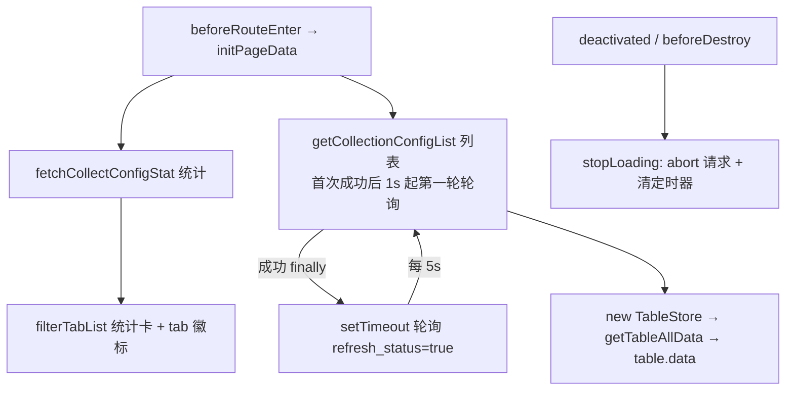
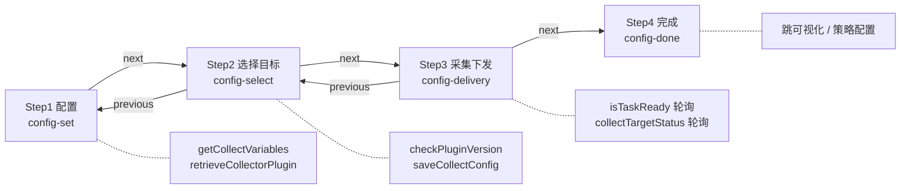
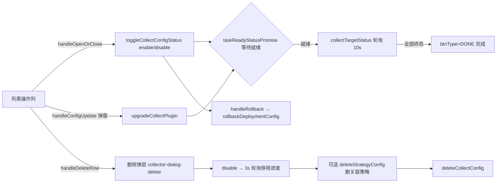

# 实现：采集专家 / 采集配置

**本文引用的文件**
- [collector-config.vue](file://bkmonitor/webpack/src/monitor-pc/pages/collector-config/collector-config.vue)
- [store.ts](file://bkmonitor/webpack/src/monitor-pc/pages/collector-config/store.ts)
- [utils.ts](file://bkmonitor/webpack/src/monitor-pc/pages/collector-config/utils.ts)
- [authority-map.ts](file://bkmonitor/webpack/src/monitor-pc/pages/collector-config/authority-map.ts)
- [collector-type.ts](file://bkmonitor/webpack/src/monitor-pc/pages/collector-config/collector-type.ts)
- [collector-config-skeleton.tsx](file://bkmonitor/webpack/src/monitor-pc/pages/collector-config/collector-config-skeleton.tsx)
- [collector-add.vue](file://bkmonitor/webpack/src/monitor-pc/pages/collector-config/collector-add/collector-add.vue)
- [config-set.vue](file://bkmonitor/webpack/src/monitor-pc/pages/collector-config/collector-add/config-set/config-set.vue)
- [plugin-selector.tsx](file://bkmonitor/webpack/src/monitor-pc/pages/collector-config/collector-add/config-set/plugin-selector.tsx)
- [config-select.vue](file://bkmonitor/webpack/src/monitor-pc/pages/collector-config/collector-add/config-select/config-select.vue)
- [topo-selector.vue](file://bkmonitor/webpack/src/monitor-pc/pages/collector-config/collector-add/config-select/topo-selector.vue)
- [config-delivery.vue](file://bkmonitor/webpack/src/monitor-pc/pages/collector-config/collector-add/config-delivery/config-delivery.vue)
- [config-done.vue](file://bkmonitor/webpack/src/monitor-pc/pages/collector-config/collector-add/config-done/config-done.vue)
- [config-deploy.vue](file://bkmonitor/webpack/src/monitor-pc/pages/collector-config/config-deploy/config-deploy.vue)
- [collector-detail.tsx](file://bkmonitor/webpack/src/monitor-pc/pages/collector-config/collector-detail/collector-detail.tsx)
- [detail-request.ts](file://bkmonitor/webpack/src/monitor-pc/pages/collector-config/collector-detail/detail-request.ts)
- [collector-configuration.tsx](file://bkmonitor/webpack/src/monitor-pc/pages/collector-config/collector-detail/collector-configuration.tsx)
- [collector-status-details.tsx](file://bkmonitor/webpack/src/monitor-pc/pages/collector-config/collector-detail/collector-status-details.tsx)
- [detail.ts](file://bkmonitor/webpack/src/monitor-pc/pages/collector-config/collector-detail/typings/detail.ts)
- [stop-start-view.vue](file://bkmonitor/webpack/src/monitor-pc/pages/collector-config/collector-stop-start/stop-start-view.vue)
- [stop-start-host.vue](file://bkmonitor/webpack/src/monitor-pc/pages/collector-config/collector-stop-start/stop-start-host/stop-start-host.vue)
- [add-del.vue](file://bkmonitor/webpack/src/monitor-pc/pages/collector-config/collector-target-add-del/add-del.vue)
- [bk-host.vue](file://bkmonitor/webpack/src/monitor-pc/pages/collector-config/collector-target-add-del/bk-host/bk-host.vue)
- [target-table.vue](file://bkmonitor/webpack/src/monitor-pc/pages/collector-config/collector-target-add-del/target-table/target-table.vue)
- [collector-dialog-delete.vue](file://bkmonitor/webpack/src/monitor-pc/pages/collector-config/collector-dialog-delete/collector-dialog-delete.vue)
- [collector-operate-detail.tsx](file://bkmonitor/webpack/src/monitor-pc/pages/collector-config/collector-host-detail/collector-operate-detail.tsx)
- [utils.ts（collector-host-detail）](file://bkmonitor/webpack/src/monitor-pc/pages/collector-config/collector-host-detail/utils.ts)
- [collector-view.tsx](file://bkmonitor/webpack/src/monitor-pc/pages/collector-config/collector-view-detail/collector-view.tsx)
- [variable-set.ts](file://bkmonitor/webpack/src/monitor-pc/pages/collector-config/collector-view/variable-set.ts)
- [collector-config-detail.vue](file://bkmonitor/webpack/src/monitor-pc/pages/collector-config/collector-config-detail/collector-config-detail.vue)
- [collector-config-update.vue](file://bkmonitor/webpack/src/monitor-pc/pages/collector-config/collector-config-update/collector-config-update.vue)
- [collecting.js](file://bkmonitor/webpack/src/monitor-api/modules/collecting.js)
- [authorityMixin.ts](file://bkmonitor/webpack/src/monitor-pc/mixins/authorityMixin.ts)
- [collector-config.ts（router）](file://bkmonitor/webpack/src/monitor-pc/router/integrated/collector-config.ts)
- [collecting-config-list-review-20261013.md](file://.pm/collecting-config-list-review-20261013.md)

## 目录
1. [简介](#简介)
2. [核心流程](#核心流程)
3. [设计模式](#设计模式)
4. [关键类与函数](#关键类与函数)
5. [热点路径](#热点路径)
6. [技术债](#技术债)
7. [结论](#结论)

---

## 简介

采集配置是 monitor-pc（集成平台集成模块）中「数据采集配置」功能域，负责监控插件采集任务的**全生命周期管理**：列表浏览、四步向导创建/编辑/克隆、目标增删、启停/升级/回滚/删除、执行明细与采集详情。技术栈为 Vue2（`.vue` SFC 与 `.tsx` class component 并存），UI 库 bk-magic-vue，状态经 Vuex 命名空间模块 `collector-config`（`SET_ADD_DATA` / `SET_ADD_MODE` / `SET_INFO_DATA` / `SET_OBJECT_TYPE`），i18n 混用 `this.$t` 与 `window.i18n.t`。

**路由与页面拓扑**（`router/integrated/collector-config.ts`，共 9 条路由，全部挂 `collectConfigAuth` 权限 map）：

| 路由 name | 页面组件 | 职责 |
|---|---|---|
| `collect-config` | `collector-config/collector-config.vue` | 列表（统计卡 + 分类 tab + 搜索 + 5s 状态轮询） |
| `collect-config-view` | `collector-view-detail/collector-view.tsx` | 可视化视图（sceneId 场景页） |
| `collect-config-add` / `collect-config-edit` / `collect-config-clone` | `collector-add/collector-add.vue` | 四步向导（新建/编辑/克隆同一容器） |
| `collect-config-node` | `collector-target-add-del/add-del.vue` | 增删目标三步流程 |
| `collect-config-update` | `collector-stop-start/stop-start-view.vue` | 启停/升级/回滚下发流程 |
| `collect-config-operate-detail` | `collector-host-detail/collector-operate-detail.tsx` | 执行详情 |
| `collect-config-detail` | `collector-detail/collector-detail.tsx` | 采集详情（5 tab） |

页面权限分两级：`VIEW_AUTH = 'view_collection_v2'`（查看）与 `MANAGE_AUTH = 'manage_collection_v2'`（管理），另导出 `PLUGIN_MANAGE_AUTH` / `STRATEGY_VIEW_AUTH` / `ALARM_GROUP_MANAGE_AUTH` 供跨模块按钮复用。

章节来源：[collector-config.ts（router）](file://bkmonitor/webpack/src/monitor-pc/router/integrated/collector-config.ts)（关键符号：`applyGuidePage`、`CollectorDetail`、`CollectorConfigNode`）、[authority-map.ts](file://bkmonitor/webpack/src/monitor-pc/pages/collector-config/authority-map.ts)（关键符号：`VIEW_AUTH`、`MANAGE_AUTH`、`PLUGIN_MANAGE_AUTH`）

---

## 核心流程

### 列表加载与状态轮询

进入页面由 `beforeRouteEnter` 的 `next(vm)` 回调统一初始化（保证数据在组件实例上取）：`initPageData()` 并行发起两路请求——`fetchCollectConfigStat`（顶部统计卡，独立 `statsRequestId` + `AbortController`）与 `getCollectionConfigList(false, true, 1000)`（列表，`pollingDelay=1000`）。

列表请求 `collectConfigList` 固定传 `bk_biz_id`、`order: '-create_time'`、`refresh_status`、`search`、`page`、`limit`，并用 `needRes: true` 拿原始响应（`res.data.config_list`）。响应到达后 `new TableStore(data, bizList)` 重建数据层，继承上一次 `sortOrder/sortProp`，经 `getTableAllData()` 写入 `table.data`。

**轮询节奏**：请求结束的 `finally` 中，若本次成功（或本次本身就是轮询请求 `status=true`）则 `setTimeout(() => this.getCollectionConfigList(true), pollingDelay)` 递归调度——首次成功后 1s 触发第一次轮询，此后每 5s 一次；轮询请求带 `refresh_status=true` 让后端刷新运行状态。首轮失败（非轮询）时清空表格并置 `emptyType='500'` 且**停止后续轮询**；轮询失败则静默保留旧数据、下个周期继续。

**竞态与清理**：`cancelListRequest()` 自增 `listRequestId` 并 `abort()` 请求；每个响应到达时校验 `requestId === this.listRequestId` 与 `isLeave`，不一致直接丢弃。页面失活（`deactivated`）/销毁（`beforeDestroy`）走 `stopLoading()`：`isLeave = true`、取消两路请求、取消 debounce（`debouncedSearch` / `lisenResize`）、停止定时器；`errorCaptured` 兜底清 timer。

图表来源：[collector-config.vue](file://bkmonitor/webpack/src/monitor-pc/pages/collector-config/collector-config.vue)（关键符号：`initPageData`、`getCollectionConfigList`、`stopLoading`、`cancelListRequest`）

**搜索与筛选参数**：`getSearchOfParams` 把 UI 状态翻译为后端 `search` 对象——分类 tab → `collect_type`；统计卡（`panel.itemActive`）→ `need_upgrade=true` / `task_status='WARNING'` / `status='STARTED|STOPPED'`；搜索词支持 `插件ID:`、`ID:` 前缀解析，其余走 `fuzzy` 模糊匹配。搜索框 `@change` → `handleSearch`（取消在途请求 + `startListLoading` + 300ms debounce `handleKeywordChange`）。分页 `handlePageChange` / `handleLimitChange` 更新 `pagination` 并重拉；`commonPageSizeGet/Set` 把每页条数持久化到 localStorage。

章节来源：[collector-config.vue](file://bkmonitor/webpack/src/monitor-pc/pages/collector-config/collector-config.vue)（关键符号：`getSearchOfParams`、`handleSearch`、`handleKeywordChange`、`handlePageChange`、`commonPageSizeSet`）

### 四步新建/编辑流程

`collector-add.vue` 是步骤容器：`stepConf.list` 定义「配置 → 选择目标 → 采集下发 → 完成」四步，`currentView` 动态挂载子组件，四步之间用统一事件协议传递状态——`config` 对象承载 `data/set/select/delivery/done/target` 分片，子组件以 `update:config` 回写、以 `next`/`previous`/`target`/`tencentCloudNext` 驱动步骤切换。`beforeRouteLeave` 时清理 Vuex 里的 `infoData` 缓存（`SET_INFO_DATA(null)`，跳转插件新增页除外）。克隆/编辑复用同一容器：由路由名 `collect-config-clone` 计算 `isClone`，`created` 时按 `route.params.pluginId/id` 装配初始 config。

图表来源：[collector-add.vue](file://bkmonitor/webpack/src/monitor-pc/pages/collector-config/collector-add/collector-add.vue)（关键符号：`stepConf`、`changeView`、`handleNext`、`handleTencentCloudNext`）、[config-delivery.vue](file://bkmonitor/webpack/src/monitor-pc/pages/collector-config/collector-add/config-delivery/config-delivery.vue)（关键符号：`handleData`、`getHosts`、`pollingStatus`）

**Step1 `config-set.vue`**（本模块最大的组件）：业务/名称/插件/采集对象/采集周期/采集超时的表单校验（`rules` + `validateField` + `validate`，名称限 50 字符按中文 2 字符折算、超时不得大于周期）；插件按 `pluginTypeMap` 分派——Log 走 `collector-log`、Process 走 `process-params`、Exporter 额外显示「绑定主机/绑定端口」、SNMP/SNMP_Trap 走独立校验链（`SnmpValidate` / `handleSnmpParamValidate` / `SnmpAuthCanSave`）；运行参数把插件 `config_json` 渲染为 `auto-complete-input`（含密码框 `passwordInputName` 上报、文件类型 `configJsonFileChange`），SNMP v3 多用户走 `auto-multi`；`dms_insert` 模式参数渲染为「维度注入」的 `tag-switch`（key:value 校验）；右侧可拖拽的插件说明栏（`handleMouseDown` 自研 resize）+ 指标预览（`indicator-preview`）+ 采集变量表（`getCollectVariables`）。`canNext` 聚合全部校验决定「下一步」；编辑模式下 `disabled` 锁死采集方式与插件。`handleNext` 校验通过后把 `set.data/set.others` 写入 config 并 `$emit('next')`。

**Step2 `config-select.vue`**：目标选择基于公共组件 `monitor-ip-selector`，面板按对象类型切换——HOST：`staticTopo/dynamicTopo/serviceTemplate/setTemplate/manualInput/dynamicGroup`；SERVICE 仅动态三面板并改用 `service_instance` 计数。`handleConfig` 回填（`transformMonitorToValueExpand` 处理 DYNAMIC_GROUP 的接口差异）、`getParams`/`getSnmpParams` 组装保存参数（见「关键类与函数」）。「开始下发」`handleDelivery`：Process 类型先 `checkPluginVersion` 校验，失败弹窗给出低版本插件与主机清单及节点管理链接、「是否继续下发」可强制；确认后 `saveCollectConfig` 保存并 `$emit('next')`。SNMP 时目标为 `bk-tag-input` IP 列表（`handleTargetsPaste` 支持逗号/分号/空格批量粘贴 + IPv4 正则校验）。

章节来源：[config-set.vue](file://bkmonitor/webpack/src/monitor-pc/pages/collector-config/collector-add/config-set/config-set.vue)（关键符号：`rules`、`validate`、`pluginTypeInfo`、`handleNext`、`canNext`）、[config-select.vue](file://bkmonitor/webpack/src/monitor-pc/pages/collector-config/collector-add/config-select/config-select.vue)（关键符号：`handleDelivery`、`checkPluginVersion`、`saveConfig`、`canDelivery`）

**Step3 `config-delivery.vue`（下发执行）**：`created` 延迟 1s 首查 `isTaskReady`；未就绪时展示 `task-ready` 占位并每 2s 轮询 `taskReadyStatus()`，`watch taskReady.show` 就绪后进入 `init()`（拉主机状态 + 打开 10s `pollingStatus`）。下发结果由共用组件 `config-deploy` 渲染（见后文）。页脚「完成」按钮受 `hasRunning` 约束；编辑模式显示「回滚」。

**Step4 `config-done.vue`**：汇总成功/失败数展示，提供「可视化 / 策略配置（受 `STRATEGY_VIEW_AUTH` 控制）/ 关闭」出口。

章节来源：[config-delivery.vue](file://bkmonitor/webpack/src/monitor-pc/pages/collector-config/collector-add/config-delivery/config-delivery.vue)（关键符号：`taskReadyStatus`、`init`、`pollingStatus`、`handleRollback`）、[config-done.vue](file://bkmonitor/webpack/src/monitor-pc/pages/collector-config/collector-add/config-done/config-done.vue)（关键符号：`handleGoConfigView`、`handleGoStrategy`）

### 启停、升级、回滚与删除

**启停/升级入口**（列表页操作列）：`handleOpenOrClose` 把行数据与 `stopStart.type`（STARTED/STOPPED）塞进路由参数跳 `collect-config-update`；「升级」由 `handleConfigUpdate`（先判 `doingStatus`）打开 `collector-config-update` 弹窗收集新版本参数，`on-submit` → `handleOpenUpgradePage` 以 `type='UPGRADE'` 继续同一路由。

**下发流程壳**：`stop-start-view.vue` 为两步壳（采集下发 → 完成），核心在 `stop-start-host.vue`——`btnType` 状态机（初始 STOPPED/STARTED/UPGRADE，执行中转 `RUNNING`，全部实例终结后转 `DONE`），`textObj` 负责按钮文案；`handleOperatorAll` 按类型分派 `toggleCollectConfigStatus({action: enable|disable})` 或 `upgradeCollectPlugin(upgradeParams)`，成功后 `taskReadyStatusPromise` 等待任务就绪，再 `getHosts` + 进入 10s `pollingStatus` 轮询。`handleRollback` 用 `$bkInfo` 二次确认后调 `rollbackDeploymentConfig`。

图表来源：[stop-start-host.vue](file://bkmonitor/webpack/src/monitor-pc/pages/collector-config/collector-stop-start/stop-start-host/stop-start-host.vue)（关键符号：`handleOperatorAll`、`pollingStatus`、`handleRollback`）、[collector-dialog-delete.vue](file://bkmonitor/webpack/src/monitor-pc/pages/collector-config/collector-dialog-delete/collector-dialog-delete.vue)（关键符号：`handleDel`、`pollingStatus`、`handleStepList`）

**删除**：真实删除路径为 `collector-dialog-delete.vue`（打开时 `listRelatedStrategy` 拉取精准/模糊关联策略），`handleDel` 串行四步——未停用则先 `toggleCollectConfigStatus('disable')` 并每 3s `pollingStatus` 展示「已停用 N 个节点内的 M 台主机」进度 → 勾选时 `deleteStrategyConfig` 批量删策略 → `deleteCollectConfig` 删配置；弹窗关闭后由列表页 `watch: delDialogShow` 重拉列表。

**共用下发结果面板 `config-deploy.vue`**（同时服务 Step3、启停流程与执行详情）：头部状态过滤（全部/正常/异常/执行中计数，`handleStatusChange` 本地过滤）+ 批量重试 + 批量终止 + 复制目标；行级操作 `handleRetry`（`retryTargetNodes`、乐观改状态为 PENDING）/ `handleRevoke`（`revokeTargetNodes`）；每个操作完成后都经 `taskReadyStatus`（2s 轮询 `isTaskReady`）等待再恢复轮询；失败实例可 `handleGetMoreDetail` 拉执行日志（`getCollectLogDetail`，侧滑展示并 `transformJobUrl` 处理 job 链接）。每类操作分片展示 diff 标签（ADD/REMOVE/UPDATE/RETRY）与 `node_path`、松散的 expand 折叠态继承。

章节来源：[config-deploy.vue](file://bkmonitor/webpack/src/monitor-pc/pages/collector-config/config-deploy/config-deploy.vue)（关键符号：`handleData`、`handleBatchRetry`、`handleBatchRowRetry`、`taskReadyStatus`）、[collector-dialog-delete.vue](file://bkmonitor/webpack/src/monitor-pc/pages/collector-config/collector-dialog-delete/collector-dialog-delete.vue)（关键符号：`handleDel`、`handleGoToStrategyList`）

### 增删目标

`add-del.vue` 三步向导（选择目标 → 采集下发 → 完成），进入即 `collectConfigDetail` 拉详情装配 `config.params/set`（`getConfigParams`），目标选择复用 `bk-host.vue`（`monitor-ip-selector` + 远程采集主机选择）：`handleStart` 组装 `target_nodes`/`target_node_type` 后 `saveCollectConfig({ id, ...newParams, operation: 'ADD_DEL' })` 触发增量下发，返回 `diff_node`（added/updated/removed/unchanged）交给 Step2 `target-table.vue`（结果面板 + 回滚）。`bk-host` 保存前有一个特有 hack：编辑态剔除 `params.plugin` 中的 password 类型参数（避免回填占位值覆盖真实密码）。

章节来源：[add-del.vue](file://bkmonitor/webpack/src/monitor-pc/pages/collector-config/collector-target-add-del/add-del.vue)（关键符号：`getConfigParams`、`getCollectorConfigDetail`、`targetUpdata`）、[bk-host.vue](file://bkmonitor/webpack/src/monitor-pc/pages/collector-config/collector-target-add-del/bk-host/bk-host.vue)（关键符号：`handleStart`、`saveCollectConfig`）

### 采集详情（5 tab）

`collector-detail.tsx`（`@Component + Mixins(authorityMixinCreate)`）以 `TabEnum`（configuration / targetDetail / DataLink / StorageState / fieldDetails）组织 5 个 tab，并通过 `query.tab` 双向同步（`handleTabChange` 切换时 `$router.replace`）。所有数据经 6 个 `DetailRequest` 实例（config/detail/targets/hosts/storage/groups）统一收口；`$route.params.id` 变化时整体重置重拉。「采集状态」tab 采用 10s `schedulePolling` 轮询（`collectingTargetStatus`，`STATUS_LIST` 含未终结态才继续），子组件可通过 `onCanPolling` 暂停（`handlePolling`）。子组件包括 `alert-topic`（告警接收组/关联策略）、`link-status`（链路状态，含 chart）、`storage-state`（存储状态）、`field-details`（指标/维度）、`detail-skeleton` / `detail-load-error`（骨架与错误重试）。

执行详情页 `collector-operate-detail.tsx` 复用 `collector-status-details`，以 `pollingCount` 版本号防止过期响应覆盖（10s 轮询）。

章节来源：[collector-detail.tsx](file://bkmonitor/webpack/src/monitor-pc/pages/collector-config/collector-detail/collector-detail.tsx)（关键符号：`handleTabChange`、`schedulePolling`、`requests`、`handlePolling`）、[detail.ts](file://bkmonitor/webpack/src/monitor-pc/pages/collector-config/collector-detail/typings/detail.ts)（关键符号：`TabEnum`、`TCollectorAlertStage`）

### 可视化视图

路由 `collect-config-view` 加载 `collector-view-detail/collector-view.tsx`：`beforeRouteEnter` 里构造 `viewOptions`（过滤 `bk_biz_id`）与 `sceneId = 'collect_${id}'`，渲染 `CommonPage`（monitor-k8s 通用视图框架）承载场景化图表；`customQuery` 里的 `bizId/pluginId` 用于跨业务打开与「数据源管理」回跳编辑页；`beforeRouteLeave` 调 `destroyTimezone`。

旧实现 `collector-view/view-wrapper.vue`（自绘视图 + `view-settings`/`variable-settings`/`view-settings-side`）在当前仓库**已无任何引用**（详见技术债）；但其兄弟工具 `variable-set.ts`（localStorage 持久化视图变量与图表展开记录：`setCollectVariable`/`getCollectVariable`/`delCollectScene`/`batchDelCollectRecord`）仍被 performance、自定义升级等模块引用。

章节来源：[collector-view.tsx](file://bkmonitor/webpack/src/monitor-pc/pages/collector-config/collector-view-detail/collector-view.tsx)（关键符号：`sceneId`、`viewOptions`、`handleMenuSelect`）、[variable-set.ts](file://bkmonitor/webpack/src/monitor-pc/pages/collector-config/collector-view/variable-set.ts)（关键符号：`setCollectVariable`、`getCollectVariable`）

---

## 设计模式

### 数据层：TableStore

`store.ts` 的 `TableStore` 以类封装「接口原始响应 → 表格行模型」的全部格式化：构造时为每条 config 生成 `statusName`（继承自 `taskStatus` 的 `statusMap`）、`doingStatus`（STARTING/STOPPING/DEPLOYING/AUTO_DEPLOYING/PREPARING 或 `TBC`）、`objectType/objectTypeEn`、`errorNum`、`needUpdate`、`updateParams`（id/pluginId/configVersion/infoVersion 打包，升级链路复用）、`updateTime`（`formatWithTimezone` 时区化）等；同时按 `type_list` 预构造 tab 结构并累计每类统计（`defaultTabData`）。对外提供 `getTableAllData`（全量 + 本地排序）与 `getTableData`（按分类/状态过滤 + 关键词 + 本地分页切片）。

设计要点：`TabStore` 内嵌 `startStatusList = ['STARTED','STOPPING','DEPLOYING','AUTO_DEPLOYING']` 与 `stopStatusList = ['STOPPED','STARTING']` 定义「启用/停用」归类口径；`statusMap`/`typeMap`/`tabItemMap` 集中管理状态与文案映射。**注意**：当前主流程只使用 `getTableAllData` 与服务端分页，`getTableData`/`deleteDataById`/`keyword`/`page`/`pageSize` 仅在已不可达的旧删除路径中被调用（见技术债）。

章节来源：[store.ts](file://bkmonitor/webpack/src/monitor-pc/pages/collector-config/store.ts)（关键符号：`TableStore`、`getTableAllData`、`getTableData`、`statusMap`、`startStatusList`、`defaultTabData`）

### 请求竞态控制：requestId + AbortController / DetailRequest

两种形态并存：列表页手工用「自增 `requestId` + `AbortController` + `isLeave`」三重判定丢弃过期响应（见核心流程）；详情页把该模式抽象为 `DetailRequest` 类——`run(fetch, apply)` 先 `cancel()` 旧请求（自增 `version` + `abort()`），响应回来若 `version` 不一致直接丢弃；`cancel()` 同时重置 `loading`。6 个请求域各持一个实例，组件销毁时统一 `cancelRequests`。此模式保证「快速切 tab / 快速翻 ID 不会有旧数据回写」。

章节来源：[detail-request.ts](file://bkmonitor/webpack/src/monitor-pc/pages/collector-config/collector-detail/detail-request.ts)（关键符号：`DetailRequest`、`run`、`cancel`）、[collector-detail.tsx](file://bkmonitor/webpack/src/monitor-pc/pages/collector-config/collector-detail/collector-detail.tsx)（关键符号：`requests`、`cancelRequests`）

### 任务就绪等待（is_task_ready）与轮询族

下发/启停/升级/回滚/重试后，任务在后端需要一段「准备期」。模块内统一以 `isTaskReady({ collect_config_id })` 轮询等待：`taskReadyStatus`（config-deploy / collector-status-details，2s 递归）、`taskReadyStatusPromise`（config-delivery / target-table / stop-start-host）。等待期间页面用 `task-ready` 占位或按钮 loading 表达；就绪后才恢复结果轮询。三档轮询周期：**列表 5s**（含首轮 1s）、**主机状态 10s**、**任务就绪 2s**、**删除停用进度 3s**——周期值硬编码在各组件（`t: 10000`、`t: 1000` 等），无统一配置。

章节来源：[config-delivery.vue](file://bkmonitor/webpack/src/monitor-pc/pages/collector-config/collector-add/config-delivery/config-delivery.vue)（关键符号：`taskReadyStatusPromise`、`taskReadyStatus`）、[config-deploy.vue](file://bkmonitor/webpack/src/monitor-pc/pages/collector-config/config-deploy/config-deploy.vue)（关键符号：`taskReadyStatus`、`handlePolling`）

### 权限与跨业务只读守卫

权限：`authorityMixinCreate(authMap)` 在 `created` 批量调 `checkAllowedByActionIds`，把 `authority` 对象以 `@ProvideReactive` 下发给子树；未授权按钮不隐藏而是统一走 `handleShowAuthorityDetail()` 弹权限申请；分享态（`__POWERED_BY_BK_WEWEB__ && token`）与超管直接放行并缓存（`setAuthById`）。模板侧用 `v-authority="{ active: !authority.MANAGE_AUTH }"` 指令控制拦截。

跨业务守卫：列表行含 `bizId`，所有写操作（增删目标/编辑/可视化/启停/删除/克隆）先判 `data.bizId !== this.bizId` 直接 return；非本业务行只渲染「查看」，且 `handleConfigNavigate` 对跨业务数据用 `getBizRouteHref` 拼所属业务路径后 `window.open`（新窗口）或 `window.location.replace`（直链场景避免弹窗拦截）。列表页 `initPageData` 对 `?id=` 直链会在异步加载到行数据后再进入详情（`handleShowDetail(row, false)`），同样为绕开新窗口拦截。

章节来源：[authorityMixin.ts](file://bkmonitor/webpack/src/monitor-pc/mixins/authorityMixin.ts)（关键符号：`authorityMixinCreate`、`handleShowAuthorityDetail`、`checkAllowedByActionIds`）、[collector-config.vue](file://bkmonitor/webpack/src/monitor-pc/pages/collector-config/collector-config.vue)（关键符号：`handleConfigNavigate`、`getBizRouteHref`、`handleShowDetail`）

### 骨架屏与加载防抖

`collector-config-skeleton.tsx` 是纯展示型 class 组件，两种形态：`section='stats'`（tab + 4 指标卡占位）与 `section='table'`（按 `columns` 动态生成 `gridTemplateColumns` 的表格骨架 + 分页占位）。表格骨架的行高随列（含 `updateUser` 时 59px）；操作列渲染 4 个宽度不一的占位条模拟真实按钮组。列表页以 `showTableSkeleton = listLoading && (!listLoaded || delayLoading)` 控制显隐，`delayLoading` 在 `startListLoading` 起 200ms 后才置 true，避免短请求闪骨架；加载中表格容器加 `is-loading`（opacity + pointer-events: none）并设 `inert` 属性阻断交互。

章节来源：[collector-config-skeleton.tsx](file://bkmonitor/webpack/src/monitor-pc/pages/collector-config/collector-config-skeleton.tsx)（关键符号：`CollectorConfigSkeleton`、`tableColumns`、`renderCell`）、[collector-config.vue](file://bkmonitor/webpack/src/monitor-pc/pages/collector-config/collector-config.vue)（关键符号：`showTableSkeleton`、`delayLoading`、`startListLoading`）

### 参数组装与敏感值处理（getParams 家族）

下发前需要把 UI 模型（`config.set.data.plugin.configJson` 的逐项 `default`）还原为后端 `params` 结构，三处实现同构但各有权衡：`config-select.getParams`（新建/编辑）、`config-select.getSnmpParams`（SNMP 专属，`auth_json[0]` 展平）、`config-delivery.getParams`（K8S）。共同规则：`mode === 'collector'` 的参数归入 `param.collector`（周期/超时/绑定主机端口等），其余归 `param.plugin`；**密码保护**——`encrypt`/`password` 类型仅当用户本次改过（`passwordInputChangeSet` 命中）才提交，避免回填密文被重新提交；`file` 类型提交 `{filename, file_base64}`；`dms_insert` 类型交由 `getCustomDmsInsertParams` 把 `["k:v", ...]` 解析为对象（解析失败发 error message 并 throw）。

章节来源：[config-select.vue](file://bkmonitor/webpack/src/monitor-pc/pages/collector-config/collector-add/config-select/config-select.vue)（关键符号：`getParams`、`getSnmpParams`、`passwordInputChangeSet`）、[utils.ts](file://bkmonitor/webpack/src/monitor-pc/pages/collector-config/utils.ts)（关键符号：`getCustomDmsInsertParams`）

---

## 关键类与函数

### TableStore（`store.ts`）

| 名称 | 职责 |
|---|---|
| `constructor(originData, bizList)` | 格式化 `config_list`：生成行模型（`statusName`/`doingStatus`/`needUpdate`/`updateParams` 等）+ 构造 tab 统计 |
| `getTableAllData()` | 全量数据 + 按 `sortProp/sortOrder` 本地排序（`+a[prop] - +b[prop]`） |
| `getTableData(type, typeLabel)` | 按分类/状态标签/tab 关键词过滤 + 本地分页切片（主流程已不用） |
| `deleteDataById(id)` | 本地删除行并递减 `stoppedNum`（主流程已不用） |
| `defaultTabData` / `typeMap` / `statusMap` / `tabItemMap` | 文案与分组映射（`window.i18n.t`） |
| `startStatusList` / `stopStatusList` | 「启用/停用」归类口径 |

### DetailRequest（`detail-request.ts`）

| 名称 | 职责 |
|---|---|
| `run(fetch, apply)` | 取消旧请求 → 发新请求（AbortSignal）→ 版本号校验 → `apply(data)`，返回是否成功 |
| `cancel()` | 自增 version + abort + 复位 loading |

### 列表页 `collector-config.vue` 主要方法

| 名称 | 职责 |
|---|---|
| `initPageData` | 进入页面并行初始化统计 + 列表；处理 `?id=` 直链进详情 |
| `fetchCollectConfigStat` | 拉统计卡（含统计失败 `statsError` 重试态） |
| `getCollectionConfigList(status, needLoading, pollingDelay)` | 拉列表 + 轮询调度核心（见核心流程） |
| `getFilterTabList(typeList)` | 后端统计 → tab 列表（剔除 `log`/`Built-In`，All 汇总，按 total 降序） |
| `getTargetString(tableData)` | 行目标列文案（拓扑/服务模板/集群模板/动态分组 × 主机/实例数） |
| `handleTabItemClick` / `handleTabNumClick` | 分类 tab / 统计卡切换（会清空搜索词） |
| `handleOperatorOver` | 行操作「更多」popover（$bkPopover 手动管理实例） |
| `handleShowDetail` / `handleCheckView` / `handleCheckStatus` | 详详情/可视化/执行详情导航（含跨业务跳转） |
| `handleShowAdd(mode, data)` | 新建/编辑导航（从分类 tab 带 `pluginType`，Process 带 `objectId=host_process`） |
| `handleConfigUpdate` / `handleOpenUpgradePage` | 升级弹窗与升级流程入口 |
| `handleOpenOrClose` | 启停导航（带 `stopStart` 参数） |
| `handleSortChange` / `handleSettingChange` | 本地排序 / 列设置 |
| `handleSearch` / `handleKeywordChange` | 搜索（debounce 300ms） |
| `startListLoading` / `stopLoading` / `cancelListRequest` | 加载态与竞态治理 |

### `config-set.vue` 核心方法

| 名称 | 职责 |
|---|---|
| `handleSetPlugin` | 从路由参数装配初始插件/采集类型 |
| `handleConfig(v)` | 初始化总入口：编辑/克隆/上一步回填三态分派 |
| `getConfigInfo(id)` / `handleConfigInfo(data)` | 拉采集详情并把 `params.label/period/host/config_json` 回填为 UI 模型 |
| `getPluginList` / `handlePluginList` / `getPluginInfo` / `pluginTypeInfo` | 插件列表与详情加载（编辑态命中缓存可省请求）；`pluginTypeInfo` 生成 `configJson` 校验态并按类型补默认值 |
| `handlePluginChange` / `handleCollectTypeChange` / `handleObjectIdChange` | 采集方式/对象变更时清理插件与筛选列表 |
| `handlePluginConfigJson` | Exporter 拆出 host/port；SNMP 系列包 `auth_json` 校验态 |
| `setPluginSelector` / `stepSetpluginSelector` | 编辑/回填时的插件选择器状态（LOG_PLUGIN_ID / PROCESS_PLUGIN_ID / snmp_${version}） |
| `validate` / `validateField` / `validateHost` / `validatePort` / `validateName` / `validateTimeout` | 校验体系（提交与失焦共用） |
| `handleNext` / `handleTencentCloudNext` | 校验通过后写 config 并推进步骤（K8S 走 popconfirm 分支） |
| `handleMouseDown` / `handleMouseMove` / `handleMouseOut` | 右侧说明栏拖拽 resize（document 级监听 + min/max 宽约束） |

### 下发与操作流

| 文件 | 关键函数 | 职责 |
|---|---|---|
| `config-select.vue` | `handleDelivery` / `saveConfig` / `saveData`（diff 回写） | 保存采集配置并进入下发 |
| `config-delivery.vue` | `init` / `getHosts` / `handleData` / `pollingStatus` / `handleRollback` / `handleDelivery`（K8S） | Step3 下发调度与结果轮询 |
| `stop-start-host.vue` | `handleOperatorAll` / `handleConfirm` / `handleDone` / `getHosts` / `pollingStatus` | 启停/升级执行状态机 |
| `target-table.vue` | `init` / `handleRollback` / `handleData` / `pollingStatus` / `taskReadyStatusPromise` | 增删目标下发结果与回滚 |
| `config-deploy.vue` | `handleRetry` / `handleRevoke` / `handleBatchRetry` / `handleBatchStop` / `handleBatchRowRetry` / `handleGetMoreDetail` / `taskReadyStatus` | 共用结果面板（单条与批量操作） |
| `bk-host.vue` | `handleStart` / `transformValueToMonitorExpand` | 目标选择与增量保存（`operation: 'ADD_DEL'`） |
| `collector-dialog-delete.vue` | `handleDel` / `handleStepList` / `pollingStatus` / `getHosts` | 删除流水线（停用 → 删策略 → 删配置） |
| `collector-operate-detail.tsx` | `getHosts` / `handlePolling` / `handleRefreshData` | 执行详情页（`pollingCount` 防过期覆盖） |
| `collector-status-details.tsx` | `handleUpdate`（watch updateKey）/ `handleFilterChange` / `handleRetry` / `handleRevoke` / `taskReadyStatus` | 状态明细表（详情页与执行详情共用，冻结表格数据 `Object.freeze`） |

章节来源：[config-set.vue](file://bkmonitor/webpack/src/monitor-pc/pages/collector-config/collector-add/config-set/config-set.vue)（关键符号：`handleConfig`、`pluginTypeInfo`、`validate`、`handleNext`）、[collector-status-details.tsx](file://bkmonitor/webpack/src/monitor-pc/pages/collector-config/collector-detail/collector-status-details.tsx)（关键符号：`handleUpdate`、`handleRetry`、`Object.freeze`）

### 请求层与工具

- `monitor-api/modules/collecting.js` 共 33 个方法覆盖：列表/详情（`collectConfigList`、`collectConfigDetail`、`frontendCollectConfigDetail`）、保存与删除（`saveCollectConfig`、`deleteCollectConfig`、`cloneCollectConfig`、`renameCollectConfig`）、执行控制（`toggleCollectConfigStatus`、`retryTargetNodes`、`revokeTargetNodes`、`batchRetry`、`batchRetryConfig`、`batchRevokeTargetNodes`、`upgradeCollectPlugin`、`rollbackDeploymentConfig`、`runCollectConfig`）、状态与日志（`collectTargetStatus`、`collectRunningStatus`、`getCollectLogDetail`、`isTaskReady`）、校验与统计（`checkPluginVersion`、`fetchCollectConfigStat`、`listRelatedStrategy`）等。
- `collector-host-detail/utils.ts`：`EStatus`、`STATUS_LIST`（未终结态集合）、`labelMap`（新增/删除/变更/重试）、`statusMap`、`operatorMap`（last_operation → 「增删目标/升级/启用/停用/回滚」）。
- `collector-view/variable-set.ts`：视图变量与图表展开态的 localStorage 持久化（跨模块被 performance 复用）。

章节来源：[collecting.js](file://bkmonitor/webpack/src/monitor-api/modules/collecting.js)（关键符号：`saveCollectConfig`、`isTaskReady`、`checkPluginVersion`）、[utils.ts（collector-host-detail）](file://bkmonitor/webpack/src/monitor-pc/pages/collector-config/collector-host-detail/utils.ts)（关键符号：`STATUS_LIST`、`operatorMap`）

---

## 热点路径

1. **列表 5s 轮询（最高频）**：常驻每 5s 一次全量 `config_list` 请求（`refresh_status=true`），每次响应重建 `TableStore`、全表重排序、整表重渲染。竞态治理（requestId/abort/`isLeave`）与「切页/搜索先取消在途请求」是这里的关键路径；`deactivated` 时停止轮询以省请求。
2. **轮询定时器生命周期**：`stopLoading`（列表）、`beforeDestroy`（下发/详情/删除）逐处清理 `setTimeout`；`errorCaptured` 兜底清 timer。任何新增轮询点都必须挂接清理，否则存在泄漏风险。
3. **大表格渲染**：bk-table 允许全列渲染 + 用户列设置；首屏用骨架屏替代（`skeletonRowCount` 取数据行数或 `min(pageSize, 10)`）；`handleSortChange` 在本地对当前页排序。历史上曾为行内 overflow 做了 `handleTableDataChange`（读不存在 ref，今为死代码）。
4. **本地 vs 服务端取舍**：搜索、分页、分类/状态筛选全部下推服务端（`search` 参数）；排序留在本地且**仅当前页**（PM 走查 N5），服务端固定 `order: '-create_time'`。
5. **详情页轮询**：采集状态 10s + `DetailRequest` 防过期覆盖；切 tab 时主动取消 hosts/storage 在途请求；`pollingPaused` 允许子组件暂停（如用户下拉/翻页时）。
6. **删除轮询**：`collector-dialog-delete.pollingStatus` 每 3s 拉 `collectTargetStatus` 更新停用进度，弹窗关闭即停（`this.showDialog && polling()`）。

章节来源：[collector-config.vue](file://bkmonitor/webpack/src/monitor-pc/pages/collector-config/collector-config.vue)（关键符号：`getCollectionConfigList`、`stopLoading`、`handleSortChange`）、[collector-detail.tsx](file://bkmonitor/webpack/src/monitor-pc/pages/collector-config/collector-detail/collector-detail.tsx)（关键符号：`schedulePolling`、`pollingPaused`）

---

## 技术债

以下条目均经当前代码核实**仍成立**（与 `.pm/collecting-config-list-review-20261013.md` 交叉验证）：

1. **列表页旧删除路径不可达**：`handleSubmitDelete` 与 `dialog.delete.show` 弹窗仍在模板/方法中，但已无任何位置把 `dialog.delete.show` 置 true（`handleDeleteRow` 已改走 `delDialogShow` 打开 `collector-dialog-delete`，旧逻辑以注释保留）；`handleSubmitDelete` 内的 `tableInstance.deleteDataById`/`getTableData` 调用随之成为死代码。佐证：collector-config.vue 中 `dialog.delete.show` 仅出现关闭赋值。
2. **TableStore 半遗留字段**：`keyword`/`page`/`pageSize`/`getTableData`/`deleteDataById` 不再被主流程使用（唯一调用点在不可达的 `handleSubmitDelete`）；`defaultTabData` 维护的前端统计与列表页 `filterTabList`（后端 `fetchCollectConfigStat`）形成**两套口径并存**（PM N2），且 `handleCloseUpdate` 中对统计做了手工 `needUpdateNum -= 1` 修补。
3. **统计不随删除刷新**（PM N3）：删除弹层关闭仅触发 `getCollectionConfigList`（watch `delDialogShow`），未重拉统计卡。
4. **FAILED 态不可筛**（PM N1）：筛选映射仅 `task_status='WARNING'`（异常）；统计卡解构也只取 `WARNING` 键，`FAILED`（全部失败）既不入卡也筛不出。
5. **交互一致性**：切分类 tab/点统计卡会静默清空搜索词（PM N4，`handleTabItemClick`/`handleTabNumClick` 内显式置空）；排序仅 ID 列且只作用当前页（PM N5）；「更新记录」空值兜底 `<template v-else> '--' </template>` 会把单引号一起渲染（PM N7）；搜索占位错别字「搜素 ID、名称」（PM N8）。
6. **死方法/死引用**：`handleTargetChange` 引用未定义的 `this.targetPage`；`handleToLogCollection` 仅被注释掉的模板按钮引用；`handleTableDataChange` 读取不存在的 `table-row-${index}` ref（overflow 恒 false）；`config-set` 中 `this.$refs.selectPluin` 引用不存在（旧插件选择器残迹）；`stop-start-view.vue` `beforeDestroy` 的 `if (this.operationCount)` 引用本组件未定义字段，分支永不执行。
7. **stop-start-host 的 TDZ 笔误**：`taskReadyStatusPromise` 首行 `clearTimeout(timer)` 先于 `let timer` 声明（同文件其他三处同类实现均先声明后调用）；该异常会被调用处 `.catch(() => true)` 兜底，可能使「等待任务就绪」退化为立即继续——行为层面需确认真实意图。
8. **注释与调试残留**：collector-config.vue（旧 tab HTML、日志采集按钮、`cloneCollectConfig` import）、config-select.vue（旧 `topo-selector` 模板块与调用处注释残留、`console.log('params', params)`）、config-set.vue（`console.log` ×2、SNMP 注释校验）、process-params.vue / storage-state.tsx 各一处 `console.log`。
9. **可视化旧实现遗留**：`collector-view/view-wrapper.vue` 及 `view-settings.tsx`/`variable-settings.tsx`/`view-settings-side.tsx` 已无外部引用（路由改用 `collector-view-detail/collector-view.tsx`）；`config-select/topo-selector.vue` 同样仅有注释引用。另：同属采集域的 `pages/collector-upgrade/collector-upgrade.vue`（约 11.7KB）文件存在，但全仓无 import / 路由引用（`collector-upgrade` 字符串搜索 0 命中），属遗留页面。
10. **非死代码修正**：`collector-config-detail/`（列表页 900px 侧滑详情，含重命名/编辑/查看数据）与 `collector-config-update/`（升级参数弹窗）**均仍被列表页活跃引用**，不是旧版遗留。

章节来源：[collector-config.vue](file://bkmonitor/webpack/src/monitor-pc/pages/collector-config/collector-config.vue)（关键符号：`handleSubmitDelete`、`handleDeleteRow`、`handleTargetChange`、`dialog.delete`）、[stop-start-host.vue](file://bkmonitor/webpack/src/monitor-pc/pages/collector-config/collector-stop-start/stop-start-host/stop-start-host.vue)（关键符号：`taskReadyStatusPromise`）、[collecting-config-list-review-20261013.md](file://.pm/collecting-config-list-review-20261013.md)（PM 走查佐证）

---

## 结论

采集配置模块是「列表 + 四步向导 + 下发执行 + 详情」四层结构的自洽系统：数据层以 `TableStore`/`DetailRequest` 两个小类支撑格式化与竞态治理；四步向导用 `config` 分片 + 事件协议实现松耦合步骤编排；下发/启停/重试/回滚统一收敛到 `config-deploy` 与 `isTaskReady` 就绪等待模式；权限与跨业务只读守卫通过 mixin + `v-authority` + `bizId` 判定全覆盖。工程化亮点：骨架屏（含 200ms 防闪烁）、`AbortController` 取消、三档轮询（1s/5s/10s）与组件生命周期严格挂钩。

主要风险集中在**列表页的历史沉积**：两套统计口径、不可达删除路径、FAILED 态筛选缺口、本地排序与若干死代码——它们不阻塞主链路，但持续抬高维护成本，建议按 PM 报告优先级（N3/N4/N7/N8 一行级修复 → N1/N2 口径拍板）逐步清理。

章节来源：[collector-config.vue](file://bkmonitor/webpack/src/monitor-pc/pages/collector-config/collector-config.vue)（关键符号：`getCollectionConfigList`、`fetchCollectConfigStat`）、[store.ts](file://bkmonitor/webpack/src/monitor-pc/pages/collector-config/store.ts)（关键符号：`TableStore`）
