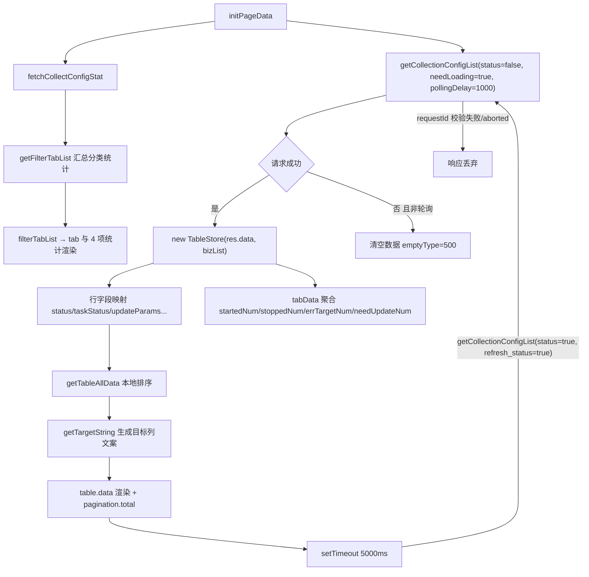
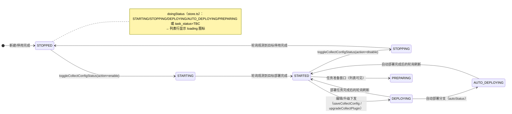
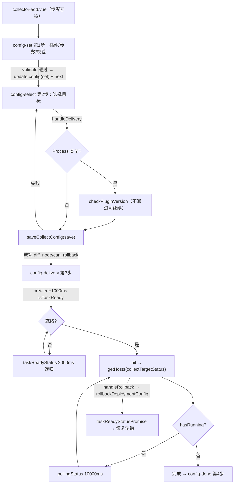
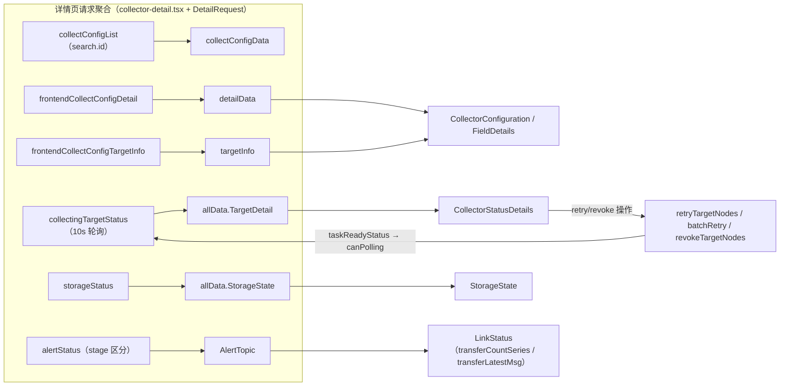

# 数据流转：采集专家 / 采集配置

**本文引用的文件**

- [collector-config.vue](file://bkmonitor/webpack/src/monitor-pc/pages/collector-config/collector-config.vue)
- [store.ts](file://bkmonitor/webpack/src/monitor-pc/pages/collector-config/store.ts)
- [collector-add.vue](file://bkmonitor/webpack/src/monitor-pc/pages/collector-config/collector-add/collector-add.vue)
- [config-set.vue](file://bkmonitor/webpack/src/monitor-pc/pages/collector-config/collector-add/config-set/config-set.vue)
- [plugin-selector.tsx](file://bkmonitor/webpack/src/monitor-pc/pages/collector-config/collector-add/config-set/plugin-selector.tsx)
- [config-select.vue](file://bkmonitor/webpack/src/monitor-pc/pages/collector-config/collector-add/config-select/config-select.vue)
- [config-delivery.vue](file://bkmonitor/webpack/src/monitor-pc/pages/collector-config/collector-add/config-delivery/config-delivery.vue)
- [task-ready.vue](file://bkmonitor/webpack/src/monitor-pc/pages/collector-config/collector-add/config-delivery/task-ready.vue)
- [config-done.vue](file://bkmonitor/webpack/src/monitor-pc/pages/collector-config/collector-add/config-done/config-done.vue)
- [collector-detail.tsx](file://bkmonitor/webpack/src/monitor-pc/pages/collector-config/collector-detail/collector-detail.tsx)
- [detail-request.ts](file://bkmonitor/webpack/src/monitor-pc/pages/collector-config/collector-detail/detail-request.ts)
- [collector-status-details.tsx](file://bkmonitor/webpack/src/monitor-pc/pages/collector-config/collector-detail/collector-status-details.tsx)
- [collector-configuration.tsx](file://bkmonitor/webpack/src/monitor-pc/pages/collector-config/collector-detail/collector-configuration.tsx)
- [link-status.tsx](file://bkmonitor/webpack/src/monitor-pc/pages/collector-config/collector-detail/components/link-status.tsx)
- [alert-topic.tsx](file://bkmonitor/webpack/src/monitor-pc/pages/collector-config/collector-detail/components/alert-topic.tsx)
- [storage-state.tsx](file://bkmonitor/webpack/src/monitor-pc/pages/collector-config/collector-detail/components/storage-state.tsx)
- [stop-start-view.vue](file://bkmonitor/webpack/src/monitor-pc/pages/collector-config/collector-stop-start/stop-start-view.vue)
- [stop-start-host.vue](file://bkmonitor/webpack/src/monitor-pc/pages/collector-config/collector-stop-start/stop-start-host/stop-start-host.vue)
- [stop-done.vue](file://bkmonitor/webpack/src/monitor-pc/pages/collector-config/collector-stop-start/stop-done/stop-done.vue)
- [add-del.vue](file://bkmonitor/webpack/src/monitor-pc/pages/collector-config/collector-target-add-del/add-del.vue)
- [bk-host.vue](file://bkmonitor/webpack/src/monitor-pc/pages/collector-config/collector-target-add-del/bk-host/bk-host.vue)
- [target-table.vue](file://bkmonitor/webpack/src/monitor-pc/pages/collector-config/collector-target-add-del/target-table/target-table.vue)
- [collector-dialog-delete.vue](file://bkmonitor/webpack/src/monitor-pc/pages/collector-config/collector-dialog-delete/collector-dialog-delete.vue)
- [collector-config-update.vue](file://bkmonitor/webpack/src/monitor-pc/pages/collector-config/collector-config-update/collector-config-update.vue)
- [collector-operate-detail.tsx](file://bkmonitor/webpack/src/monitor-pc/pages/collector-config/collector-host-detail/collector-operate-detail.tsx)
- [utils.ts（collector-host-detail）](file://bkmonitor/webpack/src/monitor-pc/pages/collector-config/collector-host-detail/utils.ts)
- [collector-view.tsx](file://bkmonitor/webpack/src/monitor-pc/pages/collector-config/collector-view-detail/collector-view.tsx)
- [variable-set.ts](file://bkmonitor/webpack/src/monitor-pc/pages/collector-config/collector-view/variable-set.ts)
- [collector-config-detail.vue](file://bkmonitor/webpack/src/monitor-pc/pages/collector-config/collector-config-detail/collector-config-detail.vue)
- [config-deploy.vue](file://bkmonitor/webpack/src/monitor-pc/pages/collector-config/config-deploy/config-deploy.vue)
- [collecting.js（monitor-api）](file://bkmonitor/webpack/src/monitor-api/modules/collecting.js)
- [datalink.js（monitor-api）](file://bkmonitor/webpack/src/monitor-api/modules/datalink.js)
- [collector-config（vuex 模块）](file://bkmonitor/webpack/src/monitor-pc/store/modules/collector-config.js)
- [collector-config（路由）](file://bkmonitor/webpack/src/monitor-pc/router/integrated/collector-config.ts)

## 目录

1. [简介](#简介)
2. [列表页数据生命周期](#列表页数据生命周期)
3. [状态流转](#状态流转)
4. [新建流程数据流](#新建流程数据流)
5. [详情与操作数据流](#详情与操作数据流)
6. [异步流（轮询）](#异步流轮询)
7. [结论](#结论)

## 简介

本文是「采集专家」实现层切面之一，聚焦 monitor-pc「数据采集配置」功能域（Vue2）的前端数据流转白盒视角：请求如何进入页面/组件、如何被变换、如何渲染、如何被轮询刷新与操作驱动，不涉及后端任务调度与数据生命周期。

数据流转大致分为三层：

- **接口层**：`collecting.js` 提供采集配置的列表/详情/保存/启停/升级/回滚/重试/状态等接口；`datalink.js` 提供链路、存储、告警三类状态接口。二者共同构成模块的全部远端数据源。
- **变换层**：`TableStore`（列表行映射与统计聚合）、`DetailRequest`（请求竞态防护工具）、各流程组件内部的 `getParams` 系列方法（表单 → 接口请求体）。
- **渲染层**：列表 `bk-table`、流程目标表格（`config-deploy.vue` 被新建流程、增删目标、启停三处复用）、详情页各 tab 组件。

页面骨架由路由定义：列表 `collect-config`、新建/编辑/克隆 `collect-config-add / edit / clone`、增删目标 `collect-config-node`、启停/升级 `collect-config-update`、执行详情 `collect-config-operate-detail`、采集详情 `collect-config-detail`、可视化 `collect-config-view`（指向 `collector-view-detail/collector-view.tsx`）。

章节来源：[collecting.js（monitor-api）](file://bkmonitor/webpack/src/monitor-api/modules/collecting.js)、[datalink.js（monitor-api）](file://bkmonitor/webpack/src/monitor-api/modules/datalink.js)、[collector-config（路由）](file://bkmonitor/webpack/src/monitor-pc/router/integrated/collector-config.ts)（关键符号：`collectConfigList`、`collectingTargetStatus`、`applyGuidePage`）

## 列表页数据生命周期

### 请求与参数构造

列表数据由两路请求并发驱动（`initPageData`）：`fetchCollectConfigStat`（头部统计）与 `getCollectionConfigList`（表格数据）。`getCollectionConfigList` 的请求参数由三部分拼装：

- 上下文：`bk_biz_id`、`order: '-create_time'`；
- 轮询标记：`refresh_status: status`（`status=true` 表示这是一次「刷新状态」轮询，由后端决定是否重算状态）；
- 查询：`search: getSearchOfParams`、`page`、`limit`。

`getSearchOfParams` 把 UI 状态翻译为接口字段：tab 采集分类 → `search.collect_type`；统计项点击（`panel.itemActive`）→ `need_upgrade / task_status / status`；搜索框语法解析 → `plugin_id`（`插件ID:` 前缀）、`id`（`ID:` 前缀）或 `fuzzy`（普通关键字）。因此**筛选/搜索/分页均由服务端完成**，响应中的 `total` 用于分页组件。

章节来源：[collector-config.vue](file://bkmonitor/webpack/src/monitor-pc/pages/collector-config/collector-config.vue)（关键符号：`initPageData`、`getCollectionConfigList`、`getSearchOfParams`、`pagination`）

### TableStore 构造与字段映射

每次请求成功后都会**新建**一个 `TableStore` 实例：`new TableStore(res.data, bizList)`（`res.data` 形如 `{ config_list, total, type_list }`）。构造过程中完成三件事：

1. **行字段映射**：`config_list` 每项映射为表格行，关键映射包括 `id`、`name`、`bizName`（由 `bizList` 按 `bk_biz_id` 反查 `text`）、`collectName`（由 `typeMap[collect_type].name` 反查）、`status`、`taskStatus`、`statusName`（用 `statusMap` 按 `task_status` 取展示文案）、`doingStatus`（进行中判定，见状态流转）、`autoStatus`（`status === 'AUTO_DEPLOYING'`）、`needUpdate`（`need_upgrade`）、`errorNum`（`error_instance_count`）、`updateTime`（`formatWithTimezone` 格式化）、`updateParams`（`{ id, pluginId, configVersion, infoVersion }`，供升级/编辑路由跳转携带）。
2. **tab 统计聚合**：`startStatusList = ['STARTED','STOPPING','DEPLOYING','AUTO_DEPLOYING']`、`stopStatusList = ['STOPPED','STARTING']`；逐行累加所属分类 tab 与 All tab 的 `startedNum / stoppedNum / errTargetNum / needUpdateNum`；`needUpdateNum` 与 `errTargetNum` 按 `total_instance_count / error_instance_count` 的**目标数量**累加（而非配置条数）；`log`、`Built-In` 两类被排除在 tabData 之外。
3. **tab 排序**：`tabData` 最后按 `order` 排序（All 固定 order=1，其余按 `type_list` 顺序）。

章节来源：[store.ts](file://bkmonitor/webpack/src/monitor-pc/pages/collector-config/store.ts)（关键符号：`TableStore`、`defaultTabData`、`statusMap`、`startStatusList`、`stopStatusList`）

### tab 统计：接口统计与本地聚合并存

头部 tab 与 4 项统计实际由**统计接口**驱动：`fetchCollectConfigStat` 的响应经 `getFilterTabList` 换算为 `filterTabList`（每类含 `nums.STARTED / nums.STOPPED / nums.WARNING / nums.need_upgrade`，`total = STARTED + STOPPED`，并累加出 All 项，再按 `total` 倒序）。template 只读取 `filterTabList`，也就是说 `TableStore.tabData` 的本地聚合结果在当前渲染路径中**不被读取**（仅被遗留的 `deleteDataById` 维护），两套统计口径并存。

章节来源：[collector-config.vue](file://bkmonitor/webpack/src/monitor-pc/pages/collector-config/collector-config.vue)（关键符号：`fetchCollectConfigStat`、`getFilterTabList`、`filterTabList`）、[store.ts](file://bkmonitor/webpack/src/monitor-pc/pages/collector-config/store.ts)（关键符号：`tabData`、`deleteDataById`）

### 渲染期本地派生

- **排序（本地）**：`handleSortChange` 把 `sortOrder/sortProp` 写入 `TableStore` 并调用 `getTableAllData`——仅对**当前页**的 `config_list` 数组做数值排序，接口固定 `order: '-create_time'`，跨页排序不生效。
- **目标描述生成**：`getTargetString` 基于行 `objectTypeEn / nodeType / targetNodesCount / totalInstanceCount` 本地拼装「N 个拓扑节点（共 M 台主机）」类文案，写入 `targetString` 列。
- **本地过滤兜底**：`TableStore.getTableData(type, typeLabel)`（本地分类/统计项过滤 + keyword 过滤 + 分页 slice）与 `getTableAllData` 并存；当前渲染路径用 `getTableAllData`，`getTableData` 仅被遗留的删除分支（`handleSubmitDelete`，该弹窗当前不可达）引用。

章节来源：[collector-config.vue](file://bkmonitor/webpack/src/monitor-pc/pages/collector-config/collector-config.vue)（关键符号：`handleSortChange`、`getTargetString`、`handleSubmitDelete`）、[store.ts](file://bkmonitor/webpack/src/monitor-pc/pages/collector-config/store.ts)（关键符号：`getTableAllData`、`getTableData`）

### 轮询刷新与加载态

- 首屏：`getCollectionConfigList(false, true, 1000)` —— 首轮延迟 1000ms 后自动发起第一次轮询；之后每轮默认 `pollingDelay = 5000`（5s），请求带 `refresh_status: true`。
- 链式规则（`finally` 块）：`if (succeeded || status)` 才安排下一轮——即「用户查询成功」或「本轮本身就是轮询」都会续链；用户查询失败则不续链。
- 数据更新方式：**整表重建**——每次成功响应重新 `new TableStore` 并整体替换 `table.data`，旧的 `TableStore` 实例被丢弃；唯一迁移的本地状态是 `sortOrder / sortProp` 两个排序字段。轮询时不显示 loading（静默刷新，`needLoading=false`），仅用户主动查询（搜索/切 tab/翻页）才进入加载态。
- 加载态防抖：`startListLoading` 中若 200ms 内已完成则不再置 `delayLoading`，避免骨架屏闪烁；`showTableSkeleton` 由 `listLoading && (!listLoaded || delayLoading)` 决定。
- 请求竞态：`cancelListRequest` 自增 `listRequestId` 并 abort 上次请求，响应返回时对 `requestId !== this.listRequestId` 直接丢弃；`fetchCollectConfigStat` 用同样的 `statsRequestId` 机制。轮询失败保留旧数据（`!status` 时才清空为 `emptyType='500'`）。
- 路由联动：进入页面（`beforeRouteEnter`）时非详情返回场景会重置 `keyword/active/itemActive`；带 `to.query.id` 时把搜索框置为 `ID: xxx` 并支持直链自动打开详情（`handleShowDetail`）。



图表来源：[collector-config.vue](file://bkmonitor/webpack/src/monitor-pc/pages/collector-config/collector-config.vue)（关键符号：`initPageData`、`getCollectionConfigList`、`cancelListRequest`）、[store.ts](file://bkmonitor/webpack/src/monitor-pc/pages/collector-config/store.ts)（关键符号：`TableStore`、`getTableAllData`）

章节来源：[collector-config.vue](file://bkmonitor/webpack/src/monitor-pc/pages/collector-config/collector-config.vue)（关键符号：`getCollectionConfigList`、`startListLoading`、`showTableSkeleton`、`listRequestId`）

## 状态流转

### 配置级 status 与展示映射

模块中同时存在两套状态维度：

- **配置级 `status`**（行数据/列表）：`STARTED / STOPPED / STARTING / STOPPING / DEPLOYING / AUTO_DEPLOYING / PREPARING`。
- **任务级 `task_status`**：`TBC / FAILED / WARNING / SUCCESS / STOPPED`。

`TableStore.statusMap` 同时提供两套文案映射（如 `STARTED→已启用` 不直接出现，行内展示的 `statusName` 实际取 `statusMap[task_status]`：`TBC→待确认`、`FAILED→失败`、`WARNING→异常`、`SUCCESS→正常`、`STOPPED→已停用`；过渡态文案 `STARTING/STOPPING/DEPLOYING/AUTO_DEPLOYING/PREPARING` 亦在映射表中备用）。

`doingStatus` 是列表行「转圈图标」与多数操作按钮禁用的统一判据：

```
doingStatus = ['STARTING','STOPPING','DEPLOYING','AUTO_DEPLOYING','PREPARING'].includes(status) || task_status === 'TBC'
```

而 tab 统计的启用/停用归并规则（`startStatusList / stopStatusList`）把过渡态分别归入两侧：`STOPPING/DEPLOYING/AUTO_DEPLOYING` 视为「已启用」、`STARTING` 视为「已停用」。

章节来源：[store.ts](file://bkmonitor/webpack/src/monitor-pc/pages/collector-config/store.ts)（关键符号：`statusMap`、`doingStatus`、`startStatusList`、`stopStatusList`）

### task_status 与行级视觉

列表「运行状态」列的组合渲染规则（template + 常量）：

- 文字：`statusName`；可点击进入执行详情（`handleCheckStatus`），`PREPARING/STOPPED` 行不可点；
- 转圈：`doingStatus === true` 时显示 spinner；
- 状态圆点：`taskStatus ∈ {FAILED, WARNING, SUCCESS, STOPPED}` 时按 `startedBack / startedBorder` 取色（FAILED 红、WARNING 橙、SUCCESS 绿、STOPPED 灰）；
- 整行样式：`handleStoppedRow` 对 `taskStatus === 'STOPPED'` 的行加灰底灰字。

章节来源：[collector-config.vue](file://bkmonitor/webpack/src/monitor-pc/pages/collector-config/collector-config.vue)（关键符号：`handleCheckStatus`、`handleStoppedRow`、`startedBack`、`startedBorder`）

### 目标级执行状态（执行表 / 下发表格）

执行流中更细的是**目标级 `child.status`**：`PENDING / RUNNING / DEPLOYING / STARTING / STOPPING / SUCCESS / FAILED`（`collector-host-detail/utils.ts` 的 `STATUS_LIST = ['PENDING','RUNNING','DEPLOYING','STARTING','STOPPING']` 表示「未完成」集合，`statusMap`/`colorMap` 提供名称与配色）。各流程组件用同一表达式判断「是否仍在执行」：

```js
hasRunning = data.contents.some(item => item.child.some(set => ['RUNNING','PENDING'].includes(set.status)))
```

（`collector-status-details.tsx` 与 operate-detail 使用 `STATUS_LIST.includes(set.status)` 的扩展集合）。目标级状态同时驱动按钮态：`stop-start-host.vue` 中 `btnType = hasRunning ? 'RUNNING' : 'DONE'`（按钮依次展示「执行中 → 完成」）。

章节来源：[utils.ts（collector-host-detail）](file://bkmonitor/webpack/src/monitor-pc/pages/collector-config/collector-host-detail/utils.ts)（关键符号：`STATUS_LIST`、`statusMap`）、[stop-start-host.vue](file://bkmonitor/webpack/src/monitor-pc/pages/collector-config/collector-stop-start/stop-start-host/stop-start-host.vue)（关键符号：`getHosts`、`btnType`）

### 状态机的轮询驱动

前端**不自行推进**配置状态：所有状态变化都由「操作请求 + 后续轮询刷新」两步观测：

- 列表：5s 轮询（`refresh_status: true`）刷新行 `status/task_status`；
- 流程内：操作成功后先等待 `is_task_ready`（就绪），再以 10s 节奏轮询 `collectTargetStatus` 直到所有目标离开未完成集合；
- 详情页：采集状态 tab 以 10s 轮询 `collectingTargetStatus`。



> 说明：图中转移的「触发侧」为前端操作（toggle/save/upgrade），「完成侧」由后端任务驱动，前端仅通过 `refresh_status` 轮询与 `collectTargetStatus / collectingTargetStatus` 刷新获得最新值。

图表来源：[store.ts](file://bkmonitor/webpack/src/monitor-pc/pages/collector-config/store.ts)（关键符号：`statusMap`、`doingStatus`）、[stop-start-host.vue](file://bkmonitor/webpack/src/monitor-pc/pages/collector-config/collector-stop-start/stop-start-host/stop-start-host.vue)（关键符号：`handleOperatorAll`、`pollingStatus`）

章节来源：[collector-config.vue](file://bkmonitor/webpack/src/monitor-pc/pages/collector-config/collector-config.vue)（关键符号：`getCollectionConfigList`）、[collector-detail.tsx](file://bkmonitor/webpack/src/monitor-pc/pages/collector-config/collector-detail/collector-detail.tsx)（关键符号：`getHosts`、`schedulePolling`）

## 新建流程数据流

### 容器与状态承载

`collector-add.vue` 是新建/编辑/克隆共用的 4 步容器（`stepConf.list`：配置 `config-set` → 选择目标 `config-select` → 采集下发 `config-delivery` → 完成 `config-done`；初始 `currentView='config-set'`）。跨步骤数据由单一 `config` 对象承载并逐级累积：

```
config = { mode, data, set, select, delivery, done, target }
```

每个子步骤通过 `:config.sync` 读取前序产出、通过 `$emit('update:config', {...config, [自己的段]: {...}})` 回写。入口参数来自路由与 vuex：列表页 `handleShowAdd(mode, row)` 先 commit `SET_ADD_MODE / SET_ADD_DATA`（`updateParams` 等）再跳转；`collector-add.vue` 在 `created` 里用 `addParams`（vuex getter）与 `params.pluginId / params.id` 初始化 `config.data`，并据此区分 add/edit/clone（`componentType`）。

章节来源：[collector-add.vue](file://bkmonitor/webpack/src/monitor-pc/pages/collector-config/collector-add/collector-add.vue)（关键符号：`stepConf`、`config`、`changeView`、`handleNext`、`addParams`）、[collector-config（vuex 模块）](file://bkmonitor/webpack/src/monitor-pc/store/modules/collector-config.js)（关键符号：`SET_ADD_DATA`、`SET_ADD_MODE`、`SET_OBJECT_TYPE`、`SET_INFO_DATA`）

### 第 1 步：配置（config-set）

输入/输出与请求：

- **进入时加载**：`getCollectorObject`（vuex action，`getLabel` 接口）拿采集对象下拉；新建时 `listCollectorPlugin({ page_size: 1000, status: 'release', with_virtual: true })` 拉全量插件列表并缓存于 `pluginSelectorObj.list`；`getCollectVariables` 拉参数提示（`tipsData`，用于自动补全）。
- **插件详情**：选中插件（或 Process/SNMP 特化路径）后 `retrieveCollectorPlugin(id)` 拉插件定义，`handlePluginConfigJson` 把 `config_json` 展开为运行参数表单（`Exporter` 的 host/port 拆出为「绑定主机/端口」；SNMP 的 auth_json 特殊处理）；编辑/克隆时用 `collectConfigDetail({id})` 回填（`getConfigInfo → handleConfigInfo`），并把已保存参数值回填到 `configJson[].default`。
- **校验**（`validate`）：必填字段 + 运行参数（`handleInput / handleParamValidate`）；`canNext` 控制下一步可用性（Log 依赖 `logCanSave`，SNMP 依赖 `SnmpCanSave / SnmpAuthCanSave / snmpIsOk`）。
- **输出**（`handleNext`）：校验通过后把整个 `info`（含 `plugin.configJson`、Log/Process 专有结构、`info.log = getLogParams()`）写入 `config.set`（`set.data / set.others / set.supportRemote`），并清空 vuex 中的 `infoData` 缓存，再 `$emit('next')`。（`topo-selector.vue` 为死代码：模板中相关引用已注释，选择目标改用 `monitor-ip-selector`。）

章节来源：[config-set.vue](file://bkmonitor/webpack/src/monitor-pc/pages/collector-config/collector-add/config-set/config-set.vue)（关键符号：`getPluginList`、`retrieveCollectorPlugin`、`handlePluginConfigJson`、`validate`、`handleNext`、`getConfigInfo`）、[plugin-selector.tsx](file://bkmonitor/webpack/src/monitor-pc/pages/collector-config/collector-add/config-set/plugin-selector.tsx)（关键符号：`LOG_PLUGIN_ID`、`PROCESS_PLUGIN_ID`）

### 第 2 步：选择目标并保存（config-select）

- **选择**：常规类型用 `monitor-ip-selector`（面板按对象类型区分：HOST 有 6 个面板、SERVICE 为 3 个），回填/回显通过 `transformMonitorToValue / transformValueToMonitor`（`DYNAMIC_GROUP` 有专用 `transform*Expand` 处理）；SNMP 用 IP 列表输入；可选「远程运行主机」。
- **保存（‘开始下发’）**：`handleDelivery` → `getParams / getSnmpParams` 把三步数据拍平成 `saveCollectConfig` 请求体：`{ name, bk_biz_id, collect_type, target_object_type, plugin_id, params: { collector, plugin, log/process/snmp_trap }, label, target_node_type, target_nodes, remote_collecting_host, id(编辑时) }`；其中密码类参数在编辑态回填时依赖 `passwordInputChangeSet` 判断是否重新提交。
- **前置校验**：Process 类型先 `checkPluginVersion`（不通过弹确认框，可继续下发）；`SERVICE_TEMPLATE / SET_TEMPLATE` 目标会先用 `getNodesByTemplate` 展开。
- **输出**：保存成功后 `saveData` 把 `data.id` 写入 `config.data.id`，编辑态还会把 `data.diff_node`（added/updated/removed/unchanged）与 `data.can_rollback` 写入 `config.select.others`（供第 3、4 步展示与回滚），随后 `$emit('next')`。

章节来源：[config-select.vue](file://bkmonitor/webpack/src/monitor-pc/pages/collector-config/collector-add/config-select/config-select.vue)（关键符号：`handleDelivery`、`getParams`、`getSnmpParams`、`saveConfig`、`saveData`、`checkPluginVersion`）

### 第 3 步：采集下发（config-delivery）

两条并行流：「准备（task-ready）等待」与「目标状态轮询」：

1. **等就绪**：`created` 后 1000ms 首查 `isTaskReady({ collect_config_id })`；未就绪（`taskReady.show=true`）则进入 `taskReadyStatus` 递归：每 2000ms 重查，直到就绪（`taskReady.show=false`）。等待期间展示 `task-ready.vue`（「准备中…」与本次覆盖目标文案）。
2. **看进度**：就绪后 watch 触发 `init()` → `getHosts(id)`（`collectTargetStatus`）渲染目标表格（`config-deploy`），并根据 `contents` 是否含 RUNNING/PENDING 得到 `hasRunning`；`pollingStatus` 每 10000ms 轮询一次，`hasRunning=false` 后不再续轮。
3. **完成**：`hasRunning=false` 时「完成」按钮可用（`$emit('next')` 进入第 4 步）。
4. **回滚**：`showRollBack`（编辑态）+ `allowRollBack`（`config.select.others.allowRollback`）为真时展示「回滚」；`handleRollback` → 确认框 → `rollbackDeploymentConfig({ id })` → `taskReadyStatusPromise`（2000ms 递归等待就绪）→ 重新 `getHosts` + `pollingStatus`。

请求竞态与取消：`getHostData` 以 `ajaxMark` 标记保证「用户在轮询期间手动刷新」时旧响应被拒；腾讯云（K8S）插件走完全不同的分支（见后文）。

章节来源：[config-delivery.vue](file://bkmonitor/webpack/src/monitor-pc/pages/collector-config/collector-add/config-delivery/config-delivery.vue)（关键符号：`taskReadyStatus`、`taskReadyStatusPromise`、`pollingStatus`、`getHosts`、`handleRollback`、`hasRunning`）、[task-ready.vue](file://bkmonitor/webpack/src/monitor-pc/pages/collector-config/collector-add/config-delivery/task-ready.vue)（关键符号：`targetMessage`）

### 第 4 步：完成（config-done）

`config-done.vue` 从父容器接收 `hosts`（由 `config-delivery` 最后一次 `$emit('update:hosts')` 双向同步上来）与 `config`，用 `hosts.headerData.successNum / failedNum` 生成成功/失败统计；按 `config.set.data.plugin.type` 区分腾讯云插件文案；提供「可视化」（跳 `collect-config-view`）、「策略配置」、「关闭」（回列表）三个出口。

章节来源：[config-done.vue](file://bkmonitor/webpack/src/monitor-pc/pages/collector-config/collector-add/config-done/config-done.vue)（关键符号：`suffixName`、`isTencentCloudPlugin`、`handleGoConfigView`）

### 腾讯云（K8S）插件分支

`isTencentCloudPlugin`（`config.set.data.plugin.type === 'K8S'`）为真时不进入 task-ready/轮询流：`created` 直接 `handleDelivery` → `saveCollectConfig`（参数为固定的 `target_object_type: 'CLUSTER'` 形态），成功即 `$emit('next')`；失败展示「失败重试」按钮，可 `CancelToken` 终止在途请求。

章节来源：[config-delivery.vue](file://bkmonitor/webpack/src/monitor-pc/pages/collector-config/collector-add/config-delivery/config-delivery.vue)（关键符号：`isTencentCloudPlugin`、`handleDelivery`、`handleDeliveryCancel`、`cancelFn`）



图表来源：[config-delivery.vue](file://bkmonitor/webpack/src/monitor-pc/pages/collector-config/collector-add/config-delivery/config-delivery.vue)（关键符号：`taskReadyStatus`、`pollingStatus`、`handleRollback`）、[config-select.vue](file://bkmonitor/webpack/src/monitor-pc/pages/collector-config/collector-add/config-select/config-select.vue)（关键符号：`handleDelivery`）

章节来源：[collector-add.vue](file://bkmonitor/webpack/src/monitor-pc/pages/collector-config/collector-add/collector-add.vue)、[config-set.vue](file://bkmonitor/webpack/src/monitor-pc/pages/collector-config/collector-add/config-set/config-set.vue)、[config-select.vue](file://bkmonitor/webpack/src/monitor-pc/pages/collector-config/collector-add/config-select/config-select.vue)、[config-delivery.vue](file://bkmonitor/webpack/src/monitor-pc/pages/collector-config/collector-add/config-delivery/config-delivery.vue)、[config-done.vue](file://bkmonitor/webpack/src/monitor-pc/pages/collector-config/collector-add/config-done/config-done.vue)

## 详情与操作数据流

### 详情页请求聚合与竞态防护

详情页 `collector-detail.tsx` 为 5 个 tab（`configuration / targetDetail / DataLink / StorageState / fieldDetails`）聚合了 6 组请求，全部经 `DetailRequest` 包装：

| 请求 | 用途 | 触发时机 |
| --- | --- | --- |
| `collectConfigList({ search: { id }, ... })` | 单条配置（用于「查看数据」「plugin_id」） | 进入 / 切换前未加载时 |
| `frontendCollectConfigDetail({ id, with_target_info: false })` | `detailData`（basic_info/extend_info/metric_list/runtime_params） | 配置信息 tab、指标/维度 tab |
| `frontendCollectConfigTargetInfo({ id })` | `targetInfo`（target_node_type/table_data） | 配置信息 tab |
| `collectingTargetStatus({ collect_config_id })` | 采集状态 `allData.TargetDetail` | 采集状态 tab（10s 轮询） |
| `storageStatus({ collect_config_id })` | 存储状态 `allData.StorageState` | 存储状态 tab |
| `listUserGroup({ exclude_detail_info: 1 })` | 告警组下拉 | 采集状态/链路/存储 tab |

`DetailRequest` 的防护模型：`run(fetch, apply)` 先 `cancel()`（自增 `version` + abort 旧 controller）再发起；响应返回时若 `version` 已变化则**丢弃**（不 apply）；abort 不置 error；`loaded/loading/error` 三态供组件渲染骨架屏/错误重试。tab 切换时 `handleTabChange` 主动 cancel `hosts/storage` 请求并清目标轮询 timer；`$route.params.id` 变化时整页重置（`loaded=false`、清数据、重拉）。

章节来源：[collector-detail.tsx](file://bkmonitor/webpack/src/monitor-pc/pages/collector-config/collector-detail/collector-detail.tsx)（关键符号：`requests`、`handleTabChange`、`getCollectConfigListItem`、`getDetails`、`getTargetInfoData`、`getStorageStateData`、`getAlarmGroupList`）、[detail-request.ts](file://bkmonitor/webpack/src/monitor-pc/pages/collector-config/collector-detail/detail-request.ts)（关键符号：`DetailRequest.run`、`cancel`）

### 各 tab 消费关系

- **配置信息 / 指标维度**：`CollectorConfiguration`、`FieldDetails` 直接消费 `detailData` 与 `targetInfo`（props 下沉，无独立请求；`CollectorConfiguration` 内部另有 `renameCollectConfig` 重命名）。
- **采集状态**：`CollectorStatusDetails` 消费 `allData.TargetDetail.data`，watch `updateKey` 做本地聚合（child 状态统计 success/pending/failed 计数、筛选项、`Object.freeze` 行数据），并把 `canPolling` 事件上抛由父组件调度 10s 轮询。
- **存储状态**：父组件 `storageStatus` 结果 → `StorageState` 组件 watch `data` 转 `infoData / tableList` 两张展示区（当前无编辑提交，编辑 UI 为预留）。
- **链路状态**：`LinkStatus` 在 `show=true` 时通过 `transferCountSeries`（minute/hour 两张趋势图）与 `transferLatestMsg`（最新数据表格）取数；同样使用 `DetailRequest`。
- **告警区**：`AlertTopic`（采集/链路/存储三个 tab 复用）以 `stage ∈ {collecting, transfer, storage}` 调 `alertStatus` 取策略命中、告警直方图与告警查询串；修改告警组经 `updateAlertUserGroups`；tab 切换时父组件轮换 `topicKey` 触发重查。

章节来源：[collector-status-details.tsx](file://bkmonitor/webpack/src/monitor-pc/pages/collector-config/collector-detail/collector-status-details.tsx)（关键符号：`updateKey`、`handleUpdate`、`handlePolling`）、[link-status.tsx](file://bkmonitor/webpack/src/monitor-pc/pages/collector-config/collector-detail/components/link-status.tsx)（关键符号：`getChartData`、`getTableData`）、[storage-state.tsx](file://bkmonitor/webpack/src/monitor-pc/pages/collector-config/collector-detail/components/storage-state.tsx)（关键符号：`handleDataChange`）、[alert-topic.tsx](file://bkmonitor/webpack/src/monitor-pc/pages/collector-config/collector-detail/components/alert-topic.tsx)（关键符号：`handleWatchKey`、`handleAlarmGroupChange`）

### 启停与升级（stop-start）

`stop-start-view.vue` 是 2 步容器（采集下发 → 完成），核心在 `stop-start-host.vue`：

- **初始加载**：`getHosts(id)` 用 `collectRunningStatus`（`running_status/`）拉「上次操作执行状态」渲染目标表格；`version = configVersion.infoVersion` 供升级用。（`openDetail=true` 分支切换为 `collectTargetStatus`，当前唯一调用方 `stop-start-view` 固定传 `false`。）
- **启停**：`handleOperatorAll` → `toggleCollectConfigStatus({ id, action: 'enable'|'disable' })`（action 由 `type` 决定）→ 等待 `taskReadyStatusPromise`（`is_task_ready`，2010ms 递归）→ `getHosts`（`collectTargetStatus`）+ `pollingStatus`（10s，至 `btnType='DONE'`）→ 用户点「完成」进 `stop-done.vue`（统计来自最新 `headerData`）。
- **升级**：列表「升级」入口先弹 `collector-config-update.vue`（`pluginUpgradeInfo` 拉最新版本、运行参数与更新记录），提交后跳 `collect-config-update` 路由，`stop-start-host` 以 `upgradeCollectPlugin(upgradeParams)` 替换 toggle 请求，其余等待/轮询流程一致；升级场景额外提供「回滚」（`rollbackDeploymentConfig`）。
- **回滚**：`handleRollback` → 确认后 `rollbackDeploymentConfig({ id })` → `getHosts + pollingStatus`。

章节来源：[stop-start-view.vue](file://bkmonitor/webpack/src/monitor-pc/pages/collector-config/collector-stop-start/stop-start-view.vue)（关键符号：`stepsMap`、`openDetail`）、[stop-start-host.vue](file://bkmonitor/webpack/src/monitor-pc/pages/collector-config/collector-stop-start/stop-start-host/stop-start-host.vue)（关键符号：`handleOperatorAll`、`taskReadyStatusPromise`、`pollingStatus`、`handleRollback`）、[collector-config-update.vue](file://bkmonitor/webpack/src/monitor-pc/pages/collector-config/collector-config-update/collector-config-update.vue)（关键符号：`pluginUpgradeInfo`、`handleSubmit`）、[stop-done.vue](file://bkmonitor/webpack/src/monitor-pc/pages/collector-config/collector-stop-start/stop-done/stop-done.vue)（关键符号：`options.successTotal`）

### 重试 / 终止 / 回滚

目标表格（`config-deploy.vue`，被三处流程复用）与 `collector-status-details.tsx` 提供同构操作，模式为「本地乐观更新 → 请求 → 等待就绪 → 恢复轮询；失败回滚」：

- **单点重试**：FAILED 行置 PENDING（本地计数同步）→ 暂停父级轮询（`handlePolling(false)`）→ `retryTargetNodes({ id, instance_id })` → `taskReadyStatus`（`is_task_ready` 2000ms 递归）→ 恢复轮询；请求失败则回滚本地状态。
- **批量重试**：全量 FAILED → PENDING → `batchRetry({ id })`（`batch_retry_detailed/`）→ 同上；失败时全部回滚为 FAILED。
- **终止 / 批量终止**：`revokeTargetNodes({ id, instance_ids })` / `batchRevokeTargetNodes({ id })` → 本地置 FAILED 并刷新。
- **回滚**：见前文（新建流程与 stop-start 均有入口）。

章节来源：[collector-status-details.tsx](file://bkmonitor/webpack/src/monitor-pc/pages/collector-config/collector-detail/collector-status-details.tsx)（关键符号：`handleRetry`、`handleBatchRetry`、`handleRevoke`、`handleBatchStop`、`taskReadyStatus`）、[config-deploy.vue](file://bkmonitor/webpack/src/monitor-pc/pages/collector-config/config-deploy/config-deploy.vue)（关键符号：`isRunning`、`statusMap`、`handleBatchStop`）

### 重命名

两处入口（列表行抽屉 `collector-config-detail.vue` 与详情页 `CollectorConfiguration`）均调用 `renameCollectConfig({ id, name })`；成功后 `$emit('update-name')` 让父级**本地同步**行名（列表 `handleChangeCollectName` 直接改 `table.data` 行；详情页改 `detailData.basic_info.name`）。抽屉侧另用 `renameRequestId` 做竞态防护：过期的重命名响应不写入 UI。

章节来源：[collector-config-detail.vue](file://bkmonitor/webpack/src/monitor-pc/pages/collector-config/collector-config-detail/collector-config-detail.vue)（关键符号：`handleUpdateConfigName`、`renameRequestId`、`frontendCollectConfigDetail`）、[collector-config.vue](file://bkmonitor/webpack/src/monitor-pc/pages/collector-config/collector-config.vue)（关键符号：`handleChangeCollectName`）

### 删除

真实路径为 `collector-dialog-delete.vue`（列表行「删除」→ `delDialogShow`，旧的 `dialog.delete` 弹窗与 `handleSubmitDelete` 已被注释、不可达）。打开时先 `listRelatedStrategy({ collect_config_id })` 拉精准/模糊关联策略；确认删除后按 4 步串行执行并在 UI 上逐条展示：

1. 未停用则 `toggleCollectConfigStatus({ id, action: 'disable' })`；
2. `pollingStatus` 每 3000ms 查 `collectTargetStatus` 更新「已停用 N 个节点内的 M 台主机」，直到无 RUNNING/PENDING（弹窗关闭即停止续 poll）；
3. 勾选「同时删除策略」时 `deleteStrategyConfig({ ids })`（策略模块接口）；
4. `deleteCollectConfig({ id })` → 按钮变「删除完成」。

弹窗关闭（`show.sync` 变化）触发列表页 watch → `getCollectionConfigList(false, true)` 全量重拉，保证统计与行数据一致。

章节来源：[collector-dialog-delete.vue](file://bkmonitor/webpack/src/monitor-pc/pages/collector-config/collector-dialog-delete/collector-dialog-delete.vue)（关键符号：`handleDel`、`pollingStatus`、`handleStepList`、`listRelatedStrategy`、`deleteCollectConfig`）、[collector-config.vue](file://bkmonitor/webpack/src/monitor-pc/pages/collector-config/collector-config.vue)（关键符号：`delDialogShow`、`handleDeleteRow`）

### 增删目标（3 步）

`add-del.vue`（`collect-config-node` 路由）3 步：选择目标 `bk-host` → 采集下发 `target-table` → 完成。数据流与新建流程同构：

- 进入时 `collectConfigDetail({ id })` → `getConfigParams` 把配置详情拍平成 `config.params / config.set`（供选择器回显与保存）；
- 第 1 步 `bk-host.vue` 的 `handleStart`：`saveCollectConfig({ id, ...params, operation: 'ADD_DEL' })`（编辑态剔除 password 类参数单列处理）→ 成功把 `data.diff_node` 下传（`update:diffData`）并切第 2 步；
- 第 2 步 `target-table.vue`：`isTaskReady` 1s 首查 + 2s 递归就绪后，`collectTargetStatus` 10s 轮询展示增删进度，可 `rollbackDeploymentConfig` 回滚（`needRollback` 控制）；
- 第 3 步 `add-del-done`。

章节来源：[add-del.vue](file://bkmonitor/webpack/src/monitor-pc/pages/collector-config/collector-target-add-del/add-del.vue)（关键符号：`getCollectorConfigDetail`、`getConfigParams`）、[bk-host.vue](file://bkmonitor/webpack/src/monitor-pc/pages/collector-config/collector-target-add-del/bk-host/bk-host.vue)（关键符号：`handleStart`、`saveCollectConfig`、`operation: 'ADD_DEL'`）、[target-table.vue](file://bkmonitor/webpack/src/monitor-pc/pages/collector-config/collector-target-add-del/target-table/target-table.vue)（关键符号：`taskReadyStatus`、`pollingStatus`、`handleRollback`）

### 执行详情与可视化入口

- **执行详情**（`collect-config-operate-detail`）：`collector-operate-detail.tsx` 用 `collectingTargetStatus` 拉 `contents` → `CollectorStatusDetails`；10s 轮询（`pollingCount` 递增做竞态防护，过期响应丢弃），直到所有目标离开 `STATUS_LIST`。
- **可视化**（`collect-config-view`）：`collector-view.tsx` 以 `sceneId = collect_<id>` + `viewOptions.filters.bk_biz_id` 交给 `CommonPage`（monitor-k8s 通用视图）加载；「数据源管理」菜单回到 `collect-config-edit`。视图侧变量记忆（图表展开、变量取值）被 `variable-set.ts` 持久化到 localStorage（key `collectVariablesConfig`），该文件同时被 performance 模块复用；旧的 `collector-view/view-wrapper.vue` 已无引用。

章节来源：[collector-operate-detail.tsx](file://bkmonitor/webpack/src/monitor-pc/pages/collector-config/collector-host-detail/collector-operate-detail.tsx)（关键符号：`getHosts`、`handlePolling`、`pollingCount`）、[collector-view.tsx](file://bkmonitor/webpack/src/monitor-pc/pages/collector-config/collector-view-detail/collector-view.tsx)（关键符号：`sceneId`、`viewOptions`）、[variable-set.ts](file://bkmonitor/webpack/src/monitor-pc/pages/collector-config/collector-view/variable-set.ts)（关键符号：`setCollectVariable`、`getCollectVariable`、`collectVariablesConfig`）



图表来源：[collector-detail.tsx](file://bkmonitor/webpack/src/monitor-pc/pages/collector-config/collector-detail/collector-detail.tsx)（关键符号：`requests`、`handleTabChange`）、[collector-status-details.tsx](file://bkmonitor/webpack/src/monitor-pc/pages/collector-config/collector-detail/collector-status-details.tsx)（关键符号：`handleRetry`、`canPolling`）

章节来源：[collector-detail.tsx](file://bkmonitor/webpack/src/monitor-pc/pages/collector-config/collector-detail/collector-detail.tsx)、[collector-status-details.tsx](file://bkmonitor/webpack/src/monitor-pc/pages/collector-config/collector-detail/collector-status-details.tsx)、[collector-config-detail.vue](file://bkmonitor/webpack/src/monitor-pc/pages/collector-config/collector-config-detail/collector-config-detail.vue)

## 异步流（轮询）

### 轮询清单

| 位置 | 请求 | 首次延迟 | 间隔 | 续轮条件 | 终止/清理 |
| --- | --- | --- | --- | --- | --- |
| 列表页 `collector-config.vue` | `collectConfigList(refresh_status=true)` | 1000ms | 5000ms | 上轮成功或本身就是轮询 | `deactivated/beforeDestroy → stopLoading → cancelListRequest`；用户查询会先取消旧链再重建 |
| 新建流程 `config-delivery.vue` | `isTaskReady` | created+1000ms | 2000ms（`taskReadyStatus` 递归） | 未就绪即继续 | 就绪后停止；`beforeDestroy` 清 `taskReadyTimer` |
| 新建流程 `config-delivery.vue` | `collectTargetStatus` | 就绪后立即 | 10000ms（`pollingStatus`） | `hasRunning=true` | `hasRunning=false` 停止；`beforeDestroy` 清 `timer` |
| 增删目标 `target-table.vue` | `isTaskReady` + `collectTargetStatus` | 1000ms | 2000ms / 10000ms | 同上 | 同上（`taskReadyTimer`/`timer`） |
| 启停/升级 `stop-start-host.vue` | `isTaskReady`（`taskReadyStatusPromise`） | 立即 | 2010ms | 未就绪即继续（实现细节见下） | 就绪后停止；`beforeDestroy` 仅清 `this.timer` |
| 启停/升级 `stop-start-host.vue` | `collectTargetStatus` | 操作成功后立即 | 10000ms（`pollingStatus`） | `btnType === 'RUNNING'` | `btnType='DONE'` 停止；`beforeDestroy` 清 `timer` |
| 删除弹窗 `collector-dialog-delete.vue` | `collectTargetStatus` | - | 3000ms | `collect.loading`（存在 RUNNING/PENDING） | 无未完成即 resolve；弹窗关闭后续轮不再发起 |
| 详情页采集状态 `collector-detail.tsx` | `collectingTargetStatus` | - | 10000ms（`schedulePolling`） | `needPolling` | `needPolling=false`、切 tab、`handlePolling(false)`、`beforeDestroy → cancelRequests` |
| 执行详情 `collector-operate-detail.tsx` | `collectingTargetStatus` | 立即 | 10000ms | `needPolling` | `beforeDestroy` 清 `timer` |
| 详情页重试 `collector-status-details.tsx` | `isTaskReady`（`taskReadyStatus`） | 立即 | 2000ms | 未就绪即继续 | 就绪后恢复 `canPolling`；组件 `beforeDestroy` 仅 `logRequest.cancel()` |

章节来源：[collector-config.vue](file://bkmonitor/webpack/src/monitor-pc/pages/collector-config/collector-config.vue)、[config-delivery.vue](file://bkmonitor/webpack/src/monitor-pc/pages/collector-config/collector-add/config-delivery/config-delivery.vue)、[stop-start-host.vue](file://bkmonitor/webpack/src/monitor-pc/pages/collector-config/collector-stop-start/stop-start-host/stop-start-host.vue)、[collector-dialog-delete.vue](file://bkmonitor/webpack/src/monitor-pc/pages/collector-config/collector-dialog-delete/collector-dialog-delete.vue)、[collector-detail.tsx](file://bkmonitor/webpack/src/monitor-pc/pages/collector-config/collector-detail/collector-detail.tsx)（关键符号：`pollingStatus`、`taskReadyStatus`、`schedulePolling`、`timer`）

### is_task_ready 递归重试机制

`is_task_ready` 语义：`isTaskReady({ collect_config_id })` 返回 true 表示该配置的部署任务已进入「可查询目标状态」阶段；前端在 5 处使用它作为「下发表格出现前」的门闩，等待实现均为「单次查询 + setTimeout 递归」，差异如下：

- `config-delivery.vue` / `target-table.vue`：`show = !isTaskReady(...)`，未就绪时 2000ms 递归；就绪后 watch `taskReady.show` 触发 `init()` 开始目标轮询。
- `config-delivery.vue` 回滚专用 `taskReadyStatusPromise(id)`：2000ms 递归，成功后继续 `getHosts`。
- `stop-start-host.vue` 的 `taskReadyStatusPromise`：2010ms 递归；**静态阅读可发现一个实现差异**——函数体首行 `clearTimeout(timer)` 位于 `let timer = null` 声明之前（TDZ），若该行抛 `ReferenceError`，async 函数返回 rejected Promise，而调用处为 `await this.taskReadyStatusPromise(this.id).catch(() => true)`，会以 `isReady=true` 兜底并**直接跳过**就绪等待进入目标轮询。该行为需运行时验证；相比之下 `config-delivery.vue`、`collector-status-details.tsx` 的同类实现均为「先声明后使用」。
- `collector-status-details.tsx` 的 `taskReadyStatus`：2000ms 递归，用于重试/批量重试后恢复轮询。

章节来源：[config-delivery.vue](file://bkmonitor/webpack/src/monitor-pc/pages/collector-config/collector-add/config-delivery/config-delivery.vue)（关键符号：`taskReadyStatus`、`taskReadyStatusPromise`）、[stop-start-host.vue](file://bkmonitor/webpack/src/monitor-pc/pages/collector-config/collector-stop-start/stop-start-host/stop-start-host.vue)（关键符号：`taskReadyStatusPromise`、`handleOperatorAll`）、[collector-status-details.tsx](file://bkmonitor/webpack/src/monitor-pc/pages/collector-config/collector-detail/collector-status-details.tsx)（关键符号：`taskReadyStatus`）

### 清理时机与已知薄弱点

- 列表页在 `deactivated`（keep-alive 离页）与 `beforeDestroy` 都会 `stopLoading`，配合 `listRequestId/controller.abort` 保证离开页面后不再写数据；
- 流程组件与详情组件均在 `beforeDestroy` 清定时器并 abort 在途请求（`DetailRequest.cancel`）；
- 薄弱点 1：`stop-start-host.vue` 的 `taskReadyStatusPromise` 使用**局部变量**定时器递归（`beforeDestroy` 只清 `this.timer`），页面销毁后递归若无就绪结果会继续发起 `is_task_ready` 查询；
- 薄弱点 2：`collector-status-details.tsx` 的 `taskReadyStatus` 同为局部定时器递归，`beforeDestroy` 未清理（仅取消最近一次 log 请求）。

章节来源：[collector-config.vue](file://bkmonitor/webpack/src/monitor-pc/pages/collector-config/collector-config.vue)（关键符号：`deactivated`、`stopLoading`）、[stop-start-host.vue](file://bkmonitor/webpack/src/monitor-pc/pages/collector-config/collector-stop-start/stop-start-host/stop-start-host.vue)（关键符号：`beforeDestroy`）、[collector-status-details.tsx](file://bkmonitor/webpack/src/monitor-pc/pages/collector-config/collector-detail/collector-status-details.tsx)（关键符号：`beforeDestroy`、`logRequest`）

## 结论

采集配置模块的前端数据流转可归纳为一条主线：**「服务端为主的数据源 + 前端只读变换 + 定时轮询换新」**——所有配置/任务状态均由后端推导，前端负责把 `config_list` 映射成表格行（`TableStore`）、把表单拍平成 save 请求（`getParams` 系列）、把任务进度渲染为目标表格，并用 5s/10s/2s 三档轮询与 `is_task_ready` 门闩保持视图与后端一致。

数据一致性与丢失风险提示：

1. **轮询整表重建覆盖**：列表每 5s 用服务端响应重建 `TableStore` 并整体替换 `table.data`。本地派生字段（`targetString`）与行本地状态随之重建；行级 UI 状态（hover/popover）在轮询开始时被主动隐藏。这是「以服务端为准」的设计，但任何纯本地的行级编辑都不会被保留。
2. **排序为页内排序**：排序在服务端返回的当前页数组上本地执行，接口固定 `order: '-create_time'`，跨页排序不生效——存在「全局顺序与展示顺序不一致」的认知风险。
3. **统计口径双源**：头部统计来自 `fetch_collect_config_stat`（`filterTabList`），`TableStore.tabData` 的本地聚合当前无 UI 读取者但仍在维护（遗留删除分支引用 `getTableData/deleteDataById`）；若未来混用两个口径会出现数字不一致。
4. **轮询失败静默**：轮询请求失败时保留旧数据并继续下一轮（不提示），页面可能长时间展示过期状态；只有用户主动查询失败才清空并显示 500 空态。
5. **竞态防护手段齐全但分布不均**：`DetailRequest`（AbortController + version）、`listRequestId`、`statsRequestId`、`renameRequestId`、`pollingCount`、`ajaxMark` 覆盖了主要路径；薄弱处在 `stop-start-host.vue` 的 `taskReadyStatusPromise`（TDZ 疑点导致就绪等待可能被跳过 + 局部定时器不可清理）与 `collector-status-details.tsx` 的递归定时器清理缺失。
6. **乐观更新有回滚**：重试/批量重试先本地置 PENDING 再请求，失败时还原计数与状态；期间暂停父级轮询，避免轮询数据与本地乐观状态互相覆盖。
7. **构造期硬依赖**：`TableStore` 构造以 `typeMap[collect_type]` 与 `tabData[collect_type]` 直接取值（无兜底，且 `log / Built-In` 被排除在 tabData 外），`type_list` 与 `config_list` 的类型一致性被破坏时会抛错并中断列表加载。

上述风险的共性是：模块选择了「整表替换、服务端权威」的数据策略，一致性强，但本地状态生命周期管理（定时器清理、双统计源、页内排序语义）是最需要后续关注的部分。

章节来源：[collector-config.vue](file://bkmonitor/webpack/src/monitor-pc/pages/collector-config/collector-config.vue)、[store.ts](file://bkmonitor/webpack/src/monitor-pc/pages/collector-config/store.ts)、[stop-start-host.vue](file://bkmonitor/webpack/src/monitor-pc/pages/collector-config/collector-stop-start/stop-start-host/stop-start-host.vue)、[collector-status-details.tsx](file://bkmonitor/webpack/src/monitor-pc/pages/collector-config/collector-detail/collector-status-details.tsx)
