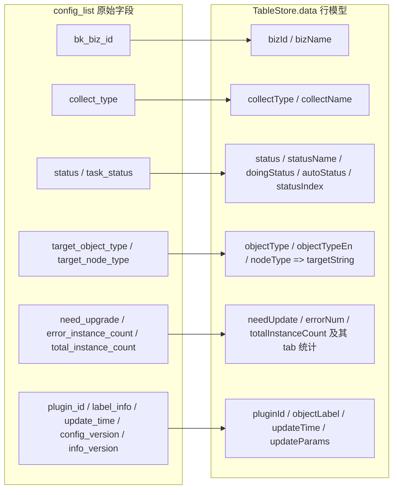

# 模型：采集专家 / 采集配置

**本文引用的文件**
- [collector-config-type.ts](file://bkmonitor/webpack/src/monitor-pc/pages/collector-config/collector-config-type.ts)
- [collector-type.ts](file://bkmonitor/webpack/src/monitor-pc/pages/collector-config/collector-type.ts)
- [store.ts](file://bkmonitor/webpack/src/monitor-pc/pages/collector-config/store.ts)
- [utils.ts](file://bkmonitor/webpack/src/monitor-pc/pages/collector-config/utils.ts)
- [collector-config.vue](file://bkmonitor/webpack/src/monitor-pc/pages/collector-config/collector-config.vue)
- [collector-view/type.ts](file://bkmonitor/webpack/src/monitor-pc/pages/collector-config/collector-view/type.ts)
- [collector-view/view-wrapper.vue](file://bkmonitor/webpack/src/monitor-pc/pages/collector-config/collector-view/view-wrapper.vue)
- [collector-view/log-handle.ts](file://bkmonitor/webpack/src/monitor-pc/pages/collector-config/collector-view/log-handle.ts)
- [collector-view-detail/status-tab-list.tsx](file://bkmonitor/webpack/src/monitor-pc/pages/collector-config/collector-view-detail/status-tab-list.tsx)
- [collector-detail/typings/detail.ts](file://bkmonitor/webpack/src/monitor-pc/pages/collector-config/collector-detail/typings/detail.ts)
- [collector-detail/detail-request.ts](file://bkmonitor/webpack/src/monitor-pc/pages/collector-config/collector-detail/detail-request.ts)
- [collector-detail/collector-detail.tsx](file://bkmonitor/webpack/src/monitor-pc/pages/collector-config/collector-detail/collector-detail.tsx)
- [collector-detail/collector-status-details.tsx](file://bkmonitor/webpack/src/monitor-pc/pages/collector-config/collector-detail/collector-status-details.tsx)
- [collector-detail/components/field-details.tsx](file://bkmonitor/webpack/src/monitor-pc/pages/collector-config/collector-detail/components/field-details.tsx)
- [collector-detail/components/storage-state.tsx](file://bkmonitor/webpack/src/monitor-pc/pages/collector-config/collector-detail/components/storage-state.tsx)
- [collector-detail/components/link-status.tsx](file://bkmonitor/webpack/src/monitor-pc/pages/collector-config/collector-detail/components/link-status.tsx)
- [collector-detail/components/alert-topic.tsx](file://bkmonitor/webpack/src/monitor-pc/pages/collector-config/collector-detail/components/alert-topic.tsx)
- [collector-detail/components/alert-histogram.tsx](file://bkmonitor/webpack/src/monitor-pc/pages/collector-config/collector-detail/components/alert-histogram.tsx)
- [collector-host-detail/utils.ts](file://bkmonitor/webpack/src/monitor-pc/pages/collector-config/collector-host-detail/utils.ts)
- [collector-config-detail/collector-config-detail.vue](file://bkmonitor/webpack/src/monitor-pc/pages/collector-config/collector-config-detail/collector-config-detail.vue)
- [collector-config-update/collector-config-update.vue](file://bkmonitor/webpack/src/monitor-pc/pages/collector-config/collector-config-update/collector-config-update.vue)
- [collector-dialog-delete/collector-dialog-delete.vue](file://bkmonitor/webpack/src/monitor-pc/pages/collector-config/collector-dialog-delete/collector-dialog-delete.vue)
- [collector-add/config-select/config-select.vue](file://bkmonitor/webpack/src/monitor-pc/pages/collector-config/collector-add/config-select/config-select.vue)
- [collector-add/config-set/config-set.vue](file://bkmonitor/webpack/src/monitor-pc/pages/collector-config/collector-add/config-set/config-set.vue)
- [collector-target-add-del/target-table/target-table.vue](file://bkmonitor/webpack/src/monitor-pc/pages/collector-config/collector-target-add-del/target-table/target-table.vue)
- [collector-stop-start/stop-start-host/stop-start-host.vue](file://bkmonitor/webpack/src/monitor-pc/pages/collector-config/collector-stop-start/stop-start-host/stop-start-host.vue)
- [monitor-api/modules/collecting.js](file://bkmonitor/webpack/src/monitor-api/modules/collecting.js)
- [monitor-api/modules/datalink.js](file://bkmonitor/webpack/src/monitor-api/modules/datalink.js)

## 目录
1. [简介](#简介)
2. [类型清单](#类型清单)
3. [运行时行模型](#运行时行模型)
4. [状态枚举与映射](#状态枚举与映射)
5. [后端数据结构契约](#后端数据结构契约)
6. [校验规则](#校验规则)
7. [结论](#结论)

章节来源：[store.ts](file://bkmonitor/webpack/src/monitor-pc/pages/collector-config/store.ts)（关键符号：`TableStore`）、[collector-config.vue](file://bkmonitor/webpack/src/monitor-pc/pages/collector-config/collector-config.vue)（关键符号：`CollectorConfig`）

## 简介

**口径说明**：采集配置域是纯前端 Vue2 + TS 模块，前端没有 DB / ORM。本切面的「模型」指以下五类前端数据模型：

1. **TS 类型定义**：模块内各 `type.ts` / `typings/` 中声明的接口与枚举（编辑期契约）；
2. **运行时行模型**：`TableStore` 在构造时为列表每一行生成的展示对象（`data[]` 行结构），即“原始接口字段 → 展示字段”的映射产物；
3. **状态枚举与映射表**：`status` / `task_status` / `collect_type` / `target_object_type` / `target_node_type` 等取值全集及 `store.ts` 中的 map getter；
4. **后端数据结构契约**：无 OpenAPI/Swagger 可用，全部**从调用点反推**（每个契约均标注推导依据文件）；
5. **校验规则**：`utils.ts` 与各表单组件中的输入校验逻辑。

模型的消费方式：列表页每次请求重建 `new TableStore(data, bizList)`（快照式，非响应式 store），详情/视图页通过 `DetailRequest` 包装的请求对象持有数据，行内可变字段（`name` / `needUpdate` / `targetString`）由页面回写。

章节来源：[store.ts](file://bkmonitor/webpack/src/monitor-pc/pages/collector-config/store.ts)（关键符号：`TableStore`）、[collector-config-type.ts](file://bkmonitor/webpack/src/monitor-pc/pages/collector-config/collector-config-type.ts)（关键符号：`IDetailInfo`）

## 类型清单

### 采集配置通用类型（collector-config-type.ts）

| 类型 | 关键字段 | 用途 |
|------|----------|------|
| `IDetailInfo` | `id` / `name` / `bkBizId` / `collectType` / `labelInfo` / `pluginInfo` / `params` / `target` / `targetNodes` / `targetNodeType` / `targetObjectType` / `deploymentId` / `subscriptionId` / `remoteCollectingHost` / `createUser` / `createTime` / `updateUser` / `updateTime` | 采集详情对象（含编辑态数据）；实际被 `view-wrapper.vue` 以 `detailInfo` prop 消费 |
| `IVariableData` | `$bk_inst_id` / `$bk_obj_id` / `$bk_target_cloud_id` / `$bk_target_ip` / `$bk_target_service_instance_id` / `$method` / `$target` | 视图变量数据；`log-handle.ts` 的 `compileVariableData` 以 `$xxx` 为占位符做字符串替换 |
| `ICustomData` | `limit` / `list` / `page` / `searchKey` / `total` | 分页持有结构（当前模块内无显式引用，历史/预留） |
| `IStatus` / `IStatusData` | `count` / `data`；`all` / `failed` / `nodata` / `success` 各为 `IStatus` | 采集目标四项状态计数结构（声明于本文件；本模块内无显式 import，见第 4 章辨析） |
| `ITabList` | `name?` / `tips?` / `type` | tab 元数据 |
| `ITargetList` | `id` / `name` | 目标选项 |
| `IDrag` | `maxWidth` / `minWidth` / `width` | 拖拽面板宽度 |
| `IHostTopoStatus` | `host` / `topo` | 主机/拓扑选择状态 |

> 引用核验：本模块内 `collector-config-type.ts` 仅被 `collector-view/view-wrapper.vue` 显式 import（`IDetailInfo`、`IVariableData`）；其余类型为保留定义。

章节来源：[collector-config-type.ts](file://bkmonitor/webpack/src/monitor-pc/pages/collector-config/collector-config-type.ts)（关键符号：`IDetailInfo`、`IVariableData`、`IStatusData`）、[collector-view/view-wrapper.vue](file://bkmonitor/webpack/src/monitor-pc/pages/collector-config/collector-view/view-wrapper.vue)（关键符号：`detailInfo`、`variableData`）

### 任务与删除步骤类型（collector-type.ts）

| 类型 | 关键字段 | 用途 |
|------|----------|------|
| `ICollectorTaskData` | `id: number \| string` / `name: string` / `status: 'STARTED' \| 'STOPPED'`（采集任务启停状态） | 删除采集弹窗（`collector-dialog-delete.vue`）与列表页删除入口传递的任务信息；列表页实际还会回填 `name` |
| `IDeletingStepListItem` | `data?: any`（`{total, node}`）/ `loading: boolean` / `title: string` / `type: 'collect' \| 'strategy'` | 删除过程的分步进度列表（停用采集任务 → 删除关联策略） |

章节来源：[collector-type.ts](file://bkmonitor/webpack/src/monitor-pc/pages/collector-config/collector-type.ts)（关键符号：`ICollectorTaskData`、`IDeletingStepListItem`）、[collector-dialog-delete/collector-dialog-delete.vue](file://bkmonitor/webpack/src/monitor-pc/pages/collector-config/collector-dialog-delete/collector-dialog-delete.vue)（关键符号：`deletingStepList`）

### 采集视图类型（collector-view/type.ts）

| 类型 | 关键字段 | 用途 |
|------|----------|------|
| `metric` | `metric?` / `englishName?` / `aliaName?` / `type?` / `unit?` / `dimension_list?` / `groupId?` | 指标/维度项 |
| `variable` | `aliaName` / `dimension` / `dimensionList: metric[]` / `preview: {label,value}[]` / `value: string[]` | 视图变量（变量值输入 + 预览） |
| `collectConfigParams` | `type: 'collect-config'` / `variableResult`（=`groupBy` 结构） / `metricGroup[]` / `dimensionsPreviews?` | `view-wrapper.vue` 传给图表的查询参数 |
| `viewSettingParams` | `variableResult: collectConfigParams['groupBy']` | 视图设置面板参数 |
| `sceneList` / `addSceneResult` | `name` / `variables: {id,name}[]`；`order: orderList[]` | 场景（存储变量值）与新增场景结果 |
| `orderList` | `id` / `title` / `panels: {hidden,id,title}[]` | 图表排序结构 |

章节来源：[collector-view/type.ts](file://bkmonitor/webpack/src/monitor-pc/pages/collector-config/collector-view/type.ts)（关键符号：`collectConfigParams`、`variable`、`addSceneResult`）、[collector-view/view-wrapper.vue](file://bkmonitor/webpack/src/monitor-pc/pages/collector-config/collector-view/view-wrapper.vue)（关键符号：`viewSettingParams`）

### 采集详情类型（collector-detail/typings/detail.ts、collector-host-detail/utils.ts）

| 类型/枚举 | 关键字段 | 用途 |
|-----------|----------|------|
| `TabEnum` | `Configuration='configuration'` / `DataLink='DataLink'` / `FieldDetails='fieldDetails'` / `StorageState='StorageState'` / `TargetDetail='targetDetail'` | 采集详情页 5 个 tab 的枚举（与路由 query `tab` 互通） |
| `TCollectorAlertStage` | `collecting` / `storage` / `transfer` | 告警面板阶段（对应采集/存储/链路三 tab） |
| `DetailData` | `basic_info` / `extend_info` / `metric_list: Record<string,any>[]` / `runtime_params: Record<string,any>[]` / `subscription_id` | `frontend_config_detail` 响应的 TS 化声明 |
| `EStatus` | `ALL` / `FAILED` / `PENDING` / `RUNNING` / `STOPPED` / `SUCCESS` / `WARNING` | 目标行状态筛选全集 |
| `IContentsItem` | `child: any[]` / `failedNum` / `is_label` / `isExpand` / `label_name` / `pendingNum` / `successNum` / `showAlertHistogram?` / `table: any[]` | 采集状态分组项（`contents` 每项的本地加工形态） |
| 常量表 | `FILTER_TYPE_LIST` / `colorMap` / `labelMap`（ADD/REMOVE/UPDATE/RETRY）/ `statusMap`（SUCCESS/FAILED/PENDING/RUNNING/DEPLOYING/STARTING/STOPPING）/ `STATUS_LIST=['PENDING','RUNNING','DEPLOYING','STARTING','STOPPING']` / `operatorMap`（ROLLBACK/UPGRADE/CREATE/EDIT/ADD_DEL/START/STOP/AUTO_DEPLOYING） | 状态展示与操作文案映射 |

章节来源：[collector-detail/typings/detail.ts](file://bkmonitor/webpack/src/monitor-pc/pages/collector-config/collector-detail/typings/detail.ts)（关键符号：`TabEnum`、`TCollectorAlertStage`、`DetailData`）、[collector-host-detail/utils.ts](file://bkmonitor/webpack/src/monitor-pc/pages/collector-config/collector-host-detail/utils.ts)（关键符号：`EStatus`、`IContentsItem`、`STATUS_LIST`）

### 组件本地契约类型

| 类型 | 位置 | 关键字段 |
|------|------|----------|
| `IStatusData`（本地版） | `collector-view-detail/status-tab-list.tsx` | `[propsName: string]: { count?: number }`，默认 `{success:{count:0}, failed:{count:0}, nodata:{count:0}}`；被 performance 模块 `host-list.tsx` 反向 import 复用 |
| `DataInterface` / `InfoItem` / `StatusItem` / `StatusValueItem` | `collector-detail/components/storage-state.tsx` | 存储状态组件消费 `storageStatus` 响应：`{info: InfoItem[], status: StatusItem[]}` |
| `IContentsItem` 的消费方 | `collector-detail/collector-status-details.tsx` | `data.config_info` + `data.contents`（逐 child 统计 success/failed/pending） |
| `DetailRequest` | `collector-detail/detail-request.ts` | 非数据类型，而是请求持有对象：`loading` / `loaded` / `error` + `run(fetch, apply)`（版本号 + AbortController 防竞态），详情页所有子请求均用它管理 |

章节来源：[collector-view-detail/status-tab-list.tsx](file://bkmonitor/webpack/src/monitor-pc/pages/collector-config/collector-view-detail/status-tab-list.tsx)（关键符号：`IStatusData`）、[collector-detail/components/storage-state.tsx](file://bkmonitor/webpack/src/monitor-pc/pages/collector-config/collector-detail/components/storage-state.tsx)（关键符号：`DataInterface`）、[collector-detail/detail-request.ts](file://bkmonitor/webpack/src/monitor-pc/pages/collector-config/collector-detail/detail-request.ts)（关键符号：`DetailRequest`）

### TableStore 实例字段（store.ts）

| 实例字段 | 初始化 | 含义 |
|----------|--------|------|
| `data: any[]` | 构造时逐条由 `config_list` 映射（见第 3 章） | 行模型数组（本类即“前端行模型工厂”） |
| `typeList: any` | `originData.type_list` | 采集方式动态列表（`{id, name}`），驱动 tab 与 `typeMap` |
| `tabData: any` | 先为 `defaultTabData` 对象，构造末尾转 `Object.values().sort(order)` 数组 | tab 计数（每项 `{data:{startedNum,stoppedNum,errTargetNum,needUpdateNum}, total, key, name}`） |
| `total: number` | 初始 `config_list.length`，被 `getTableData` 覆写为过滤后总数 | 分页总数 |
| `keyword: string` | `''` | 搜索词（支持 `插件ID:` / `ID:` 前缀，见第 4 章） |
| `page` / `pageSize` / `pageList` | `1` / `localStorage('__common_page_size__') \|\| 10` / `[10,20,50,100]` | 分页状态 |
| `sortProp` / `sortOrder` | `null` | 排序字段/方向（`ascending` 正序，否则倒序，数值强转 `+`） |
| `startStatusList` | `['STARTED','STOPPING','DEPLOYING','AUTO_DEPLOYING']` | 「已启用」口径 |
| `stopStatusList` | `['STOPPED','STARTING']` | 「已停用」口径 |

getter 方法：`defaultTabData`（构建 `All` + `typeList` 各 tab，排除 `log` / `Built-In`）、`objectTypeMap`、`statusMap`、`tabItemMap`、`typeMap`（`All` order=1，其余按索引 order=index+2）；实例方法：`deleteDataById(id)`（删除行并同步 tab 的 `stoppedNum`）、`getTableAllData()`、`getTableData(type='All', typeLabel='')`（tab 过滤 + 关键词过滤 + 排序 + 分页切片）、`setDefaultStore()`。

章节来源：[store.ts](file://bkmonitor/webpack/src/monitor-pc/pages/collector-config/store.ts)（关键符号：`TableStore`、`defaultTabData`、`getTableData`、`setDefaultStore`）

## 运行时行模型

列表页每次拿到 `config_list` 后执行 `new TableStore(data, bizList)`，为每行生成 30 个展示字段；随后 `collector-config.vue` 的 `getTargetString` 再回填 `targetString`，用户改名时回写 `name`。

原始接口字段 → 展示行字段映射关系：



图表来源：[store.ts](file://bkmonitor/webpack/src/monitor-pc/pages/collector-config/store.ts)（关键符号：`TableStore`、`data`、`updateParams`）、[collector-config.vue](file://bkmonitor/webpack/src/monitor-pc/pages/collector-config/collector-config.vue)（关键符号：`getTargetString`）

| 行字段 | 来源（接口字段/计算） | 含义与使用 |
|--------|----------------------|------------|
| `id` | `item.id` | 行标识；`#id` 展示、`ID:` 搜索、路由参数 |
| `name` | `item.name` | 配置名（可点击进详情；改名后由页面回写） |
| `copyName` | `item.name` | 重命名编辑时的副本（详情侧栏） |
| `bizId` | `item.bk_biz_id` | 所属业务；`bizId !== 当前 bizId` 时仅可「查看」 |
| `space_name` | `item.space_name` | 「所属」列 |
| `bizName` | `bizList.find(b => b.id === bk_biz_id).text` | 业务名 |
| `collectName` | `typeMap[item.collect_type].name` | 「方式」列（动态类型名） |
| `collectType` | `item.collect_type` | tab 过滤键 / 克隆禁用（`K8S`）/ tab 计数归档 |
| `targetNodesCount` | `item.target_nodes_count` | 目标节点数（拼 `targetString`） |
| `totalInstanceCount` | `item.total_instance_count` | 实例总数；`need_upgrade` 时累加进 tab `needUpdateNum` |
| `status` | `item.status` | 启停/执行状态（见第 4 章）；启停判定、行样式、`doingStatus` 判定 |
| `taskStatus` | `item.task_status` | 任务级状态；`statusName` 取它，圆点颜色取它；`STOPPED` 时禁编辑/增删 |
| `runningTasks` | `item.running_tasks` | 运行中任务信息（原样透传） |
| `statusIndex` | `Object.keys(statusMap).indexOf(status)` | 状态在映射表中的排序位 |
| `statusName` | `statusMap[taskStatus]` | 状态展示文案（TBC/FAILED/WARNING/SUCCESS/STOPPED） |
| `objectType` | `objectTypeMap[target_object_type]` | 「对象」列（主机/服务） |
| `objectTypeEn` | `item.target_object_type` | 英文对象类型（`HOST`/`SERVICE`，另见 `CLUSTER`） |
| `nodeType` | `item.target_node_type` | 节点类型（`TOPO`/`SET_TEMPLATE`/`SERVICE_TEMPLATE`/`DYNAMIC_GROUP`/`INSTANCE`） |
| `errorNum` | `item.error_instance_count` | 异常实例数；>0 时「可视化」旁红字、tab `errTargetNum` |
| `doingStatus` | `['STARTING','STOPPING','DEPLOYING','AUTO_DEPLOYING','PREPARING'].includes(status) \|\| taskStatus === 'TBC'` | 执行中（转圈、操作禁用） |
| `autoStatus` | `status === 'AUTO_DEPLOYING'` | 自动执行标记（透传给停启轮询 `is_auto`） |
| `needUpdate` | `item.need_upgrade` | 待升级（显示「升级」角标；操作前强制先升级） |
| `overflow` | `false`（本地） | 表格省略状态 |
| `targetString` | 空串 → `getTargetString` 回填 | 按 `objectTypeEn`+`nodeType` 组合文案，如 `{n}个拓扑节点 （共{m}台主机）`、`{n}台主机`、`{n}个集群` |
| `objectLabel` | `item.label_info` | 对象标签（展示） |
| `pluginId` | `item.plugin_id` | 插件 ID；`插件ID:` 搜索、克隆/升级路由参数 |
| `serviceLabel` | `item.label` | 下发保存时的对象 ID 标签（如 `host_process`） |
| `updateUser` | `item.update_user` | 「更新记录」列 |
| `updateTime` | `formatWithTimezone(item.update_time)` | 「更新记录」列（时区格式化） |
| `updateParams` | `{ id, pluginId: plugin_id, configVersion: config_version, infoVersion: info_version }` | 升级弹窗/升级路由参数（见第 5 章 `pluginUpgradeInfo`） |

行过滤/分页行为（`getTableData`）：

- `type` 为 tab key（`All` 或 `collectType`）；`typeLabel` 为顶部状态卡：`startedNum` → `startStatusList`、`stoppedNum` → `stopStatusList`、`errTargetNum` → `errorNum > 0`、`needUpdateNum` → `needUpdate`；
- 关键词：`插件ID:xxx` → `pluginId.includes`；`ID:xxx` → `id === Number(...)`；否则 `name` 模糊（小写）+ `id` 数字包含；
- 排序：对 `sortProp` 字段 `+` 强转后数值排序；分页切片 `pageSize * (page - 1) ~ pageSize * page`。

章节来源：[store.ts](file://bkmonitor/webpack/src/monitor-pc/pages/collector-config/store.ts)（关键符号：`data`、`getTableData`、`updateParams`）、[collector-config.vue](file://bkmonitor/webpack/src/monitor-pc/pages/collector-config/collector-config.vue)（关键符号：`getTargetString`、`getCollectionConfigList`）

## 状态枚举与映射

### `status`（采集配置运行状态，`item.status`）

取值全集（由 `startStatusList` / `stopStatusList` / `doingStatus` / `autoStatus` 判定与行样式使用点反推）：

| 取值 | 语义 | 归组 |
|------|------|------|
| `STARTED` | 已启用 | 启用组（`startStatusList`） |
| `STOPPING` | 停用中 | 启用组（执行中） |
| `DEPLOYING` | 部署中 | 启用组（执行中） |
| `AUTO_DEPLOYING` | 自动部署中 | 启用组（执行中，`autoStatus=true`） |
| `STOPPED` | 已停用 | 停用组（`stopStatusList`）；此时不可编辑/增删目标；文案置灰 |
| `STARTING` | 启用中 | 停用组（执行中） |
| `PREPARING` | 准备中 | 展示 `--`、文案置灰、不可点状态 |

检索映射（列表页 `getSearchOfParams`）：`startedNum` → `search.status='STARTED'`；`stoppedNum` → `search.status='STOPPED'`。

章节来源：[store.ts](file://bkmonitor/webpack/src/monitor-pc/pages/collector-config/store.ts)（关键符号：`startStatusList`、`stopStatusList`、`doingStatus`、`autoStatus`）、[collector-config.vue](file://bkmonitor/webpack/src/monitor-pc/pages/collector-config/collector-config.vue)（关键符号：`getSearchOfParams`）

### `task_status`（采集任务状态，`item.task_status`）

取值全集 = `statusMap` 的 key（`store.ts`）：`TBC`(待确认) / `FAILED`(失败) / `WARNING`(异常) / `SUCCESS`(正常) / `STOPPED`(已停用) / `STARTING`(启用中) / `STOPPING`(停用中) / `DEPLOYING`(部署中) / `AUTO_DEPLOYING`(自动部署中) / `PREPARING`(准备中)。

使用要点：

- 行内文案 `statusName = statusMap[taskStatus]`；状态圆点仅对 `['FAILED','WARNING','SUCCESS','STOPPED']` 渲染（颜色取页面 `startedBack` / `startedBorder`）；
- `taskStatus === 'STOPPED'` 时行灰显（`handleStoppedRow`）、禁用「可视化/编辑/增删目标」；
- 「异常采集目标」卡 → `search.task_status='WARNING'`；
- `taskStatus === 'TBC'` 计入 `doingStatus`。

章节来源：[store.ts](file://bkmonitor/webpack/src/monitor-pc/pages/collector-config/store.ts)（关键符号：`statusMap`、`statusName`）、[collector-config.vue](file://bkmonitor/webpack/src/monitor-pc/pages/collector-config/collector-config.vue)（关键符号：`startedBack`、`handleStoppedRow`）

### `collect_type`（采集方式）与 tab 过滤逻辑

- `collect_type` 是**动态枚举**：由接口 `type_list` 驱动（`config_list` 的 `type_list` 与 `fetchCollectConfigStat` 返回的统计数组）；
- **tab 过滤规则（硬编码特例）**：`log` 与 `Built-In` 不建 tab（`defaultTabData` 与 `getFilterTabList` 两处均排除）；tab key 恒有 `All`；
- 其他代码内特例：`K8S`（禁用增删目标、隐藏克隆）、`Log`（详情侧栏基本信息扩展、视图隐藏部分能力）、`Process`（`objectId: 'host_process'`、进详情默认展开、下发前调用 `checkPluginVersion`）、`SNMP` / `SNMP_Trap`（独立参数构建路径）；
- tab 计数：`total = startedNum + stoppedNum`（统计接口口径），`store.ts` 端 `tabData[collect_type].total` 为行数累计。

章节来源：[store.ts](file://bkmonitor/webpack/src/monitor-pc/pages/collector-config/store.ts)（关键符号：`typeMap`、`defaultTabData`）、[collector-config.vue](file://bkmonitor/webpack/src/monitor-pc/pages/collector-config/collector-config.vue)（关键符号：`getFilterTabList`、`handleShowAdd`）

### `target_object_type` 与 `target_node_type`

| 枚举 | 取值 | 说明 |
|------|------|------|
| `target_object_type` | `HOST`(主机) / `SERVICE`(服务)，另见 `CLUSTER`（K8S，`targetString` 显示 `{n}个集群`） | 由 `objectTypeMap` 映射中文；决定目标表「主机数/实例数」列名与复制文案（复制主机IP / 复制服务实例） |
| `target_node_type` | `TOPO` / `SET_TEMPLATE` / `SERVICE_TEMPLATE` / `DYNAMIC_GROUP` / `INSTANCE`（+ `CLUSTER`） | 与 `objectTypeEn` 组合生成 `targetString`；`INSTANCE` 时目标表展示 IP 列表（`display_name`），其余展示节点表（`bk_inst_name`/`count`/`labels`） |

章节来源：[collector-config.vue](file://bkmonitor/webpack/src/monitor-pc/pages/collector-config/collector-config.vue)（关键符号：`getTargetString`）、[collector-config-detail/collector-config-detail.vue](file://bkmonitor/webpack/src/monitor-pc/pages/collector-config/collector-config-detail/collector-config-detail.vue)（关键符号：`targetInfo`、`target_node_type`）、[collector-detail/collector-status-details.tsx](file://bkmonitor/webpack/src/monitor-pc/pages/collector-config/collector-detail/collector-status-details.tsx)（关键符号：`target_node_type`、`isK8SCollect`）

### 其余映射表（store.ts / utils.ts）

| 映射 | 内容 | 消费点 |
|------|------|--------|
| `statusMap` | 10 个 `task_status` → 中文文案 | 行 `statusName` |
| `objectTypeMap` | `HOST`→主机、`SERVICE`→服务 | 行 `objectType` |
| `typeMap` | `All` + `typeList` 逐项 `{name, order}` | 行 `collectName`、`defaultTabData` 排序 |
| `tabItemMap` | `startedNum/stoppedNum/errTargetNum/needUpdateNum` → 已启用配置/已停用配置/异常采集目标/待升级目标 | 顶部状态卡文案 |
| 状态→搜索参数 | `needUpdateNum`→`need_upgrade='true'`、`errTargetNum`→`task_status='WARNING'`、`startedNum`→`status='STARTED'`、`stoppedNum`→`status='STOPPED'` | 列表请求 `search` |
| 详情侧枚举 | `EStatus`、`FILTER_TYPE_LIST`、`colorMap`、`labelMap`、`statusMap`(host utils 版)、`STATUS_LIST`、`operatorMap` | 采集状态/操作记录展示 |
| 视图 tab 状态 | `success/failed/nodata`（`status-tab-list` 本地 `IStatusData`，`{key:{count}}`） | performance 主机列表/树上的状态筛选计数（该类型被反向 import） |

> 辨析：模块内存在两个同名 `IStatusData`——`collector-config-type.ts`（`all/success/failed/nodata: {count,data}`）与 `collector-view-detail/status-tab-list.tsx`（`{key:{count}}`）。前者本模块无引用；后者被 performance 模块消费、由主机列表/树**前端聚合**出计数，并非直接来自某接口。

章节来源：[store.ts](file://bkmonitor/webpack/src/monitor-pc/pages/collector-config/store.ts)（关键符号：`tabItemMap`、`startStatusList`）、[collector-host-detail/utils.ts](file://bkmonitor/webpack/src/monitor-pc/pages/collector-config/collector-host-detail/utils.ts)（关键符号：`FILTER_TYPE_LIST`、`STATUS_LIST`）、[collector-view-detail/status-tab-list.tsx](file://bkmonitor/webpack/src/monitor-pc/pages/collector-config/collector-view-detail/status-tab-list.tsx)（关键符号：`IStatusData`）

## 后端数据结构契约

> 前端无接口 schema，以下均为**从调用点反推**。接口 URL 定义见 [collecting.js](file://bkmonitor/webpack/src/monitor-api/modules/collecting.js) / [datalink.js](file://bkmonitor/webpack/src/monitor-api/modules/datalink.js)。

### `config_list`（列表）

- API：`collectConfigList` POST `rest/v2/collecting_config/config_list/`；详情页复用它做单条查询（`search:{id}` + `page:1, limit:1`）。
- 响应：`{ config_list: [...], type_list: [{ id, name }], total }`。

请求参数（推导：`collector-config.vue#getSearchOfParams`）：`bk_biz_id`、`refresh_status`、`order: '-create_time'`、`page`、`limit`、`search`；`search` 字段：`collect_type` / `status` / `task_status` / `need_upgrade` / `plugin_id` / `id` / `fuzzy`。

`config_list` 项字段（推导：`store.ts` 构造器 + `collector-detail.tsx#getCollectConfigListItem` + `collector-config.vue`）：

| 字段 | 类型/取值 | 消费 |
|------|-----------|------|
| `id` | number | 行标识 |
| `name` | string | 配置名 |
| `bk_biz_id` | number | 所属业务 |
| `space_name` | string | 所属空间名 |
| `collect_type` | string | 动态类型 |
| `target_nodes_count` | number | 节点数 |
| `total_instance_count` | number | 实例总数 |
| `status` | 见第 4 章 | 启停状态 |
| `task_status` | 见第 4 章 | 任务状态 |
| `running_tasks` | any | 运行中任务 |
| `need_upgrade` | boolean | 待升级 |
| `error_instance_count` | number | 异常实例数 |
| `target_object_type` | `HOST`/`SERVICE`/… | 对象类型 |
| `target_node_type` | 见第 4 章 | 节点类型 |
| `label_info` | string | 对象标签（展示） |
| `label` | string | 下发对象 ID（如 `host_process`） |
| `plugin_id` | string | 插件 ID |
| `update_user` / `update_time` | string | 更新记录（时间经 `formatWithTimezone`） |
| `config_version` / `info_version` | string/number | 组装 `updateParams` 供升级 |

章节来源：[store.ts](file://bkmonitor/webpack/src/monitor-pc/pages/collector-config/store.ts)（关键符号：`originData.config_list`）、[collector-config.vue](file://bkmonitor/webpack/src/monitor-pc/pages/collector-config/collector-config.vue)（关键符号：`getSearchOfParams`、`collectConfigList`）、[collector-detail/collector-detail.tsx](file://bkmonitor/webpack/src/monitor-pc/pages/collector-config/collector-detail/collector-detail.tsx)（关键符号：`getCollectConfigListItem`）

### `fetch_collect_config_stat`（头部统计）

- API：`fetchCollectConfigStat` GET `rest/v2/collecting_config/fetch_collect_config_stat/`（并行于列表请求，独立 loading/error）。
- 响应：数组，每项 `{ id, name, nums: { STARTED, STOPPED, WARNING, need_upgrade } }`；前端聚合出 `All` tab（各值求和）、每 tab `total = STARTED + STOPPED`，并按 `total` 降序排序。

章节来源：[collector-config.vue](file://bkmonitor/webpack/src/monitor-pc/pages/collector-config/collector-config.vue)（关键符号：`fetchCollectConfigStat`、`getFilterTabList`）

### `frontend_config_detail`（配置详情）

- API：`frontendCollectConfigDetail` GET `rest/v2/collecting_config/frontend_config_detail/`，参数 `{ id, with_target_info: false }`。
- 响应 `DetailData`：`{ basic_info, extend_info, metric_list, runtime_params, subscription_id }`。

| 子结构 | 字段（消费点反推） |
|--------|--------------------|
| `basic_info` | `id / name / label_info / collect_type / plugin_display_name / plugin_id / period / bk_biz_id / target_object_type / create_user / create_time / update_user / update_time`；详情侧栏 `basicInfoMap` 以此为键序展示 |
| `extend_info.log` | `log_path: string[] / filter_patterns: string[] / rules: [{name, pattern}] / charset` |
| `extend_info.process` | `match_type('command'|'pid') / process_name / port_detect / match_pattern / exclude_pattern / extract_pattern / pid_path` |
| `metric_list` | 每项 `{ id, name, list: [{ metric('metric' 为指标，否则维度), englishName, aliaName, type, unit }] }` |
| `runtime_params` | 每项 `{ name, type, value }`；`type==='file'` 时 `value = { filename, file_base64 }`；`password`/`encrypt` 前端显示 `******` |

升级场景另有 `pluginUpgradeInfo`（推导：`collector-config-update.vue`），入参 `{ plugin_id, config_version, info_version, config_id }`，出参 `{ plugin_id, plugin_display_name, plugin_version, runtime_params, version_log }`（`runtime_params` 即升级弹窗的表单定义源）。

章节来源：[collector-config-detail/collector-config-detail.vue](file://bkmonitor/webpack/src/monitor-pc/pages/collector-config/collector-config-detail/collector-config-detail.vue)（关键符号：`getDetailData`、`basicInfoMap`）、[collector-detail/components/field-details.tsx](file://bkmonitor/webpack/src/monitor-pc/pages/collector-config/collector-detail/components/field-details.tsx)（关键符号：`metric_list`）、[collector-config-update/collector-config-update.vue](file://bkmonitor/webpack/src/monitor-pc/pages/collector-config/collector-config-update/collector-config-update.vue)（关键符号：`pluginUpgradeInfo`）

### `frontend_target_info`（采集目标信息）

- API：`frontendCollectConfigTargetInfo` GET `rest/v2/collecting_config/frontend_target_info/`，参数 `{ id }`。
- 响应：`{ target_node_type, table_data: [...] }`。

`table_data` 行结构按 `target_node_type` 分两种（推导：`collector-config-detail.vue` 模板）：

| 场景 | 行字段 |
|------|--------|
| `TOPO` / `SET_TEMPLATE` / `SERVICE_TEMPLATE` / `DYNAMIC_GROUP` | `bk_inst_name`（节点名称）、`count`（主机数/实例数）、`labels: [{ first, second }]`（分类标签） |
| `INSTANCE` | `display_name`（IP，列名 IP）、`agent_status`（`'normal'` 为正常，其余异常）、`bk_cloud_name`（管控区域） |

章节来源：[collector-config-detail/collector-config-detail.vue](file://bkmonitor/webpack/src/monitor-pc/pages/collector-config/collector-config-detail/collector-config-detail.vue)（关键符号：`getTargetInfoData`、`table_data`、`display_name`）

### `status` 系（采集目标状态）

三个接口返回**同构**的“目标分组明细”结构，可整体视作一张“采集目标状态模型”：

| API | URL | 使用场景 |
|-----|-----|----------|
| `collectTargetStatus` | GET `rest/v2/collecting_config/status/`（参数 `{ id, is_auto? }`） | 停启/增删目标/删除弹窗轮询 |
| `collectingTargetStatus` | GET `rest/v2/datalink_status/collecting_target_status/`（参数 `{ collect_config_id }`） | 采集详情「采集状态」tab、执行详情 |
| `collectInstanceStatus` | GET `rest/v2/collecting_config/collect_instance_status/`（参数 `{ id }`） | 执行详情（host-detail） |

响应结构（推导：`collector-status-details.tsx`、`target-table.vue`、`collector-host-detail.vue`）：

```
{
  contents: [{
    label_name: string,          // 分组标签（ADD/REMOVE/UPDATE/RETRY，与 labelMap 对应）
    is_label: boolean,           // 是否展示标签
    child: [{
      instance_id, instance_name, ip,
      status,                    // EStatus：SUCCESS/FAILED/PENDING/RUNNING/DEPLOYING/STARTING/STOPPING/WARNING/STOPPED
      task_id, plugin_version, log,
      alert_histogram: number[][] // [时间戳, level] 对（AlertHistogram 消费）
    }]
  }],
  config_info: { id, name, target_node_type, target_object_type }  // 轮询/复制/复制目标等使用
}
```

前端消费：按 `child[].status === 'SUCCESS'` 计成功、`STATUS_LIST`（PENDING/RUNNING/DEPLOYING/STARTING/STOPPING）计执行中、其余计失败；`hasRunning = contents.some(child 含 RUNNING/PENDING)` 决定轮询（10s）。

> `IStatusData`（`all/success/failed/nodata: {count,data}`）在 `collector-config-type.ts` 中声明，但当前模块内无任何 import/读取点（全模块 grep 核验）；实际状态计数在视图侧由主机列表前端聚合生成（见第 4 章「辨析」）。

章节来源：[collector-detail/collector-status-details.tsx](file://bkmonitor/webpack/src/monitor-pc/pages/collector-config/collector-detail/collector-status-details.tsx)（关键符号：`contents`、`config_info`、`alert_histogram`）、[collector-target-add-del/target-table/target-table.vue](file://bkmonitor/webpack/src/monitor-pc/pages/collector-config/collector-target-add-del/target-table/target-table.vue)（关键符号：`getHosts`、`handleData`）、[collector-host-detail/collector-host-detail.vue](file://bkmonitor/webpack/src/monitor-pc/pages/collector-config/collector-host-detail/collector-host-detail.vue)（关键符号：`collectInstanceStatus`）

### `datalink_status/*`（链路/存储/告警状态）

| API | URL | 响应结构（推导依据） |
|-----|-----|----------------------|
| `storageStatus` | GET `rest/v2/datalink_status/storage_status/`（`{ collect_config_id }`） | `{ info: [{ key, name, value, type?, hasEdit?, hasUnderline? }], status: [{ name, content: { keys: [{key,name}], values: [{...}] } }] }`（`storage-state.tsx` 按此渲染“存储信息 + 表格”） |
| `transferCountSeries` | GET `rest/v2/datalink_status/transfer_count_series/`（`{ collect_config_id, interval_option: 'minute'\|'hour', start_time, end_time }`） | 数组，取 `res[0].datapoints` 作为图表数据（`link-status.tsx`） |
| `transferLatestMsg` | GET `rest/v2/datalink_status/transfer_latest_msg/`（`{ collect_config_id }`） | 数组，行 `{ message, time, raw? }`；「复制」用 `message`，「查看上报数据」`JSON.stringify(row.raw)` |
| `alertStatus` | GET `rest/v2/datalink_status/alert_status/`（`{ collect_config_id, stage: 'collecting'\|'storage'\|'transfer' }`） | `{ has_strategies, alert_config: { strategies: [{name, description}], user_group_list: [{id}] }, alert_histogram: number[][], has_alert, alert_query }`；`has_strategies === false` 时隐藏面板 |
| `updateAlertUserGroups` | POST `rest/v2/datalink_status/update_alert_user_groups/`（`{ collect_config_id, stage, notice_group_list }`） | 写操作（告警组变更，1s 防抖） |

章节来源：[collector-detail/components/storage-state.tsx](file://bkmonitor/webpack/src/monitor-pc/pages/collector-config/collector-detail/components/storage-state.tsx)（关键符号：`DataInterface`、`storageStatus`）、[collector-detail/components/link-status.tsx](file://bkmonitor/webpack/src/monitor-pc/pages/collector-config/collector-detail/components/link-status.tsx)（关键符号：`transferCountSeries`、`transferLatestMsg`）、[collector-detail/components/alert-topic.tsx](file://bkmonitor/webpack/src/monitor-pc/pages/collector-config/collector-detail/components/alert-topic.tsx)（关键符号：`alertStatus`）、[collector-detail/components/alert-histogram.tsx](file://bkmonitor/webpack/src/monitor-pc/pages/collector-config/collector-detail/components/alert-histogram.tsx)（关键符号：`value: number[][]`）、[monitor-api/modules/datalink.js](file://bkmonitor/webpack/src/monitor-api/modules/datalink.js)（关键符号：`storageStatus`、`alertStatus`）

## 校验规则

### `getCustomDmsInsertParams`（维度注入 key:value 校验）

位置：`utils.ts`；调用点：`config-select.vue#handleDelivery`（插件参数 `mode === 'dms_insert'` 时）。

规则（symbol：`getCustomDmsInsertParams`）：

| 条件 | 行为 |
|------|------|
| `mode !== 'dms_insert'` | 返回 `undefined`（不校验） |
| `default` 为数组 | 逐项校验：须为含 `:` 的字符串，`split(':')` 后 key、value 均非空 → 写入 `params[key] = value`；任一项非法 → 中断并返回 `{ error: true, message: '${item} 维度注入标签格式应为 key:value', params: {} }` |
| `default` 非数组 | 原样返回 `{ error: false, message: '', params: default }` |

调用点行为：`error` 时 `$bkMessage({theme:'error'})` 并 `throw new Error(message)`，直接阻断下发。

章节来源：[utils.ts](file://bkmonitor/webpack/src/monitor-pc/pages/collector-config/utils.ts)（关键符号：`getCustomDmsInsertParams`）、[collector-add/config-select/config-select.vue](file://bkmonitor/webpack/src/monitor-pc/pages/collector-config/collector-add/config-select/config-select.vue)（关键符号：`getCustomDmsInsertParams`、`handleDelivery`）

### 新建/编辑配置表单（config-set.vue）

| 字段 | 规则 | 关键符号 |
|------|------|----------|
| `name` | 必填；长度校验：汉字按 2 字符计，总长 > 50 报「注意：最大值为50个字符」 | `validateName` / `validateStrLength` |
| `bizId` / `objectType` / `plugin` | 必填/必选 | `rules` |
| `timeout` | 须 ≤ 采集周期 `period` | `validateTimeout` |
| `host` / `ip` | 非空（`trim` 后长度 > 0）；`Exporter` 插件强制校验绑定主机 | `validateIp` / `validateHost` |
| `port` | 正则 `^([1-9]\d{0,4}|[1-5]\d{5}|6[0-4]\d{4}|65[0-4]\d{3}|655[0-2]\d{2}|6553[0-5])$`（0~65535） | `validatePort` |
| 插件运行参数（`configJson`） | 逐项校验：`file` 类型走 `item.validate.isValidate`；`host/ip/port` 名称的参数映射到对应规则（`handleParamValidate` / `validateParam`）；`required` 且空 → 「必填项」 | `handleParamValidate` |

章节来源：[collector-add/config-set/config-set.vue](file://bkmonitor/webpack/src/monitor-pc/pages/collector-config/collector-add/config-set/config-set.vue)（关键符号：`validateName`、`validatePort`、`handleParamValidate`）

### 目标选择与下发（config-select.vue）

- `canDelivery`：启用「使用远程主机」后必须已选远程主机；`SNMP` 采集还需已选 `snmpTargets` 且有远程主机，否则「开始下发」禁用；
- SNMP 目标 IP 正则（含可带端口的 IPv4），非法项移除并提示「输入正常的IP」；
- `Process` 采集下发前调用 `checkPluginVersion({collect_type, target_node_type, target_nodes})`，校验失败（`result=false`）时弹窗展示 `invalid_host`（`{插件名: [目标]}`，取 `target[0]` 与 `plugin_version[插件名]` 拼提示），可确认后继续。

章节来源：[collector-add/config-select/config-select.vue](file://bkmonitor/webpack/src/monitor-pc/pages/collector-config/collector-add/config-select/config-select.vue)（关键符号：`canDelivery`、`checkPluginVersion`、`handleDelivery`）

### 升级弹窗与其它校验

- 升级弹窗（`collector-config-update.vue`）：`validateItem` 对 `required` 项空值报「必填项」；`port` 同 0~65535 正则；`host` 必填；`user`/`password` 定义必填规则；参数 `mode` 枚举 → 分类文案：`collector`(采集器参数)/`opt_cmd`(命令行参数)/`pos_cmd`(位置参数)/`env`(环境变量参数)/`listen_cmd`(监听参数)/`dms_insert`(维度注入)；
- 详情重命名：`bk-input :maxlength="50"`，提交 `renameCollectConfig({ id, name })`；
- 视图变量设置：变量「显示名」（`aliaName`）为空或重复时报「显示名不能为空且不能相同」（`verifyMethod` / `errMsg`）；
- 列表页目标列：`status === 'PREPARING'` 时 `targetString` 显示 `--`。

章节来源：[collector-config-update/collector-config-update.vue](file://bkmonitor/webpack/src/monitor-pc/pages/collector-config/collector-config-update/collector-config-update.vue)（关键符号：`validateItem`、`paramType`）、[collector-config-detail/collector-config-detail.vue](file://bkmonitor/webpack/src/monitor-pc/pages/collector-config/collector-config-detail/collector-config-detail.vue)（关键符号：`handleUpdateConfigName`）、[collector-view/variable-settings.tsx](file://bkmonitor/webpack/src/monitor-pc/pages/collector-config/collector-view/variable-settings.tsx)（关键符号：`verifyMethod`、`errMsg`）

## 结论

1. **模型形态**：采集配置域的前端“模型”是「类型声明（编辑期）+ TableStore 行模型（运行时）+ 映射表（枚举翻译）+ 调用点逆推的接口契约」四件套，无任何持久化模型（唯一 localStorage 使用是分页大小与视图变量缓存，不属于本域核心模型）。
2. **双状态轴是理解难点**：`status`（启停/执行：STARTED/STOPPED/STARTING/STOPPING/DEPLOYING/AUTO_DEPLOYING/PREPARING）负责启停判定与 tab 计数；`task_status`（任务级：TBC/FAILED/WARNING/SUCCESS/STOPPED/STARTING/STOPPING/DEPLOYING/AUTO_DEPLOYING/PREPARING）负责展示文案与圆点颜色。两轴在 `statusMap` / `startStatusList` / `stopStatusList` / `doingStatus` 中交汇。
3. **动态枚举**：`collect_type` 完全由接口 `type_list` 驱动（`log`、`Built-In` 硬编码不建 tab）；`target_object_type` / `target_node_type` 为固定枚举但有 `CLUSTER`（K8S）等扩展分支。
4. **契约风险点**：所有后端结构均无 schema，字段改名只能靠编译器发现 TS 部分；`IStatusData` 等类型存在“声明未用”现象（历史遗留），同名类型跨文件重复定义（两处 `IStatusData`）需在改动时注意区分。
5. **行模型是稳定接口**：列表/详情/升级/克隆/删除/停启等页面间大量以 `TableStore` 行对象（或 `updateParams` 子对象）作为路由参数传递，改行字段需全模块检索使用点。

章节来源：[store.ts](file://bkmonitor/webpack/src/monitor-pc/pages/collector-config/store.ts)（关键符号：`TableStore`、`updateParams`）、[collector-config-type.ts](file://bkmonitor/webpack/src/monitor-pc/pages/collector-config/collector-config-type.ts)（关键符号：`IStatusData`）、[collector-config.vue](file://bkmonitor/webpack/src/monitor-pc/pages/collector-config/collector-config.vue)（关键符号：`handleConfigNavigate`）
