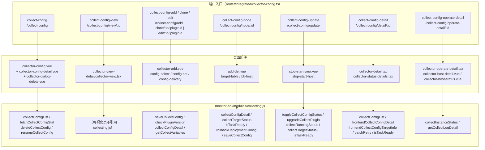

# 接口：采集专家 / 采集配置

**本文引用的文件**
- [collector-config.ts](file://bkmonitor/webpack/src/monitor-pc/router/integrated/collector-config.ts)（路由定义，9 条）
- [integrated/index.ts](file://bkmonitor/webpack/src/monitor-pc/router/integrated/index.ts)（路由注册入口）
- [common/index.ts](file://bkmonitor/webpack/src/monitor-pc/common/index.ts)（`applyGuidePage`）
- [router/utils.ts](file://bkmonitor/webpack/src/monitor-pc/router/utils.ts)（`beforeEnter`）
- [collecting.js](file://bkmonitor/webpack/src/monitor-api/modules/collecting.js)（33 个 API）
- [base.ts](file://bkmonitor/webpack/src/monitor-api/base.ts)（`request` 请求层）
- [authority-map.ts](file://bkmonitor/webpack/src/monitor-pc/pages/collector-config/authority-map.ts)
- [authorityMixin.ts](file://bkmonitor/webpack/src/monitor-pc/mixins/authorityMixin.ts)
- [collector-config.vue](file://bkmonitor/webpack/src/monitor-pc/pages/collector-config/collector-config.vue)
- [store.ts](file://bkmonitor/webpack/src/monitor-pc/pages/collector-config/store.ts)（`TableStore`，列表字段映射）
- [config-deploy.vue](file://bkmonitor/webpack/src/monitor-pc/pages/collector-config/config-deploy/config-deploy.vue)
- [collector-config-detail.vue](file://bkmonitor/webpack/src/monitor-pc/pages/collector-config/collector-config-detail/collector-config-detail.vue)
- [detail-request.ts](file://bkmonitor/webpack/src/monitor-pc/pages/collector-config/collector-detail/detail-request.ts)
- [collector-detail.tsx](file://bkmonitor/webpack/src/monitor-pc/pages/collector-config/collector-detail/collector-detail.tsx)
- [collector-configuration.tsx](file://bkmonitor/webpack/src/monitor-pc/pages/collector-config/collector-detail/collector-configuration.tsx)
- [collector-status-details.tsx](file://bkmonitor/webpack/src/monitor-pc/pages/collector-config/collector-detail/collector-status-details.tsx)
- [collector-host-status.vue](file://bkmonitor/webpack/src/monitor-pc/pages/collector-config/collector-host-detail/collector-host-status.vue)
- [collector-host-detail.vue](file://bkmonitor/webpack/src/monitor-pc/pages/collector-config/collector-host-detail/collector-host-detail.vue)
- [config-select.vue](file://bkmonitor/webpack/src/monitor-pc/pages/collector-config/collector-add/config-select/config-select.vue)
- [config-delivery.vue](file://bkmonitor/webpack/src/monitor-pc/pages/collector-config/collector-add/config-delivery/config-delivery.vue)
- [config-set.vue](file://bkmonitor/webpack/src/monitor-pc/pages/collector-config/collector-add/config-set/config-set.vue)
- [variable-table.vue](file://bkmonitor/webpack/src/monitor-pc/pages/collector-config/collector-add/config-set/variable-table.vue)
- [bk-host.vue](file://bkmonitor/webpack/src/monitor-pc/pages/collector-config/collector-target-add-del/bk-host/bk-host.vue)
- [add-del.vue](file://bkmonitor/webpack/src/monitor-pc/pages/collector-config/collector-target-add-del/add-del.vue)
- [target-table.vue](file://bkmonitor/webpack/src/monitor-pc/pages/collector-config/collector-target-add-del/target-table/target-table.vue)
- [stop-start-host.vue](file://bkmonitor/webpack/src/monitor-pc/pages/collector-config/collector-stop-start/stop-start-host/stop-start-host.vue)
- [collector-dialog-delete.vue](file://bkmonitor/webpack/src/monitor-pc/pages/collector-config/collector-dialog-delete/collector-dialog-delete.vue)
- [monitor-common/utils/index.ts](file://bkmonitor/webpack/src/monitor-common/utils/index.ts)（`getBizRouteHref`）

## 目录
1. [简介](#简介)
2. [路由入口清单](#路由入口清单)
3. [API 方法清单](#api-方法清单)
4. [契约示例](#契约示例)
5. [错误处理与权限](#错误处理与权限)
6. [结论](#结论)

## 简介

采集配置域存在两层「接口」：

1. **页面路由入口（对用户）**：`router/integrated/collector-config.ts` 导出 9 条路由（经 `applyGuidePage` 包装后注册进 `router/integrated/index.ts`），覆盖「列表 → 可视化 / 新建 / 克隆 / 编辑 / 增删目标 / 启停 / 采集详情 / 执行详情」的完整操作链。
2. **后端 API（对服务端）**：全部经由 `monitor-api/modules/collecting.js` 的 33 个导出方法调用，统一走 `rest/v2/collecting_config/*`，由 `monitor-api/base.ts` 的 `request(method, url)` 生成请求函数。

两层都遵循同一套权限模型（`authority-map.ts` 的 `VIEW_AUTH` / `MANAGE_AUTH`）与同一套归属模型（配置 `bk_biz_id` 与当前业务 `bizId` 比对，跨业务只读）。

章节来源：[collector-config.ts](file://bkmonitor/webpack/src/monitor-pc/router/integrated/collector-config.ts)（关键符号：`applyGuidePage`）、[collecting.js](file://bkmonitor/webpack/src/monitor-api/modules/collecting.js)（关键符号：`request`）

## 路由入口清单

### 路由总表

9 条路由全部挂在 `integrated` 父路由下，`meta.navId` 统一为 `collect-config`（用于左侧导航高亮与引导页判定）。表中「权限」取自 `meta.authority.page`，「守卫」为源码中显式书写的 `beforeEnter`。

| # | path | name | 组件（懒加载） | props | meta.title | 权限 | 守卫 / 特性 |
|---|------|------|----------------|-------|-----------|------|-------------|
| 1 | `/collect-config` | `collect-config` | `pages/collector-config/collector-config.vue`（`CollectorConfig`，单视图 `component`） | — | 数据采集 | `VIEW_AUTH` | `noNavBar: true`；无显式守卫 |
| 2 | `/collect-config/view/:id` | `collect-config-view` | `collector-view-detail/collector-view.tsx`（`CollectorConfigViewNew`） | `{ noCache: true }` | 可视化 | `VIEW_AUTH` | `needBack`、`customContent`、`noNavBar`，多视图 `components.noCache` |
| 3 | `/collect-config/add` | `collect-config-add` | `collector-add/collector-add.vue` | `true` | 新建配置 | `MANAGE_AUTH` | `beforeEnter`：`to.meta.title = to.params.title \|\| '新建配置'`；`noSpaceCheck: true` |
| 4 | `/collect-config/clone/:id/:pluginId` | `collect-config-clone` | `collector-add/collector-add.vue` | `true` | 新建配置 | `MANAGE_AUTH` | `beforeEnter` 设置 title（见下方「生效规则」，运行时被覆盖） |
| 5 | `/collect-config/edit/:id/:pluginId` | `collect-config-edit` | `collector-add/collector-add.vue` | `true` | 编辑配置 | `MANAGE_AUTH` | `beforeEnter` 设置 title；`needCopyLink: false` |
| 6 | `/collect-config/node/:id` | `collect-config-node` | `collector-target-add-del/add-del.vue` | `true` | 增删目标 | `MANAGE_AUTH` | `needCopyLink: false`；无显式守卫 |
| 7 | `/collect-config/update` | `collect-config-update` | `collector-stop-start/stop-start-view.vue` | `true` | 启用采集配置 | `MANAGE_AUTH` | `beforeEnter`：`!to.params.data → next({ path: '/collect-config' })`；`noNavBar: true` |
| 8 | `/collect-config/operate-detail/:id` | `collect-config-operate-detail` | `collector-host-detail/collector-operate-detail.tsx` | `true` | 执行详情 | `VIEW_AUTH` | `beforeEnter`：`!to.params.id → next({ path: '/collect-config' })` |
| 9 | `/collect-config/detail/:id` | `collect-config-detail` | `collector-detail/collector-detail.tsx`（`CollectorDetail`） | `true` | 采集详情 | `VIEW_AUTH` | `beforeEnter`：`!to.params.id → next({ path: '/collect-config' })` |

`props: true` 的路由（#3~#9）把 `$route.params` 直接注入组件，因此 `collect-config-update` 依赖 `params.data`（整个列表行对象）、`params.stopStart`；`collect-config-detail` / `collect-config-operate-detail` 依赖 `params.title`（守卫中用于动态改标题）。

章节来源：[collector-config.ts](file://bkmonitor/webpack/src/monitor-pc/router/integrated/collector-config.ts)（关键符号：`CollectorConfig`、`CollectorConfigViewNew`、`CollectorConfigAdd`、`CollectorConfigNode`、`CollectorConfigUpdate`、`CollectorConfigOperateDetail`、`CollectorDetail`）

### applyGuidePage 包装与 beforeEnter 生效规则

`export default applyGuidePage([...9 条], ['collect-config-add', 'collect-config-edit'])`。第二个参数是**排除名单**；`applyGuidePage` 的处理逻辑是：

- 若 `route.name` 在 excludes 中 → 原样返回；
- 否则若 `meta.noSpaceCheck === true` → 原样返回；
- 否则返回 `{ ...route, beforeEnter: (to, from, next) => beforeEnter(navId, next), meta: { ...route.meta, noChangeLoading: true } }`。

由此得出**实际生效结果**（源码书写与实际注册存在差异，属需要留意的行为）：

| 路由 | 是否有自定义 `beforeEnter` | 是否被 applyGuidePage 覆盖 | 运行时实际守卫 |
|------|---------------------------|---------------------------|----------------|
| `collect-config-add` | 有（设 title） | 否（`noSpaceCheck: true` 提前返回） | 自定义：设 `meta.title` |
| `collect-config-edit` | 有（设 title） | 否（在 excludes 中） | 自定义：设 `meta.title` |
| `collect-config-clone` | 有（设 title） | **是** | 仅 `beforeEnter(navId, next)` 引导页预取，title 逻辑不生效 |
| `collect-config` / `collect-config-view` / `collect-config-node` | 无 / 无 / 无 | 是 | `beforeEnter(navId, next)` |
| `collect-config-update` / `-operate-detail` / `-detail` | 有（参数校验重定向） | **是** | 仅 `beforeEnter(navId, next)`，参数校验逻辑被覆盖 |

`beforeEnter(navId, next)`（[router/utils.ts](file://bkmonitor/webpack/src/monitor-pc/router/utils.ts)）的职责是：置 `app/SET_ROUTE_CHANGE_LOADING` 为 true → `introduce.getRouteFunc(routeId)` 预取导航/引导数据 → `next()` → `requestIdleCallback` 复位 loading。

章节来源：[common/index.ts](file://bkmonitor/webpack/src/monitor-pc/common/index.ts)（关键符号：`applyGuidePage`）、[router/utils.ts](file://bkmonitor/webpack/src/monitor-pc/router/utils.ts)（关键符号：`beforeEnter`）、[collector-config.ts](file://bkmonitor/webpack/src/monitor-pc/router/integrated/collector-config.ts)（关键符号：`noSpaceCheck`）

### 路由 → 页面 → API 调用关系



图表来源：[collector-config.ts](file://bkmonitor/webpack/src/monitor-pc/router/integrated/collector-config.ts)（关键符号：`CollectorConfigViewNew`、`CollectorConfigOperateDetail`）、[collecting.js](file://bkmonitor/webpack/src/monitor-api/modules/collecting.js)（关键符号：`collectConfigList`、`frontendCollectConfigDetail`）、[collector-config.vue](file://bkmonitor/webpack/src/monitor-pc/pages/collector-config/collector-config.vue)（关键符号：`getCollectionConfigList`、`fetchCollectConfigStat`）

> 关于 A2：`pages/collector-config/collector-view-detail/` 未出现在 `monitor-api/modules/collecting` 的 18 个引用文件中，可视化页的数据不来自本切面的 `collecting.js`。

## API 方法清单

### 33 个方法总表

全部定义在 `collecting.js`：`export const xxx = request('<METHOD>', 'rest/v2/collecting_config/<path>/')`。下表「调用点」为仓库内实际调用（`grep` 校验）；标注「未使用」者为无任何调用点的预留/历史方法。

| # | 方法名 | HTTP | 路径 | 语义 | 主要调用点（文件 / 调用者） |
|---|--------|------|------|------|------------------------------|
| 1 | `collectConfigList` | POST | `config_list/` | 采集配置列表（搜索/分页/排序） | `collector-config.vue` `getCollectionConfigList`；`collector-detail.tsx` `getCollectConfigListItem` |
| 2 | `collectConfigDetail` | GET | `config_detail/` | 单个配置明细（编辑回填） | `config-set.vue` `getConfigInfo`；`add-del.vue` `getCollectorConfigDetail` |
| 3 | `toggleCollectConfigStatus` | POST | `toggle/` | 启用/停用配置（`action: enable\|disable`） | `stop-start-host.vue` `handleOperatorAll`；`collector-dialog-delete.vue` `handleDel` |
| 4 | `deleteCollectConfig` | POST | `delete/` | 删除配置 | `collector-config.vue` `handleSubmitDelete`；`collector-dialog-delete.vue` `handleDel` |
| 5 | `cloneCollectConfig` | POST | `clone/` | 克隆配置 | 未使用（`collector-config.vue` 中已注释，改走路由 `collect-config-clone`） |
| 6 | `retryTargetNodes` | POST | `retry/` | 单目标失败重试 | `config-deploy.vue` `handleRetry`；`collector-host-status.vue`；`collector-status-details.tsx` |
| 7 | `runCollectConfig` | POST | `run/` | 执行配置 | 未使用 |
| 8 | `revokeTargetNodes` | POST | `revoke/` | 撤销单目标下发 | `config-deploy.vue` `handleRevoke`；`collector-host-status.vue`；`collector-status-details.tsx` |
| 9 | `batchRevokeTargetNodes` | POST | `batch_revoke/` | 批量撤销（停止） | `config-deploy.vue` `handleBatchStop`；`collector-host-status.vue`；`collector-status-details.tsx` |
| 10 | `batchRetryConfig` | POST | `batch_retry/` | 批量重试（配置维度） | `config-deploy.vue` `handleBatchRetry` |
| 11 | `saveCollectConfig` | POST | `save/` | 保存配置（新建/编辑/增删目标） | `config-select.vue` `saveConfig`；`config-delivery.vue` `handleDelivery`；`bk-host.vue` |
| 12 | `upgradeCollectPlugin` | POST | `upgrade/` | 插件版本升级（替换 toggle） | `stop-start-host.vue` `handleOperatorAll`（`type === 'UPGRADE'` 分支） |
| 13 | `rollbackDeploymentConfig` | POST | `rollback/` | 回滚本次下发 | `target-table.vue` `handleRollback`；`config-delivery.vue`；`stop-start-host.vue` `handleRollback` |
| 14 | `frontendTargetStatusTopo` | POST | `target_status_topo/` | 目标状态拓扑 | 未使用 |
| 15 | `frontendCollectConfigDetail` | GET | `frontend_config_detail/` | 前端配置详情（基本信息/指标/运行参数） | `collector-config-detail.vue` `getDetailData`；`collector-detail.tsx` `getDetails` |
| 16 | `frontendCollectConfigTargetInfo` | GET | `frontend_target_info/` | 目标信息（`table_data` / `target_node_type`） | `collector-config-detail.vue` `getTargetInfoData`；`collector-detail.tsx` |
| 17 | `collectInstanceStatus` | GET | `collect_instance_status/` | 实例级采集状态（执行详情轮询） | `collector-host-detail.vue` `getHosts` / `handleRefreshData` |
| 18 | `collectTargetStatus` | GET | `status/` | 目标级状态与内容 | `target-table.vue` `getHosts`/`getHostData`；`config-delivery.vue`；`stop-start-host.vue`；`collector-dialog-delete.vue` `getHosts` |
| 19 | `getMetrics` | GET | `metrics/` | 指标列表 | 未使用（`trace/pages/failure/failure-topo/detail/useMetrics.ts` 中的 `getMetricsData` 是本地函数，非本 API） |
| 20 | `renameCollectConfig` | POST | `rename/` | 重命名配置 | `collector-config-detail.vue` `handleUpdateConfigName`；`collector-configuration.tsx` `handleUpdateConfigName` |
| 21 | `deploymentConfigDiff` | GET | `deployment_diff/` | 下发差异对比 | 未使用（`stop-start-view.vue` 中已注释） |
| 22 | `collectRunningStatus` | GET | `running_status/` | 运行状态（只读，用于启停页） | `stop-start-host.vue` `created`（`ajaxFn`） |
| 23 | `getCollectLogDetail` | GET | `get_collect_log_detail/` | 目标执行日志详情 | `config-deploy.vue` `handleGetMoreDetail`；`collector-host-status.vue`；`collector-status-details.tsx` |
| 24 | `getCollectVariables` | GET | `get_collect_variables/` | 变量提示数据 | `config-set.vue` `getVariableData`；`variable-table.vue` `getTableData` |
| 25 | `batchRetry` | POST | `batch_retry_detailed/` | 批量重试（明细维度） | `collector-status-details.tsx` `handleBatchRetry`；`collector-host-status.vue` `handleBatchRetry` |
| 26 | `listLegacySubscription` | GET | `list_legacy_subscription/` | 历史订阅列表 | 未使用 |
| 27 | `cleanLegacySubscription` | GET | `clean_legacy_subscription/` | 清理历史订阅 | 未使用 |
| 28 | `listLegacyStrategy` | GET | `list_legacy_strategy/` | 历史策略列表 | 未使用 |
| 29 | `listRelatedStrategy` | POST | `list_related_strategy/` | 关联策略（精准/模糊） | `collector-dialog-delete.vue` `getCollectorConifg` |
| 30 | `isTaskReady` | POST | `is_task_ready/` | 任务是否就绪（轮询锚点） | `config-deploy.vue` `taskReadyStatus`；`config-delivery.vue`；`collector-host-status.vue`；`collector-status-details.tsx`；`target-table.vue`；`stop-start-host.vue` |
| 31 | `checkAdjectiveCollect` | GET | `check_adjective_collect/` | 相邻采集检查 | 未使用 |
| 32 | `fetchCollectConfigStat` | GET | `fetch_collect_config_stat/` | 顶部统计（类型 × 状态计数） | `collector-config.vue` `fetchCollectConfigStat` |
| 33 | `checkPluginVersion` | POST | `check_plugin_version/` | 插件版本校验（进程采集） | `config-select.vue`（Process 类型保存前）；`bk-host.vue` |

统计：**33 个导出方法，24 个被实际调用，9 个为未使用预留**（`cloneCollectConfig`、`runCollectConfig`、`frontendTargetStatusTopo`、`getMetrics`、`deploymentConfigDiff`、`listLegacySubscription`、`cleanLegacySubscription`、`listLegacyStrategy`、`checkAdjectiveCollect`）。

章节来源：[collecting.js](file://bkmonitor/webpack/src/monitor-api/modules/collecting.js)（关键符号：`collectConfigList`、`saveCollectConfig`、`isTaskReady`、`fetchCollectConfigStat`、`checkPluginVersion`）

### 按页面归类的调用分布

- **列表页**（`collector-config.vue` + `collector-config-detail.vue` + `collector-dialog-delete.vue`）：`collectConfigList`、`fetchCollectConfigStat`、`deleteCollectConfig`、`frontendCollectConfigDetail`、`frontendCollectConfigTargetInfo`、`renameCollectConfig`、`listRelatedStrategy`、`toggleCollectConfigStatus`、`collectTargetStatus`。
- **新建/编辑向导**（`collector-add/*`）：`saveCollectConfig`、`collectConfigDetail`、`checkPluginVersion`、`getCollectVariables`、`collectTargetStatus`、`isTaskReady`、`rollbackDeploymentConfig`。
- **增删目标**（`collector-target-add-del/*`）：`collectConfigDetail`、`saveCollectConfig`、`checkPluginVersion`、`collectTargetStatus`、`isTaskReady`、`rollbackDeploymentConfig`。
- **启停/升级**（`collector-stop-start/*`）：`toggleCollectConfigStatus`、`upgradeCollectPlugin`、`collectRunningStatus`、`collectTargetStatus`、`isTaskReady`、`rollbackDeploymentConfig`。
- **详情页**（`collector-detail/*`）：`collectConfigList`、`frontendCollectConfigDetail`、`frontendCollectConfigTargetInfo`、`batchRetry`、`batchRevokeTargetNodes`、`retryTargetNodes`、`revokeTargetNodes`、`getCollectLogDetail`、`isTaskReady`、`renameCollectConfig`。
- **执行详情**（`collector-host-detail/*`）：`collectInstanceStatus`、`getCollectLogDetail`、`batchRetry`、`batchRevokeTargetNodes`、`retryTargetNodes`、`revokeTargetNodes`、`isTaskReady`。

章节来源：[config-deploy.vue](file://bkmonitor/webpack/src/monitor-pc/pages/collector-config/config-deploy/config-deploy.vue)（关键符号：`batchRetryConfig`、`revokeTargetNodes`、`getCollectLogDetail`）、[collector-status-details.tsx](file://bkmonitor/webpack/src/monitor-pc/pages/collector-config/collector-detail/collector-status-details.tsx)（关键符号：`batchRetry`）、[collector-host-detail.vue](file://bkmonitor/webpack/src/monitor-pc/pages/collector-config/collector-host-detail/collector-host-detail.vue)（关键符号：`collectInstanceStatus`）

## 契约示例

以下结构与参数均由调用点代码反推（不编造）；字段名为源码中真实出现的键名。

### 1. `collectConfigList`（POST `config_list/`）——列表页主接口

请求（来源：`collector-config.vue` `getCollectionConfigList`）：

```js
collectConfigList(
  {
    bk_biz_id: this.bizId,      // request 层也会自动注入，此处显式传
    refresh_status: status,     // 是否强制刷新状态（轮询时 true）
    order: '-create_time',      // 排序
    search: this.getSearchOfParams, // 搜索条件对象
    page: this.pagination.page,
    limit: this.pagination.pageSize,
  },
  { needRes: true, needMessage: false, signal: controller.signal }
)
```

响应（`needRes: true` → 取 `res.data`，源码兜底默认值即契约）：

```js
res.data = { config_list: [], total: 0, type_list: [] }
```

- `config_list[]` 原始字段（来源：`store.ts` 的 `TableStore` 构造器逐字段取值）：`id`、`name`、`bk_biz_id`、`space_name`、`collect_type`、`target_nodes_count`、`total_instance_count`、`error_instance_count`、`status`、`task_status`、`running_tasks`、`need_upgrade`、`target_object_type`、`target_node_type`、`label`、`label_info`、`plugin_id`、`update_user`、`update_time`、`config_version`、`info_version`。
- `type_list[]` 元素结构（来源：`collector-config.vue` `getFilterTabList`）：`{ id, name, nums: { STARTED, STOPPED, WARNING, need_upgrade } }`；`id` 为 `log` / `Built-In` 的项被前端过滤掉。
- `collector-detail.tsx` 的另一种用法（来源：`getCollectConfigListItem`）：`{ refresh_status: false, search: { id }, page: 1, limit: 1 }` → 从 `data.config_list?.find(item => Number(item.id) === this.collectId)` 取单条。

章节来源：[collector-config.vue](file://bkmonitor/webpack/src/monitor-pc/pages/collector-config/collector-config.vue)（关键符号：`getCollectionConfigList`、`getFilterTabList`、`fetchCollectConfigStat`）、[store.ts](file://bkmonitor/webpack/src/monitor-pc/pages/collector-config/store.ts)（关键符号：`TableStore`）、[collector-detail.tsx](file://bkmonitor/webpack/src/monitor-pc/pages/collector-config/collector-detail/collector-detail.tsx)（关键符号：`getCollectConfigListItem`）

### 2. `saveCollectConfig`（POST `save/`）——新建/编辑/增删目标共用

请求（来源：`config-delivery.vue` `getParams`）：

```js
{
  name, bk_biz_id, collect_type, target_object_type: 'CLUSTER',
  plugin_id, params: { collector: { period, timeout }, plugin: { [key]: value } },
  label, target_node_type: 'CLUSTER', target_nodes: [], remote_collecting_host: null,
  id, // 仅编辑态（config.mode === 'edit' && setData.id）追加
}
```

`config-select.vue` 的差异（来源：`getParams`）：`target_node_type: 'INSTANCE'`、`target_nodes: [{ ip, bk_cloud_id, bk_supplier_id }]`，`params.collector` / `params.plugin` 由 `configJson` 的 `item.mode === 'collector'` 分流生成，`remote_collecting_host` 为 `{ ip, is_collecting_only, bk_cloud_id, bk_supplier_id, bk_host_id }` 或 `null`。

增删目标场景（来源：`bk-host.vue`）额外带 `operation: 'ADD_DEL'`，并在提交前剔除 `type === 'password'` 的插件字段：

```js
saveCollectConfig({ id, ...newParams, operation: 'ADD_DEL' }, { needMessage: false })
```

`config-delivery.vue` `handleDelivery` 传入可取消 token：`{ cancelToken: new CancelToken(c => (this.cancelFn = c)) }`，取消入口是 `handleDeliveryCancel`。

章节来源：[config-delivery.vue](file://bkmonitor/webpack/src/monitor-pc/pages/collector-config/collector-add/config-delivery/config-delivery.vue)（关键符号：`handleDelivery`、`getParams`）、[config-select.vue](file://bkmonitor/webpack/src/monitor-pc/pages/collector-config/collector-add/config-select/config-select.vue)（关键符号：`saveConfig`）、[bk-host.vue](file://bkmonitor/webpack/src/monitor-pc/pages/collector-config/collector-target-add-del/bk-host/bk-host.vue)（关键符号：`saveCollectConfig`）

### 3. `frontendCollectConfigDetail`（GET `frontend_config_detail/`）——侧滑详情

请求（来源：`collector-config-detail.vue` `getDetailData`）：`{ id, with_target_info: false }`，配置 `{ signal, needMessage: false }`。

响应字段（来源：`getDetailData` 的消费代码）：

```js
{
  basic_info: { name, ... },              // 名称等基础信息
  extend_info: { log: {...}, process: {...} }, // 类型化扩展参数
  metric_list: [ { collapse } ],          // 指标列表，前端追加 collapse
  runtime_params: [],
}
```

- `extend_info.log` 展开后使用 `log_path`、`filter_patterns`、`rules`、`charset`。
- `extend_info.process` 使用 `match_type`、`process_name`、`port_detect`、`match_pattern`、`exclude_pattern`、`extract_pattern`、`pid_path`。

配套的目标信息接口 `frontendCollectConfigTargetInfo`（同文件 `getTargetInfoData`）请求 `{ id }`，响应消费字段为 `target_node_type` 与 `table_data[]`：`target_node_type ∈ {TOPO, SET_TEMPLATE, SERVICE_TEMPLATE, DYNAMIC_GROUP, INSTANCE}`，拓扑类行取 `bk_inst_name`，实例类行取 `display_name || ip`。

章节来源：[collector-config-detail.vue](file://bkmonitor/webpack/src/monitor-pc/pages/collector-config/collector-config-detail/collector-config-detail.vue)（关键符号：`getDetailData`、`getTargetInfoData`、`frontendCollectConfigDetail`、`frontendCollectConfigTargetInfo`）

### 4. `isTaskReady`（POST `is_task_ready/`）——下发后的就绪轮询锚点

请求：`{ collect_config_id: id }`（来源：`config-deploy.vue` `taskReadyStatus`、`target-table.vue`、`stop-start-host.vue`）。

响应：布尔值（语义为「是否可进入下一步」）。消费分支（来源：`config-deploy.vue` `taskReadyStatus`）：

```js
isTaskReady({ collect_config_id: id })
  .then(show => show ? resolve(true) : retry(2000))
  .catch(() => retry(2000))   // 失败同样 2s 后重试，永不 reject
```

`collector-status-details.tsx` / `collector-host-status.vue` 中的 `taskReadyStatusPromise` 采用同样的「非 ready 或异常 → 2s 递归」策略。

章节来源：[config-deploy.vue](file://bkmonitor/webpack/src/monitor-pc/pages/collector-config/config-deploy/config-deploy.vue)（关键符号：`taskReadyStatus`、`isTaskReady`）、[stop-start-host.vue](file://bkmonitor/webpack/src/monitor-pc/pages/collector-config/collector-stop-start/stop-start-host/stop-start-host.vue)（关键符号：`taskReadyStatusPromise`）

### 5. 两个辅助接口

- `fetchCollectConfigStat`（GET `fetch_collect_config_stat/`）：请求 `{}` + `{ signal, needMessage: false }`；响应为 `getFilterTabList(typeList)` 的入参，即 `type_list` 形态数组（`{ id, name, nums }`）。失败走页面级 `statsError` 而非弹窗（来源：`collector-config.vue` `fetchCollectConfigStat`）。
- `listRelatedStrategy`（POST `list_related_strategy/`）：请求 `{ collect_config_id }`；响应 `{ accurate_strategies: [{ strategy_id }], fuzzy_strategies: [{ strategy_id }] }`，删除弹层据此提示「有 n 个关联的策略」并可勾选一并删除（来源：`collector-dialog-delete.vue` `getCollectorConifg`、`handleDel`）。

章节来源：[collector-config.vue](file://bkmonitor/webpack/src/monitor-pc/pages/collector-config/collector-config.vue)（关键符号：`fetchCollectConfigStat`）、[collector-dialog-delete.vue](file://bkmonitor/webpack/src/monitor-pc/pages/collector-config/collector-dialog-delete/collector-dialog-delete.vue)（关键符号：`getCollectorConifg`、`listRelatedStrategy`）

## 错误处理与权限

### 请求层封装（monitor-api/base）

`request(method, url)` 生成的函数签名支持两种调用：`(params, config)` 与 `(id, params, config)`（后者用于含 `{pk}` 的路径；本模块 33 个接口均不使用 `{pk}`）。默认配置（`defaultConfig`）：

- `needBiz: true`：自动注入业务上下文——有 `bk_biz_id`（`parseBizId(window.cc_biz_id)` 且 ≠ -1）时注入 `bk_biz_id`，否则注入 `space_uid`；若 data 中已存在 `bk_biz_id` 则不覆盖。
- `needRes: false`：默认 resolve `res.data`；调用点需要分页/原始响应时显式传 `needRes: true`（如 `collectConfigList`、`fetchCollectConfigStat`）。
- `needMessage`：默认由 `localStorage.getItem('bk_monitor_api_no_message') !== 'true'` 决定；调用点普遍显式传 `needMessage: false` 来接管错误展示（如列表、详情、重试类接口）。
- 每个请求生成 `traceparent` 头（`00-<32 位>-<16 位>-01`）；`isAsync: true` 时附加 `X-Async-Task: true`。
- 取消：支持 `signal: AbortSignal` 与 `cancelToken`；`needCancel: true` 时通过 `pendingRequest` 映射表自动取消同 `method_url` 的重复请求。

错误分支（GET / 其他方法两处 `.catch` 逻辑一致）：`makeMessage(err.error_details || err.message, traceparent, config.needTraceId)` 生成文案，仅当 `needMessage` 为真且 `err.code` 不在白名单 `noMessageCode = [3308005, 3314003, 3314004, ...axiosError]` 时才 `bkMessage(message)`；最终 `Promise.reject`（`axiosError` 中的 code 会 reject 空字符串）。

章节来源：[base.ts](file://bkmonitor/webpack/src/monitor-api/base.ts)（关键符号：`request`、`defaultConfig`、`noMessageCode`、`makeMessage`、`addPendingRequest`）

### 调用点的错误处理约定

| 场景 | 位置 | 约定 |
|------|------|------|
| 列表加载失败 | `collector-config.vue` `getCollectionConfigList` | 仅首次加载（`status === false`）清空表格并置 `emptyType = '500'`；轮询失败不清空 |
| 列表轮询 | 同上 `finally` | 成功或轮询态 → `setTimeout(getCollectionConfigList(true), pollingDelay)`，默认 5000ms |
| 统计请求失败 | `collector-config.vue` `fetchCollectConfigStat` | `statsError = true`，不弹窗；带 `requestId + AbortController` 防竞态 |
| 详情侧滑失败 | `collector-config-detail.vue` / `detail-request.ts` | `DetailRequest.run` 捕获后置 `error`，由 `DetailLoadError` 提供重试按钮；`abort` 不视为错误 |
| 就绪轮询 | 各 `taskReadyStatus` | 失败/未就绪 → 2s 后递归，永不 reject（调用方 `.catch(() => true)` 兜底） |
| 日志详情失败 | `config-deploy.vue` `handleGetMoreDetail` | `needMessage: false` + 手动 `bkMsg('error', err.message \|\| '获取更多数据失败')` 并关闭侧栏 |
| 重命名失败 | `collector-config-detail.vue` / `collector-configuration.tsx` | `needMessage: false` + 手动 `bkMessage({ theme: 'error', message: err.message })`，并用 `requestId` 判定响应是否过期 |
| 版本校验 | `config-select.vue` / `bk-host.vue` | `checkPluginVersion(...).catch(() => ({ result: false }))`；`result` 为假时弹二次确认（列出低于要求版本的主机、跳转节点管理），用户确认仍可继续保存 |
| 重试/撤销失败 | `config-deploy.vue` `handleRetry` / `handleRevoke` | catch 中回滚乐观更新的状态与计数（`PENDING → FAILED`），恢复轮询 |

章节来源：[collector-config.vue](file://bkmonitor/webpack/src/monitor-pc/pages/collector-config/collector-config.vue)（关键符号：`fetchCollectConfigStat`、`getCollectionConfigList`）、[detail-request.ts](file://bkmonitor/webpack/src/monitor-pc/pages/collector-config/collector-detail/detail-request.ts)（关键符号：`DetailRequest`）、[config-select.vue](file://bkmonitor/webpack/src/monitor-pc/pages/collector-config/collector-add/config-select/config-select.vue)（关键符号：`checkPluginVersion`）

### 鉴权 / 权限约定

`authority-map.ts` 定义本域权限常量：

| 常量 | action id | 用途 |
|------|-----------|------|
| `VIEW_AUTH` | `view_collection_v2` | 查看：列表页、可视化、采集详情、执行详情（4 条路由） |
| `MANAGE_AUTH` | `manage_collection_v2` | 管理：新建/克隆/编辑/增删目标/启停（5 条路由） |
| `PLUGIN_MANAGE_AUTH` | 复用 `plugin-manager/authority-map` 的 `MANAGE_AUTH` | 插件管理（详情页跨模块跳转用） |
| `STRATEGY_VIEW_AUTH` | `view_rule_v2` | 关联策略查看 |
| `ALARM_GROUP_MANAGE_AUTH` | 复用 `alarm-group/authority-map` 的 `MANAGE_AUTH` | 告警组管理 |

生效链路：路由 `meta.authority.map = collectConfigAuth` + `meta.authority.page = [VIEW_AUTH | MANAGE_AUTH]` → 页面 `mixins: [authorityMixinCreate(collectAuth)]`（`collector-config.vue`、`collector-host-detail.vue`、`collector-detail.tsx` 等）→ `authorityMixin.getAuthCreated` 调用 `authorityStore.checkAllowedByActionIds({ action_ids })` 批量取权 → 结果写入 `authority` 并 `provide` 给子组件。要点：

- 页面级判定 `hasPageViewAuth`：`is_superuser` 直接放行；否则取 `getAuthById(meta.authority.page, bizId)`，并对 `VIEW_AUTH` 兜底 `|| this.authority.VIEW_AUTH`。
- 分享视图（`window.__POWERED_BY_BK_WEWEB__ && window.token`）下前端不做权限校验，全部置 true，交由 API 判断。
- 结果缓存于 `common/auth-store` 的 `getAuthById` / `setAuthById`，命中缓存不再发请求。
- 按钮级：模板中以 `authority.MANAGE_AUTH` 三分（如 `collector-host-status.vue` `@click="authority.MANAGE_AUTH ? handleBatchRetry() : handleShowAuthorityDetail()"`），无权限时转而展示权限申请详情（`handleShowAuthorityDetail` → `authorityStore.getAuthorityDetail`）。

章节来源：[authority-map.ts](file://bkmonitor/webpack/src/monitor-pc/pages/collector-config/authority-map.ts)（关键符号：`VIEW_AUTH`、`MANAGE_AUTH`、`PLUGIN_MANAGE_AUTH`、`STRATEGY_VIEW_AUTH`、`ALARM_GROUP_MANAGE_AUTH`）、[authorityMixin.ts](file://bkmonitor/webpack/src/monitor-pc/mixins/authorityMixin.ts)（关键符号：`getAuthCreated`、`handleInitPageAuthority`、`hasPageViewAuth`）、[collector-host-status.vue](file://bkmonitor/webpack/src/monitor-pc/pages/collector-config/collector-host-detail/collector-host-status.vue)（关键符号：`handleShowAuthorityDetail`）

### 跨业务只读（#12736 修正后的语义）

采集列表会展示「与当前业务关联的全局插件在其他业务中的采集配置」，因此列表行自带 `bizId`（映射自 `bk_biz_id`）与 `space_name`（「所属」列）。约定如下（commit `1bcb1fb3a4`「fix: 修正跨业务采集配置的查看与只读入口 (#12736)」）：

1. **入口分流**：`handleConfigNavigate(data, routeLocation, openNewPage = true)` —— `data.bizId === this.bizId` 时用 `$router.push` 本页导航；否则用 `getBizRouteHref(route.fullPath, data.bizId)` 拼出 `?bizId=<n>#/<path>` 并在新标签页打开（`window.open(href, '_blank', 'noopener')`，直链场景用 `window.location.replace`）。
2. **可导航入口**：名称/查看（`handleShowDetail` → `collect-config-detail`）、可视化（`handleCheckView` → `collect-config-view`）、状态（`handleCheckStatus` → `collect-config-operate-detail`）。
3. **写操作一律拦截**：`handleOperatorOver`、`handleUpdateTarget`、`handleConfigUpdate`、`handleShowAdd`（`mode === 'edit'`）、`handleDeleteRow`、`handleCloneConfig`、`handleSubmitDelete`、`handleOpenOrClose`、`handleOpenUpgradePage` 均以 `bizId !== this.bizId → return` 开头；跨业务行的升级与写入口默认隐藏，只保留「查看」。
4. **直链接收**：`collector-config.vue` `initPageData` 中读取 `$route.query.id`，在列表异步加载后用 `$router.replace({ name: 'collect-config' })` 清 query，再 `handleShowDetail(row, false)`，避免浏览器拦截自动打开的新窗口。
5. **统计口径**：顶部统计区标注「本业务」（模板 `panel-scope`），类型与状态统计沿用本业务口径；表格总数使用全部可见配置的列表结果。

章节来源：[collector-config.vue](file://bkmonitor/webpack/src/monitor-pc/pages/collector-config/collector-config.vue)（关键符号：`handleConfigNavigate`、`initPageData`、`handleShowDetail`、`handleCheckView`）、[monitor-common/utils/index.ts](file://bkmonitor/webpack/src/monitor-common/utils/index.ts)（关键符号：`getBizRouteHref`）

### 版本 / 兼容约定

- **插件升级兼容**：`upgradeCollectPlugin` 与 `toggleCollectConfigStatus` 在 `stop-start-host.vue` 中共用同一调用槽位——`type === 'UPGRADE'` 时把 `ajaxMethod` 与 `params` 换成 `upgradeCollectPlugin` + `this.upgradeParams`，因此升级请求体与启停请求体结构不同（启停为 `{ id, action }`，升级为弹层回传的 `{ id, params: { collector, plugin } }`，来源：`collector-config-update.vue` 的 `$emit('on-submit', params)`）。
- **升级前差异预览**：`collector-config-update.vue` 走的是插件模块的 `pluginUpgradeInfo`（来自 `monitor-api/modules/plugin`，非本切面），再回填 `runtime_params`；`deploymentConfigDiff`（下发差异）在 `stop-start-view.vue` 中已被注释，属未启用能力。
- **旧版数据兼容接口预留**：`listLegacySubscription` / `cleanLegacySubscription` / `listLegacyStrategy` 三个 legacy 接口已定义但无调用点，删除弹层当前只使用 `listRelatedStrategy`（精准 + 模糊两档）提示关联策略。
- **路由命名兼容**：`collector-config-view` 指向新版 `collector-view-detail/collector-view.tsx`，旧的 `collector-view/collector-view.vue` 引入已注释；`collector-config-operate-detail` 指向 `collector-host-detail/collector-operate-detail.tsx`，旧的 `collector-host-detail.vue` 引入亦被注释——旧组件保留但不再被路由使用。
- **权限标识版本化**：action id 带 `_v2` 后缀（`view_collection_v2` / `manage_collection_v2`），与路由 meta 中的权限声明强绑定。

章节来源：[stop-start-host.vue](file://bkmonitor/webpack/src/monitor-pc/pages/collector-config/collector-stop-start/stop-start-host/stop-start-host.vue)（关键符号：`handleOperatorAll`、`upgradeCollectPlugin`、`toggleCollectConfigStatus`）、[collector-config-update.vue](file://bkmonitor/webpack/src/monitor-pc/pages/collector-config/collector-config-update/collector-config-update.vue)（关键符号：`pluginUpgradeInfo`、`on-submit`）、[collector-config.ts](file://bkmonitor/webpack/src/monitor-pc/router/integrated/collector-config.ts)（关键符号：`CollectorConfigViewNew`、`CollectorConfigOperateDetail`）

## 结论

- **路由层**：9 条路由全部经 `applyGuidePage` 包装注册（排除 `collect-config-add` / `collect-config-edit`），权限二分（`VIEW_AUTH` 4 条、`MANAGE_AUTH` 5 条），`meta.navId` 统一为 `collect-config`；源码中书写在 4 条路由上的 `beforeEnter`（clone 的标题设置、update/operate-detail/detail 的参数校验重定向）会被 `applyGuidePage` 的 `beforeEnter` 覆盖，属实际行为与源码文本不一致的点，改造这些路由时需留意。
- **API 层**：`collecting.js` 33 个方法全部指向 `rest/v2/collecting_config/*`，其中 24 个被页面真实调用、9 个为未使用预留（含 3 个 legacy 接口）；错误处理统一收敛在 `monitor-api/base` 的 `request`，调用点通过 `needMessage: false` + 手动提示 / 状态标记 / 递归轮询三种方式接管错误。
- **契约稳定性**：表格类接口返回 `{ config_list, total, type_list }`，详情类返回 `{ basic_info, extend_info, metric_list, runtime_params }`，目标类返回 `{ target_node_type, table_data }`，是跨页面复用的三类核心结构；`TableStore` 是列表接口字段（snake_case）到页面模型（camelCase）的唯一映射点，字段变更应先改此处。

章节来源：[collector-config.ts](file://bkmonitor/webpack/src/monitor-pc/router/integrated/collector-config.ts)（关键符号：`applyGuidePage`）、[collecting.js](file://bkmonitor/webpack/src/monitor-api/modules/collecting.js)（关键符号：`collectConfigList`）、[store.ts](file://bkmonitor/webpack/src/monitor-pc/pages/collector-config/store.ts)（关键符号：`TableStore`）
