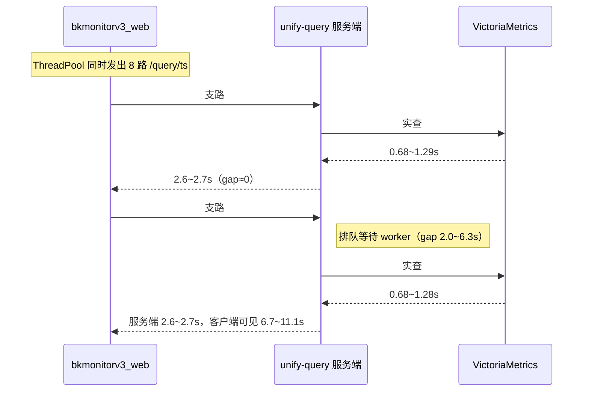

# 性能分析报告 — 新版主机监控 · 主机列表页（search_host_metric 主链路）

> 读者档位：👥 双读者档（默认，可切换）　模式：**S1 证据驱动**
> 分析对象：`SearchHostMetricResource`（`packages/monitor_web/performance/resources.py:400`）
> 负载场景：生产业务 `bk_biz_id=100864`（DFM，拓扑树显示 38478 台），主机列表页首屏/刷新
> 观测窗口：2026-09-18 10:36 与 14:49（Asia/Shanghai），两份 BKMonitor Tracing Trace
> 代码版本：[待补：2026-09-18 前后 web 发布记录，见 H-4]
> 关联需求：REQ-20260914-001（主机监控慢接口优化）
> 报告日期：2026-09-20
> 产品侧建议出处：本次未做产品侧分析，第五章二节全部标「⚠️ 待产品确认」，未经产品分析不作为决策依据

## 目录

- [一、执行摘要](#一执行摘要)
- [二、性能画像](#二性能画像)
- [三、耗时构成（慢样本关键路径）](#三耗时构成慢样本关键路径)
- [三·B、双样本对比分析](#三b双样本对比分析)
- [四、主瓶颈与归因](#四主瓶颈与归因)
- [五、优化建议](#五优化建议)
  - [五·一、技术优化（不改产品功能）](#五一技术优化不改产品功能)
  - [五·二、产品侧调整（需产品决策）](#五二产品侧调整需产品决策)
- [六、待验证清单](#六待验证清单)
- [七、验证计划](#七验证计划)
- [附录](#附录)

---

## 一、执行摘要

**现状**：主机列表页首屏被 `search_host_metric` 单接口主导，38357 台主机规模下端到端 **26.37s**（Trace `6b8ed4f4…`）；同一接口在 4551 台规模下仅 **3.73s**（Trace `29ac0bc9…`）。页面其余接口（get_topo_tree 9.3s、get_strategy_and_event_count 8.4s、search_host_info 7.8s）与之并发发起，不构成该接口内部耗时。

**主瓶颈（按 Δ 贡献排序）**

1. **指标查询并发排队**——8 路 `POST /query/ts` 并发打向 unify-query，服务端处理稳定在 2.6~2.7s，客户端 HTTP 等待却达 6.7~11.1s，多出 2~6.3s 为排队；最慢支路 17.69s 占端到端 **67%**。根因在 upstream UQ 服务端并发窗口不足，**本仓库只能缓解**。
2. **CMDB 全量主机解析 5.07s**（`_resolve_hosts` 走 `get_host_by_topo_node` 拉业务全量），占 **19%**，是串行前置段，无法被分区并发掩盖。
3. **隐藏债**：ES 告警计数 4.49s、进程路 CMDB 1.87s、NodeMan 5 批 2.01s，当前被指标路掩盖，指标路优化后会立即成为新关键路径。

**预期收益（两条路，口径不同）**

- **不改产品功能的优化（3 项）**：只能改并发形态与查询构造。排队根因在上游、本仓库无法根治，端到端保守预估 26.37s → **约 20~24s**，属量变。
- **需要产品决策的调整（5 项退让 + 3 项改进）**：其中「排序下沉到数据侧」是**不牺牲功能**的方向——若成立，用户仍能拿到全局 TopN 而查询规模大幅下降，是当前最值得优先论证的方向（待验证，见第六章 H-7）；若产品接受按页查询（让出全量排序与全量统计），端到端可到 **7~12s**。

> **口径说明**：按页下推 **不算功能等价优化**。它虽保持返回字段结构不变，却把排序与统计的作用域从**全量主机集**降级为**当页主机集**——用户点「按 CPU 排序」时排的是当页 50~200 台而非全业务 38357 台，顶部统计同步失真。这是用户可见的功能变更，故列入需产品决策的调整。

**目标 SLO 建议**：当页查询 P95 < 4s（参照快样本 3.73s 量级设定，属建议值，**非既有服务等级协议**，需产品/运维确认后生效）。

**不做会怎样**：业务主机规模仍在增长（当前 38478 台），指标查询排队随并发用户数放大；多用户同时打开页面时耗时不是平均值叠加而是排队叠加，存在雪崩风险。

---

## 二、性能画像

| 指标 | 现状（38357 台） | 对照（4551 台） | 目标 / SLO | 状态 |
|---|---|---|---|---|
| 端到端 RT（单样本） | 26.37s | 3.73s | 当页查询 P95 < 4s | 🔴 未达标 |
| P50 / P95 / P99 | [待补：需 ≥20 次采样统计] | [待补] | — | ⚪ |
| 响应体积 | 861KB（2026-09-11 截图那次） | — | — | 🟡 |
| 并发用户数 / QPS | [待补：需网关或 APM 聚合指标] | [待补] | — | ⚪ |
| UQ 服务端 worker 数 | [待补：上游服务，不可观测] | — | — | ⚪ |
| 主机规模 | 38478 台（拓扑树口径） | 4551 台 | — | 🟢 |

**时段特征**：两份 Trace 分属 10:36 与 14:49，时段负载特征未核对。慢样本规模是快样本的 8.4 倍，规模差异是本次分析的主变量。

---

## 三、耗时构成（慢样本关键路径）

`SearchHostMetricResource.perform_request` 的结构是：**串行前置 `_resolve_hosts`** → **ThreadPool 4 路并发**（agent_status / performance_data / process_status / alarm_count），端到端 = 前置 + max(4 路)。

| 链路段 | 耗时 | 占端到端 | 是否在关键路径 | 数据来源 | 证据级 |
|---|---|---|---|---|---|
| 前置 `api.cmdb.GetHostByTopoNode`（全量业务主机） | 5.07s | 19.2% | 是（串行） | Trace `6b8ed4f4…` | 🟢 |
| 指标路 UQ（6 指标 + agent + proc = 8 路，取 max） | 17.69s | 67.1% | 是（分区 max） | 同上 | 🟢 |
| ES 告警计数（terms 过滤 + scan） | 4.49s | 17.0% | 否（被掩盖） | 同上 | 🟢 |
| 进程路 `api.cmdb.GetProcess` | 1.87s | 7.1% | 否（被掩盖） | 同上 | 🟢 |
| NodeMan `IpchooserHostDetail`（5 批，取 max） | 2.01s | 7.6% | 否（被掩盖） | 同上 | 🟢 |
| 其余收尾（序列化 / 合并 / DB 小查询） | ≈3.06s | 11.6% | 部分 | 端到端倒推 | 🟡 |

> 各段不可直接相加：并行段取最大值。端到端 25.82s（子层）≈ 5.07 + 17.69 + 3.06。

### 卡点时序：8 路 UQ 的排队形态（核心证据）

| 支路 | 外层 QueryDataResource | 客户端 HTTP POST | UQ 服务端 `/query/ts` | VM 底层实查 | 客户端可见 gap |
|---|---|---|---|---|---|
| #1 | 3.03s | 1.99s | 1.94s | 687.82ms | 0.05s |
| #2 | 14.82s | 11.10s | 11.07s | 5.26s | 0.03s |
| #3 | 2.85s | 2.69s | 2.66s | 1.29s | 0.03s |
| #4 | 3.92s | 2.83s | 2.62s | 710.61ms | 0.21s |
| #5 | 9.94s | 9.01s | 2.70s | 1.18s | **6.31s** |
| #6 | 5.57s | 4.68s | 2.65s | 1.05s | **2.03s** |
| #7 | 8.26s | 6.74s | 2.64s | 684.33ms | **4.10s** |
| #8 | 8.28s | 6.89s | 2.65s | 1.28s | **4.24s** |

> VM 底层耗时按 trace 中出现顺序对应，非严格绑定支路。gap = 客户端 HTTP POST 时长 − UQ 服务端 span 时长。

**读图结论**：先完成的 #1~#4 gap 近乎为 0，后 4 条 gap 达 2~6.3s，而服务端处理始终稳定在 2.6~2.7s（#2 除外，其服务端 11.07s / VM 5.26s 是真正的大查询）。这是**并发度超过服务端可用窗口**的典型排队特征，不是存储慢、也不是网络慢。

```mermaid
gantt
    title search_host_metric 关键路径（38357 台，26.37s）
    dateFormat x
    axisFormat %M:%S
    section 关键路径
    前置 CMDB 全量主机解析 :done, 0, 5070
    指标路 UQ 8 路并发取 max :crit, done, 5070, 22760
    收尾与序列化 :done, 22760, 25820
    section 被掩盖的分区
    ES 告警计数 :done, 5070, 9560
    进程路 CMDB 与 proc_exists :done, 5070, 6940
    NodeMan 5 批取 max :done, 5070, 7080
```



> 关键路径累加、并行段取 max：5.07 + 17.69 + 3.06 ≈ 25.82s；其余分区均短于指标路，不影响端到端。



---

## 三·B、双样本对比分析

**样本定义**

| 样本 | Trace ID | 时间 | 主机规模 | 端到端 |
|---|---|---|---|---|
| 慢样本 | `6b8ed4f43038d6587f29f4ce73c76c3f` | 2026-09-18 10:36:45 | 38357 | 26.37s |
| 快样本 | `29ac0bc955fbbd1657801c9d80e6fa37` | 2026-09-18 14:49:36 | 4551 | 3.73s |

**变量对齐**

| 变量 | 慢样本 | 快样本 | 核对结果 | 核对方式 |
|---|---|---|---|---|
| 主机规模 / 数据量 | 38357 | 4551 | ❌ 不一致（8.4 倍） | Trace 标题与 `_resolve_hosts` 行为 |
| 代码版本 | 未记录 | 未记录 | ⚪ 未核对 | 无发布记录可查（H-4） |
| 负载（并发用户 / QPS） | 未记录 | 未记录 | ⚪ 未核对 | 无聚合指标 |
| 环境配置（UQ worker / 连接池） | 生产 | 生产 | 🟡 同为生产，具体参数未核对 | 服务名一致 |
| 观测时段 | 10:36 | 14:49 | ⚪ 未核对（时段负载未知） | — |

**归因可用性**：除主机规模外存在 3 项未核对变量，差分**有条件可用**——**在已核对变量范围内**，唯一差异为主机规模，Δ 集中段可归因于数据规模相关路径；未核对项为版本、负载、时段。

**样本代表性**：各 1 次采样，非同量级统计口径，Δ 仅代表该两次请求，**不作为收益计算的唯一依据**，收益区间须由复测确认。

**Δ 分解**（Δ总 = 22.64s）

| 链路段 | 快样本 | 慢样本 | Δ | Δ 占 Δ总 | 归因价值 |
|---|---|---|---|---|---|
| 指标路 UQ（并发取 max） | 2.12s | 17.69s | +15.57s | 68.8% | **主嫌疑** |
| 前置 CMDB `GetHostByTopoNode` | 0.52s | 5.07s | +4.55s | 20.1% | **次嫌疑** |
| ES 告警计数 | 1.74s | 4.49s | +2.75s | 12.1% | 隐藏债（非关键路径） |
| 进程路 `GetProcess` | 0.06s | 1.87s | +1.81s | 8.0% | 隐藏债 |
| NodeMan 批（取 max） | 0.68s | 2.01s | +1.33s | 5.9% | 已排除 |
| UQ 单支路服务端时长 | 0.32~1.01s | 2.62~11.07s | +1.6~10s | — | 规模相关 |

> 各段 Δ 之和大于 Δ总，因并发段取 max；只有前置段与指标路落在关键路径上，其余为被掩盖的隐藏债。

**经对照已排除为本次变慢主因**：NodeMan 段（Δ 1.33s，占 5.9%，低于 10% 显著性门槛）；Redis / DB 小查询（两组均在 2~10ms 量级，Δ 可忽略）。

**次要发现（两组均偏慢，属存量性能债）**：快样本 UQ 支路 #5（外层 2.12s / 服务端 0.996s）同样存在约 1.05s gap，说明**排队在 4551 台规模下已存在**，只是被规模掩盖；ES 告警计数在快样本已达 1.74s，是 scan 逐条反序列化模式的固有成本，与规模弱相关。

---

## 四、主瓶颈与归因

| 主瓶颈 | 表层现象 | 根因 | 影响面 | 证据级 |
|---|---|---|---|---|
| 瓶颈一 · 指标路并发排队 | 最慢支路 17.69s，占端到端 67% | ① **两级线程池**：外层 `perform_request`（`resources.py:616`）起 4 个分区，`performance_data` 分区内 `get_host_performance_data`（`cmdb.py:688`）再起 `ThreadPool()` 并发 6 个指标，`agent_status`（`cmdb.py:66`）与 `process_status`（`cmdb.py:313`）各 1 路，共 **6+1+1=8 路** `POST /query/ts` 同时打向 UQ；② UQ 服务端可用并发窗口不足，后 4 路排队 2~6.3s；③ 属**设计选型问题**（按指标拆分查询、线程池无上限），非局部写法问题 | 主机列表首屏/刷新；规模越大越慢；**多用户并发时排队叠加**（用户 A 的 8 路与用户 B 的 8 路争抢同一窗口，是否线性叠加见 H-5） | 🟢 |
| 瓶颈二 · 前置 CMDB 全量主机解析 | 5.07s 且无法被并发掩盖 | 前端分页是**内存分页**，普通场景不传 `bk_host_ids`，`_resolve_hosts` 退化为 `api.cmdb.get_host_by_topo_node` 拉业务全量主机；`push_host_target=False` 使 UQ 侧也无 target 过滤 | 该接口全部场景（含首屏） | 🟢 |
| 瓶颈三 · 隐藏债 ES 告警计数 | 4.49s，当前被掩盖 | `get_host_alarm_count`（`cmdb.py:869`）先按 `event.ip` 做 terms 过滤、再对命中的 7 天窗口 `status=ABNORMAL` 文档 `scan()` 逐条反序列化（`cmdb.py:936`），并用 Python 循环做 IP+云区域匹配与 severity 累加；索引窗口恒 `[now-7d, now]`（ABNORMAL 每日 reindex 到当天索引） | 指标路优化后将成为新关键路径 | 🟢 |

**根因在上游标注**：瓶颈一的排队根因位于 unify-query 服务端（worker 数与并发窗口，REQ-09 已确认扩容不可获得）。本仓库可做的是**降低并发路数与单次查询规模**（缓解），无法消除排队本身（根治在上游）。

### 调用链：卡在哪一步（26.37s 端到端）

```text
主机列表页首屏 / 刷新（38357 台，26.37s）
  │
  ▼
前置 _resolve_hosts：CMDB 拉业务全量主机（5.07s）  ← 关键路径 · 瓶颈二
  │   前端未传 bk_host_ids，退化为按拓扑节点全量拉取
  ▼
ThreadPool 4 路并发（取 max）
  ├─ 指标路（17.69s）  ← 关键路径 · 主要瓶颈
  │    └─ 内部再起 6 路指标 UQ（取 max）
  │         └─ 后 4 路排队等 UQ 服务端窗口 2.0~6.3s
  ├─ agent 状态（2.01s · 被掩盖）→ NodeMan 5 批取 max + 1 路 UQ
  ├─ 进程状态（1.87s · 被掩盖）→ GetProcess + 1 路 UQ
  └─ 告警计数（4.49s · 被掩盖）→ ES terms 过滤 + scan 逐条
  │
  ▼
等待各分区完成 → 合并与序列化（≈3.06s）
  │
  ▼
返回列表：排序与统计在应用层内存完成（故必须拿到全量主机集）
```

> 关键路径 = 前置 5.07s + 指标路 17.69s + 收尾 ≈3.06s ≈ 25.82s；其余三个分区均短于指标路，被掩盖但会在指标路优化后浮出。

### 影响面（易被忽略的连带效应）

| 影响维度 | 说明 | 证据级 |
|---|---|---|
| 并发放大 | 单用户一次刷新即向 UQ 发 8 路 `/query/ts`；N 个用户同时打开列表页即 8N 路争抢同一 UQ 窗口。26.37s 是**单用户**基线；是否线性叠加待 H-5 压测确认 | 🟡 结构性可证（路数可数） |
| 同页面其他接口被连带拖慢 | `get_topo_tree` / `search_host_info` 等若同样依赖 UQ 或共享 web worker 线程池，会被这 8 路挤占；页面整体体感比单接口 26.37s 更差 | 🟡 |
| 疑似前端重复请求 | 2026-09-11 曾观察到双实例时间轴几乎重叠，若属实则实际并发是 16 路；本次两份 Trace 未复现（见 H-6） | 🟡 |
| 规模增长 | 业务主机 38478 台且仍在增长，CMDB 全量解析 5.07s 与 UQ 规模均随规模上升，不做优化则耗时只会恶化 | 🟡 |
| 正向减轻效应 | 查询主机集缩小后，不仅本接口变快，**发往 UQ 的 8 路规模同时下降**，会连带缓解同页面其他 UQ 依赖接口的排队，收益不限于本接口 | 🟢 |

---

## 五、优化建议

本章不配图。每项先给一句话（改什么 → 省掉什么）、推荐指数与预期效果，细节进表。

### 五·一、技术优化（不改产品功能）

本节只收纳**用户可见行为完全不变**的优化：同字段、同数值、同排序与统计口径，仅改变执行方式（并发形态、查询构造、执行顺序）。

**1 · 指标路并发收敛（同表合并 + 分批）**：把 6 个指标中同表 `system.mem` 的 `mem_usage` 与 `psc_mem_usage` 合并为 1 路、并发度从 8 路收敛到 4 路，**省掉 4 路同时争抢 UQ 服务端窗口造成的 2~6.3s 排队等待**。
　**推荐指数 ★★★★｜预期效果**：端到端 26.37s → 约 **21s**（p=67.1%，s≈1.47 保守取值；因 #2 支路服务端 11.07s 是真大查询、非排队，无法一并消除），用户看到的排序与统计完全不变。
　功能等价性：同表合并返回相同字段集合与数值（同 method=MAX、同 interval），分批不改变结果集。
　风险与成本：排队根因在上游，本仓库只能减少路数、无法根治；串行批次会拉长单路耗时，净收益须实测确认（跨度大时可能得不偿失）。

**2 · 告警计数 ES 聚合改造**：`scan()` 逐条反序列化（`cmdb.py:936`）改为 terms/composite 聚合按 `event.ip` + `severity` 分桶计数，**省掉命中文档的逐条反序列化与 Python 循环**，alarm 段 4.49s → 预估 0.5~1s。
　**推荐指数 ★★★｜预期效果**：段内 -78%~-89%；**端到端当前收益 ≈0**（该段被指标路掩盖），价值在于解除隐藏债、避免指标路优化后立即成为新关键路径。
　功能等价性：计数口径一致（`_resolve_host_id_from_alert` 的 IP+云区域匹配须在聚合侧等价实现；仅 dimensions 匹配的 K8s 告警仍按现有已知权衡遗漏）。
　风险与成本：多 IP 主机（`innerip` 逗号分隔）需在桶聚合侧同样拆分；与「退让 4 告警近似计数」作用于同一耗时点，**二选一，不叠加**。

**3 · 进程路内部并行化**：`get_process_info` 中 `api.cmdb.get_process`（1.87s）与状态查询当前串行，二者无数据依赖，改为并发，**省掉 1.87s 串行等待**。
　**推荐指数 ★★｜预期效果**：进程段 1.87+UQ → max 值；**端到端当前收益 ≈0**（被掩盖），属顺手清理的存量债。
　功能等价性：返回进程列表与状态完全一致，仅执行顺序变化。
　风险与成本：低。

> **为什么「按页下推 `bk_host_ids`」不在本节**：它虽保持返回字段结构不变、后端 `bk_host_ids` 契约也已就绪（`RequestSerializer` 中 `required=False`，老前端不传时行为不变），但**改变了排序与统计的作用域**——从全量主机集降为当页主机集，用户可见行为随之变化，故列入下一节。

> **本节收益上限（须先读）**：瓶颈一的排队根因在 unify-query 服务端（并发窗口不足，REQ-09 已确认扩容不可获得），本节能做的是降低并发路数与查询构造成本，属缓解而非根治。在「全量主机集」这一前提不变时，本节无法消除前置 CMDB 全量解析 5.07s，也无法让单路查询规模下降，故端到端仅 **26.37s → 约 20~24s**，是量变。要拿到 -55%~-70% 必须缩小查询主机集，即下一节。

### 五·二、产品侧调整（需产品决策）

> 本节为技术侧候选与收益估算，**取舍须由产品确认**，全部标「⚠️ 待产品确认」，未经产品分析不作为决策依据。前 2 项退让已在 REQ-20260914-001 §4.2 登记为待决策项。
> 分两类：**退让类**（让出部分功能换性能）与**改进类**（疑似原设计不合理，修掉后体验与性能双升，不牺牲功能）。改进类与退让类并列，**不相互替代**。

#### 退让类（让出什么 → 换多少收益）

**退让 1 · 让出「全量排序 + 全量统计」→ 换取查询规模下降（按页下推 `bk_host_ids`）**：把 `getMetricQueryParams` 的 `bk_host_ids` 从「仅分享场景传」改为「始终传当页主机 ID」，后端 `_resolve_hosts` 改走 `get_host_by_id` 并 `push_host_target=True` 下推，**省掉 38357 台全量 CMDB 拉取与全量 UQ target**，前置段 5.07s → 约 0.3s、指标路规模降至当页 50~200 台。
　**推荐指数：技术侧 ★★★★☆（收益上限 -55%~-70%，但需前端中等改造）　⚠️ 待产品确认**
　**预期效果**：端到端 26.37s → **7~12s**（保守取指标路加速比 s=3~5），需复测确认。
　⚠️ **这是用户可见的功能变更**，破坏的现有能力见下表：

| 现有能力 | 下推后行为 | 用户可见影响 |
|---|---|---|
| 按指标全量排序（「按 CPU 使用率排序」取全局 TopN） | 排序仅在当页 50~200 台内进行 | 看到的「CPU 最高」只是当页最高，切页后顺序重置，无法找到全局最高主机 |
| 顶部统计（如「告警中的主机 72」） | 统计仅覆盖当页 | 统计数字随翻页变化，失去全业务口径 |
| 按状态/条件筛选后的全量结果集 | 筛选与分页耦合 | 改排序或筛选条件时当页主机集可能整体变化 |

　⚠️ **落地成本不止后端**：需前端 `getMetricQueryParams` 改造 + 排序/筛选状态与分页联动；后端契约已就绪，改造量集中在前端。
　✅ **非破坏性部分**：后端契约零变更（`bk_host_ids` 已在 `RequestSerializer` 且 `required=False`），老前端不传时行为完全不变，可分阶段灰度。

**退让 2 · 让出「Agent 状态随行返回」→ 换取状态过滤/统计不失真**：`status` 当前来自本接口，按页下推（退让 1）后按状态筛选与顶部统计会失真；配套拆独立全量轻量接口可保住能力，代价是 1 个新接口 + 前端 1 次并行请求。
　**推荐指数：技术侧 ★★★　⚠️ 待产品确认（须与退让 1 绑定评估）**
　**预期效果**：保住过滤与统计能力，成本为 1 个新接口。
　⚠️ 若该独立接口不落地，代偿方案不存在，此时接受退让 1 即等于接受「顶部统计与筛选失效」，须产品明确书面接受，不能默认为「后续再补」。

**退让 3 · 让出「首屏展示全部 6 个指标」→ 换取并发路数腰斩**：首屏只查 CPU/内存/磁盘 3 项，其余指标滚动或展开时按需加载，指标路并发 8 → 5。
　**推荐指数：技术侧 ★★★　⚠️ 待产品确认**
　**预期效果**：并发路数 -3，缓解排队（收益需与「1 · 并发收敛」按新基线重算，不直接相加）。

**退让 4 · 让出「未恢复告警精确计数」→ 换取 ES 路成本**：改为近似计数或异步刷新（先显示上次值，后台更新）。
　**推荐指数：技术侧 ★★　⚠️ 待产品确认**
　**预期效果**：ES 段 4.49s → <1s；与技术优化 2 同一耗时点，**二选一**。

**退让 5 · 让出「实时」语义 → 换取结果复用**：接受指标为 30~60s 快照，对结果按 `(bk_biz_id, 主机集 hash, 时间窗)` 加短缓存，命中时 RT 降至毫秒级。
　**推荐指数：技术侧 ★★★　⚠️ 待产品确认**
　**预期效果**：刷新与多用户重复请求命中缓存时 RT 毫秒级；用户可见影响为刷新后 30s 内数值不变。
　> 注：若产品认为「最近三分钟」聚合语义下 30~60s 快照不可区分，此项可视为等价、并入上一节技术优化。风险：缓存键含主机集，基数上升需 LRU 限制。

#### 改进类（疑似原设计缺陷 → 不牺牲功能，体验与性能双升）

> 以下为技术侧识别的**疑似**设计不合理点，是否算缺陷由产品判断；每条须说清体验提升点，说不出提升点的应退回退让类或技术优化。

**改进 1 · 排序下沉到数据侧，而非拉全量到应用层内存排序**
　**疑似不合理的点**：当前为支持「按 CPU 排序取全局 TopN」，把 38357 台主机的指标全部拉到应用层，再由 Python 内存排序——排序本可在查询侧完成。这是本次最值得优先论证的方向，因为它**保留了全量排序能力**，不必走退让 1。
　**改成什么**：把排序与 limit 下推到 UQ / VictoriaMetrics 侧（order by + limit），应用层只接收 TopN 结果与必要的总数口径。
　**体验提升点**：用户仍能看到全局 TopN（不退让任何能力），且首屏更快、结果更稳定。
　**性能收益上限**：若成立，指标路由 17.69s → 3~5s，端到端有望 → 8~12s；**🔴 待验证**（需确认 UQ 是否支持 order/limit 下推及其服务端代价，见 H-7）。
　**推荐指数：技术侧 ★★★★☆（潜力最高）　⚠️ 待产品与 UQ 团队确认**
　风险与成本：UQ 侧支持度未知；跨指标排序可能仍需多次查询；与现有两层聚合语义的兼容性需实测。

**改进 2 · 首屏概览 + 按需下钻，替代「一次塞满全部字段」**
　**疑似不合理的点**：首屏一次返回 6 个指标 + 拓扑预览 + 告警计数 + agent 状态 + 进程信息，而用户进入列表页通常先只想看「哪几台有问题」。
　**改成什么**：首屏先给异常主机 TopN 与负载分布概览，明细指标在展开/下钻时按需加载。
　**体验提升点**：更快看到关键信息、减少滚动与等待，信息层次更清晰。
　**性能收益上限**：首屏并发路数下降，端到端 → 5~10s（🔴 待验证，须先明确首屏必备字段集）。
　**推荐指数：技术侧 ★★★★　⚠️ 待产品确认**

**改进 3 · 消除疑似重复请求与首屏非必需随行数据**
　**疑似不合理的点**：2026-09-11 曾观察到双实例时间轴几乎重叠（疑似前端重复请求）；拓扑预览非首屏必需却每次全量随行（前端仅 selectedNode 变化时增量用）。
　**改成什么**：列表与详情共享上下文、复用已有数据；拓扑预览改为按需预取或独立接口。
　**体验提升点**：无功能损失，操作即时性提升。
　**性能收益上限**：若重复请求属实，实际并发减半；拓扑预览拆出可省其传输与序列化成本（🔴 待 H-6 验证）。
　**推荐指数：技术侧 ★★★　⚠️ 待验证与产品确认**

#### 汇总与决策顺序

| 项 | 让出什么 / 改进什么 | 技术收益上限 | 决策依赖 | 决策状态 | 决策人 |
|---|---|---|---|---|---|
| 退让 1 | **全量排序 + 全量统计**（按页下推） | -55%~-70% | 需前端改造；退让 2 为其代偿 | ⚠️ 待产品确认（REQ-20260914-001 §4.2 已登记） | 产品 |
| 退让 2 | 状态随行返回（代偿，需独立接口） | 保住过滤/统计，成本 1 接口 | **与退让 1 绑定评估**，否则为纯退化 | ⚠️ 待产品确认 | 产品 |
| 退让 3 | 首屏 6 指标 → 3 指标 | 并发 8→5 | 与技术优化 1 按新基线重算 | ⚠️ 待产品确认 | 产品 |
| 退让 4 | 告警精确计数 → 近似/异步 | ES 段 4.49s → <1s | 与技术优化 2 二选一 | ⚠️ 待产品确认 | 产品 |
| 退让 5 | 实时 → 30~60s 快照 | 命中时 RT 毫秒级 | 决定其归技术优化还是本节 | ⚠️ 待产品确认 | 产品 |
| 改进 1 | 排序下沉（**不牺牲全量排序**） | 指标路 17.69 → 3~5s | 需 UQ 侧支持（H-7） | ⚠️ 待产品 + UQ 团队确认 | 产品 / UQ |
| 改进 2 | 首屏概览 + 按需下钻 | 端到端 → 5~10s | 需明确首屏必备字段 | ⚠️ 待产品确认 | 产品 |
| 改进 3 | 消除重复请求 / 拓扑预览分层 | 并发减半（若属实） | 需 H-6 验证 | ⚠️ 待验证 | 产品 |

> **决策顺序建议**：先评估**改进 1**（不牺牲功能，若成立则不必接受退让 1 的能力损失）；改进 1 不成立时，再评估退让 1 与退让 2（二者必须**绑定评估**，单接受退让 1 等于接受统计退化）；最后评估退让 3/4/5 与改进 2/3。

### 改前 → 改后（结构怎么变、省掉什么）

```text
改前（26.37s）
主机列表页首屏
  ▼
前置 CMDB 全量主机解析（5.07s）
  ▼
指标路 8 路 UQ 并发（取 max，17.69s）
  ├─ 6 路指标 + agent 1 路 + proc 1 路
  └─ 后 4 路排队 2.0~6.3s
  ▼
合并与序列化（≈3.06s）

改后（≈21s，逐段重算；仅计入技术优化 1，产品侧未拍板不计入）
主机列表页首屏
  ▼
前置 CMDB 全量主机解析（5.07s · 未变，技术侧无法消除）
  ▼
指标路 4 路 UQ 并发（取 max，≈12~13s）  ← 技术优化 1
  ├─ system.mem 两指标合并为 1 路 —— 省 4 路争抢 UQ 窗口
  └─ #2 支路服务端 11.07s 是真实大查询，不属排队，未消除
  ▼
合并与序列化（≈3.06s · 未变）
```

**另有待产品确认（未计入上树）**：退让 1 按页下推 → 前置 5.07s → 约 0.3s、指标路规模降至当页；改进 1 排序下沉 → 指标路 17.69s → 3~5s。二者作用于同一段，**收益需按序重算，不可与 ≈21s 相加**。

**若产品侧全部被否决的收尾**：技术侧上限仅到约 20~24s，无法闭合到 4s 目标。此时出路为三条——① 上调目标容忍度（接受 P95 20s 级）；② 扩容或加资源（UQ 服务端扩容，REQ-09 已确认不可得，需升级协同）；③ 按场景分级 SLO（如超大业务单独放宽、普通业务维持 4s）。**不做为凑达标而弱化描述的结论**。

---

## 六、待验证清单

| 编号 | 假设 | 验证方法 | 当前状态 |
|---|---|---|---|
| H-1 | 后 4 路的 2~6.3s gap 确为**服务端排队**，非客户端连接池耗尽或 DNS | 抓 UQ 客户端连接池等待时长与 UQ 服务端入队时长；或把并发降到 2 路复测 gap 是否消失。**已排除部分替代解释**：gap 只出现在后完成的 4 路、前 4 路 gap≈0，若是连接池耗尽/DNS 应随机分布而非呈现「先到先得、后到排队」规律 | 🔴 待验证（已排除连接池/DNS） |
| H-2 | 主机集缩到 200 台后指标路能从 17.69s 降到 2~3s | 用 `bk_host_ids` 传 200 台复测（分享场景已有线上路径） | 🔴 待验证 |
| ~~H-3~~ | ~~ThreadPool 默认线程数~~ | **已实证**：`ThreadPool`（`bkmonitor/utils/thread_backend.py:113`）继承 `multiprocessing.pool.ThreadPool` 且**未传 `processes`**，默认取 `os.cpu_count()`；`resources.py:616` 与 `cmdb.py:688` 均为无参构造 → 并发度随宿主机核数变化，与请求规模无关 | ✅ 已实证（静态） |
| H-4 | 两份 Trace 代码版本一致（差分归因前提） | 核对 2026-09-18 前后 web 服务发布记录 | 🔴 待验证 |
| H-5 | 多用户并发时排队是否线性叠加 | 需并发压测 | 🔴 待验证 |
| H-6 | 2026-09-11 观察到的双实例时间轴重叠确为前端重复请求 | 前端请求日志核对 + 现场复现抓包 | 🔴 待验证 |
| H-7 | UQ / VictoriaMetrics 侧支持排序与 limit 下推，且服务端代价可接受 | 与 UQ 团队确认 API 能力 + 用 TopN 查询压测对比 | 🔴 待验证（决定改进 1 是否成立） |

---

## 七、验证计划

| 验证项 | 验证方式 | 判据 | 前置条件 |
|---|---|---|---|
| 技术优化 1 并发收敛 | 8 路 → 4~5 路，同负载复测指标路 gap | 后发支路 gap ≤ 0.5s；端到端 P95 较基线下降 | 需可观测 UQ 客户端连接等待 |
| 技术优化 2 ES 聚合改造 | 同业务同窗口，对比改造前后 alarm 段与计数结果 | alarm 段 ≤ 1s，且与 scan 口径计数一致（抽样 100 台比对） | 需 ES 测试索引含 ABNORMAL 文档 |
| 技术优化 3 进程路并行 | 同负载复测进程段 | 进程段 ≤ max(GetProcess, UQ) + 0.1s | — |
| 退让 1 按页下推 | 同一业务、同数据量，传 `bk_host_ids=当页200台` 复测 10 次取 P95 | `search_host_metric` P95 ≤ 4s（基线 26.37s） | 前端改造或后端用 curl 模拟 |
| 退让 1 产品验收 | 产品侧走查 | 顶部「告警中的主机 72 / CPU 超 80% 51 台」等统计仍为全业务口径，或产品书面接受当页口径；翻页排序用户可理解 | 需产品确认与前端配合 |
| 退让 5 结果复用 | 30s 内重复请求复测 | 命中请求 RT ≤ 200ms，未命中不劣化；产品确认 30~60s 快照可接受 | 需缓存容量评估 |
| 改进 1 排序下沉 | UQ 侧 TopN 查询压测 + 结果比对 | 与内存排序结果一致（TopN 集合与顺序），指标路 ≤ 5s | 需 UQ 侧能力确认（H-7） |
| 改进 1 产品验收 | 产品侧走查 | 体验不降反升：用户仍能看到全局 TopN，点击次数未增加，首屏更快 | 需产品确认 |
| 改进 2 概览 + 下钻 | 首屏字段集对比走查 | 体验不降反升：首屏关键信息不缺失、下钻点击次数未增加 | 需产品确认字段集 |
| 退让 2 状态独立接口 | 与退让 1 同批走查 | 顶部统计与状态筛选结果与下推前全量口径一致（抽样 100 台比对） | 退让 1 采纳后才有意义 |
| 退让 3 首屏 3 指标 | 首屏指标集对比复测 | 指标路并发 8 → 5，端到端较退让 3 前基线下降；产品确认首屏 3 指标信息够用 | 需产品确认指标集 |
| 退让 4 告警近似计数 | 近似值与精确值抽样比对 | 计数误差在产品接受范围内；与技术优化 2 二选一，不得并存 | 需产品先定误差上限 |
| 改进 3 消除重复请求 | 抓包核对同页面请求次数 | 同一操作下本接口请求次数由 2 降为 1（若 H-6 成立） | 需 H-6 先验证 |

**验证三要素**：同负载、同数据量、同观测窗口——三者不齐的对比不成立。基线建议固定为业务 `bk_biz_id=100864`、38357 台、工作日下午时段。

---

## 附录

**证据来源**

| 来源 | 内容 | 采集方式 |
|---|---|---|
| Trace `6b8ed4f43038d6587f29f4ce73c76c3f` | 慢样本（38357 台，26.37s，164 spans） | BKMonitor Tracing 瀑布列表逐屏读取 |
| Trace `29ac0bc955fbbd1657801c9d80e6fa37` | 快样本（4551 台，3.73s，157 spans） | 同上 |
| 上传文件 | `knot-uploads/1789899328106-g7ch-trace-38157.md`、`1789899328105-v7v7-trace-4551.md` | 用户上传 |
| DevTools Network 截图（2026-09-11） | 页面各接口耗时与体积 | 用户提供 |
| 代码 | `performance/resources.py:400`（编排）、`cc/resources/cmdb.py:66/218/596/869`（四分区实现）、`utils/thread_backend.py:113` | 本次阅读核对 |

**待补数据**

- `search_host_metric` 的 P50/P95/P99（需 ≥20 次采样的 Trace 列表聚合）
- 并发用户数与 QPS（网关或 APM 聚合指标）
- UQ 服务端 worker 数与入队时长（上游服务，需协同 UQ 团队）
- web 侧 HTTP 客户端连接池大小与等待时长
- 2026-09-18 前后 web 服务发布记录（用于确认差分前提，H-4）
- 业务主机规模增长曲线（判断容量缺口时点）

**自查说明**

- 影响面表的「等级」列已改用证据级（🟢/🟡）标注，避免与结论区的假设级混淆。
- 🔴 的分布：仅出现在第六章待验证清单，以及第五章「改进类」候选项的收益上限处（均带验证编号与方法）。执行摘要等结论区已无 🔴。
- 性能画像状态列的 🔴 表示指标未达标（状态色），非证据级假设。

**交付自查**：第 2 轮通过（修复 6 项：补第四章调用链文字树与第五章「改前 → 改后」对照树——skill 9.4 要求全档位必带，两棵树耗时与第三章耗时表、gantt 同源；清除执行摘要中的假设标记，假设只保留在第六章待验证清单；补退让 2/3/4 与改进 3 的验证方式与判据；报告头占位符统一为 `[待补：]`；附录自查说明按 🔴 实际分布重写；清除自查记录中的内部项号残留）
