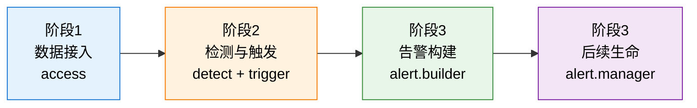

# 学习路径总览：告警后台如何拉取数据并构建告警

## 🎯 学习目标

学完这套课程，你应该能回答三个问题：

1. **数据从哪来**：一条 CPU 使用率数据，是怎么从 TSDB / 数据平台被后台定时拉出来的？
2. **异常怎么定**：拉到的一堆数字，凭什么被判定为"异常"？判定一次就告警吗？
3. **告警怎么成**：异常点是怎么变成一条你在告警列表里看到的、有 ID 有状态有生命周期的**告警**的？

## 📖 故事主线

> **主角**：一条再普通不过的时序数据点（`load5 = 1.38`）
> **冲突**：它只是个数字，而用户要看到的是"这台机器出问题了"这样一个**有身份、有状态、有始有终的对象**
> **收束**：从"数字"到"告警"的四级蜕变——数据点 → 异常点 → 异常事件 → 告警

整条链路是一场**逐级收敛**的漏斗：

| 层级 | 数据量级（直觉） | 收敛动作 |
|---|---|---|
| 数据点（DataPoint） | 每周期每维度一个，最多 | 接入层批量拉取 |
| 异常点（AnomalyDataPoint） | 少数越界的 | 检测算法判定 |
| 异常事件（Event） | 满足"N 周期 M 次"才出 | 触发条件判定 |
| 告警（Alert） | 按去重身份合并 | 去重与状态机 |

**关键认知**：告警不是"检测到的"，是**构建出来的**。检测只负责回答"这个点越界了吗"，真正产生告警的是最后一级——把事件按身份去重、合并、赋予状态的那一步。

## 🗺️ 全阶段总览

| 阶段 | 主题 | 回答什么 | 课 |
|---|---|---|---|
| 1 | **数据接入** | 后台怎么定时把数据拉出来、洗干净 | 01 调度的起点 / 02 拉取数据 |
| 2 | **检测与触发** | 数字怎么被判异常、异常怎么变成事件 | 03 检测 / 04 触发 |
| 3 | **告警构建** | 事件怎么变成告警、告警之后怎么活 | 05 告警构建 / 06 后续生命 |

## 🔗 阶段依赖图

看图：左边是入口（拉数据），中间是加工（判异常、出事件），右边是成型（建告警）与养护（管状态）。箭头方向就是数据流动方向，也是本课程的讲解顺序——**前三阶段严格串行为一条流水线，后面的每一步都依赖前一步的输出**。

## 🧭 阅读建议

- 想搞懂"告警为什么没触发" → 重点看阶段 2（检测与触发）
- 想搞懂"为什么产生这么多重复告警" → 重点看阶段 3 课 05（去重）
- 想搞懂"告警为什么一直不恢复" → 重点看阶段 3 课 06（状态检查）

> 图配色说明：本教程所有图表统一浅色背景 + 深色文字，深色仅用于强调块。
