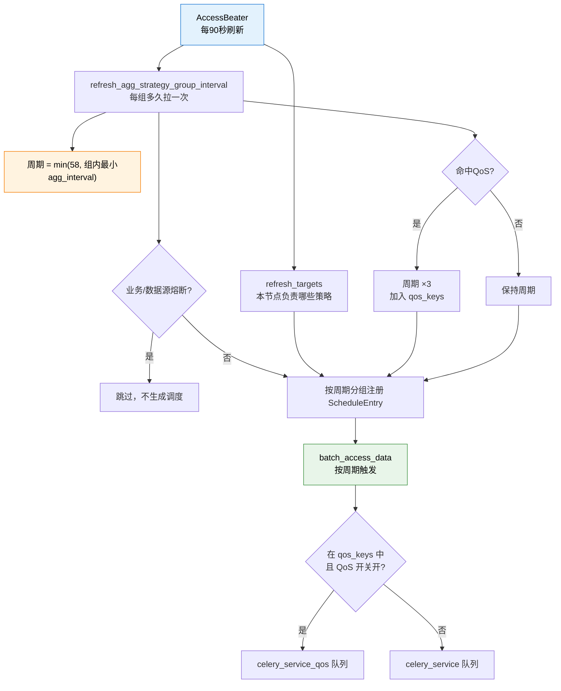

# 第 01 课：调度的起点——后台怎么知道"该拉数据了"

## 📖 文档核对

已核对源码：
- [handler.py:1-120](/root/bk-monitor/bkmonitor/alarm_backends/service/access/handler.py) —— AccessBeater 类定义、refresh_targets、refresh_agg_strategy_group_interval 前半
- [handler.py:120-260](/root/bk-monitor/bkmonitor/alarm_backends/service/access/handler.py) —— 周期计算、分发、batch_access_data
- [README.md](/root/bk-monitor/bkmonitor/alarm_backends/service/access/README.md) —— 接入层职责与标准输出格式

## 🎯 本课目标

搞懂告警后台的"心跳"从哪来：**谁**在什么时候、**以什么频率**、把**哪些策略**的拉数任务发出去。

---

## 一、先有个整体印象：调度器是个"节拍器"

告警后台不是一个死循环在跑，而是有个 **beat（节拍器）** 在打拍子。这个节拍器叫 `AccessBeater`，定义在 [handler.py:39](/root/bk-monitor/bkmonitor/alarm_backends/service/access/handler.py)：

```python
class AccessBeater(MonitorBeater):
    def __init__(self, name, targets, service, entries=None):
        super().__init__(name, entries)
        self.targets = targets or []
        self.max_access_data_period = 58
        self.interval_map = {}
        ...
```

它做两件周期性的事（周期 `REFRESH_INTERVAL = 90` 秒，定义在 handler.py:37）：

| 方法 | 作用 | 周期 |
|---|---|---|
| `refresh_targets()` | 刷新"本节点负责哪些策略" | 90 秒 |
| `refresh_agg_strategy_group_interval()` | 刷新"每个策略组多久拉一次" | 90 秒 |

还有一个非周期性的 `batch_access_data(interval_key)`，它是**被调度出来的动作**——按周期把任务丢进 Celery。

> 💡 **直觉比喻**：`refresh_*` 是"排班表更新"（每 90 秒重排一次班），`batch_access_data` 是"到点上班"（按排班表的周期触发）。

---

## 二、知识点 1：策略分组与周期调度

### 为什么要有"策略分组"？

如果每个策略都单独起一个定时任务，几万个策略就是几万个定时器——调度开销会爆炸。所以 bk-monitor 把策略**按相关性分组**：同一分组内的策略共享数据源与查询条件，一起查、一起拉。

这个分组就是 `strategy_group_key`，来自 `StrategyCacheManager.get_all_groups()`（handler.py:98）。

### 周期怎么算？——那个神奇的 58 秒

核心逻辑在 [handler.py:172-179](/root/bk-monitor/bkmonitor/alarm_backends/service/access/handler.py)：

```python
min_interval = self.max_access_data_period   # 58
if interval_list:
    min_interval = min(self.max_access_data_period, *interval_list)
else:
    logger.warning(f"strategy_group_key({strategy_group_key}) is invalid, will not processed")
```

**读法**：取该组内所有 item 的 `agg_interval` 列表，与上限 58 取最小值。

**为什么上限是 58 而不是 60？**

这是一个很实在的工程考量：

1. 策略的监控周期可能是 1 分钟、5 分钟、1 小时。
2. 调度本身有开销、数据入库有延迟，如果周期正好设 60 秒，实际可能变成 61、62 秒 —— 那"1 分钟周期"的策略就会**漏掉某些分钟**。
3. 压到 58 秒，留 2 秒余量，保证 1 分钟周期的策略每分钟内一定能被拉起至少一次。
4. 对长周期策略（5 分钟、1 小时）无副作用：多余轮次拉不到新数据，空转而已。

> ⚠️ **易错点**：58 是**上限**不是默认值。周期实际是 `min(58, 组内最小 agg_interval)`。所以一个 `agg_interval=60` 的组和 `agg_interval=300` 的组，周期都是 58 秒。

### 周期列表从哪来？

优先从策略缓存里取 `interval_list`（handler.py:104）：

```python
interval_list = strategy_group.pop("interval_list", [])
```

如果缓存里没有（兼容旧数据），才走 `get_interval()` 去 Redis 逐个策略查（handler.py:100 附近的嵌套函数）。这是一个**性能优化**——避免每次刷新都打 Redis。

### 排班表怎么生效？

算完周期后，按周期值分组，注册成 Celery 的调度条目（handler.py:196-213）：

```python
for interval, group_keys in interval_map.items():
    schedule_dict = {
        "task": self.batch_access_data,
        "schedule": interval,
        "args": (interval,),
    }
    if interval not in self.entries:
        self.entries[interval] = ScheduleEntry(**schedule_dict)
    else:
        self.entries[interval].args = schedule_dict["args"]

intervals = list(self.entries.keys())
for interval in intervals:
    if interval not in interval_map and interval not in [REFRESH_STRATEGY_INFO, REFRESH_TARGETS]:
        self.entries.pop(interval)
```

**注意最后那个清理循环**：如果某个周期值在本次刷新后不再出现（比如策略被删了），对应的调度条目会被 `pop` 掉。**这意味着调度表是动态的**——策略一改，90 秒内排班表就会跟着变。

---

## 三、知识点 2：目标分发与 QoS 队列

### 谁负责拉哪些策略？——目标分发

`refresh_targets()`（handler.py:56-65）决定本节点负责哪些策略：

```python
def refresh_targets(self):
    if settings.ENVIRONMENT == constants.CONST_DEV:
        host_targets = self.service.query_host_targets()
        instance_targets = self.service.query_instance_targets(host_targets)
    else:
        host_targets, instance_targets = self.service.dispatch()
    self.targets = instance_targets
    self.host_target = host_targets
```

开发环境直接查全量；生产环境走 `service.dispatch()` 做**分片分发**——多节点部署时，每个节点只领自己那一份。

分发结果怎么用？在刷新周期时过滤（handler.py:127-136）：

```python
bk_biz_id = strategy_group.pop("bk_biz_id", None)
strategy_ids = strategy_group.keys()
if bk_biz_id is not None:
    # 只要判定业务对应目标归属即可，因为策略组关联的策略归属同一业务
    if bk_biz_id not in self.host_target:
        continue
elif not targets & strategy_ids:
    # 业务字段未取到，则使用instance_targets 匹配
    continue
```

**两种匹配口径**：有 `bk_biz_id` 就用业务维度判（更快，因为同组策略业务相同）；没有就退化到策略 ID 集合求交集。

### QoS 队列：慢数据源为什么要单独排队？

有些数据源查询特别慢（比如计算平台 BKDATA 的 bksql 查询）。如果它们和普通数据源混在同一个 Celery 队列里，慢查询会把队列堵死，导致所有策略都延迟。

解决方案是 **QoS 队列**（Quality of Service），两处配合：

**① 周期放大**（handler.py:181-186）：

```python
if is_qos:
    logger.warning(
        f"strategy_group_key({strategy_group_key}) is qos, interval will be expanded with {qos_interval_expand}"
    )
    min_interval *= qos_interval_expand
    if self.enable_qos_queue:
        self.qos_keys.append(strategy_group_key)
```

`qos_interval_expand` 默认 3（handler.py:96：`getattr(settings, "QOS_INTERVAL_EXPAND", 3)`）。即慢数据源的拉取周期被放大 3 倍，从源头降低压力。

**② 独立队列**（handler.py:238-241）：

```python
run_task = run_access_data_with_qos_queue if strategy_group_key in self.qos_keys else run_access_data
run_task.delay(strategy_group_key, interval=interval_key)
```

命中 QoS 的走 `run_access_data_with_qos_queue`（投递到 `celery_service_qos` 队列），否则走普通 `run_access_data`（`celery_service` 队列）。

**注意开关**：`self.enable_qos_queue = os.getenv("QOS_QUEUE_ENABLE", False)`（handler.py:48）。**环境变量没开时，只有周期放大生效，队列不分离**——这是个容易踩的坑：你以为配了 QoS 就隔离了，其实没开环境变量就只是降频。

### 分发时的限流

handler.py:243-246：

```python
if _idx % (len(strategy_group_keys) // interval_key + 1) == 0:
    time.sleep(0.05)
```

每分发若干任务休眠 50ms，避免一次性把几万个任务砸进队列。

### 熔断：在刷新阶段就掐断

handler.py:138-166 引入了 `AccessDataCircuitBreakingManager`，在**刷新阶段**（还没进 Celery）就检查业务/数据源是否熔断：

```python
if bk_biz_id and circuit_breaking_manager.is_circuit_breaking(
    bk_biz_id=bk_biz_id,
    data_source_label=data_source_label,
    data_type_label=data_type_label,
    strategy_source=f"{data_source_label}:{data_type_label}",
):
    circuit_breaking_count += 1
    logger.warning(...)
    continue   # 跳过被熔断的策略组
```

**设计要点两个**：
1. **早拦截**：在刷新阶段跳过的策略组根本不会进 `interval_map`，连调度条目都不会生成——最省资源。
2. **失败不阻塞**：`except Exception` 里只打 warning 然后"继续处理该策略组"（源码注释明写）。**熔断检查本身挂了，不能反过来把告警整条链路弄挂**。

---

## 四、本课回顾



看图：蓝色是节拍器（90 秒一次），橙色是周期计算（58 秒上限 + QoS 放大），绿色是分发动作。熔断检查插在周期计算之后、调度注册之前，是"最早的拦截点"。

**三条要记住的**：

1. **58 秒是上限不是默认值**——为了让 1 分钟周期的策略不漏拉。
2. **QoS 是"周期放大 3 倍 + 独立队列"两件事**，且独立队列还要看 `QOS_QUEUE_ENABLE` 环境变量。
3. **熔断在刷新阶段就拦截**，被熔断的策略组连调度条目都不会有。

## 🚀 下一课

课 02《拉取数据》——任务已经进了 Celery 队列，接下来看它怎么算时间范围、怎么查数据源、怎么把原始数据洗干净。
