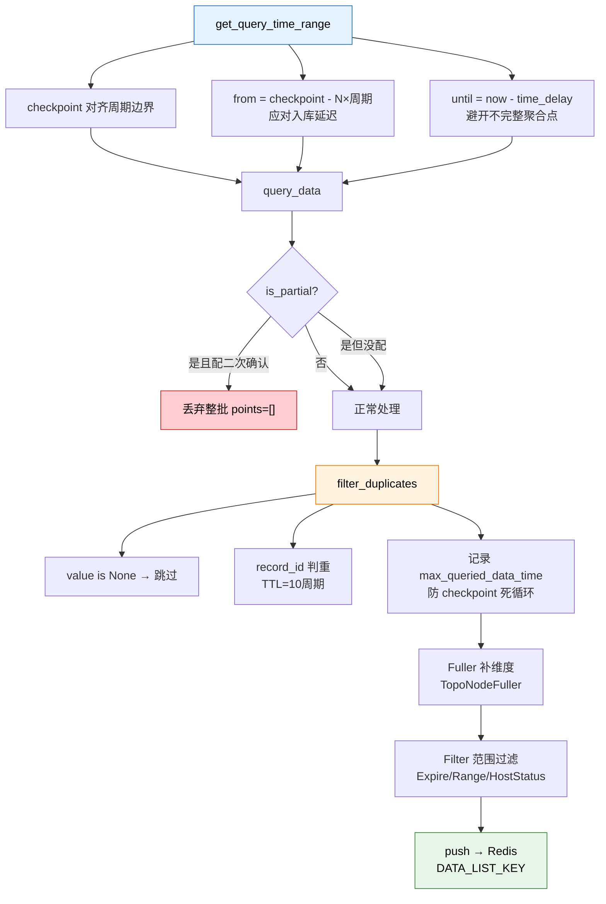

# 第 02 课：拉取数据——从数据源到标准格式

## 📖 文档核对

已核对源码：
- [processor.py:565-606](/root/bk-monitor/bkmonitor/alarm_backends/service/access/data/processor.py) —— get_query_time_range
- [processor.py:468-540](/root/bk-monitor/bkmonitor/alarm_backends/service/access/data/processor.py) —— query_data
- [processor.py:718-800](/root/bk-monitor/bkmonitor/alarm_backends/service/access/data/processor.py) —— filter_duplicates
- [fullers.py:20-35](/root/bk-monitor/bkmonitor/alarm_backends/service/access/data/fullers.py) —— TopoNodeFuller
- [filters.py:25-121](/root/bk-monitor/bkmonitor/alarm_backends/service/access/data/filters.py) —— ExpireFilter / RangeFilter / HostStatusFilter
- [README.md](/root/bk-monitor/bkmonitor/alarm_backends/service/access/README.md) —— 标准输出格式

## 🎯 本课目标

搞懂数据接入的**执行侧**：任务进了 Celery 之后，怎么决定"拉哪一段数据"、怎么查、怎么去重复、怎么补维度，最后变成什么格式。

---

## 一、知识点 1：查询时间范围与检查点

任务落到 [processor.py](/root/bk-monitor/bkmonitor/alarm_backends/service/access/data/processor.py) 的 `AccessDataProcess`，第一件事是算**拉哪一段时间的数据**。方法叫 `get_query_time_range`（processor.py:565）。

### 为什么需要检查点（Checkpoint）？

后台是周期性去数据源"要数据"的。如果每轮都固定拉"最近 5 分钟"，一旦某轮挂了或延迟了，那段时间的数据就**永久丢失**。所以需要记住"上次拉到哪了"——这就是 Checkpoint。

### 代码逐行读

```python
def get_query_time_range(self, now_timestamp: int):
    first_item = self.items[0]
    agg_interval = min(query_config["agg_interval"] for query_config in first_item.query_configs)
    min_last_checkpoint = min([i.item_config["update_time"] for i in self.items])
    checkpoint = Checkpoint(self.strategy_group_key).get(min_last_checkpoint, interval=agg_interval)
    checkpoint = checkpoint // agg_interval * agg_interval
```

**三行，三个设计**：

1. `agg_interval` 取组内最小周期——保证高频 item 不被低频 item 拖慢。
2. `min_last_checkpoint` 取所有 item 中**最早的** `update_time`。取最早而不是最新，是因为策略可能被修改过（改了查询条件），要以"最早那次改动"为界重新拉，避免用旧条件的数据。
3. `checkpoint // agg_interval * agg_interval` —— **对齐到周期边界**。如果上次拉到 10:00:37，而周期是 60 秒，就回退到 10:00:00。这样每轮拉的都是一个完整的周期，不会出现"半个周期的数据"。

### 往前多拉几个周期

```python
# 由于存在入库延时问题，每次多往前拉取settings.NUM_OF_COUNT_FREQ_ACCESS个周期的数据
self.from_timestamp = checkpoint - settings.NUM_OF_COUNT_FREQ_ACCESS * agg_interval
```

**为什么？** 数据源（尤其计算平台）入库有延迟。上一轮拉的时候，某个时间点的数据可能还没写进去。这轮往前多拉 N 个周期，就能把"迟到的数据"补回来。配合后面的去重，重复拉不会造成重复告警。

### 上界为什么要往前推

```python
time_delay = settings.ACCESS_DATA_TIME_DELAY
if first_item.time_delay:
    time_delay += first_item.time_delay
elif (DataSourceLabel.BK_LOG_SEARCH, DataTypeLabel.LOG) in first_item.data_source_types:
    time_delay += 60
elif first_item.use_aiops_sdk:
    # bkbase智能检测flow默认有1分钟的计算等待延迟, SDK智能检测保持相同的逻辑
    time_delay += 60

if not until_timestamp:
    # 由于存在入库延时问题，SUM等聚合方式最后一个点的结果会不准确，所以后台检测往前推 ACCESS_DATA_TIME_DELAY 秒
    # 保证查询时间范围是< until_timestamp 而不是<=即可
    until_timestamp = (now_timestamp - time_delay) // agg_interval * agg_interval
```

**这段代码是理解"告警为什么有延迟"的关键**：

- 对 `SUM` 这类聚合方式，**最后一个周期的点还没聚合完**，现在拉到的是一个不完整的残值。如果拿它去判阈值，会误判。
- 所以上界往前推一个 `time_delay`，**宁可晚一个周期拉，也不要拉到一个不准的值**。
- 不同数据源延迟不同：日志搜索 +60 秒、AIOps SDK +60 秒（对齐 bkbase 的计算等待），可叠加策略自定义的 `time_delay`。

> 💡 **直觉比喻**：就像统计"今天营业额"，你不会在 23:59:59 去统计，因为最后一笔可能还没入账。你会等到明天早上统计昨天全天的——这就是 `time_delay` 的意义。

### 计算平台的特殊处理

```python
if DataSourceLabel.BK_DATA in first_item.data_source_labels:
    end_time_key = key.ACCESS_END_TIME_KEY.get_key(group_key=self.strategy_group_key)
    until_timestamp_str = client.get(end_time_key)
    if until_timestamp_str:
        client.delete(end_time_key)
        until_timestamp = int(until_timestamp_str)
```

计算平台（BKDATA）支持"上次没处理完的时间"续传——从 Redis 取出上次中断的时间点继续。这是它独有的优化，其他数据源走上面的通用逻辑。

---

## 二、知识点 2：数据查询、去重与实例化

### 查询

`query_data`（processor.py:468）真正打向数据源：

```python
points = first_item.query_record(self.from_timestamp, self.until_timestamp)
# 判定is_partial
if first_item.query.is_partial:
    ...
    configured_strategy_ids = set(settings.DOUBLE_CHECK_SUM_STRATEGY_IDS)
    protected_strategy_ids = {
        item.strategy.id for item in self.items if item.strategy.id in configured_strategy_ids
    }
    if protected_strategy_ids:
        logger.warning(
            "double_check strategy group(%s) configured strategies(%s) is partial: skip query results",
            self.strategy_group_key,
            sorted(protected_strategy_ids),
        )
        points = []
```

**这里有个非常重要的一致性原则**：

- `is_partial` 表示查询返回的是**不完整结果**（比如数据源超时返回了部分数据）。
- 如果这批策略配置了**二次确认**（`DOUBLE_CHECK_SUM_STRATEGY_IDS`），则**整批结果丢弃**（`points = []`）。
- 为什么？二次确认本身就要求数据完整可靠。用残缺数据做二次确认，比不做还糟。

> ⚠️ **注意**：没配二次确认的策略，`is_partial` 只打日志，**不丢弃**——数据照常处理。这是"可用性优先"的取舍：宁可用不完整数据告警，也不能不告警。

异常也分两类处理（processor.py:520-540 附近）：`BKAPIError` 只记 error 日志，其他 `Exception` 记 exception 带堆栈，最终都是 `points = []`——**查询失败不炸主流程**。

### 去重：为什么要去，以及怎么去

进入 `filter_duplicates`（processor.py:718）：

```python
dup_obj = Duplicate(self.strategy_group_key, strategy_id=first_item.strategy.id, ttl=max_agg_interval * 10)
duplicate_counts = none_point_counts = 0
dup_obj.preload_duplicate_cache(points)
```

**TTL 是 `max_agg_interval * 10`**——去重缓存保留 10 个周期。这跟前面"往前多拉 N 个周期"是配套的：多拉的周期数必须在去重缓存的存活期内，否则去重失效会造成重复告警。

逐条处理：

```python
for record in reversed(points):
    value = get_value_from_raw_data(record, first_item)
    if value is None:
        none_point_counts += 1
        continue

    record_id, record_time = calculate_record_id(record, first_item)

    if record_time > max_queried_data_time:
        max_queried_data_time = record_time

    if dup_obj.is_duplicate_by_id(record_id, record_time):
        duplicate_counts += 1
        if have_priority:
            point = DataRecord(self.items, record)
            point.is_duplicate = True
            records.append(point)
    else:
        point = DataRecord(self.items, record)
        records.append(point)
        non_duplicate_records.append(point)
```

四个要点：

1. **空值先过滤**：`value is None` 直接跳过。这是最后一道防线——数据源可能返回空点。
2. **去重键是 `record_id`**：由 `calculate_record_id` 算出，格式是 `{dimensions_md5}.{timestamp}`（见 README 的标准格式）。**同一个维度在同一个时间点只算一条**。
3. **有优先级策略的重复数据要保留**：`have_priority` 时重复的也加进 `records` 但打 `is_duplicate = True` 标记，留给后续优先级过滤。普通策略则直接丢弃。
4. **`max_queried_data_time` 记录所有数据（含重复）的最大时间点**——源码注释明说：用于去重后 `record_list` 为空时仍能推进 checkpoint，**避免死循环**。这是个很细的防御：如果一批数据全是重复的，不去重缓存更新，checkpoint 不推进，下一轮还会拉同一批……无限循环。

最后批量写缓存：

```python
if non_duplicate_records:
    dup_obj.add_records_batch(non_duplicate_records)
```

**关键设计——延迟刷新**：源码注释写得很清楚：

```python
# 修改：不在这里刷新缓存，而是在 push() 中，时间点限制之后刷新
# 这样可以确保只有被处理的数据才会被标记为"已见过"
# dup_obj.refresh_cache()
```

**为什么？** 因为后面还有"时间点限制"（`_limit_records_by_time_points`）可能丢弃数据。如果这里就标记"已见过"，被丢弃的数据下次就不会再拉，就真的丢了。**只有最终被 push 出去的数据才算"处理过"**。

---

## 三、知识点 3：维度补充与范围过滤

数据洗干净后，还要做两件事：**补信息**和**过滤**。

### 维度补充（Fuller）

[fullers.py:20](/root/bk-monitor/bkmonitor/alarm_backends/service/access/data/fullers.py) 的 `TopoNodeFuller`：

```python
class TopoNodeFuller(Fuller):
    @classmethod
    def is_service_target(cls, scenario): ...
    @classmethod
    def is_host_target(cls, scenario): ...
    def full(self, record: DataRecord): ...
```

作用：给主机数据**补上拓扑节点信息**（集群、模块）。接入层 README 里写得很清楚：

> 维度补充方式：目前支持一种，对主机的数据补充节点（集群、模块）信息。支持用户自定义，自己补充任意数据

**为什么要在这一层补？** 因为原始数据里只有 `bk_target_ip` 这种裸 IP，没有"这台机器属于哪个集群哪个模块"。而**告警的收敛、订阅、屏蔽都需要按拓扑节点来组织**。在这一层补上，后面所有环节（检测、收敛、通知）都能直接用。

看标准输出格式里 event 的 dimensions 就能看到补完的效果（README）：

```json
"dimensions": {
    "bk_target_ip": "127.0.0.1",
    "bk_target_cloud_id": "0",
    "bk_topo_node": ["biz|2", "set|5", "module|6"]
}
```

`bk_topo_node` 这一项就是 Fuller 补的。

### 范围过滤（Filter）

[filters.py](/root/bk-monitor/bkmonitor/alarm_backends/service/access/data/filters.py) 有三个过滤器：

| 过滤器 | 行号 | 作用 |
|---|---|---|
| `ExpireFilter` | 25 | 过期数据过滤 |
| `RangeFilter` | 41 | 按配置的监控目标范围过滤 |
| `HostStatusFilter` | 77 | 按主机状态过滤（如 `ignore_monitoring`） |

`RangeFilter` 的实现（filters.py:46-71）体现了"过滤是逐 item 独立判定"的设计：

```python
# 如果被前面的filter过滤了，没有被保留下来，这里就直接跳过，节省时间
...
is_filtered = not is_match
if is_filtered:
    ...
record.is_retains[item_id] = not is_filtered
```

注意 `record.is_retains[item_id]` 是**按 item 记录**的——同一条数据，对 item A 被过滤，对 item B 可能保留。因为一个策略组里不同 item 的监控目标范围可能不同。

`HostStatusFilter`（filters.py:86-121）：

```python
is_filtered = host.ignore_monitoring
record.is_retains[item.id] = not is_filtered and record.is_retains[item.id]
```

注意 `and` 的写法——它是**在所有前置过滤结果的基础上再叠加**，而不是覆盖。这保证了多个过滤器是"与"的关系。

接入层 README 对范围过滤的口径说得很明确：

> 范围过滤：对监控目标的过滤，按配置来。只支持数据中有的维度，没有的则忽略

**这句"没有的则忽略"很重要**：如果策略配了按 `bk_module_id` 过滤，但数据里根本没有这个维度，那这个过滤条件**不生效**（而不是把数据全过滤掉）。这是 fail-open 的设计——避免配置错误导致整个策略没数据。

---

## 四、最终产物：标准数据格式

所有处理完成后，数据被 push 到 Redis 的 `DATA_LIST_KEY`（`access.data.{strategy_id}.{item_id}`），格式固定（README）：

```json
{
    "record_id": "f7659f5811a0e187c71d119c7d625f23.1569246480",
    "value": 1.38,
    "values": {"timestamp": 1569246480, "load5": 1.38},
    "dimensions": {"bk_target_ip": "127.0.0.1"},
    "time": 1569246480
}
```

字段含义：

| 字段 | 说明 |
|---|---|
| `record_id` | `{dimensions_md5}.{timestamp}`，去重的唯一键 |
| `value` | 判定用的数值（单指标） |
| `values` | 原始字段全集（多指标表达式要用） |
| `dimensions` | 维度字典，已被 Fuller 补充、被 Filter 判定 |
| `time` | 数据时间点 |

> 💡 **`record_id` 是贯穿全链路的身份证**：接入层用它去重，检测层用它实例化 DataPoint，事件层的 `anomaly_id` 也基于它派生（`{dimensions_md5}.{timestamp}.{strategy_id}.{item_id}.{level}`）。

---

## 五、本课回顾



看图：蓝色是"决定拉哪段"，红色是唯一的丢弃分支（配了二次确认的残缺数据），橙色是去重，绿色是最终输出。

**四条要记住的**：

1. **checkpoint 对齐周期边界**，且以组内**最早**的 `update_time` 为基准（策略改过要重拉）。
2. **上界往前推 `time_delay`** —— 这是告警天然有延迟的根本原因，`SUM` 聚合的最后一个点不准。
3. **去重缓存 TTL = 10 个周期**，且**延迟到 push 后才刷新**，防止被丢弃的数据永久丢失。
4. **过滤是"与"关系且按 item 独立记录**，`is_retains[item_id]` 用 `and` 叠加而非覆盖。

## 🚀 下一课

阶段 2 课 03《检测》——数据已经躺在 Redis 队列里了，接下来看它怎么被判定为异常。
