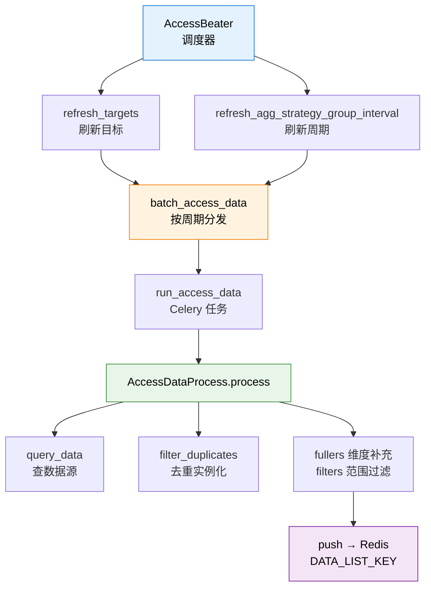

# 阶段 1 概览：数据接入

## 🎯 阶段目标

搞懂告警后台的**输入端**：一条时序数据是怎么被后台知道"该拉了"、然后被拉出来、洗干净、变成标准格式的。

## 📍 在故事主线中的定位

> 故事主线第一章：**"数字的报到"**
>
> 主角（一个时序数据点）还在 TSDB 里躺着。这一章讲的是：后台怎么定时去把它叫醒、核对身份、补上它自己说不清的信息（属于哪个集群哪个模块），然后送到流水线上。

## 🔑 必须掌握的知识点

| 课 | 知识点 | 为什么必须掌握 |
|---|---|---|
| 01 | 策略分组与周期调度 | 决定"多久拉一次"，是所有后续节奏的源头 |
| 01 | 目标分发与 QoS 队列 | 决定"谁来拉"，理解慢数据源为什么不被拖垮 |
| 02 | 查询时间范围与检查点 | 决定"拉哪一段"，理解数据延迟与补拉机制 |
| 02 | 数据查询、去重与实例化 | 决定"拉到的是什么"，理解标准数据格式 |
| 02 | 维度补充与范围过滤 | 决定"数据带什么信息走"，理解过滤与富化 |

## 🗺️ 本阶段路径图

看图：上半部分是"调度"（谁在什么时候发起），下半部分是"执行"（拉数据→洗数据→推队列）。橙色的 `batch_access_data` 是调度与执行的分界线——它只负责把任务丢进 Celery 队列，真正干活的是绿色的 `AccessDataProcess`。

## 📚 本阶段涉及的代码

| 文件 | 作用 |
|---|---|
| [handler.py](/root/bk-monitor/bkmonitor/alarm_backends/service/access/handler.py) | 调度器 AccessBeater、任务分发 |
| [processor.py](/root/bk-monitor/bkmonitor/alarm_backends/service/access/data/processor.py) | 数据拉取、去重、推送主流程 |
| [README.md](/root/bk-monitor/bkmonitor/alarm_backends/service/access/README.md) | 接入层职责与标准数据格式 |

## 🚀 阶段完成后的下一站

阶段 2《检测与触发》——数据已经躺在 Redis 队列里了，接下来要看它怎么被判定为异常。
