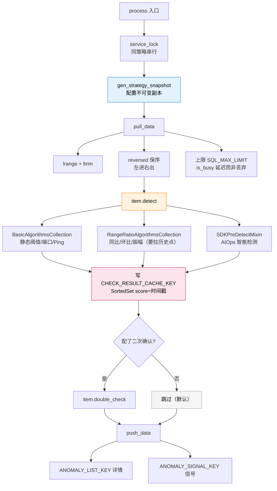

# 第 03 课：检测——数字凭什么叫"异常"

## 📖 文档核对

已核对源码：
- [detect/process.py:30-226](/root/bk-monitor/bkmonitor/alarm_backends/service/detect/process.py) —— DetectProcess 全流程
- [detect/strategy/__init__.py:45-543](/root/bk-monitor/bkmonitor/alarm_backends/service/detect/strategy/__init__.py) —— 算法基类体系
- [detect/strategy/](/root/bk-monitor/bkmonitor/alarm_backends/service/detect/strategy/) —— 18 个算法文件，已核实类名
- [core/detect_result/__init__.py:26](/root/bk-monitor/bkmonitor/alarm_backends/core/detect_result/__init__.py) —— `ANOMALY_LABEL = "ANOMALY"`
- [core/cache/key.py:240/260/390/436](/root/bk-monitor/bkmonitor/alarm_backends/core/cache/key.py) —— ANOMALY_LIST_KEY / ANOMALY_SIGNAL_KEY / LAST_CHECKPOINTS_CACHE_KEY / CHECK_RESULT_CACHE_KEY

## 🎯 本课目标

搞懂"判定"这一层：数据点怎么被算法判定为异常、判定结果存在哪、以及可选的二次确认是怎么回事。

---

## 一、先看主干：检测就六行

`DetectProcess.process()`（detect/process.py:209）是全阶段的主干：

```python
def process(self):
    with service_lock(key.SERVICE_LOCK_DETECT, strategy_id=self.strategy_id):
        start_at = time.time()
        logger.info(f"[detect][latency] strategy({self.strategy_id}) processing start")
        self.strategy.gen_strategy_snapshot()
        for item in self.strategy.items:
            self.pull_data(item)
            self.handle_data(item)
            try:
                self.double_check(item)
            except Exception:
                logger.exception("[detect] strategy(%s) 二次确认时发生异常，不影响告警主流程", self.strategy_id)
        self.push_data()
        ...
    self.run_inline_trigger()
```

**三个设计一眼可见**：

1. **`service_lock` 包住整个处理** —— 同一个策略的检测不会并发跑（否则同一批数据会被重复检测）。
2. **`double_check` 单独 try/except** —— 二次确认挂了**不影响主流程**（日志原话："不影响告警主流程"）。
3. **`run_inline_trigger()` 在锁外** —— 检测完尝试内联触发（性能优化，省掉一轮调度），但放在锁外避免延长持锁时间。

---

## 二、知识点 1：策略快照——为什么改配置不会撕裂半周期

### 问题从哪来？

检测是分 item 循环处理的，一个策略可能有多个 item，处理要花时间。**如果处理到一半，用户改了策略配置**（比如把阈值从 80 改成 90），会发生什么？

- 前半批 item 用阈值 80 判 → 判为异常
- 后半批 item 用阈值 90 判 → 判为正常

同一时刻的数据，两个 item 用两套标准——这就是**撕裂**。更糟的是，事后你想复盘"当时到底用的什么配置"，根本说不清。

### 解决方案：快照

```python
self.strategy.gen_strategy_snapshot()
```

检测开始时先生成一份策略配置的**不可变副本**，存进 Redis。后续所有 item 都用这份快照。

快照的 key 会**一路带到告警里**：`strategy_snapshot_key`。你在 `MonitorEventAdapter.adapt()` 的输出里能看到它（adapter.py:170）：

```python
"extra_info": {
    "origin_alarm": {
        ...
        "strategy_snapshot_key": self.record["strategy_snapshot_key"],
    },
}
```

> 💡 **这为什么重要？** 告警列表里展示的"触发条件"，不是从当前策略读的，是从快照读的。所以**你改了策略阈值，历史告警显示的仍是触发时的旧阈值**——这是特性，不是 bug。

---

## 三、知识点 2：检测算法家族

### 先取数据

`pull_data`（detect/process.py:41）从 Redis 队列取数据。有个非常容易忽略的细节：

```python
records = client.lrange(data_channel, -offset, -1)
...
if records:
    client.ltrim(data_channel, 0, -offset - 1)
    # 队列左进右出，lrange 取出时需要做一次倒序才能保证先进先出
    for record in reversed(records):
        try:
            data_point = DataPoint(json.loads(record), item)
            self.inputs[item.id].append(data_point)
        except ValueError:
            unexpected_record_count += 1
            last_unexpected_record = record
```

**三个要点**：

1. **`reversed(records)`** —— 队列是"左进右出"，`lrange` 取出来是倒序的，必须反转一次才能保证按时间先后处理。**如果漏了这行，检测顺序就乱了**，对环比这类依赖顺序的算法会出错。
2. **单批上限 `SQL_MAX_LIMIT`** —— 达到上限时 `is_busy = True` 并打 error 日志："部分数据可能存在处理延时"。**不是丢弃，是延迟到下一批处理**。
3. **坏数据隔离** —— 单条 JSON 解析失败只计数不中断（`except ValueError`），最后统一打一条 error 日志。一条脏数据不会毁掉整批。

### 算法家族全图

`item.detect(data_points)` 按配置调用具体算法。算法文件在 [detect/strategy/](/root/bk-monitor/bkmonitor/alarm_backends/service/detect/strategy/)，已核实全部类名与继承关系：

| 算法类 | 文件:行 | 继承 | 判定逻辑 | 典型场景 |
|---|---|---|---|---|
| `Threshold` | threshold.py:62 | `AndThreshold` | 与固定阈值比较，支持多条件 AND | 磁盘使用率、负载 |
| `SimpleYearRound` | simple_year_round.py:29 | `RangeRatioAlgorithmsCollection` | 与历史同期（上周/前N天同一时刻）比较 | PV、在线人数（日/周周期） |
| `AdvancedYearRound` | advanced_year_round.py:29 | `RangeRatioAlgorithmsCollection` | 同比高级版（多历史点统计） | 周期性强且需稳定性 |
| `SimpleRingRatio` | simple_ring_ratio.py:26 | `RangeRatioAlgorithmsCollection` | 与前一时刻/前N点均值比较 | 突增突降、成功率 |
| `AdvancedRingRatio` | advanced_ring_ratio.py:29 | `AdvancedYearRound` | 环比高级版 | 需历史统计的环比 |
| `YearRoundAmplitude` | year_round_amplitude.py:25 | `RangeRatioAlgorithmsCollection` | 同比振幅：同期差值 × 波动率 + 振幅 | 每天定点活动但幅度需受控 |
| `RingRatioAmplitude` | ring_ratio_amplitude.py:24 | `SimpleRingRatio` | 环比振幅 | 相邻周期波动幅度 |
| `OsRestart` | os_restart.py:47 | `SimpleRingRatio` | 系统重启特判（`system.env.uptime`） | 主机重启 |
| `ProcPort` | proc_port.py:26 | `BasicAlgorithmsCollection` | 进程端口状态 | 进程端口存活 |
| `PingUnreachable` | ping_unreachable.py:27 | `BasicAlgorithmsCollection` | Ping 不可达 | 主机存活 |

另有 8 个扩展算法文件（未逐个核实类名）：`abnormal_cluster.py`、`host_anomaly_detection.py`、`intelligent_detect.py`、`multivariate_anomaly_detection.py`、`new_series.py`、`time_series_forecasting.py`、`year_round_range.py`。

### 两条继承主线

从基类体系（detect/strategy/__init__.py）看，算法分两大支：

```
Algorithms                          (基类，:45)
├── ExprDetectAlgorithms            (:204，表达式检测)
├── BasicAlgorithmsCollection       (:218，基础算法集合)
│   ├── AndThreshold → Threshold
│   ├── ProcPort
│   ├── PingUnreachable
│   └── RangeRatioAlgorithmsCollection   (:421，同时继承 HistoryPointFetcher)
│       ├── SimpleYearRound / AdvancedYearRound
│       ├── SimpleRingRatio → RingRatioAmplitude / OsRestart
│       └── YearRoundAmplitude
└── SDKPreDetectMixin               (:487，SDK 预检测：detect_by_sdk / detect_by_bkdata)
```

**关键区分**：

- **`BasicAlgorithmsCollection`**：只跟当前点（或固定阈值）比，不需要历史数据。快，但无法感知周期规律。
- **`RangeRatioAlgorithmsCollection`**：额外继承 `HistoryPointFetcher`（:297），**要拉历史点做比较**。所以同比/环比类算法天生比静态阈值慢——因为每次检测都伴随历史数据查询。
- **`SDKPreDetectMixin`**：走外部 SDK / bkdata 做智能检测（AIOps），本地不算。

> ⚠️ **选型提示**：能用静态阈值就别用同比/环比。同比环比要拉历史点，是检测阶段最主要的性能开销来源之一。

### 判定结果写哪？

这是理解触发阶段的关键。检测不只输出"是/否异常"，还要把**每次判定的结果**记下来，供下一阶段统计"连续几次异常"。

写在两个 Redis 结构里（key 定义位置已核实）：

| Key | 定义位置 | 类型 | 内容 |
|---|---|---|---|
| `CHECK_RESULT_CACHE_KEY` | core/cache/key.py:436 | SortedSet（score=时间戳） | 每维度每级别一条时序，异常点记为 `{timestamp}\|ANOMALY` |
| `LAST_CHECKPOINTS_CACHE_KEY` | core/cache/key.py:390 | Hash | 每维度最后检测时间戳 |

`ANOMALY_LABEL` 常量定义在 [core/detect_result/__init__.py:26](/root/bk-monitor/bkmonitor/alarm_backends/core/detect_result/__init__.py)：

```python
ANOMALY_LABEL = "ANOMALY"  # 异常标识
```

源码里 key.py:398 和 :441 有两处**互相引用**的注释，明确要求两个 key 的模板保持一致：

```python
# 这里的field_tpl需要保持和CHECK_RESULT_CACHE_KEY的key_tpl一致     (:398)
# 这里的key_tpl修改后，需要同步修改LAST_CHECKPOINTS_CACHE_KEY的field_tpl  (:441)
```

> 💡 **这处注释是个信号**：这两个 key 的模板是**耦合**的，改一个必须改另一个，否则触发阶段会取不到检测结果。典型的隐式契约。

---

## 四、知识点 3：二次确认——可选的降噪层

`double_check`（detect/process.py:181）：

```python
def double_check(self, item):
    """二次确认"""
    # 当不存在异常时跳过二次确认
    if not self.outputs[item.id]:
        return
    # 灰度入口提前（不再放到二次确认代码逻辑中）
    # 基于性能考虑，先将逻辑设置为：没配置灰度，则不开启二次确认。
    # 后续优化性能后，考虑默认开启全量二次确认。
    if int(self.strategy_id) not in settings.DOUBLE_CHECK_SUM_STRATEGY_IDS:
        return
    logger.info(f"[detect] strategy({self.strategy_id}) item({item.id}) 开始异常二次确认流程")
    item.double_check(outputs=self.outputs[item.id])
```

**三个事实**（都写在注释里，很坦诚）：

1. **无异常直接跳过** —— 正常数据不做二次确认，零开销。
2. **白名单制** —— 只有配在 `settings.DOUBLE_CHECK_SUM_STRATEGY_IDS` 里的策略 ID 才启用。**默认全关**。
3. **为什么默认关？注释明说：性能考虑**。二次确认要再查一次数据源，成本高。注释还留了 TODO："后续优化性能后，考虑默认开启全量二次确认"。

**二次确认跟接入层的关系**：回忆课 02 —— `query_data` 里 `is_partial` 时，只有"配了二次确认的策略"才会丢弃整批结果。**这两处是同一批策略 ID**，逻辑自洽：既然要做二次确认，数据就必须完整。

---

## 五、输出：异常点去哪了

`push_data`（detect/process.py:119）做两件事：

**① 算处理延迟**（SLI 监控）：

```python
for data_points in self.outputs.values():
    for data_point in data_points:
        if not data_point["data"].get("access_time"):
            continue
        latency = current_time - data_point["data"]["access_time"]
        data_point["data"]["detect_time"] = current_time
        ...
if max_latency > 60:
    logger.warning("[access to detect]big latency %s, strategy(%s)", max_latency, self.strategy_id)
```

`access_time` 是接入层打的，`detect_time` 是检测层打的。**这两个时间戳一路带到告警里**，是排查"告警延迟"的关键证据——能直接看出卡在接入还是检测。

**② 推两个队列**：

```python
anomaly_count = self.push_abnormal_data(
    self.outputs,
    self.strategy_id,
    publish_signal=not inline_trigger_enabled,
)
```

- `ANOMALY_LIST_KEY`（key.py:240）—— 存**异常详情**
- `ANOMALY_SIGNAL_KEY`（key.py:260）—— 存**信号**，内容只是 `{strategy_id}.{item_id}`

**为什么分两个？** 信号极轻（就一个字符串），下游可以高频扫描信号快速定位"哪组有异常"，再按图索骥去 ANOMALY_LIST 取详情。**避免为了找异常而扫全量列表**。

内联触发（detect/process.py:194-207）是性能优化：

```python
def run_inline_trigger(self):
    for item_id in self.inline_trigger_items:
        try:
            run_trigger_item(self.strategy_id, item_id, executor="detect_inline")
        except LockError:
            self.publish_anomaly_signals([f"{self.strategy_id}.{item_id}"])
```

检测完直接在本进程跑触发，省掉一轮调度。**抢锁失败就退化**：补发信号交给独立的 trigger worker 处理。这是"快路径 + 慢路径兜底"的典型设计。

---

## 六、本课回顾



看图：蓝色是快照（保证一致性），橙色是算法三分支，粉色是检测结果落盘（供下阶段统计），灰色是默认关闭的二次确认。

**四条要记住的**：

1. **策略快照保证"同一轮用同一套配置"**，快照 key 带到告警里，历史告警显示的是触发时的旧阈值。
2. **`reversed(records)` 不能漏** —— 队列左进右出，不反转就乱序。
3. **同比/环比要拉历史点**，是检测阶段主要性能开销；能用静态阈值就别用。
4. **检测输出的是"每次判定结果"写入 SortedSet**，不是直接产出告警——告警要等下一阶段统计"连续几次"。

## 🚀 下一课

课 04《触发》——异常点已经记录了，接下来看"连续 N 次"到底怎么统计，以及事件长什么样。
