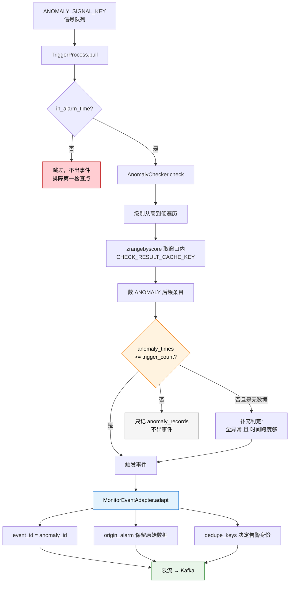

# 第 04 课：触发——异常点 ≠ 事件

## 📖 文档核对

已核对源码：
- [trigger/processor.py:664-706](/root/bk-monitor/bkmonitor/alarm_backends/service/trigger/processor.py) —— process / process_point
- [trigger/checker.py:27-230](/root/bk-monitor/bkmonitor/alarm_backends/service/trigger/checker.py) —— AnomalyChecker 全量
- [core/alert/adapter.py:104-176](/root/bk-monitor/bkmonitor/alarm_backends/core/alert/adapter.py) —— MonitorEventAdapter.adapt
- [core/alert/event.py:164-217](/root/bk-monitor/bkmonitor/alarm_backends/core/alert/event.py) —— dedupe_keys / cal_dedupe_md5
- [constants.py:75](/root/bk-monitor/bkmonitor/alarm_backends/constants.py) —— `DEFAULT_DEDUPE_FIELDS`

## 🎯 本课目标

搞懂最容易误解的一层：**检测出异常 ≠ 产生告警**。中间还有一道"连续 N 次"的闸门，以及把内部格式转成自愈事件的适配层。

---

## 一、先看主干：触发的两道闸门

`TriggerProcess.process()`（trigger/processor.py:664）：

```python
def process(self):
    pulled_count = self.pull()

    in_alarm_time, message = self.strategy.in_alarm_time()
    if not in_alarm_time:
        logger.info("[trigger] strategy(%s) not in alarm time: %s, skipped", self.strategy_id, message)
    else:
        for point in self.anomaly_points:
            try:
                self.process_point(point)
            except Exception as e:
                error_message = f"[process error] strategy({self.strategy_id}), item({self.item_id}) reason: {e} \norigin data: {point}"
                logger.exception(error_message)
            if self.progress_callback is not None:
                self.progress_callback()

    self.push()
    return pulled_count
```

**第一道闸门：`in_alarm_time()`** —— 策略的生效时间段。不在时间段内，**连判定都不做**，直接跳过。

> 🔥 **排障第一检查点**：告警死活不触发，先看这里。很多策略配了"只在工作时间告警"，非工作时间数据照常检测、异常照常记录，但**不出事件**。

**第二道闸门：`AnomalyChecker.check()`** —— 在 `process_point`（trigger/processor.py:683）里：

```python
def process_point(self, point):
    point = json.loads(point)
    strategy = self.get_strategy_snapshot(point["strategy_snapshot_key"])
    checker = AnomalyChecker(point, strategy, self.item_id)
    anomaly_records, event_record = checker.check()
    ...
    if event_record:
        self.event_records.append({"anomaly_records": anomaly_records, "event_record": event_record})
    else:
        self.anomaly_records.extend(anomaly_records)
```

**注意最后的分支**：`check()` 返回两个东西——`anomaly_records`（异常记录）**总是有**，`event_record`（事件）**可能没有**。没触发就只记异常记录，**不产生事件**。

这就是本课标题的意思：**异常点是常态，事件才是稀缺品**。

---

## 二、知识点 1：触发条件判定——"连续 N 次"到底怎么统计

### 核心代码

`AnomalyChecker._check_anomaly_by_level`（checker.py:168）：

```python
check_cache_key = CHECK_RESULT_CACHE_KEY.get_key(
    strategy_id=self.strategy_id,
    item_id=self.item_id,
    dimensions_md5=self.dimensions_md5,
    level=level,
)
# 在对应的打点队列中取出打点信息。时间范围为source_time前后的一个窗口偏移量
check_window_offset = trigger_config["check_window_size"] * self.check_window_unit - 1
check_results = CHECK_RESULT_CACHE_KEY.client.zrangebyscore(
    name=check_cache_key, min=self.source_time - check_window_offset, max=self.source_time, withscores=True
)
# 统计包含异常标记的key的数量，并与trigger_count进行比较
anomaly_timestamps = []
for label, score in check_results:
    if label.endswith(ANOMALY_LABEL):
        anomaly_timestamps.append(int(score))

anomaly_times = len(anomaly_timestamps)
is_triggered = anomaly_times >= trigger_config["trigger_count"]
```

**逐步拆解**：

1. **窗口起点**：`source_time - (check_window_size × check_window_unit - 1)`，`-1` 是为了让窗口闭区间正好覆盖 N 个周期（含当前点）。
2. **取数**：从课 03 说的 `CHECK_RESULT_CACHE_KEY` SortedSet 里，按 score（时间戳）范围取。
3. **统计**：数带 `ANOMALY` 后缀的条目数量。
4. **判定**：`anomaly_times >= trigger_count`。

> 💡 **一句话总结**：在最近 N 个周期的判定记录里，异常点的个数够不够 M 个。

### 常见误解澄清

**误解**："连续 3 次触发" = 必须**紧挨着**的 3 次都异常。

**实际**：是**窗口内累计**够 3 次就算，不要求严格连续。窗口内 5 个周期里有 3 个异常（比如第 1、3、5 个），同样触发。

这是个重要区别——它意味着偶尔恢复一次不会重置计数，只要窗口内累计够数就触发。**降噪效果比"严格连续"弱，但比"单点即告"强得多**。

### 级别从高到低，高级别优先

`check_anomaly`（checker.py:144）：

```python
levels = sorted([int(level) for level in list(self.point["anomaly"].keys())])
# 按照算法级别从高到低判断，如果高级别算法已经触发了，则无需判断低级别
anomaly_level = -1
anomaly_timestamps = []
for level in levels:
    if anomaly_level != -1:
        logger.debug(...)
        continue
    is_triggered, anomaly_timestamps = self._check_anomaly_by_level(str(level))
    if is_triggered:
        anomaly_level = level
return anomaly_level, anomaly_timestamps
```

**设计意图**：一条数据可能同时命中多个级别（比如致命级和警告级的算法都判为异常）。**只出最高级别的那个事件**，日志明说"skip trigger because high level anomaly record has been trigger"。

这保证了**一条数据只产生一个事件**，不会出现同一时刻同一维度蹦出两条不同级别的告警。

### 无数据告警的特殊补充判定

```python
if anomaly_times >= 2 and not is_triggered and self.is_no_data_point(self.point):
    # 无数据判定补充：
    # 1. 所有检测记录均为异常点
    # 2. 异常点间时间差异符合无数据配置的周期
    start, end = anomaly_timestamps[0], anomaly_timestamps[-1]
    always_nodata = anomaly_times == len(check_results)
    is_triggered = always_nodata and (
        (end - start) >= (trigger_config["trigger_count"] - 1) * self.check_window_unit
    )
```

无数据告警（agent 挂了没上报）走**独立逻辑**，两个额外条件：

1. `always_nodata` —— 窗口内**所有**记录都是异常（不是部分）。
2. 首末异常点的时间跨度 ≥ `(trigger_count - 1) × 窗口单位` —— 确保异常**持续**了足够长时间。

**为什么要额外判定？** 因为无数据场景下，检测记录的产生本身可能不规律（数据都没了，哪来规律的打点）。用"时间跨度"代替"点数"更能反映"确实断了一段时间"。

无数据告警的初始化也不同（checker.py:41-46）：

```python
if self.is_no_data_point(point):
    no_data_configs = Strategy.get_no_data_configs(self.item)
    no_data_level = no_data_configs.pop("level")
    self.trigger_configs = {str(no_data_level): no_data_configs}
else:
    self.trigger_configs = Strategy.get_trigger_configs(self.strategy)
```

无数据告警的 `trigger_configs` 来自 `get_no_data_configs`（无数据专用配置），且**只有一个级别**。

### 配置缺失的兜底

```python
try:
    trigger_config = self.trigger_configs[level]
except KeyError:
    trigger_configs = self.trigger_configs.values()
    if not trigger_configs:
        logger.error("strategy({}), item({}) level({}) trigger config not exists".format(...))
        return False, []
    # 默认兜底，trigger 配置当前所有告警级别默认一致
    trigger_config = list(trigger_configs)[0]
```

某个级别没配触发条件时，**取任意一个级别的配置兜底**（注释说"当前所有告警级别默认一致"）。如果整个都没配，才返回 `False` 并打 error。

---

## 三、知识点 2：事件适配与输出

### 为什么要适配？

触发阶段产出的内部格式，是 bk-monitor 自己认的。但下游（告警构建、Issue 聚合、自愈）用的是**自愈事件标准格式**。所以需要一个适配层：`MonitorEventAdapter`（core/alert/adapter.py:30）。

### 输出结构

`adapt()`（adapter.py:104）产出事件，核心字段：

```python
event = {
    "event_id": self.record["anomaly"][str(severity)]["anomaly_id"],
    "plugin_id": settings.MONITOR_EVENT_PLUGIN_ID,
    "strategy_id": self.strategy["id"],
    "alert_name": alert_name,
    "description": ...,
    "severity": int(severity),
    "tags": tags,
    "target_type": target_type,
    "target": target,
    "status": status or EventStatus.ABNORMAL,
    "metric": list(dict.fromkeys(metric)),
    "category": self.strategy["scenario"],
    "data_type": self.strategy["items"][0]["query_configs"][0]["data_type_label"],
    "dedupe_keys": [f"tags.{key}" for key in data_dimensions.keys()],
    "time": time or self.record["data"]["time"],
    "anomaly_time": EventIDParser(self.record["trigger"]["anomaly_ids"][0]).source_time,
    ...
    "extra_info": {
        "additional_dimensions": additional_dimensions,
        "origin_alarm": {
            "trigger_time": now_time,
            "data": self.record["data"],
            "trigger": self.record.get("trigger", {}),
            "anomaly": self.record.get("anomaly", {}),
            "dimension_translation": {},
            "strategy_snapshot_key": self.record["strategy_snapshot_key"],
        },
    },
}
```

### 三个必须理解的点

**① `event_id` 就是 `anomaly_id`**

```python
"event_id": self.record["anomaly"][str(severity)]["anomaly_id"],
```

回顾接入层 README 里的格式：`anomaly_id = {dimensions_md5}.{timestamp}.{strategy_id}.{item_id}.{level}`。

**这个 ID 把"谁、什么时候、哪个策略、哪个级别"全部编码进去了**。它是事件与异常点之间的纽带。

**② `origin_alarm` 是溯源命脉**

原始数据被整体塞进 `extra_info.origin_alarm`，包含：

| 字段 | 内容 |
|---|---|
| `data` | 原始接入数据（含 `dimensions`、`values`、`access_time`、`detect_time`） |
| `trigger` | 触发信息（含 `level`、`anomaly_ids[]`） |
| `anomaly` | 各级异常详情（`anomaly_message`、`anomaly_id`、`anomaly_time`） |
| `strategy_snapshot_key` | 策略快照 key |

> 🔥 **这是整个告警系统最重要的设计之一**：告警顶层字段（如 `target_type`、`target`）是**加工后**的收编结果，会丢失原始维度细节。而 `origin_alarm` 保留了**完整的原始数据**。
>
> Issue 聚合取维度时，必须从 `origin_alarm.data.dimensions` 取，而不是顶层字段——项目里已有决策记忆明确这一点（"指纹取值源必须 origin_alarm 的 dimensions"）。

**③ `dedupe_keys` 决定了告警身份**

```python
# 基于事件维度，生成唯一告警指纹。实例化 Event内存对象，执行 clean 会补充默认字段: DEFAULT_DEDUPE_FIELDS
# 这里事件维度的 key 统一补充 tags. 前缀
"dedupe_keys": [f"tags.{key}" for key in data_dimensions.keys()],
```

`dedupe_keys` 是**告警去重的输入**。它把事件的每个维度都变成 `tags.{维度名}` 的形式。

最终去重键怎么算？在 `Event.clean` 时补充默认字段（event.py:164）：

```python
def _clean_dedupe_keys(self):
    default_dedupe_keys = copy.deepcopy(DEFAULT_DEDUPE_FIELDS)
    if self.data.get("strategy_id"):
        # 如果有策略ID，就用策略ID，不用告警名称。这是监控特有逻辑
        default_dedupe_keys.remove("alert_name")
    else:
        default_dedupe_keys.remove("strategy_id")
    ...
```

`DEFAULT_DEDUPE_FIELDS`（constants.py:75）：

```python
DEFAULT_DEDUPE_FIELDS = ["alert_name", "strategy_id", "target_type", "target", "bk_biz_id"]
```

**那段"监控特有逻辑"的注释很重要**：有 `strategy_id` 时**移除 `alert_name`**。

**为什么？** 因为策略改名不该导致告警炸开成新的一条。用 `strategy_id` 做身份，改名不影响去重；如果用 `alert_name`，改一次名字就产生一批新告警。

最终 MD5 计算（event.py:205）：

```python
def cal_dedupe_md5(self):
    self._dedupe_values = []
    for key in self.dedupe_keys:
        value = self.get_field(key)
        if self.data["target_type"] in EVENT_EXTRA_TARGET_TYPE:
            # 兼容告警目标扩展前后 告警 MD5 指纹连贯性
            if key == "target":
                value = None
            if key == "target_type":
                value = ""
        self._dedupe_values.append(value)
    self.data["dedupe_md5"] = count_md5(self._dedupe_values)
```

还有一处**兼容性处理**：目标类型扩展前后，为保证 MD5 指纹连贯，把 `target` 置 None、`target_type` 置空。这是产品演进中"不能因为加功能就让所有老告警重新开一遍"的妥协。

---

## 四、输出：进 Kafka

`push_event_to_kafka`（trigger/processor.py:565）三步：

1. **限流**：`_reserve_rate_limit` / `_filter_by_rate_limit` —— 并发内联时先原子预占额度，开关关闭时保留"Kafka 成功后记账"的旧语义。
2. **适配**：逐个 `MonitorEventAdapter(...).adapt()`。
3. **发送**：`MonitorEventAdapter.push_to_kafka(events=events)`。

限流丢弃有独立指标 `TRIGGER_EVENT_RATE_LIMIT_DROP`，单批超 1000 条也有 `PROCESS_OVER_FLOW` 指标——**限流是静默丢事件，只能靠指标发现**。

---

## 五、本课回顾



看图：红色是第一个跳过点（告警时间窗），橙色是核心判定，灰色是"没触发"的常态出口，蓝色是适配（本课第二知识点），绿色是输出。

**四条要记住的**：

1. **`in_alarm_time` 不过就直接跳过**，这是"告警不触发"排查的第一检查点。
2. **"连续 N 次"是窗口内累计**，不是严格连续；偶尔恢复一次不会清零。
3. **级别从高到低，只出最高级别**，一条数据最多一个事件。
4. **`origin_alarm` 保留完整原始数据**，是唯一可靠的溯源来源；`dedupe_keys` 决定告警身份，有 `strategy_id` 时故意不用 `alert_name`。

## 🚀 下一课

阶段 3 课 05《告警构建》——事件已经进了 Kafka，接下来看它怎么变成一条有 ID、有状态、有生命周期的告警。
