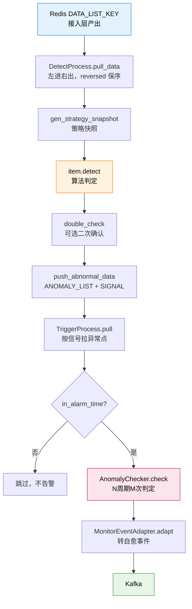

# 阶段 2 概览：检测与触发

## 🎯 阶段目标

搞懂告警后台的**加工端**：洗好的数据点怎么被判定为"异常"，异常点又怎么被聚合成一个"事件"。

## 📍 在故事主线中的定位

> 故事主线第二章：**"判决与传票"**
>
> 主角（数据点 `load5 = 1.38`）已经报到、洗干净，排进了队列。这一章它要接受两次审判：
> - **第一次审判（检测）**：你越界了吗？——由算法回答。
> - **第二次审判（触发）**：你配得上发一张传票吗？——偶发一次不算，得"连续多次"才算。
>
> 只有两次都通过，它才能从"数据点"晋升为"事件"。

## 🔑 必须掌握的知识点

| 课 | 知识点 | 为什么必须掌握 |
|---|---|---|
| 03 | 策略快照 | 决定"用哪套配置判"，理解为什么改策略不会撕裂半周期 |
| 03 | 检测算法家族 | 决定"怎么判越界"，理解不同场景该选哪种算法 |
| 03 | 二次确认 | 决定"要不要再验一遍"，理解降噪的代价与开关 |
| 04 | 触发条件判定 | 决定"几次才算"，理解"连续 N 次"到底怎么统计 |
| 04 | 事件适配与输出 | 决定"输出长什么样"，理解 `origin_alarm` 为何是溯源命脉 |

## 🗺️ 本阶段路径图

看图：蓝色是输入（上一阶段的产物），橙色是第一次审判（检测），粉色是第二次审判（触发判定 + 告警时间窗），绿色是输出（进 Kafka，交给阶段 3 构建告警）。

**注意 `in_alarm_time` 这个分支**：很多"告警没触发"的排查，问题就出在这里——策略配了生效时间段，不在时间段内直接跳过，连检测都不做。

## 📚 本阶段涉及的代码

| 文件 | 作用 |
|---|---|
| [detect/process.py](/root/bk-monitor/bkmonitor/alarm_backends/service/detect/process.py) | 检测主流程（226 行） |
| [detect/strategy/](/root/bk-monitor/bkmonitor/alarm_backends/service/detect/strategy/) | 检测算法家族（18 个算法文件） |
| [trigger/processor.py](/root/bk-monitor/bkmonitor/alarm_backends/service/trigger/processor.py) | 触发主流程（706 行） |
| [trigger/checker.py](/root/bk-monitor/bkmonitor/alarm_backends/service/trigger/checker.py) | AnomalyChecker 触发判定 |
| [core/alert/adapter.py](/root/bk-monitor/bkmonitor/alarm_backends/core/alert/adapter.py) | MonitorEventAdapter 事件适配 |
| [core/detect_result/__init__.py:26](/root/bk-monitor/bkmonitor/alarm_backends/core/detect_result/__init__.py) | `ANOMALY_LABEL = "ANOMALY"` 异常标识常量 |

## 🚀 阶段完成后的下一站

阶段 3《告警构建》——事件已经进了 Kafka，接下来看它怎么变成一条真正的告警。
