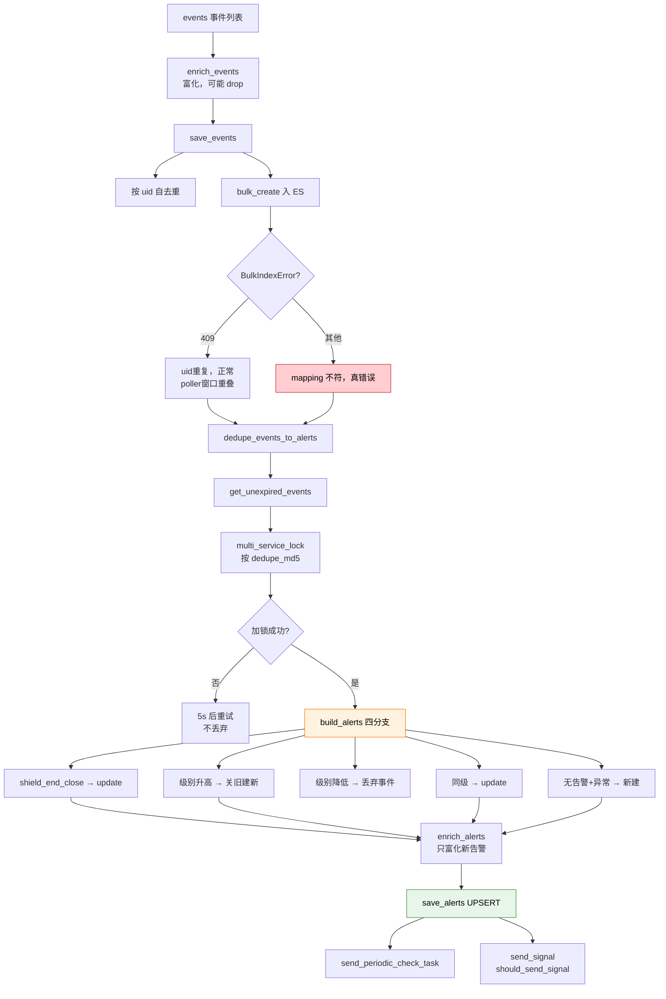

# 第 05 课：告警构建——事件怎么变成"告警"

## 📖 文档核对

已核对源码：
- [builder/processor.py:174-183](/root/bk-monitor/bkmonitor/alarm_backends/service/alert/builder/processor.py) —— handle 主流程
- [builder/processor.py:217-292](/root/bk-monitor/bkmonitor/alarm_backends/service/alert/builder/processor.py) —— enrich_events / save_events
- [builder/processor.py:76-172](/root/bk-monitor/bkmonitor/alarm_backends/service/alert/builder/processor.py) —— dedupe_events_to_alerts 加锁与落盘
- [builder/processor.py:365-460](/root/bk-monitor/bkmonitor/alarm_backends/service/alert/builder/processor.py) —— build_alerts 分支
- [builder/processor.py:185-215](/root/bk-monitor/bkmonitor/alarm_backends/service/alert/builder/processor.py) —— send_periodic_check_task / enrich_alerts
- [core/alert/alert.py:563/616/626/790](/root/bk-monitor/bkmonitor/alarm_backends/core/alert/alert.py) —— 状态判定与 from_event

## 🎯 本课目标

搞懂全链路**最核心**的一课：事件如何被合并成告警，告警的"身份"由什么决定，级别升降怎么处理。

---

## 一、先看主干：三步

`AlertBuilder.handle()`（builder/processor.py:174）：

```python
def handle(self, events: list[Event]):
    """
    事件处理逻辑
    1. 保存事件数据到 ES
    2. 更新告警 Redis 缓存
    """
    events = self.enrich_events(events)
    events = self.save_events(events)
    alerts = self.dedupe_events_to_alerts(events)
    return alerts
```

清晰三步：**富化 → 存事件 → 去重成告警**。

---

## 二、知识点 1：事件富化与保存

### 富化（enrich_events）

```python
def enrich_events(self, events: list[Event]):
    factory = EventEnrichFactory(events)
    events = factory.enrich()
    self.logger.info(
        "[alert.builder enrich event] finished, dropped(%d/%d), cost: (%.3f)",
        len([e for e in events if e.is_dropped()]),
        len(events),
        time.time() - start_time,
    )
```

**关键**：富化过程中事件**可能被丢弃**（`is_dropped()`）。典型场景是黑白名单过滤——配了"这个 IP 不告警"，事件在富化阶段就被标记丢弃。

日志里专门统计 `dropped(N/M)`，说明**丢弃是常态而非异常**。

### 保存（save_events）

```python
def save_events(self, events: list[Event]) -> list[Event]:
    dedupe_events = []
    exist_uids = set()
    for event in events:
        if event.is_dropped() or event.id in exist_uids:
            # 忽略拥有重复uid的事件
            continue
        dedupe_events.append(event)
        exist_uids.add(event.id)
```

**先按 uid 自去重**——同一批里重复的直接跳过。

然后是这段**非常有信息量**的错误处理：

```python
try:
    EventDocument.bulk_create(event_documents)
except BulkIndexError as e:
    for err in e.errors:
        error_uids.add(err["create"]["_id"])
        if err["create"]["status"] == 409:
            # status=409 一般是uid重复了，这种情况大多是因为 poller 拉取窗口重叠导致的
            conflict_error_events_count += 1
        else:
            # 其他的情况，一般是实际数据类型与es的 mapping 对不上，例如在 KeyWord 字段中存入了 Object
            self.logger.error("[alert.builder save events ERROR] detail: %s", err)
            other_error_events_count += 1
```

**把 409 和其他错误分开统计**，因为：

| 错误 | 含义 | 严重度 |
|---|---|---|
| `409` | uid 重复 | **正常**——Kafka poller 拉取窗口重叠导致，不是问题 |
| 其他 | 数据类型与 ES mapping 不符（如 Keyword 字段存了 Object） | **真错误**，打 error 日志 |

> 💡 **这是很好的可观测性设计**：如果不区分，409 的噪声会淹没真正的 mapping 错误。分开后，看到 `other_error` 增长就知道有字段类型问题要修。

最后只返回保存成功的事件：

```python
return [event for event in dedupe_events if event.id not in error_uids]
```

**保存失败的事件不参与后续去重**——它根本没进 ES，拿什么建告警。

---

## 三、知识点 2：去重与告警生成（核心）

### 前置：剔除过期事件 + 加锁

`dedupe_events_to_alerts`（builder/processor.py:76）：

```python
events = self.get_unexpired_events(events)
if not events:
    return []
lock_keys = [ALERT_UPDATE_LOCK.get_key(dedupe_md5=event.dedupe_md5) for event in events]

with multi_service_lock(ALERT_UPDATE_LOCK, lock_keys) as lock:
    success_locked_events = []
    fail_locked_events = []
    for event in events:
        if lock.is_locked(ALERT_UPDATE_LOCK.get_key(dedupe_md5=event.dedupe_md5)):
            success_locked_events.append(event)
        else:
            fail_locked_events.append(event)
```

**锁的粒度是 `dedupe_md5`**——同一个告警身份的事件串行处理。这很关键：如果两个并发的事件同属一条告警，同时去"创建"就会建出两条重复告警。

**加锁失败不丢弃**：

```python
if fail_locked_events:
    # 对加锁失败的告警，丢到队列中，延后5s操作
    dedupe_events_to_alerts.apply_async(
        kwargs={"events": fail_locked_events},
        countdown=5,
    )
```

**5 秒后重试**。这是"事件不能丢"原则的体现——宁可晚 5 秒，也不能扔掉。

### 核心：build_alerts 的四分支

`build_alerts`（builder/processor.py:365）——**本课最重要的一段代码**：

```python
for event in events:
    alert: Alert = current_alerts.get(event.dedupe_md5)
    if alert and alert.is_abnormal():
        close_shields.take_over(alert)
        if alert.shield_end_close:
            alert.update(event)
            new_alerts[alert.id] = alert
            continue
    if alert and alert.is_abnormal():
        # 存量告警处理
        alert = self.alert_qos_handle(alert, successor_event=event)
        if alert.status == EventStatus.CLOSED:
            # qos状态解除，创建新告警
            new_alerts[alert.id] = alert
            alert = Alert.from_event(event, circuit_breaking_manager=self.circuit_breaking_manager)
        else:
            if alert.severity > event.severity and alert.severity_source != AssignMode.BY_RULE:
                # 如果告警级别小于当前事件的级别，并且级别不是告警分派改变的，先将当前告警关闭，再创建一个新的告警
                alert.set_end_status(
                    status=EventStatus.CLOSED,
                    op_type=AlertLog.OpType.CLOSE,
                    description=_("存在更高级别的告警，告警关闭"),
                    end_time=max(event.time, alert.latest_time),
                    event_id=event.id,
                )
                new_alerts[alert.id] = alert
                alert = Alert.from_event(event, circuit_breaking_manager=self.circuit_breaking_manager)
            elif alert.event_severity < event.severity:
                # 如果当前告警关联的事件级别高于新的事件级别， 接丢弃当前的event, 并记录日志
                alert.add_log(
                    op_type=AlertLog.OpType.EVENT_DROP,
                    event_id=event.id,
                    description=event.description,
                    time=event.time,
                    severity=event.severity,
                )
                event.drop()
            else:
                alert.update(event)
    else:
        # 新告警
        if not event.is_abnormal():
            # 如果当前没有正在产生的告警，且当前事件状态不是异常，则跳过处理
            continue
        alert = Alert.from_event(event=event, circuit_breaking_manager=self.circuit_breaking_manager)
```

**四个分支，一张表说清**：

| 情况 | 条件 | 动作 | 为什么 |
|---|---|---|---|
| **屏蔽接管** | 告警 `shield_end_close` | `update` 后 `continue` | 屏蔽期结束要关闭的告警，只更新不参与后续逻辑 |
| **级别升高** | 新事件级别 > 告警级别，且不是分派改的 | **关旧告警 + 建新告警** | 级别是告警核心属性，变了就不是同一条了 |
| **级别降低** | 新事件级别 < 关联事件级别 | **丢弃事件**，记 `EVENT_DROP` 日志 | 不能让低级别事件把高级别告警拉下来 |
| **同级** | 其余 | `alert.update(event)` | 同一条告警的延续，更新内容 |
| **新告警** | 无缓存告警 / 已有告警已结束 | 异常事件才建，非异常跳过 | 没活的告警 + 恢复事件 = 无意义 |

**三个易错点**：

1. **级别升高必须"关旧建新"**，不是直接改级别。因为告警级别变了，历史曲线、通知策略都不同了，混在一条里说不清。
2. **`severity_source != AssignMode.BY_RULE` 这个条件**：如果级别是"告警分派"规则人为改的，就**不走关闭重建**。尊重人工干预。
3. **无活跃告警 + 非异常事件 = 跳过**（`continue`）。一个"恢复"事件，找不到对应的活告警，就是无主事件，丢弃。

### 新告警初始化 UID

```python
alerts_to_init = [alert for alert in alerts if alert.is_new()]
AlertUIDManager.preload_pool(len(alerts_to_init))
for alert in alerts_to_init:
    alert.init_uid()
```

`AlertUIDManager.preload_pool` **批量预分配**——避免每条告警单独申请 ID 造成性能问题。

---

## 四、知识点 3：告警富化与落盘

### 富化：只对新告警

```python
def enrich_alerts(self, alerts: list[Alert]):
    """
    告警丰富
    注意：只需要对新产生的告警进行丰富
    """
    factory = AlertEnrichFactory(alerts)
    alerts = factory.enrich()
    AssignCacheManager.clear()
```

**docstring 明确写了"只需要对新产生的告警进行丰富"**。为什么？富化要查 CMDB、拓扑、维度翻译、分派规则——**都是外部调用，很慢**。存量告警的信息已经富化过，重复做是纯浪费。

`AssignCacheManager.clear()` —— 富化完清分派缓存，避免跨批污染。

### 落盘与信号

```python
alerts = self.save_alerts(alerts, action=BulkActionType.UPSERT, force_save=True)

# TODO: 这里需要清理保存失败的告警的 Redis 缓存，否则会导致DB和 Redis 不一致
self.save_alert_logs(alerts)
self.send_periodic_check_task(alerts)

alerts_to_send_signal = [alert for alert in alerts if alert.should_send_signal()]
self.send_signal(alerts_to_send_signal)
```

**`UPSERT`** —— 新增和更新走同一个批量操作。

**那个 TODO 要留意**：源码自己承认"保存失败的告警 Redis 缓存没清理，会导致 DB 和 Redis 不一致"。这是已知的遗留问题。

`should_send_signal()`（alert.py:616）：

```python
def should_send_signal(self) -> bool:
    return self._refresh_db and not self.is_blocked and not self.shield_end_close
```

**三个条件全部满足才发信号**：需要刷新 DB、没被熔断限流、不是屏蔽期末关闭。所以**被屏蔽的告警不会通知下游**——这是屏蔽功能的基础。

### 新告警立刻检查一次

```python
def send_periodic_check_task(self, alerts: list[Alert]):
    """
    对于新产生告警，立马触发一次状态检查。因为周期检测任务是1分钟跑一次，对于监控周期小于1分钟告警来说可能不够及时
    """
    alerts_params = [
        {"id": alert.id, "strategy_id": alert.strategy_id}
        for alert in alerts
        if alert.is_new() and alert.strategy_id and not alert.shield_end_close
    ]
    send_check_task(alerts=alerts_params, run_immediately=False)
```

**为什么？** 周期检查任务 1 分钟跑一次。如果策略的监控周期是 10 秒，1 分钟后才检查恢复就太迟了——用户可能已经恢复了，告警还挂着。

**注意 `run_immediately=False`** —— 不是同步执行，是发一个延时任务。避免阻塞构建主流程。

---

## 五、本课回顾



看图：橙色是全链路最核心的四分支判定，红色是唯一需要告警的错误类型（409 是噪声），绿色是落盘。

**五条要记住的**：

1. **加锁粒度是 `dedupe_md5`**，加锁失败 5 秒重试**不丢弃**。
2. **级别升高 = 关旧建新**，因为级别是告警核心属性；但**分派改的级别除外**。
3. **级别降低 = 丢弃事件**，不能让低级别事件拖低高级别告警。
4. **只对新告警富化**——富化有外部调用，存量告警重复做是浪费。
5. **`should_send_signal()` 三个条件**：需刷新 DB、未熔断、非屏蔽期关闭。**被屏蔽的告警不发信号**。

## 🚀 下一课

课 06《后续生命》——告警建好了，接下来看它怎么被养护：状态检查、恢复、屏蔽，以及那条不走检测触发的旁路。
