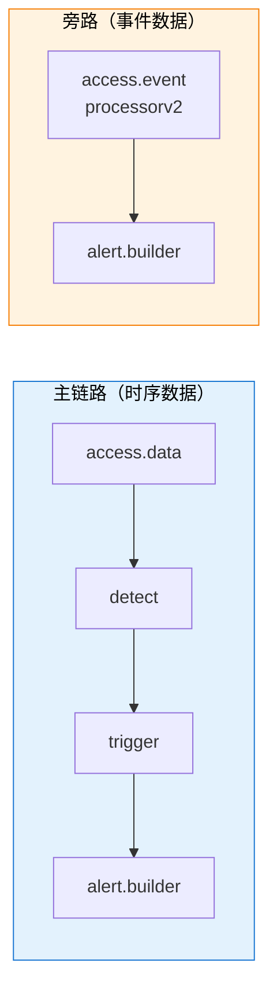
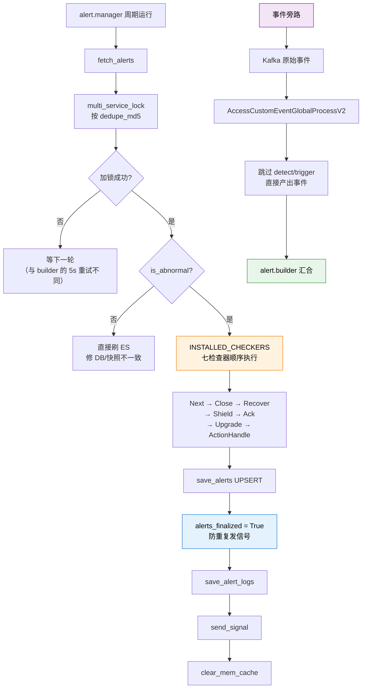

# 第 06 课：后续生命——告警的养护与旁路

## 📖 文档核对

已核对源码：
- [manager/processor.py:31-40](/root/bk-monitor/bkmonitor/alarm_backends/service/alert/manager/processor.py) —— `INSTALLED_CHECKERS` 七个检查器
- [manager/processor.py:143-230](/root/bk-monitor/bkmonitor/alarm_backends/service/alert/manager/processor.py) —— process / handle 主流程
- [manager/checker/](/root/bk-monitor/bkmonitor/alarm_backends/service/alert/manager/checker/) —— 检查器目录（ack/action/base/close/next/recover/shield/upgrade/utils）
- [access/event/processorv2.py:50-390](/root/bk-monitor/bkmonitor/alarm_backends/service/access/event/processorv2.py) —— 事件接入旁路
- [constants.py:67](/root/bk-monitor/bkmonitor/alarm_backends/constants.py) —— `NO_DATA_TAG_DIMENSION = "__NO_DATA_DIMENSION__"`

## 🎯 本课目标

搞懂告警建好之后的**养护机制**（谁在定期检查它、怎么恢复），以及一条**不走上节课链路**的特殊入口。

---

## 一、知识点 1：状态检查与恢复

### 谁在检查告警？

`AlertManager`（manager/processor.py:42），它跟 `AlertBuilder` 是**两个独立的服务**：

- `AlertBuilder` —— 消费 Kafka 事件，**建**告警
- `AlertManager` —— 周期性运行，**养**告警

检查器清单（manager/processor.py:31）：

```python
INSTALLED_CHECKERS = (
    NextStatusChecker,
    CloseStatusChecker,
    RecoverStatusChecker,
    ShieldStatusChecker,
    AckChecker,
    UpgradeChecker,
    ActionHandleChecker,
)
```

**七个检查器，按顺序执行**（`handle` 里 `for checker_cls in INSTALLED_CHECKERS`）。

| 检查器 | 职责 |
|---|---|
| `NextStatusChecker` | 下一状态判定（状态机流转的基础） |
| `CloseStatusChecker` | 关闭判定（如超过 N 周期没数据则关闭） |
| `RecoverStatusChecker` | 恢复判定 —— 数据恢复正常则转 `RECOVERED` |
| `ShieldStatusChecker` | 屏蔽判定 —— 回写 `is_shielded` / `shield_id` / `shield_left_time` |
| `AckChecker` | 确认状态 |
| `UpgradeChecker` | 级别升级（长时间未恢复则升级） |
| `ActionHandleChecker` | 处理动作状态 |

> 💡 **顺序很重要**：`NextStatusChecker` 在最前（先确定状态机位置），`RecoverStatusChecker` 在 `ShieldStatusChecker` 之前（先判恢复再判屏蔽）。改这个顺序会改变语义。

### 主流程：加锁 → 分类 → 检查

`process()`（manager/processor.py:143）：

```python
alerts = self.fetch_alerts()
if not alerts:
    return

lock_keys = [ALERT_UPDATE_LOCK.get_key(dedupe_md5=alert.dedupe_md5) for alert in alerts]

with multi_service_lock(ALERT_UPDATE_LOCK, lock_keys) as lock:
    locked_alerts = []
    fail_locked_alert_ids = []
    for alert in alerts:
        if lock.is_locked(...):
            locked_alerts.append(alert)
        else:
            fail_locked_alert_ids.append(alert.id)
    locked_alerts = self.filter_alerts(locked_alerts)
    alerts_to_check = []
    alerts_to_update_directly = []
    for alert in locked_alerts:
        if alert.is_abnormal():
            alerts_to_check.append(alert)
        else:
            alerts_to_update_directly.append(alert)
    alerts_to_check = self.handle(alerts_to_check)
```

**跟 builder 的加锁对比，有个关键差异**：

| | AlertBuilder | AlertManager |
|---|---|---|
| 加锁失败 | **5 秒后重试**（`apply_async(countdown=5)`） | **等下一轮周期检测**（只打日志） |

**为什么不同？** builder 处理的是**新事件**，丢了就没了；manager 处理的是**存量告警**，下一轮周期任务还会捞起来。**代价不同，策略就不同**。

### 分类处理：异常 vs 非异常

```python
for alert in locked_alerts:
    if alert.is_abnormal():
        alerts_to_check.append(alert)
    else:
        alerts_to_update_directly.append(alert)
```

- **异常告警** → 走七个检查器（`handle`）
- **非异常告警**（已恢复/已关闭）→ 直接刷 ES

后半段注释说明了为什么：

```python
if alerts_to_update_directly:
    # 某些情况下，会存在snapshot的告警处于终结状态，而 DB 的并没有，此时需要刷一波进DB
    self.logger.info("[refresh alert es] refresh ES directly: %s", alerts_to_update_directly)
    self.save_alerts(alerts_to_update_directly, action=BulkActionType.UPSERT, force_save=True)
```

**这是数据一致性修复**：快照里已经是终态，但 DB 还没更新。直接刷一次保证 DB 追上。

### 那个重要的 `alerts_finalized` 标记

```python
saved_alerts = self.save_alerts(alerts_to_check, action=BulkActionType.UPSERT, force_save=True)
# 状态已落库: 此后(save_alert_logs / send_signal)再抛异常属 finalize 后,
# recovered/closed 等终态不会被下周期 check_abnormal_alert 重新捞起重发 signal。
self.alerts_finalized = True
```

**这段注释解释了一个防重复设计**：状态一旦落库，后面 `save_alert_logs` / `send_signal` 再抛异常，也不会导致下个周期重新捞起这条告警重发信号。

**为什么？** 因为告警已经是终态（`recovered`/`closed`），`check_abnormal_alert` 只捞异常告警。所以**不会重复通知**。

> ⚠️ **反过来说**：如果状态**没**落库就抛异常，下个周期会重新捞起——可能重发信号。所以 `alerts_finalized` 这个标记是"已落库"的分界线。

### 养护后的清理

```python
# 8. 清理内存缓存
clear_mem_cache("host_cache")
clear_mem_cache("service_instance_cache")
```

每轮结束清理主机/服务实例的内存缓存——**避免进程内缓存无限增长**，也保证下一轮能拿到最新的 CMDB 数据。

---

## 二、知识点 2：事件接入旁路

### 什么是旁路？

前五课讲的是**时序数据**的链路：

```
接入(拉数据) → 检测(判异常) → 触发(出事件) → 构建(成告警)
```

但有一类告警**不走这条路**：**事件型告警**。比如：

- agent 心跳丢失
- 自定义事件（业务直接上报一条"订单失败了"）
- GSE 事件

这类数据的特点是：**它本身就是异常**。agent 没上报心跳，不需要算法判定"是不是异常"——它本来就是异常。也不需要"连续 N 次"——一次心跳丢失就是一次。

### 实现在哪？

[access/event/processorv2.py](/root/bk-monitor/bkmonitor/alarm_backends/service/access/event/processorv2.py)，核心类 `AccessCustomEventGlobalProcessV2`（processorv2.py:193）。

它继承 `BaseAccessEventProcess`（processorv2.py:50），关键方法：

| 方法 | 行号 | 作用 |
|---|---|---|
| `pull` | 67 / 364 | 从 Kafka 拉原始事件 |
| `process_strategies` | 252 | 按策略处理 |
| `fetch_custom_event_alarm_type` | 264 | 取自定义事件告警类型 |
| `_instantiate_by_event_type` | 275 | 按事件类型实例化 |
| `push_to_check_result` | 84 | 推检测结果 |
| `push` | 137 | 输出 |
| `run_inline_trigger` | 79 | 内联触发 |

**关键差异**：它**直接产出事件**，跳过 detect 和 trigger 两级。

```
Kafka 原始事件 → AccessCustomEventGlobalProcessV2 → 直接产出事件 → alert.builder
```

跟主链路对比：



看图：旁路直接对接 `alert.builder`，中间两级全省。**两条链路在 alert.builder 汇合**——这就是为什么 builder 的输入契约是"事件"，而不是"异常点"。

### 无数据告警：介于两者之间

无数据告警（agent 挂了）比较特殊。它走**主链路**，但用特殊标记区分。

常量定义（[constants.py:67](/root/bk-monitor/bkmonitor/alarm_backends/constants.py)）：

```python
NO_DATA_TAG_DIMENSION = "__NO_DATA_DIMENSION__"
```

这个维度标记在两处起作用：

**① 触发阶段**（checker.py:59-67）：

```python
@staticmethod
def is_no_data_point(point):
    dimensions = point["data"]["dimensions"]
    if NO_DATA_TAG_DIMENSION in dimensions:
        return True
    return False
```

命中后用**无数据专用配置**（`get_no_data_configs`）而非普通触发配置，且有独立的补充判定（见课 04）。

**② 告警展示阶段**（adapter.py:117-121）：

```python
if NO_DATA_TAG_DIMENSION in data_dimensions:
    # 无数据告警的名称需要做特殊处理
    alert_name = _("[无数据] {alert_name}").format(alert_name=self.strategy["name"])
```

**告警名自动加 `[无数据]` 前缀**——这是你在告警列表里看到 `[无数据] XXX` 的来源。

---

## 三、全链路收束

到这里，主角完成了全部蜕变。回顾四级：

| 层级 | 形态 | 由谁产出 | 关键标识 |
|---|---|---|---|
| 数据点 | `{"value": 1.38, "dimensions": {...}}` | `AccessDataProcess` | `record_id = {dimensions_md5}.{timestamp}` |
| 异常点 | 带 `ANOMALY` 标记的检测结果 | `DetectProcess` | 写入 `CHECK_RESULT_CACHE_KEY` |
| 事件 | 自愈标准格式 | `TriggerProcess` / 事件旁路 | `event_id = anomaly_id` |
| 告警 | 有状态有生命周期 | `AlertBuilder` + `AlertManager` | `dedupe_md5` + UID |

**收敛关系**：多个数据点 → 少数异常点 → 更少事件 → 最少告警。

---

## 四、本课回顾



看图：主流程（上）是周期养护，紫色是旁路，两条在绿色处（alert.builder）汇合。

**四条要记住的**：

1. **builder 加锁失败 5 秒重试，manager 失败等下一轮**——因为丢事件的代价远大于延迟检查。
2. **七个检查器顺序固定**，`Next` 最前、`Recover` 在 `Shield` 之前。
3. **`alerts_finalized` 是"已落库"分界线**，之后的异常不会导致重复发信号。
4. **事件旁路跳过 detect/trigger 两级**，因为事件本身就是异常；两条链路在 `alert.builder` 汇合。

## 🎓 阶段 3 完成

你已经学完全部 6 课 15 个知识点，走完了从"一个数字"到"一条告警"的完整链路。接下来用结课实战项目检验理解。
