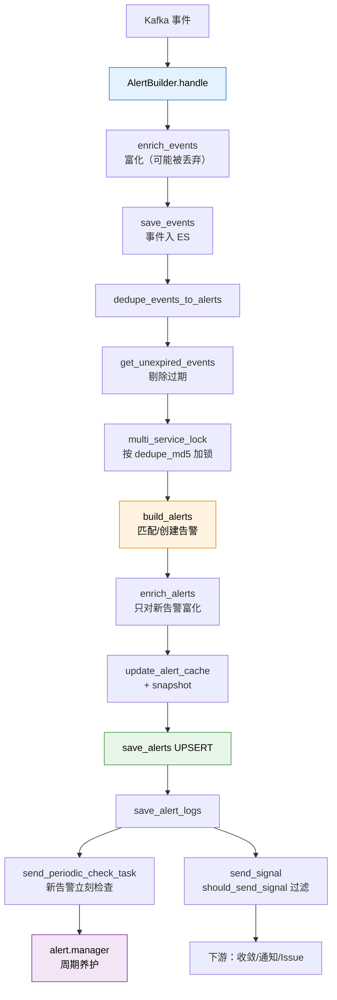

# 阶段 3 概览：告警构建

## 🎯 阶段目标

搞懂告警的**成型端与养护端**：事件怎么变成一条真正的告警（有 ID、有状态、有生命周期），以及告警建好之后怎么被持续照料。

## 📍 在故事主线中的定位

> 故事主线第三章：**"身份与归宿"**
>
> 主角已经通过两次审判，拿到了"传票"（事件）。但传票还不是告警——同一台机器、同一个策略，每周期都可能来一张传票。
>
> 这一章讲的是：**怎么把这些传票合并成"一个案子"**（去重），给案子编上号（UID）、定下状态（异常/已恢复/已关闭），然后交给养护人员定期照看（状态检查、屏蔽、无数据）。
>
> 终点：主角从一个数字，变成告警列表里那条你能点开、能认领、能屏蔽、能看着它恢复的**告警**。

## 🔑 必须掌握的知识点

| 课 | 知识点 | 为什么必须掌握 |
|---|---|---|
| 05 | 事件富化与保存 | 理解事件为什么会被丢弃、保存失败怎么处理 |
| 05 | 去重与告警生成 | **全链路核心**：理解告警身份与级别升降规则 |
| 05 | 告警富化与落盘 | 理解新告警才富化的性能考量、信号发送条件 |
| 06 | 状态检查与恢复 | 理解告警怎么恢复、为什么新告警要立刻检查一次 |
| 06 | 事件接入旁路 | 理解为什么有些告警跳过检测与触发两级 |

## 🗺️ 本阶段路径图

看图：蓝色是入口三步（富化→入 ES→去重），橙色是全链路最核心的一步（告警身份判定），绿色是落盘，紫色是养护。

**注意 `send_periodic_check_task` 和 `send_signal` 是并列的两条出口**——前者负责告警状态养护，后者负责通知下游。两者条件不同（新告警 vs `should_send_signal()`）。

## 📚 本阶段涉及的代码

| 文件 | 作用 |
|---|---|
| [builder/processor.py](/root/bk-monitor/bkmonitor/alarm_backends/service/alert/builder/processor.py) | 告警构建主流程（464 行） |
| [core/alert/alert.py](/root/bk-monitor/bkmonitor/alarm_backends/core/alert/alert.py) | Alert 类：状态机、`from_event`、`should_send_signal` |
| [core/alert/event.py](/root/bk-monitor/bkmonitor/alarm_backends/core/alert/event.py) | Event 类：去重 MD5 计算 |
| [manager/processor.py](/root/bk-monitor/bkmonitor/alarm_backends/service/alert/manager/processor.py) | 告警养护主流程 |
| [manager/checker/](/root/bk-monitor/bkmonitor/alarm_backends/service/alert/manager/checker/) | 9 个状态检查器（ack/action/base/close/next/recover/shield/upgrade/utils） |
| [access/event/processorv2.py](/root/bk-monitor/bkmonitor/alarm_backends/service/access/event/processorv2.py) | 事件接入旁路（402 行） |

## 🚀 学完之后

你已经走完了从"一个数字"到"一条告警"的完整链路，可以用结课实战项目检验理解程度。
