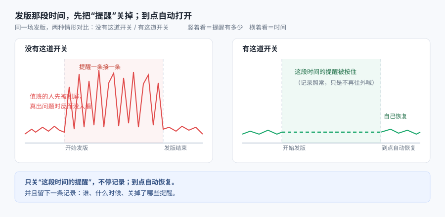

# 能力大纲：蓝盾流水线插件 bk-monitor-shield

**本文引用的文件**
- [插件声明 task.json](file://bk-monitor-shield/task.json)
- [入口与编排 command_line](file://bk-monitor-shield/bk_monitor_shield/command_line.py)
- [条件表达式处理 dimension_processor](file://bk-monitor-shield/bk_monitor_shield/dimension_processor.py)
- [词法与语法定义 ply/dimension](file://bk-monitor-shield/bk_monitor_shield/ply/dimension/__init__.py)
- [解析异常 ply/error](file://bk-monitor-shield/bk_monitor_shield/ply/error.py)
- [错误码 error_code](file://bk-monitor-shield/bk_monitor_shield/error_code.py)
- [打包声明 setup.py](file://bk-monitor-shield/setup.py)
- [依赖清单 requirements.txt](file://bk-monitor-shield/requirements.txt)
- [离线联调工具 devtools/offline_console](file://bk-monitor-shield/devtools/offline_console.py)
- [平台速查资产 docs/蓝盾流水线插件开发速查](file://bk-monitor-shield/docs/蓝盾流水线插件开发速查.md)

## 范围确认

- 目标模块：`bk-monitor-shield/`（插件工程；讲解内核为 `bk_monitor_shield/` 包，契约层为 `task.json` / `setup.py` / `requirements.txt`）
- 知识范围：**两者都含（默认范围，可调整）**——`[通用]` 为流水线插件机制、词法/语法解析、Python 打包入口；`[专用]` 为蓝盾平台约定与监控屏蔽接口
- 学习目标：**读懂**（默认）
- 讲解对象类型：`module`
- 讲解强度：**完整讲解**（Phase 0→7）
- **来源与标注约定**：本档案以紧贴论述的逐行 `file://` 作为来源；未特别标注 `[通用]` 处默认 `[专用]`（平台与监控侧约定）
- 规模口径（实测）：内核 `bk_monitor_shield/` **7 个 py 文件 / 609 行**（1+313+104+7+10+14+160）；契约层 3 文件（`task.json` / `setup.py` / `requirements.txt`）；另有辅助工具 `devtools/` 2 个 py / 约 1036 行（**不在讲解主线**，它在 Phase 3–4 作为"验证手段"出现）。三者均未触发分批阈值（文件数 ≤ 20、单文件 < 1000 行）。

## 目录

1. [一句话本质](#一句话本质)
2. [这份代码为什么存在](#这份代码为什么存在)
3. [这套写法的特性](#这套写法的特性)
4. [职责边界](#职责边界)
5. [公开能力清单](#公开能力清单)
6. [关键抽象](#关键抽象)
7. [子模块划分](#子模块划分)
8. [讲解路线](#讲解路线)
9. [外部文档索引](#外部文档索引)

## 一句话本质

> 它给"发版 / 变更那段时间"装了一个**临时静音开关**：开始前按下（还能限定"只静音哪一批提醒"），时间一到自己弹起。
>
> 换句话说：**把"这段时间的提醒先别吵我"变成发布流程里的一个动作，并且留下一笔可查的记录。**
>
> **术语先说清**：下文把"按下开关"这个动作叫**屏蔽**（`[专用]` 叫法；业界同类叫"告警静默 / 维护窗口"，见「关键抽象」的对标表）；被静音的对象叫**告警**；用来限定"只静音哪一批"的对象属性叫**维度**。

## 这份代码为什么存在

**范围**：本节为 `[专用]`（讲的是本插件在流水线里承担的那件事）。

**处境对照**：

| | 不这么做 | 这么做 |
|---|---|---|
| 谁去关提醒 | 人手动进监控后台，挑业务、挑策略、填时间——发版最忙的时候最容易漏 | 流水线跑到这一步自动关，不用记 |
| 关多久 | 靠人记着去恢复，忘了恢复 = 真出问题也被静默 | 时长写死在参数里（30m / 1h / 3h / 6h / 1d 或自定义），到点自动恢复 |
| 关多大范围 | 纯手点，容易点宽（把不该静音的也静音）或点窄 | 用一行文本描述范围，支持"等于/不等于/包含/排除/正则/大小比较"并可 AND / OR 组合 |
| 事后追溯 | 说不清"谁在什么时候关了什么" | 操作人必然带上（取流水线的修改人 / 发起人），屏蔽原因可填；并产出一个可被下游步骤引用的编号 |
| 想提前解除 | 再进后台翻出那条记录手动解除 | 把上次拿到的编号填回来即可解除 |

> **量化锚点说明**：本仓库未收集"一次发版会触发多少条提醒"这类线上数据，故上表只给可核实的定性对照。表内三项有代码依据：时长档位（30m~1d）见 [task.json](file://bk-monitor-shield/task.json#L89-L127)；范围表达式的运算符见 [ply/dimension](file://bk-monitor-shield/bk_monitor_shield/ply/dimension/__init__.py#L44-L71)；**屏蔽原因可填但非必填**（`required: false`）见 [task.json](file://bk-monitor-shield/task.json#L151-L158) 与取值处 [command_line.py](file://bk-monitor-shield/bk_monitor_shield/command_line.py#L133)。

**图表来源**
- [task.json](file://bk-monitor-shield/task.json#L8-L168)（两个动作、时长档位、屏蔽原因、是否发通知——"开关"这三个字对应的全部参数）
- [command_line.py](file://bk-monitor-shield/bk_monitor_shield/command_line.py#L71-L305)（按下 / 弹起两个动作的实现与结果回传）
- [ply/dimension/__init__.py](file://bk-monitor-shield/bk_monitor_shield/ply/dimension/__init__.py#L44-L160)（"限定只静音哪一批"所依赖的条件表达式）

**看图**：左右两半是同一场发版的两种情形；横着看是时间（两条竖虚线分别是"开始发版"和"到点 / 结束"），竖着看是提醒的多少。左边那条红线的尖峰在发版期间挤成一团——提醒一条接一条往外喊，值班的人先被刷屏；右边那条绿线在同样的区间被按住（虚线那一段），到点自己恢复；图里"记录照常、只是不再往外喊"这句是对**被静音方语义**的直觉表达（⚠️ 本项目未核实，登记为 `03-功能推演.md` 的待核对项）。本模块做的，就是"按下"和"到点弹起"这两个动作。

## 这套写法的特性

| # | 范围 | 特性 | 换来什么 | 代价是什么 |
|---|---|---|---|---|
| 1 | `[专用]` | 两个动作装进**一个**插件（`shield_mode` 二选一） | 一条流水线内闭环：开启与解除用同一个插件，字段显隐靠参数依赖关系自动切换 | 解除必须拿到上次的编号（`id` 需人工或上游传递），跨流水线续用要自己存 |
| 2 | `[专用]` | **字段形态 / 必填 / 可见性**由一份声明文件（`task.json`）描述，**交叉校验仍留在代码里**（如"策略与维度至少填一项"） | 改表单不用改代码，平台自动渲染界面并把值下发 | 两份清单要手工保持一致：声明与代码之间没有编译期校验，字段名拼错不报错、只会永远取到默认值（静默失效） |
| 3 | `[通用]` | 请求体自己拼，不引入监控侧 SDK | 只依赖 HTTP 契约，能被本地 mock 完整复现（本仓库的离线联调正是这么做的） | 契约漂移要自己盯；后端路径形态不同（组件 API / 网关）会把请求打到错误地址 |
| 4 | `[通用]` | 条件表达式由**自带解析器**处理（词法 + 语法两段） | 用户用一行文本描述复杂范围，并且 AND / OR 优先级由语法保证，不靠字符串切割 | 多了一个**未写进依赖清单**的第三方库（`ply`）——换构建机就可能起不来（本地 `.venv` 已装 `ply 3.11`，所以问题只在换环境时暴露）；解析器要自己维护 |
| 5 | `[专用]` | 与平台的交互只走三条通道：**输入文件、输出文件、控制台日志** | 本地只要喂一个输入文件就能完整跑一遍，调试成本极低 | 本地拿不到平台服务权限，也拿不到真实的"谁在调、带了什么头"；隐藏字段等平台细节只能靠实测校准 |

章节来源：[task.json](file://bk-monitor-shield/task.json#L8-L176)、[command_line.py](file://bk-monitor-shield/bk_monitor_shield/command_line.py#L20-L305)、[dimension_processor.py](file://bk-monitor-shield/bk_monitor_shield/dimension_processor.py#L13-L104)、[ply/dimension/__init__.py](file://bk-monitor-shield/bk_monitor_shield/ply/dimension/__init__.py#L23-L160)、[requirements.txt](file://bk-monitor-shield/requirements.txt#L1-L3)

## 职责边界

**范围**：本节为 `[专用]`。

**做什么**：把"流水线里的一次屏蔽 / 解除操作"翻译成监控侧的 HTTP 请求——装配请求体（含把用户的文本条件表达式变成结构化条件）、带上认证头、发请求、按平台契约写回结果。

**不做什么**：

| 不做 | 归谁 |
|---|---|
| 屏蔽怎么匹配告警、怎么生效、到点怎么恢复 | 监控平台侧（本仓库只调用其接口） |
| 表单长什么样、什么时候显示哪个字段 | 平台前端（按 `task.json` 的 `input` 声明渲染） |
| 依赖怎么装、包怎么打包、结果怎么展示给下游 | 平台构建与流水线引擎 |
| 屏蔽期间的开始 / 结束通知怎么发 | 监控平台侧。本插件只传"是否发通知"（`shield_notice`）；**接收人固定为流水线发起人、通知时间与渠道在代码里写死**（`notice_time=5` / `rtx`） |

章节来源：[task.json](file://bk-monitor-shield/task.json#L8-L168)（字段范围）、[command_line.py](file://bk-monitor-shield/bk_monitor_shield/command_line.py#L114-L276)（装配与两个动作）、[command_line.py](file://bk-monitor-shield/bk_monitor_shield/command_line.py#L211-L215)（通知接收人 / 时间 / 渠道写死处）

## 公开能力清单

**范围**：下表 5 条能力均为 `[专用]`（平台与监控侧的约定）。

| 能力 | 入口 | 一句话职责 | 代码位置 |
|---|---|---|---|
| 开启屏蔽 | `shield_mode=shield` | 按业务 + 策略 / 维度条件 + 时长创建一条屏蔽，返回其编号 | [command_line.py](file://bk-monitor-shield/bk_monitor_shield/command_line.py#L89-L91) + [#L221-L249](file://bk-monitor-shield/bk_monitor_shield/command_line.py#L221-L249) |
| 解除屏蔽 | `shield_mode=unshielded` | 按编号提前解除 | [command_line.py](file://bk-monitor-shield/bk_monitor_shield/command_line.py#L92-L94) + [#L252-L276](file://bk-monitor-shield/bk_monitor_shield/command_line.py#L252-L276) |
| 条件表达式解析 | 输入 `dimension_expression` | 把一行文本（`key 运算符 值` 用 AND / OR 连接）解析成结构化条件列表 | [dimension_processor.py](file://bk-monitor-shield/bk_monitor_shield/dimension_processor.py#L16-L48) + [ply/dimension](file://bk-monitor-shield/bk_monitor_shield/ply/dimension/__init__.py#L91-L160) |
| 结果与输出 | 输出变量 `shield_id` | 成功写 `{id}`、失败写错误码与错误类型，交给平台判定 | [command_line.py](file://bk-monitor-shield/bk_monitor_shield/command_line.py#L20-L68) + [task.json](file://bk-monitor-shield/task.json#L170-L176) |
| 认证头装配 | 私有配置 | 用 `app_code` / `app_secret` + 操作人拼出平台互认的认证头（另一项私有配置 `monitor_url` **不参与拼头**，它是请求地址基址） | [command_line.py](file://bk-monitor-shield/bk_monitor_shield/command_line.py#L279-L292) |

> **两个动作 / 五条对外能力**：动作只有"开启"和"解除"两个（`shield_mode` 二选一），上表后三条是这两个动作共用的支撑能力。
>
> 所有能力的参数来源、取值形态与"哪些字段同时可见"，全部由 [task.json](file://bk-monitor-shield/task.json#L8-L168) 声明，代码里**没有第二份字段清单**；但**参数之间的交叉校验在代码里**（如 [command_line.py](file://bk-monitor-shield/bk_monitor_shield/command_line.py#L175-L176)"策略与维度至少填一项"）。

## 关键抽象

**范围**：本表除注明 `[通用]` 者外均为 `[专用]`。

| 名称 | 范围 | 角色 | 代码位置 |
|---|---|---|---|
| `demo` | `[专用]` | 分派两个动作的唯一入口函数（`main` 只是它的调用壳） | [command_line.py](file://bk-monitor-shield/bk_monitor_shield/command_line.py#L71-L97) + [#L308-L313](file://bk-monitor-shield/bk_monitor_shield/command_line.py#L308-L313) |
| `build_request_body` | `[专用]` | 请求体装配：取值 → 换算时长 → 解析条件 → 按"填了什么"决定请求类型 | [command_line.py](file://bk-monitor-shield/bk_monitor_shield/command_line.py#L114-L218) |
| `DimensionProcessor` | `[专用]` | 条件表达式的对外门面（解析 + 补全字段 + 值类型归一） | [dimension_processor.py](file://bk-monitor-shield/bk_monitor_shield/dimension_processor.py#L13-L73) |
| 词法 / 语法定义 | `[通用]` | 运算符与字段名的切分规则、AND 优先级高于 OR 的语法结构 | [ply/dimension](file://bk-monitor-shield/bk_monitor_shield/ply/dimension/__init__.py#L23-L160) |
| `exit_with_succ` / `exit_with_error` | `[专用]` | 结果契约：组装平台要的成功 / 失败结构并写盘 | [command_line.py](file://bk-monitor-shield/bk_monitor_shield/command_line.py#L20-L68) |
| `ErrorCode` | `[专用]` | 三个退出码常量（正常 / 插件异常 / 用户配置错误） | [error_code.py](file://bk-monitor-shield/bk_monitor_shield/error_code.py#L4-L7) |

**术语对标**（每行左侧叫法为 `[专用]`、右侧对标为 `[通用]`）：

| 项目叫法 | 业界标准叫法 | 在本项目出现在哪 | 代价 / 注意 |
|---|---|---|---|
| 插件 / 原子（atom） | CI/CD 流水线插件的通用形态（如 Jenkins Plugin、GitHub Action、Tekton Task）——都是"声明一份元数据 + 一个可执行入口" | [task.json](file://bk-monitor-shield/task.json#L2-L7)、[setup.py](file://bk-monitor-shield/setup.py#L48) | 元数据格式各家不同，迁移不通用 |
| 屏蔽（shield） | **告警静默**（alert silence）/ **维护窗口**（maintenance window），同类实现如 Alertmanager Silence、Grafana Mute timing | 本插件调用监控侧屏蔽接口（实现不在本仓库） | "静默"的语义边界由被调方定义，本插件只是传参 |
| 维度条件表达式 | **标签匹配表达式**（label matcher），形如 PromQL 的 `label="v"` / 正则匹配 | [ply/dimension](file://bk-monitor-shield/bk_monitor_shield/ply/dimension/__init__.py#L44-L71) | 运算符是自定的（含"包含/排除"这类非 PromQL 语义），不能直接套用 PromQL 判断 |
| 私有配置（sensitive conf） | **凭据管理**（credentials / secret store） | [command_line.py](file://bk-monitor-shield/bk_monitor_shield/command_line.py#L279-L292) | 取值来自平台下发的输入文件，本地需自行注入 |
| 输出变量（output） | **步骤输出**（step outputs，如 GitHub Actions `outputs`） | [task.json](file://bk-monitor-shield/task.json#L170-L176) | 声明与赋值两处需手工保持一致，无编译期校验 |

> 上表"业界标准叫法"为**类比参考**（用于检索与跨团队沟通）。⏳ **置信度：中**——本轮未逐条联网核对官方文档，仅确认叫法存在、语义方向一致；`01-代码wiki.md` 与 `02-正确性核对.md` 引用时将按需核对并标注核实月份。
> 本仓库还有两个不宜混淆、但无可对标业界叫法的 `[专用]` 术语：`cycle_config`（屏蔽周期，本插件写死为单次）见 [command_line.py](file://bk-monitor-shield/bk_monitor_shield/command_line.py#L150-L152)；`verify_user_permission`（要求后端额外校验操作人权限）见 [command_line.py](file://bk-monitor-shield/bk_monitor_shield/command_line.py#L216)。

## 子模块划分

**范围**：前两行 `[专用]`；"契约声明"行的每项范围见括号。

| 子模块 | 范围 | 包含文件 | 一句话职责 |
|---|---|---|---|
| 入口与编排 | `[专用]` | `bk_monitor_shield/command_line.py` | 读输入 → 分派动作 → 装配请求 → 发请求 → 写结果 |
| 条件表达式解析 | `[通用]`（解析器）/ `[专用]`（运算符与字段语义） | `bk_monitor_shield/dimension_processor.py`、`bk_monitor_shield/ply/`（`dimension/`、`error.py`） | 把文本条件变成结构化条件（词法切分、语法组树、值归一） |
| 契约声明 | `[专用]` | `task.json`、`setup.py`、`requirements.txt`、`bk_monitor_shield/error_code.py`、`.ci/build.yml`、`.gitignore` | 告诉平台"长什么样、怎么启动、依赖什么、产出什么" |
| 辅助工具（非主线） | `[专用]` | `devtools/offline_console.py`、`devtools/console.html`、`devtools/selfcheck.py` | 离线联调：模拟编排页 + mock 依赖接口 + 真跑插件自检；**不参与发布物**，用于验证本模块结论 |

**依赖方向**：入口与编排 → 条件表达式解析（单向）；契约声明 → 被平台读取，代码不反向依赖它（只按约定读输入文件）。

章节来源：[command_line.py](file://bk-monitor-shield/bk_monitor_shield/command_line.py#L1-L313)、[dimension_processor.py](file://bk-monitor-shield/bk_monitor_shield/dimension_processor.py#L1-L104)、[ply/dimension/__init__.py](file://bk-monitor-shield/bk_monitor_shield/ply/dimension/__init__.py#L1-L160)、[setup.py](file://bk-monitor-shield/setup.py#L38-L53)、[requirements.txt](file://bk-monitor-shield/requirements.txt#L1-L3)

三者关系：**契约声明层**决定平台如何收集参数与启动进程；**入口与编排层**是唯一被执行的代码；**解析层**只在装配请求体需要解析条件时被调用；**辅助工具**不参与运行链路，只用于本地验证。

## 讲解路线

本次按 7 步推进，建议依序阅读（每步一份材料，前一步是后一步的前提）：

1. **能力大纲**（本文）——它是什么、为什么存在、边界在哪
2. **代码 wiki**（`01`）——目录结构、契约层三个文件、入口编排、解析器、依赖与不变量
3. **正确性核对**（`02`）——回读代码校验前两步的每条结论
4. **功能推演**（`03`）——真实运行时行为：正常路径、异常路径、边界与副作用
5. **应用场景**（`04`）——什么时候适合用、什么时候不该用、已知局限
6. **数据流**（`05`）——一次操作的完整数据生命周期与状态变化
7. **最终文档**（`06`）——以上汇总

> 契约层（`task.json`）与代码层（`bk_monitor_shield/`）是**两份清单、一套语义**，读的时候建议成对看：每个字段在代码里对应哪一行取值。这是本模块最容易出错的地方，也是 `01` 与 `02` 的重点。

## 外部文档索引

**无（未收集）**。

原因与替代来源：

- 蓝盾插件机制的权威文档在**内网 iWiki**（`15008942` 快速入门 / `15009001` 配置规范 / `15009003` 开发规范 / `15009033` Python 指引 / `17512739` 调试指引 / `15009171` 第三方 API 接入网关），本次已抓取主要信息并落盘为本地资产 [docs/蓝盾流水线插件开发速查](file://bk-monitor-shield/docs/蓝盾流水线插件开发速查.md)，讲解中的平台结论优先引用该资产。
- `[通用]` 部分（词法 / 语法解析工具 PLY、Python 打包入口机制）本次引用点少（≤2 处），按 Phase 1.5「执行 ≠ 一定建」判定**不建索引**，需要时现场查官方站并标注核实月份。

**知识范围标注约定**：本文及后续产物中，`[通用]` = 跨项目通用知识（CI 插件机制、解析器、打包），`[专用]` = 本项目 / 本平台特有约定（字段名、接口路径、错误码、屏蔽语义）。
