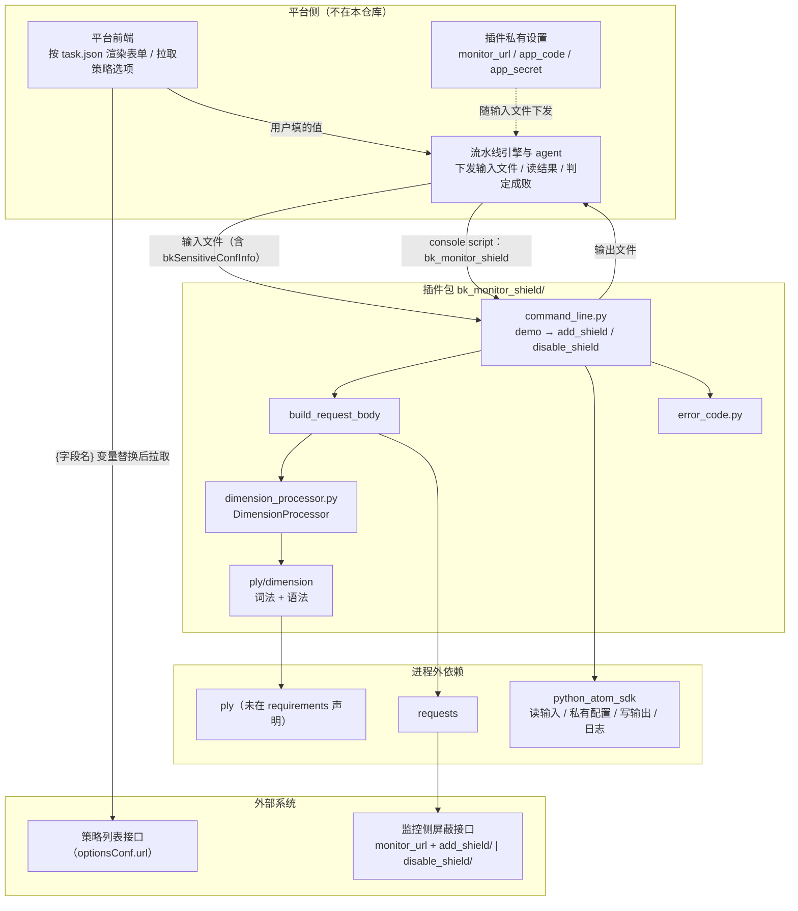

# 代码 wiki：蓝盾流水线插件 bk-monitor-shield

**本文引用的文件**
- [插件声明 task.json](file://bk-monitor-shield/task.json)
- [入口与编排 command_line](file://bk-monitor-shield/bk_monitor_shield/command_line.py)
- [条件表达式处理 dimension_processor](file://bk-monitor-shield/bk_monitor_shield/dimension_processor.py)
- [词法与语法 ply/dimension](file://bk-monitor-shield/bk_monitor_shield/ply/dimension/__init__.py)
- [解析异常 ply/error](file://bk-monitor-shield/bk_monitor_shield/ply/error.py)
- [错误码 error_code](file://bk-monitor-shield/bk_monitor_shield/error_code.py)
- [打包声明 setup.py](file://bk-monitor-shield/setup.py)
- [依赖清单 requirements.txt](file://bk-monitor-shield/requirements.txt)
- [构建扫描 .ci/build.yml](file://bk-monitor-shield/.ci/build.yml)
- [忽略规则 .gitignore](file://bk-monitor-shield/.gitignore)

## 范围确认

- 对象类型：`module`；目标：`bk-monitor-shield/`（内核 `bk_monitor_shield/`，契约层三文件）
- 知识范围：两者都含；学习目标：读懂；强度：完整讲解
- 规模（实测）：内核 7 个 py / 609 行；契约层 3 文件；辅助工具 `devtools/` 约 1036 行（不在本主线）
- **本文形式**：结构化直述（代码 wiki）——按"结构 → 契约 → 入口 → 解析 → 依赖 → 不变量"由外到内推进，不套五幕叙事（理由：本模块是"配置 + 一个执行包"的工程型对象，叙事会稀释查阅价值；问题与处境已在 `00-能力大纲.md` 讲完）
- **来源与标注约定**：本文以**紧贴论述的逐行 `file://`** 作为主要来源，节末另给 `章节来源` 仅在跨多文件综合结论处补充；**未特别标注 `[通用]` 处默认 `[专用]`**（平台与监控侧约定）

## 先读这一段：术语速查（约 1 分钟）

| 术语 | 人话解释 |
|---|---|
| 蓝盾 / 流水线 / 插件 | 蓝盾是平台的流水线系统；**插件 = 流水线里的一个步骤**，可被编排到任意位置 |
| 屏蔽（shield） | 就是大纲说的"静音开关"这类动作：让某段时间 / 某个范围的**告警提醒**不再往外发 |
| 告警 / 策略 / 维度 | 告警=系统发现问题后发出的提醒；策略=产生告警的规则；维度=告警对象的属性（集群、设备、云区域……），用来限定"只静音哪一批" |
| `python_atom_sdk` | 平台提供的运行时库：读输入、取私有配置、写输出、打日志、取"是谁触发的"这类内置变量 |
| 组件类型（`enum-input` / `vuex-input` / `selector` …） | 平台前端**渲染该字段用的控件标识**（单选、单行文本、下拉框……），写在 `task.json` 里 |
| `rely` | 字段的"依赖显隐"规则：满足条件才显示该字段（本插件用它把"解除屏蔽"相关的字段藏起来） |
| PLY | 一个 Python 的解析器工具（词法 + 语法两段），本插件用它把用户写的一行条件文本变成结构化条件 |
| `parsetab.py` / `parser.out` | PLY 首次解析时自动生成的**语法表缓存**（已被 `.gitignore` 忽略） |
| `monitor_url` | 监控侧接口的**基址**，由平台私有配置下发；插件把它与 `add_shield/` 之类拼成完整地址 |
| `rtx` | 企业内部的 IM 通知渠道 |
| `isSensitive` | 标记输出字段是否为敏感信息（影响平台侧展示是否脱敏） |

## 目录

1. [项目结构](#1-项目结构)
2. [契约层：三个"给平台看"的文件](#2-契约层三个给平台看的文件)
3. [入口与编排层](#3-入口与编排层command_linepy)
4. [解析层](#4-解析层dimension_processorpy--ply)
5. [依赖关系](#5-依赖关系)
6. [设计模式与不变量](#6-设计模式与不变量)
7. [回扣大纲特性卡](#7-回扣大纲特性卡)
8. [留给 Phase 3 的待核对点](#8-留给-phase-3-的待核对点)

---

## 1. 项目结构

```
bk-monitor-shield/                  ← 插件工程根（平台要求 task.json 在仓库根）
├── task.json                       ← 契约声明：表单、启动方式、输出
├── setup.py                        ← 打包与命令行入口
├── requirements.txt                ← 依赖清单
├── MANIFEST.in                     ← 打包时纳入的非 py 文件
├── readme.md                       ← 平台文档链接
├── .ci/build.yml                   ← 平台代码扫描配置
├── .gitignore                      ← 忽略规则（含 PLY 生成的解析表）
├── bk_monitor_shield/              ← 唯一被执行的代码包（内核 7 py / 609 行）
│   ├── __init__.py                 ← 仅一行编码声明（包标记）
│   ├── command_line.py             ← 入口 + 编排 + 两个动作（313 行）
│   ├── dimension_processor.py      ← 条件表达式的对外门面（104 行）
│   ├── error_code.py               ← 三个退出码常量（7 行）
│   └── ply/                        ← 自带的解析器实现
│       ├── __init__.py             ← 仅 license 头
│       ├── error.py                ← ParseError（14 行）
│       └── dimension/__init__.py   ← 词法 + 语法定义（160 行）
│                                     运行时会生成 parsetab.py / parser.out（语法表缓存，已忽略）
└── devtools/                       ← 离线联调工具（本档案材料来源，不参与发布物）
    ├── offline_console.py / console.html / selfcheck.py
```

**职责一句话**：`task.json` 说"长什么样、怎么启动"；`setup.py` 说"怎么变成一条命令"；`bk_monitor_shield/` 是"启动后干什么"；`devtools/` 是"本地怎么验证"。

章节来源：[task.json](file://bk-monitor-shield/task.json#L1-L177)、[setup.py](file://bk-monitor-shield/setup.py#L1-L53)、[bk_monitor_shield/\_\_init\_\_.py](file://bk-monitor-shield/bk_monitor_shield/__init__.py#L1-L1)、[command_line.py](file://bk-monitor-shield/bk_monitor_shield/command_line.py#L1-L313)、[.gitignore](file://bk-monitor-shield/.gitignore#L1-L21)

---

## 2. 契约层：三个"给平台看"的文件

**范围**：本节 `task.json` 为 `[专用]`；`setup.py` / `requirements.txt` 为 `[通用]`（打包生态常识）。

### 2.1 `task.json` — 表单与启动契约 `[专用]`

顶层只有四个键：`atomCode` / `execution` / `input` / `output`（**没有 `inputGroups`**，故平台侧字段不分组展开）。

**`execution`**（[task.json](file://bk-monitor-shield/task.json#L3-L7)）：

| 键 | 值 | 含义 |
|---|---|---|
| `language` | `python` | 用哪个语言环境打包 / 运行 |
| `demands` | `[]` | 运行前的前置命令（本插件为空，依赖交给 `requirements.txt`） |
| `target` | `bk_monitor_shield` | **启动命令名**——必须与 `setup.py` 的 `console_scripts` 名一致 |

> ⚠️ 没有 `runtimeVersion`：官方规范称 python 不填默认 python2，而代码是 py3 语法（f-string / `urllib.parse`）。**核查留痕**：该结论来自内网 iWiki 配置规范 `15009001` 的 `runtimeVersion` 表（抓取于 2026-09），已登记为待确认项（见 `04-应用场景.md` 与本地资产 `docs/蓝盾流水线插件开发速查.md §6`）。

**`input` 字段总表**（8 个字段）。**首读建议只看 4 行**：`shield_mode`、`strategy_list`、`dimension_expression`、`id`——其余 4 行是时长与通知类细节，可第二遍再看。

> 表中"组件类型"是平台前端渲染该字段用的控件标识；"依赖显隐"即 `rely`（满足条件才显示该字段）。

| 字段 | 组件类型 | 必填 | 依赖显隐（`rely`） | 默认 | 代码取值处 |
|---|---|---|---|---|---|
| `shield_mode` | `enum-input`（单选：屏蔽 / 解除） | ✅ | — | `shield` | [command_line.py](file://bk-monitor-shield/bk_monitor_shield/command_line.py#L85-L97) |
| `bk_biz_id` | `vuex-input`（单行文本） | ✅ | — | — | [#L131-L132](file://bk-monitor-shield/bk_monitor_shield/command_line.py#L131-L132) |
| `strategy_list` | `selector`（下拉，**选项来自远程接口**） | — | `shield_mode=shield` | — | [#L155-L163](file://bk-monitor-shield/bk_monitor_shield/command_line.py#L155-L163) |
| `dimension_expression` | `vuex-textarea`（多行文本） | — | `shield_mode=shield` | — | [#L166-L172](file://bk-monitor-shield/bk_monitor_shield/command_line.py#L166-L172) |
| `id` | `vuex-input` | ✅ | `shield_mode=unshielded` | — | [#L259-L261](file://bk-monitor-shield/bk_monitor_shield/command_line.py#L259-L261) |
| `duration` | `select-input`（可输入下拉） | ✅ | `shield_mode=shield` | `1h` | [#L138-L148](file://bk-monitor-shield/bk_monitor_shield/command_line.py#L138-L148) |
| `shield_notice` | `enum-input`（是 / 否） | — | `shield_mode=shield` | — | [#L134-L135](file://bk-monitor-shield/bk_monitor_shield/command_line.py#L134-L135) |
| `shield_reason` | `vuex-textarea` | — | `shield_mode=shield` | — | [#L131-L135](file://bk-monitor-shield/bk_monitor_shield/command_line.py#L131-L135) |

三处值得记住的细节：

1. **`strategy_list` 的选项来自远程接口**（[task.json](file://bk-monitor-shield/task.json#L35-L56) 的 `optionsConf.url`，配 `dataPath: data` / `paramId: optionId` / `paramName: optionName` / `multiple: true`）。这个请求由**平台前端浏览器**发出，不是插件发的——插件只拿到被选中的 id。
2. **`duration` 与 `shield_notice` 的显隐靠依赖关系**（[task.json](file://bk-monitor-shield/task.json#L118-L126) 是 `duration` 的 `rely` 片段）：切到"解除屏蔽"时它们自动隐藏，这也是"一个插件两个动作"能共存的机制。
3. **`id` 只在解除时出现**，却被声明为 `required: true`——隐藏时是否仍参与平台的必填校验，官方文档未明确（本档案按"仅校验可见字段"实现本地模拟，见 `03-功能推演.md`）。

**`output`**（[task.json](file://bk-monitor-shield/task.json#L170-L176)）：只声明一个 `shield_id`（`type: string`、`isSensitive: false`——即该输出不敏感、平台展示无需脱敏），供下游步骤引用。

章节来源：[task.json](file://bk-monitor-shield/task.json#L1-L177)

### 2.2 `setup.py` — 把包变成一条命令 `[通用]`

| 关注点 | 实现 | 说明 |
|---|---|---|
| 包名 | `name="bk-monitor-shield"` | 发布物名 |
| 版本 | `get_version()` 读 `version.txt`，不存在则 `0.0.1`（[setup.py](file://bk-monitor-shield/setup.py#L24-L34)） | 正式发布时由平台注入版本号 |
| **入口** | `console_scripts` 声明（[setup.py](file://bk-monitor-shield/setup.py#L44-L48)） | **这就是 `execution.target` 那条命令的诞生处** |
| 依赖 | `install_requires=parse_requirements()`（[#L10-L21](file://bk-monitor-shield/setup.py#L10-L21)） | 安装插件包时一并装依赖 |

> `[通用]` 知识点：`console_scripts` 是 Python 打包生态的标准机制——安装后会在解释器的可执行目录下生成一个同名脚本，内容就是"import 指定模块并调用指定函数"。所以平台只需要拉起 `bk_monitor_shield` 这条命令，不需要知道 Python、包路径等细节。
> 📖 通用知识已核对（核对于 2026-09，来源：Python 打包官方文档的 entry points / console scripts 既有约定）——**本档案未建立外部文档索引**，此处为该机制的通行做法，非逐条联网核对。

章节来源：[setup.py](file://bk-monitor-shield/setup.py#L1-L53)

### 2.3 `requirements.txt` — 依赖清单 `[通用]`

四行：`python_atom_sdk>=1.0.0`、`requests`（含版本区间）、`urllib3`（含区间）、`requests-toolbelt==0.9.1`（[requirements.txt](file://bk-monitor-shield/requirements.txt#L1-L4)）。

> ⚠️ **代码实际还依赖 `ply`，但这里没有声明**——本地能跑是因为 `.venv` 里装了 `ply 3.11`。这是"换环境可能起不来"的根因，见 §6 不变量 8。

章节来源：[requirements.txt](file://bk-monitor-shield/requirements.txt#L1-L4)

---

## 3. 入口与编排层（`command_line.py`）

**范围**：本节整体 `[专用]`（除 §3.4 的认证头格式涉及 `[通用]` 的 HTTP 约定）。

**先铺垫一句**：`python_atom_sdk` 是平台给的运行时库——本文件用它读输入（[#L87](file://bk-monitor-shield/bk_monitor_shield/command_line.py#L85-L97)）、取私有配置（[#L283-L284](file://bk-monitor-shield/bk_monitor_shield/command_line.py#L283-L284)）、写输出（[#L39](file://bk-monitor-shield/bk_monitor_shield/command_line.py#L30-L39)）、打日志（[#L85](file://bk-monitor-shield/bk_monitor_shield/command_line.py#L85-L97)）、取"是谁触发的"（[#L289](file://bk-monitor-shield/bk_monitor_shield/command_line.py#L285-L291)）。

### 3.1 函数地图

| 函数 | 行号 | 职责 |
|---|---|---|
| `exit_with_error` | [#L20-L41](file://bk-monitor-shield/bk_monitor_shield/command_line.py#L20-L41) | 组装失败结果（错误类型 / 错误码 / 消息）写盘并退出 |
| `exit_with_succ` | [#L44-L68](file://bk-monitor-shield/bk_monitor_shield/command_line.py#L44-L68) | 组装成功结果写盘并退出 |
| `demo` | [#L71-L97](file://bk-monitor-shield/bk_monitor_shield/command_line.py#L71-L97) | **唯一分派点**：读输入 → 按 `shield_mode` 选动作 → 正常退出 |
| `_parse_dimension_expression` | [#L100-L111](file://bk-monitor-shield/bk_monitor_shield/command_line.py#L100-L111) | 薄封装：把表达式交给解析层 |
| `build_request_body` | [#L114-L218](file://bk-monitor-shield/bk_monitor_shield/command_line.py#L114-L218) | 请求体装配（取值 → 换算 → 解析 → 三分支定型） |
| `add_shield` | [#L221-L249](file://bk-monitor-shield/bk_monitor_shield/command_line.py#L221-L249) | 发请求建屏蔽，从响应里取编号作为输出 |
| `disable_shield` | [#L252-L276](file://bk-monitor-shield/bk_monitor_shield/command_line.py#L252-L276) | 发请求解除屏蔽 |
| `get_api_headers` | [#L279-L292](file://bk-monitor-shield/bk_monitor_shield/command_line.py#L279-L292) | 拼认证头 |
| `deal_error` | [#L295-L305](file://bk-monitor-shield/bk_monitor_shield/command_line.py#L295-L305) | 统一判定"这次 HTTP 调用是否算失败" |
| `main` | [#L308-L313](file://bk-monitor-shield/bk_monitor_shield/command_line.py#L308-L313) | 入口壳：**`setup.py` 的 `console_scripts` 指向它**（[setup.py](file://bk-monitor-shield/setup.py#L44-L48)） |

顶层还有一行有副作用的语句：`err_code = ErrorCode()`（[command_line.py](file://bk-monitor-shield/bk_monitor_shield/command_line.py#L14-L17)，与 import 同段）。

### 3.2 分派与两个动作

```python
# command_line.py#L85-L97（节选）
python_atom_sdk.log.info("enter bk-monitor-shield plugin")
input_params = python_atom_sdk.get_input()
if input_params.get("shield_mode") == "shield":
    data = add_shield(input_params)
else:
    data = disable_shield(input_params)
exit_with_succ(data=data)
```

**读法**：`demo` 只做三件事——打日志、按一个字段分派、把结果交回。**注意 `else` 分支没有再做取值校验**：只要输入不是 `"shield"`，就走解除（含拼错、为空等情形），而解除路径的兜底是"缺 `id` 就报错退出"（[#L259-L261](file://bk-monitor-shield/bk_monitor_shield/command_line.py#L259-L261)）。

两个动作的请求骨架：

| 动作 | 目标地址 | 请求体要点 | 输出 |
|---|---|---|---|
| `add_shield` | 把**监控侧接口基址** `monitor_url` 与 `add_shield/` 拼起来（[#L232-L234](file://bk-monitor-shield/bk_monitor_shield/command_line.py#L232-L234)） | `build_request_body()` 的产物 | `{"shield_id": {"type": "string", "value": str(响应.data.id)}}`（[#L244-L249](file://bk-monitor-shield/bk_monitor_shield/command_line.py#L244-L249)） |
| `disable_shield` | 同基址 + `disable_shield/`（[#L263-L267](file://bk-monitor-shield/bk_monitor_shield/command_line.py#L263-L267)） | `{id, bk_biz_id, verify_user_permission: true}`（[#L269-L273](file://bk-monitor-shield/bk_monitor_shield/command_line.py#L269-L273)） | 无（只靠成功与否判定） |

> `monitor_url` 来自**私有配置**（[#L232](file://bk-monitor-shield/bk_monitor_shield/command_line.py#L232-L234)）：它是"监控侧接口的基址"，由平台私有设置里配好、随输入一起下发（谁配置、怎么下发见 §3.4 与 §5）。它的具体形态决定了 URL 拼出来长什么样——这是"路径族"问题的来源，见 `04-应用场景.md`。

### 3.3 请求体装配的三分支（本文件最核心的一段）

装配顺序（[#L131-L200](file://bk-monitor-shield/bk_monitor_shield/command_line.py#L131-L200)）：

1. **取通用字段**：业务 ID、屏蔽原因（`description`）、是否发通知（字符串 → 布尔，`"true"` 才算真）、`end_time`（先取输入里的同名值）。
2. **时长换终点**（[#L138-L148](file://bk-monitor-shield/bk_monitor_shield/command_line.py#L138-L148)）：`m`→分钟、`h`→小时、`d`→天、纯数字→秒；算出的终点**覆盖** `end_time`。⚠️ `duration` 为空串时这一步整体跳过，`end_time` 保持 `None`，随后格式化即崩——已登记为缺陷。
3. **周期固定单次**（[#L150-L152](file://bk-monitor-shield/bk_monitor_shield/command_line.py#L150-L152)）。
4. **两个可选来源**：`strategy_list`（字符串形式的数组 → 解析成列表 → 逐个转整数，失败即报错退出）与 `dimension_expression`（走解析层，失败即报错退出）。
5. **共同校验**：两者都没有 → 报"至少填一项"并退出（[#L175-L176](file://bk-monitor-shield/bk_monitor_shield/command_line.py#L175-L176)）。
6. **三分支定型**（[#L179-L200](file://bk-monitor-shield/bk_monitor_shield/command_line.py#L179-L200)）——**按"填了什么"决定请求类型，而不是按用户选了什么**（`category`=屏蔽类型、`dimension_config`=具体屏蔽对象的配置）：

| 情形 | `category` | `dimension_config` |
|---|---|---|
| 只填策略 | `strategy`（策略屏蔽） | `{"id": [整数]}` |
| 只填维度条件 | `dimension`（维度屏蔽） | `{"dimension_conditions": [...]}` |
| 两者都填 | `strategy` | `{"id": [...], "dimension_conditions": [...]}` |

7. **组装定稿**（[#L202-L217](file://bk-monitor-shield/bk_monitor_shield/command_line.py#L202-L217)）：`begin_time` 取**当下**、通知配置写死"通知时间 5 + 渠道 `rtx`（企业内部 IM）+ 接收人=流水线发起人"、并要求后端校验操作人权限（`verify_user_permission: true`）。

章节来源：[command_line.py](file://bk-monitor-shield/bk_monitor_shield/command_line.py#L114-L218)（装配全段）、[task.json](file://bk-monitor-shield/task.json#L35-L73)（两个可选来源的声明）

### 3.4 认证头 `[专用]`

```python
# command_line.py#L283-L291（节选）
app_code = python_atom_sdk.get_sensitive_conf("app_code")
app_secret = python_atom_sdk.get_sensitive_conf("app_secret")
headers = {"X-Bkapi-Authorization": json.dumps({
    "bk_app_code": app_code, "bk_app_secret": app_secret,
    "bk_username": python_atom_sdk.get_pipeline_modifier() or python_atom_sdk.get_pipeline_creator(),
})}
```

三项私有配置（`monitor_url` / `app_code` / `app_secret`）与"操作人"（流水线修改人，取不到则退回创建人）都由平台注入：**在平台上它们配在"插件私有设置"里，运行时随输入文件一起下发到插件进程**（`[通用]` 层面就是"CI 平台的凭据注入 + 内置变量注入"）。本地调试时，这三项直接写在输入文件的一个字段里——完整链路见 `05-数据流.md`。

> `[通用]` 对照：`X-Bkapi-Authorization` 是蓝鲸 API 网关的认证头约定（值里含应用身份 + 操作人）；换到其他 CI 平台，等价物是"凭据 + 触发者身份"。

### 3.5 结果契约

| 情形 | 产物 | 退出码 |
|---|---|---|
| 成功 | `{"status": "success", "message": ..., "type": "default", "data": {...}}` 写入输出文件（[#L44-L68](file://bk-monitor-shield/bk_monitor_shield/command_line.py#L44-L68)） | `0` |
| 失败 | `{"status": "failure", "errorType": ..., "errorCode": ..., "message": ..., "type": "default", "platformCode": ..., "platformErrorCode": ...}`（后三项可为空；[#L20-L41](file://bk-monitor-shield/bk_monitor_shield/command_line.py#L20-L41)） | 等于错误码 |

`exit_with_error` 的两个默认值（`errorType=PLUGIN`、`errorCode=PLUGIN_ERROR`）是理解"错误归类"问题的关键，见 `03-功能推演.md` 与 §8。

章节来源：[command_line.py](file://bk-monitor-shield/bk_monitor_shield/command_line.py#L20-L68)

---

## 4. 解析层（`dimension_processor.py` + `ply/`）

**范围**：解析器机制 `[通用]`；运算符集合与字段语义 `[专用]`。

### 4.0 先看一个真实例子（本节其余内容都是这个例子的展开）

用户填的一行文本（取自 [task.json](file://bk-monitor-shield/task.json#L57-L73) 的输入提示）：

```text
bcs_cluster_id = 123 AND bk_biz_id = 114514 OR bcs_cluster_id = BCS-KS8-259378
```

经 `DimensionProcessor.process_full()` 得到（结构为条件列表，`AND` 标在条件自身、`OR` 标在右半边第一项）：

```json
[
  {"key": "bcs_cluster_id", "method": "eq", "value": ["123"],   "name": "bcs_cluster_id"},
  {"key": "bk_biz_id",      "method": "eq", "value": ["114514"],"name": "bk_biz_id", "condition": "and"},
  {"key": "bcs_cluster_id", "method": "eq", "value": ["BCS-KS8-259378"], "name": "bcs_cluster_id", "condition": "or"}
]
```

**三处要看的点**：① 值都变成了**字符串**（`123` → `"123"`）；② 每条都补上了 `name`（等于 `key`）；③ 第三条带 `condition: "or"`，表示"或者"，而第二条的 `"and"` 表示"并且"。

> 📖 通用知识已核对（核对于 2026-09，来源：PLY 官方文档 https://ply.readthedocs.io/）——该库是 lex / yacc 在 Python 里的对应物，本档案未建索引（引用点少），此处只用其既有机制。

### 4.1 对外门面：`DimensionProcessor`（类）与一个模块级函数

| 成员 | 行号 | 行为 |
|---|---|---|
| `DimensionProcessor.parse_expression`（类方法） | [#L16-L48](file://bk-monitor-shield/bk_monitor_shield/dimension_processor.py#L16-L48) | 空表达式直接失败；调用解析器拿条件列表；**给每条补 `name`（默认等于 `key`）**；**把 `value` 逐项转字符串**；解析异常转成 `(False, 消息)` |
| `DimensionProcessor.process_full`（类方法） | [#L50-L73](file://bk-monitor-shield/bk_monitor_shield/dimension_processor.py#L50-L73) | 直接转调 `parse_expression`（当前无额外逻辑） |
| `validate_dimension_config`（**模块级函数，非类方法**） | [#L76-L104](file://bk-monitor-shield/bk_monitor_shield/dimension_processor.py#L76-L104) | 单条条件的字段 / 枚举校验——**当前全仓无调用点**（grep 仅命中定义处），属"写好但未接入运行链路"的代码 |

### 4.2 词法：能识别什么 `[通用]`

| 类别 | 定义位置 | 说明 |
|---|---|---|
| 运算符 | [#L44-L53](file://bk-monitor-shield/bk_monitor_shield/ply/dimension/__init__.py#L44-L53) | `=` `!=` `=~` `!~` `=-` `!-` `>` `>=` `<` `<=`；**长的先匹配**，所以 `=-` 不会被拆成 `=` 加负号 |
| 字符串 | [#L54-L54](file://bk-monitor-shield/bk_monitor_shield/ply/dimension/__init__.py#L54-L54) | 单引号或双引号包裹 |
| 数字 | [#L56-L56](file://bk-monitor-shield/bk_monitor_shield/ply/dimension/__init__.py#L56-L56) | 支持负数、小数、逗号分隔多值 |
| 字段名 / 关键字 | [#L74-L77](file://bk-monitor-shield/bk_monitor_shield/ply/dimension/__init__.py#L74-L77) | `字母/下划线` 开头，可含点；`and` / `or` 不分大小写（[#L17-L20](file://bk-monitor-shield/bk_monitor_shield/ply/dimension/__init__.py#L17-L20)） |
| 非法字符 | [#L80-L83](file://bk-monitor-shield/bk_monitor_shield/ply/dimension/__init__.py#L80-L83) | **打印一行提示后跳过**，不报错（重要行为，见 §6 不变量 9） |

> 读 §4.3 时的对照关系：下面语法块里的"运算符"就是本表这 10 个 token（内部代号 `EQ` / `NEQ` / `REGEQ` / `REGNEQ` / `INCLUDE` / `EXCLUDE` / `GT` / `GTE` / `LT` / `LTE`），二者一一对应。

### 4.3 语法：AND 优先于 OR 怎么保证 `[通用]`

```text
expression : expression OR term      # OR 连接"项"
expression : term
term       : term AND condition      # AND 连接"条件"
term       : condition
condition  : NAME 运算符 STRING | NAME 运算符 NUMBER
```

- 因为 `term` 里才能出现 `AND`，而 `OR` 只在更外层的 `expression` 出现，**AND 天然绑定更紧**（[#L91-L121](file://bk-monitor-shield/bk_monitor_shield/ply/dimension/__init__.py#L91-L121)）。
- `condition` 字段的落点：`AND` 时标在本条条件上（[#L107-L113](file://bk-monitor-shield/bk_monitor_shield/ply/dimension/__init__.py#L107-L113)）；`OR` 时标在**右半边第一项**上（[#L91-L97](file://bk-monitor-shield/bk_monitor_shield/ply/dimension/__init__.py#L91-L97)）。
- 运算符→方法名是一张**按运算符字面量索引**的表（[#L60-L71](file://bk-monitor-shield/bk_monitor_shield/ply/dimension/__init__.py#L60-L71)），取值时用"匹配到的文本"查（[#L136-L138](file://bk-monitor-shield/bk_monitor_shield/ply/dimension/__init__.py#L136-L138)）——因此**新增运算符必须同时改 token 与这张表**。
- 字符串值与数字值的处理不同：字符串按逗号切分后**不 trim 空格**（[#L136-L138](file://bk-monitor-shield/bk_monitor_shield/ply/dimension/__init__.py#L136-L138)），数字会 trim（[#L151-L153](file://bk-monitor-shield/bk_monitor_shield/ply/dimension/__init__.py#L151-L153)）。
- 语法错误在 [#L156-L157](file://bk-monitor-shield/bk_monitor_shield/ply/dimension/__init__.py#L156-L157) 抛 `ParseError`，由门面转成"解析失败"消息。

---

## 5. 依赖关系



**图表来源**
- [command_line.py](file://bk-monitor-shield/bk_monitor_shield/command_line.py#L71-L292)（入口、装配、两次外部调用、认证头与私有配置取值）
- [dimension_processor.py](file://bk-monitor-shield/bk_monitor_shield/dimension_processor.py#L9-L73)（门面 → 解析器的 import 关系）
- [ply/dimension/\_\_init\_\_.py](file://bk-monitor-shield/bk_monitor_shield/ply/dimension/__init__.py#L11-L12)（对 `ply` 的依赖）
- [task.json](file://bk-monitor-shield/task.json#L3-L7) + [setup.py](file://bk-monitor-shield/setup.py#L44-L48)（`target` ↔ `console_scripts` 的咬合）
- [task.json](file://bk-monitor-shield/task.json#L35-L56)（策略选项接口由前端拉取）

**读图**：上游是"人 + 平台"（左），下游是"监控侧接口"（右）。中间那条竖线是关键——平台只把**一个输入文件**递进插件包，插件把**一个输出文件**递回去；所有字段、私有配置、内置变量都从那个文件里读（所以本地只要造一个输入文件就能完整跑）。**策略列表接口（右下）与插件包之间没有连线**，因为它由平台前端直接调用，插件拿到的只是被选中的编号。

---

## 6. 设计模式与不变量

> **第一遍可跳过本节**：下面 10 条不变量是"改动前必读"，首读只要知道"有两处清单要手工对齐、有个隐性依赖 `ply`"即可。

**可辨认的做法**（不是框架级设计模式，但对读代码有用）：

| 做法 | 表现 | 好处 / 代价 |
|---|---|---|
| 单一入口 + 内部分派 | `demo` 一个函数决定走哪条路（[#L85-L97](file://bk-monitor-shield/bk_monitor_shield/command_line.py#L85-L97)） | 结构简单易读；但动作增多后会变长 |
| 装配与发送分离 | `build_request_body` 只拼数据、`add_shield` 只发请求 | 请求体可在本地单独构造 / 断言（离线联调正是这么用的） |
| 失败即退出的前置守卫 | 校验不通过就退出、不再继续（如 [#L157-L163](file://bk-monitor-shield/bk_monitor_shield/command_line.py#L157-L163)） | 主流程干净；但错误码语义要手工保证（见 §8） |
| 门面 + 解析器两段式 | 门面负责归一（补 `name`、值转字符串），解析器只管切分与组树 | 职责清楚；纯解析逻辑可以单测 |

**不变量 / 关键约束**：

| # | 不变量 | 依据 | 破坏后果 |
|---|---|---|---|
| 1 | `execution.target` 必须等于 `setup.py` 的 `console_scripts` 名 | [task.json](file://bk-monitor-shield/task.json#L3-L7) ↔ [setup.py](file://bk-monitor-shield/setup.py#L44-L48) | 平台拉不起命令 → 插件无法执行 |
| 2 | `input` 字段名必须与代码取值的名字逐字一致 | 8 处取值（§2.1 表） | 无报错、永远取默认值（静默失效） |
| 3 | `output` 声明的 `shield_id` 必须与写输出时的 data key 一致 | [task.json](file://bk-monitor-shield/task.json#L170-L176) ↔ [command_line.py](file://bk-monitor-shield/bk_monitor_shield/command_line.py#L244-L249) | 下游选不到该输出 |
| 4 | 多选 / 布尔类字段到插件里**按字符串处理**（`"true"` 才算真、数组要先解析） | [#L134-L135](file://bk-monitor-shield/bk_monitor_shield/command_line.py#L134-L135)、[#L155-L163](file://bk-monitor-shield/bk_monitor_shield/command_line.py#L155-L163) | 不转换就会崩（布尔）或迭代字符串（数组）。**平台究竟下发字符串还是原生类型，待核对（§8①）** |
| 5 | `category` 由"填了什么"决定，不由用户选项决定 | [#L179-L200](file://bk-monitor-shield/bk_monitor_shield/command_line.py#L179-L200) | 与平台 / 用户预期不一致时难以察觉 |
| 6 | 时间语义：`begin_time` 取当下、`end_time` = 当下 + 时长，且**不带时区** | [#L138-L148](file://bk-monitor-shield/bk_monitor_shield/command_line.py#L138-L148)、[#L202-L217](file://bk-monitor-shield/bk_monitor_shield/command_line.py#L202-L217) | 由被调方按业务时区解释 → 跨时区机器上窗口偏移 |
| 7 | 周期恒为单次、要求校验操作人权限恒为真 | [#L150-L152](file://bk-monitor-shield/bk_monitor_shield/command_line.py#L150-L152)、[#L211-L217](file://bk-monitor-shield/bk_monitor_shield/command_line.py#L211-L217) | 想支持周期屏蔽需改代码，不能只改配置 |
| 8 | **只要插件启动就会加载 `ply`**（解析器在 import 链上） | [#L14-L15](file://bk-monitor-shield/bk_monitor_shield/command_line.py#L14-L15) → [dimension_processor.py](file://bk-monitor-shield/bk_monitor_shield/dimension_processor.py#L7-L9) → [ply/dimension](file://bk-monitor-shield/bk_monitor_shield/ply/dimension/__init__.py#L11-L12) | `ply` 未安装时，**连"解除屏蔽"这种不做解析的路径也起不来** |
| 9 | 解析器对**非法字符**是"跳过"，对**语法错误**才报错 | [#L80-L83](file://bk-monitor-shield/bk_monitor_shield/ply/dimension/__init__.py#L80-L83) vs [#L156-L157](file://bk-monitor-shield/bk_monitor_shield/ply/dimension/__init__.py#L156-L157) | 脏输入可能被"静默吞掉一部分"后仍解析成功 |
| 10 | 字符串值按逗号切分时**不 trim 空格**，数字值会 trim | [#L136-L138](file://bk-monitor-shield/bk_monitor_shield/ply/dimension/__init__.py#L136-L138) vs [#L151-L153](file://bk-monitor-shield/bk_monitor_shield/ply/dimension/__init__.py#L151-L153) | `'a, b'` 会得到带前导空格的值 → 匹配不上 |

章节来源：[command_line.py](file://bk-monitor-shield/bk_monitor_shield/command_line.py#L14-L305)、[dimension_processor.py](file://bk-monitor-shield/bk_monitor_shield/dimension_processor.py#L7-L104)、[ply/dimension/\_\_init\_\_.py](file://bk-monitor-shield/bk_monitor_shield/ply/dimension/__init__.py#L11-L160)

---

## 7. 回扣大纲特性卡

**术语回指**：本节的"屏蔽""维度条件表达式""输出变量"等叫法的业界对标，见 `00-能力大纲.md` 的「关键抽象 · 术语对标」表（例如"维度条件表达式 = 标签匹配表达式 label matcher"，`dimension_conditions` 就是它落到接口上的字段名）。

| 大纲特性（`00-能力大纲.md`） | 落到哪一行实现 |
|---|---|
| ① 两个动作装进一个插件，字段显隐自动切换 | [task.json](file://bk-monitor-shield/task.json#L9-L25)（枚举）+ 各字段的 `rely`（如 [#L118-L126](file://bk-monitor-shield/task.json#L118-L126)）+ [command_line.py](file://bk-monitor-shield/bk_monitor_shield/command_line.py#L85-L97)（分派） |
| ② 字段形态在声明文件、交叉校验在代码里 | 声明：[task.json](file://bk-monitor-shield/task.json#L8-L168)；交叉校验：[command_line.py](file://bk-monitor-shield/bk_monitor_shield/command_line.py#L175-L176)、[#L155-L163](file://bk-monitor-shield/bk_monitor_shield/command_line.py#L155-L163)、[#L259-L261](file://bk-monitor-shield/bk_monitor_shield/command_line.py#L259-L261) |
| ③ 请求体自己拼、不引入监控 SDK | [command_line.py](file://bk-monitor-shield/bk_monitor_shield/command_line.py#L202-L241)（拼 + 发请求） |
| ④ 条件表达式由自带解析器处理 | [dimension_processor.py](file://bk-monitor-shield/bk_monitor_shield/dimension_processor.py#L16-L48) + [ply/dimension](file://bk-monitor-shield/bk_monitor_shield/ply/dimension/__init__.py#L91-L160)；"未声明依赖"见 [requirements.txt](file://bk-monitor-shield/requirements.txt#L1-L4) 与 §6 不变量 8 |
| ⑤ 交互只有输入文件 / 输出文件 / 控制台日志 | 输入 [#L85-L97](file://bk-monitor-shield/bk_monitor_shield/command_line.py#L85-L97)；输出 [#L44-L68](file://bk-monitor-shield/bk_monitor_shield/command_line.py#L44-L68)；日志 [#L85-L97](file://bk-monitor-shield/bk_monitor_shield/command_line.py#L85-L97) |

章节来源：[00-能力大纲.md](file://.teach/bk-monitor-shield/00-能力大纲.md#L66-L76)（特性卡）、上述各行代码位置

---

## 8. 留给 Phase 3 的待核对点

> **第一遍可跳过**：这一节是给"要动手改代码的人"看的。

1. `shield_notice` 声明里没有 `required` 键，代码却直接按字符串处理（`.lower()`）——**平台究竟下发字符串还是原生布尔**需再确认（本档案暂按字符串处理，见 §6 不变量 4）。
2. `end_time` 在代码里被读取（[#L131-L132](file://bk-monitor-shield/bk_monitor_shield/command_line.py#L131-L132)），但 `task.json` 没有该输入字段——是历史预留还是外部注入？
3. `validate_dimension_config` 无调用点（§4.1）——是留作测试用，还是接入链路漏了一步？
4. `demo` 的 `else` 分支把非 `"shield"` 一律当解除（[#L85-L97](file://bk-monitor-shield/bk_monitor_shield/command_line.py#L85-L97)）——拼错时是否会走到"缺 id 报错"，需按输入组合推演。
5. §6 不变量 9 / 10 两条解析器行为（非法字符跳过、字符串不 trim）需用真实输入验证。
6. `cycle_config={"type": 1}` 的"1 = 单次"目前只有代码注释与命名支撑（[#L150-L152](file://bk-monitor-shield/bk_monitor_shield/command_line.py#L150-L152)），需与接口文档核对取值含义。

章节来源：本表为 Phase 2 自评产物，逐条对应上文 §2.1 / §3.2 / §3.3 / §4.1 / §6
